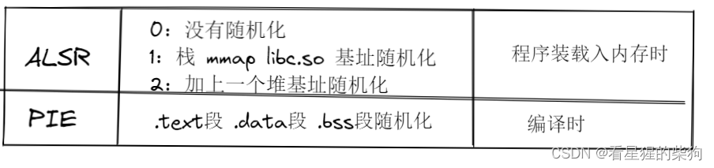


# 介绍
溢出是指向某个变量中写入的字节数超过了该变量本身所申请的字节数，从而导致与其相邻的变量的值被改变。
## 分类
栈溢出、BSS 段溢出、堆溢出等。

> gets() 函数从标准输入设备（键盘）读取字符串，直到遇到换行符为止；换行符会被丢弃，并在末尾添加 '\0' 字符。其调用格式为：gets(s); 其中 s 为字符串变量（字符串数组名或字符串指针）

# ASLR 与 PIE

# 技巧
## 危险函数
### 输入
gets() 函数从标准输入设备（键盘）读取字符串，直到遇到换行符为止；换行符会被丢弃，并在末尾添加 '\0' 字符。其调用格式为：gets(s); 其中 s 为字符串变量（字符串数组名或字符串指针）。

scanf 使用 %s 参数的格式化输入
[大佬对 scanf 的看法](https://blog.csdn.net/qq_54218833/article/details/121308367)

int vscanf ( const char * format, va_list arg );
将格式化数据读入可变参数列表
从标准输入（stdin）读取数据，并按照 format 参数将其存储到 arg 所标识的可变参数列表中各元素所指向的位置。
在内部，该函数如同使用 va_arg 一样从 arg 所标识的列表中获取参数，因此 arg 的状态很可能会被该调用改变。
无论如何，arg 都应在调用之前的某个时刻由 va_start 初始化，并应在调用之后的某个时刻由 va_end 释放。
### 输出
sprintf 等价于 fprintf()，区别在于其输出写入数组而不是流。写入的字符串末尾必须添加一个空字符
[大佬对 sprintf 的看法](https://blog.csdn.net/sdgsdgg/article/details/125453776)
### 字符串
strlen：计算字符串长度，直到空结束符为止，但不包括空结束符。
strcpy：字符串复制，遇到 '\x00' 停止
strcat：字符串拼接，遇到 '\x00' 停止
bcopy：bcopy() 函数不检查字符串中的空字节（NULL）
[bcopy 相关知识](https://blog.csdn.net/youbang321/article/details/7826333)
## 覆盖目标
**覆盖函数的返回地址——这种情况直接看 EBP 即可。
覆盖栈上某个变量的内容——这需要更精确的计算。
覆盖 BSS 段中某个变量的内容**

