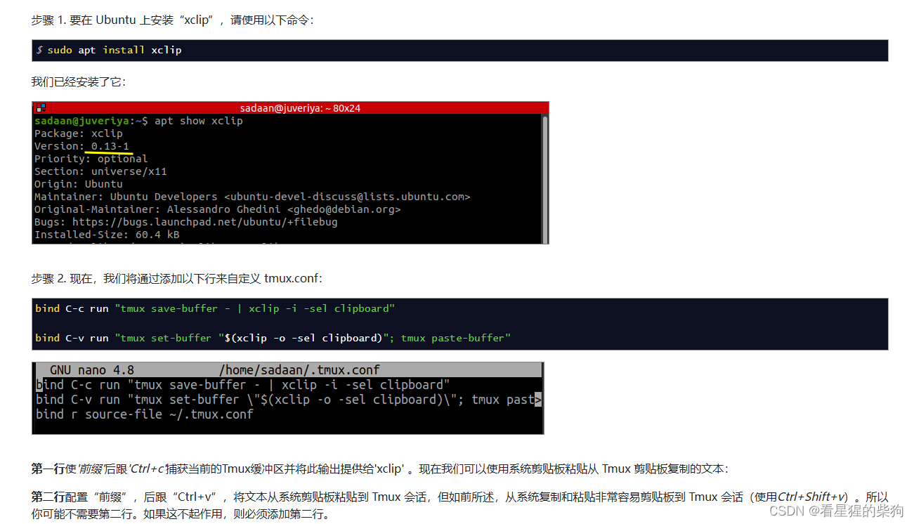

# 远程调试

不过目前我还不知道怎样实现一边跟随脚本的执行一边调试

# docker pull 失败

[https://wiki.bafangwy.com/doc/413/](https://wiki.bafangwy.com/doc/413/)

# 程序在 Docker 容器上无法运行

[https://blog.csdn.net/qq_46106285/article/details/124946919](https://blog.csdn.net/qq_46106285/article/details/124946919)

# 从宿主机远程调试运行在 Docker 中的程序

[https://www.roderickchan.cn/zh-cn/2023-02-13-%E4%BD%BF%E7%94%A8docker%E8%B0%83%E8%AF%95pwn%E9%A2%98/#0x3-%E4%BD%BF%E7%94%A8%E6%8A%80%E5%B7%A7](https://www.roderickchan.cn/zh-cn/2023-02-13-%E4%BD%BF%E7%94%A8docker%E8%B0%83%E8%AF%95pwn%E9%A2%98/#0x3-%E4%BD%BF%E7%94%A8%E6%8A%80%E5%B7%A7)

### 环境准备

1. **容器内的准备**：

   - **安装 gdbserver**：首先需要在 Docker 镜像中安装 `gdbserver`。通常的做法是在 Dockerfile 中加入相应的安装命令（例如对于基于 Debian 的镜像，使用 `RUN apt-get update && apt-get install -y gdbserver`）。
2. **宿主机上的准备**：

   - **安装 GDB**：确保宿主机上已安装 GDB；它是调试器的客户端部分，将用来远程控制运行在容器中的程序。
   - **可执行文件或符号文件**：宿主机需要有与容器中待调试程序对应的可执行文件或调试符号文件。这是因为 GDB 运行在宿主机上，需要这些信息来解析并显示调试信息。

### 调试步骤

1. **启动容器并映射端口**：   直接选用 roderick 的容器来调试
   [https://hub.docker.com/r/roderickchan/debug_pwn_env/tags](https://hub.docker.com/r/roderickchan/debug_pwn_env/tags)

```bash
docker run -it --rm -v host_path:container_path -p host_port:container_port --cap-add=SYS_PTRACE IMAGE_ID /bin/bash
```

2. **在容器中启动 gdbserver**：进入容器后，使用 `gdbserver` 附加到你想要调试的程序上，并指定监听端口。例如，如果你的程序名为 `my_program`，命令如下：

   ```bash
   gdbserver localhost:12345 my_program
   ```

   这会让 `gdbserver` 在容器中启动你的程序，并监听 2345 端口，等待来自 GDB 的连接。
3. **在宿主机上用 GDB 连接**：在宿主机上打开终端，使用 GDB 连接容器中的 `gdbserver`。你需要指定宿主机上的可执行文件路径（尽管它实际上运行在容器中）以及目标远程地址和端口：

   ```bash
   gdb -ex 'target remote 127.0.0.1:12345' /path/to/your_program
   ```

   `/path/to/your_program` 应当与容器中的是同一个程序的副本或符号文件，以确保 GDB 能够识别并加载正确的调试信息。
4. **开始调试**：连接成功后，你就可以在宿主机的 GDB 中设置断点、单步执行、查看变量等，就像直接在本机调试程序一样。

# 本地调试

**启动容器并映射端口**：   直接选用 roderick 的容器来调试
[https://hub.docker.com/r/roderickchan/debug_pwn_env/tags](https://hub.docker.com/r/roderickchan/debug_pwn_env/tags)

```bash
docker run -it --rm -v host_path:container_path -p host_port:container_port --cap-add=SYS_PTRACE --privileged IMAGE_ID /bin/bash
```

通过卷挂载 `-v host_path:container_path`，让在宿主机上对文件所做的修改也能在 docker 中生效；然后在 docker 中调试和运行，同时在宿主机上修改这个文件夹或文件

# bug

[Could not find a terminal binary to use. Set context.terminal to your terminal](https://blog.csdn.net/weixin_43483799/article/details/118757637)
然后在容器里直接运行 ./exp.py 就行

# pwngdb+tmux

```python
# 绑定Ctrl+a为新的指令前缀
set -g prefix C-a

# 从tmux v1.6版起，支持设置第二个指令前缀, 设置一个不常用的`键作为指令前缀，按键更快
set-option -g prefix2 `

# 修改分屏快捷键
unbind '"'
bind - splitw -v -c '#{pane_current_path}' # 垂直方向新增面板，默认进入当前目录
unbind %
bind | splitw -h -c '#{pane_current_path}' # 水平方向新增面板，默认进入当前目录

# 设置面板大小调整快捷键
bind j resize-pane -D 5
bind k resize-pane -U 5
bind h resize-pane -L 5
bind l resize-pane -R 5

# 刷新配置文件
bind R run-shell "tmux source-file ~/.tmux.conf"

# 上一个窗口
bind a last-window


```

[https://louiszhai.github.io/2017/09/30/tmux/](https://louiszhai.github.io/2017/09/30/tmux/)

- 先按下 Ctrl+a 并松开，再按 ?，就会显示帮助信息。然后按 ESC 或 q 退出帮助
- Ctrl+a <方向键>：把光标移动到另一个面板
- Ctrl+a hjkl：调整当前面板的大小
- Ctrl+a a：切换到上一个窗口
- Ctrl+a |：水平新增一个面板
- Ctrl+a -：垂直新增一个面板
- 复制：直接用鼠标选中内容即可
- 粘贴：Ctrl+a +]

# 从 Tmux 复制粘贴到其他地方

[https://cn.linux-console.net/?p=15192](https://cn.linux-console.net/?p=15192)


# pwngdb 与 tmux 的优化

[https://bbs.kanxue.com/thread-276203.htm](https://bbs.kanxue.com/thread-276203.htm)

# ~~用了大佬的镜像之后，感觉在宿主机上做 pwn 题已经没什么吸引力了~~
