# GDB 动态调试学习 - 1 - [信息显示、函数]


## 显示 gdb 版本信息
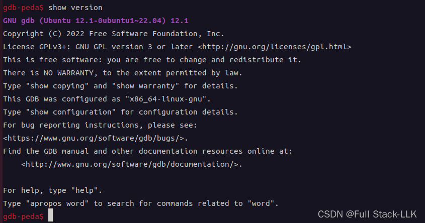
## 启动时不显示提示信息


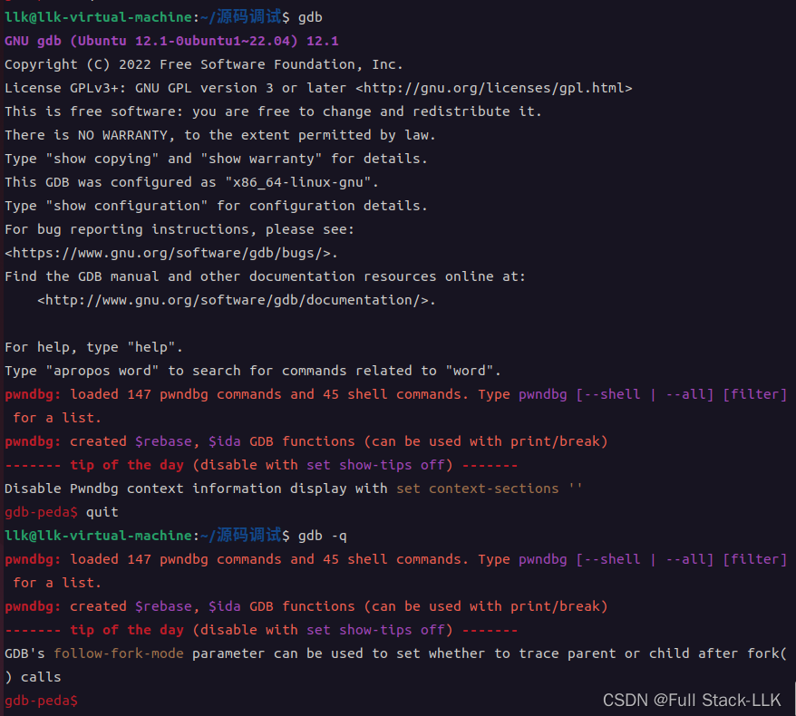
gdb 启动时会显示类似上面的提示信息。

如果不想显示这些信息，可以用 -q 选项关闭提示信息：

### .bashrc
.bashrc 是主目录下的一个 shell 文件，用于保存用户的个性化设置。每次 bash 启动时，都会加载 .bashrc 文件的内容，并根据其内容定制当前 bash 会话的配置和环境。
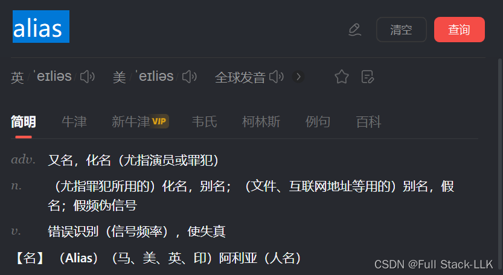
可以在 ~/.bashrc 中为 gdb 设置一个别名：

```bash
alias gdb="gdb -q"
```
### 关于 ~ 和 /
~ 是主目录
/ 是根目录
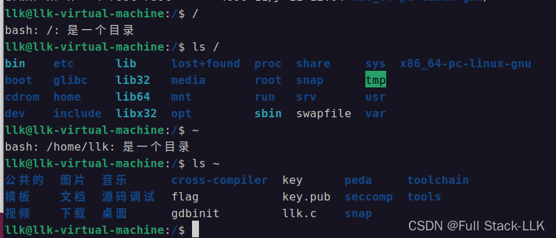
现在运行 gdb
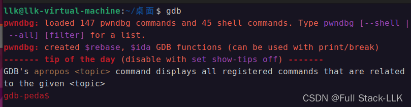
## 列出函数的名字
[参考链接](https://visualgdb.com/gdbreference/commands/info_functions)
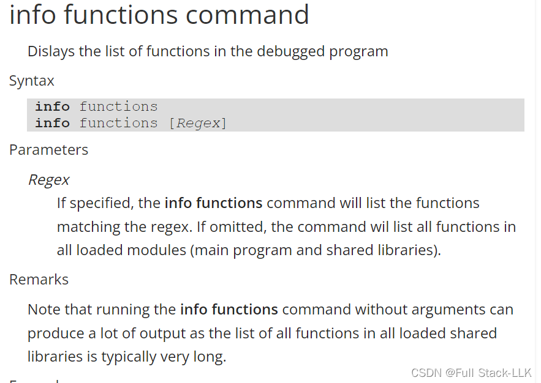

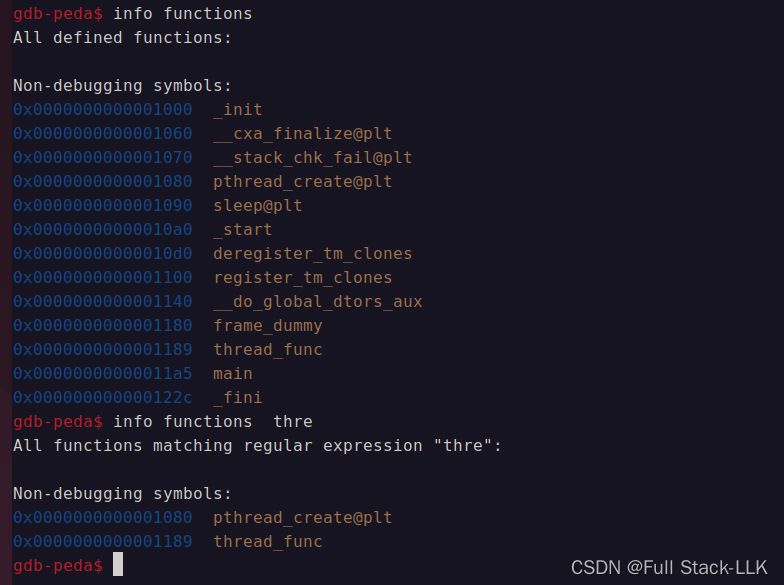
## 源码级单步执行
n/s 都是 C 语言级别的断点单步。s 会进入 C 函数内部，但不会进入没有调试信息的函数（例如编译时没加 -g 的代码，因为它没有 C 代码的行号标记，所以无法定位；可以执行 "set step-mode on" 命令，让 gdb 不跳过没有调试信息的函数，而是进入其汇编，之后可以用调试汇编程序的方法来调试该函数），而 n 不会进入。

简单来说，就是一行一行地执行源代码。

## 汇编级单步执行
ni/si 都是汇编级别的断点单步。si 会进入汇编和 C 函数内部，而 ni 不会。

简单来说，就是一行一行地执行汇编代码。


## si、ni、s、n 总结

总结：当需要进入并调试没有调试信息的库函数时，只能用 si。

进入有调试信息的函数时，si 和 s 都可以用，但两者不同：si 定位到汇编层面的第一条语句，而 s 进入 C 层面的第一条语句。
## 退出正在调试的函数
[参考链接](https://www-zeuthen.desy.de/unix/unixguide/infohtml/gdb/Returning.html)

```c
#include <stdio.h>

int func(void)
{
    int i = 0;

    i += 2;
    i *= 10;

    return i;
}

int main(void)
{
    int a = 0;

    a = func();
    printf("%d\n", a);
    return 0;
}
```

单步调试一个函数时，如果不想继续跟踪下去，有两种方式退出。

第一种是用 "finish" 命令，函数会继续执行直到结束，然后到达返回地址对应的指令位置。
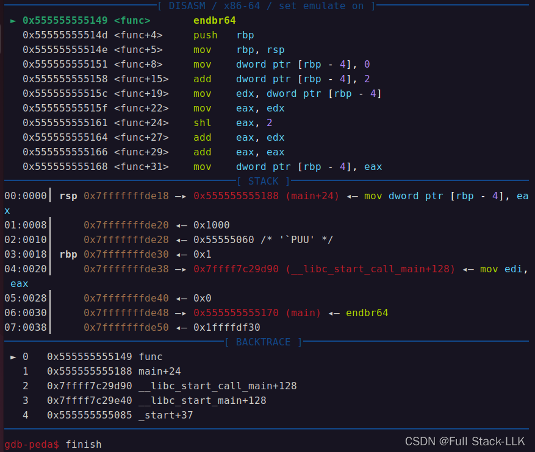
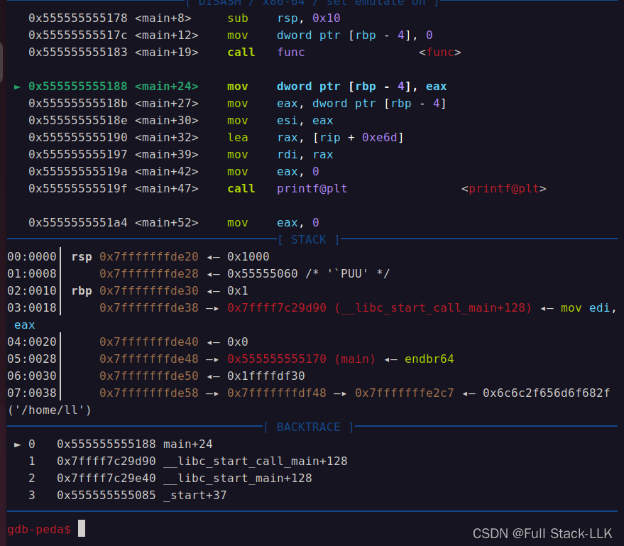
第二种是用 "return" 命令，函数不再继续执行后面的语句，而是直接返回。也可以用 "return expression" 命令指定函数的返回值。仍以上面的代码为例：
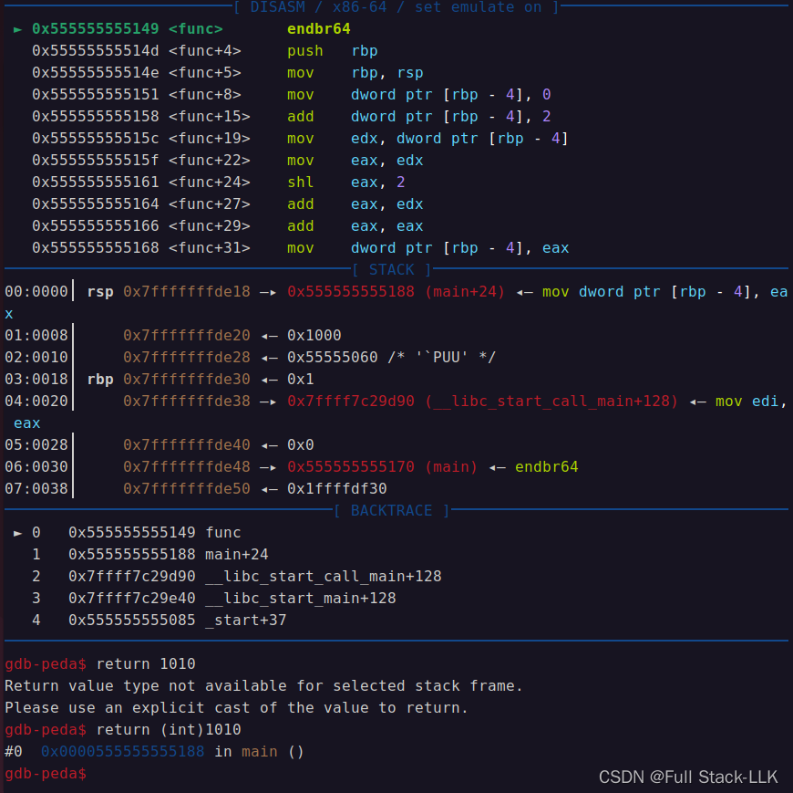
此时执行 return，返回地址对应指令处的寄存器信息与执行 return 时相同。
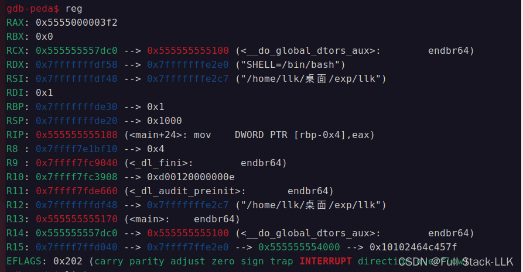


> 通常，所选栈帧是有调试信息的。有调试信息时，GDB 总是会使用调试信息，而不是表达式的隐式类型。例如，如果输入 return -1，而当前栈帧中的函数被声明为返回 long long int，gdb 会透明地把隐式 int 值 -1 转换为 long long int：


> 不过，如果所选栈帧没有调试信息——例如函数编译时没有带调试信息——gdb 就必须从用户那里得知要返回的类型。错误地指定了不同的类型，可能会把值设置到与调用者代码预期不同的从属寄存器中。例如，对一个调试信息较少的函数（在 32 位架构上）输入 return -1，其隐式类型为 int，只会设置 long long int 结果的一部分。因此，用户需要通过适当的强制类型转换显式指定返回类型：


## 直接执行函数
在执行函数方面，call 和 print 没有区别。

```c
#include <stdio.h>

int global = 1;

int func(void) 
{
	return (++global);
}

int main(void)
{
	printf("%d\n", global);
	return 0;
}
```

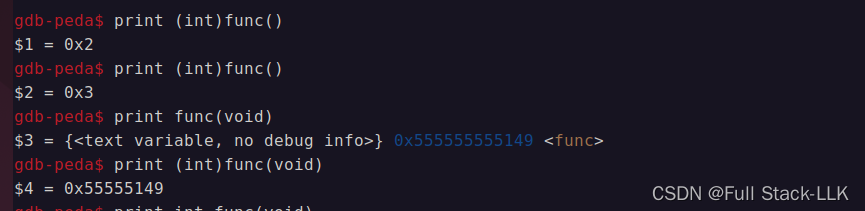
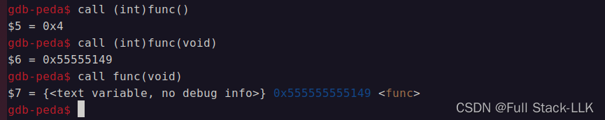
## 打印函数栈帧信息

```c
#include <stdio.h>
int func(int a, int b)
{
	int c = a * b;
	printf("c is %d\n", c);
}

int main(void) 
{
	func(1, 2);
	return 0;
}
```

为了方便用户在调试程序时查看某个栈帧中记录的信息，gdb 调试器提供了 frame 和 backtrace 命令。

在 Linux 上用 gdb 调试时，经常需要查看函数栈帧信息。

bt（backtrace 的缩写）命令：查看栈上当前函数之上各函数的栈信息。

i frame（info frame 的缩写）命令：查看当前正在调试的函数的栈帧信息，这种方式查看到的栈信息更详细。


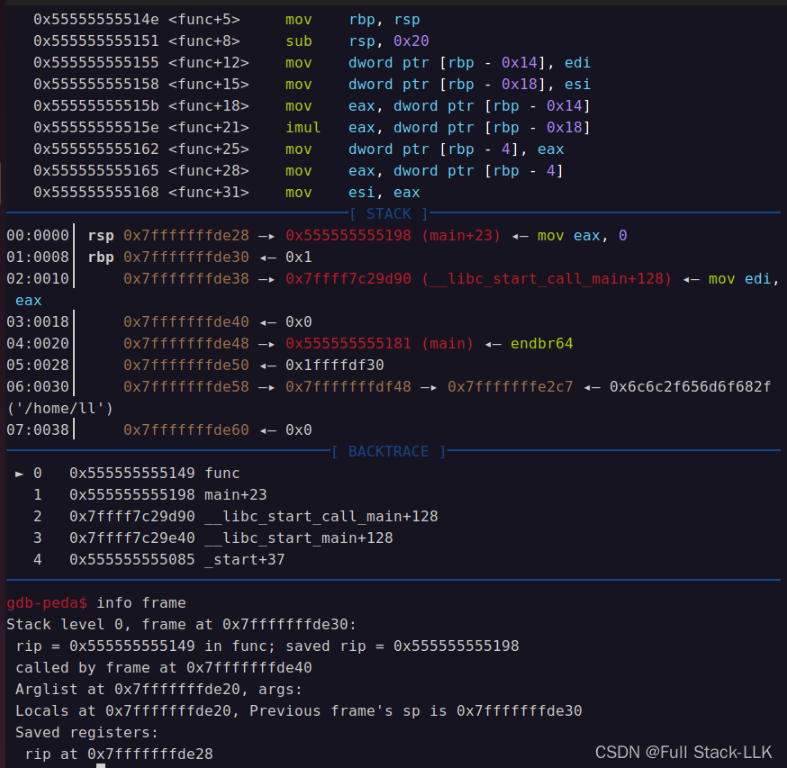
它会输出当前函数栈帧的地址、指令寄存器的值、局部变量的地址和值等信息。

## 打印尾调用栈帧信息

```c
#include<stdio.h>
void a(void)
{
        printf("Tail call frame\n");
}

void b(void)
{
        a();
}

void c(void)
{
        b();
}

int main(void)
{
        c();
        return 0;
}
```
当一个函数的最后一条指令是调用另一个函数时，开启了优化选项的编译器常常会把最后被调用函数的返回值直接作为调用者的返回值，这叫做“尾调用”。以上面的程序为例，编译程序（使用 '-O'）：
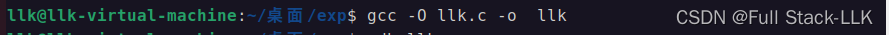

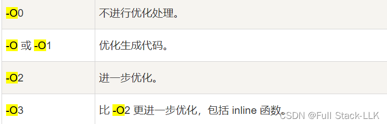
可以看到 main 函数直接调用了函数 a。
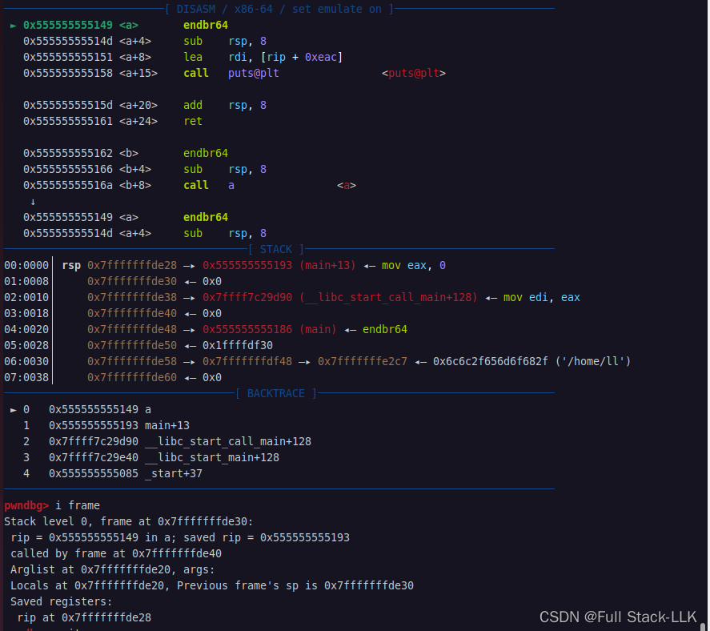
可以把 "debug entry-values" 选项设置为非零值，这样除了输出正常的函数栈帧信息外，还能输出与尾调用相关的信息；但这与程序编译时是否带 -g 参数有关。

不带 -g 编译
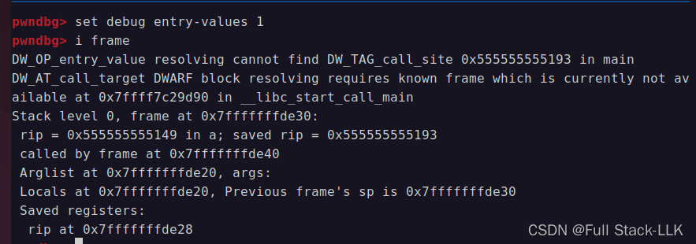
带 -g 编译
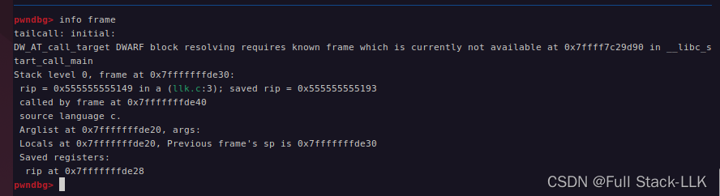


## 选择函数栈帧

```c
#include <stdio.h>

int func1(int a)
{
        return 2 * a;
}

int func2(int a)
{
        int c = 0;
        c = 2 * func1(a);
        return c;
}

int func3(int a)
{
        int c = 0;
        c = 2 * func2(a);
        return c;
}

int main(void)
{
        printf("%d\n", func3(10));
        return 0;
}
```
可以用 "frame n" 命令选择函数栈帧，其中 n 是层号。然后可以通过 info frame 查看所选的函数栈帧，也可以直接用 frame 查看当前选中的栈帧，只是信息的显示格式不同。


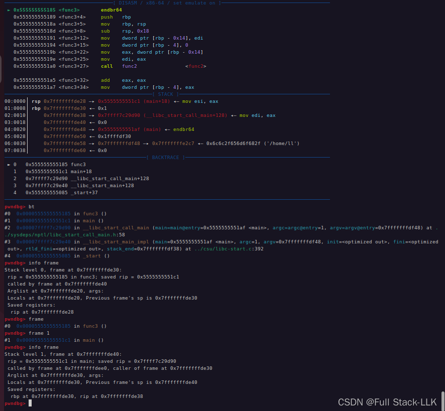
## 向上或向下切换函数栈帧

```c
#include <stdio.h>

int func1(int a)
{
        return 2 * a;
}

int func2(int a)
{
        int c = 0;
        c = 2 * func1(a);
        return c;
}

int func3(int a)
{
        int c = 0;
        c = 2 * func2(a);
        return c;
}

int main(void)
{
        printf("%d\n", func3(10));
        return 0;
}
```

可以用 "up n" 或 "down n" 命令向上或向下选择函数栈帧，其中 n 是层数。以上面的程序为例：
up 使帧号加 1，down 使帧号减 1。
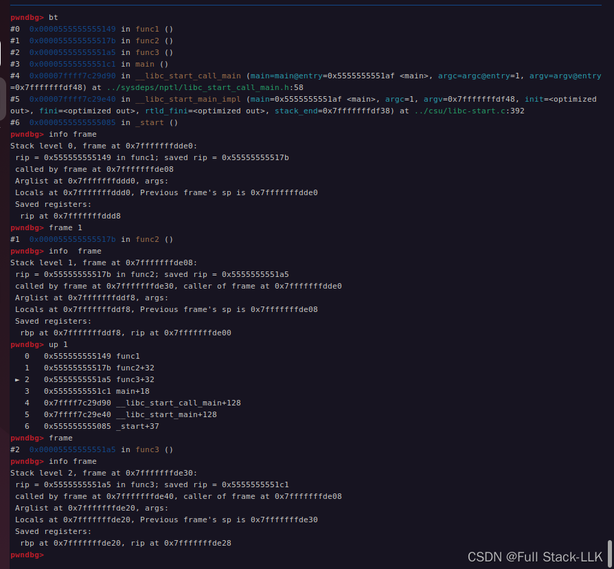
"up-silently n" 和 "down-silently n" 这两个命令与 "up n" 和 "down n" 的区别在于，切换栈帧后不打印任何信息。仍以上面的程序为例：
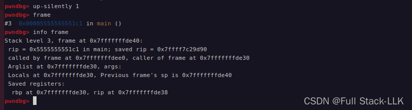


# GDB动态调试学习-2-［断点］


## 在程序地址上打断点
当调试汇编程序，或者没有调试信息的程序时，经常需要在程序地址上打断点，使用 b *address。例如：
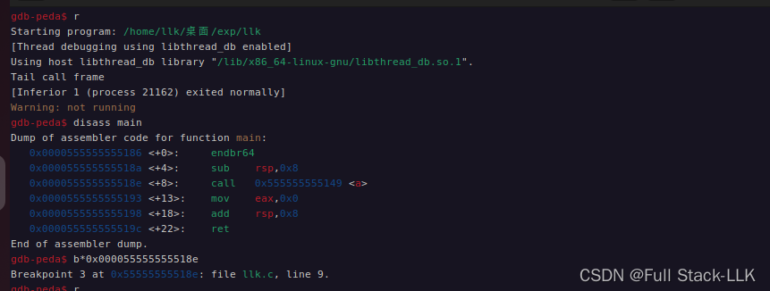
在断点位置停了下来
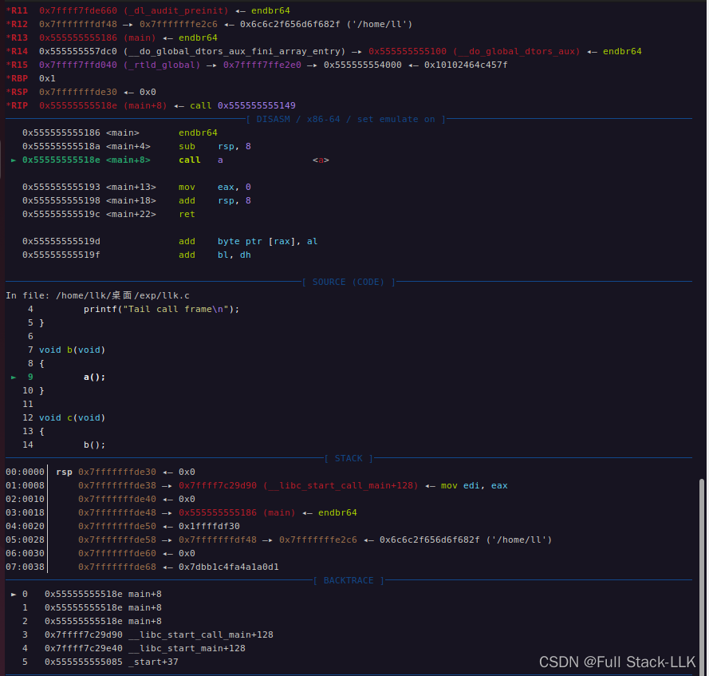
## 在程序入口处打断点
### 获取程序入口地址


```bash
readelf -h  可执行文件名
```

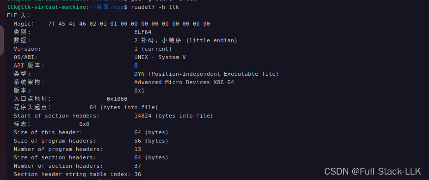

```bash
info files
```

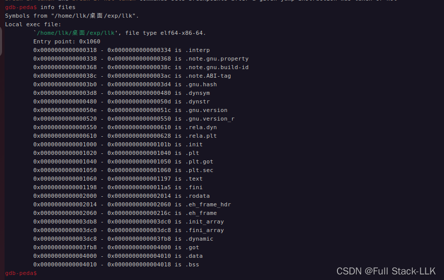
先运行程序，再执行 **info file**
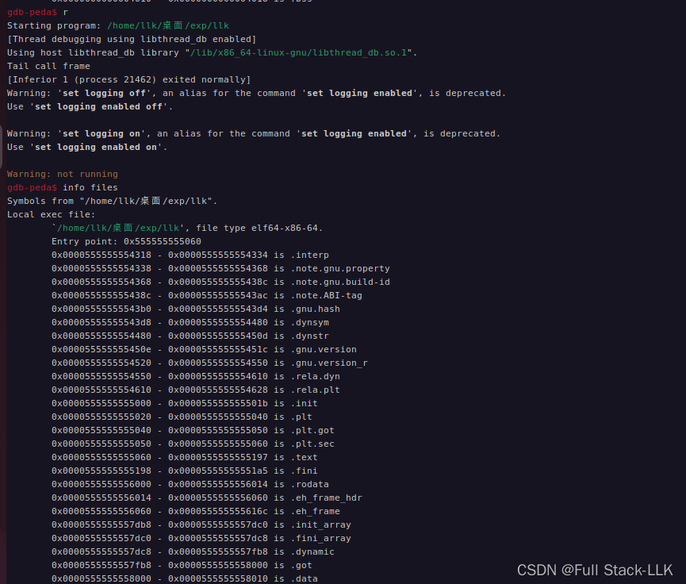
注意程序入口地址就是 _start 函数的起始地址
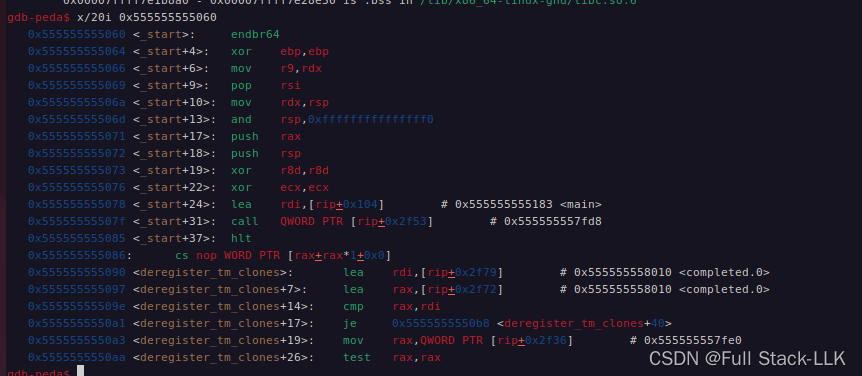


>  start 命令用于启动程序，它完全等价于先在 main() 函数开头打一个断点，再用 run 命令启动程序。


> 另外，在程序运行过程中使用 run 或 start 命令，表示重新启动程序。

## 在命名空间中打断点
### 命名空间

> 命名空间（英语：Namespace），也称名字空间、名称空间等，它表示着一个标识符（identifier）的可见范围。一个标识符可在多个命名空间中定义，它在不同命名空间中的含义是互不相干的。这样，在一个新的命名空间中可定义任何标识符，它们不会与任何已有的标识符发生冲突，因为已有的定义都处于其他命名空间中。

> 例如，设Bill是X公司的员工，工号为123，而John是Y公司的员工，工号也是123。由于两人在不同的公司工作，可以使用相同的工号来标识而不会造成混乱，这里每个公司就表示一个独立的命名空间。如果两人在同一家公司工作，其工号就不能相同了，否则在支付工资时便会发生混乱。
###  给命名空间中的函数打断点

```c

namespace Foo
{
  void foo()
  {
  }
}

namespace
{
  void bar()
  {
  }
}
int main()
{


  return 0;
}
```

```bash
info functions     查看函数
```

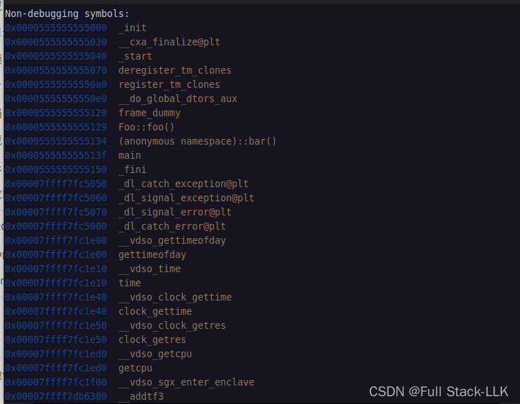

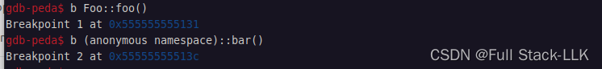
## 在文件行号上打断点
这种情况下编译时要带调试信息 -g
并且 linenum 对应的是 main 函数所在源文件的第几行
```bash
b linenum或者b file:linenum
```
## 保存已经设置的断点
在 GDB 中，你可以使用 save 命令来保存你的断点。以下是使用该命令的步骤：

- 首先，你需要设置你想要的断点。可以使用 break 命令来设置断点。例如，如果你想在函数 foo 上设置断点，可以输入 break foo。

- 设置好断点后，可以使用 info breakpoints 命令查看你设置的所有断点。

- 最后，可以使用 save 命令来保存你的断点。你可以选择保存到特定文件中，例如 save breakpoints my_breakpoints 会把断点保存到 my_breakpoints 文件中。

> 注意：save 命令会保存所有断点，而不仅仅是你刚刚设置的那个。

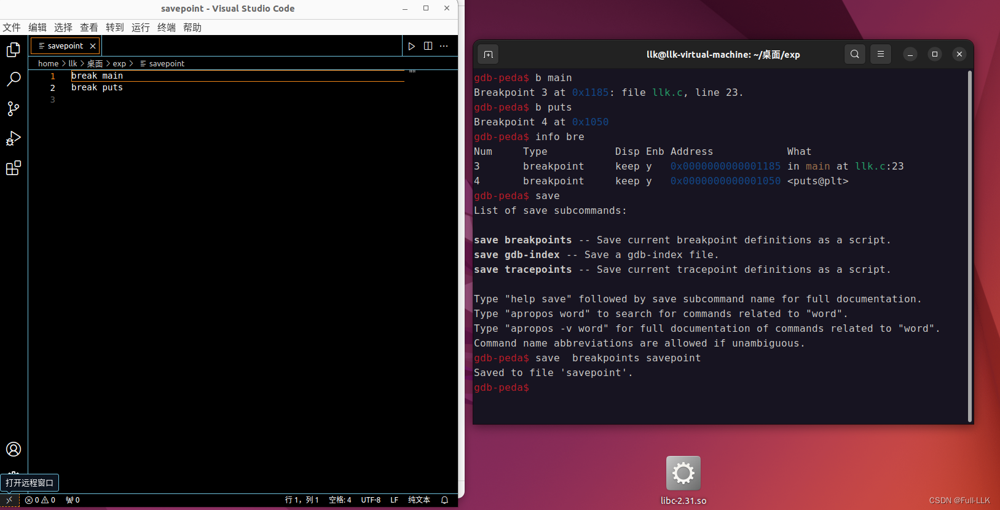

在 GDB 中，source 命令用于把一个文件当作 GDB 命令序列来执行。

source 命令非常有用，尤其是在你需要重复执行一系列复杂命令的时候。你可以把这些命令写入一个脚本文件中，然后使用 source 命令来执行该文件中的命令，这样可以大大提高调试效率。例如，如果你有一个包含多个断点和观察点的复杂调试会话，你可以把所有设置保存到一个脚本中，下次调试时只需加载该脚本即可。

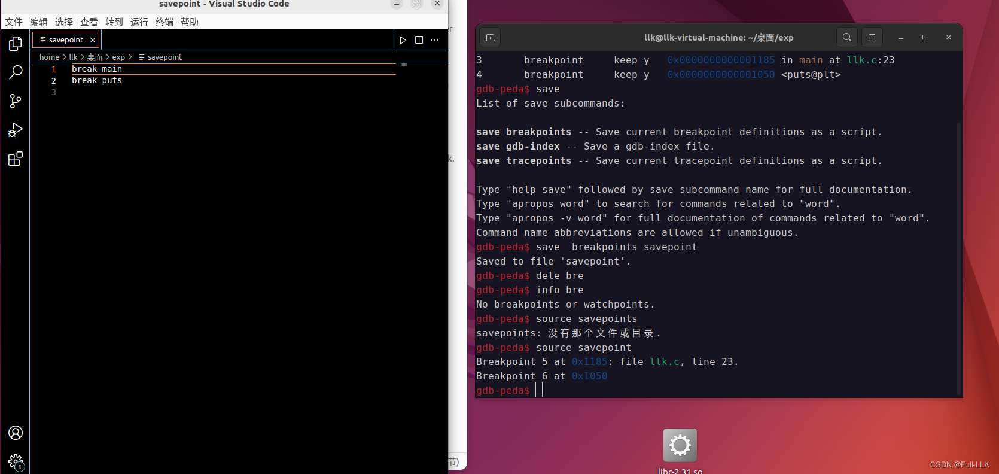
## 设置临时断点
在使用 gdb 时，如果想让断点只生效一次，可以使用“tbreak”命令（缩写为：tb）。
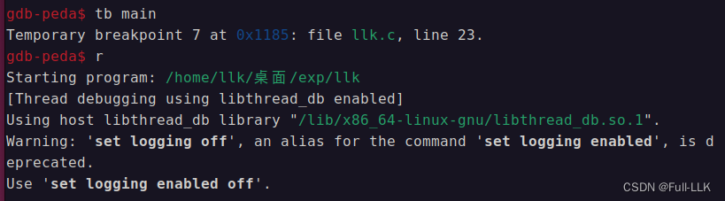
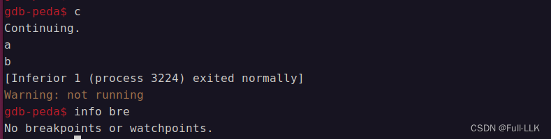
## 设置条件断点

```c
/* a/file.c */
#include <stdio.h>

void print_a (void)
{
  puts ("a");
}

/* b/file.c */
#include <stdio.h>

void print_b (void)
{
  puts ("b");
}

/* main.c */
extern void print_a(void);
extern void print_b(void);

int main(void)
{
  int i=1;
  print_a();
  print_b();
  i=2;
  return 0;
}
```
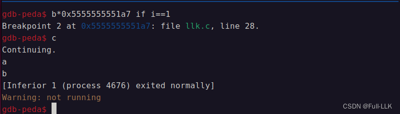

在 GDB 中，可以使用 break 命令设置条件断点。条件断点允许你指定一个表达式，只有当表达式的值为真时，程序才会在该位置停下来。

**执行到断点时断点是否生效，取决于执行到该断点那一刻条件是否满足，而不是设置断点时条件是否满足**

以下是设置条件断点的步骤：

1. 首先，你需要设置你想要的断点。可以使用 break 命令来设置断点。例如，如果你想在函数 foo 上设置断点，可以输入 break foo。

2. 然后，可以使用 condition 命令为该断点添加条件。例如，如果你只想在变量 x 大于 10 时在该断点处停止执行，可以输入 condition 1 x>10。

3. 最后，可以使用 info breakpoints 命令查看你设置的所有断点及其条件。

**注意：如果条件表达式的结果为假，程序不会在该位置停下来。另外，可以使用 commands 命令指定条件满足时要执行的命令序列。**
### commands 命令
在 GDB 中，commands 命令确实可以指定一组命令，在程序每次运行到某个断点时自动执行。以下是 commands 命令的使用方法：

指定断点：首先，你需要一个已经设置好的断点，可以使用 break 命令来设置。例如，break main 会在 main 函数处设置一个断点。
添加命令：然后，可以使用 commands 命令加上断点编号，为该断点添加要执行的命令。例如，如果你想在断点 1 处打印变量 x 的值并继续执行程序，可以输入：
        
```bash
commands 1
silent
print x
continue
end

```
这里，silent 命令用于阻止 GDB 显示 continue 命令的提示信息。
查看断点：最后，可以使用 info breakpoints 命令查看你设置的所有断点及其关联的命令。
另外，你可以把 commands 命令与条件断点结合使用，在特定条件下执行一系列命令。例如，如果你想在变量 x 大于 10 时在某个断点处打印 x 的值，可以设置如下命令：

```bash
break 2 if x > 10
commands 2
silent
print x
continue
end
```

    
这样，commands 命令可以帮助你在调试过程中自动完成一些重复性的工作，从而提高调试效率。


## 忽略断点

```c
#include <stdio.h>
	
int main(void)
{
        int i = 0;
		int sum = 0;

		for (i = 1; i <= 200; i++)
		{
			sum += i;
		}
	
		printf("%d\n", sum);
        return 0;
}
```

在设置断点后，可以用“ignore bnum count”命令忽略该断点：意思是接下来 count 次编号为 bnum 的断点触发都不会让程序中断，只有第 count + 1 次及之后的断点触发才会让程序中断。以上面的程序为例：
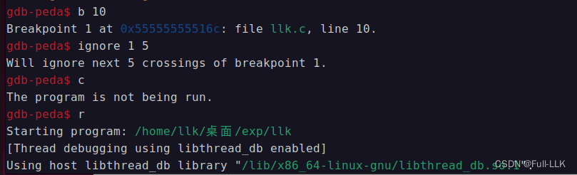
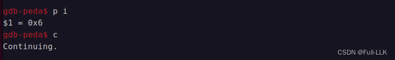

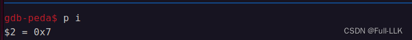

