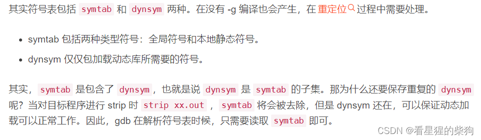
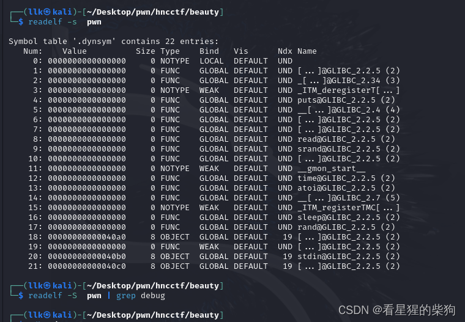
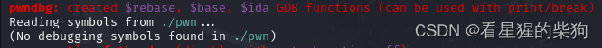
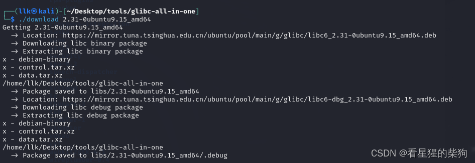
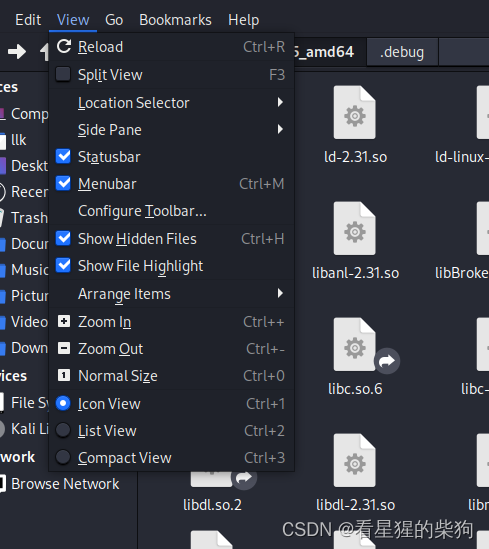
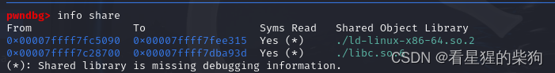
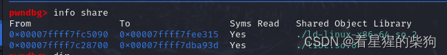
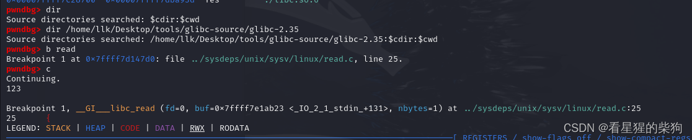
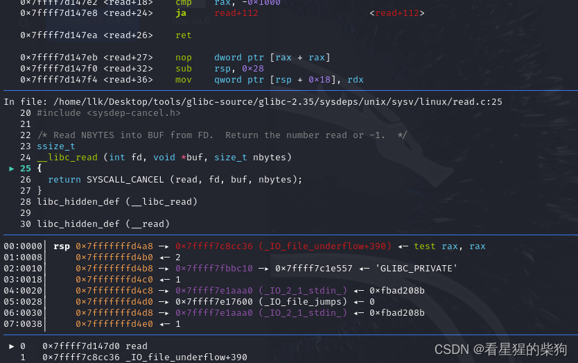



# 调试信息

调试信息是在编译或构建程序时生成的额外数据，用于帮助开发者在调试时理解代码的执行流程和状态。这些信息不直接影响程序的功能，但在调试阶段至关重要。调试信息通常包含以下内容：

- **源代码行号**：对应每段可执行代码的源代码位置，使调试器能够在源代码中定位确切的执行点。
- **局部变量和函数参数的名称与类型**：使调试时可以查看和修改变量的值。
- **源代码路径**：帮助调试器找到原始源文件，以便显示代码上下文。
- **编译器宏定义**：有助于理解代码中条件编译的部分。
- **程序的静态结构信息**：如类、结构体、枚举等的定义，有助于理解数据结构。

有了这些信息，调试器就能提供丰富的上下文视图，使开发者能够单步执行代码、设置断点、查看和修改变量值，从而追踪错误的根源。

# 符号表


符号表是编译器或汇编器在编译过程中创建的一种数据结构。它存储程序中定义的所有符号（如变量名、函数名、类名等）及其对应的地址或内存位置。符号表的主要用途包括：

- **地址解析**：生成目标代码时，把源代码中的符号引用转换为目标代码中的实际地址。这对链接过程尤为重要，因为它帮助链接器解析外部引用。
- **辅助调试**：提供给调试器，使其能够根据符号名查找变量或函数的确切内存地址，进而查看或修改其值，或跳转到特定函数的开头执行。
- **错误报告**：编译时的错误和警告信息通常会引用符号表中的符号名，从而提供更易理解的错误描述。
- **性能分析**：在性能分析工具中，符号表帮助把内存地址映射回源代码中的符号，便于了解哪些函数或代码块消耗了更多资源。

#  `.symtab` 与 `.dynsym`

在 ELF（Executable and Linkable Format，可执行与可链接格式）文件结构中，`.symtab`（符号表）和 `.dynsym`（动态符号表）存储着用途不同的符号信息。下面通过例子详细说明这两种符号表的区别。
### `.symtab`（符号表）

`.symtab` 包含程序中的所有符号信息，无论是局部（静态）符号还是全局符号。这些符号信息用于在链接阶段解析符号引用，运行时也可能用于调试目的。这里的“局部静态符号”指只在当前编译单元内可见的符号，而“全局符号”是在整个程序中都可以访问的符号。

**例子**：
假设有一个 C 程序，包含两个源文件：`main.c` 和 `helper.c`。`helper.c` 中定义了一个全局函数 `void helper_function()`，并在 `main.c` 中被调用。在这种情况下：

- `helper_function` 的符号信息作为全局符号出现在 `.symtab` 中，因为它跨编译单元可见。
- 假设 `main.c` 中还有一个局部静态变量 `static int local_var;`，它的符号信息也会被加入 `.symtab`，但作为局部静态符号，它只在编译 `main.c` 时可见，不会暴露给链接后程序的其他地方。

### `.dynsym`（动态符号表）

相比之下，`.dynsym` 只包含动态链接时需要的符号，如从动态库导出的函数和全局变量。动态链接器（如 Linux 上的 `ld.so`）在程序启动时使用 `.dynsym` 来解析程序引用的动态库中的符号。

**例子**：
如果你的程序使用了 `libm.so`（数学库）中的 `sin()` 函数，那么 `sin` 的符号信息会出现在 `.dynsym` 中而不是 `.symtab` 中。这是因为 `sin` 函数由动态库提供，只有在程序运行时，动态链接器才需要知道去哪里找这个函数的实现。

### 总结

- `.symtab` 是全面的，包含程序中的所有符号信息，既包括局部静态符号也包括全局符号，主要用于链接和调试。
- `.dynsym` 则更精简，只记录动态链接过程中需要的那些符号；这些符号通常属于动态链接库，或者是需要被其他共享对象链接的全局符号。


# 编译相关选项
[https://workerwork.github.io/posts/sub-bin/](https://workerwork.github.io/posts/sub-bin/)


#  实际调试

## 检查是否有符号表或调试信息
```bash
readelf -S  vuln  | grep debug #查看是否有调试信息
readelf -s vuln #查看是否去除符号表           

```
确实，`.symtab` 和 `.dynsym` 是 ELF（Executable and Linkable Format）文件中两个重要的节。它们各自扮演不同的角色，共同服务于程序的链接和运行时符号解析过程。下面简要说明这两个节，以及它们如何帮助我们查看 libc 或其他库中变量的类型。

- **.symtab（静态符号表）**：这是一个完整的符号表，包含程序中所有的符号定义和引用，无论是局部符号、全局符号还是外部符号。它主要用于链接时的符号解析和调试目的。`.symtab` 包含符号的名称、类型（如函数、对象、TLS 等）、在文件中的地址，以及符号的绑定属性（局部或全局）。静态链接器利用这些信息解析未定义的符号引用。不过，在程序运行时，`.symtab` 并不直接用于动态链接，所以在生成程序的最终发布版本时，通常会用 `strip` 命令将其去除以减小文件体积。

- **.dynsym（动态符号表）**：这个节只包含动态链接所需的信息，即运行时可能需要从共享库中解析的全局符号和外部符号。`.dynsym` 不包含局部符号，因为它关注的是跨模块边界的符号查找。在程序执行过程中，动态链接器会查阅这张表来定位和加载共享对象中定义的符号。`.dynsym` 同样记录了符号的类型和地址，这对动态库尤为重要。


符号表（`.symtab`）已被去除，也没有调试信息。



调试符号是编译器在编译程序时生成并嵌入到可执行文件或库文件中的一系列信息。它们主要用于提供源代码级的调试信息，使调试器（如 GDB）能够：

- 显示源代码行号与指令之间的对应关系，让你知道每条机器指令对应哪一行源代码。
- 显示变量名及其在内存中的位置，包括局部变量、全局变量和结构体成员等，这对观察和修改变量值至关重要。
- 提供函数名及其在内存中的地址，有助于设置断点和追踪函数调用栈。
- 呈现类型信息，这对理解复杂数据结构以及正确显示复杂类型（如结构体和类）的内容尤为重要。


缺少调试符号时，虽然有些调试器仍然可以加载并运行程序，但很多高级调试功能（如列出源代码、查看变量值等）将不可用或受限，使调试过程更加困难。

## 从 glibc-all-in-one 下载不同版本的 glibc 二进制库和调试信息
`libc6_2.31-0ubuntu9.15_amd64.deb` 和 `libc6-dbg_2.31-0ubuntu9.15_amd64.deb` 都是 Debian 软件包格式的二进制包文件，即 `.deb` 文件。它们包含预编译的二进制代码、库文件、配置文件和其他支持文件，旨在简化软件的安装和管理过程。用户无需从源代码编译，可以直接用包管理器（如 APT）安装这些包。

- `libc6_2.31-0ubuntu9.15_amd64.deb` 包含 GNU C 库（glibc）的共享库文件，这是许多 Linux 程序运行所需的基础库。
  
- `libc6-dbg_2.31-0ubuntu9.15_amd64.deb` 包含与 glibc 相关的调试符号信息，这对开发和调试使用这些库的应用程序非常重要，因为它使调试器（如 GDB）能够提供详细的栈回溯、变量值和源代码级调试信息。



它们被下载到 libs/2.31-0ubuntu9.15_amd64 和 libs/2.31-0ubuntu9.15_amd64/.debug 中；需要显示隐藏文件才能看到。



## 导入调试信息


> 感谢 flyyy 师傅的指点，不然我都忘了导入调试信息的命令和导入源码搜索路径的命令是不一样的，害我之前用 dir 试了半天都不行。

```bash
show debug-file-directory
set debug-file-directory /home/llk/Desktop/tools/glibc-all-in-one/libs/2.35-0ubuntu3.7_amd64/.debug/
info share 再次查看发现导入成功
```

## 下载源码
[https://mirrors.tuna.tsinghua.edu.cn/gnu/glibc/?spm=5176.28103460.0.0.4a8b3da2UN07VI](https://mirrors.tuna.tsinghua.edu.cn/gnu/glibc/?spm=5176.28103460.0.0.4a8b3da2UN07VI)
[https://ftp.gnu.org/gnu/glibc/?spm=5176.28103460.0.0.4a8b3da2UN07VI](https://ftp.gnu.org/gnu/glibc/?spm=5176.28103460.0.0.4a8b3da2UN07VI)

```bash
 directory 源码路径
```
## 导入源码

当 GDB 或其他调试器提示缺少调试信息时，即使你有源代码文件，调试器在运行时也无法把执行的指令准确映射到源代码行。没有调试信息时，你可能只能看到汇编代码（通过 `disassemble` 命令），无法直接跳转到或查看具体的 C 源代码行。





