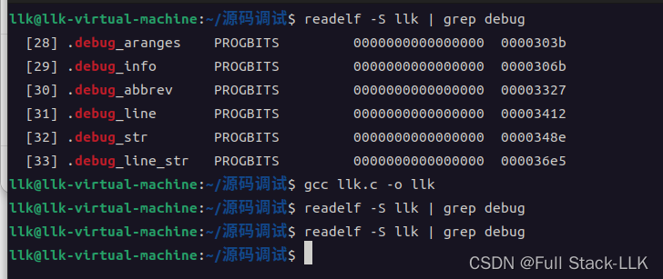
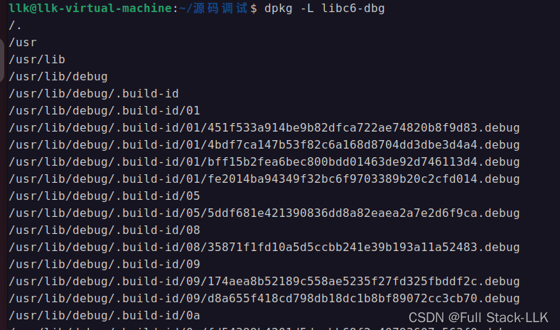


# 参考资料
[gdb 源码级调试 libc](https://xuanxuanblingbling.github.io/ctf/tools/2020/03/20/gdb/)
[查看是否为 debug 模式编译](https://blog.csdn.net/gong_xucheng/article/details/23996145)

[使用 gcc 生成动态库及动态库的使用方法](https://blog.csdn.net/lzg_zone/article/details/83541906)
# 查看源码是否用 -g 编译
用 -g 编译的可执行文件会多出许多以 .debug 开头的节
不用 -g 编译的则没有



# 调试信息与符号表
这里的调试信息指 debug_* 相关的信息；符号表指 symtab 和 dynsym。

只有用 -g 选项编译时才会产生调试信息。

符号表实际上有两种：symtab 和 dynsym，即使不加 -g 也会产生，因为重定位时需要用到它们。
- symtab 包含两类符号：全局符号和局部静态符号。
- dynsym 只包含加载动态库所需的符号。
#   剥离符号表
剥离符号表通常是指删除程序中包含的符号信息，以减小程序体积或出于安全/隐私考虑。符号信息通常包括函数名、全局变量名和静态变量名。可以用 strip 这样的工具完成，它会删除可执行文件和目标文件中的所有符号信息。

例如，对于用 gcc 编译的 C 程序，可以这样剥离符号表：

```bash

gcc -g -o my_program my_program.c
strip --strip-all my_program
 
```

用上面的命令编译并剥离符号后，my_program 会丢失所有符号信息，调试难度大大增加。没有符号表，gdb 就无法按函数名或变量名设置断点、查看变量值。在逆向工程中，由于缺少符号信息，分析剥离过的程序也更加困难。

注意，strip 只删除符号表，不会删除 -g 选项生成的调试信息，这些信息存放在程序的其他部分。如果想把调试信息和符号表一起删除，需要使用不同的 strip 选项，或者编译时不加 -g。例如：

```bash
strip --strip-debug my_program
```

 
这条命令会删除文件中的调试信息，而不仅仅是符号表
# 如果用 -g 编译但剥离了符号表，还能进行源码级调试吗（看到执行的每条汇编指令对应哪一行源码）？
用 -g 选项编译程序时，调试信息会被加入可执行文件，其中包括源代码的行号信息。如果之后用工具（如 strip）删除了符号表，但没有删除 .debug 节中的调试信息，那么理论上仍然可以在 gdb 中进行一定程度的源码级调试。这是因为源代码行号信息通常存放在调试节中，而不是符号表中。

即使删除了符号表，只要 .debug 调试信息节还在，gdb 应该仍能把汇编指令映射到源代码行号。这意味着在某些情况下，单步执行程序时确实可以看到每条汇编指令对应哪一行源码。

不过，删除符号表会带来以下限制：

- 无法用函数名或变量名设置断点，因为这些信息通常存放在符号表中。
- 查看和操作变量会变得非常困难，尤其是局部变量和静态变量，因为解析它们需要符号表中的数据。


# 在 gdb 中加载调试信息
[参考链接](https://bbs.kanxue.com/thread-254868.htm#msg_header_h1_0)
用 GDB 调试时不太容易看到 libc 中的各种结构体，因此需要加载符号表来方便调试。

Ubuntu 的软件包维护者在编译相应的 ELF 文件时，会把符号表从 ELF 文件中分离出来，并把符号包命名为 "*-dbg.deb"。这样我们就可以手动下载符号表，方便调试。

如果使用的是 "glibc all in one" 下载的 libc，libc 的符号表存放在与 libc 库同目录的 ".debug" 文件夹中，gdb 可以自动加载。但遇到 "glibc all in one" 中没有的 libc 版本时，就需要手动下载 debug 文件并手动加载。

## 把 debug 文件放入 ".debug" 文件夹
在 libc 所在目录下新建一个 ".debug" 文件夹，把 debug 文件放进去。

## 使用 gdb 命令 set debug-file-directory directories
需要把 libc 及其他库的 debug 文件放到对应的文件夹中，然后用 set debug-file-directory $directories 命令把该文件夹设置为独立调试文件目录，这样 gdb 就能加载 debug 文件。

# [GCC 中 gcc 与 g++ 的区别](https://www.cnblogs.com/samewang/p/4774180.html)
GCC：GNU 编译器套件（GNU Compiler Collection），可以编译 C、C++、JAV、Fortran、Pascal、Object-C、Ada 等语言。

gcc 是 GCC 中的 GNU C Compiler（C 编译器）

g++ 是 GCC 中的 GNU C++ Compiler（C++ 编译器）

一个有趣的事实：本质上，gcc 和 g++ 并不是编译器，也不是编译器的集合，它们只是驱动程序，根据参数中给出的待编译文件类型调用相应的 GNU 编译器。例如，用 gcc 编译一个 c 文件包括以下几步：

Step1：调用预处理器，如 cpp。

Step2：调用真正的编译器，如 cc 或 cc1。

Step3：调用汇编器，如 as。

Step4：调用链接器，如 ld

由于编译器是可以替换的，gcc 能编译的不只是 C 文件

所以更准确地说：gcc 调用的是 C 编译器，而 g++ 调用的是 C++ 编译器


# 用指定版本的 gcc/g++ 和 glibc 编译
不同版本的 GCC 实现了不同版本的 C 和 C++ 标准库，这对代码兼容性有一定影响。各个 gcc 版本与标准库版本的对应关系可以在官方文档中查到。使用不同版本的标准库可能导致代码的编译和行为不同，甚至出错。因此，写代码时应该清楚自己使用的是哪个版本的标准库，避免使用已废弃或不再维护的标准库。

## 指定 gcc/g++ 版本

```bash
export CC=gcc的路径
export CXX=g++的路径

```
## 指定 glibc 和 ld 版本

设置 LD_LIBRARY_PATH 环境变量，添加一个默认的库搜索路径，使我们提供的目录中的 libc 被优先匹配

通过 gcc 的 -L 选项指定 glibc 库（libc.so）的路径

在 gcc 的编译选项中指定 -Wl,–dynamic-linker=glibc 中动态链接器的路径，如下：

```c
-Wl,--dynamic-linker=/动态连接器的路径/ld-linux-x86-64.so.2

```

# apt 安装的软件在哪里
[参考链接](https://blog.csdn.net/u013797029/article/details/44492677)

dpkg -L +软件包名 可以知道该软件包包含哪些文件；这个方法会列出安装后留在系统中的所有文件，可以用来查询已安装的软件包把文件放在了哪里。
系统安装的软件一般放在 /usr/share，可执行文件放在 /usr/bin，配置文件可能放在 /etc，等等。


文档一般放在 /usr/share

可执行文件：/usr/bin

配置文件：/etc

lib 文件：/usr/lib
# gdb 搜索独立调试文件的路径
[参考链接](https://zhuanlan.zhihu.com/p/669022391)

gdb 搜索独立调试文件的路径为：

1. 当前文件所在的目录。
2. 当前文件所在目录下的 .debug 目录。
3. debug-file-directory 设置的目录；查找当前可执行文件的调试信息时会结合文件的实际路径。（例如，debug-file-directory 为 /usr/lib/debug，可执行文件位于 /home/test/example，那么 gdb 会在 /usr/lib/debug/home/test/ 下查找 example.debug 文件。）对于共享库（.so）的调试信息，使用的是 ldd 显示的目录，可以直接把 debug-file-directory 与 ldd 显示的目录拼接起来。（例如，debug-file-directory 为 /usr/lib/debug，ldd 显示 liba.so 位于 /home/zy/debuginfo/fff/liba.so，gdb 就会在 /usr/lib/debug/home/zy/debuginfo/fff 下读取 liba.so 的 debuginfo 文件。）


```bash
set debug-file-directory directories
Set the directories which GDB searches for separate debugging information files to directory. Multiple path components can be set concatenating them by a path separator.

show debug-file-directory
Show the directories GDB searches for separate debugging information files.
```

> 前面提到过，把 debuginfo 文件直接放在 /usr/lib/debug（或用 set-debug-file-directory 命令设置的根目录）下也可以，但目录结构必须与运行时的目录结构一致。需要注意的是，尤其是 .so 文件，在 debug-root-directory 下查找对应的 debuginfo 文件时，路径不一定与文件的实际位置一致——它取决于链接器能找到的路径，即 ldd 显示的路径。gdb 会在 debug-root-directory/$LDD显示的目录 下查找对应的 debuginfo 文件。ldd 显示的路径可能是绝对路径，也可能是相对路径，这取决于操作系统中配置的 .so 搜索路径——例如 LD_LIBRARY_PATH 设置的是相对路径还是绝对路径——相应地，gdb 在 debug-root-directory 下要查找的路径也不同。gdb 会直接把 ldd 显示的路径与 debug-root-directory 拼接起来。例如，如果我当前的 LD_LIBRARY_PATH 是 ./fff，那么 gdb 会在 /usr/lib/debug/./fff 下读取 liba.so 的 debuginfo 文件，因为 ldd 显示的 liba.so 路径是 ./fff/liba.so。

# 在 gdb 中对 libc 进行源码级调试（gdb 搜索源码的路径）
用 gcc 编译时，如果加了 -g 选项，二进制文件中就会附带调试信息，gdb 可以进行源码级调试。 `如果二进制中存在调试信息，会去相关目录寻找源码，GDB首先在编译时目录中搜索，如果失败则在当前目录中搜索，即$cdir:$cwd，其中$cdir指的是编译时目录（compilation directory），$cwd指的是当前工作目录（current working directory）。` 如果找到了源文件，就可以用 gdb 的 list 命令查看源码。
在 Ubuntu 上安装带调试信息的 libc 并下载 libc 源码后，就可以配置 gdb，单步进入 libc 库函数进行源码级调试

> 不过，如果 gdb 在默认搜索的目录中找不到源文件，就无法进行源码级调试。如果源码在其他目录，可以在 gdb 中用 directory 或 dir 命令指定，或者在启动 gdb 时用 -d 选项指定——两种方式都能看到源码。


libc6-dbg 是一个调试信息包，包含 C 标准库的调试符号

```bash
 sudo apt install libc6-dbg  
 sudo apt install libc6-dbg:i386
```

libc6-dev：当前 gcc 编译链接时所用版本的 libc 源码

1. 先修改 /etc/apt/sources.list，启用 deb-src 配置
2. 用 sudo apt update 更新
3. 用 apt source libc6-dev 下载源码

然后在调试时把 directory 指向对应的子文件夹，例如要调试 malloc：

```bash
 gdb -q ./可执行性文件 -d 下载的libc库源码文件夹路径/malloc
```
或者直接在 gdb 中使用 directory

```bash
directory   下载的libc库源码文件夹路径/malloc
```

