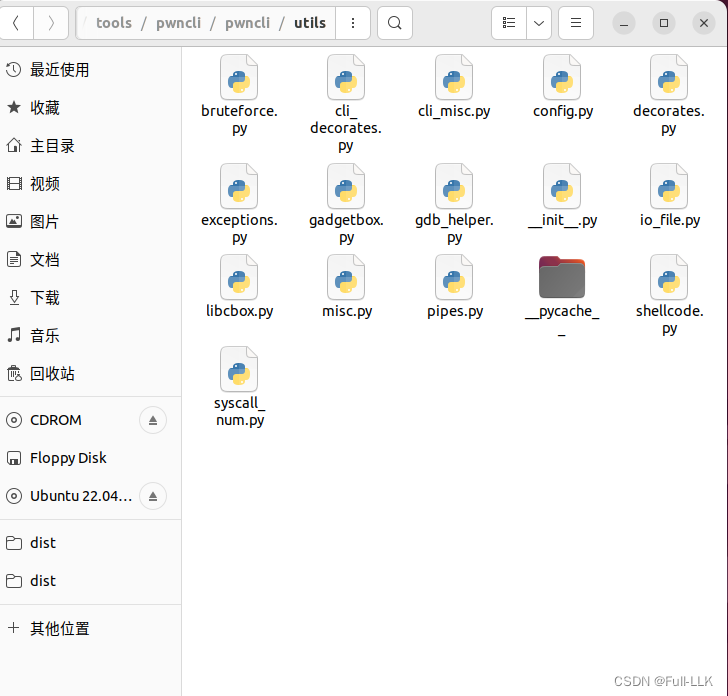
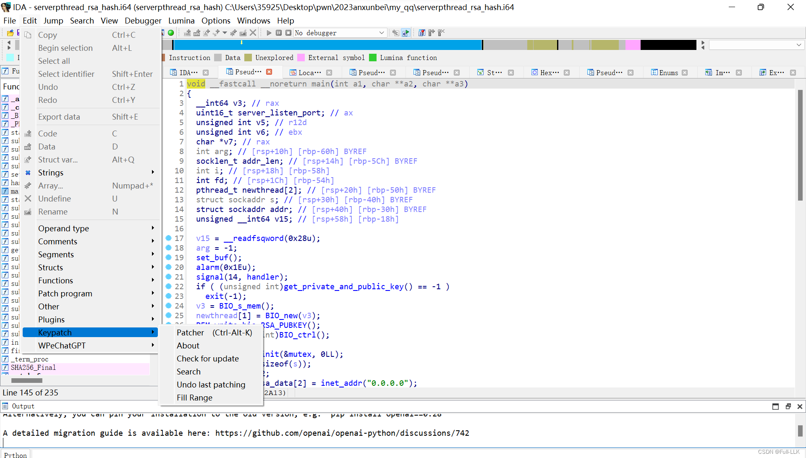
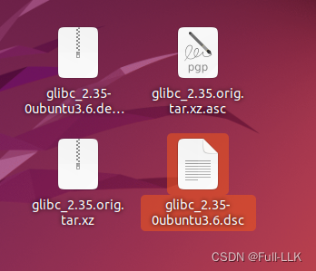


# pwngdb 和 pwndbg
从 GitHub 下载 pwndbg 和 pwngdb。
最后在家目录下设置 .gdbinit 文件。

```bash

source /home/llk/tools/pwndbg/gdbinit.py  #pwndbg/gdbinit.py位置而已
source ~/Pwngdb/pwngdb.py   

source ~/Pwngdb/angelheap/gdbinit.py

define hook-run
python
import angelheap
angelheap.init_angelheap()
end
end
```
# pwngdb 相比 pwndbg 多出的一些有用命令

libc : Print the base address of libc
ld : Print the base address of ld
codebase : Print the base of code segment
heap : Print the base of heap
got : Print the Global Offset Table infomation
dyn : Print the Dynamic section infomation
findcall : Find some function call
**bcall : Set the breakpoint at some function call**
tls : Print the thread local storage address
at : Attach by process name
findsyscall : Find the syscall
fmtarg : Calculate the index of format string
You need to stop on printf which has vulnerability.
force : Calculate the nb in the house of force.
**heapinfo : Print some infomation of heap**
heapinfo (Address of arena)
default is the arena of current thread
If tcache is enable, it would show infomation of tcache entry
**heapinfoall : Print some infomation of heap (all threads)**
arenainfo : Print some infomation of all arena
chunkinfo: Print the infomation of chunk
chunkinfo (Address of victim)
chunkptr : Print the infomation of chunk
chunkptr (Address of user ptr)
**mergeinfo : Print the infomation of merge**
mergeinfo (Address of victim)
printfastbin : Print some infomation of fastbin
tracemalloc on : Trace the malloc and free and detect some error .
You need to run the process first than tracemalloc on, it will record all of the malloc and free.
You can set the DEBUG in pwngdb.py , than it will print all of the malloc and free infomation such as the screeshot.
parseheap : Parse heap layout
magic : Print useful variable and function in glibc
**fp : show FILE structure**
fp (Address of FILE)
**fpchain: show linked list of FILE**

# search 命令

### 示例 1：搜索特定值

假设你想在内存中搜索值 `0x41414141`，可以这样做：

```gdb
search 0x41414141
```

### 示例 2：搜索特定字符串

如果想搜索字符串 `"Hello World!"`，可以使用以下命令：

```gdb
search "Hello World!"
```

### 示例 3：搜索特定类型的值

除了简单的数值和字符串，还可以搜索特定类型的值，例如 `byte`、`short`、`word`、`dword`、`qword`、`pointer`、`string`、`bytes` 或 `asm`。例如，搜索一个 `word` 类型的值 `0x12345678`：

```gdb
search word 0x12345678
```

### 参数详解

- `-a`：指定搜索的起始地址。
- `-l`：限制搜索范围。
- `-t`：指定搜索类型，例如 `byte`、`short`、`word`、`dword`、`qword`、`pointer`、`string`、`bytes` 或 `asm`。
- `-r`：指定要搜索的架构。
- `-m`：指定映射名称。
- `-x`：以十六进制显示结果。
- `-e`：忽略大小写差异。
- `-w`：只显示可打印字符。
- `-s`：步长。
- `-S`：搜索栈。
- `-L`：搜索线程。
- `-A`：对齐搜索。
- `-n`：不保存搜索结果。
- `-N`：保存搜索结果。

# pwncli 库模式
可以调用一些库函数和类，例如 house_of_apple2_execmd_when_do_IO_operation() 和 IO_FILE_plus_struct 类。


# keypatch
[https://github.com/keystone-engine/keypatch](https://github.com/keystone-engine/keypatch)
最终效果

# pwninit
[https://github.com/io12/pwninit](https://github.com/io12/pwninit)


libc6_2.31-0ubuntu9.12_amd64.deb：这个包是 glibc 的标准库包，包含用 C 语言编写的程序在运行时所需的基本库文件。这些文件提供了程序在执行过程中进行系统调用、处理数据、分配内存以及其他标准操作所需的函数实现。这个包通常不包含库的源代码、符号表或调试信息，以保持库文件的轻量，使系统运行更高效，并减少对存储资源的需求。

libc6-dbg_2.31-0ubuntu9.12_amd64.deb：这个包是 glibc 的调试包，包含与 libc6 包同一版本库文件的调试信息和符号表。这些调试信息使开发者在使用调试工具（如 GDB）时能够看到更多关于程序执行的信息，包括变量值、内存地址、栈回溯等。调试信息很重要，它能帮助开发者发现并修复程序中的错误，尤其是在追踪难以解决的内存泄漏和其他复杂错误时。

glibc 源码直接从网上下载即可，解压后会得到类似下图所示的内容。



# .dynsym 和 .symtab 
.dynsym 和 .symtab 都是符号表，但用途不同：

.dynsym（动态符号表）

- dynsym 是 ELF（Executable and Linkable Format）文件格式的一部分，包含动态链接过程中所需的符号。它主要用于运行时的动态链接（例如共享库 .so 文件之间的链接），包括由动态链接器（ld.so）处理的那些符号。
它通常包括需要被其他模块（如其他共享库或可执行文件）共享或使用的全局符号。

.symtab（符号表）
- .symtab 同样是 ELF 文件格式的一部分，包含链接和调试过程中可能用到的完整符号信息，既包括全局符号，也包括局部符号。
它通常在编译时通过 -g 选项（gcc 中）生成，在 GDB 或其他调试器中用于符号解析和源码级调试。

在优化文件大小时，常常使用 strip 命令（或编译器选项）去除 .symtab 节及其他调试信息，以减小生成的二进制文件的大小。这通常发生在为生产环境准备二进制文件时。但 .dynsym 会被保留，因为它是动态链接所必需的。这意味着即使去除了 .symtab，程序仍然可以正常运行，因为动态链接所依赖的符号仍由 .dynsym 提供。

# heaptrace
[https://github.com/Arinerron/heaptrace](https://github.com/Arinerron/heaptrace)

一旦设置断点进入 pwngdb，堆相关的内容就不再回显了，有点让人头疼。

- heaptrace 是一个堆调试器，用于追踪 ELF64（x86_64）二进制文件中的 glibc 堆操作。它的目的是在调试二进制文件或做堆 pwn 时帮助可视化堆操作。


- 用易于理解的符号替换地址

- 检测堆损坏和内存泄漏问题

- 可以随时在 GDB 中调试（--break）

- 支持所有 ELF64（x86_64）二进制文件，不受 ASLR 或编译器设置影响
- 可以创建断点，在满足指定条件时自动由 GNU 调试器（gdb）接管追踪器。

