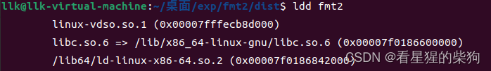
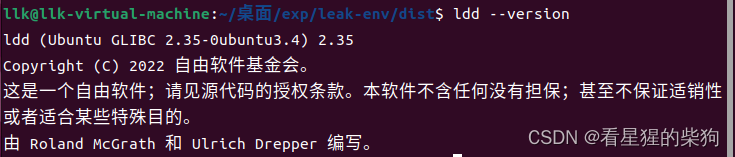
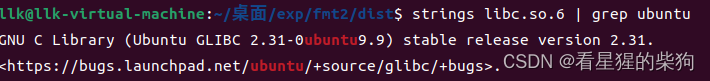
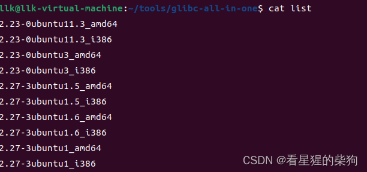
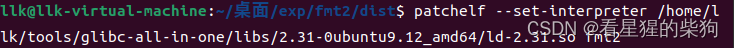
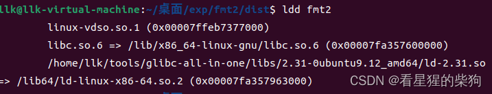
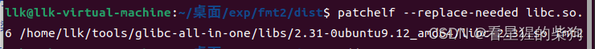
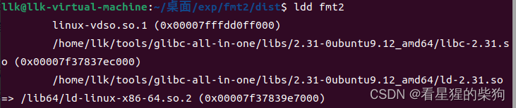
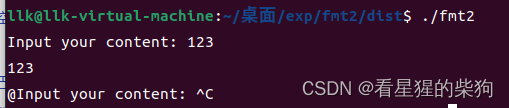


# 查看当前链接情况
```bash
ldd 可执行文件名
```

第一行不用管
第二行是 libc，libc 是 C 标准库
第三行是 ld，ld 是动态链接器

# 查看当前 libc 和 ld 的版本


# 查看正确对应的 libc 和 ld 版本

是 2.31-0ubuntu9.9，与当前的不一致

# 在 glibc-all-in-one 中下载对应或相近的版本
查看是否有对应版本

下载


# 使用 patchelf 修改 libc 和 ld

```bash
patchelf --set-interpreter 新的ld文件的路径 当前程序名
```

``
ld 已修改


```bash
patchelf --replace-needed 原来第二行的==>前的libc名 新的libc文件的路径
```


libc 已修改

# 测试程序能否正常运行


