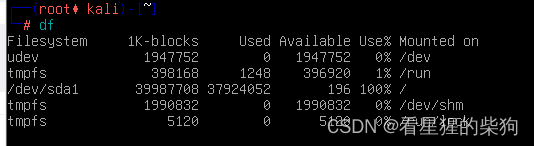
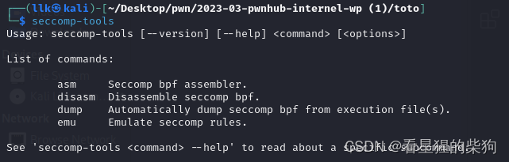
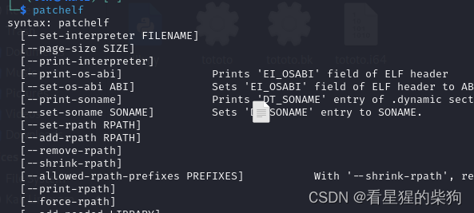


为了防止出现某些问题需要重新配置 pwn 环境的情况，每次都一个一个去搜实在太麻烦了，这里做个汇总，方便自己下次重新配置；需要的工具会在这篇博客中实时更新……

# Kali 无法启动

解决办法：扩容磁盘，或者删除一些不需要的东西
可以看到 100%


解决办法：[https://blog.csdn.net/weixin_39510813/article/details/78387334](https://blog.csdn.net/weixin_39510813/article/details/78387334)

#  解决 Kali 没有网络的问题（配置 eth0 即可解决）


1. **sudo systemctl restart networking.service**
   - `systemctl` 是 Systemd 提供的用于管理系统服务的工具，允许用户启动、停止、重启或查询系统服务的状态。
   - `networking.service` 是 Linux 系统中负责管理和配置系统网络接口的服务单元。在某些 Linux 发行版（如 Debian 及其衍生系统，包括 Kali Linux）中，重启 `networking.service` 服务会重新读取网络配置文件并应用更改，从而刷新网络接口的状态。

2. **/etc/network/interfaces**
   - 这是 Debian 系 Linux 发行版中用于配置网络接口的主要配置文件。每个网络接口（如 `eth0`）的属性和行为都在这个文件中定义。
   - 上面提到的配置片段的含义是：
     - `auto eth0` 表示系统启动时应自动配置并启动 `eth0` 网络接口。
     - `iface eth0 inet dhcp` 表示 `eth0` 接口使用 DHCP 协议获取网络配置，即动态获取 IP 地址、子网掩码、网关、DNS 服务器等信息。

3. **三者之间的关系**
   当你执行 `sudo systemctl restart networking.service` 时，系统会根据 `/etc/network/interfaces` 中的配置信息重新配置并启动所有网络接口；这里专门指定了 `eth0` 接口使用 DHCP 获取 IP 地址及其他相关网络参数。也就是说，在你修改了 `/etc/network/interfaces` 中的配置之后，通过重启 `networking.service` 服务，新的配置就会应用到网络接口 `eth0` 上，实现网络配置的更新和生效。
# 换源

```bash
sudo editor /etc/apt/sources.list
```
把里面的内容改成下面这样
```bash
deb http://mirrors.tuna.tsinghua.edu.cn/kali kali-rolling main contrib non-free

deb-src http://mirrors.tuna.tsinghua.edu.cn/kali kali-rolling main contrib non-free
```

# 前置工具

```bash
sudo apt-get install python3 python3-pip python3-dev git libssl-dev libffi-dev build-essential
```
# 更新

```bash
sudo apt update
```
# 安装 pwntools

```bash
pip install pwntools
```

# 安装 vscode
从官网下载 deb 包后，执行以下命令
```bash
sudo dpkg -i deb所在的路径
```
# 安装 pycharm
[https://blog.csdn.net/qq_42095950/article/details/130235907](https://blog.csdn.net/qq_42095950/article/details/130235907)
```bash
sudo apt install snapd
sudo systemctl start snapd
sudo snap install pycharm-community --classic
```
然后设置桌面快捷方式，参考上面的链接

#  安装中文输入法
[https://blog.csdn.net/wxqndm/article/details/130640200](https://blog.csdn.net/wxqndm/article/details/130640200)


# gdb 配置

```bash
sudo apt install gdb 
sudo apt-get install gdb-multiarch
```

在 ~ 目录下进行如下安装
```bash
git clone https://github.com/scwuaptx/Pwngdb.git
git clone https://github.com/pwndbg/pwndbg.git
cd ~/pwndbg
sudo ./setup.sh
cd ～
cp ~/Pwngdb/.gdbinit ~/
editor ~/.gdbinit
```
.gdbinit 文件配置如下
```bash
source /home/kali/pwndbg/gdbinit.py
source ~/Pwngdb/pwngdb.py
source ~/Pwngdb/angelheap/gdbinit.py

define hook-run
python
import angelheap
angelheap.init_angelheap()
end
end
```

**接下来在 ~ 下创建一个 tools 目录，然后其他所有工具都在 tools 目录中下载安装。如果 git clone 失败，就直接下载 zip 解压，再执行剩下的命令**
#  ROPgadget

```bash
sudo apt install python3-ropgadget
```
# one_gadget

```bash
sudo apt install ruby
sudo apt install gem
sudo gem install one_gadget

```
# LibcSearcher

```bash
git clone https://github.com/lieanu/LibcSearcher.git
cd LibcSearcher
sudo python3 setup.py develop

```
更新 libc 数据库
```bash
cd LibcSearcher
rm -rf libc-database
git clone https://github.com/niklasb/libc-database.git

```
# checksec

```bash
sudo apt install checksec
```


# 安装百度网盘

```bash
安装deb包后
sudo dpkg -i deb包
```
# 安装 seccomp-tools 

```bash
sudo apt install gcc ruby-dev
sudo gem install seccomp-tools

```

# 安装 patchelf

```bash
sudo apt install patchelf
```

# glibc-all-in-one

```bash
git clone https://github.com/matrix1001/glibc-all-in-one.git
cd ./glibc-all-in-one
./update_list
```

# 待完善……

