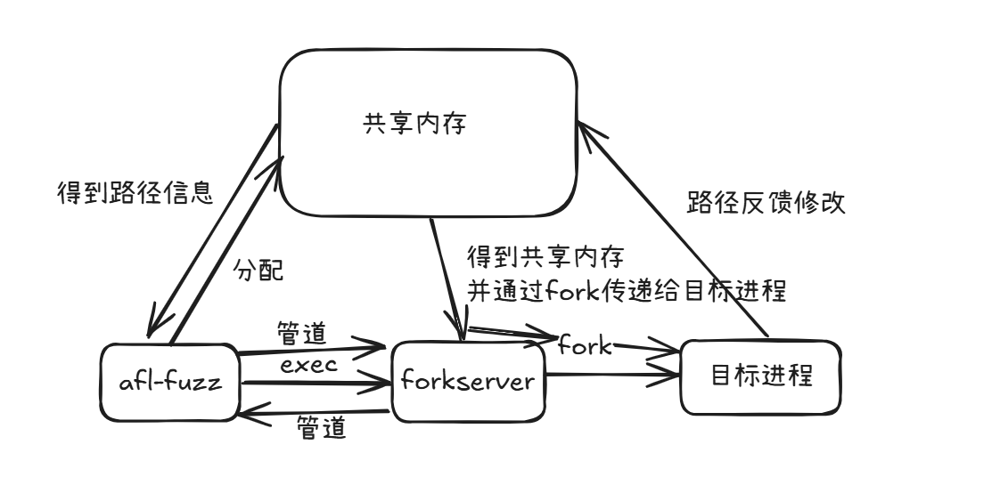
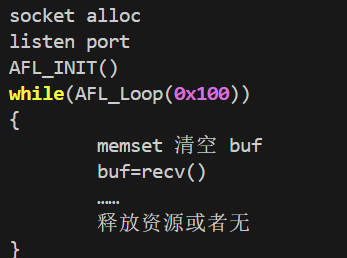
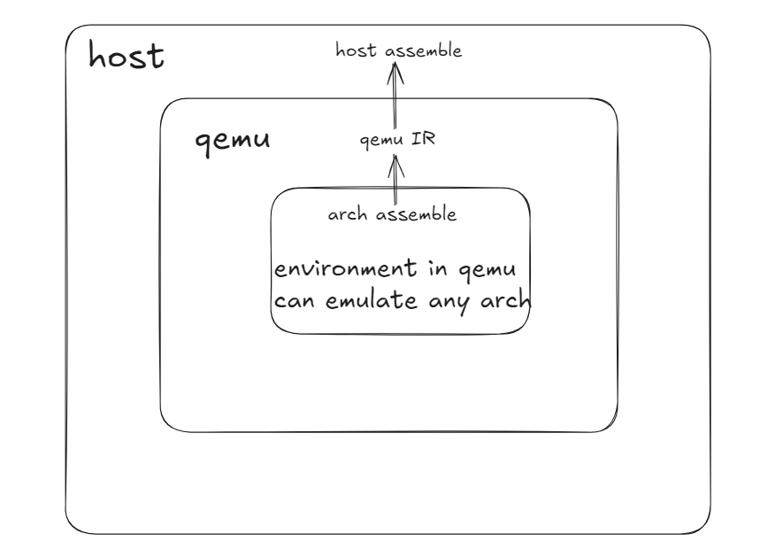
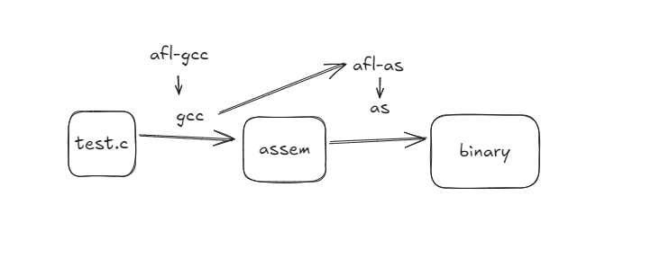



shenhao 师傅 yyds。

# 什么是 FUZZ（模糊测试）？
它自动生成大量样本，用某种方法对其进行变异，输入给被测程序，并根据程序的反馈判断程序是否存在相关漏洞

## 相关工具


## 两种主流模糊测试方式的基本原理
- 基于生成的输入模糊测试：1. 随机；2. 基于模板生成（例如 HTTP 报文，其中每个字段可以分为固定、任意可变、有限可变三类）
- 基于变异、覆盖率引导的模糊测试：样本变异 -> 触发新路径，感知进程反馈 -> 根据反馈再次对样本进行变异并输入


# AFL 原理


## 路径信息反馈
反馈流程：
	1. 数据生成器
	2. 数据输入
	3. 执行进程（已插桩）
	4. 收集并整理路径信息
	5. 反馈给数据生成器，进行针对性变异

插桩方式：
1. 汇编级：在从汇编语言到二进制的过程中，找到条件跳转点，如 JNZ adder，插入函数；不同汇编架构的插桩函数也不同
2. llvm pass（官方 API）：clang/llvm IR 在不同架构下是通用的；在 IR 级进行插桩
  clang：高级语言 -> IR
  llvm：IR -> 汇编/二进制
  
插桩函数：覆盖率信息反馈

    1. fuzz 开始时，有一个 afl-fuzz 主进程，它创建一块共享内存区域并执行程序进程
    2. 当程序进程在执行过程中触发不同路径时，会执行 afl-maybe-log（random_num 参数是插桩时随机生成的数字），为当前路径生成一个哈希索引
    3. 进程将共享内存中该哈希索引位置的值加 1
    4. afl-fuzz 访问共享内存，获取路径信息
    


 代码层面：计算当前索引
   

```cpp
   index=afl_pre_loc^random_num
   afl_pre_loc=random_num>>1(防止A到A和B到B都是异或为0)
   
   v8 = __CFADD__((*( _BYTE *)(v6 + index))++, 1); // 预防整数溢出
// template<class T, class U> int8 __CFADD__(T x, U y)
// {  不同数据类型（如 uint8, uint16, uint32, uint64）之间进行加法操作时，检查是否会发生溢出
//     int size = sizeof(T) > sizeof(U) ? sizeof(T) : sizeof(U);
//     if ( size == 1 )
//         return uint8(x) > uint8(x+y);
//     if ( size == 2 )
//         return uint16(x) > uint16(x+y);
//     if ( size == 4 )
//         return uint32(x) > uint32(x+y);
//     return uint64(x) > uint64(x+y);
// }
*( _BYTE *)(v6 + index) += v8;//共享内存出+1还是溢出所以不加

   
```


## forkserver


afl-fuzz 第一次执行时，程序进程会把自身变成一个 forkserver

```cpp
v6 = _afl_area_ptr;
if ( !_afl_area_ptr ) // fork_server_is_on
{
    if ( _afl_setup_failure ) // fork_server init
        return v5 + 127;
    v6 = _afl_global_area_ptr;
    if ( _afl_global_area_ptr )
    {
        afl_area_ptr = _afl_global_area_ptr;
    }
    else  //这里
    {
        v17 = v4;
        v18 = random_num;
        afl_shm_id_str = getenv("__AFL_SHM_ID"); // afl-fuzz通过环境变量AFL_SHM_ID传递共享内存handle
        if ( !afl_shm_id_str
            || (v11 = atoi(afl_shm_id_str), afl_shm_addr = shmat(v11, 0LL, 0), afl_shm_addr == (_BYTE *)-1LL) )
        {
            ++_afl_setup_failure;
            v5 = v17;
            return v5 + 127;
        }
        *afl_shm_addr = 1;
        _afl_area_ptr = (__int64)afl_shm_addr; // target
        _afl_global_area_ptr = afl_shm_addr;
        v16 = afl_shm_addr;
        if ( write(199, &_afl_temp, 4uLL) == 4 ) // 通过199管道通知afl-fuzz, forkserver已准备完毕
        {
            while ( 1 ) // 开始作为forkserver
            {
                v13 = 198;
                if ( read(198, &_afl_temp, 4uLL) != 4 ) // 收到afl-fuzz指令，fork新进程
                    break; // 如果198管道关闭，forkserver退出
                LODWORD(v14) = fork();
                if ( v14 < 0 )
                    break;
                if ( !v14 ) // 父进程(forkserver)，子进程是目标程序进入afl_fork_resume，关闭由forkserver继承而来的管道后，正常执行
                    goto _afl_fork_resume;
                _afl_fork_pid = v14;
                write(199, &_afl_fork_pid, 4uLL); //传输子进程pid给afl-fuzz
                v13 = _afl_fork_pid;
                LODWORD(v15) = waitpid(_afl_fork_pid, &_afl_temp, 0); // 父进程(forkserver)获得子进程pid，并通过waitpid等待子进程退出
                if ( v15 <= 0 )
                    break;
                write(199, &_afl_temp, 4uLL); // afl_temp保存子进程退出信息，由199管道传递给afl-fuzz后继续循环等待下一次指令
            }
        }
    }
}

else
{
之前覆盖信息反馈的逻辑
}
```



数据归一化：统一那些路径执行次数只有细微差异的情况，从而找出能产生更有利路径的样本

```cpp
如   [0]         = 0,
[]里的数据会被映射到 右边的数据
static const u8 count_class_lookup8[256] = {
    [0]         = 0,
    [1]         = 1,
    [2]         = 2,
    [3]         = 4,
    [4 ... 7]   = 8,
    [8 ... 15]  = 16,
    [16 ... 31] = 32,
    [32 ... 127] = 64,
    [128 ... 255] = 128
};
```

##  样本变异
[https://rk700.github.io/2018/01/04/afl-mutations/](https://rk700.github.io/2018/01/04/afl-mutations/)
获取到一个样本的路径信息后，会对其进行评估；如果合适，就把该样本加入变异队列，接下来会继续对这个样本进行变异
确定性变异：
- bitflip：按位翻转
如果路径没有变化，就认为该字段没有价值
如果路径以相同的方式变化，就认为是一个固定的 token 组合
- arithmetic：整数加减算术运算 
- interest：替换为特殊值（边界值）
- dictionary：把自动生成的（位翻转后的）或用户提供的 token 替换／插入到原始样本中
非确定性变异：
- havoc：随机变异，随机选择一种变异方式
- splice：样本拼接

## 覆盖率引导存在的问题

对于大型项目：
1. 哈希比较简单（通过异或生成索引）
2. 共享内存对应的数组长度有限
3. 路径太多会导致哈希冲突（多条路径映射到同一个位置；AFL 在路径过多时会减少插桩位置的数量，但这并没有从根本上解决问题）

对策：afl-fuzz 第一次执行目标程序时把它变成一个 forkserver，之后由它 fork 子进程
4. 检测 afl-fuzz 的特征（比如共享内存相关的环境变量），清除它们，或者直接写共享内存来干扰 fuzzing
5. 检测 198/199 管道是否存在，或者直接读写这些管道来判断 AFL 是否在 fuzz


# 基本使用
AFL++ 功能更多，但很多用不到 > AFL 更容易修改


## 基础
```bash
# 拉取aflplusplus镜像
docker pull aflplusplus/aflplusplus
# 运行容器
docker run --name afl -it -d aflplusplus/aflplusplus /bin/bash
# 连接容器
docker exec -it afl /bin/bash
```

afl-clang-lto 和 afl-clang-lto++ 功能更多
```bash
mkdir work
wget https://dl.xpdfreader.com/old/xpdf-3.02.tar.gz
tar -zxvf xpdf-3.02.tar.gz
cd  xpdf-3.02
CC=afl-clang-fast CXX=afl-clang-fast++ ./configure --prefix=/root/work/xpdf-3.02/install  #配置 Xpdf 项目，将其安装路径设置为 /root/work/xpdf-3.02/install

AFL_USE_ASAN=1 make #make 命令用于编译项目。AFL_USE_ASAN=1 启用了地址空间布局随机化（ASAN）
make install
```

样本：简洁 + 覆盖更多功能点
```bash
mkdir input
# input
wget https://github.com/mozilla/pdf.js-sample-files/raw/master/helloworld.pdf
wget http://www.africau.edu/images/default/sample.pdf
wget https://www.melbpc.org.au/wp-content/uploads/2017/10/small-example-pdf-file.pdf
```

两种输入方式：文件（用 @@ 表示）和标准输入
```bash
cd ..
afl-fuzz -i input/ -o output/ -m none ./install/bin/pdftotext @@ demo_test

#-m 参数用于设置目标程序的内存限制。none 表示不设置内存限制，允许目标程序使用无限内存。如果设置了具体的内存限制（如 -m 100 表示 100MB），AFL 会在目标程序超出限制时停止其运行。

#demo_test：是目标程序 pdftotext 的输出文件名
#output/：是 AFL 模糊测试的结果保存目录。

ls output/default/crashes
README.txt  id:000000,sig:11,src:000830,time:1106600,execs:207213,op:havoc,rep:14
```

## 字典的使用
固定的 token 组合很难被变异出来，而除了固定组合之外，其他路径都是一样的，不会给出路径反馈
1. 使用预定义的固定 token 组合来减少变异时间
2. 或者重新实现并插桩库函数（例如把 strcmp 变成逐字符的字符串比较，这样每正确变异出一个字符就会产生新的路径反馈） 
```bash
cd ~/work
wget http://xmlsoft.org/download/libxml2-2.9.4.tar.gz
tar -zxvf libxml2-2.9.4.tar.gz
cd libxml2-2.9.4
# 
CC=afl-clang-lto CXX=afl-clang-lto++ CFLAGCXXFLAGS="-fsanitize=address" LDFLAGS="-fsanitize=address" ./configure --prefix="/root/work/libxml2-2.9.4/install/" --disable-shared --without-debug --without-ftp --without-http --without-legacy --without-python LIBS='-ldl'
make
make install
```

```bash
# input
wget https://raw.githubusercontent.com/antonio-morales/Fuzzing101/main/Exercise%205/SampleInput.xml
```

-M：主 fuzz 进程执行确定性变异
-S：次要 fuzz 进程执行非确定性变异
两者是协作关系；各自获取对方的输出进行变异 fuzz
```bash
afl-fuzz -m none -i ./input/ -o ./output -x xml.dict -M m ./install/bin/xmllint --memory --noenc --nocdata --dtdattr --loaddtd --valid --xinclude @@
afl-fuzz -m none -i ./input/ -o ./output -x xml.dict -S s0 ./install/bin/xmllint --memory --noenc --nocdata --dtdattr --loaddtd --valid --xinclude @@
afl-fuzz -m none -i ./input/ -o ./output -x xml.dict -S s1 ./install/bin/xmllint --memory --noenc --nocdata --dtdattr --loaddtd --valid --xinclude @@
```

现成的字典

```bash
ls /AFLplusplus/dictionaries/
README.md       exif.dict        jpeg2000.dict    pdf.dict       sql.dict               webm.dict
aff.dict        fbs.dict         js.dict          perl.dict      stata.dict             webp.dict
ass.dict        ftp.dict         json.dict        png.dict       svg.dict               wkt.dict
atom.dict       gif.dict         jsonnet.dict     proj4.dict     tex.dict               x86.dict
av1_dc.dict     graphviz.dict    jsonschema.dict  protobuf.dict  theme-load-fuzz.dict   xml.dict
bash.dict       heif.dict        markdown.dict    ps.dict        tiff.dict              xml_UTF_16.dict
bdf.dict        hoextdown.dict   math.dict        psd.dict       tokener_parse_ex.dict  xml_UTF_16BE.dict
bmp.dict        html_tags.dict   mathml.dict      regexp.dict    toml.dict              xml_UTF_16LE.dict
bz2.dict        http.dict        mp4.dict         riff.dict      type42.dict            xpath.dict
creole.dict     icc.dict         mysqld.dict      rss.dict       url.dict               xslt.dict
css.dict        iccprofile.dict  ogg.dict         rst.dict       utf8.dict              yaml.dict
csv.dict        icns.dict        openexr.dict     rtf.dict       vcf.dict               yara.dict
dds.dict        initfile.dict    otf.dict         ruby.dict      vhd.dict               zip.dict
djvu.dict       jbig2.dict       pbm.dict         sas.dict       vpx_dec.dict
docommand.dict  jpeg.dict        pcap.dict        spss.dict      wav.dict
```

另外，你也可以用 `strings <executable_name>` 获取程序相关的字符串，作为字典使用


## 延迟插桩与持久化 fuzzing

```bash
ls /AFLplusplus/utils/persistent_mode/
Makefile  persistent_demo.c  persistent_demo_new.c  test-instr.c
```
  __AFL_INIT() 放在可信代码的下方、可疑代码的上方，延迟 fork_server 的启动，这样 fork 之后只执行后面的可疑代码


__AFL_LOOP(UINT_MAX) 让一个子进程可以接受多次样本投喂：把程序包在一个循环里
多个样本的路径信息是否都会进入共享内存？每次循环迭代开始时共享内存会被清空
样本之间是否会相互影响？循环体开始时进行初始化，循环体结束时释放相关资源

多用于网络程序的 fuzz，因为网络程序通常都包含一个用于接收消息包的无限循环


```bash
cd  /AFLplusplus/utils/persistent_mode/                 
make
afl-fuzz -i input/  -o output/  ./persistent_demo

/AFLplusplus/utils/persistent_mode/output/default/crashes # cat id:000000,sig:06,src:000004,time:1885
,execs:26697,op:havoc,rep:3   |  ../../../persistent_demo
one
two
three
four
five
six
Aborted (core dumped)


```

## qemu 模式
[https://github.com/shellphish/afl-other-arch](https://github.com/shellphish/afl-other-arch)

[针对 afl-fuzz 的高性能纯二进制插桩](https://github.com/AFLplusplus/AFLplusplus/tree/stable/qemu_mode)
```c
cd qemu_mode

```

- qemu 仿真的架构与宿主机相同

```c
./build_qemu_support.sh
```

- qemu 仿真的架构与宿主机不同

```bash
CPU_target=arm ./build_qemu_support.sh

```
- qemu 需要在另一种架构上运行，并且 qemu 仿真的架构也是另一种架构；这种情况下需要静态编译 qemu

```bash
 STATIC=1 HOST=arm-linux-gnueabi CPU_target=arm ./build_qemu_support.sh

```

然后设置为全局可用

```bash
cd ..
make install
```

正常编译

```bash
gcc test-instr.c -o test-instr
```
开始 fuzz

```bash
afl-fuzz -i input/ -o output/ -m none -Q ./test-instr

```

qemu 可以把被仿真架构的汇编翻译成宿主机对应的汇编

qemu 知道待翻译指令的地址和功能（或内容）

qemu 把一条指令翻译成宿主机上的汇编指令时，由于它知道待翻译指令的作用，就可以在这时识别并对其插桩



基于 qemu 知道当前指令的地址和功能这一原理，我们可以设置 forkserver 的延迟启动
- 通过设置 `AFL_ENTRYPOINT` 环境变量为 forkserver 开始启动的位置，实现延迟启动
基于 qemu 知道当前指令的地址和功能这一原理，我们也可以设置持久化 fuzzing 的范围
- 通过设置 `AFL_QEMU_PERSISTENT_ADDR` 设置起始地址，`AFL_QEMU_PERSISTENT_RET` 设置返回地址，定义一个范围，最终实现在该范围内的持久化 fuzzing


# ASAN
## 开源 ASAN
一个用于检测内存访问错误的工具

用 -fsanitize=address 标志编译；执行过程中发生内存访问错误时程序会崩溃

- 不可访问的内存，比如 UAF 和 double free
- 越界读写问题

KASAN 和 ASAN 本质上是一样的；两者都是通过编译器插桩来实现的

数据区域被划分为可访问区域和不可访问区域（red_zone）

shadow memory 与普通内存的比例是 1:8，也就是一个字节代表八个（对齐的）字节的内存访问信息。两者存在映射关系，是两块独立的区域（其中一块是 shadow memory，通常固定在 0x7FFF8000）

例如在内核中：


 shadow memory 的值：1-7 表示有多少字节可以访问；0 表示全部可以访问；负数表示全部不可以访问

检测某个数据区域是否可访问的大致过程如下；详细可参考 [linux内核（5.4.81）——KASAN](https://www.anquanke.com/post/id/237502)

__asan_loadN(addr)/__asan_storeN(addr) 的主要功能：
1. 检查要检测的地址是否在 shadow memory 映射的区域内
2. 然后检查 addr 处的 N 个字节内存是否可用


 设置某个数据区域是否可访问
 - 堆：不可访问的情况，比如 UAF 和 double free
   malloc 时，把对应的 shadow memory 区域设置为 0
   free 时，把对应的 shadow 区域设置为负数或其他值（因为库函数可能需要使用被释放的区域）
- 栈：越界读写问题
  两个连续数组的问题可能导致越界访问无法被检测到，因为溢出到下一个数组会显示为可访问
  在函数入口处，分配空间时，会把数组前后的某段区域在 shadow memory 中设置为不可访问（负数），并把数组对应的 shadow memory 区域设置为 0


在 IDA 中，我发现与堆相关的设置操作被整合进了 malloc 和 free 中；访问堆内存时，会检查对应的 shadow memory 值是 0，还是大于要访问的大小

IDA 显示栈会分配一块更大的空间，里面包含 ASAN 的描述信息、redzone 和数组，并设置 shadow memory 的值

```c
#include <stdio.h>
#include <stdlib.h>

int main()
{
    char buf1[] = "abcdefg";
    char tmp[] = "hi";
    char buf2[] = "jkl";

    printf("%c\n", tmp[3]);

    return 0;
}
```
反汇编后

```cpp
int __fastcall main(int argc, const char **argv, const char **envp)
{
  unsigned __int64 extend_stack_1; // rbx
  __int64 v4; // rax
  __int64 v5; // rax
  _DWORD *v6; // r12
  char v7; // cl
  _BYTE extend_stack[120]; // [rsp+0h] [rbp-A0h] BYREF 存储ASAN必要描述和redzone和数组
  unsigned __int64 v10; // [rsp+78h] [rbp-28h]

  extend_stack_1 = (unsigned __int64)extend_stack;
  if ( edata )
  {
    v4 = __asan_stack_malloc_1(0x60LL, argv, envp);
    if ( v4 )
      extend_stack_1 = v4;
  }
  v5 = extend_stack_1 + 128;
  *(_QWORD *)extend_stack_1 = 'A\xB5\x8A\xB3';
  *(_QWORD *)(extend_stack_1 + 8) = "3 32 3 5 tmp:7 48 4 6 buf2:8 64 8 6 buf1:6";
  *(_QWORD *)(extend_stack_1 + 0x10) = main;
  v6 = (_DWORD *)(extend_stack_1 >> 3);
  v6[0x1FFFE000] = 0xF1F1F1F1;                  // F为负数，都不能访问
  v6[0x1FFFE001] = 0xF204F203;                  // 0x20部分有3个字节可以访问
                                                // 0x30部分有4个字节可以访问
  v6[0x1FFFE002] = 0xF3F3F300;                  // 0x40部分有八个字节可以访问
  v10 = __readfsqword(0x28u);
  *(_QWORD *)(extend_stack_1 + 0x40) = 'gfedcba';
  if ( *(char *)(((extend_stack_1 + 0x20) >> 3) + 0x7FFF8000) < 0
    || *(_BYTE *)(((extend_stack_1 + 0x22) >> 3) + 0x7FFF8000) != 0
    && (char)((extend_stack_1 + 0x22) & 7) >= *(_BYTE *)(((extend_stack_1 + 0x22) >> 3) + 0x7FFF8000) )
  {
    v5 = ((__int64 (__fastcall *)(unsigned __int64, __int64))__asan_report_store_n)(extend_stack_1 + 0x20, 3LL);
  }
  strcpy((char *)(v5 - 0x60), "hi");
  *(_DWORD *)(v5 - 0x50) = 'lkj';
  v7 = *(_BYTE *)(((unsigned __int64)(v5 - 0x60 + 3) >> 3) + 0x7FFF8000);
  if ( v7 != 0 && ((v5 - 0x60 + 3) & 7) >= v7 )
    v5 = ((__int64 (__fastcall *)(__int64))__asan_report_load1)(v5 - 0x60 + 3);
  printf("%c\n", (unsigned int)*(char *)(v5 - 93));
  if ( extend_stack == (_BYTE *)extend_stack_1 )
  {
    *(_QWORD *)((extend_stack_1 >> 3) + 0x7FFF8000) = 0LL;
    *(_DWORD *)((extend_stack_1 >> 3) + 0x7FFF8008) = 0;
  }
  else
  {
    *(_QWORD *)extend_stack_1 = 1172321806LL;
    *(_QWORD *)((extend_stack_1 >> 3) + 0x7FFF8000) = 0xF5F5F5F5F5F5F5F5LL;
    *(_DWORD *)((extend_stack_1 >> 3) + 0x7FFF8008) = -168430091;
    **(_BYTE **)(extend_stack_1 + 120) = 0;
  }
  return 0;
}
```

  
## 闭源 ASAN
两种方式都只适用于堆
闭源环境下栈的 ASAN 仍未解决，因为设置区域需要增大栈空间，在汇编层面这比给闭源堆 ASAN 插入代码对程序逻辑的破坏更大

### 二进制重写
[https://git.zephyr-software.com/opensrc/zafl
](https://git.zephyr-software.com/opensrc/zafl)

[https://github.com/HexHive/retrowrite.git
](https://github.com/HexHive/retrowrite.git)

ASAN 的区域设置和区域检测主要是通过插桩实现的

 
对于闭源程序，从二进制程序中获取到汇编后，对代码段进行插桩

因为需要在函数的开头和结尾处插桩，比如设置某些区域，

如何找到它们？
1. 对代码段中的所有指令进行插桩，反复丢弃并重试，直到插桩能正常运行而不崩溃为止。目标是把所有函数的起始点都插桩进去
2. 使用函数表直接插桩

在插入代码而不破坏原有功能时存在的问题：
1. 插入汇编代码可能会改变汇编代码的位置；例如跳转指令的目标地址可能保持不变，但对应的内容已经改变
2. inline hook：插入一条跳转指令（指令长度小，比直接插入更好，但仍然存在第一种方式的后果）；跳转指令跳到插桩函数，然后再跳回来

中间语言插桩——不在汇编层面插桩，因为不同架构比较麻烦：二进制 -> 汇编 -> IR，对 IR 插桩，抹平各种架构的差异
### 动态库劫持
适用于堆的 UAF/double free
 1. 劫持 malloc/free 动态库的内部实现，并插桩以设置内存
2. UAF：使用时需要进行检查，这同样需要插桩；可以通过 qemu 的仿真来实现（遇到 store 或 load 指令时插入检查）
3. double free：free 之前检查是否已经被设置为负数（已释放）

LD_PRELOAD 指定动态库；这里的动态库函数会被优先加载

[QASAN](https://github.com/andreafioraldi/qasan/tree/master)
# AFL 源码

[sakuraのAFL源码全注释](https://eternalsakura13.com/2020/08/23/afl/)


```bash
apt install afl
或者git clone https://github.com/google/AFL.git
cd AFL
make
  
```
编译
```bash
./afl-gcc test-instr.c   -o test-instr
afl-cc 2.57b by <lcamtuf@google.com>
afl-as 2.57b by <lcamtuf@google.com>
[+] Instrumented 5 locations (64-bit, non-hardened mode, ratio 100%).
```
输入文件、输出文件夹，以及 afl-fuzz

```bash
sudo echo /proc/sys/kernel/core_pattern
./afl-fuzz  -i ./input/ -o output/ ./test-instr
```
crash：使程序崩溃的样本
hang：afl-fuzz 有一个计时器；如果程序长时间不退出，就认为是 hang，并保存该 hang 样本
queue：历史样本
## 整体流程


## 1. afl-gcc

afl-gcc 的核心逻辑如下：
```c
int main(int argc, char** argv) {
	……
  find_as(argv[0]); //find assem compiler

  edit_params(argc, argv);
  // 1. find c compiler 
  // 2. edit the compile args (change assem compiler to afl-as  and set AFL_USE_ASAM environment arg to set asan)
  
  // execvp("gcc","-B afl-as")
  execvp(cc_params[0], (char**)cc_params);
  //execvp() 是一个 Unix/Linux 系统提供的标准库函数，用于启动一个新的进程，并用指定的程序替换当前进程的映像
 //#include <unistd.h>
//pid_t execvp(const char *file, char *const argv[]);
//file: 这是指定要执行的程序的名字。execvp() 会在环境变量 PATH 所定义的目录中搜索这个程序。如果找到了这个程序，就会执行它；如果没有找到，函数就会失败。
//argv: 这是一个字符串数组，包含了程序名以及传递给程序的参数。最后一个元素必须是 NULL，表示参数列表的结束。
  ……
}
```

### find_as 

寻找汇编语言编译器

### edit_params

1. 根据命令行参数找到对应的 C 编译器
2. 根据命令行参数编辑编译参数
    + 指定汇编语言编译器的路径为 afl-as
    + 可以通过 AFL_USE_ASAN 环境变量在编译时设置 asan

###  execvp
带参数执行 gcc 进行编译
## 2. afl-as

### add_instrumentation

> instr_ok 表示是否处于代码段中
+ 读取输入的汇编文件
+ 只在代码段中插桩
+ 在函数入口、跳转指令之后以及跳转目标处插桩
+ 输出插桩后的文件
  
+ trampoline_fmt_64/trampoline_fmt_32 分别对应 64 位/32 位的插桩代码，调用 __afl_maybe_log

+ 调用编译器（as）进行编译
```c
fprintf(outf, use_64bit ? trampoline_fmt_64 : trampoline_fmt_32,
                R(MAP_SIZE));  //R(MAP_SIZE)是随机数，会作为afl_maybe_log里的随机数
```

## 3. afl-clang-fast

clang：高级代码 -> IR
llvm：IR -> 汇编 -> bin（提供了一些修改 IR 的 API，即 llvm pass）

+ runOnModule 遍历代码块进行路径覆盖率插桩
+ __AFL_INIT()->__afl_manual_init：与延迟插桩相关
+ __afl_persistent_loop：与持久化 fuzzing 相关

## 4. afl-fuzz

> fuzz_one 开始

- 通过 mmap 把 test_case 的内容映射到 orig_in/in_buf
- 样本变异
  - bitflip 1/1
  - bitflip 2/1
  - bitflip 4/1
  - bitflip 8/8
  - bitflip 16/8
  - bitflip 32/8
  - arith 8/8
  - arith 16/8
  - arith 32/8
  - interest 8/8 =>interesting_8
  - interest 16/8 => interesting_16
  - interest 32/8 => interesting_32
  - dict
  - havoc
  - splice

- common_fuzz_stuff 投喂样本
  - post_handler：对变异后的样本进行自定义调整
  - write_to_testcase => 投喂样本数据：文件投喂（out_file）和标准输入投喂，单进程
  - run_target
    - 清空共享内存
    - 在 forkserver 模式下，通过管道通知 forkserver 创建子进程，并等待子进程退出（等待时设置了超时，以检测 hang）
    - classify_counts：对共享内存中的数据进行归一化
  - save_if_interesting：
    - has_new_bits 检查共享内存，判断当前样本是否触发了新路径或是否有意义
    - 如果有意义，就把它加入变异队列
  


# 说明
一定要把 AFL 源码仔仔细细地读一遍
网络设备/IOT：libfuzz + frida
多次交互：样本中包含多次交互的输入数据，目标程序分别把样本作为多次交互中每一次的输入

