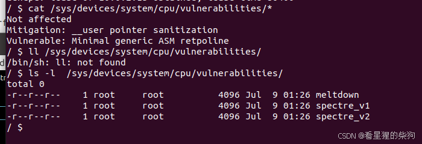
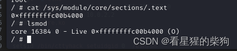
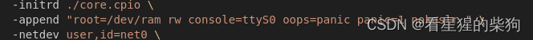
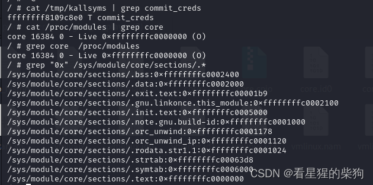



# 打包上传测试脚本

```bash
#!/bin/sh
gcc expolit.c -static -masm=intel -g -o expolit
mv expolit fs/
cd core
find . | cpio -o --format=newc > core.cpio
mv core.cpio ..
cd ..
./start.sh
```

# 查看保护



# 调试

记得设置为 root，否则看不到

然后关闭 kaslr，方便下断点

查看模块相关的段以及内核中存在的符号函数



```bash
gdb ./vmlinux -q
set architecture i386:x86-64

target remote 127.0.0.1:1234

# 先 continue， 在 insmod 之后手动 Ctrl+C 再设置断点，免得断点处于 pending 状态
add-symbol-file /home/llk/Desktop/pwn/kernel/babydriver/lib/modules/4.4.72/babydriver.ko 0xffffffffc0000000

b babyread
b babywrite
b babyioctl
b babyopen
b babyrelease

c
```
# 脚本编写
Intel 和 AT&T 是两种不同的汇编语言语法风格，主要用于 x86 架构的处理器。虽然两者都用于编写底层机器代码，但它们在语法上有显著差异，尤其是在操作数顺序和某些细节的表达方式上。下面详细说明两者的区别：

### Intel 语法

Intel 语法是最常见的 x86 汇编语言语法，也是 Intel 官方文档推荐的语法。它的特点是操作数出现在指令之前……更准确地说，通常把“目的操作数”放在前面，“源操作数”放在后面。

#### 特点：
- 目的操作数在前，源操作数在后。
- 寄存器名没有前缀。
- 用花括号 `{}` 表示立即数的范围，例如 `mov eax, {0x1234}`（不过这并不是最常见的写法，我们通常写成 `mov eax, 0x1234`）。

#### 示例：
```assembly
; Intel Syntax
mov eax, ebx    ; 将ebx的值移动到eax
add eax, 1      ; 将eax的值加1
```

### AT&T 语法

AT&T 语法起源于 UNIX 系统，由 AT&T 开发。它与 Intel 语法的主要区别是操作数顺序相反，以及寄存器名前要加百分号 `%`。

#### 特点：
- 源操作数在前，目的操作数在后。
- 寄存器名前加百分号 `%`。
- 立即数通常在操作数中显式标明，没有特殊的花括号表示法。

#### 示例：
```assembly
# AT&T Syntax
movl %ebx, %eax    # 将ebx的值移动到eax
addl $1, %eax      # 将eax的值加1
```

### 对比总结

|          | Intel 语法                          | AT&T 语法                            |
|----------|---------------------------------------|----------------------------------------|
| 操作数顺序 | 目的操作数在前，源操作数在后         | 源操作数在前，目的操作数在后          |
| 寄存器表示 | 无前缀                              | 百分号 `%` 前缀                   |
| 立即数标记 | 通常无特殊标记                        | 显式标明，例如 `$1` 表示立即数 1       |


## C 库中的 asm 汇编
默认遵循 AT&T 语法。如果想使用

```c
  __asm__("mov user_cs, cs;"
            "mov user_ss, ss;"
            "mov user_sp, rsp;"
            "pushf;"
            "pop user_rflags;");
```
需要加上 `-masm=intel`，否则就要按照

```c
  asm(
            "movq %%cs, %0\n\t"
            "movq %%ss, %1\n\t"
            "movq %%rsp, %2\n\t"
            "pushfq\n\t"
            "popq %3\n\t"
            : "=r" (user_cs), "=r" (user_ss), "=r" (user_sp), "=r" (user_rflags)
            :
            : "memory");
```


# 需要什么就更新什么，持续更新中

