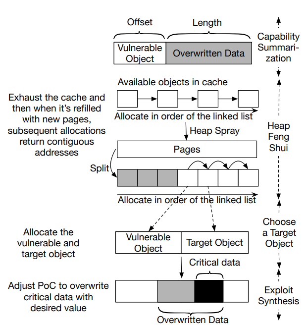
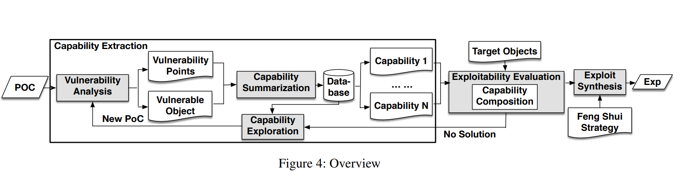
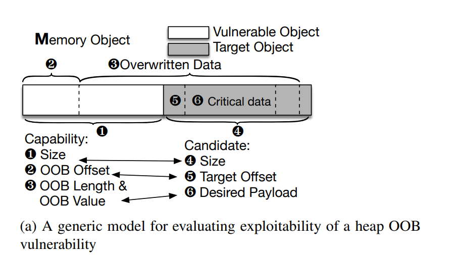
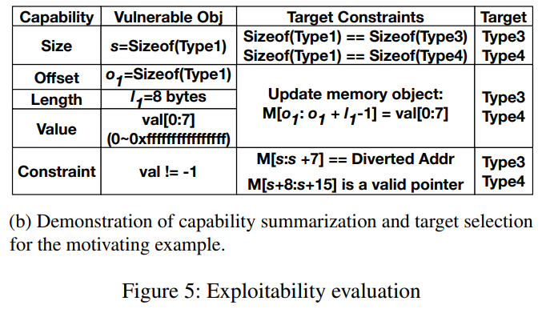
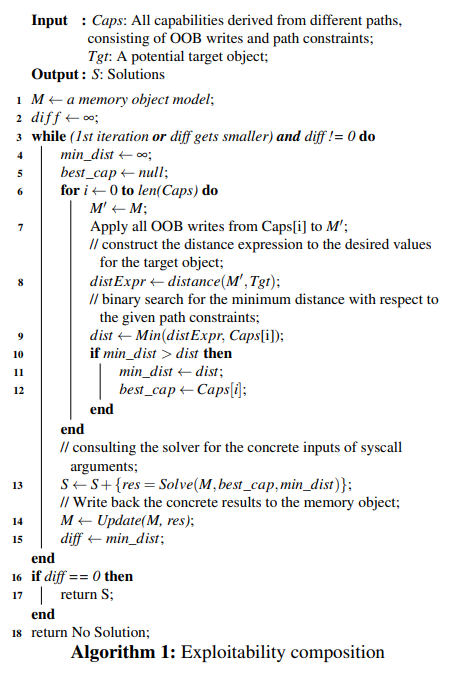
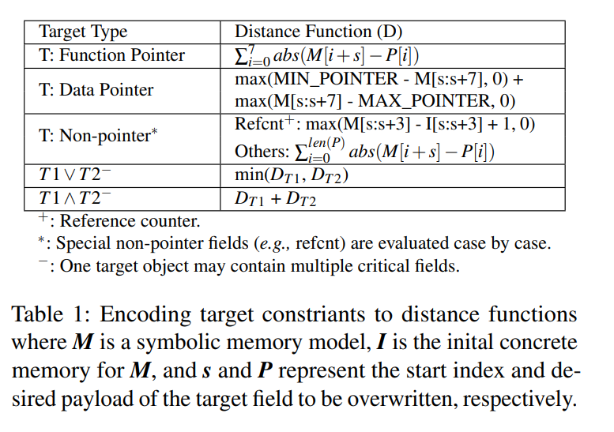
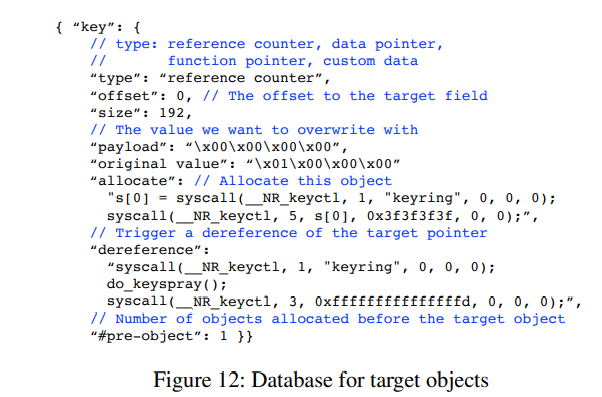
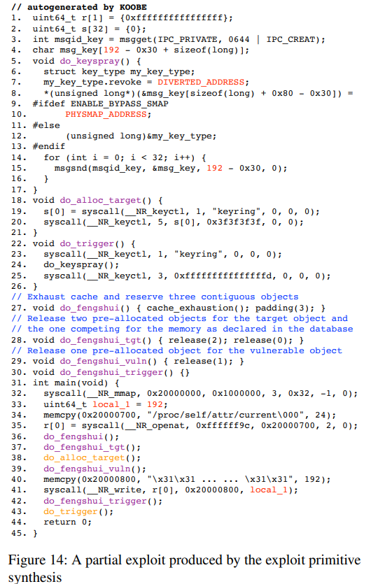


# 参考资料
[KOOBE：辅助生成内核越界写漏洞的利用](https://www.usenix.org/conference/usenixsecurity20/presentation/chen-weiteng)
[论文阅读：KOOBE](https://j-kangel.github.io/2020/05/18/%E8%AE%BA%E6%96%87%E9%98%85%E8%AF%BB%E4%B9%8BKOOBE/#%E6%BC%8F%E6%B4%9E%E5%88%86%E6%9E%90-Vulnerable-Analysis)
# 概述
本文研究 Linux 内核中另一类重要的内存漏洞——越界写（Out-of-Bounds，OOB），并提出了名为 KOOBE 的系统，辅助分析此类漏洞。研究背景是，现代操作系统内核的宏内核结构使新漏洞不断被发现，其中只有一部分严重到能够导致系统被接管，例如权限提升。因此，研究人员开始开发自动化利用生成技术，尤其是针对释放后使用（Use-After-Free，UAF）漏洞的技术，以辅助漏洞分诊。然而，针对 OOB 漏洞，仍然缺乏有效的分析工具。

### KOOBE 的设计理念

KOOBE 的设计基于两个观察：
1. OOB 漏洞的不同实例往往具有多种不同的能力。
2. 内核漏洞利用通常需要多次交互，即一次利用涉及多个系统调用，因此利用构造过程可以模块化。

### KOOBE 的工作方式

- **面向能力的模糊测试**：KOOBE 引入了一种新的面向能力的模糊测试方法，用于发现隐藏能力。这种方法会有针对性地寻找能够暴露特定漏洞能力的输入。
- **能力组合**：KOOBE 还提供了组合不同能力的机制，以提高成功利用漏洞的可能性。通过这种方式，即使看似难以利用的漏洞，也可能找到有效的攻击路径。

### 实验结果

评估中，KOOBE 全面分析了近期的 17 个 Linux 内核 OOB 漏洞，其中仅 5 个已有公开利用代码。KOOBE 成功为 11 个漏洞生成了候选利用策略，其中包括 5 个尚未获得 CVE 编号的漏洞。研究人员以这些策略为基础，为全部 11 个漏洞构建了可完整运行的利用。

### 意义

这项工作有助于提高操作系统内核的安全性，帮助发现和评估 OOB 漏洞的影响，并推动更快地修复这些问题，从而降低潜在安全威胁。此外，KOOBE 的技术和方法也可以为其他类型的安全研究提供参考。


# 启发示例与自动化思路

## CVE-2018-5703
```c
1. struct Type1 { …; };
2. struct Type2 { Type1 sk; uint64_t option; …; };
3. struct Type3 { int (*ptr)(); …; };
4. struct Type4 { uint64_t state; Type3 *sk; …; };
5. struct Type5 { atomic_t refcnt; …; };

6. Type2 gsock = { …, .option = 0x08080000000000, };
7. Type1 * vul = NULL; Type3 * tgt = NULL;

8. void sys_socket() //sizeof(Type1) == sizeof(Type3)
9. vul = kmalloc(sizeof(Type1))

10. void sys_accept()
11. vul = (Type2*)vul; //type confusion
12. vul->option = gsock.option; //Vulnerability Point

13. void sys_setsockopt(val) //not invoked in given PoC
14. if (val == -1) return;
15. gsock.option = val;

16. void sys_create_tgt()
17. tgt = kmalloc(sizeof(Type3));
18. tgt->ptr = NULL; //init ptr

19. void sys_deref() { if (tgt->ptr) tgt->ptr(); }
```


1. 漏洞概述：
   - 漏洞点位于第 12 行，类型混淆导致对原对象的越界写。
   - 涉及两个对象：漏洞对象（vul）与目标对象（tgt）。
   - 第 11 行的类型混淆引发第 12 行的越界写。

2. 漏洞特征：
   - 初看似乎只能写入固定值 0x08080000000000。
   - 实际上，如果先调用 sys_setsockopt，覆盖的内容就可以控制。

3. 利用过程（见图）：
   - 使用堆喷射（堆风水）技术控制堆布局。
   - 创建目标对象，使其与漏洞对象相邻。
   - 利用漏洞修改目标对象的指针。
   - 触发指针解引用，劫持控制流。


```c
1. for (i = 0; i < N; i++)
2. sys_create_tgt(); // cache exhaustion
3. sys_socket(); // vuln obj
4. sys_create_tgt(); // target obj
5. sys_setsockopt(0xdeadbeef);
6. sys_accept(); // tgt->ptr = 0xdeadbeef
7. sys_deref();
```
关键点：
   - 原始 PoC 缺少 sys_setsockopt 调用，限制了该漏洞的利用价值。




## 分析能力（可利用性）
对于大多数通过模糊测试发现的漏洞，相应 PoC 通常能破坏某些数据，但不一定能进入可利用状态。例如，基于随机变异的模糊测试生成的 PoC，可能用某个随机值覆盖目标对象中的指针，引发无法利用的缺页异常；也可能破坏某些系统数据，导致崩溃。

为了评估可利用性，安全分析人员通常需要检查漏洞代码的逻辑，然后仔细调整系统调用参数，在 PoC 中插入额外的系统调用（如前述示例），甚至反复触发覆盖。

## 堆风水
当前一代 Linux 内核堆分配器按大小组织动态分配的内存。同样大小的对象由专用缓存（也称 slab）管理；缓存向系统预留一个或多个页面，并提前将其切分为相同大小的块，以提高效率。例如，图 1a 中的 Type1 或 Type3 对象大小相同，因此始终从同一个缓存分配。缓存耗尽时，会申请新页面，并切分为地址连续的块。最关键的是，这些新块按顺序从低地址向高地址分配，例如通过 kmalloc()。图 2 的堆风水步骤展示了这一过程。利用这一特性，可以先耗尽当前缓存（图 1b 第 1、2 行），确保后续分配会申请新页面，使由同一缓存管理的漏洞对象和目标对象相邻分配（分别对应图 1b 第 3、4 行）。注意，耗尽缓存不一定要使用漏洞对象或目标对象；实际上，已有研究找到若干不同大小的通用对象，例如 msgbuf，用于此目的 [41]。

通常，一个系统调用可能一次创建多个对象，这会使堆风水更复杂。不过，堆分配器具有确定性，攻击者也可以通过一系列系统调用提前设置堆布局，因此几乎总能安排出有利于越界写漏洞利用的内存布局，例如让漏洞对象与目标对象相邻。

## 选择利用目标

总结漏洞能力并预先安排内存布局后，需要仔细选择目标对象，使其关键字段能被所需的载荷覆盖。一般而言，关键字段可以分为指针（函数指针或数据指针）与非指针字段。

(i) **函数指针**（例如图 1a 中的 Type3）最理想，因为控制其值后，一旦解引用就能劫持控制流。

(ii) **数据指针**可以用于构造任意写原语（如果其指向稍后会被写入的结构体），也可以用于任意代码执行（如果其指向另一个包含函数指针的结构体，例如 Type4）。堆元数据是一种特殊的目标对象，其中包含指向缓存中下一个空闲对象的数据指针 [1]。

(iii) **非指针字段**需要逐一评估。例如，在 Linux 中，`uid` 是 `struct cred` 中常被攻击的特殊字段，用于控制用户 ID。如果攻击者能将自身进程的 `uid` 覆盖为 0，就可以将进程权限提升到 root。另一个较少见的例子是 Linux 内核对象中广泛使用的引用计数器，例如图 1a 中 Type5 的第一个字段。如果能够强制覆盖引用计数器，例如将其置为 0，目标对象就会被提前释放，从而产生 UAF 漏洞 [4]。（Linux 内核中的许多对象通过引用计数器管理生命周期。引用计数器 refcnt 是一个原子变量，记录有多少引用指向对象。计数降为 0 时，意味着没有引用指向该对象，通常会触发对象释放。）随后，攻击者就可以使用已有充分研究的 UAF 利用技术 [57, 58]。

如图 1b 所示，我们选择 Type3 作为目标对象，因为它与漏洞对象大小相同，便于进行堆风水，而且前 8 个字节中包含函数指针。这与漏洞能力相匹配，即可以在漏洞对象边界之外写入共 8 个可控字节。另一方面，Type4 不适合作为利用目标，因为它的关键字段，即数据指针 `sk`，不在对象起始位置。

当某个越界写漏洞的能力受限时，收集多种包含关键字段的对象非常重要。例如，图 3a 中的 CVE-2016-6187 只能溢出一个零字节，不足以构造指针。但是，可以选择首字段为引用计数器的目标对象，例如图 1a 中的 Type5。因为将引用计数器的最低有效字节覆盖为零，相当于减小其值，最终可将该漏洞转变为 UAF 漏洞。实际上，Linux 内核中有超过 2,000 种对象可作为合适的攻击目标。


```c
void example1(size) {
    vul = kmalloc(size);
    vul[size] = '\0';
}
// (a) CVE-2016-6187

void example2(i) {
    vul = (char*)kmalloc(sizeof(TYPE));
    // 省略路径上的其他越界点
    vul[i/8] |= 1 << (i & 0x7); // 设置1位
}
// (b) CVE-2017-7184
```

上面是两个简化后的 CVE。左侧只能溢出一个零字节，右侧则只能在可控偏移处设置一个比特。


## 合成利用


最后，需要根据先前选择的目标对象，相应调整 PoC（概念验证程序）。目标对象通常是预先已知的，因为 Linux 内核是开源的。具体而言，需要知道如何分配每种对象，以及如何触发相应指针的解引用。随后，就可以组合这些知识，合成完整的利用。

接下来是绕过高级防御并实现任意代码执行。现代防御措施通常包括 KASLR（内核地址空间布局随机化）、SMEP（管理模式执行保护）和 SMAP（管理模式访问保护）。这些防御会增加攻击的复杂性，但未必能够阻止攻击。下面简要介绍几种常见绕过策略：
- **绕过 KASLR**：实践中通常使用独立的信息泄露漏洞；也可以借助较新的 CPU 侧信道攻击，如 Meltdown [36]、Spectre [34]、RIDL [54] 和 ZombieLand [46]。
- **绕过 SMEP**：只需将控制流引向内核地址空间，使用 ROP/JOP，无须在用户空间执行代码，因此不算太大的障碍。
- **绕过 SMAP**：可以让被破坏的数据指针指向内核的物理映射区（physmap），再通过 physmap 喷射技术在其中伪造可控对象 [33, 58]。
- **最后，将 IP 劫持转化为任意代码执行与提权**：近期研究 [56] 即使在开启 SMEP 和 SMAP 的情况下，也能自动完成这一过程。


# 设计


## 漏洞分析

给定一个 PoC，系统首先尝试发现所有漏洞点，即越界访问位置，并识别相应的漏洞对象，详见附录 B 的图 10。遗憾的是，仅靠 KASAN [5] 无法提供完整的漏洞点，也无法准确报告漏洞对象。KASAN 依赖影子内存和红区 [51]，因此可能漏报越界访问；对于没有越界进入红区的访问，例如仅覆盖相邻对象的情况，它无法有效检测。实际上，我们发现某些情况下 KASAN 只能报告多个越界访问中的一个。此外，KASAN 无法准确定位漏洞对象，因为它只报告距离被访问红区最近的对象。

为此，执行 PoC 时，除基本的 KASAN 检测外，我们还进行符号跟踪，监控更细粒度的内存操作，例如 `kmalloc()` 和单次内存访问。这是针对每个 PoC 执行的一项离线步骤。具体而言，系统通过符号跟踪追踪每个对象，在对象创建时为其赋予唯一的符号值。因此，对每次内存访问，只要其中包含符号表达式，就可以直接提取目标对象。此外，通过查询指针符号表达式的可能取值范围，即使给定 PoC 没有触发溢出，也能检测潜在溢出。在启发示例中，如果为 `kmalloc()` 返回的漏洞对象赋予符号值（第 9 行），则第 12 行指针的符号表达式为 `vul + offsetof(Type2, option)`，其中 `vul` 是我们赋予的符号值。分析图 3b 中指针的符号表达式 `vul + i/8`，其中 `vul` 和 `i` 都是符号值，`i` 来自系统调用参数，可以断定这里必然存在越界漏洞点：由于 `i` 没有约束，偏移可能大于漏洞对象的大小，即使 PoC 并未使用足够大的 `i`。


## 能力总结

## 相关定义 1：越界写表示
有点抽象。
### 符号表达式集合 \( E \)
- **符号表达式集合 \( E \)**：符号执行引擎支持的所有可能表达式构成的集合。这些表达式可以由变量、常量、运算符等组合而成。例如，`x + 5`、`y * 2` 和 `z - 1` 都是符号表达式。

### 路径集合 \( P \)
- **路径集合 \( P \)**：程序中所有可能执行路径的集合。每条路径代表程序的一种执行方式。例如，一个简单的 if-else 语句会产生两条路径：一条是 if 条件为真，另一条是 if 条件为假。

### 路径 \( p \) 上的漏洞点集合 \( N_p \)
- **路径 \( p \) 上的漏洞点集合 \( N_p \)**：特定路径 \( p \) 上所有可能漏洞点的集合。漏洞点是程序中可能引发安全问题的位置，例如缓冲区溢出或越界写。

### 示例

假设有一个简单的 C 程序：

```c
void vulnerable_function(int x) {
    int buffer[10];
    if (x > 0) {
        buffer[x] = 1;  // 可能的漏洞点
    } else {
        buffer[0] = 1;  // 不是漏洞点
    }
}
```

该程序有两条路径：

1. **路径 1**：`x > 0`
   - 在这条路径上，`buffer[x] = 1` 是一个可能的漏洞点，因为当 `x` 大于 10 时，会发生越界写。
   - 因此，路径 1 上的漏洞点集合 \( N_{p_1} \) 包含一个元素：`buffer[x] = 1`。

2. **路径 2**：`x <= 0`
   - 在这条路径上，`buffer[0] = 1` 不是漏洞点，因为 `buffer[0]` 是合法的。
   - 因此，路径 2 上的漏洞点集合 \( N_{p_2} \) 为空。

### 数学符号

- **路径 \( p \) 上的漏洞点集合 \( N_p \)**：路径 \( p \) 上所有可能漏洞点的集合。
- **\( i \in N_p \)**：表示 \( i \) 是路径 \( p \) 上的一个漏洞点。
- **\( off, len, val \in E \)**：表示偏移 \( off \)、长度 \( len \) 和写入值 \( val \) 都是属于集合 \( E \) 的符号表达式。

### 通俗解释

- **路径 \( p \)**：程序的一种执行方式。
- **漏洞点 \( i \)**：路径 \( p \) 上可能引发安全问题的具体位置。
- **偏移 \( off \)**：相对于漏洞对象起始地址的偏移。
- **长度 \( len \)**：可以写入的字节数。
- **写入值 \( val \)**：写入的数据值。

### 示例说明

假设路径 \( p \) 上有两个漏洞点 \( i_1 \) 和 \( i_2 \)：

- **漏洞点 \( i_1 \)**：`buffer[x] = 1`，其中 `x` 是符号表达式。
  - **偏移 \( off_{p_1} \)**：`x`，相对于 `buffer` 的起始地址。
  - **长度 \( len_{p_1} \)**：1，即写入 1 字节。
  - **写入值 \( val_{p_1} \)**：1，即写入的值。

- **漏洞点 \( i_2 \)**：`buffer[y] = 2`，其中 `y` 是符号表达式。
  - **偏移 \( off_{p_2} \)**：`y`，相对于 `buffer` 的起始地址。
  - **长度 \( len_{p_2} \)**：1，即写入 1 字节。
  - **写入值 \( val_{p_2} \)**：2，即写入的值。

因此，路径 \( p \) 上的越界写集合 \( T_p \) 可表示为：

\[ T_p = \{(x, 1, 1), (y, 1, 2)\} \]
## 相关定义 2：能力提取

路径 \( p \) 的能力表示为 Cp = {sizep,Tp, f(p) | sizep ∈ E}，其中：
- **\( size_p \)**：表示漏洞对象的大小。
- **\( T_p \)**：表示路径 \( p \) 上的越界写集合。
- **\( f(p) \)**：表示执行路径 \( p \) 时收集的路径约束集合。
- **\( size_p \in E \)**：表示 \( size_p \) 是符号表达式集合 \( E \) 的一个元素。

### 详细说明

1. **漏洞对象的大小 \( size_p \)**
   - **定义**：\( size_p \) 表示路径 \( p \) 上漏洞对象的大小。
   - **重要性**：某些情况下，漏洞对象的大小可变，会影响越界写的可能性与范围。例如，对象大小若能由用户输入控制，就会扩大寻找合适目标对象的搜索空间。
   - **符号表达式**：\( size_p \) 是属于集合 \( E \) 的符号表达式。

2. **越界写集合 \( T_p \)**
   - **定义**：\( T_p \) 表示路径 \( p \) 上所有越界写的集合。
   - **结构**：每次越界写可以表示为三元组 \( (off, len, val) \)，其中：
     - **\( off \)**：表示相对于漏洞对象起始地址的偏移。
     - **\( len \)**：表示可以写入的字节数。
     - **\( val \)**：表示写入的值。
   - **示例**：假设路径 \( p \) 上有两个越界写点 \( (10, 2, 0x41) \) 和 \( (15, 1, 0x42) \)，那么 \( T_p = \{(10, 2, 0x41), (15, 1, 0x42)\} \)。

3. **路径约束 \( f(p) \)**
   - **定义**：\( f(p) \) 表示执行路径 \( p \) 时收集的路径约束集合。
   - **重要性**：路径约束限制了越界写实际可能出现的情况。例如，某个值必须满足特定条件，执行流程才能到达某行代码。
   - **示例**：假设路径 \( p \) 上有条件检查 `val != -1`，则 \( f(p) \) 包含此约束。

### 示例说明

假设有一个包含漏洞函数的 C 程序：

```c
void vulnerable_function(char *data, int len, int obj_size) {
    char *buffer = malloc(obj_size);
    if (obj_size > 0 && obj_size < 20) {
        memcpy(buffer, data, len);
    }
    free(buffer);
}
```

本例中，通过符号执行可以发现两条路径：

1. **路径 1**：`len = 16`，`obj_size = 15`
   - **路径约束**：`obj_size > 0 && obj_size < 20`
   - **漏洞点**：`memcpy(buffer, data, 16)`，在 `buffer` 边界之外写入 1 字节。
   - **越界写集合**：\( T_{p_1} = \{(15, 1, data[15])\} \)
   - **能力**：\( C_{p_1} = \{15, T_{p_1}, \{obj_size > 0, obj_size < 20\}\} \)

2. **路径 2**：`len = 18`，`obj_size = 15`
   - **路径约束**：`obj_size > 0 && obj_size < 20`
   - **漏洞点**：`memcpy(buffer, data, 18)`，在 `buffer` 边界之外写入 3 字节。
   - **越界写集合**：\( T_{p_2} = \{(15, 3, data[15])\} \)
   - **能力**：\( C_{p_2} = \{15, T_{p_2}, \{obj_size > 0, obj_size < 20\}\} \)

### 路径约束为何重要

路径约束限制了越界写实际可能出现的情况。例如，上例中 `obj_size` 必须在 1 到 19 之间，否则不会执行 `malloc` 和 `memcpy`。因此，路径约束 \( f(p) \) 是判断越界写是否可行的重要因素。


- **漏洞对象的大小 \( size_p \)**：表示对象大小，可能影响越界写的范围。
- **越界写集合 \( T_p \)**：表示路径 \( p \) 上所有越界写的集合，每次写入由偏移、长度和写入值组成。
- **路径约束 \( f(p) \)**：表示执行路径 \( p \) 时收集的路径约束，限制越界写实际可能出现的情况。


## 相关定义 3：能力比较


- **定义**：对于所有 \( e1, e2 \in E \)，若 \( e1 \) 与 \( e2 \) 相同，或者 \( e1 \) 是常量且 \( e2 \) 可以取到该值，则 \( e1 \leq e2 \)。
- **说明**：这定义了符号表达式之间的比较关系。若两个表达式相同，或其中一个是常量且另一个可以取到该值，就认为前者小于等于后者。

#### 越界写集合的比较
- **定义**：对于所有 \( p1, p2 \in P \)，若 \( off_{p1_i} \leq off_{p2_i} \)、\( len_{p1_i} \leq len_{p2_i} \) 且 \( val_{p1_i} \leq val_{p2_i} \)，则 \( T_{p1_i} \leq T_{p2_i} \)。
- **说明**：这定义了两个越界写集合之间的比较关系。如果一次越界写的偏移、长度和写入值均小于等于另一次越界写对应的值，就认为前者小于等于后者。

#### 能力比较
- **定义**：对于所有 \( p1, p2 \in P \)，若 \( size_{p1} \leq size_{p2} \)，且对于所有 \( i \in N_{p1} \) 均有 \( T_{p1_i} \leq T_{p2_i} \)，则 \( C_{p1} \leq C_{p2} \)。
- **说明**：这定义了两条路径的能力之间的比较关系。如果一条路径上漏洞对象的大小小于等于另一条路径上的对象大小，并且该路径上的所有越界写都小于等于另一条路径上对应的越界写，就认为前者的能力小于等于后者。

### 观察
直接比较符号表达式可能很困难，因为表达式之间存在内在关系，尤其是在结合路径约束时。因此，我们采取保守判断：只有当两个表达式相同，或者前者是常量且后者可以取到该值时，才认为前者等于或弱于后者。在此基础上，可以逐一比较各元素，为越界写和能力定义偏序关系。从上例可知，第二种能力更强，因为 \( C_{orig} \leq C_{comp} \)。


### 1. 符号表达式之间的内在关系

符号表达式之间的内在关系，是指表达式之间存在某些依赖、等价或逻辑联系，因而不能简单地将它们独立看待。

#### 示例 1：依赖关系
假设有两个符号表达式：
- \( e1 = x + 5 \)
- \( e2 = y + 5 \)

若 \( y = x + 10 \)，则 \( e2 = (x + 10) + 5 = x + 15 \)。此时，虽然 \( e1 \) 和 \( e2 \) 形式相似，但由于 \( y \) 依赖于 \( x \)，它们的值不同。

### 2. 路径约束的影响

路径约束是在程序执行过程中收集的条件，用于确定程序的执行路径。它们限制符号表达式的取值，使符号表达式之间的关系更加复杂。

#### 示例 2：路径约束
假设有以下程序片段：

```c
int x, y;

if (x > 0) {
    y = x + 5;
} else {
    y = x - 5;
}
```

本例中，路径 1 的约束为 \( x > 0 \)，路径 2 的约束为 \( x \leq 0 \)。

### 3. 符号表达式与路径约束相结合

符号表达式与路径约束结合后，情况会更加复杂。路径约束限制符号表达式的取值，因此比较符号表达式时必须考虑这些约束。

#### 示例 3：符号表达式与路径约束
假设有两个符号表达式：
- \( e1 = x + 5 \)
- \( e2 = y + 5 \)

同时有以下路径约束：
- 路径 1 的约束：\( x > 0 \)
- 路径 2 的约束：\( y > 10 \)

此时，虽然 \( e1 \) 和 \( e2 \) 形式相似，但取值范围不同。在路径 1 上，\( x \) 可以取任意大于 0 的值；在路径 2 上，\( y \) 可以取任意大于 10 的值。因此，不能直接比较 \( e1 \) 和 \( e2 \)，而必须考虑路径约束。

#### 具体示例

假设有一个更复杂的 C 程序，包含多个条件分支与路径约束：

```c
int x, y, z;

if (x > 10) {
    y = x + 5;
    if (y > 15) {
        z = y + 10;
    } else {
        z = y - 10;
    }
} else {
    y = x - 5;
    if (y < -10) {
        z = y + 10;
    } else {
        z = y - 10;
    }
}
```

#### 符号表达式
- **路径 1**：`x > 10` 且 `y > 15`
  - **符号表达式**：
    - `y = x + 5`
    - `z = y + 10`
- **路径 2**：`x > 10` 且 `y <= 15`
  - **符号表达式**：
    - `y = x + 5`
    - `z = y - 10`
- **路径 3**：`x <= 10` 且 `y < -10`
  - **符号表达式**：
    - `y = x - 5`
    - `z = y + 10`
- **路径 4**：`x <= 10` 且 `y >= -10`
  - **符号表达式**：
    - `y = x - 5`
    - `z = y - 10`

#### 路径约束
- **路径 1 的约束**：`x > 10` 且 `y > 15`
- **路径 2 的约束**：`x > 10` 且 `y <= 15`
- **路径 3 的约束**：`x <= 10` 且 `y < -10`
- **路径 4 的约束**：`x <= 10` 且 `y >= -10`

#### 内在关系
- **路径 1**：当 `x > 10` 且 `y > 15` 时，`y = x + 5`，`z = (x + 5) + 10 = x + 15`。这里 `y` 和 `z` 的值依赖于 `x`，且 `x` 必须大于 10，`y` 必须大于 15。
- **路径 2**：当 `x > 10` 且 `y <= 15` 时，`y = x + 5`，`z = (x + 5) - 10 = x - 5`。这里 `y` 和 `z` 的值依赖于 `x`，且 `x` 必须大于 10，`y` 必须小于等于 15。
- **路径 3**：当 `x <= 10` 且 `y < -10` 时，`y = x - 5`，`z = (x - 5) + 10 = x + 5`。这里 `y` 和 `z` 的值依赖于 `x`，且 `x` 必须小于等于 10，`y` 必须小于 -10。
- **路径 4**：当 `x <= 10` 且 `y >= -10` 时，`y = x - 5`，`z = (x - 5) - 10 = x - 15`。这里 `y` 和 `z` 的值依赖于 `x`，且 `x` 必须小于等于 10，`y` 必须大于等于 -10。


### 能力生成


#### 漏洞点分类
- **分类**：通常将上一步识别的漏洞点分为两类：函数调用与内存访问指令。
  - **函数调用**：若越界访问由内存复制函数（如 `memcpy()`）触发，则相应漏洞点是调用该函数的指令。
  - **内存访问指令**：否则，直接将引发越界写的指令视为漏洞点。

#### 内存复制函数建模
- **目的**：为内存复制函数建模可以简化能力提取，因为这样可以避免循环分析；后文会详细介绍循环的处理。
- **方法**：
  - **偏移**：通过符号跟踪，从 `memcpy()` 的第一个参数（目的地址）提取写入偏移。
  - **写入值**：从 `memcpy()` 的第二个参数（源地址）提取写入值。
  - **长度**：从 `memcpy()` 的第三个参数提取写入长度。


### 示例说明

假设有一个包含漏洞函数的程序：

```c
void vulnerable_function(char *data, int len, int obj_size) {
    char *buffer = malloc(obj_size);
    if (obj_size > 0 && obj_size < 20) {
        memcpy(buffer, data, len);
    }
    free(buffer);
}
```

本例中，通过符号执行可以发现两条路径：

1. **路径 1**：`len = 16`，`obj_size = 15`
   - **路径约束**：`obj_size > 0 && obj_size < 20`
   - **漏洞点**：`memcpy(buffer, data, 16)`，在 `buffer` 边界之外写入 1 字节。
   - **越界写集合**：\( T_{p1} = \{(15, 1, data[15])\} \)
   - **能力**：\( C_{p1} = \{15, T_{p1}, \{obj_size > 0, obj_size < 20\}\} \)

2. **路径 2**：`len = 18`，`obj_size = 15`
   - **路径约束**：`obj_size > 0 && obj_size < 20`
   - **漏洞点**：`memcpy(buffer, data, 18)`，在 `buffer` 边界之外写入 3 字节。
   - **越界写集合**：\( T_{p2} = \{(15, 3, data[15])\} \)
   - **能力**：\( C_{p2} = \{15, T_{p2}, \{obj_size > 0, obj_size < 20\}\} \)

### 比较能力
- **偏移**：`off_{p1} = 15` 与 `off_{p2} = 15` 相等。
- **长度**：`len_{p1} = 1`，`len_{p2} = 3`，因此 `len_{p1} < len_{p2}`。
- **写入值**：`val_{p1} = data[15]` 与 `val_{p2} = data[15]` 相等。

因此，根据定义，\( C_{p1} \leq C_{p2} \)，即路径 2 的能力强于路径 1。




## 能力探索

通常，漏洞在不同路径上会产生不同的漏洞点，每个漏洞点可能体现独特的能力。（利用漏洞可能使其所在的不同路径上出现新的漏洞点。）此外，即使是同一个漏洞点，不同路径及其路径约束也可能导致不同能力，如图 1a 所示。遗憾的是，给定 PoC 通常只覆盖一条路径，可能限制我们对漏洞全部能力的认识。因此，如图 4 所示，如果系统无法使用已发现的能力找到解决方案，即无法找到合适的目标对象，就会探索新的 PoC，以扩展现有能力或发现新能力。随后反复进行能力总结和可利用性评估，直到成功或达到预设超时。为此，系统采用一种新的面向能力的模糊测试方案，探索额外能力。

#### 能力引导的模糊测试
模糊测试是探索不同可利用状态的一种自然方案。然而，现有内核模糊测试工具（如 Syzkaller）主要由覆盖率引导，无法有效探索 OOB 能力。原因是，最大化分支覆盖率只是发现更多 OOB 能力的一种非常粗略的近似：它经常优先选择获得新覆盖率的测试程序，而这些程序甚至可能不触发 OOB；它对实际发现的 OOB 能力也不敏感。这促使我们设计了将能力引导与覆盖率引导结合的模糊测试策略。给定一个 PoC 及其对应的 OOB 能力，我们对其进行变异，并收集能力反馈（每当触发 OOB 时）和覆盖率反馈。最后，将具有新能力的种子交给符号跟踪引擎，进一步总结。与已有能力 \( C_{p1} \) 相比，若新提取的能力 \( C_{p2} \) 不满足 \( C_{p2} \leq C_{p1} \)，就将其视为新能力。

具体而言，每当执行一个新的测试程序时，我们都会在运行时收集越界写集合的具体值作为能力反馈，例如写入了多少字节、写入了什么值。与使用符号跟踪的重量级能力总结不同，模糊测试组件使用轻量级动态插桩收集越界写集合，插桩细节见第 5 节开头。不过，代价是：如果只比较具体值来判断是否发现新能力，一些测试用例可能重复，因为稍后通过能力总结就能将它们概括起来。例如，如果已经知道覆盖值可以任意控制，那么模糊测试时保留仅在覆盖值上不同的用例就是冗余的。为此，KOOBE 每次发现新漏洞点时都会进行能力总结，再将越界写集合的取值范围交给模糊测试引擎，用于过滤用例。因此，它可以将具体值与符号跟踪得到的范围进行比对，识别“重复”输入，而无须比较符号值。注意，如图 4 所示，在能力总结之前始终先进行漏洞分析（见第 4.1 节），避免遗漏 KASAN 未检测到的越界位置。

设计中，我们保持语料库内测试程序的平衡。由于增加覆盖率通常比发现新能力更容易，语料库中新测试程序的分布可能严重偏向增加覆盖率的程序。我们通过维护两个队列改变种子选择策略：一个保存增加覆盖率的程序，另一个保存扩展能力的程序，以相同概率从两个队列中选择种子。该配置在实验中取得了良好结果，详见第 6.4 节；不同概率配置的探索留待未来工作，更多讨论见第 7 节。


## 可利用性评估
给定前面步骤获得的能力，系统尝试在 Linux 内核中搜索一个或多个合适的目标对象。如果找到匹配对象，就会生成解决方案，具体示例见附录 B 的图 13。

首先引入目标约束的概念：它表示覆盖目标对象后可能实现利用所需满足的条件。目标约束描述需要覆盖哪些字段，例如函数指针、数据指针、引用计数器或任意自定义数据，以及这些字段的期望取值范围。例如，指针必须指向有效的用户空间或内核空间地址。此外，出于堆风水的需要，要求目标对象与漏洞对象大小相同。不过，这一要求可以取消，因为高级堆风水策略即使在对象大小不同时，也能使目标对象与漏洞对象相邻。但这样做稳定性较差，因此我们优先选择大小相同的目标对象。

随后，将目标约束叠加在先前推导的能力上，交给求解器寻找解决方案。如果没有找到，就继续尝试下一个对象。

图 5a 描述了一个通用模型：假设堆风水可以按需控制堆布局，通过一次或多次内存访问，覆盖与漏洞对象相邻的目标对象。这里以只有一次越界写的情况为例，但可以推广到多次越界写。


更具体地说，系统构造内存对象 M，为漏洞对象和目标对象所在的内存区域建模，并允许使用符号索引、符号值和符号长度更新其内容，详见第 5 节。使用能力提供的符号数据、索引和偏移初始化内存对象 M 后，就可以在 M 上添加目标约束，并相对于能力总结得到的路径约束检查可满足性，从而评估候选对象是否合适。



图 5b 展示了启发示例中的过程，考虑了两个目标对象 Type3 和 Type4。第一行仅说明漏洞对象的大小必须与目标对象大小相同。第二、三行涉及越界偏移和越界长度，二者都是常量，用于更新内存对象；第四行表示越界写入值，是一个 8 字节符号值。最后一行包含路径约束（能力的一部分）和载荷要求的取值范围（目标约束的一部分）。本例中，Type3 目标对象要求将其首字段，即索引 0 到 7 的 8 字节函数指针，覆盖为有效的用户空间或内核空间地址，这确实可以满足。而由于越界偏移和越界长度受限，Type4 目标对象的第二个字段无法被覆盖。


**能力组合**。一次使用某种能力时，哪怕该能力已经包含多次越界访问，若仍无法满足给定目标对象的要求，也不一定意味着该能力无用，因为它可能每次只能修改目标对象的一部分，例如一个比特。因此，可以重复使用同一能力，即重新触发同一条越界写路径，操作剩余部分，最终得到期望值。例如，图 3b 中的 CVE-2017-7184 虽然每次只能设置一个比特，仍能将空指针修改为任意值。当漏洞对象的分配与溢出发生在不同系统调用中时，可以反复调用相应的系统调用序列，从同一个漏洞对象多次触发越界写。此外，除重复使用同一能力外，某些漏洞还需要组合不同能力才能利用，例如具有不同越界写入值的能力。为此，我们提出了一种高效的贪心算法，根据不同能力评估可利用性，见附录 A。


无需暴力枚举每一种可能的能力组合，核心思路是每轮迭代只使用一种能力，逐步逼近期望的目标字段值，直到结果不再变化，再检查最终结果是否满足要求，即是否得到解决方案。因此，根据目标字段类型，例如数据指针或函数指针，定义相应距离函数作为目标函数，引导每轮选择最佳能力，使距离最小。注意，每次选择后都会将结果写回内存对象，让下一轮迭代继续缩小距离。表 1 描述了第 3 节提到的三种目标字段类型对应的距离函数。对于函数指针和非指针类型，通常会给定载荷，例如重定向地址，也就是要写入的地址；数据指针类型则要求修改后的值位于有效内存区域内，无论是内核空间还是用户空间。因此，相应目标类型的距离函数具有以下两个性质：

1. 满足条件时返回零：例如，数据指针类型的距离函数只有在值位于有效范围 \[MIN_POINTER, MAX_POINTER\] 内时才返回零，否则返回正距离。
2. 可区分性：使贪心算法能区分哪一种能力有助于更接近期望载荷。

基于上述两个性质，为包含多个关键字段的目标对象推导距离函数并不困难。例如，两个目标字段取合取时，距离函数是各自距离之和；取析取时，则是两者距离的最小值。推广到两个以上目标字段的联合距离函数也很直接。

## 利用原语合成

系统成功找到解决方案后，即确定了先前被标记为符号值的系统调用参数的具体值，下一步就是通过堆风水构造前一步假定的布局，并触发被破坏字段（例如函数指针）的解引用。对于堆风水，我们编码实现了第 3 节介绍的几种已知策略，足以处理遇到的全部案例。
具体而言，我们通过 add_key()、msgsnd() 和 sendmsg() 三种系统调用进行堆喷射，采用文献 [58] 的技术耗尽缓存，并在适当位置插入所选目标的分配函数和解引用函数，详见附录 B 的图 2。我们手动收集了网上找到的所有公开利用中使用的目标对象，建立数据库，记录它们的用法，如图 12 所示。此外，评估时还选取了一些有潜力的对象辅助该步骤，见第 5 节。



如前所述，目标是获得 IP 劫持原语，而不是提供任意代码执行的端到端方案，后者可能涉及通过 ROP/JOP 绕过 SMEP，因此我们明确将这些现代防御措施，例如 KASLR、SMEP，排除在研究范围之外。不过，在需要伪造可控内核对象的特殊情况下，我们会使用 physmap 喷射 [33]，避免违反 SMAP 限制，详见附录 B 的图 14。

上面这段的逻辑确实很难理解，下面换一种更清楚的表述：

1. **目标**：攻击者的目标是实现 IP（指令指针）劫持，即控制程序执行流，而不是直接实现任意代码执行。IP 劫持可以作为更复杂攻击的一部分。

2. **现代防御措施**：
   - **KASLR（内核地址空间布局随机化）**：随机化内核在内存中的位置，增加攻击者猜测内核地址的难度。
   - **SMEP（管理模式执行保护）**：阻止内核执行用户空间的代码，增加攻击难度。
   - **SMAP（管理模式访问保护）**：阻止内核访问用户空间数据。

3. **不考虑绕过 KASLR 和 SMEP**：由于目标只是实现 IP 劫持，而不是完整的任意代码执行方案，因此原文明确说明，不考虑绕过 KASLR 和 SMEP。

4. **特殊情况与 physmap 喷射技术**：
   - 某些特殊情况下，攻击者需要创建可控的内核对象。
   - **Physmap 喷射**：攻击者通过分配大量内存填充物理地址空间，使可控数据在某些情况下进入内核物理地址空间。
   - 这种方式在内核内部创建可控对象，因此可以避免违反 SMAP 限制。

总之，这段话描述了一种专注于 IP 劫持的攻击策略：通过 physmap 喷射控制内核对象，同时避免违反 SMAP。由于目标不是实现任意代码执行，KASLR 和 SMEP 等防御措施被排除在研究范围之外。


# 实现


我们基于常用内核模糊测试工具 Syzkaller、二进制符号执行框架 S2E [21] 和二进制分析引擎 angr [50]，实现了系统原型，包括：

- 基于 S2E 的 7,510 行 C++ 代码，用于能力总结与可利用性评估；
- 基于 angr 的 2,271 行 Python 代码，用于漏洞分析；
- 1,106 行 Go 代码，用于探索分歧路径和合成利用。

---
**支持能力引导模糊测试的动态插桩**。除使用 S2E 进行符号跟踪、生成能力的符号表示外，我们还通过 S2E 提供的 QEMU 将 S2E 与 Syzkaller 集成，利用其强大的二进制级插桩能力，支持第 4.3 节介绍的能力引导模糊测试。此外，动态插桩使 Syzkaller 能检查内核内部状态，并进行不引发崩溃的模糊测试。具体而言，初始种子，即给定 PoC，已经能够使系统崩溃，我们希望变异后的程序也能触发相同崩溃。因此，如果每运行一个测试用例都必须重启系统，效率会极低。为此，我们在内核中插入插桩代码，跳过引发越界写的指令，同时记录每次越界访问的操作数，检查是否出现新能力，并避开所有 KASAN 警告，使模糊测试会话得以继续。缺点是，这可能导致系统状态不一致，产生潜在误报，即错误报告新漏洞点或新能力。不过，我们观察到，被跳过的漏洞点仅涉及对动态分配堆对象的访问。每个测试程序结束后，这些堆对象都会释放，因此不会干扰后续测试程序运行。即便如此，仍可以在标准 Syzkaller 环境中重新运行这些程序，过滤掉无法复现漏洞的程序。（“可复现”简单说就是两次运行都能触发。）


---

**支持符号长度**：在可利用性评估的关键步骤，需要更新内存模型 `M[offset: offset+length-1] = value[0: length-1]`（见第 4.4 节），其中 `offset`、`length` 和 `value` 都可能是符号值。然而，与较容易处理的符号索引和符号值相比，符号执行引擎对符号长度的支持通常很差。一般需要为符号数据指定具体长度 [2, 7]，因而无法使用符号长度更新内存对象中的越界值。遗憾的是，将长度具体化会低估能力，因为实际上可能写入更多或更少字节。能力引导的模糊测试可以缓解这一问题，因为它能够生成具有不同具体越界长度的 PoC。不过，依靠模糊测试生成所有可能的具体越界长度并不现实。实践中，有多种原因要求在一定越界长度范围内搜索解决方案，而支持符号长度是处理这种需求的最佳方式：(1) 通常优先选择越界长度最小的方案，避免破坏系统数据而导致崩溃；(2) 可能需要根据漏洞对象的大小要求约束越界长度，尤其是二者相互耦合时，即溢出不仅影响目标对象，还影响下一个相邻对象。


```c
1. void loop(n) // n = 64
2. vul = (char*)kmalloc(32);
3. for (i = 0; i < n; i++)
4. vul[i] = 0; // OOB Point
```
图 6：包含循环的溢出示例

直观上，该方案相当于枚举不同的可能越界长度，但实现方式更高效，并且兼容现有内存模型和求解器。具体而言，对于总结出的越界写操作 `(off, len, val)`，若所有元素均为符号值，且具体长度为 10，系统会按以下方式逐字节更新内存对象 `M`：
```python
for i in [0, 10]:
    M[ite(i < len, i + off, offsetdummy)] = val[i]
```
其中，`ite` 表示 KLEE 和 Z3 [10] 支持的 if-then-else 表达式，`offsetdummy` 表示我们引入的虚拟字节的偏移，用于取消对特定字节的内存更新。（offsetdummy 是一个虚拟内存地址，不指向实际内存区域。使用 offsetdummy 时，程序不会真正更新任何有效内存地址。这样做是为了在条件不满足，即 i >= len 时，避免对真实内存进行不必要或错误的写入。）本质上，求解器可以在 0 到 10 的长度范围内搜索可行解，并相应更新内存模型。

如示例所示，我们采取保守方式，仅从具体越界长度向较小长度搜索，即 0 到 10。这是因为更大索引处的字节值无法预测；而在长度变小的情况下，预测较小索引处的值是安全的，因为已经观察到这些字节的赋值，并且通过遵守越界长度的路径约束，可以知道何时路径不会改变。注意，我们依靠能力引导的模糊测试寻找更大长度。如果低位字节依赖高位字节计算，且越界值是符号值，这一假设可能失效，例如加密与压缩场景。不过，我们认为此类情况在 Linux 内核中很少见，而且符号执行或符号跟踪遇到这些过程时，本就会卡在求解器中，因为很难求出满足要求的相应符号的具体值。实验中没有遇到此类情况，该假设始终成立。

与较容易处理的符号索引和符号值相比，符号执行引擎对符号长度的支持通常很差。


```c
1. void loop(int n) // n 是符号化的
2. {
3.     char *vul = (char *)malloc(32); // 分配 32 字节的内存
4.     for (int i = 0; i < n; i++)
5.     {
6.         vul[i] = 0; // OOB Point
7.     }
8.     free(vul);
9. }
```
- 生成的路径约束：0 <= i < n。
每次 i 增大时，都会重新评估路径约束 0 <= i < n。
- 每条路径约束独立描述程序到达某个状态的条件。
因此，n 的每个取值都会生成一条新路径，因为每条路径约束都是唯一的。
- 如果 n 是符号值，n 的每个可能取值都会生成新路径，导致路径数量急剧增加。
 符号长度引入更复杂的约束，使约束求解器的求解过程更复杂、更耗时。例如，需要针对 n 的每个可能取值求解路径约束 0 <= i < n。
---

**循环中的能力提取**：如图 6 第 3—4 行所示，溢出数据的长度由已经符号化的输入 n 决定。然而，涉及循环时，现有符号执行技术存在局限：符号值 n 不会传播到索引 i。这种依赖输入的循环问题是符号执行中的常见问题，尚未完全解决。为此，我们借鉴 SAGE 的方法，使用一些简单的循环守卫模式匹配规则，动态推断索引公式。我们采用相同假设，即归纳变量，例如索引 i，与其守卫条件呈线性关系。由于只需关注涉及漏洞点的特定循环，因此决定使用 Angr 进行静态分析，而不是原论文建议的动态分析。如第 4.2 节所述，处理循环的能力对能力总结至关重要。

```c
void process(char* input, int n) {
    char buffer[10];
    for (int i = 0; i < n; i++) {
        buffer[i] = input[i];
    }
}
```


在传统符号执行中，进入循环后，符号值（例如 `n`）通常不会直接影响循环变量（例如 `i`）的具体值。此时，每轮循环都会生成新的路径约束，而且约束相互嵌套，导致路径约束急剧增长。对于循环，这可能引发路径爆炸，因为每个路径约束都可能产生一条新路径。可以将相应的新路径理解为逐一尝试 n 的每个取值。此外，符号执行器可能无法精确确定 `i` 在每轮迭代中如何变化：虽然 `i` 的变化逻辑很清晰，每次加 1，但最终值取决于符号值 `n`。

大致过程：
1. 循环展开
有限展开：符号执行器可能选择只展开有限次循环，例如 3 次。此时无论 n 取何值，循环只会执行 0 到 3 次，每次展开都会产生新的路径分支。
2. 路径分支
分支点：每轮循环结束时，符号执行器面临一个分支点，即继续循环还是退出。对于 n 的每个可能取值，这一决策会产生不同路径：
继续循环：若 i < n 为真，进入下一轮。
退出循环：若 i >= n，退出循环。
3. 符号约束
约束生成：每轮迭代中，符号执行器都会生成或更新路径约束。对于 i < n，如果 n 是符号值，该约束会在每轮迭代时添加或更新。
例如，第一次迭代后的约束为 i < n && i == 1。
第二次迭代后，约束可能更新为 i < n && i == 2。
4. 约束求解
求解与分支：符号执行器使用约束求解器判断，是否存在某个 n 的取值，使当前路径可行。若可行，就沿此路径继续；否则，回溯到之前的决策点，探索其他路径。


**解决方案——循环守卫模式匹配**：

- **动态推断索引公式**：SAGE 及类似方法通过观察循环结构解决这一问题。它们使用模式匹配识别常见循环模式，例如 `for (int i = 0; i < n; i++)`，并假设循环中的索引变量 `i` 与循环边界条件，即 `n`，存在线性关系。

- **为什么有效**：
  - **模式识别**：识别出 `i < n` 这样的守卫条件后，工具可以推断 `i` 的上界为 `n`，即使 `n` 是符号值。这样，工具就可以在符号执行过程中，为 `i` 创建与 `n` 相关的表达式，无须逐一尝试 `i` 的所有可能取值。
  - **线性关系假设**：假设 `i` 与 `n` 呈线性关系，工具就可以构造 `i = k` 这样的公式，其中 `k` 从 `0` 取到 `n-1`。这简化了循环分析，因为工具现在可以用该公式描述 `i` 的变化，无须针对 `n` 的每个可能取值进行完整路径探索，即无须实际执行循环的每一步，也能描述循环行为。


---

**处理符号索引和循环边界，解决路径冲突**。尝试超出对给定 PoC 进行符号跟踪时收集的路径约束，就会出现路径冲突，例如为了调整符号长度而尝试少写一个字节。问题在于，PoC 具体执行时只能经过一条特定路径，任何偏离，例如使用不同数组索引或不同循环次数，都会产生与先前约束不兼容的新约束。此前工作 [13] 也遇到过类似问题，尝试通过所谓“路径揉合”（path kneading）解决冲突，即暂时偏离原路径，再在某处合并回原路径，以到达同一个关键点。这类分析非常耗时，平均需要 2.62 小时，对 Linux 内核这样的大型代码库并不实用，而且能力探索后，每个漏洞可能需要评估数百个 PoC。
下面用具体示例解释路径冲突及其处理方式。

### 问题描述

尝试超出给定 PoC 执行时收集的路径约束，就会发生路径冲突。例如，假设有以下代码片段：

```c
void example_function(int n) {
    char buffer[64];
    for (int i = 0; i < n; i++) {
        buffer[i] = 'A';
    }
}
```

假设符号执行时，`n` 被具体化为 64，则路径约束为：

1. `0 < n`
2. `1 < n`
3. `2 < n`
4. ...
5. `63 < n`
6. `64 >= n`

这些约束实际上将 `n` 固定为 64，因为只有 `n` 等于 64，才能满足所有约束。

如果现在尝试通过少写一个字节来生成新 PoC，例如让 `n` = 63，就会产生与先前路径约束不兼容的新约束：

1. `0 < 63`
2. `1 < 63`
3. `2 < 63`
4. ...
5. `62 < 63`
6. `63 >= 63`

这些新约束显然不同于原约束，因而发生路径冲突。


我们观察到，数组索引和循环边界具体化引入的过度约束，可以通过直接移除这些约束来处理。其原理是，动态分配对象的地址不太可能保持不变，因此每次运行的内存索引都会变化；在内存访问操作中添加约束，将符号索引具体化，会禁止求解器改变索引，不必要地过度限制搜索空间，从而引入额外的过度约束。例如，图 3b 中在地址 'vul[i/8]' 处发生写入时，S2E 会引入一条约束，将相应符号地址具体化为某个值，以降低符号索引建模的开销。由于我们已经对漏洞对象进行了抽象和建模，如第 4.4 节所述，因此可以自动检测并直接消除这些约束。同样，假设图 6 中的参数 n 在符号跟踪时是符号值，具体值为 64，循环中的 i 递增 64 次，就会产生 65 条路径约束：0 < n、1 < n、...、63 < n 和 64 >= n，实际上强制 n 等于 64。直观上，在提取循环能力时，已经为循环守卫，例如 n，与循环体执行次数之间的关系建模，因此丢弃这些约束不会高估能力。我们的方案直接移除这些不必要约束，使求解器可以在符号索引和循环边界的有效范围内搜索，生成不同于之前的新 PoC。也就是说，系统调用参数会改变，使越界写及其长度适配目标对象，覆盖关键字段。评估中，这种约束放松方法确实没有引发任何问题，例如错误解。


```c
void loop(int n) { // 假设 n = 64
    char *vul = (char*)kmalloc(32);
    for (int i = 0; i < n; i++) {
        vul[i] = 0; // OOB Point
    }
}
```


### 现有方案及其问题

此前工作 [13] 尝试通过“路径揉合”（path kneading）解决这些冲突。基本思路是暂时偏离原路径，再在某处合并回原路径，以到达同一个关键点。该方法需要大量计算来寻找合适的偏离点和合并点，因此非常耗时，平均需要 2.62 小时。

### 我们的方法

我们观察到，数组索引和循环边界具体化引入的过度约束，可以通过直接移除这些约束来处理。

### 示例说明

假设有以下代码：

```c
void loop(int n) { // 假设 n = 64
    char *vul = (char*)kmalloc(32);
    for (int i = 0; i < n; i++) {
        vul[i] = 0; // OOB Point
    }
}
```

符号执行时，假设 `n` 被具体化为 64，会得到以下路径约束：

1. `0 < n`
2. `1 < n`
3. `2 < n`
4. ...
5. `63 < n`
6. `64 >= n`

这些约束强制 `n` 等于 64，导致过度具体化。

为处理这种过度具体化，可以直接移除这些约束。这意味着不再强制 `n` 等于 64，而是允许 `n` 保持符号状态，让求解器探索 `n` 的不同取值及其对应路径。

移除这些具体化约束后，求解器可以探索以下情况：

- `n` 可以是 63 或其他值；
- 循环迭代次数不再固定为 64。

这样就能生成不同的 PoC，其中 `n` 不再局限于 64，而可以取其他值。该方法可以在不影响利用能力的情况下探索更多路径。


---

**消除不必要的约束**：由于内核复杂，收集到的路径约束可能过于复杂，无法在有限时间内求解。为此，可以直接忽略由与目标无关的函数，例如 `printk()`，引入的某些复杂约束。另一种特殊情况是竞态条件：相同参数的系统调用被反复调用，导致重复约束累积。系统在每个线程中识别这些重复约束，只保留最后一条，即发生越界访问时的约束。由于竞态线程通常会在循环中反复执行一系列系统调用，因此我们在 PoC 每次循环开始时添加标注，通知系统该线程即将重新执行其系统调用序列。如第 6.4 节所示，这些优化显著提高了可利用性评估效率。

---
**目标收集**：我们解析 Linux 内核的调试信息，获取所有结构体，只保留包含指针或引用计数器等关键数据的结构体，共 2,615 个。除关键数据类型外，还收集其偏移以及目标对象大小，因为这些构成目标约束。理想情况下，还应获取目标对象的使用方式，例如如何分配对象、如何触发关键数据的解引用。为此，我们实现了一个 LLVM pass，构建整个内核的调用图，以便搜索从系统调用可达的分配位置和解引用位置。然而，由于调用图不精确，且静态分析无法提供具体输入，我们仍会对每个结构体进行可利用性评估，但利用调用图确定候选对象的检查优先级。同时，在分析过程中编码记录新目标对象的相关知识。此外，还从公开利用中收集了常用对象，例如 `key`、`packet_sock` 和 `ip_mc_socklist`，这些对象能满足我们构建的大多数利用。近期发表的同期工作 SLAKE [20] 也面向相同目标，通过模糊测试自动、系统地生成所需输入，实现更全面的内核对象分配与解引用。KOOBE 可以直接受益于此类系统的输出。

