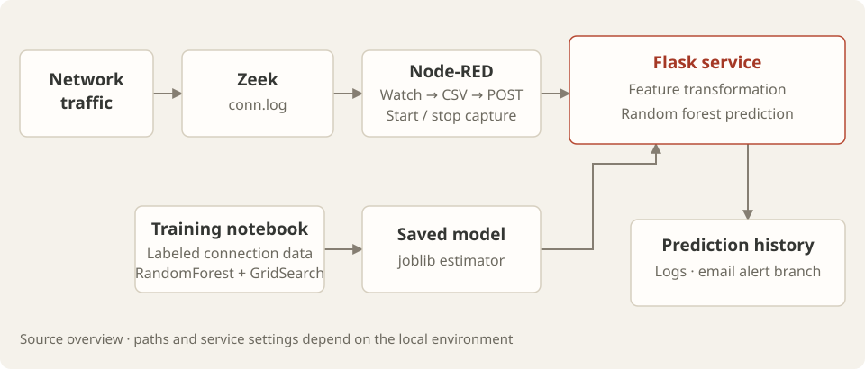

## 背景

网络扫描会在连接元数据中留下特征：目的端口、协议、连接状态和数据包数量。本项目探索如何利用这些信号构建针对 Nmap 扫描行为的检测器，将流量观测、监督学习和可视化处理工作流结合在一起。

## 实现

仓库包含两条相互衔接的路径：

- **训练：** notebook 负责准备带标签的连接数据、对类别字段编码，并训练 `RandomForestClassifier`。`GridSearchCV` 用于搜索模型参数；训练好的估计器通过 joblib 保存。
- **预测：** 导出的 Node-RED 流程会启动 Zeek、监视 `conn.log`、将选定字段转换为 CSV，并把新读取的行发送给 Flask 服务。该服务进行特征变换并返回预测标签。

<figure>
  
  <figcaption>仓库中体现的代码路径：上方为抓包与推理，下方为模型训练。</figcaption>
</figure>

`run/model_api.py` 暴露了 `POST /predict` 接口，保存预测历史，并在 `/log` 提供 JSON 日志、在 `/log_view` 提供 HTML 视图。检测分支会调用邮件告警函数。这使得该项目适合用来研究网络监控器、分类器与应用服务之间的接口。

## 查看成果

- [Node-RED 流程](https://github.com/Y0uYuGe/nmap_ids/blob/main/node-red-flow.json)：进程控制、文件监视、CSV 提取和 HTTP 请求。
- [训练 notebook](https://github.com/Y0uYuGe/nmap_ids/blob/main/train/train.ipynb)：特征准备、参数搜索和评估代码。
- [预测服务](https://github.com/Y0uYuGe/nmap_ids/blob/main/run/model_api.py)：预处理、模型加载、预测和历史记录路由。
- [开发历史](https://github.com/Y0uYuGe/nmap_ids/commits/main/)：公开仓库中记录的变更。

## 运行项目

抓包工作流需要一个装有 Zeek、Node-RED、Python 的 Linux 环境，并且有权限监听所选的网络接口。Python 依赖包括 pandas、NumPy、scikit-learn、joblib 和 Flask。导入流程之前，需要把其中的绝对路径、抓包接口和预测 URL 调整为本地环境；如果使用邮件发送，需单独配置。

已发布的目录树使用 `run/` 和 `train/`。复现该原型时应以这些源码路径为准，因为 README 中的目录示意与实际提交的文件不一致。模型结果取决于带标签的数据集和评估划分；仓库中包含可供查看的评估代码。
