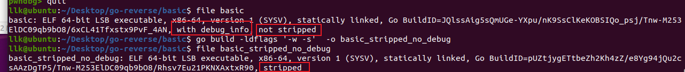
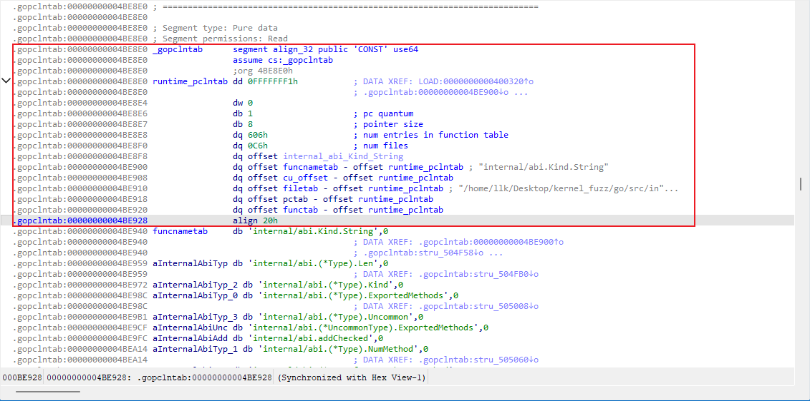
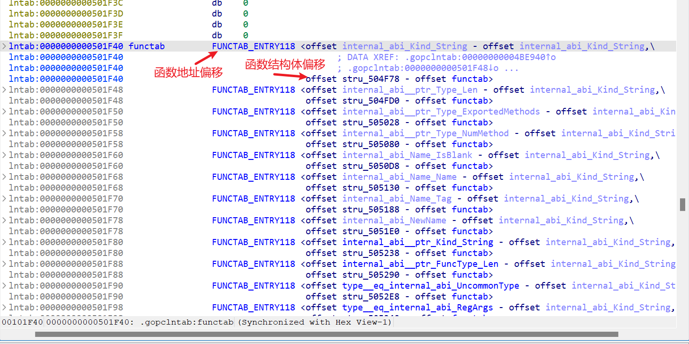
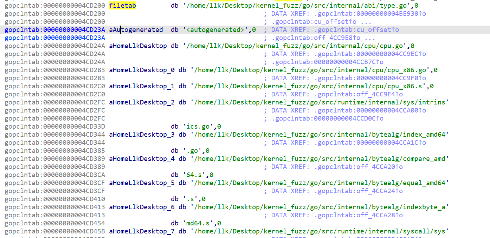
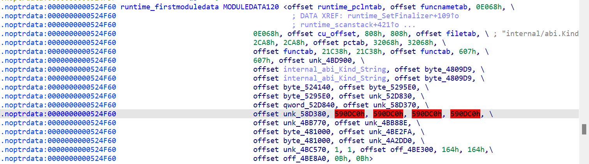
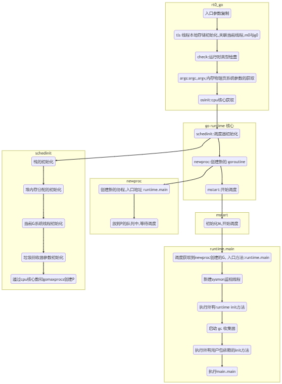


# go 编译参数 ldflags -w -s 的作用与问题
[https://blog.csdn.net/Kevin_Gates/article/details/130107710](https://blog.csdn.net/Kevin_Gates/article/details/130107710)
-ldflags 参数可以用来向编译器传递额外的参数。其中，-w 和 -s 是两个常用的参数。

- w：剥离 DWARF 调试信息。这会减小可执行文件的体积。
- s：剥离符号表信息。这会进一步减小可执行文件的体积。

使用 `-ldflags "-w -s"` 参数编译出可执行文件之后，可以通过以下方式检查生成的可执行文件是否已经剥离了调试信息和符号表。


### 使用 `file` 命令检查文件类型

`file` 命令可以显示可执行文件的基本信息；如果调试信息已被剥离，`file` 的输出中就不应提到调试符号。



# Go 语言逆向相关参考资料
[https://www.cnblogs.com/lordtianqiyi/articles/16315905.html](https://www.cnblogs.com/lordtianqiyi/articles/16315905.html)
[https://forum.butian.net/share/1874](https://forum.butian.net/share/1874)
[https://jiayu0x.com/2020/09/28/go-binary-reverse-engineering-tips-and-example/](https://jiayu0x.com/2020/09/28/go-binary-reverse-engineering-tips-and-example/)
[推荐阅读：从正向开发角度理解 Go 逆向](https://xz.aliyun.com/t/9015?time__1311=n4%2bxnD0DuAitG=DODy7DlhjmE3biDBn7QZDWqAID)
[Golang 逆向资料合集](https://zu1k.com/posts/security/reverse/golang-reverse/)

[Go 语言设计与实现](https://draveness.me/golang/docs/part3-runtime/ch07-memory/golang-garbage-collector/)


# go ID
Build ID 是 Go 二进制文件中的元数据之一
```cpp
llk@ubuntu:~/Desktop/go-reverse/basic$ go tool buildid basic
-VH5aOSX9mVrJNbHxruF/FwnNtemK3U4RER9TE7_8/5x300ikDrpjLHazn79N3/ftLrOMaMAByiPF3chfMM

```
无论是用 gccgo 还是 go 编译的，都可以通过 `file` 或 `readelf -n` 看到 BuildID
# 版本


```bash
一、查看版本号
go version xx.exe
二、查看地址以及依赖库
go version -m xxx.exe
```


# GOROOT 与 GOPATH

- **`GOROOT`**：主要是 Go 工具链的位置；通常不需要手动修改。
- **`GOPATH`**：用来管理和组织用户的 Go 项目；可以根据需要进行设置和修改，方便管理不同的工作区。

### GOROOT

- **定义**：`GOROOT` 是 Go 的安装目录。它指向包含 Go 工具链、标准库源码、编译器等内容的目录。
- **默认值**：安装 Go 时，`GOROOT` 通常会自动设置为安装路径。例如，通过官方安装程序安装 Go 时，`GOROOT` 可能是 `/usr/local/go`（类 Unix 系统）或 `C:\Go`（Windows）。
- **作用**：
  - 存放 Go 编译器和工具链。
  - 包含标准库源码。
  - Go 工具使用 `GOROOT` 来定位编译器、链接器等工具，以及标准库源码。

### GOPATH

- **定义**：`GOPATH` 是 Go 项目的工作目录。它指向开发者的工作空间，可以包含多个目录。
- **默认值**：如果没有设置 `GOPATH`，默认通常是用户主目录下的 `go` 目录（例如 `$HOME/go`）。
- **结构**：`GOPATH` 目录通常包含三个子目录：
  - `src`：存放源代码。
  - `pkg`：存放编译后的包对象文件。
  - `bin`：存放编译后生成的可执行文件。
- **作用**：
  - 用于存放和组织用户的 Go 代码。
  - `go get` 命令会把依赖包下载到 `GOPATH` 的 `src` 目录中。
  - 编译时，Go 工具会在 `GOPATH` 中查找包的源代码。

### GOROOT 与 GOPATH 的关系

- `GOROOT` 是 Go 工具链的安装目录，包含标准库。
- `GOPATH` 是用户的工作空间目录，包含用户的代码和第三方库。

### 示例

假设你在 `$HOME/go_projects` 下开发一个项目：

1. 你可以把 `GOPATH` 设置为 `$HOME/go_projects`：
   ```sh
   export GOPATH=$HOME/go_projects
   ```

2. 你的项目目录结构可能是这样的：
   ```
   $HOME/go_projects/
       src/
           github.com/
               yourusername/
                   yourproject/
                       main.go
       pkg/
       bin/
   ```

3. 编译你的项目：
   ```sh
   cd $HOME/go_projects/src/github.com/yourusername/yourproject
   go build
   ```

编译后的可执行文件会出现在 `$HOME/go_projects/bin` 目录中。


# go build 与 go mod
```cpp
go build命令用来启动编译，它可以将Go语言程序与相关依赖编译成一个可执行文件，其语法格式如下。
go build fileName  -o 可执行程序名
其中 fileName 为所需要的参数，可以是一个或者多个 Go 源文件名（当有多个参数时需要使用空格将两个相邻的参数隔开），也可以省略不写。
使用 go build 命令进行编译时，不同参数的执行结果也是不同的。
```
编译一个 Go 程序同样也是一个编译和链接的过程


[golang 包管理工具----go mod](https://juejin.cn/post/6914195712737542157)


一个 Module 可以包含多个不同的 Package，而每个 Package 又可以包含多个目录和许多源文件。

```cpp
Module :moduledata 里面有pclntab 全名是 Program Counter Line Table
```

# pclntab（程序计数器行号表）

它对应源码中的 pcHeader 结构体，位于 `src/runtime/symtab.go`

```cpp
// pcHeader 包含 pclntab 查找使用的数据。
type pcHeader struct {
        magic          uint32  // 0xFFFFFFF1: 用于识别 pcHeader 结构的魔数。
        pad1, pad2     uint8   // 0,0: 对齐结构在内存中的填充字节。
        minLC          uint8   // 架构的最小指令大小。
        ptrSize        uint8   // 指针的字节大小（取决于 32 位或 64 位架构）。
        nfunc          int     // 模块中的函数数量。
        nfiles         uint    // 文件表中的条目数量（模块中的源文件数量）。
        textStart      uintptr // 功能入口 PC 偏移的基地址，等于 moduledata.text。
        funcnameOffset uintptr // 从 pcHeader 开始到 funcnametab 变量的偏移量，包含函数名。
        cuOffset       uintptr // 从 pcHeader 开始到 cutab 变量的偏移量，用于编译单元信息。
        filetabOffset  uintptr // 从 pcHeader 开始到 filetab 变量的偏移量，包含文件名。
        pctabOffset    uintptr // 从 pcHeader 开始到 pctab 变量的偏移量，用于 PC 数据表。
        pclnOffset     uintptr // 从 pcHeader 开始到 pclntab 变量的偏移量，用于 PC 到行号的映射。
}
```



1. **cu_offset**：
   - `cu_offset` 是编译单元的偏移量。
   - 在 `gopclntab` 中，一个编译单元是一个包含函数信息、行号表等内容的大块。
   - `cu_offset` 指的是当前函数在该编译单元中的偏移位置。

2. **pctab**：
   - `pctab` 是一个存储程序计数器（PC）与行号之间映射关系的表。
   - 这种映射关系使得在运行时能够从某个 PC 值反查出对应的源码行号，便于调试和错误处理。

3. **runtime_pclntab**：
   - `runtime_pclntab` 是整个 `gopclntab` 的起始点或基址。
   - 它是一张全局表，包含所有函数的 PC 到函数信息的映射。

4. **dq offset cu_offset - offset runtime_pclntab**：
   - 这表示当前函数的 `cu_offset` 减去全局 `runtime_pclntab` 的偏移量，得到一个具体的偏移值。
   - 这个偏移值用来在整个 `gopclntab` 结构中定位当前函数。

5. **dq offset pctab - offset runtime_pclntab**：
   - 这表示当前函数的 `pctab` 减去全局 `runtime_pclntab` 的偏移量。
   - 这个偏移值用来在整个 `gopclntab` 结构中定位 `pctab`。

函数表
函数地址偏移是相对于函数表中第一个函数的地址

源文件表



# Moduledata 
Module 是比 Package 更高层的概念：一个 Module 可以包含多个不同的 Package，而每个 Package 又可以包含多个目录和许多源文件。

相应地，Moduledata 也是 Go 二进制文件中一个更高层的数据结构，包含了许多其他结构的索引信息

根据 Moduledata 的定义，源码路径是 `src/runtime/symtab.go`

```cpp
type moduledata struct {
        sys.NotInHeap // 仅用于静态数据

        // 指向pcHeader结构的指针，包含程序计数器的头信息
        pcHeader     *pcHeader
        funcnametab  []byte      // 函数名称表
        cutab        []uint32    // 编译单元表
        filetab      []byte      // 文件表
        pctab        []byte      // 程序计数器表
        pclntable    []byte      // PC到行号的映射表
        ftab         []functab   // 函数表
        findfunctab  uintptr     // findfunctab函数的起始地址
        minpc, maxpc uintptr     // 代码段的起始和结束地址

        text, etext           uintptr // 代码段的起始和结束地址
        noptrdata, enoptrdata uintptr // 不包含指针的数据段的起始和结束地址
        data, edata           uintptr // 数据段的起始和结束地址
        bss, ebss             uintptr // BSS段的起始和结束地址
        noptrbss, enoptrbss   uintptr // 不包含指针的BSS段的起始和结束地址
        covctrs, ecovctrs     uintptr // 覆盖计数器的起始和结束地址
        end, gcdata, gcbss    uintptr // 结束地址，GC数据，GC BSS
        types, etypes         uintptr // 类型信息的起始和结束地址
        rodata                uintptr // 只读数据段的起始地址
        gofunc                uintptr // go.func.*

        textsectmap []textsect // 文本段映射
        typelinks   []int32    // 类型链接信息，存储类型偏移
        itablinks   []*itab    // 接口表链接

        ptab []ptabEntry // P 表

        pluginpath string       // 插件路径
        pkghashes  []modulehash // 包哈希信息

        // 这个切片记录了启动程序所需的初始化任务。由链接器构建。
        inittasks []*initTask

        modulename   string       // 模块名
        modulehashes []modulehash // 模块哈希信息

        hasmain uint8 // 如果模块包含main函数，则值为1，否则为0

        gcdatamask, gcbssmask bitvector // GC数据和BSS段的位向量

        typemap map[typeOff]*_type // 前一个模块中从偏移量到*_rtype的映射

        bad bool // 模块加载失败，应被忽略

        next *moduledata // 指向下一个模块的指针
}
```

Moduledata 条目可以串成一个链表，在一个完整的可执行 Go 二进制文件中，只有一个 firstmoduledata 包含上面展示的完整字段集合




# 程序启动
[Golang 程序启动流程](https://juejin.cn/post/7035633561805783070)

> rt0_amd64_linux->rt0_amd64->runtime_rt0_go
> rt0_go 代码相当长，可以分为两部分。第一部分处理系统参数获取和运行时检查。第二部分是 Go 程序启动的核心；整体启动流程如下

执行 runtime.main 主要完成以下工作：
1. 启动系统后台监控 sysmon 线程
2. 执行 runtime 包内的 init
3. 启动 GC
4. 执行用户包依赖的 init
5. 执行用户的 main.main 方法


1. **`rt0_go` 函数**
   - 程序启动时，Go 运行时的入口点是 `rt0_go` 函数。该函数负责初始化运行时环境。

2. **`schedinit`：初始化运行时组件**
   - `rt0_go` 调用 `runtime_schedinit_0` 来初始化调度器、内存分配器、垃圾回收器等。
   - **调度器初始化**：初始化调度器，为管理 Goroutine 的创建、调度和执行做准备。
   - **内存分配器初始化**：初始化堆内存管理，为 Goroutine 和程序数据分配内存。
   - **垃圾回收器初始化**：初始化垃圾回收器，自动管理内存的分配和回收。

3. **`newproc`：创建主 Goroutine**
   - `rt0_go` 调用 `runtime_newproc_0` 来创建主 Goroutine。主 Goroutine 的入口函数是 `runtime.main`，而不是用户的 `main` 函数。
   - **创建 Goroutine**：`newproc` 函数负责创建一个新的 Goroutine，并将其加入调度器的队列。这个 Goroutine 的入口函数就是 `runtime.main`。

4. **`mstart`：启动调度器的调度循环**
   - `rt0_go` 调用 `runtime_mstart` 来启动主线程。主线程执行 `runtime.main` 函数。
   - **调度循环**：`mstart` 函数启动调度器的调度循环，开始执行队列中的 Goroutine。首先执行的 Goroutine 就是入口方法为 `runtime.main` 的 G。

5. **`runtime.main`：执行初始化并运行用户的 `main` 函数**
   - `runtime.main` 函数首先会执行一些必要的初始化操作，例如设置全局变量、初始化标准库。
   - 然后，`runtime.main` 调用用户的 `main` 函数。

