
[非常感谢这篇博客，写得非常好](https://www.giantbranch.cn/2020/01/05/QEMU%20%E7%9A%84%E4%B8%80%E4%BA%9B%E5%9F%BA%E7%A1%80%E7%9F%A5%E8%AF%86%E5%8F%8AQOM%28Qemu%20Object%20Model%29%E7%9A%84%E9%83%A8%E5%88%86%E7%9B%B8%E5%85%B3%E6%BA%90%E7%A0%81%E9%98%85%E8%AF%BB/)

#  概述
QEMU 可以为用户进程提供 CPU 仿真的环境
一个 QEMU 进程提供的环境可以启动一台虚拟机

KVM 运行在内核中；它让 QEMU 启动的虚拟机能够安全地直接在 host CPU 上执行 guest 代码。它的作用是负责创建虚拟机、分配虚拟内存和虚拟 CPU

```c
// 第一步，获取到 KVM 句柄
kvmfd = open("/dev/kvm", O_RDWR);
// 第二步，创建虚拟机，获取到虚拟机句柄。
vmfd = ioctl(kvmfd, KVM_CREATE_VM, 0);
// 第三步，为虚拟机映射内存，还有其他的 PCI，信号处理的初始化。
ioctl(kvmfd, KVM_SET_USER_MEMORY_REGION, &mem);
// 第四步，将虚拟机镜像映射到内存，相当于物理机的 boot 过程，把镜像映射到内存。
// 第五步，创建 vCPU，并为 vCPU 分配内存空间。
ioctl(kvmfd, KVM_CREATE_VCPU, vcpuid);
vcpu->kvm_run_mmap_size = ioctl(kvm->dev_fd, KVM_GET_VCPU_MMAP_SIZE, 0);
// 第五步，创建 vCPU 个数的线程并运行虚拟机。
ioctl(kvm->vcpus->vcpu_fd, KVM_RUN, 0);
// 第六步，线程进入循环，并捕获虚拟机退出原因，做相应的处理。
for (;;) {
  ioctl(KVM_RUN)
  switch (exit_reason) {
      case KVM_EXIT_IO:  /* ... */
      case KVM_EXIT_HLT: /* ... */
  }
}
// 这里的退出并不一定是虚拟机关机，
// 虚拟机如果遇到 I/O 操作，访问硬件设备，缺页中断等都会退出执行，
// 退出执行可以理解为将 CPU 执行上下文返回到 Qemu。
```
退出时会检查退出原因；可能由 KVM 处理，也可能由 QEMU 处理
# 内存
可以这样理解：guest 使用的物理内存实际上是启动它的 QEMU 进程虚拟内存的一部分。也就是说，这部分内存（从 guest 的视角看）可能对应从 0 开始的 guest 物理内存

两层地址转换

 1. 从 guest 的虚拟地址到 guest 的物理地址
     相当于从页表中取得物理地址
 2. 从 guest 的物理地址到 host 上 QEMU 进程中的虚拟地址
     这个物理地址加上 guest 在 host 上 QEMU 进程虚拟地址空间中的起始地址，就得到了对应的 host 虚拟地址


第一层转换：使用 pagemap 页映射文件进行转换

 1. 虚拟地址在 pagemap 中对应的偏移（即它是 pagemap 中的第几项）乘以 8，就得到了 pagemap 中的偏移量（即 pagemap 中对应的地址）

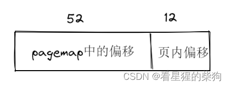 

 2. 读取后，检查内容是否存在，以及最高位是否为 1；如果是 1，表示该页存在。然后把读到的内容左移 12 位得到低 52 位（物理页的地址），再与原始虚拟地址的低 12 位（页内偏移）做或运算，即可得到 guest 的物理地址


用 QEMU 运行以下代码

```c
#include <stdio.h>
#include <string.h>
#include <stdint.h>
#include <stdlib.h>
#include <fcntl.h>
#include <assert.h>
#include <inttypes.h>

#define PAGE_SHIFT  12
#define PAGE_SIZE   (1 << PAGE_SHIFT)
#define PFN_PRESENT (1ull << 63)
#define PFN_PFN     ((1ull << 55) - 1)

int fd;
// 获取页内偏移
uint32_t page_offset(uint32_t addr)
{
	// addr & 0xfff
    return addr & ((1 << PAGE_SHIFT) - 1);
}

uint64_t gva_to_gfn(void *addr)
{
    uint64_t pme, gfn;
    size_t offset;

    printf("pfn_item_offset : %p\n", (uintptr_t)addr >> 9);
    offset = ((uintptr_t)addr >> 9) & ~7;

    ////下面是网上其他人的代码，只是为了理解上面的代码
    //一开始除以 0x1000  （getpagesize=0x1000，4k对齐，而且本来低12位就是页内索引，需要去掉），即除以2**12, 这就获取了页号了，
    //pagemap中一个地址64位，即8字节，也即sizeof(uint64_t)，所以有了页号后，我们需要乘以8去找到对应的偏移从而获得对应的物理地址
    //最终  vir/2^12 * 8 = (vir / 2^9) & ~7 
    //这跟上面的右移9正好对应，但是为什么要 & ~7 ,因为你  vir >> 12 << 3 , 跟vir >> 9 是有区别的，vir >> 12 << 3低3位肯定是0，所以通过& ~7将低3位置0
    // int page_size=getpagesize();
    // unsigned long vir_page_idx = vir/page_size;
    // unsigned long pfn_item_offset = vir_page_idx*sizeof(uint64_t);

    lseek(fd, offset, SEEK_SET);
    read(fd, &pme, 8);
    // 确保页面存在——page is present.
    if (!(pme & PFN_PRESENT)) //同时判断
        return -1;
    // physical frame number 
    gfn = pme & PFN_PFN; //取低52位
    return gfn;
}

uint64_t gva_to_gpa(void *addr)
{
    uint64_t gfn = gva_to_gfn(addr);
    assert(gfn != -1);
    return (gfn << PAGE_SHIFT) | page_offset((uint64_t)addr);//合并
}

int main()
{
    uint8_t *ptr;
    uint64_t ptr_mem;
    
    fd = open("/proc/self/pagemap", O_RDONLY);
    if (fd < 0) {
        perror("open");
        exit(1);
    }
    
    ptr = malloc(256);
    strcpy(ptr, "Where am I?");
    printf("%s\n", ptr); //此时ptr是guest中虚拟地址
    ptr_mem = gva_to_gpa(ptr); //此时转换成了guest中物理地址
    printf("Your physical address is at 0x%"PRIx64"\n", ptr_mem);

    getchar();
    return 0;
}
```
此时

```bash
 printf("Your physical address is at 0x%"PRIx64"\n", ptr_mem);
 ptr_mem输出为0x68cf0010
 0x7fcddc000000  为guest的物理地址在host视角下的起始地址
 0x7fcddc000000+0x68cf0010即对应where am I?
```

# PCI 设备
PCI 是 Peripheral Component Interconnect 标准；PCI 设备是符合该标准、连接到 PCI 总线上的设备。PCI 总线是 CPU 与外部设备之间的桥梁

符合 PCI 总线标准的设备称为 PCI 设备
PCI 设备分为主设备和目标设备；主设备是访问操作的发起者，目标设备是被访问的对象

每个 PCI 设备都有一个对应的 PCI 配置空间（PCI Configuration Space），记录着该设备的相关信息。PCI 配置空间最多 256 字节，其中前 64 字节是预先定义好的标准部分
## PCI 配置空间的前 64 字节
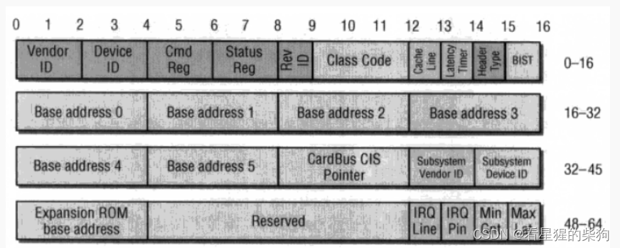
## 对应的源码

```c
typedef struct {
   WORD   wBusNum;		// Bus No. input field
   WORD   wDeviceNum;		// Device No. input field
   WORD   wFunction;		// Function No. input field
   WORD   wVendorId;		// Vendor ID input field
   WORD   wDeviceId;		// Device ID input field
   WORD   wDeviceIndex; 	// Device Search No. input field
   WORD   wCommand;             // Command
   WORD   wClassId; 		// Class ID
   BYTE   byInterfaceId;        // Interface ID
   BYTE   byRevId;              // Revision ID
   BYTE   byCLS;                // Cache Line Size
   BYTE   byLatency;            // Latency Timer
   DWORD  dwBaseAddr[6];        // 6个Base Address Register为32位
   DWORD  dwCIS;
   WORD   wSubSystemVendorId;
   WORD   wSubSystemId;
   DWORD  dwRomBaseAddr;        // Extension ROM Base Address
   BYTE   byIntLine;            // Interrupt Line
   BYTE   byIntPin;             // Interrupt Pin 
   BYTE   byMaxLatency;         // Max Latency
   BYTE   byMinGrant;           // Min Grant
  } PCIDEV, *LPPCIDEV;

```
共有 6 个 BAR；每个 BAR 记录了设备映射的一段地址空间，可以是 Memory 空间，也可以是 IO 空间
## Memory 空间的 BAR
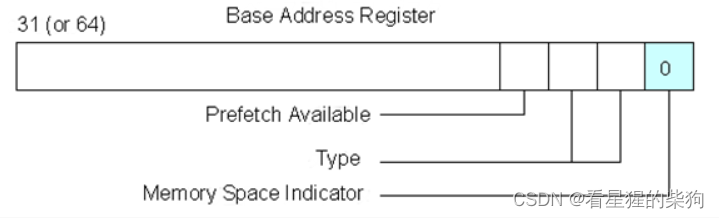
第 0 位为 0 表示这是 Memory 空间
第 1 位为 0 表示 32 位地址；为 1 表示 64 位地址
第 2 位为 0 表示该区域大小超过 1M；为 0 表示不超过 1M
第 3 位表示是否支持预取
## IO 空间的 BAR
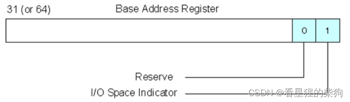第 0 位为 1 表示这是 IO 空间
# MMIO
内存映射 IO 与内存共用同一个地址空间。它的内容可以像读写内存一样进行读写
通过 Memory 空间访问设备 I/O 的方式称为内存映射 I/O，即 MMIO。此时 CPU 可以直接使用普通的内存访问指令来访问设备 I/O
# PMIO
端口映射 IO：内存和 IO 设备拥有各自独立的地址空间，CPU 需要专用指令来访问它们。在 Intel 微处理器中，使用的指令是 IN 和 OUT

通过 I/O 空间访问设备 I/O 的方式称为端口映射 I/O，即 PMIO。此时 CPU 需要使用 IN/OUT 等专用 I/O 指令来访问 I/O 端口
# Ispci
PCI 外设的地址看起来像 0000:00:1f.1 这样的格式。第一部分 16 位表示域（domain）；第二部分 8 位表示总线号；第三部分 5 位表示设备号；最后一部分 3 位表示功能号
lspci 命令可以显示当前的 PCI 设备

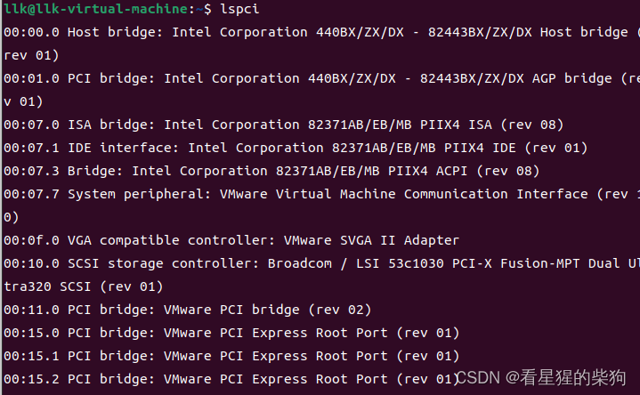

lspci -v 可以显示当前 PCI 设备的详细信息，比如 MMIO 地址和 PMIO 端口号
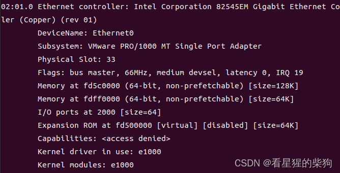

lspci -v -m -n -s <设备> 可以显示一些头部信息
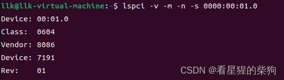

/sys/bus/pci/devices 中包含与 PCI 设备相关的文件
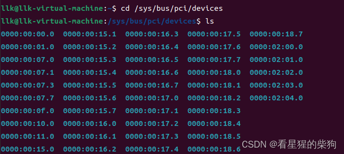
/sys/devices/pci0000:00 中同样包含与 PCI 设备相关的文件
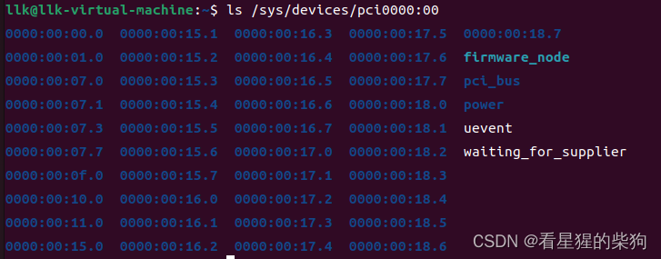
设备 ID 可以在 device 文件中查看
cat /sys/devices/pci0000\:00/0000:00:03.0/device
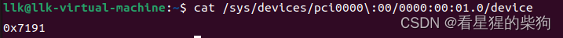

进入任意一个 PCI 设备目录用 ls 查看
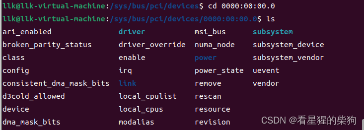

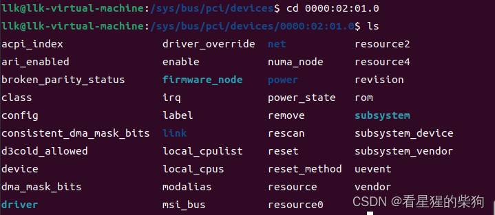
每个设备目录下，resource0 对应 MMIO 空间，resource1 对应 PMIO 空间（不是所有设备文件都有 resource0 或 resource1）
resource 文件记录了相关数据；第一行是 MMIO 信息，从左到右依次是：起始地址、结束地址、标志位。第二行是 PMIO

I/O 内存：/proc/iomem
I/O 端口：/proc/ioports
使用 cat /proc/iomem 可以查看当前 PCI 设备映射的内存空间
使用 cat /proc/ioports 可以查看当前 PCI 设备映射的端口空间
# 访问 PCI 设备配置空间中的 Memory 空间和 IO 空间
## MMIO

```c
#include <stdio.h>
#include <unistd.h>
#include <stdlib.h>
#include <stdint.h>
#include <string.h>
#include <errno.h>
#include <signal.h>
#include <fcntl.h>
#include <ctype.h>
#include <termios.h>
#include <assert.h>
#include <sys/types.h>
#include <sys/mman.h>
#include <sys/io.h>

#define MAP_SIZE 4096UL
#define MAP_MASK (MAP_SIZE - 1)

char* pci_device_name = "/sys/devices/pci0000:00/0000:00:04.0/resource0";

unsigned char* mmio_base;

unsigned char* getMMIOBase(){
    
    int fd;
    if((fd = open(pci_device_name, O_RDWR | O_SYNC)) == -1) {
        perror("open pci device");
        exit(-1);
    }
    mmio_base = mmap(0, MAP_SIZE, PROT_READ | PROT_WRITE, MAP_SHARED, fd, 0);//根据resource0中的文件内容来分配Memory空间
    if(mmio_base == (void *) -1) {
        perror("mmap");
        exit(-1);
    }
    return mmio_base;
}

void mmio_write(uint64_t addr, uint64_t value)
{
    *((uint64_t*)(mmio_base + addr)) = value;
}

uint64_t mmio_read(uint64_t addr)
{
    return *((uint64_t*)(mmio_base + addr));
}

int main(int argc, char const *argv[])
{
    getMMIOBase();
    printf("mmio_base Resource0Base: %p\n", mmio_base);

    mmio_write(144, val);
    mmio_read(144);
    
    return 0;
}
```
## PMIO
访问端口需要权限
端口 0x000-0x3ff 可以用 ioperm(from, num, turn_on) 来访问
例如，ioperm(0x300,5,1); 获取 0x300 到 0x304 端口的访问权限
更高的端口需要用 iopl(3) 获取权限，这样可以访问该范围内的所有端口
in 和 out 系列函数如下：分别用于写入／读取一个字节（以 b 结尾）、两个字节（以 w 结尾）、四个字节（以 l 结尾）

```c
#include <sys/io.h >

iopl(3); 
inb(port); 
inw(port); 
inl(port);

outb(val,port); 
outw(val,port); 
outl(val,port);
```

# QQM（qemu object model）
QEMU 提供了一套面向对象的编程模型——QOM，即 QEMU Object Module。几乎所有的设备，比如 CPU、内存、总线，都是用这套面向对象模型实现的
对象初始化分为四个步骤：

 1. 把 TypeInfo 注册为 TypeImpl
 2. 实例化 ObjectClass
 3. 实例化 Object
 4. 添加 Property

ObjectClass：所有类对象的基类；它只存储一个整数类型
Object：所有对象的 Base Object；它的第一个成员变量是指向 ObjectClass 的指针
TypeInfo：用户用来定义一个 Type 的工具型数据结构
TypeImpl：数据类型的抽象数据结构；TypeInfo 的属性与 TypeImpl 的属性相对应

# 简要总结

## 把 TypeInfo 注册为 TypeImpl：

1. 首先，`__attribute__((constructor))` 修饰符使 type_init 在 main 之前执行。type_init 的参数是 XXX_register_types 函数指针，它被传给 ModuleEntry 的 init 函数指针。最终，这个 ModuleEntry 被插入到 ModuleTypeList 中
2. 主函数中的 module_call_init(MODULE_INIT_QOM); 会调用 ModuleTypeList 中所有类型为 MODULE_INIT_QOM 的 ModuleEntry 的 init() 函数，这正是第一步中作为 type_init 第一个参数传入的 XXX_register_types 函数指针
3. 接下来是 XXX_register_types 函数的操作，即创建 TypeImpl 哈希表

## ObjectClass 的初始化：

调用链：main->select_machine->object_class_get_list->object_class_foreach->object_class_foreach_tramp->type_initialize

parent->class->interfaces 中的部分信息会被加入到 ti->class->interfaces 列表中，ti->interfaces[i].typename 对应的类型信息也会被加入到 ti->class->interfaces 列表中。最后，也是最重要的一步，会调用父类的 class_base_init 进行初始化，然后再调用自己的 ti->class_init 进行初始化

## 实例化 Instance（Object）

调用链：qemu_opts_foreach->device_init_func->qdev_device_add->object_new->object_new_with_type

object_new_with_type 函数会初始化 Object 的部分成员，并通过 object_init_with_type 函数调用 ti->instance_init 函数（如果有父类，会先递归调用 object_init_with_type，再调用自己的 ti->instance_init 函数）。最后 object_post_init_with_type 与之类似，只是它先调用自己的 ti->instance_post_init，再递归调用父类的 ti->instance_post_init

## 做好自己写一个迷你版 QEMU 的准备，否则真的会很迷

