
#  参考
[https://xz.aliyun.com/t/6562?time__1311=n4%2bxnD0DRDBAi=GkDgiDlhjmYh2xuCllx7whD&alichlgref=https://www.bing.com/#toc-3](https://xz.aliyun.com/t/6562?time__1311=n4%2bxnD0DRDBAi=GkDgiDlhjmYh2xuCllx7whD&alichlgref=https://www.bing.com/#toc-3)

# 地址相关
每个 qemu 虚拟机都是宿主机上的一个进程，该进程通过 mmap 分配 0x40000000 字节的宿主机虚拟内存，作为虚拟机的物理内存

GVA：guest virtual address（虚拟机中的虚拟地址）
GPA：guest physical address（虚拟机中的物理地址）
HVA：host virtual address（宿主机上的虚拟地址）
HPA：host physical address（宿主机上的物理地址）

GVA 通过虚拟机的页表转换为 GPA，GPA 实际上是宿主机进程 mmap 出来的空间中的偏移，加上基址就得到 HVA（mmap 分配虚拟机所申请大小的内存，作为该虚拟机的物理内存）


2. 设备可以申请两类空间：memory mapped I/O（MMIO）和 port mapped I/O（PMIO），并使用配置空间中的基址寄存器（BAR）来标记内存地址信息

```c
#include <stdio.h>
#include <string.h>
#include <stdint.h>
#include <stdlib.h>
#include <fcntl.h>
#include <assert.h>
#include <inttypes.h>

#define PAGE_SHIFT  12
#define PAGE_SIZE   (1 << PAGE_SHIFT)
#define PFN_PRESENT (1ull << 63)
#define PFN_PFN     ((1ull << 55) - 1)

int fd;

uint32_t page_offset(uint32_t addr)
{
    return addr & ((1 << PAGE_SHIFT) - 1);
    //虚拟地址addr在其所在页面内的偏移量
}

uint64_t gva_to_gfn(void *addr)
{
    uint64_t pme, gfn;
    size_t offset;
    offset = ((uintptr_t)addr >> 9) & ~7;//页表条目相对于文件开始的偏移量（GFN, Guest Physical Frame Number）
    lseek(fd, offset, SEEK_SET);//移动文件指针到计算出的偏移量处，准备读取PTE。
    read(fd, &pme, 8);  //从文件中读取8字节到pme变量即物理块起始地址
    if (!(pme & PFN_PRESENT))
        return -1;
    gfn = pme & PFN_PFN;
    return gfn;
}

uint64_t gva_to_gpa(void *addr)
{
    uint64_t gfn = gva_to_gfn(addr);
    assert(gfn != -1);
    return (gfn << PAGE_SHIFT) | page_offset((uint64_t)addr);
}

int main()
{
    uint8_t *ptr;
    uint64_t ptr_mem;
    // uint64_t ptr_malloc;
    fd = open("/proc/self/pagemap", O_RDONLY);
    if (fd < 0) {
        perror("open");
        exit(1);
    }

    ptr = malloc(256);
    strcpy(ptr, "Where am I?");
    printf("%s\n", ptr);
    ptr_mem = gva_to_gpa(ptr);
    
    printf("Your physical address is at 0x%"PRIx64"\n", ptr_mem);
    // ptr_malloc = gva_to_gpa(&malloc);
    // printf("malloc physical address 0x%"PRIx64" \n",ptr_malloc);

    getchar();
    return 0;
}
```

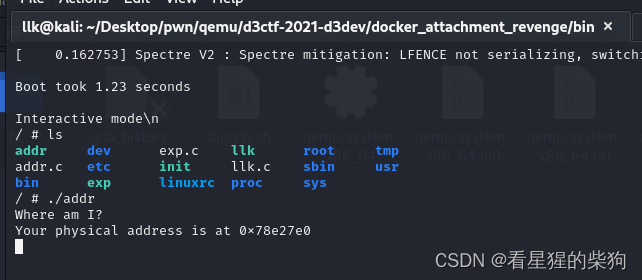
gdb attach 之后，通过 vmmap 可以看到启动脚本中 -M 指定的分配大小

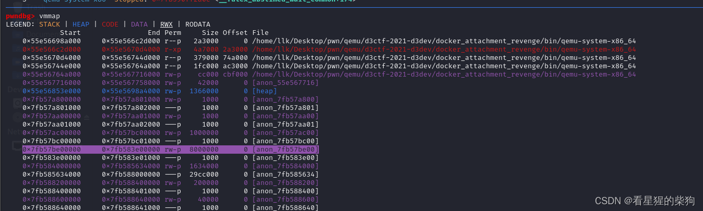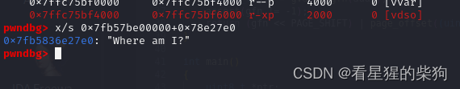


# 交互相关

 每个 PCI 设备都有一个总线号、一个设备号和一个功能标识，并且位于某个 PCI 域中。一个 PCI 域最多可以容纳 256 条总线，每条总线最多可以有 32 个设备，每个设备最多可以有 8 个功能 

   lspci 可以显示设备的域、总线号、设备号和功能号，不同版本的 lspci 显示的内容不同

   对于 0000:00:03.0 这种形式的数据，0000 是 domain，00 是总线号，03 是设备号，0 是功能号
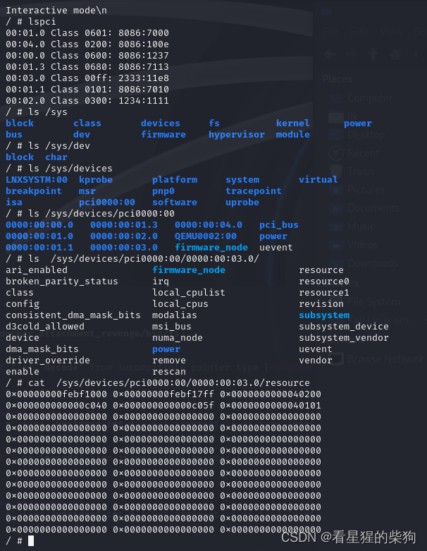
resource 中的 pmio 端口和 mmio 基址是固定的
mmio：把配置好的寄存器映射到端口，访问端口即可访问寄存器
pmio：把配置好的寄存器映射到内存，访问内存即可访问寄存器


- hexdump /sys/devices/pci0000:00/0000:00:03.0/config 可以查看 deviceid、vendorid 等配置信息
- 访问 memory mapped I/O 内存：open 得到 fd，然后用 mmap 映射内存地址，直接对内存进行操作

```c
int mmio_fd = open("/sys/devices/pci0000:00/0000:00:04.0/resource0", O_RDWR | O_SYNC);
mmio_mem = mmap(0, 0x1000, PROT_READ | PROT_WRITE, MAP_SHARED, mmio_fd, 0);
```

- 访问 port mapped I/O 内存：申请端口访问权限后，用 in 和 out 进行访问

```c
iopl(3);// iopl(3) 表示打开对全部IO端口的访问权限
inb(port); //从端口读一个字节
outb(val,port); //往端口写一个字节val
```

设备会注册自己的 MMIO 和 PMIO 读写函数，当检测到对其内存或端口的访问时，就会调用注册的读写函数，实现对设备内存的读写访问


访问设备所在内存时，会调用注册的 mmio 读函数 d3dev_mmio_read，读取位置为基址 + 0x128，读取 4 字节。在 d3dev_mmio_read 中识别为 rsi = 0x128（偏移）以及 rdx = 4

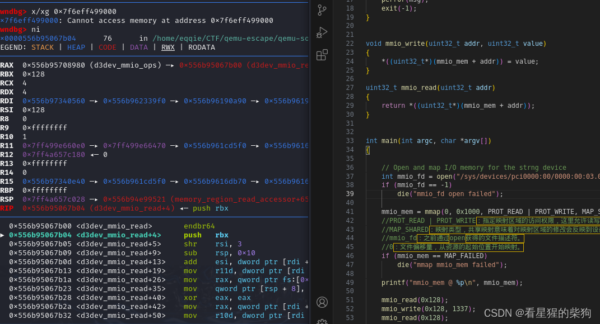
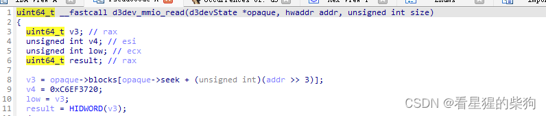
写设备所在内存时，会调用注册的 mmio 写函数 d3dev_mmio_write
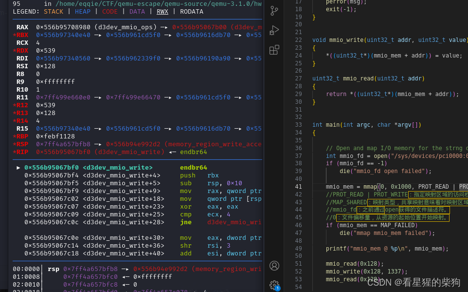

```c
#include <assert.h>
#include <fcntl.h>
#include <inttypes.h>
#include <stdio.h>
#include <stdlib.h>
#include <string.h>
#include <sys/mman.h>
#include <sys/types.h>
#include <unistd.h>
#include<sys/io.h>


unsigned char* mmio_mem;

void die(const char* msg)
{
    perror(msg);
    exit(-1);
}


void mmio_write(uint32_t addr, uint32_t value)
{
    *((uint32_t*)(mmio_mem + addr)) = value;
}

uint32_t mmio_read(uint32_t addr)
{
    return *((uint32_t*)(mmio_mem + addr));
}


int main(int argc, char *argv[])
{

    // Open and map I/O memory for the strng device
    int mmio_fd = open("/sys/devices/pci0000:00/0000:00:03.0/resource0", O_RDWR | O_SYNC);//O_SYNC标志表示同步I/O操作，确保对文件的写操作在返回前完成
    if (mmio_fd == -1)
        die("mmio_fd open failed");

    mmio_mem = mmap(0, 0x1000, PROT_READ | PROT_WRITE, MAP_SHARED, mmio_fd, 0);
    //PROT_READ | PROT_WRITE：指定映射区域的访问权限，这里允许读写。
    //MAP_SHARED：映射类型，共享映射意味着对映射区域的修改会反映到设备上，其他映射同一资源的进程也能看到修改。
    //mmio_fd：之前通过open获得的文件描述符。
    //0：文件偏移量，从资源的起始位置开始映射。
    if (mmio_mem == MAP_FAILED)
        die("mmap mmio_mem failed");

    printf("mmio_mem @ %p\n", mmio_mem);

    mmio_read(0x128);
    mmio_write(0x128, 1337);
    mmio_read(0x128);

}
```

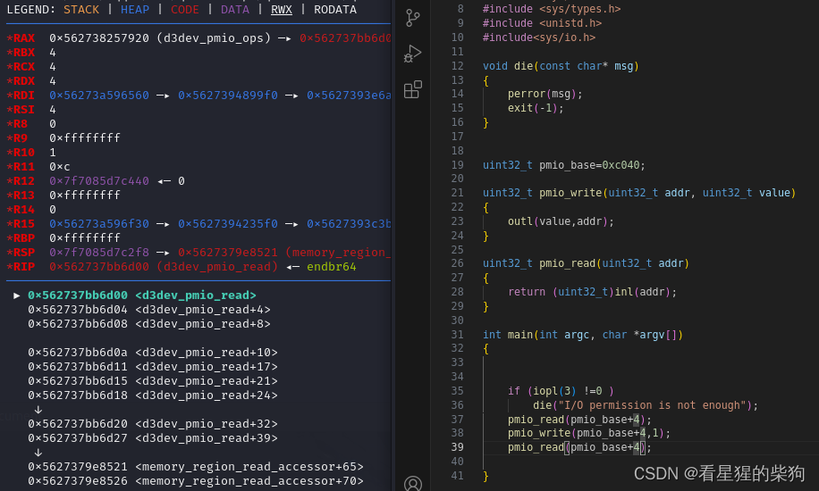
可以看到 rsi 被设置为偏移
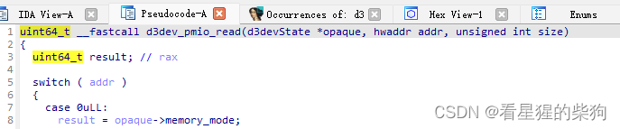

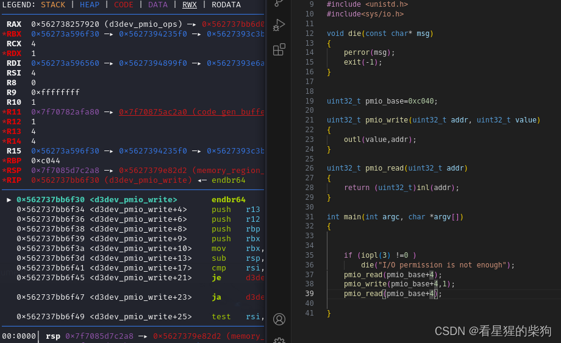


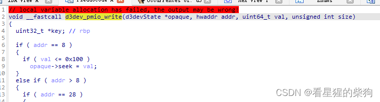

```c
#include <assert.h>
#include <fcntl.h>
#include <inttypes.h>
#include <stdio.h>
#include <stdlib.h>
#include <string.h>
#include <sys/mman.h>
#include <sys/types.h>
#include <unistd.h>
#include<sys/io.h>

void die(const char* msg)
{
    perror(msg);
    exit(-1);
}


uint32_t pmio_base=0xc040;

uint32_t pmio_write(uint32_t addr, uint32_t value)
{
    outl(value,addr);
}

uint32_t pmio_read(uint32_t addr)
{
    return (uint32_t)inl(addr);
}

int main(int argc, char *argv[])
{


    if (iopl(3) !=0 )
        die("I/O permission is not enough");
    pmio_read(pmio_base+4);
    pmio_write(pmio_base+4,1);
    pmio_read(pmio_base+4);

}
```

- 在 qemu 中运行程序时，设备读写涉及的操作是由 qemu 进程执行的，而不是由虚拟机执行——它们操作的是 qemu 进程的虚拟地址，而不是 mmap 出来作为虚拟机内存的那部分（和普通用户态一样）
- 注册的读写函数中的 addr 是偏移，mmio 的范围是 0x800，pmio 是 0x20

# 配置相关
PCI 设备有一个配置空间用于存放设备信息，头部最开始的数据是 Device id 和 Vendor id

 初始化设备时会初始化四个重要的结构体：TypeInfo -> TypeImpl -> ObjectClass -> Object。每个 Object 对应一个具体的设备，在 qemu 启动并通过 -device 参数加载设备时会调用其构造函数

设备读写操作函数的第一个参数就是指向这个 Object 类的指针


# 调试

把 exp 打包进文件系统

```bash
gcc -static exp.c -o   exp
find . | cpio -o --format=newc > ../rootfs.img
```
启动 qemu

```bash
./launch.sh
```

```bash
touch .gdbinit
往里面写入断点
b*d3dev_pmio_write
b*d3dev_pmio_read
b*d3dev_mmio_write
b*d3dev_mmio_read
去除符号表就用
b *$rebase(addr)
```

```bash
ps -ef | grep qemu
一般是最下面的那个进程

```

```bash
sudo gdb attach -p 进程号
```

在 qemu 中：

```bash
./exp
```
此时 gdb 会在断点处断下，就可以开始调试了

> attach 成功后即可下断点调试。程序开启了 PIE 保护且没有符号表，可以用 pwndbg 的 $rebase() 根据 IDA 中的地址确定进程中的真实地址

# QOM
[https://www.cnblogs.com/edver/p/14684143.html](https://www.cnblogs.com/edver/p/14684143.html)
[https://martins3.github.io/qemu/qom.html](https://martins3.github.io/qemu/qom.html)

[https://juniorprincewang.github.io/2018/07/23/qemu%E6%BA%90%E7%A0%81%E6%B7%BB%E5%8A%A0%E8%AE%BE%E5%A4%87/](https://juniorprincewang.github.io/2018/07/23/qemu%E6%BA%90%E7%A0%81%E6%B7%BB%E5%8A%A0%E8%AE%BE%E5%A4%87/)
# 待完善（以后做题用到了再补充）

