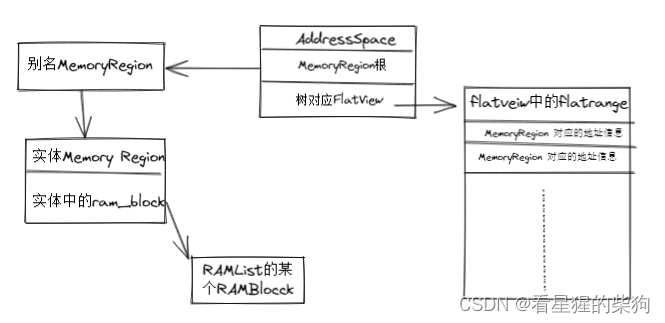


# QEMU 内存管理（QEMU 如何管理某个具体 VM 的内存）
QEMU：能够完成 gva-gpa-hva-hpa 的地址转换

## MemoryRegion gpa->hpa
QEMU 通过 MemoryRegion 来管理虚拟机的内存；每个 MemoryRegion 对应 VM 内存的一部分，以及对应 Host 虚拟内存的信息。不同的 MemoryRegion 以树的形式组织在某个根 MemoryRegion 之下；不同的 MemoryRegion 树代表着承担不同角色的内存，例如系统内存空间（system_memory）或 IO 内存空间（system_io）

MemoryRegion 可以分为以下三种类型
 - 根级 MemoryRegion：通过 memory_region_init 初始化；它只用于管理（例如 system_memory），本身没有对应的内存
 - 具体 MemoryRegion：通过 memory_region_init_ram 初始化；它拥有大小为 size 的对应内存
 - 别名 MemoryRegion：通过 memory_region_init_alias 初始化；它本身没有对应的内存，作为某个具体 region 的别名存在，通过 alias 成员指向对应的具体 region；alias_offset 表示该别名 MemoryRegion 所代表内存的起始 GPA 相对于其所对应具体 MemoryRegion 所代表内存起始 GPA 的偏移量

## FlatView：表示 MR 树所对应的地址空间
```c
struct FlatView {
    struct rcu_head rcu;
    unsigned ref;
    FlatRange *ranges;
    unsigned nr;
    unsigned nr_allocated;
    struct AddressSpaceDispatch *dispatch;
    MemoryRegion *root;
};
```
##  FlatRange：存放不同 MR 对应的地址信息

```c
struct FlatRange {
    MemoryRegion *mr;
    hwaddr offset_in_region;
    AddrRange addr;
    uint8_t dirty_log_mask;
    bool romd_mode;
    bool readonly;
    bool nonvolatile;
};
```

## AddressSpace：不同类型的 MemoryRegion 树
一共有两种：address_space_memory 和 address_space_io
```c
/**
 * struct AddressSpace: describes a mapping of addresses to #MemoryRegion objects
 */
struct AddressSpace {
    /* private: */
    struct rcu_head rcu;
    char *name;
    MemoryRegion *root; //是对应树的根

    /* Accessed via RCU.  */
    struct FlatView *current_map; //对对应树的地址空间表示

    int ioeventfd_nb;
    struct MemoryRegionIoeventfd *ioeventfds;
    QTAILQ_HEAD(, MemoryListener) listeners;
    QTAILQ_ENTRY(AddressSpace) address_spaces_link;
};
```

## RAMBlock
MR 所对应的 Host 虚拟内存；每个 RAMBlock 代表单个具体 MemoryRegion 所占用的 Host 虚拟内存信息，多个 RAMBlock 组成一个 RAMList
每个 RAMBlock 都唯一对应一个 MemoryRegion


## 整体简化示意图
大佬们轻喷，后面深入学习了会再完善

# QEMU 设备模拟（QEMU 模拟的 IO 设备如何与 VM 交互）
QEMU 在用户空间独立完成设备模拟；虚拟设备通过 VMM 提供的接口被其他 VM 调用。并且设备模拟独立于 VMM
## QEMU 设备 IO 处理
当虚拟机访问虚拟设备的物理内存/端口时，控制权会从 VM 转移到 VMM；此时 QEMU 会根据触发 VM-exit 的事件类型，即 MMIO 或 PMIO，做出不同的处理。
MMIO：读写 address_space_memory 类型的地址空间
PMIO：读写 address_space_io 类型的地址空间

