# CTF-虚拟机——【前置知识一】


## 虚拟化与虚拟机
虚拟化：将计算机的各种物理资源抽象出来，呈现出不同的虚拟资源

虚拟机：利用虚拟化技术将一台计算机变为多台逻辑计算机——虚拟化技术中的系统虚拟化

按不同的抽象层次，虚拟化分为：
硬件虚拟化：为虚拟操作系统呈现与物理硬件相似的抽象层（VMware）
操作系统虚拟化：为多个用户空间提供类似操作系统的抽象层（docker）
库函数虚拟化：对库函数进行虚拟化，使应用程序可以使用不同的库运行
编程语言虚拟化：进程级虚拟化，模拟编译器/解释器来生成机器码

硬件虚拟化：
计算虚拟化：对 CPU 和内存资源进行虚拟化。
网络虚拟化：对网络链路资源进行虚拟化。
IO 虚拟化：对 IO 资源进行虚拟化。
存储虚拟化：对磁盘存储资源进行虚拟化

## 基本模型
计算机一般可以分为
物理硬件层、操作系统层、应用层

虚拟机可以分为：虚拟硬件层、操作系统层、应用层

### 虚拟硬件层——VMM
可以看作是位于虚拟机与硬件之间的一个软件层。该软件层不仅对硬件层进行抽象，还负责虚拟机的创建与销毁，并为虚拟机提供运行环境

### VMM 满足虚拟化系统架构的条件
等价性：在 VMM 管理下运行与在物理机上运行没有区别
资源控制：VMM 对虚拟化的资源有完全的控制权
高效性：经常使用的那部分机器指令应当直接在硬件上执行，无需 VMM 干预（这样可以提高效率）

## 两种 VMM 方案
VMM 与操作系统处于同一层，运行在硬件之上
VMM 与应用程序处于同一层，运行在操作系统之上

## 敏感指令与特权指令
特权指令：系统中有一些操作和管理关键系统资源的指令，这些指令只有在最高特权级上才能正确运行。如果在非最高特权级上运行，特权指令会引发一个异常，处理器会陷入到最高特权级，交由系统软件处理。

敏感指令：操作特权资源的指令，包括修改虚拟机的运行模式或下层物理机的状态；读写时钟和中断寄存器；访问存储保护系统、地址重定位系统以及所有的 I/O 指令
敏感指令必须在 VMM 的监控下或通过 VMM 来完成。

## 特权级压缩（Ring Compression）
VMM 运行在最高特权级，而 Guest VM 运行在较低特权级。当 Guest VM 执行敏感指令或特权指令时，会陷入到最高特权级的 VMM，再由 VMM 执行该敏感指令或特权指令。


# CTF - 虚拟机 — ［前置知识 第二部分］


## CPU 虚拟化

CPU 是计算机最核心的部件，直接控制着整个系统的运行。同时，内存访问（内存虚拟化）和 I/O 操作（I/O 虚拟化）也都直接依赖于 CPU，所以 CPU 虚拟化是系统虚拟化技术的核心

## 特权级压缩
VMM 处于最高特权级，Guest VM 处于较低特权级。Guest VM 执行非敏感指令时直接在硬件上运行；执行敏感指令时则陷入最高特权级的 VMM，由 VMM 执行该敏感指令的行为

## 特权级别
内核处于 ring 0；用户进程处于 ring 3
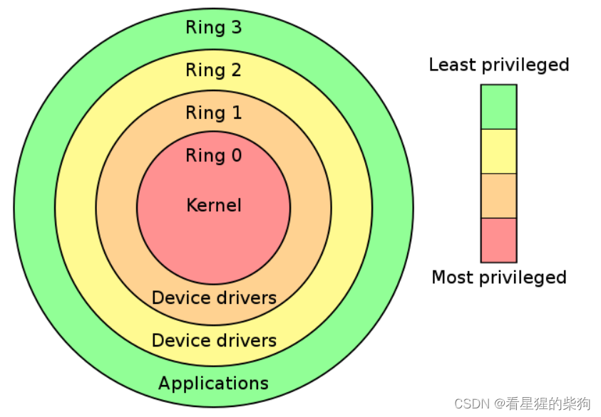
## 系统虚拟化
在系统虚拟化的“陷入与模拟”（Trap & Emulate）架构中，Guest OS 完全运行在 ring 3。当虚拟机涉及特权指令时，会触发一个通用保护异常，由 VMM 介入处理
但并非所有敏感指令都是特权指令，所以有些非特权的敏感指令不会触发通用保护异常让 VMM 介入——这是危险的

## 解决方案
### 仿真与解释（VMware）
仿真的本质：在不同的平台上实现与被仿真对象相同的行为
仿真技术：仿真器不断地从内存中读取指令，模拟每条指令的效果，然后决定是否改变状态（即解释）

QEMU（Quick Emulator）：完整仿真一整套计算机系统，包括各种硬件

仿真的缺点：性能极差；每条指令都必须被模拟，模拟步骤繁琐

### 扫描与打补丁（Scan & patch）
虚拟机和物理机的指令集基本相同，所以没必要进行纯粹的仿真
只有特权指令和敏感指令才会以某种方式转到 VMM
扫描与打补丁：把所有敏感指令替换成跳转指令或其他能陷入 VMM 的命令
基本流程：

 1. 在虚拟机执行每段代码之前，VMM 先扫描这段代码，解析每条指令，寻找敏感指令和特权指令
 2. VMM 为对应的指令动态生成补丁代码，把敏感指令和特权指令替换为跳出去进入 VMM 的跳转；VMM 执行这段补丁代码
 3. 补丁代码执行完后，VMM 跳回虚拟机继续执行下一段代码

### 二进制翻译（Binary Translation）
与扫描打补丁类似，二进制翻译也是动态修改代码，但 BT 以基本块（只有一个入口和一个出口的代码块）为翻译单位

 1. 仿真器对二进制代码进行翻译，输出由不包含特权指令或敏感指令的指令集组成的代码；这段代码可以在虚拟机下安全运行
 2. 仿真器为当前基本块动态分配一块空间，称为翻译缓存（translation cache），用于存放翻译后的代码；每个翻译缓存都与原始代码存在一定的映射关系

翻译方式

 1. 简单翻译：用其他代码实现等价功能，但指令数量会增加（少数情况）
 2. 等价翻译：翻译后的代码与原始代码相同（大多数情况）

### 二进制翻译与扫描打补丁的区别
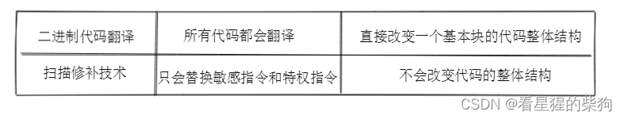
### 硬件辅助虚拟化（VT）
这是 Intel 为虚拟化提供的硬件支持；负责 CPU 虚拟化的部分叫做 VT-x

#### VMX 操作模式（Virtual Machine eXtensions）
 - VMX Root Operation：VMM 的工作模式；可以访问
所有资源，并调度虚拟机
 - VMX Non-Root Operation：虚拟机的工作模式；在这种模式下只能访问非敏感资源。访问敏感资源会导致 CPU 退出 Non-Root 模式，进入 VMX Root Operation 模式；处理完后再重新进入 VMX Non-Root Operation 模式

#### **模式切换行为的定义**

 - VM-Entry：VMM 保存自身的状态信息，切换到 VMX Non-Root Operation 模式，加载虚拟机的状态信息，恢复虚拟机的执行流程
 - VM-Exit：虚拟机停止运行并保存自身的状态信息，切换到 VMX Root Operation 模式，加载 VMM 的状态信息，并执行相应的处理程序
 
#### 特权级保护
VMX Root Operation 和 VMX Non-Root Operation 都有各自的特权级保护。Host OS 和 Guest OS 可以在各自对应的模式下直接在硬件上运行；只有当 Guest OS 访问敏感资源或 Host OS 调度虚拟机时才会发生切换
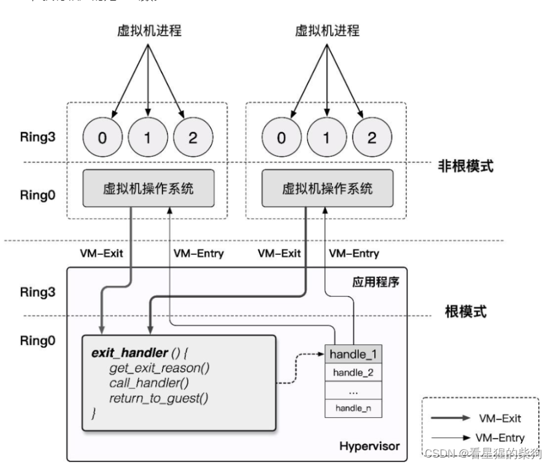
#### VMCS（Virtual-Machine Control Structure）
VMCS 是一块内存，存储着虚拟机的虚拟 CPU 的状态。每个虚拟 CPU 都有一个 VMCS；在任意时刻，一个物理 CPU 只能绑定一个 VMCS，即一个物理 CPU 对应一个虚拟 CPU，但在不同时刻，一个 VMCS 可以绑定不同的物理 CPU——虚拟 CPU 可以选择它对应的物理 CPU，这被称为 VMCS 迁移

**VMCS 与物理 CPU 的绑定与解绑**
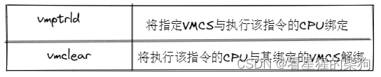

**在 VT-x 中，VMCS 结构被定义为一块最多 4KB 的内存，按 4KB 对齐（即对应十六进制地址的低三位为 0）**
```c
struct VMCS {
    /* 版本号，4字节 */
    uint32_t vmcs_revision_identifier:31, shadow_vmcs_indicator:1;

    /* 中止标识，4字节
     * 当 VM-Exit 失败时便会产生 VMX 中止，并在此处存放原因
     */
    uint32_t    vmx_abort_indicator;

    /* 数据域 */
    struct VMCSData vmcs_data;
};
```

**数据域 struct VMCSData vmcs_data 存储了 VMCS 的主要信息，可以分为以下几个部分**

[数据域布局示意图](https://rayanfam.com/assets/files/VMCS.pdf)

 - Guest-state area：存储虚拟机模式下的寄存器状态；在 VM-Entry 时加载，在 VM-Exit 时保存
 - Host-state area：存储 VMM 模式下的寄存器状态；在 VM-Exit 时加载，在 VM-Entry 时保存
 - VM-execution control fields：控制虚拟机模式下处理器的行为
 - VM-entry control fields：控制 VM-Entry 过程中的某些行为
 - VM-exit control fields：控制 VM-Exit 过程中的某些行为
 - VM-exit information field：存储 VM-Exit 的基本原因及其他详细信息；在某些处理器上该字段是只读的

**VMCS 的读写**
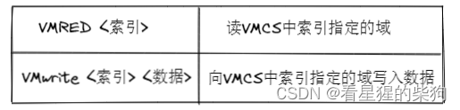

这里的 index 并不是偏移量；Intel 为数据域中的每个字段都定义了一个唯一的索引值

#### MSR
Model Specific Register，即 MSR，是 x86 下的一组寄存器；有的控制 CPU 的运行，有的记录特性开关，有的负责调试，有的监控 CPU 性能等等，但总体上可以分为两大类。如图所示：
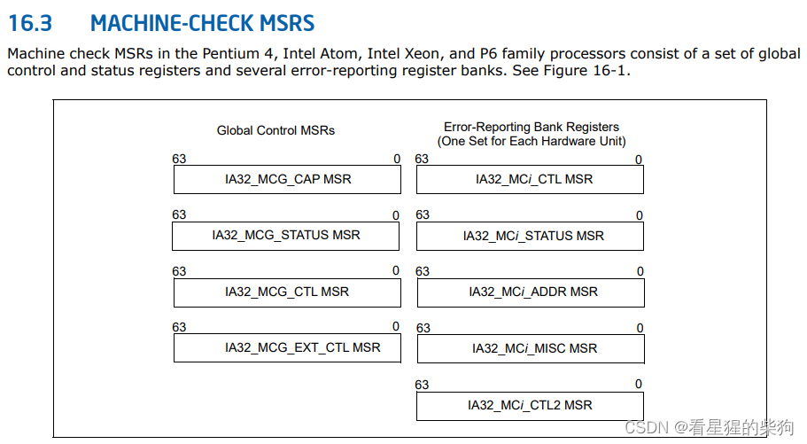

#### VMX 操作模式的整体流程
VMX 模式默认是关闭的；只有当 VMM 需要使用硬件辅助虚拟化时才会启用，并且只有启用之后，VM-root-operation 和 VM-non-root-operation 模式才会存在

> VMXON：启用 VMX 操作模式
> VMXOFF：关闭 VMX 操作模式


> resume 和 launch
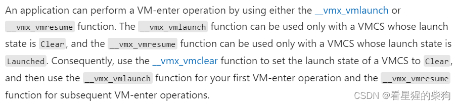


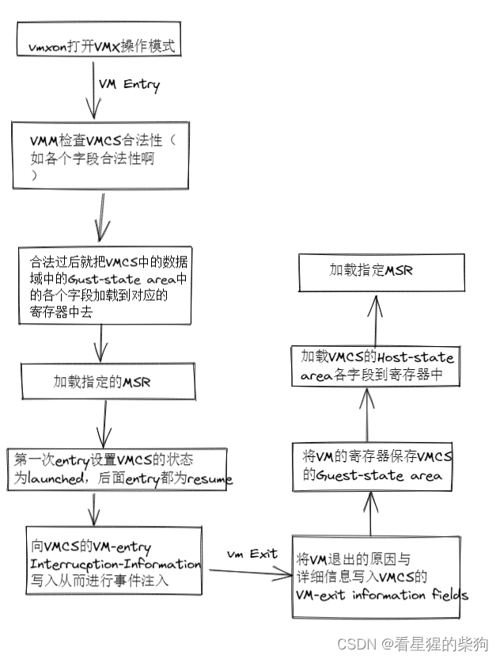

## KVM&QEMU-KVM（基于内核的虚拟机）
本质上，QEMU 作为 host，而 VMM 位于内核中
KVM 负责 CPU 和内存的虚拟化，而 QEMU 负责模拟 IO 设备等硬件
在 Linux 中，可以使用 ioctl() 函数在用户程序和内核模块之间进行通信

 - QEMU 通过 ioctl 系统调用发起请求，进入内核态并把控制权交给 KVM，由 KVM 来运行虚拟机
 - 虚拟机代码运行过程中发生 VM-Exit；KVM 接管后判断原因，处理完毕后决定是继续运行还是交给 QEMU
 - 如果需要进行 IO 操作，就退出 KVM，由 QEMU 处理
[QEMU-KVM 详细讲解](https://www.cnblogs.com/wujuntian/p/16294898.html)


# CTF - 虚拟机 —— [前置知识 第三部分]


## 内存虚拟化

 - 能够提供一个让 Guest 认为从零开始的连续物理地址空间
 - 在各虚拟机之间有效地隔离、调度和共享内存资源
## 常见缩写
HPA：Host Physical Address（宿主机物理地址）

HVA：Host Virtual Address（宿主机虚拟地址）

GPA：Guest Physical Address（客户机物理地址）

GVA：Guest Virtual Address（客户机虚拟地址）

PDBR：页目录表物理基址寄存器，在 x86 上称为 CR3（Page Directory Base Register）

EPT：Extended Page Table（扩展页表）

SPT：shadow page table（影子页表）

ptr：此处用来描述指向某个页表的寄存器

## 虚拟机中内存访问的原理
Guest 访问自己的内存时，步骤如下：

 **1. 通过 Guest 页表把 GVA 转换为 GPA
 2. GPA 对应 Host 中一大块 mmap 出来的内存，因此需要把 GPA 转换为 HVA
 3. 最后通过 Host 页表把 HVA 转换为 HPA**

缺点：过程繁琐，导致虚拟机内的内存访问性能极差

## 影子页表
影子页表：一种 GVA→HPA 映射的页表
**实现机制：
访问内存时，需要用到读写 CR3（保存页目录表物理基址的寄存器）的指令。由于这一操作是敏感指令，VMM 会将其截获，并把页表替换为影子页表，这样页表就变成了 GVA→HPA 的映射。**

缺点：每一套页表都需要独立维护一个影子页表，并且 VMM 与 VM 之间需要多次切换，开销相当大
## 扩展页表
EPT：一种 GPA→HPA 映射的页表
在硬件层面引入了 EPTP 寄存器，用来指向 EPT 页表的基地址。Guest 运行时，Guest 页表被加载到 PDBR 中，而 EPT 页表被加载到专用的 EPT 页表指针寄存器 EPTP 中。

**实现机制：
**GVA->GPA 的转换仍然通过查原来的页表完成，而 GPA->HPA 的转换则通过查 EPT 完成。每个客户虚拟机都有一个由 VMM 维护的 EPT。与此同时，hypervisor 只需要截获 EPT Violation 异常（EPT 表项为空）****

## VPID（Virtual Processor Identifier，虚拟处理器标识符）：TLB（Translation Lookaside Buffer，转换后备缓冲器）资源优化
TLB 是页表项的缓存，缓存最近的虚拟地址转换记录。进行地址转换时，CPU 首先查询 TLB；TLB 检查是否有该虚拟地址对应的缓存项，只有缓存未命中时才会去查页表。

由于 TLB 与对应的页表配合工作，页表切换时其原有内容就会失效，所以应当使用 INVLPG 使 TLB 失效。例如在 VM-Entry 和 VM-Exit 时会切换页表，CPU 会强制使 TLB 失效——但这样做仍会带来一定的性能损失。

VPID 是对 TLB 资源管理的一种优化：它给每个 TLB 表项打上 VPID 标识（VMM 为每个 vCPU 分配一个唯一的 VPID，存放在 VMCS 中；逻辑 CPU 的 VPID 为 0）。CPU 查找 TLB 缓存时，会先比较 VPID，因此我们不再需要在每次 VM 进入/退出时刷新所有缓存项，可以持续复用之前保留的缓存。
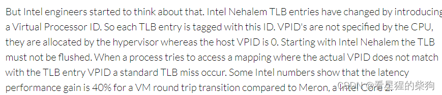


# CTF——虚拟机——［前置知识之四］


## IO 虚拟化
由于外设数量有限，我们仍然希望为虚拟机提供外设功能。（另外，由于处理器与外设之间的交互主要是 IO 交互，所以外设虚拟化被称为 IO 虚拟化。）因此需要 VMM 通过 IO 虚拟化为虚拟机提供 IO 设备功能。

**IO 虚拟化的任务：**
 - 访问截获：虚拟机访问外设时，VMM 需要能够截获
 - 提供设备接口：VMM 必须为虚拟机提供虚拟设备接口或物理设备接口
 - 实现设备功能：VMM 需要实现虚拟设备的功能
## 基本模型
### 平台设备模拟
即由 VMM 负责模拟设备功能
VMM 模拟设备供各个 Guest OS 共享

### 用户空间设备模拟
即由宿主机的用户空间模拟设备功能，模拟出的虚拟设备可以通过 VMM 提供的接口被其他虚拟机调用。而且设备模拟独立于 VMM。
### 设备直通
即把物理设备直接独占地分配给指定的虚拟机，由该虚拟机直接使用物理设备的功能。这能提供接近原生的设备性能（常被模仿，从未被超越）

## 软件半虚拟化——virtio
通过 virtio 驱动与虚拟化设备建立连接，从而获得访问能力
1. 全虚拟化

无需对 GuestOS 操作系统软件源代码做任何修改，就可以运行在这样的 VMM 上

在全虚拟化平台中，GuestOS 并不知道自己是虚拟机，它认为自己是运行在计算机物理硬件上的 HostOS。这是因为全虚拟化的 VMM 把操作系统能够操作的物理设备——CPU、内存、外设——在逻辑上抽象为虚拟 CPU、虚拟内存、虚拟外设等虚拟设备，再交给 GuestOS 使用。这样的 GuestOS 会把底层硬件平台当作自己的，但实际上这种假象是 VMM 为 GuestOS 营造出来的。

2. 半虚拟化

必须对 GuestOS 的内核代码做一定修改，GuestOS 才能运行在半虚拟化的 VMM 上。

半虚拟化通过在 GuestOS 源代码层面修改特权指令，避开了前面提到的虚拟化漏洞。

修改过内核的 GuestOS 也知道自己是虚拟机，所以能很好地识别和处理内核态指令及敏感指令；缺点是 GuestOS 的镜像文件不通用。

半虚拟化增加了专门的 API 接口来优化客户机指令并共享系统硬件驱动，最大限度地发挥计算机性能，用软件接口替代计算机硬件功能，解决了全虚拟化中二进制翻译带来的性能浪费。
### 驱动
驱动本质上是一段软件代码，其主要作用是在计算机系统与硬件设备之间进行数据传输；只有有了驱动，二者才能通信并实现特定功能。没有驱动，仅靠操作系统，硬件设备无法实现其特定功能。换句话说，驱动是操作系统与硬件之间的中介，实现双向通信——把硬件设备自身的功能传达给操作系统，同时把操作系统的标准指令传达给硬件设备——从而实现二者的无缝连接。
### VirtQueue：传输层抽象
virtqueue 是 virtio 中用于数据传输的关键结构，它本身代表一个数据队列：一方向队列中添加缓冲区，另一方从队列中取出缓冲区——这就实现了 Guest 与 Host 之间的基本数据传输模型。

为了降低模型复杂度，我们用两个 virtqueue 实现 Guest 与 Host 之间的双向通信：一个 virtqueue 从 Guest 到 Host，另一个从 Host 到 Guest

#### 用到的数据结构

这是描述符结构
```c
struct vring_desc
{
    __u64 addr;     // 描述符对应的起始地址
    __u32 len;      // 从起始地址开始占的大小空间
    __u16 flags;    // 该描述符的属性
    __u16 next;     // 对应的下一个描述符的下标
};
```
这是 Avail 结构
```c
struct vring_avail
{
    __u16 flags; //该结构内所有描述符的附加属性
    __u16 idx;  // 下一次要加描述符对应在ring数组中的下标
    __u16 ring[NUM]; //存储描述符的
};
```
这是 Used 结构
```c
struct vring_used_elem 
{
    __u32 id;  //描述符的值
    __u32 len; //允许从描述符对应的地址空间中写入的长度
};

struct vring_used
{
    __u16 flags; //该结构内所有描述符的附加属性
    __u16 idx; //下一次要加描述符对应在ring数组中的下标
    struct vring_used_elem ring[];//存储描述符的
};
```
#### 大致流程
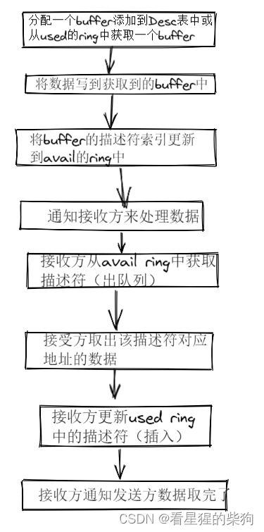
[大佬的分析](https://nxw.name/2023/virtqueue)

## IOMMU
IOMMU，即输入/输出内存管理单元，其功能与 CPU 的 MMU 类似，是在设备端提供地址转换的单元。
**IOMMU 与 MMU 的区别**
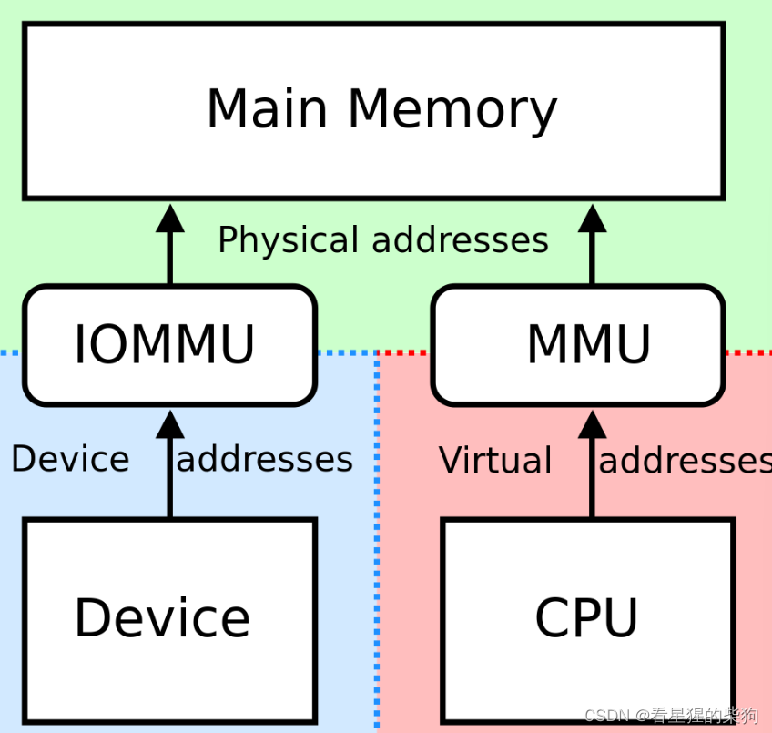
**IOMMU 的功能**
LAPIC（Local Advanced Programmable Interrupt Controller，本地高级可编程中断控制器） 

 - DMA 重映射：具备 DMA 能力的设备可以使用虚拟地址，由 IOMMU 转换为物理地址进行直接内存访问。
 - 中断重映射：IOMMU 截获设备产生的中断，并根据中断重映射表生成新的中断请求，发送给 LAPIC。
### DMA 重映射
DMA 重映射是设备端的地址访问再转换。如下图所示，左侧是 CPU 对内存的虚拟化：MMU 利用进程页表把进程要访问的虚拟地址转换为物理地址，由于不同进程的页表不同，两个进程访问同一个虚拟地址实际访问的是不同的物理地址——DMA 重映射的原理与此类似。如图右侧所示，当外设要进行 DMA 时，IOMMU 根据“设备页表”进行地址转换；不同设备的页表不同，所以两个设备各自认为访问的是同一个地址，实际访问的却是不同的物理地址。
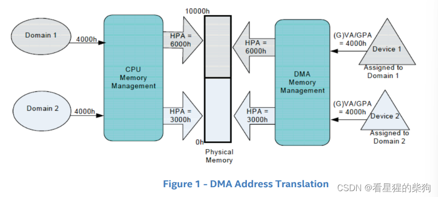


半虚拟化设备并不知道 GPA 到 HPA 的转换，因此可能会访问出错；所以 IOMMU 需要根据 Host 提供的 GPA 到 HPA 地址转换表进行 DMA 映射，使外设能够正确访问 Guest 的物理内存

