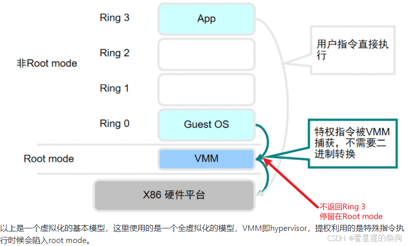
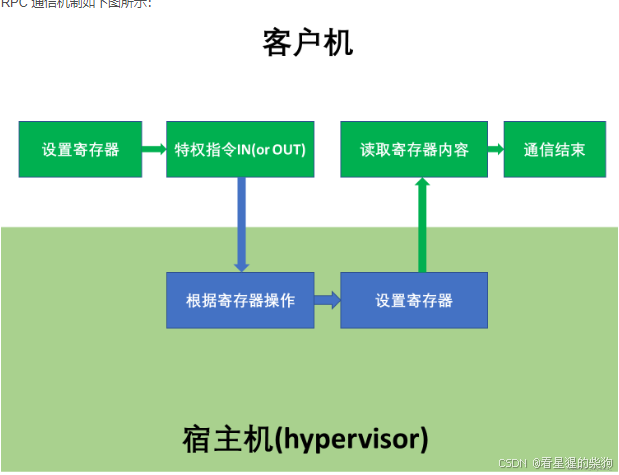
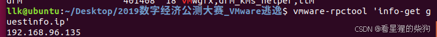
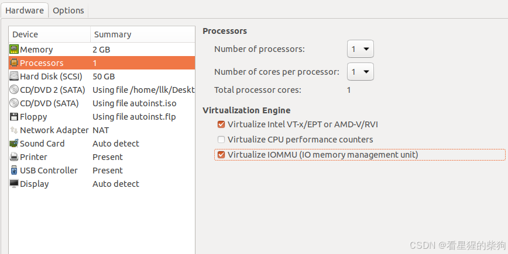
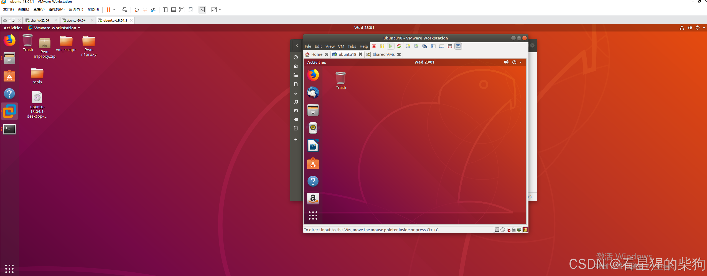


# 参考资料
[2018-RealWorld-Station-Escape](https://a1ex.online/2021/05/28/2018-RealWorld-Station-Escape/)

[技术分享：亲手实践 VMware 虚拟机逃逸漏洞](https://www.anquanke.com/post/id/86483)
[VMware 逃逸基础](https://blog.csdn.net/qq_45323960/article/details/131275005)
[从零到一的虚拟机逃逸三部曲](https://xz.aliyun.com/t/7345?time__1311=n4%2bxnD0GDtYmwwDUx05%2btoLPAKpe7Ko5DOeD&alichlgref=https://www.google.com.hk/)
[虚拟机逃逸入门（上）](https://forum.butian.net/share/1666)
[RealWorldCTF2018 Station Escape](https://zhuanlan.zhihu.com/p/52140921)

[VMware 逃逸基础](https://blog.csdn.net/qq_45323960/article/details/131275005?ops_request_misc=%257B%2522request%255Fid%2522%253A%2522172126252116800180693225%2522%252C%2522scm%2522%253A%252220140713.130102334.pc%255Fblog.%2522%257D&request_id=172126252116800180693225&biz_id=0&utm_medium=distribute.pc_search_result.none-task-blog-2~blog~first_rank_ecpm_v1~rank_v31_ecpm-1-131275005-null-null.nonecase&utm_term=VMM&spm=1018.2226.3001.4450)


# VMware 逃逸简介
1. 虚拟机操作系统发送敏感请求，使 OS 陷入内核态
2. 某些特权指令会进入比 ring 0 更底层的状态，即交由 Hypervisor 处理
3. 利用 Hypervisor 的漏洞，使其执行特权指令后不返回指令状态，从而在指令执行完后仍停留在内核态
4. 提权成功后，就可以穿透 Hypervisor 及虚拟机的其他区域，打破虚拟化隔离机制，完成逃逸。

（也就是说，虚拟机执行某些操作时，会向宿主机的 vmx 发送请求，由 vmx 处理这些请求；利用 vmx 中的漏洞实现提权。）



例如，假设发现 Hypervisor 中存在漏洞，可以利用它阻止特权指令执行后的正常状态切换。

1. 正常情况：

```
Guest OS 执行特权指令 -> Trap 到 Hypervisor -> Hypervisor 执行指令 -> 返回 Guest OS 用户态
```

2. 利用漏洞后：

```
Guest OS 执行特权指令 -> Trap 到 Hypervisor -> Hypervisor 执行指令 
-> 漏洞阻止状态转换 -> Guest OS 保持在内核态
```

具体实现可能如下：

1. 攻击者发现，Hypervisor 在处理某些特权指令时存在缓冲区溢出漏洞。

2. 攻击者构造特殊输入，触发缓冲区溢出。

3. 溢出的数据覆盖 Hypervisor 中负责状态切换的代码或数据结构。

4. Hypervisor 执行完特权指令、准备返回 Guest OS 时，由于关键代码已被覆盖，无法正确进行状态切换。

5. 结果是，Guest OS 在特权指令执行后仍停留在内核态，而没有像正常情况那样切换回用户态。

这类攻击可能导致严重的安全问题，因为它破坏了用户态与内核态之间的隔离，还可以进一步用于提权或执行其他恶意操作。

# 客户机到宿主机的通信机制（guest to host）
[https://sysprogs.com/legacy/articles/kdvmware/guestrpc.shtml](https://sysprogs.com/legacy/articles/kdvmware/guestrpc.shtml)

经常使用 VMware 虚拟机的人应该熟悉它的拖放功能：Guest 与宿主机之间的文件传输、复制等操作，都通过拖放实现，而拖放背后就是 Guest 与宿主机之间的通信机制。VM 类逃逸利用的正是这套通信机制。这套机制设计在 vmtools 中；在较高版本的 VMware 中，vmtools 不再作为独立组件存在，而是默认安装。
## 共享内存（已弃用）


   - 优点：速度快
   - 缺点：需要不断轮询状态标志，导致 CPU 占用率达到 100%
   - 示例：假设有一块虚拟机和宿主机都能访问的共享内存：
     ```c
     struct SharedMemory {
         int newRequestFlag;
         char requestData[1024];
     };
     
     // 在虚拟机中持续检查新请求
     while(1) {
         if(sharedMemory->newRequestFlag) {
             processRequest(sharedMemory->requestData);
             sharedMemory->newRequestFlag = 0;
         }
     }
     ```

## Backdoor 机制

相关源码

```c
open-vm-tools/lib/backdoor/backdoor_def.h

#define BDOOR_MAGIC 0x564D5868

/* Low-bandwidth backdoor port number for the IN/OUT interface. */

#define BDOOR_PORT        0x5658

/* Flags used by the hypercall interface. */


#define   BDOOR_CMD_GETMHZ                    1
/*
 * BDOOR_CMD_APMFUNCTION is used by:
 *
 * o The FrobOS code, which instead should either program the virtual chipset
 *   (like the new BIOS code does, Matthias Hausner offered to implement that),
 *   or not use any VM-specific code (which requires that we correctly
 *   implement "power off on CLI HLT" for SMP VMs, Boris Weissman offered to
 *   implement that)
 *
 * o The old BIOS code, which will soon be jettisoned
 */
#define   BDOOR_CMD_APMFUNCTION               2 /* CPL0 only. */
#define   BDOOR_CMD_GETDISKGEO                3
#define   BDOOR_CMD_GETPTRLOCATION            4
#define   BDOOR_CMD_SETPTRLOCATION            5
#define   BDOOR_CMD_GETSELLENGTH              6
#define   BDOOR_CMD_GETNEXTPIECE              7
#define   BDOOR_CMD_SETSELLENGTH              8
#define   BDOOR_CMD_SETNEXTPIECE              9
#define   BDOOR_CMD_GETVERSION               10
#define   BDOOR_CMD_GETDEVICELISTELEMENT     11
……………………还有很多

open-vm-tools/lib/include/backdoor_types.h
typedef union {
   struct {
      DECLARE_REG_NAMED_STRUCT(ax);
      size_t size; /* Register bx. */
      DECLARE_REG_NAMED_STRUCT(cx);
      DECLARE_REG_NAMED_STRUCT(dx);
      DECLARE_REG_NAMED_STRUCT(si);
      DECLARE_REG_NAMED_STRUCT(di);
   } in;
   struct {
      DECLARE_REG_NAMED_STRUCT(ax);
      DECLARE_REG_NAMED_STRUCT(bx);
      DECLARE_REG_NAMED_STRUCT(cx);
      DECLARE_REG_NAMED_STRUCT(dx);
      DECLARE_REG_NAMED_STRUCT(si);
      DECLARE_REG_NAMED_STRUCT(di);
   } out;
} Backdoor_proto;


open-vm-tools/lib/backdoor/backdoorGcc64.c.h

void
Backdoor_InOut(Backdoor_proto *myBp) // IN/OUT
{
   uint64 dummy;

   __asm__ __volatile__(
#ifdef __APPLE__
        /*
         * Save %rbx on the stack because the Mac OS GCC doesn't want us to
         * clobber it - it erroneously thinks %rbx is the PIC register.
         * (Radar bug 7304232)
         */
        "pushq %%rbx"           "\n\t"
#endif
        "pushq %%rax"           "\n\t"
        "movq 40(%%rax), %%rdi" "\n\t"
        "movq 32(%%rax), %%rsi" "\n\t"
        "movq 24(%%rax), %%rdx" "\n\t"
        "movq 16(%%rax), %%rcx" "\n\t"
        "movq  8(%%rax), %%rbx" "\n\t"
        "movq   (%%rax), %%rax" "\n\t"
        "inl %%dx, %%eax"       "\n\t"  /* NB: There is no inq instruction */
        "xchgq %%rax, (%%rsp)"  "\n\t" //恢复之前的压入rax并将rax刚开始的内容给栈
        "movq %%rdi, 40(%%rax)" "\n\t"
        "movq %%rsi, 32(%%rax)" "\n\t"
        "movq %%rdx, 24(%%rax)" "\n\t"
        "movq %%rcx, 16(%%rax)" "\n\t"
        "movq %%rbx,  8(%%rax)" "\n\t"
        "popq          (%%rax)" "\n\t"//恢复原来rax刚开始部分
#ifdef __APPLE__
        "popq %%rbx"            "\n\t"
#endif
      : "=a" (dummy) 
//       输出操作数:
// : "=a" (dummy)
// 这定义了输出操作数。"=a" 表示使用 %rax 寄存器，结果存储在 dummy 变量中。
      : "0" (myBp)
//       输入操作数:
// : "0" (myBp)
// 这定义了输入操作数。"0" 表示使用与第一个输出操作数相同的寄存器（即 %rax），值来自 myBp。
// myBp 被加载到 rax 中（通过 "0" (myBp) 指定）。
      /*
       * vmware can modify the whole VM state without the compiler knowing
       * it. So far it does not modify EFLAGS. --hpreg
       */
      :
#ifndef __APPLE__
      /* %rbx is unchanged at the end of the function on Mac OS. */
      "rbx",
#endif
      "rcx", "rdx", "rsi", "rdi", "memory"
   );
}


```

工作原理：

1. 使用特殊的 I/O 指令：
   VMware 会拦截特定的 I/O 指令（本例中是 'in' 指令），并将其解释为 backdoor 调用。

2. 魔数和命令：
   使用预定义魔数（BDOOR_MAGIC）及命令码，指定操作类型。

3. 通过寄存器传递参数：
   通过特定寄存器传入参数并接收结果。

```c
unsigned __declspec(naked) GetMousePos()
{
    __asm
    {
        mov eax, 564D5868h  // 设置魔术数字 (BDOOR_MAGIC)
        mov ecx, 4          // 设置命令码 (BDOOR_CMD_GETPTRLOCATION)
        mov edx, 5658h      // 设置I/O端口 (BDOOR_PORT)
        in eax, dx          // 执行后门调用
        ret                 // 返回结果(在eax中)
    }
}
```

这段代码执行以下操作：

1. 将 eax 设置为魔数，表明这是一次 backdoor 调用。
2. 将 ecx 设置为 4，表示要获取鼠标位置。
3. 将 edx 设置为特殊的 I/O 端口号。
4. 执行 'in' 指令，由 VMware 拦截并处理。
5. 结果通过 eax 返回。

main 函数中：

```c
void main()
{
    unsigned mousepos = GetMousePos();
    printf("Mouse cursor pos: x=%d,y=%d\n", mousepos >> 16, mousepos & 0xFFFF);
}
```

1. 调用 GetMousePos() 获取鼠标位置。
2. 高 16 位表示 X 坐标，低 16 位表示 Y 坐标。

示例：

假设在 VMware 虚拟机中运行这段程序：

1. 在物理机上：
   ```
   运行结果: 程序崩溃,因为'in'指令在用户模式下是不允许的。
   ```

2. 在 VMware 虚拟机中，鼠标位于 (100, 200)：
   ```
   运行结果: Mouse cursor pos: x=100,y=200
   ```

3. 在 VMware 虚拟机中，鼠标位于 (500, 300)：
   ```
   运行结果: Mouse cursor pos: x=500,y=300
   ```

其中涉及特权指令 `in`。在普通操作系统上执行该指令会引发错误，但在 VM 内部的客户机执行时，异常会被 vmtools 捕获，再传给 vmware-vmx.exe 完成通信。

关键在于普通用户也可以执行 backdoor。因此，在 guest 中执行相应代码，就可以使操作系统进入 hypervisor 层，再通过 backdoor 与宿主机通信并触发漏洞。


##  Message_Send 和 Message_Recv
Message 相关函数是客户机应用与 VMware 之间内部通信通道的第二层，也在 open-vm-tools 中实现。Message_Send、Message_Recv 等是在 backdoor 机制之上的更高层抽象：它们使用 backdoor 作为底层通信通道，同时提供更易用、更灵活的接口。


1. Message_OpenAllocated（简化版）：

```c
Bool Message_OpenAllocated(uint32 proto, Message_Channel *chan, char *receiveBuffer, size_t receiveBufferSize)
{
    Backdoor_proto bp;
    
    bp.in.cx.halfs.high = MESSAGE_TYPE_OPEN;
    bp.in.size = proto | GUESTMSG_FLAG_COOKIE;
    bp.in.cx.halfs.low = BDOOR_CMD_MESSAGE;
    
    Backdoor(&bp);
    
    if (!(bp.in.cx.halfs.high & MESSAGE_STATUS_SUCCESS)) {
        return FALSE;
    }
    
    chan->id = bp.in.dx.halfs.high;
    chan->cookieHigh = bp.out.si.word;
    chan->cookieLow = bp.out.di.word;
    
    chan->in = (unsigned char *)receiveBuffer;
    chan->inAlloc = receiveBufferSize;
    chan->inPreallocated = receiveBuffer != NULL;
    
    return TRUE;
}
```
 Message_OpenAllocated：
   - 功能：打开一个预先分配好的通信通道。
   - 参数：协议类型、通道结构体指针、接收缓冲区及其大小。
   - 流程：
     * 使用 Backdoor 机制发送打开通道的请求。
     * 成功后，设置通道 ID 和 cookie。
     * 初始化接收缓冲区信息。
   - 返回值：成功返回 TRUE，失败返回 FALSE。
2. Message_Open（简化版）：
```c
Message_Channel* Message_Open(uint32 proto)
{
    Message_Channel *chan = malloc(sizeof(Message_Channel));
    if (chan == NULL) {
        return NULL;
    }

    if (!Message_OpenAllocated(proto, chan, NULL, 0)) {
        free(chan);
        return NULL;
    }

    return chan;
}
```
 Message_Open：
   - 功能：分配并打开一个新的通信通道。
   - 流程：
     * 分配一个 Message_Channel 结构体。
     * 调用 Message_OpenAllocated 初始化通道。
   - 返回值：成功返回通道指针，失败返回 NULL。


3. Message_Send（简化版）：

```c
Bool Message_Send(Message_Channel *chan, const unsigned char *buf, size_t bufSize)
{
    Backdoor_proto bp;
    
    bp.in.cx.halfs.high = MESSAGE_TYPE_SENDSIZE;
    bp.in.dx.halfs.high = chan->id;
    bp.in.si.word = chan->cookieHigh;
    bp.in.di.word = chan->cookieLow;
    bp.in.size = bufSize;
    bp.in.cx.halfs.low = BDOOR_CMD_MESSAGE;
    
    Backdoor(&bp);
    
    if (!(bp.in.cx.halfs.high & MESSAGE_STATUS_SUCCESS)) {
        return FALSE;
    }
    
    if (bp.in.cx.halfs.high & MESSAGE_STATUS_HB) {
        // 高带宽传输
        Backdoor_proto_hb bphb;
        // 设置 bphb...
        Backdoor_HbOut(&bphb);
    } else {
        // 低带宽传输
        while (bufSize > 0) {
            // 设置 bp 发送数据块...
            Backdoor(&bp);
            // 更新 buf 和 bufSize...
        }
    }
    
    return TRUE;
}
```
 Message_Send：
   - 功能：通过通道发送消息。
   - 参数：通道指针、消息缓冲区、消息大小。
   - 流程：
     * 先发送消息大小。
     * 根据是否支持高带宽选择发送方式：
       - 高带宽：一次发送整条消息。
       - 低带宽：分块发送消息。
   - 返回值：成功返回 TRUE，失败返回 FALSE。

4. Message_Receive（简化版）：

```c
Bool Message_Receive(Message_Channel *chan, unsigned char **buf, size_t *bufSize)
{
    Backdoor_proto bp;
    
    bp.in.cx.halfs.high = MESSAGE_TYPE_RECVSIZE;
    bp.in.dx.halfs.high = chan->id;
    bp.in.si.word = chan->cookieHigh;
    bp.in.di.word = chan->cookieLow;
    bp.in.cx.halfs.low = BDOOR_CMD_MESSAGE;
    
    Backdoor(&bp);
    
    if (!(bp.in.cx.halfs.high & MESSAGE_STATUS_SUCCESS)) {
        return FALSE;
    }
    
    if (!(bp.in.cx.halfs.high & MESSAGE_STATUS_DORECV)) {
        *bufSize = 0;
        return TRUE;
    }
    
    *bufSize = bp.out.bx.word;
    
    // 分配或检查缓冲区大小...
    
    if (bp.in.cx.halfs.high & MESSAGE_STATUS_HB) {
        // 高带宽接收
        // 使用 Backdoor_HbIn...
    } else {
        // 低带宽接收
        // 循环使用 Backdoor 接收数据...
    }
    
    return TRUE;
}

```
 Message_Receive：
   - 功能：从通道接收消息。
   - 参数：通道指针、指向接收缓冲区指针的指针、指向接收大小的指针。
   - 流程：
     * 检查是否有待接收的消息。
     * 如果有，取得消息大小。
     * 根据是否支持高带宽选择接收方式。
     * 分配接收缓冲区或检查其大小。
   - 返回值：成功返回 TRUE，失败返回 FALSE。


5. Message_CloseAllocated（简化版）：


```c
void Message_CloseAllocated(Message_Channel *chan)
{
    Backdoor_proto bp;

    if (chan == NULL) {
        return;
    }

    bp.in.cx.halfs.high = MESSAGE_TYPE_CLOSE;
    bp.in.dx.halfs.high = chan->id;
    bp.in.si.word = chan->cookieHigh;
    bp.in.di.word = chan->cookieLow;
    bp.in.cx.halfs.low = BDOOR_CMD_MESSAGE;

    Backdoor(&bp);

    if (!chan->inPreallocated && chan->in != NULL) {
        free(chan->in);
    }

    chan->in = NULL;
    chan->inAlloc = 0;
}
```
. Message_CloseAllocated：
   - 功能：关闭一个预先分配好的通信通道。
   - 参数：通道指针。
   - 流程：
     * 发送关闭通道的请求。
     * 释放接收缓冲区（如果是动态分配的）。
     * 重置通道信息。

6. Message_Close（简化版）：


```c
void Message_Close(Message_Channel *chan)
{
    if (chan == NULL) {
        return;
    }

    Message_CloseAllocated(chan);
    free(chan);
}

```
 Message_Close：
   - 功能：关闭并释放一个通信通道。
   - 参数：通道指针。
   - 流程：
     * 调用 Message_CloseAllocated 关闭通道。
     * 释放通道结构体内存。


## GuestRPC 
在 backdoor 和 Message_Send/Receive 之上实现的一种更灵活的通信方式。

Backdoor -> Message_Send/Receive -> GuestRPC
每一层都建立在其下层之上，提供更高层的抽象与功能。

执行 GuestRPC 调用时，数据流通常为：
GuestRPC 命令 -> Message_Send 处理 -> Backdoor，例如 RpcOut_start->Message_OpenAllocated->Backdoor。

执行一次 GuestRPC 调用包含一系列请求：

- 打开 GuestRPC 通道
- 发送命令长度
- 发送命令数据
- 接收回复长度
- 接收回复数据
- 发送接收结束信号
- 关闭 GuestRPC 通道

每个请求的处理流程如下：


```c
/open-vm-tools/lib/rpcOut/rpcout.c

/open-vm-tools/lib/include/rpcout.h

typedef struct RpcOut RpcOut;

RpcOut *RpcOut_Construct(void);
void RpcOut_Destruct(RpcOut *out);
Bool RpcOut_start(RpcOut *out);
Bool RpcOut_send(RpcOut *out, char const *request, size_t reqLen,
                 Bool *rpcStatus, char const **reply, size_t *repLen);
Bool RpcOut_stop(RpcOut *out);


/*
 * This is the only method needed to send a message to vmware for
 * 99% of uses. I'm leaving the others defined here so people know
 * they can be exported again if the need arises. [greg]
 */
Bool RpcOut_sendOne(char **reply, size_t *repLen, char const *reqFmt, ...);

/* 
 * A version of the RpcOut_sendOne function that works with UTF-8
 * strings and other data that would be corrupted by Win32's
 * FormatMessage function (which is used by RpcOut_sendOne()).
 */

Bool RpcOut_SendOneRaw(void *request, size_t reqLen, char **reply, size_t *repLen);

/* 
 * A variant of the RpcOut_SendOneRaw in which the caller supplies the
 * receive buffer so as to avoid the need to call malloc internally.
 * Useful in situations where calling malloc is not allowed.
 */

Bool RpcOut_SendOneRawPreallocated(void *request, size_t reqLen, char *reply,
                                   size_t repLen);
```

这段代码定义了 RpcOut 模块的接口，用于从虚拟机内部向 VMware 虚拟化层发送 RPC（远程过程调用）请求。

1. 通信机制：
   RpcOut 提供一种机制，让虚拟机内部的程序能够与 VMware 虚拟化层通信。

2. 发送请求：
   虚拟机可通过该接口向 VMware 发送各种请求，例如获取信息、执行操作等。

3. 接收响应：
   RpcOut 不仅能发送请求，还能接收 VMware 的响应。

4. 灵活性：
   提供多种构造和发送 RPC 请求的方法，适应不同的使用场景。

5. 主要函数：
   - RpcOut_sendOne：最常用的方法，用于发送单个 RPC 请求并接收响应。
   - RpcOut_SendOneRaw：处理 UTF-8 字符串，以及其他可能被 Win32 FormatMessage 函数破坏的数据。
   - RpcOut_SendOneRawPreallocated：允许调用者提供接收缓冲区，避免在内部调用 malloc。

6. 生命周期管理：
   提供构造函数（RpcOut_Construct）和析构函数（RpcOut_Destruct），管理 RpcOut 对象的生命周期。

7. 会话控制：
   包含 RpcOut_start 和 RpcOut_stop 方法，用于开始和结束 RPC 会话。

```c
/open-vm-tools/lib/include/rpin.h

RpcIn *RpcIn_Construct(GMainContext *mainCtx,
                       RpcIn_Callback dispatch,
                       gpointer clientData);

Bool RpcIn_start(RpcIn *in, unsigned int delay,
                 RpcIn_ErrorFunc *errorFunc,
                 RpcIn_ClearErrorFunc *clearErrorFunc,
                 void *errorData);

#else /* } { */

#include "dbllnklst.h"

/*
 * Type for old RpcIn callbacks. Don't use this anymore - this is here
 * for backwards compatibility.
 */
typedef Bool
(*RpcIn_Callback)(char const **result,     // OUT
                  size_t *resultLen,       // OUT
                  const char *name,        // IN
                  const char *args,        // IN
                  size_t argsSize,         // IN
                  void *clientData);       // IN

RpcIn *RpcIn_Construct(DblLnkLst_Links *eventQueue);

Bool RpcIn_start(RpcIn *in, unsigned int delay,
                 RpcIn_Callback resetCallback, void *resetClientData,
                 RpcIn_ErrorFunc *errorFunc,
                 RpcIn_ClearErrorFunc *clearErrorFunc,
                 void *errorData);


/*
 * Don't use this function anymore - it's here only for backwards compatibility.
 * Use RpcIn_RegisterCallbackEx() instead.
 */
void RpcIn_RegisterCallback(RpcIn *in, const char *name,
                            RpcIn_Callback callback, void *clientData);

void RpcIn_UnregisterCallback(RpcIn *in, const char *name);

unsigned int RpcIn_SetRetVals(char const **result, size_t *resultLen,
                              const char *resultVal, Bool retVal);

#endif /* } */

void RpcIn_Destruct(RpcIn *in);
void RpcIn_stop(RpcIn *in);

```

RpcIn 模块的主要用途，是处理从 VMware 虚拟化层发往虚拟机内部的 RPC（远程过程调用）请求。RpcIn 为虚拟机内部程序提供框架，使其能够接收并处理 VMware 虚拟化层发来的 RPC 请求。

1. 接收请求：
   RpcIn 允许虚拟机内部的程序接收来自 VMware 虚拟化层的 RPC 请求。

2. 回调机制：
   提供注册回调函数（RpcIn_RegisterCallback）的机制，处理特定类型的 RPC 请求。

3. 事件驱动：
   使用事件队列（DblLnkLst_Links *eventQueue）处理异步 RPC 请求。

4. 生命周期管理：
   提供构造函数（RpcIn_Construct）和析构函数（RpcIn_Destruct），管理 RpcIn 对象的生命周期。

5. 启动和停止：
   包含 RpcIn_start 和 RpcIn_stop 方法，用于启动和停止 RPC 监听。

6. 错误处理：
   支持错误处理函数（RpcIn_ErrorFunc）和清除错误函数（RpcIn_ClearErrorFunc）。

7. 灵活性：
   允许设置延迟（delay）和重置回调（resetCallback），适应不同使用场景。

8. 设置响应：
   提供 RpcIn_SetRetVals 函数，用于设置 RPC 调用的返回值。

9. 向后兼容：
   保留部分旧接口（如旧版 RpcIn_RegisterCallback），以维持向后兼容性。

10. 多平台支持：
    通过条件编译（#ifdef __cplusplus），同时支持 C 和 C++ 环境。

11. 自定义处理：
    允许注册自定义回调函数，处理特定名称的 RPC 请求。

12. 动态注册和注销：
    提供注册（RpcIn_RegisterCallback）和注销（RpcIn_UnregisterCallback）回调的方法，允许动态添加或删除 RPC 处理函数。

### 示例：`RpcOutSendOneRawWork`

```c

/*
 *-----------------------------------------------------------------------------
 *
 * RpcOutSendOneRawWork --
 *
 *    Helper function to make VMware execute a RPCI command.  See
 *    RpcOut_SendOneRaw and RpcOut_SendOneRawPreallocated.
 *
 *-----------------------------------------------------------------------------
 */

static Bool
RpcOutSendOneRawWork(void *request,         // IN: RPCI command
                     size_t reqLen,         // IN: Size of request buffer
                     char *callerReply,     // IN: caller supplied reply buffer
                     size_t callerReplyLen, // IN: size of caller supplied buf
                     char **reply,          // OUT: Result
                     size_t *repLen)        // OUT: Length of the result
{
   Bool status;
   Bool rpcStatus;
   /* Stack allocate so this can be used in kernel logging.  See 1389199. */
   RpcOut out;
   char const *myReply;
   size_t myRepLen;

   Debug("Rpci: Sending request='%s'\n", (char *)request);
   RpcOutInitialize(&out);
   if (!RpcOut_startWithReceiveBuffer(&out, callerReply, callerReplyLen)) {
      myReply = "RpcOut: Unable to open the communication channel";
      myRepLen = strlen(myReply);

      if (callerReply != NULL) {
         unsigned s = MIN(callerReplyLen - 1, myRepLen);
         ASSERT(reply == NULL);
         memcpy(callerReply, myReply, s);
         callerReply[s] = '\0';
      }
      if (reply != NULL) {
         *reply = NULL;
      }
      return FALSE;
   }

   status = RpcOut_send(&out, request, reqLen,
                        &rpcStatus, &myReply, &myRepLen);
   /* On failure, we already have the description of the error */

   Debug("Rpci: Sent request='%s', reply='%s', len=%"FMTSZ"u, "
         "status=%d, rpcStatus=%d\n",
         (char *)request, myReply, myRepLen, status, rpcStatus);

   if (reply != NULL) {
      /*
       * If we got a non-NULL reply, make a copy of it, because the reply
       * we got back is inside the channel buffer, which will get destroyed
       * at the end of this function.
       */
      if (myReply != NULL) {
         /*
          * We previously used strdup to duplicate myReply, but that
          * breaks if you are sending binary (not string) data over the
          * backdoor. Don't assume the data is a string.
          */
         *reply = malloc(myRepLen + 1);
         if (*reply != NULL) {
            memcpy(*reply, myReply, myRepLen);
            /*
             * The message layer already writes a trailing NUL but we might
             * change that someday, so do it again here.
             */
            (*reply)[myRepLen] = 0;
         }
      } else {
         /*
          * Our reply was NULL, so just pass the NULL back up to the caller.
          */
         *reply = NULL;
      }

      /*
       * Only set the length if the caller wanted it and if we got a good
       * reply.
       */
      if (repLen != NULL && *reply != NULL) {
         *repLen = myRepLen;
      }
   }

   if (RpcOut_stop(&out) == FALSE) {
      /*
       * We couldn't stop the channel. Free anything we allocated, give our
       * client a reply of NULL, and return FALSE.
       */

      if (reply != NULL) {
         free(*reply);
         *reply = NULL;
      }
      Debug("Rpci: unable to close the communication channel\n");
      status = FALSE;
   }

   return status && rpcStatus;
}
```

这一过程体现在 RpcOutSendOneRawWork 函数中。该函数将一段原始数据打包为消息，再通过 VMware 的 RPC 协议发送给另一个虚拟机或宿主机。它主要调用三个函数：

- RpcOut_startWithReceiveBuffer：最终调用 Message_OpenAllocated，执行 MESSAGE_TYPE_OPEN 流程。
- RpcOut_send：最终调用 Message_Send 和 Message_Receive 两个函数。
Message_Send：先执行 MESSAGE_TYPE_SENDSIZE 流程，发送消息长度，再循环执行 MESSAGE_TYPE_SENDPAYLOAD 流程，直到整条消息发送完毕。
Message_Receive：先执行 MESSAGE_TYPE_RECVSIZE 流程，取得待接收消息的长度，再循环执行 MESSAGE_TYPE_RECVPAYLOAD 流程，直到整条消息接收完毕。
- RpcOut_stop：最终调用 Message_CloseAllocated，执行 MESSAGE_TYPE_CLOSE 流程。

### 示例：  `vmware-rpctool 'info-get guestinfo.ip'`




1. 用户输入：
   用户在虚拟机中执行 `vmware-rpctool 'info-get guestinfo.ip'`。

2. vmware-rpctool 处理：
   - vmware-rpctool 解析命令，识别为 "info-get" 操作。
   - 准备 RPC 请求内容："info-get guestinfo.ip"。

3. RpcOut 初始化：
   - vmware-rpctool 在内部初始化 RpcOut 结构体。

4. 发送请求（RpcOut）：
   - 调用 RpcOut_send 函数。
   - 通过预定义通道（如 VSockets 或 backdoor）将请求发送给 VMX。

5. VMX 接收请求（RpcIn）：
   - VMX 中的 RpcIn 模块接收请求。
   - 触发 HandleRpcIn 函数，处理传入请求。

6. 请求解析：
   - HandleRpcIn 函数解析 "info-get guestinfo.ip" 请求。

7. 查找 GuestRPC 表：
   - VMX 在 GuestRPC 表中查找 "info-get" 对应的处理函数。

8. 执行处理函数：
   - 找到并执行 HandleInfoGet 函数。
   - 该函数专门处理 "info-get" 类型的请求。

9. 获取 IP 地址：
   - HandleInfoGet 函数识别 "guestinfo.ip" 参数。
   - 调用内部函数，获取虚拟机的 IP 地址。

10. 准备响应：
    - 假设 IP 为 "192.168.1.100"。
    - 准备响应字符串，如 "1 192.168.1.100"。
    - "1" 表示成功，后面是实际的 IP。

11. 设置响应：
    - 使用 RpcIn_SetRetVals 函数设置响应内容。

12. 发送响应（RpcIn）：
    - 调用 RpcInSend 函数，将响应发回虚拟机。

13. 虚拟机接收响应（RpcOut）：
    - 虚拟机一侧的 RpcOut_send 函数接收响应。

14. 响应处理：
    - vmware-rpctool 解析响应，提取 IP 地址。

15. 显示结果：
    - vmware-rpctool 将 IP 地址显示到控制台。

16. 完成：
    - 命令执行结束，用户看到输出的 IP 地址。


### 各步骤对应的 Backdoor 操作
#### 打开 RPC 通道
RPC 子命令：00h

调用 IN（OUT）前需要设置的寄存器内容：

```bash
EAX = 564D5868h - magic number
EBX = 49435052h - RPC open magic number ('RPCI')
ECX(HI) = 0000h - subcommand number
ECX(LO) = 001Eh - command number
EDX(LO) = 5658h - port number
```

返回值：

```bash
ECX = 00010000h: success / 00000000h: failure
EDX(HI) = RPC channel number
```

该函数用于打开 RPC 通道。ECX 返回是否成功，EDX 返回的值是通道号，后续 RPC 通信都要使用它。注意，单个虚拟机最多只能同时使用 8 个通道（#0 - #7）。尝试打开第 9 个通道时，会检查其他通道的打开时间；如果某个通道已打开超过一定时长，就关闭该超时通道并返回其通道号。如果没有超时通道，则创建通道失败。

为了防止进程干扰 RPC 交互，VMware 会在建立通道时生成两个 cookie 值，用于发送和接收数据。

可以使用以下函数实现打开 RPC 通道的过程：

```c
void channel_open(int *cookie1, int *cookie2, int *channel_num, int *res) {
    asm("movl %%eax,%%ebx\n\t"
        "movq %%rdi,%%r10\n\t"
        "movq %%rsi,%%r11\n\t"
        "movq %%rdx,%%r12\n\t"
        "movq %%rcx,%%r13\n\t"
        "movl $0x564d5868,%%eax\n\t"
        "movl $0xc9435052,%%ebx\n\t"
        "movl $0x1e,%%ecx\n\t"
        "movl $0x5658,%%edx\n\t"
        "out %%eax,%%dx\n\t"
        "movl %%edi,(%%r10)\n\t"
        "movl %%esi,(%%r11)\n\t"
        "movl %%edx,(%%r12)\n\t"
        "movl %%ecx,(%%r13)\n\t"
        :
        :
        : "%rax", "%rbx", "%rcx", "%rdx", "%rsi", "%rdi", "%r8", "%r10", "%r11", "%r12", "%r13");
}

```

#### 发送 RPC 命令长度
RPC 子命令：01h

调用：

```bash
EAX = 564D5868h - magic number
EBX = command length (not including the terminating NULL)
ECX(HI) = 0001h - subcommand number
ECX(LO) = 001Eh - command number
EDX(HI) = channel number
EDX(LO) = 5658h - port number
```

返回值：

```c
ECX = 00810000h: success / 00000000h: failure
```

发送 RPC 命令前，需要先发送 RPC 命令的长度。注意，我们提供的通道号所指向的通道必须已经打开。ECX 返回发送是否成功。具体实现如下：

```c
void channel_set_len(int cookie1, int cookie2, int channel_num, int len, int *res) {
    asm("movl %%eax,%%ebx\n\t"
        "movq %%r8,%%r10\n\t"
        "movl %%ecx,%%ebx\n\t"
        "movl $0x564d5868,%%eax\n\t"
        "movl $0x0001001e,%%ecx\n\t"
        "movw $0x5658,%%dx\n\t"
        "out %%eax,%%dx\n\t"
        "movl %%ecx,(%%r10)\n\t"
        :
        :
        : "%rax", "%rbx", "%rcx", "%rdx", "%rsi", "%rdi", "%r10");
}
```
#### 发送 RPC 命令数据
RPC 子命令：02h
调用：

```bash
EAX = 564D5868h - magic number
EBX = 4 bytes from the command data (the first byte in LSB)
ECX(HI) = 0002h - subcommand number
ECX(LO) = 001Eh - command number
EDX(HI) = channel number
EDX(LO) = 5658h - port number
```

返回值：

```bash
ECX = 000010000h: success / 00000000h: failure
```

该函数必须在发送 RPC 命令长度之后使用，且每次只能发送 4 字节。例如，要发送 machine.id.get 命令，就必须调用 4 次：

```bash
EBX set to 6863616Dh ("mach")
EBX set to 2E656E69h ("ine.")
EBX set to 672E6469h ("id.g")
EBX set to 00007465h ("et\x00\x00")

```
ECX 返回是否成功。具体实现如下：

```c

void channel_send_data(int cookie1,int cookie2,int channel_num,int len,char *data,int *res){
	asm("pushq %%rbp\n\t"
                "movq %%r9,%%r10\n\t"
		"movq %%r8,%%rbp\n\t"
		"movq %%rcx,%%r11\n\t"
		"movq $0,%%r12\n\t"
		"1:\n\t"
		"movq %%r8,%%rbp\n\t"
		"add %%r12,%%rbp\n\t"
		"movl (%%rbp),%%ebx\n\t"
                "movl $0x564d5868,%%eax\n\t"
                "movl $0x0002001e,%%ecx\n\t"
		"movw $0x5658,%%dx\n\t"
                "out %%eax,%%dx\n\t"
		"addq $4,%%r12\n\t"
		"cmpq %%r12,%%r11\n\t"
		"ja 1b\n\t"
		"movl %%ecx,(%%r10)\n\t"
		"popq %%rbp\n\t"
                :
                :
                :"%rax","%rbx","%rcx","%rdx","%rsi","%rdi","%r10","%r11","%r12"
        );


```
#### 接收 RPC 回复长度
RPC 子命令：03h

调用：

```bash
EAX = 564D5868h - magic number
ECX(HI) = 0003h - subcommand number
ECX(LO) = 001Eh - command number
EDX(HI) = channel number
EDX(LO) = 5658h - port number
```

返回值：

```bash
EBX = reply length (not including the terminating NULL)
ECX = 00830000h: success / 00000000h: failure
```

接收 RPC 回复的长度。注意，每个 RPC 命令至少返回 2 字节的回复数据，其中 1 表示成功，0 表示失败；即使 VMware 无法识别该 RPC 命令，也会返回 "0 Unknown command"。也就是说，回复数据的前两个字节始终表示 RPC 命令的状态。

```c
void channel_recv_reply_len(int cookie1, int cookie2, int channel_num, int *len, int *res) {
    asm("movl %%eax,%%ebx\n\t"
        "movq %%r8,%%r10\n\t"
        "movq %%rcx,%%r11\n\t"
        "movl $0x564d5868,%%eax\n\t"
        "movl $0x0003001e,%%ecx\n\t"
        "movw $0x5658,%%dx\n\t"
        "out %%eax,%%dx\n\t"
        "movl %%ecx,(%%r10)\n\t"
        "movl %%ebx,(%%r11)\n\t"
        :
        :
        : "%rax", "%rbx", "%rcx", "%rdx", "%rsi", "%rdi", "%r10", "%r11");
}

```

#### 接收 RPC 回复数据
RPC 子命令：04h

调用：

```bash

EAX = 564D5868h - magic number
EBX = reply type from subcommand 03h
ECX(HI) = 0004h - subcommand number
ECX(LO) = 001Eh - command number
EDX(HI) = channel number
EDX(LO) = 5658h - port number
```

返回值：

```bash
EBX = 4 bytes from the reply data (the first byte in LSB)
ECX = 00010000h: success / 00000000h: failure
```

EBX 中存放的是回复类型（子命令 03h 返回的回复类型，即上一次 RPC 成功还是失败），它决定执行路径。程序会根据回复类型的值执行不同处理逻辑，也就是说，回复类型决定后续执行路径。与发送数据一样，每次只能接收 4 字节数据，因此 vmx 每次 RPC 请求也只返回四字节，要返回完整结果就需要多次 RPC 请求。注意，正如接收 RPC 回复长度一节所述，回复数据的前两个字节始终表示 RPC 命令的状态。例如，使用 RPC 命令查询 machine.id.get，成功时返回 "1 virtual machine id"，否则返回 "0 No machine id"。

```c
void channel_recv_data(int cookie1, int cookie2, int channel_num, int offset, char *data, int *res) {
    asm("pushq %%rbp\n\t"
        "movq %%r9,%%r10\n\t"
        "movq %%r8,%%rbp\n\t"
        "movq %%rcx,%%r11\n\t"
        "movq $1,%%rbx\n\t"
        "movl $0x564d5868,%%eax\n\t"
        "movl $0x0004001e,%%ecx\n\t"
        "movw $0x5658,%%dx\n\t"
        "in %%dx,%%eax\n\t"
        "add %%r11,%%rbp\n\t"
        "movl %%ebx,(%%rbp)\n\t"
        "movl %%ecx,(%%r10)\n\t"
        "popq %%rbp\n\t"
        :
        :
        : "%rax", "%rbx", "%rcx", "%rdx", "%rsi", "%rdi", "%r10", "%r11", "%r12");

```
#### 完成 RPC 回复接收
RPC 子命令：05h

调用：

```bash
EAX = 564D5868h - magic number
EBX = reply type from subcommand 04h
ECX(HI) = 0005h - subcommand number
ECX(LO) = 001Eh - command number
EDX(HI) = channel number
EDX(LO) = 5658h - port number
```

返回值：

```bash
ECX = 00010000h: success / 00000000h: failure
```

如前所述，EBX 存放子命令 03h 返回的回复类型。此命令应在接收完回复数据后调用。如果未通过接收 RPC 回复数据操作收到完整的回复数据（四字节），也就是接收 RPC 回复数据失败，则返回失败。


```c
void channel_recv_finish(int cookie1, int cookie2, int channel_num, int *res) {
    asm("movl %%eax,%%ebx\n\t"
        "movq %%rcx,%%r10\n\t"
        "movq $0x1,%%rbx\n\t"
        "movl $0x564d5868,%%eax\n\t"
        "movl $0x0005001e,%%ecx\n\t"
        "movw $0x5658,%%dx\n\t"
        "out %%eax,%%dx\n\t"
        "movl %%ecx,(%%r10)\n\t"
        :
        :
        : "%rax", "%rbx", "%rcx", "%rdx", "%rsi", "%rdi", "%r10");
}

```
#### 关闭 RPC 通道
RPC 子命令：06h
调用：

```bash

EAX = 564D5868h - magic number
ECX(HI) = 0006h - subcommand number
ECX(LO) = 001Eh - command number
EDX(HI) = channel number
EDX(LO) = 5658h - port number
```

返回值：

```bash
ECX = 00010000h: success / 00000000h: failure
```

关闭通道。

```c
void channel_close(int cookie1,int cookie2,int channel_num,int *res){
	asm("movl %%eax,%%ebx\n\t"
                "movq %%rcx,%%r10\n\t"
                "movl $0x564d5868,%%eax\n\t"
                "movl $0x0006001e,%%ecx\n\t"
                "movw $0x5658,%%dx\n\t"
                "out %%eax,%%dx\n\t"
                "movl %%ecx,(%%r10)\n\t"
                :
                :
                :"%rax","%rbx","%rcx","%rdx","%rsi","%rdi","%r10"
        );
}
```

## VMWareRPCChannel 和 BufferedRPCChannel 类

vmx 还提供了便捷的面向对象方式来执行 GuestRPC 命令，即 VMWareRPCChannel 和 BufferedRPCChannel 类。使用 VMWareRPCChannel 类，可以执行 VMware 支持的任意 GuestRPC 请求。

VMWareRPCChannel 和 BufferedRPCChannel 是 VMware 用来实现虚拟机与宿主机通信的类，用于管理和优化远程过程调用（RPC）的数据传输，是对前面一系列机制的封装。

BufferedRPCChannel 是在 VMWareRPCChannel 基础上实现的增强类，主要增加缓冲机制，以优化数据传输。
# 环境搭建
[VMware 安装脚本](https://github.com/201853910/VMwareWorkstation/releases)
题目通常会提供 VMware 版本和打过补丁的 vmware-vmx 二进制文件，需要找到对应 VMware 版本的安装脚本。找到相应的 Linux 安装脚本即可，只要能让 vmware-vmx 运行起来就行。如果无法安装，也可以下载下面的驱动项目，再手动编译安装。

```bash
git clone https://github.com/mkubecek/vmware-host-modules.git

cd vmware-host-modules
git checkout w15.5.0

之后分别编译两个驱动并安装即可。注意选择 gcc 版本，否则容易编译失败。

cd vmmon-only
make
cd ../vmnet-only
make
cd ..
sudo insmod vmmon.o
sudo insmod vmnet.o

```
vmmon 和 vmnet 是 VMware 虚拟机中的两个重要模块，各自负责不同功能：

1. vmmon（VMware Monitor）：
   - 这是负责虚拟机核心功能的内核模块，如 CPU、内存和硬件设备的虚拟化。
   - 它模拟完整的计算机系统，包括 CPU、内存、磁盘和网卡等硬件设备，让虚拟机能够像运行在物理硬件上一样运行操作系统和应用程序。
   - 例如，在 VMware 虚拟机中运行 Windows 时，vmmon 模块负责虚拟化物理 CPU 和内存资源，让 Windows 感觉自己运行在独立硬件上。

2. vmnet（VMware Network）：
   - 这是用于虚拟网络的内核模块。
   - 负责创建和管理虚拟交换机、虚拟路由器等虚拟网络设备，以及虚拟机之间的网络连接。
   - 例如，将 VMware 虚拟机网络模式设为“桥接”时，vmnet 模块会创建虚拟交换机，将虚拟机网卡连接到物理网络，使虚拟机能像物理机一样访问外部网络。


由于涉及虚拟机嵌套，最好使用 Intel CPU 的电脑。

```bash
 sudo ./VMware-Workstation-Full-15.5.0-14665864.x86_64.bundle  安装全选默认就行
 

```
然后用题目提供的、存在漏洞的 vmx_patched 替换原版 vmx。

```bash
sudo cp vmware-vmx_patched /usr/lib/vmware/bin/vmware-vmx 
将当前目录下的 vmware-vmx_patched 文件复制到 /usr/lib/vmware/bin/ 目录，并命名为 vmware-vmx。
如果目标位置已经存在同名文件，这个命令会覆盖它。
```

> 另外，最好点击应用程序列表中的 VMware 图标启动虚拟机，而不要运行下面的命令启动。因为直接执行命令会启动 VMware 用户进程，跳过驱动安装步骤；点击 VMware 图标则会执行完整的 VMware 启动脚本。


安装虚拟机
在新安装的 VMware 中安装 Ubuntu 18.04.1。

~~启动慢得离谱，电脑实在太差了~~ 

成功了，终于松了口气。


# 调试
- 在宿主机上使用 sudo gdb ./vmware-vmx_patched -q 启动 gdb。
- 然后启动 VMware 和客户机，用 ps -aux | grep vmware-vmx 获取进程 pid，再在 gdb 中使用 attach $pid 附加进程。
- 为方便调试，先用 echo 0 > /proc/sys/kernel/randomize_va_space 关闭地址随机化。
- 然后使用 b* 0x0000555555554000 + offset 下断点，再 continue，让虚拟机进程继续运行。
- 随后在虚拟机内部执行相关 RPC 函数，就可以动态调试、跟进漏洞。


# 工具

[BinDiff 下载与使用](https://www.cnblogs.com/lsdb/p/10543411.html)

