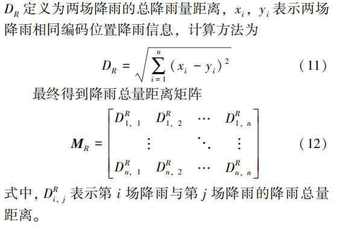
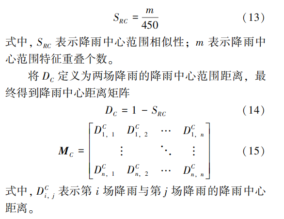
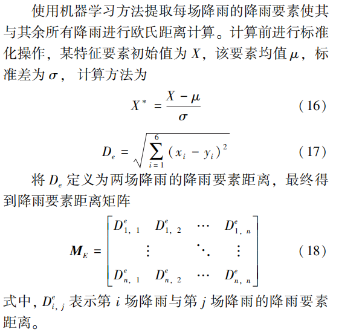
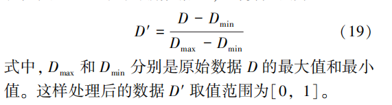


# 参考文献
李虎, 王丽晶, 杨思敏, 等. 基于多距离融合的场次降雨时空相似性比较[J]. 水利水电技术(中英文), 2024, 55(6): 106- 119. LI Hu, WANG Lijing, YANG Simin, et al. Spatio-temporal similarity comparison of rainfall events based on multi-distance fusion  [J]. Water Resources and Hydropower Engineering, 2024, 55(6): 106- 119.
# 任务
任务：提高根据实时数据识别大雨和暴雨的准确率。
#   方法
采用相似性比较方法进行识别。
- 相似性要素所属的宏观对象（不同区域）
- 选取哪些特征进行相似性比较
- 选取的特征如何进行相似性比较
- 选取的数据如何处理后进行相似性比较

> 基于多距离融合的场次降雨时空相似性比较：多距离融合。
> [方法] 首先，通过设定降雨占比阈值划分降雨场次，共识别出汛期（6—9 月）225 场降雨。然后提取降雨量、降雨历时、降雨强度、降雨中心范围等特征要素，计算降雨要素距离、降雨中心距离和总降雨量距离三个方面的降雨特征距离。同时，为更好地融合各特征距离，采用主成分分析法进行距离融合并计算权重，得到最终距离，并根据计算结果进行相似性排序。

存在的问题
- 数据问题：大雨/暴雨事件较少，而且大降雨没有上限，数值差异很大。
- 每次相似性计算都要与所有历史记录进行比较，开销很大。
- 模型：各距离参数的获取方式是否合适（主成分分析）。
- 各距离的计算方法是否合适。
- 选取的特征要素要有科学性，尽量朝着可能提高暴雨识别率的方向选取。
- 针对不同场景需要增加相应的特征距离。
- 单场降雨的评估。

多距离 + 单核心 + 深度学习调整。

# 复现
## 特征提取与距离计算
## 降雨特征的来源
- 区域被划分为像元，每个像元有一个降雨特征。
- 并非所有像元都能实际采集到降雨特征，因此需要用反距离权重法补全数据。

矩阵的每个元素代表一个像元。

## 距离
### 总降雨量距离

两场降雨的总降雨量距离 = 各元素降雨量之差的平方和。

###  降雨中心距离
一场降雨中前 10% 的元素构成降雨中心。

两场降雨的降雨中心相似度 = 两场降雨降雨中心元素的重叠个数 / 元素总数。
两场降雨的降雨中心距离 = 1 − 两场降雨的降雨中心相似度。

### 降雨要素距离
（1）降雨历时 T，单位为小时（h），表示降雨过程的时间要素，按整小时计。
 （2）强降雨历时 Tt，单位为小时（h），表示降雨中心范围内降雨强度大于 7 mm/h 的小时数。 
（3）平均降雨量 Ra，单位为 mm，表示场次总降雨量中所有格点降雨信息的平均值。（4）最大降雨量 Rm，单位为 mm，表示场次总降雨量中前 10% 格点降雨信息的平均值。 
（5）最大 1 h 降雨强度 I，单位为 mm/h：先计算每小时所有格点降雨信息的平均值，再取其中的最大值。 
（6）降雨中心最大降雨强度 Ic，单位为 mm/h：先计算每小时降雨中心范围内降雨信息的平均值，再取其中的最大值。

按场次计算时，可能涉及如何将各元素的降雨特征汇总为该场降雨的降雨特征。

先对场次降雨要素进行标准化。

两场降雨的降雨要素距离 = 各自六个降雨要素之差的平方和再开平方。

## 用主成分分析融合权重

[主成分分析（PCA）的基本原理及其 Python 实现——基于 sklearn](https://www.bilibili.com/video/BV1Fe41157Tw/?spm_id_from=333.337.search-card.all.click&vd_source=a1be939c65919194c77b8a6a36c14a6e)

[最直观的解释：什么是主成分分析（PCA）](https://www.bilibili.com/video/BV1E5411E71z/?spm_id_from=333.337.search-card.all.click&vd_source=a1be939c65919194c77b8a6a36c14a6e)

得到三个距离矩阵后，需要统一它们的量纲。

然后通过主成分分析得到模型参数。
## 相似性度量与评级
计算出各距离矩阵 × 其参数 = 综合距离矩阵之后，
就知道了与每场降雨的距离；然后用 1 − 该矩阵的每个元素 = 相似度矩阵。

然后对相似度进行分级，最高的就是最相似的。
随着类别序号增大，样本相似度整体呈下降趋势；降雨较小的类别相似度集中在较高区间，而降雨较大的类别分布更宽、均值更低，相似性评价效果较差。
## K-means 聚类分析
[十分钟掌握 k-means++ 聚类算法及其 Python 实现（代码详细讲解，包教包会！超级适合新手）](https://www.bilibili.com/video/BV12NsuedEiL/?spm_id_from=333.337.search-card.all.click&vd_source=a1be939c65919194c77b8a6a36c14a6e)
聚类变量：六个降雨要素。
聚类数：6，由肘部法则确定。

基于同一簇内计算的相似度进行评价。

# 代码
[https://github.com/FULLK/Intelligent_Water_Management_Emergency_Response-Studying/tree/master/%E9%99%8D%E9%9B%A8%E8%AF%86%E5%88%AB](https://github.com/FULLK/Intelligent_Water_Management_Emergency_Response-Studying/tree/master/%E9%99%8D%E9%9B%A8%E8%AF%86%E5%88%AB)

