
   
# 公钥密码
[现代密码学 | 公钥密码体制概述](https://www.bilibili.com/video/BV1P34y1B72L?spm_id_from=333.788.videopod.sections&vd_source=a1be939c65919194c77b8a6a36c14a6e)

- 加密
   A 用 B 的公钥加密
   B 用 B 的私钥解密
   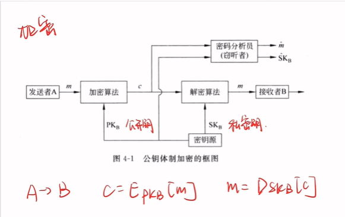
- 认证 
A 用 A 的私钥加密
B 用 A 的公钥解密

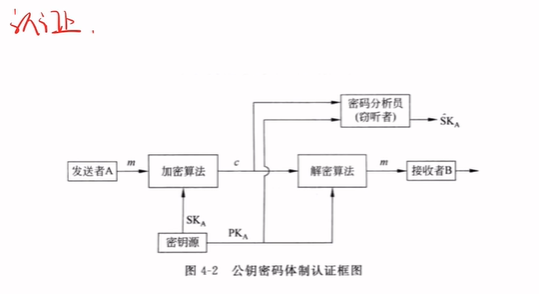
- 加密 + 认证
 A 先用 A 的私钥加密，再用 B 的公钥加密
 B 先用 B 的私钥解密，再用 A 的公钥解密
 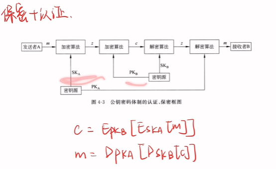
# RSA 的数学基础
[现代密码学 | RSA 加密算法及其数学基础](https://www.bilibili.com/video/BV1gT4y117My/?spm_id_from=333.788.videopod.sections&vd_source=a1be939c65919194c77b8a6a36c14a6e)
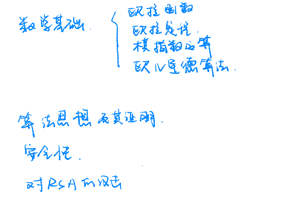

## 欧拉函数
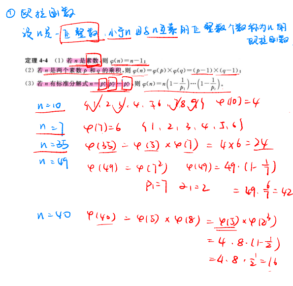
## 欧拉定理
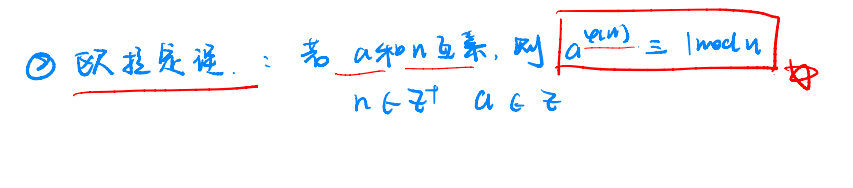

## 模幂运算
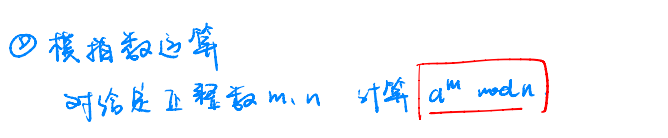
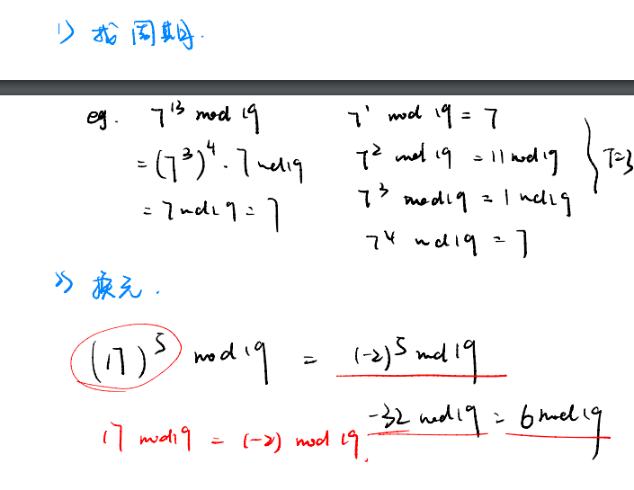

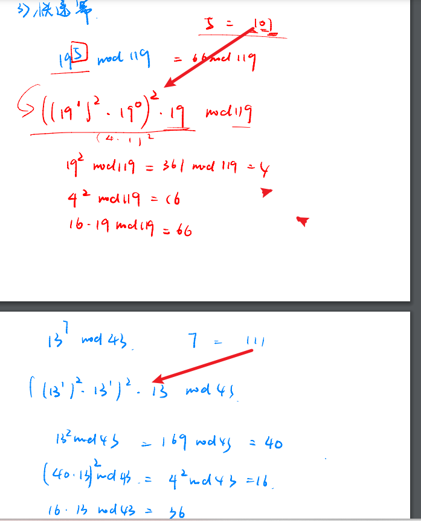

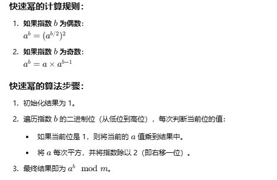

求最大公约数
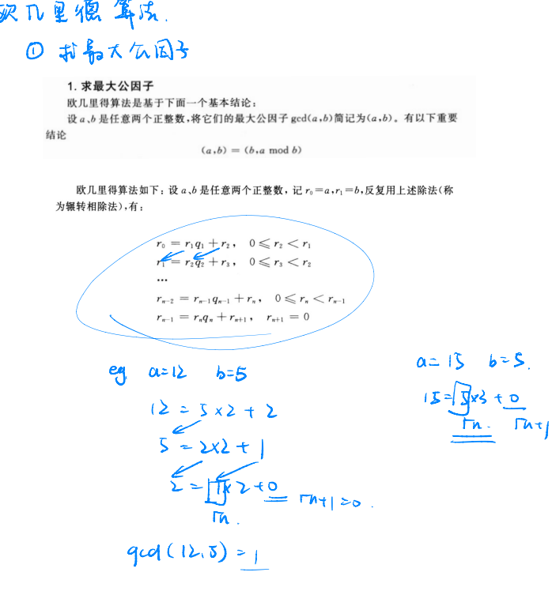
求乘法逆元
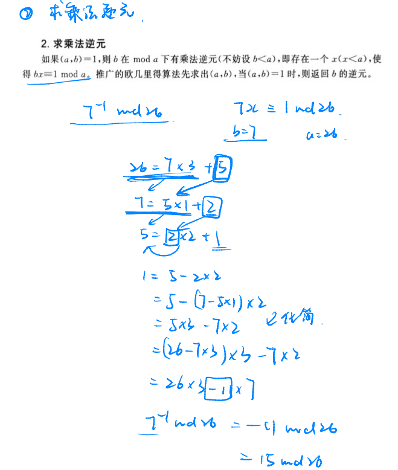

# RSA 加密算法

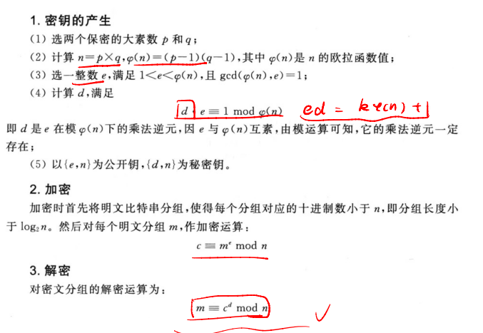
证明

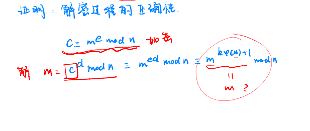

分为互素和不互素两种情况
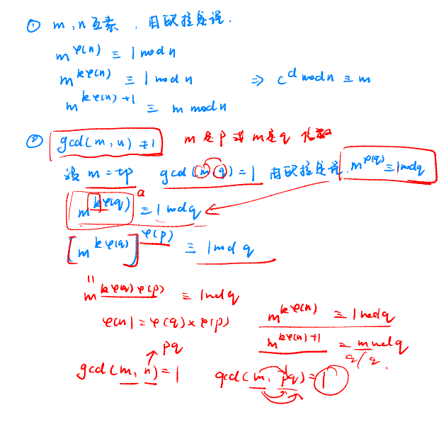
示例
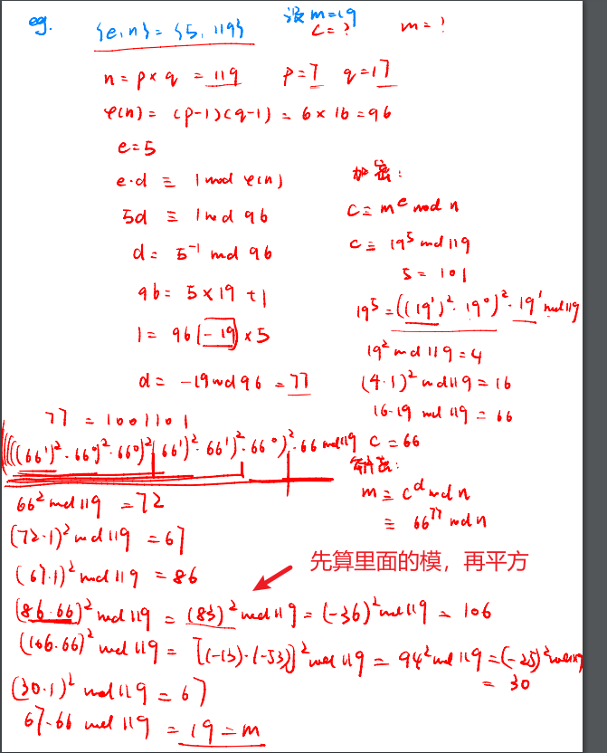

# 针对 RSA 的攻击
所有情况下 e 和 n（公钥）都是已知的

枚举时，假设 x 之后，根据 (p+q)/2 > sqrt(a) 选取 q 的可能取值，使得当 q 等于 y 时，n=(x+y)*(x-y) 成立

如果 p-q 的绝对值较大，假设一个 p 值后需要枚举很多可能的 q 值，才能找到正确的 p 和 q
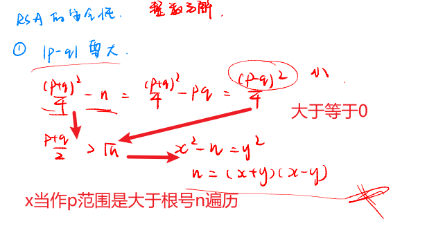
不断加密，直到结果与 c 模 b 同余
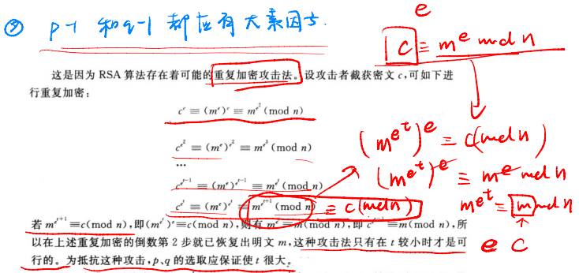

共模攻击最终可以泄露明文

低指数攻击利用中国剩余定理恢复出 m^e
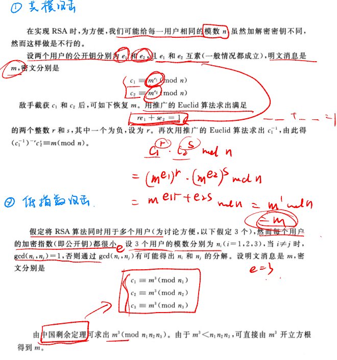

