
# 总结
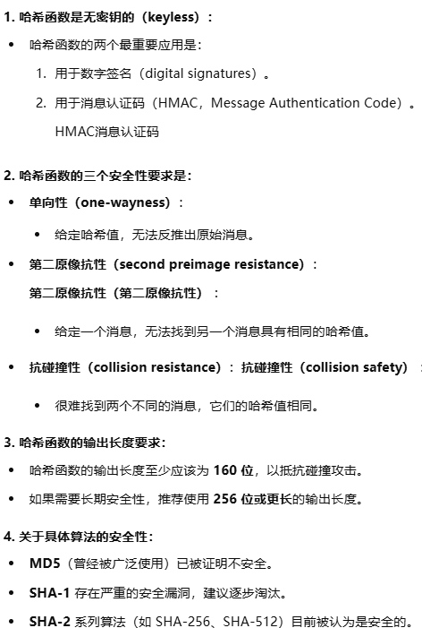

# 为什么需要哈希函数

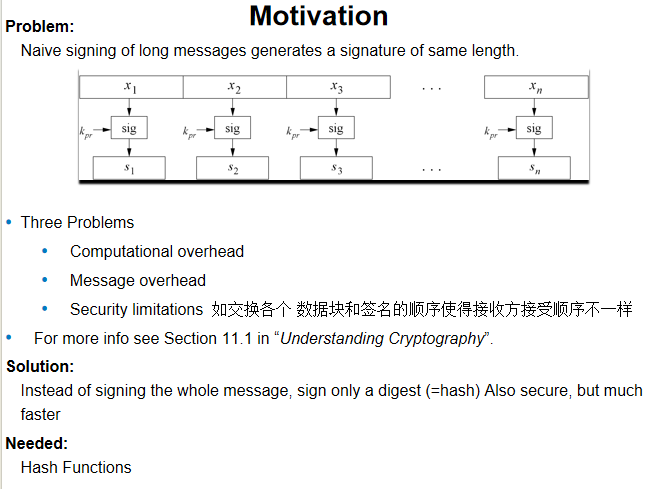
## 使用哈希函数的数字签名
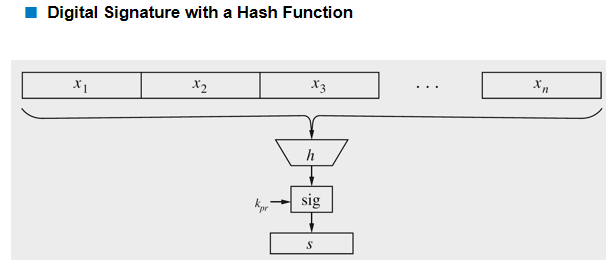
## 使用哈希函数进行数字签名的基本协议
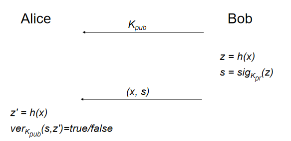
##  哈希函数的基本输入输出特性
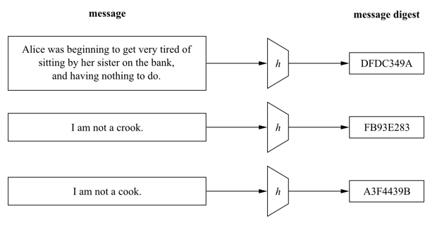
# 安全性质
##  哈希函数的三个安全性要求
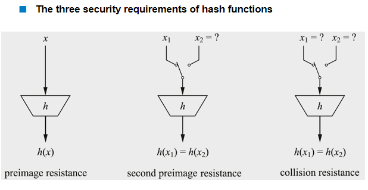
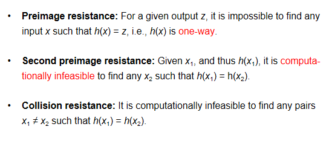
## 为什么基于哈希的数字签名方案是安全的？
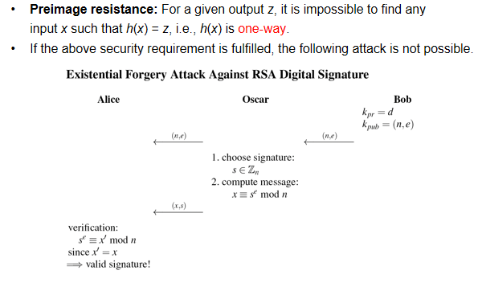
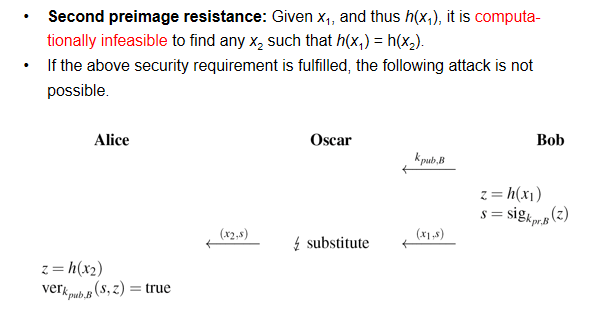
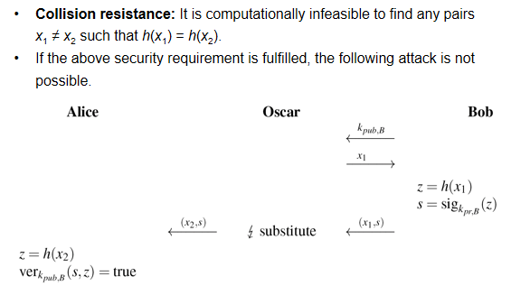
## 抗碰撞性与生日攻击
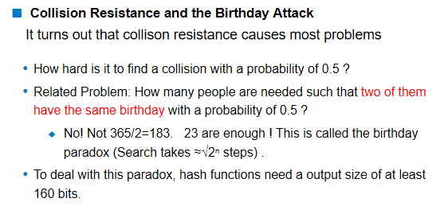
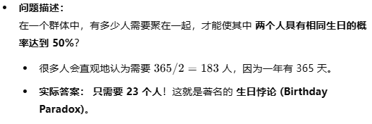
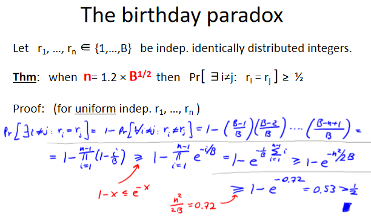
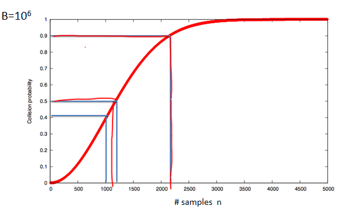
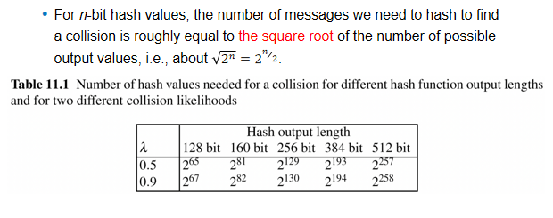
2 的 80 次方是当前计算机能够达到的范围

# 算法
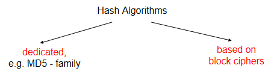

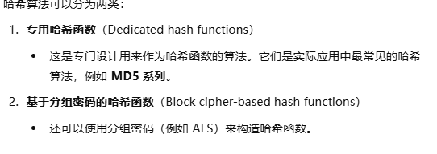
##  基于分组密码构造哈希函数
每个 xi 是分组密码的输入长度，最终的哈希结果是 xn 经过函数 e 之后的结果

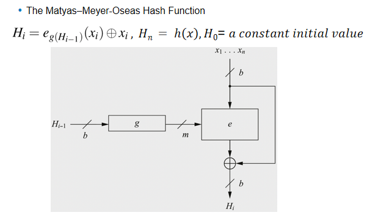

这个是反过来的，但最终的哈希结果仍然是 xn 经过函数 e 之后的结果

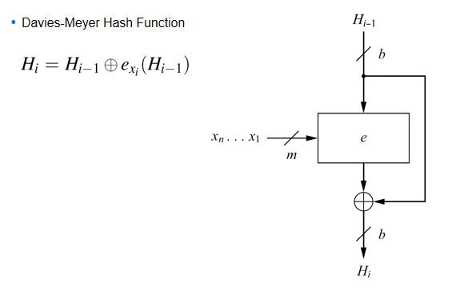

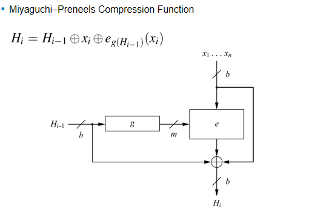
##  专用哈希函数 -- MD4 哈希函数族

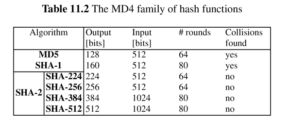
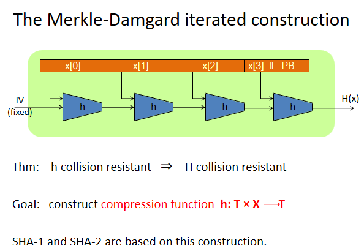

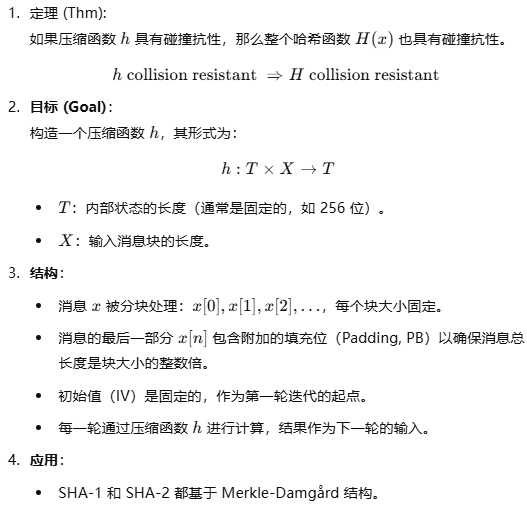
# 示例：安全哈希算法 SHA-256
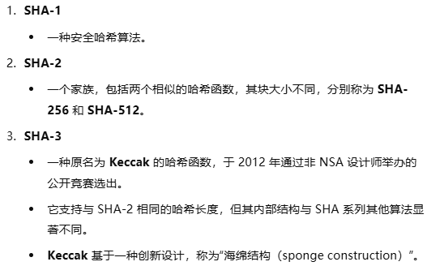
## SHA-2
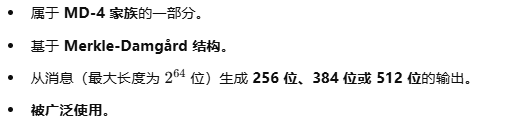
整体框架
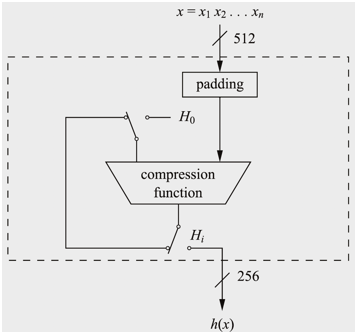
每个分组大小为 512 位
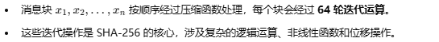

### SHA-256 预处理
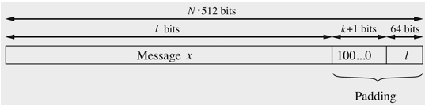

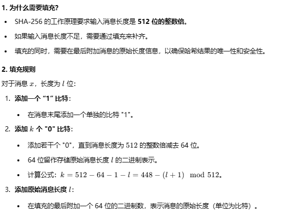
### SHA-256 压缩函数
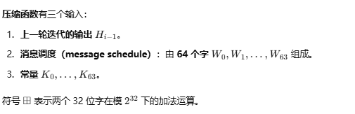
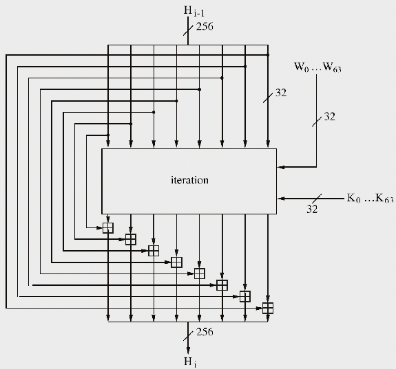
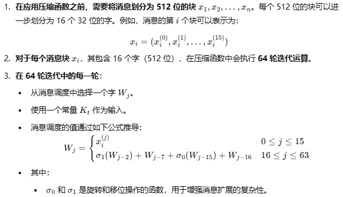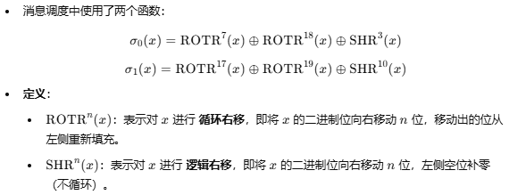

###  SHA-256 压缩函数中的第 j 轮迭代
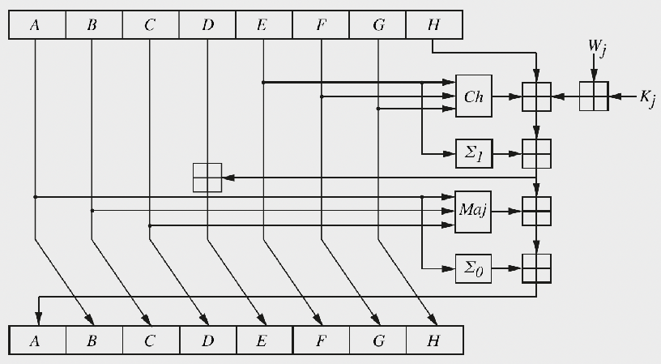

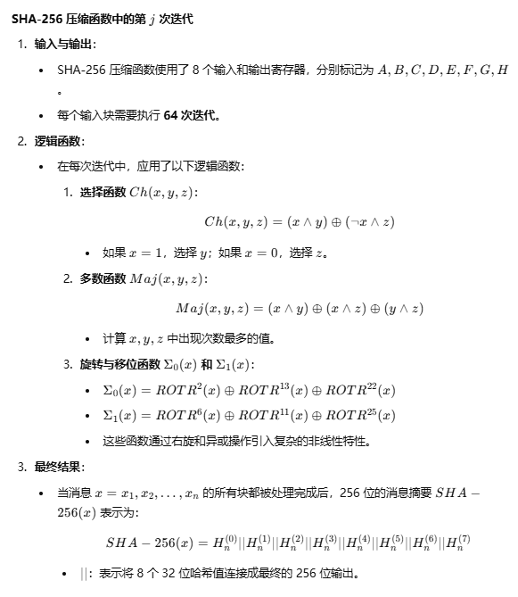
# 参考资料

1. **众多哈希函数及其规范的概览**：  
   - [http://ehash.iaik.tugraz.at/wiki/The_Hash_Function_Zoo](http://ehash.iaik.tugraz.at/wiki/The_Hash_Function_Zoo)

2. **生日悖论**：  
   - 维基百科给出了很好的解释：  
   - [http://en.wikipedia.org/wiki/Birthday_problem](http://en.wikipedia.org/wiki/Birthday_problem)

3. **SHA 标准**：  
   - **SHA1+2**：  
     - [http://csrc.nist.gov/publications/fips/fips180-2/fips180-2withchangenotice.pdf](http://csrc.nist.gov/publications/fips/fips180-2/fips180-2withchangenotice.pdf)  
   - **SHA3 概览**：  
     - [http://ehash.iaik.tugraz.at/wiki/The_SHA-3_Zoo](http://ehash.iaik.tugraz.at/wiki/The_SHA-3_Zoo)

4. **CrypTool**：  
   - CrypTool 是一个学习程序，也可以进行哈希运算：  
   - [http://www.cryptool.org/](http://www.cryptool.org/)

---

