
# 概述
可以理解为对称形式的数字签名，但与数字签名之间仍有很多不同
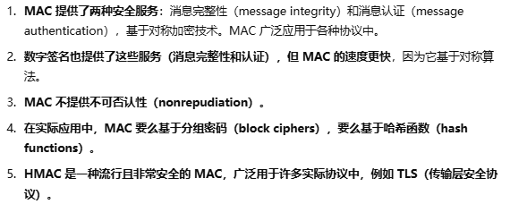

# MAC 的原理
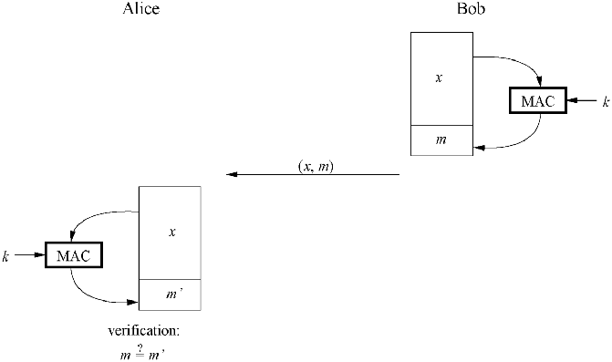

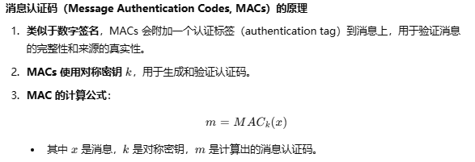

#  消息认证码的性质
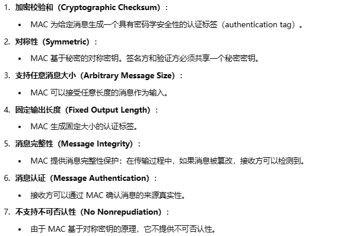
消息认证 = 数据源认证
# 消息认证码（MAC）的安全性
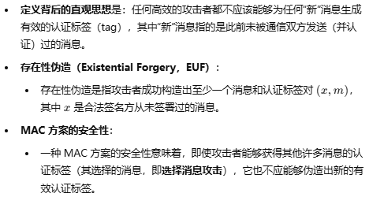

# 基于哈希函数的 MAC
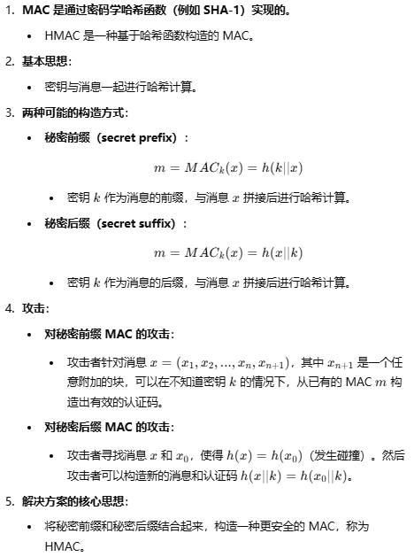

前缀攻击：直接在原消息后面追加消息分组
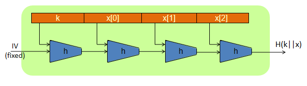

后缀攻击：两个 x 产生碰撞，从而生成一个合法的消息和认证码
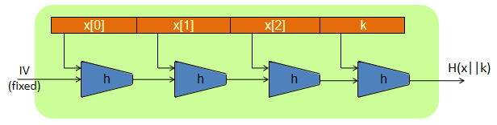

#  HMAC
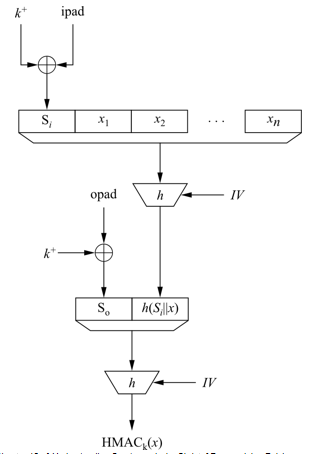
这里的 h 是哈希函数

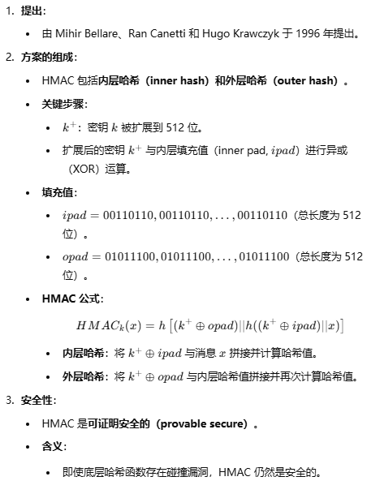
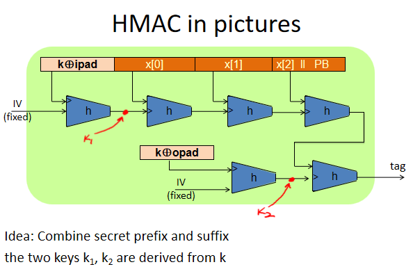
这里的 h 可以理解为哈希函数中的压缩函数
# 基于分组密码的 MAC

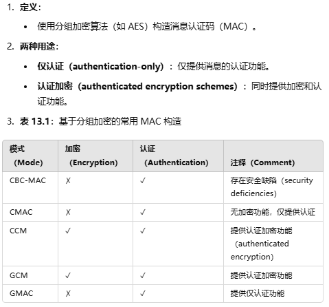

## CBC-MAC
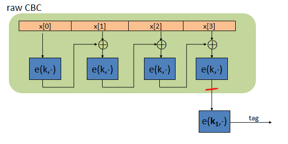

 最后一步使用 k1 而不是 k 会更安全
 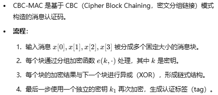
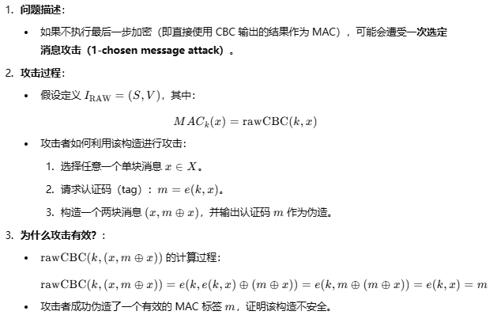

