
# 基本信息
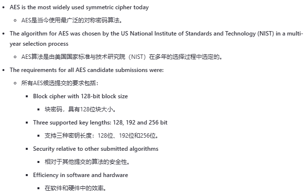
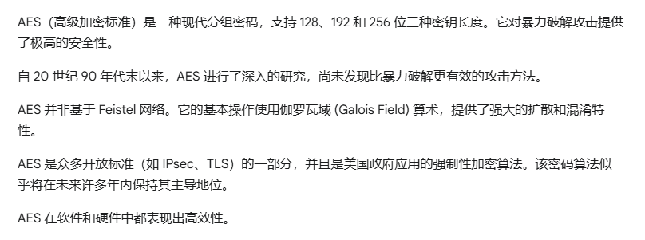

# 概述
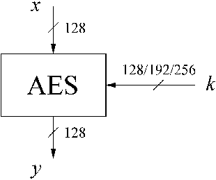
轮数与所选的密钥长度有关
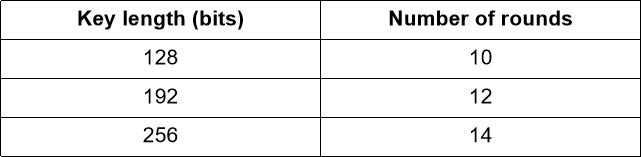
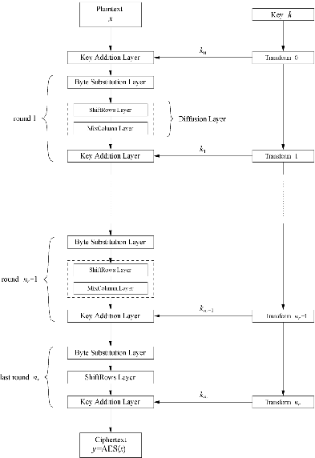
# AES 实现细节
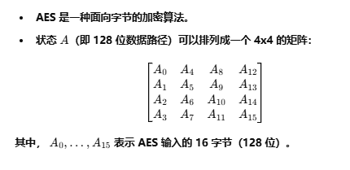
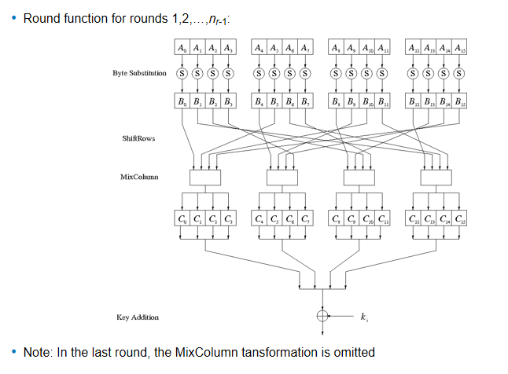

##  伽罗瓦域（GF）
#  字节代换层

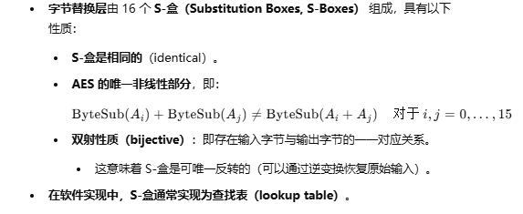
### AES S 盒
输入字节的高 4 位表示行 X，低 4 位表示列 Y

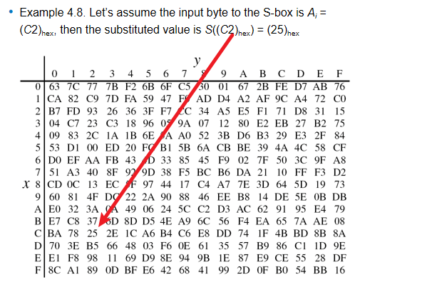
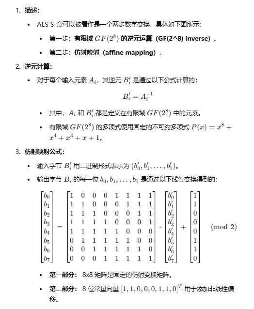
# 扩散层
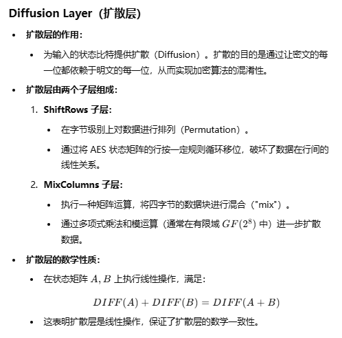
## ShiftRows 子层
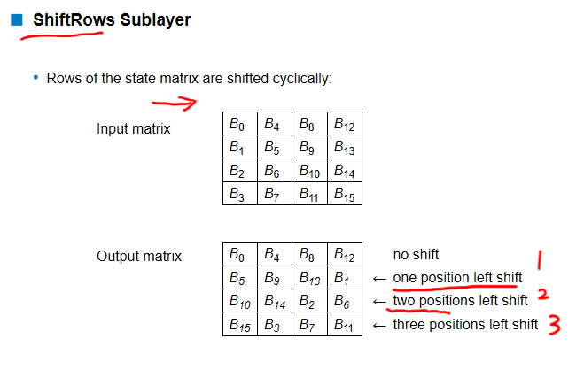
## MixColumn 子层
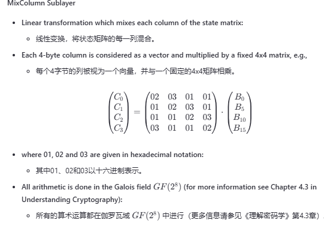
## 密钥加法层

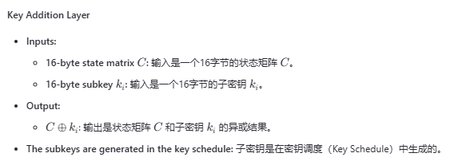
# 密钥编排
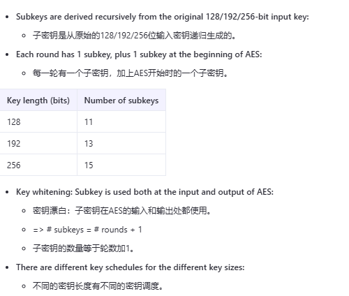
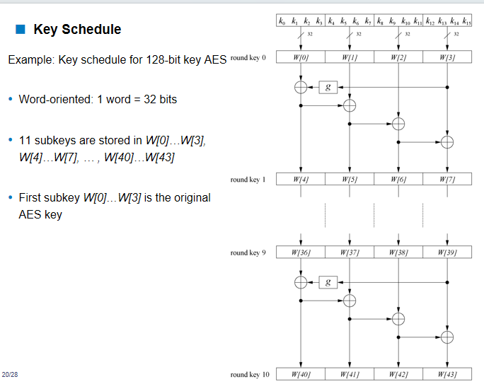
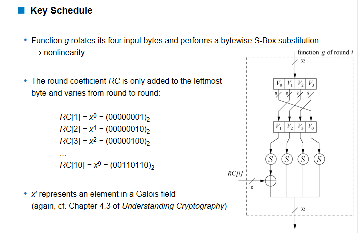
# 解密
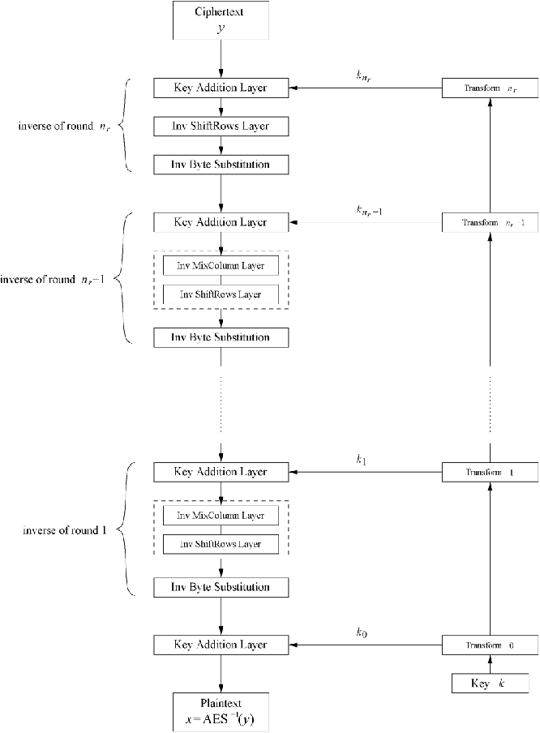
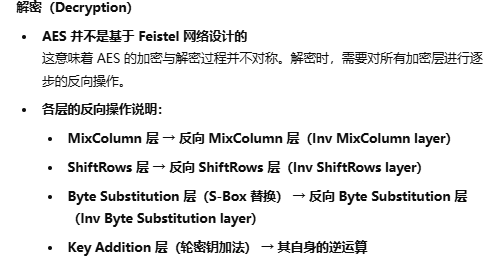
## 逆 MixColumn 层：
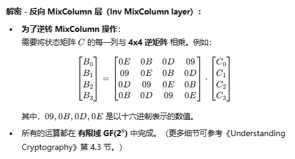
## 逆 ShiftRows 层
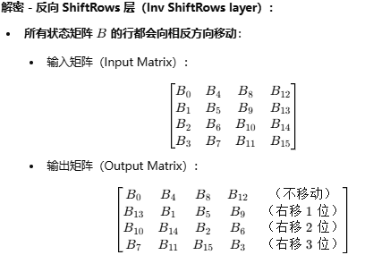

## 逆字节代换层 + 解密密钥编排

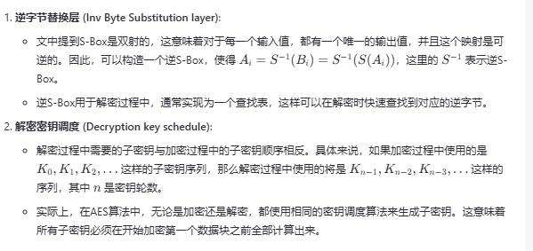
# 实际问题
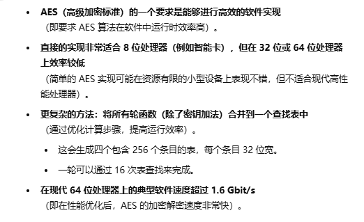

---

### **直接实现适合 8 位处理器**

#### **为什么适合 8 位处理器？**
- **8 位处理器**一次只能处理 **8 位（1 字节）**数据。AES 的核心算法（如 S-Box、ShiftRows、MixColumns 等）都是基于矩阵的运算，在这种情况下只能逐步处理每个字节。
- 由于 8 位处理器本身性能较低、资源有限，采用直接实现更简单、更易用。

#### **示例：**
一个 AES 数据块的大小是 **128 位（16 字节）**。如果处理器一次只能处理 8 位（1 字节），就必须逐个处理每个字节。例如：
1. AES 需要加密一个 128 位的数据块。
2. 每次只能处理 8 位（1 字节），因此需要 **128 ÷ 8 = 16 步**。
3. 每一步都涉及多次计算（如字节代换、ShiftRows、MixColumns 等），因此整个过程可能需要数百个指令周期。

这种逐字节的方式虽然简单，但在 **32 位或 64 位处理器**上效率很低，因为它们一次可以处理更多数据（例如 32 位处理器可以同时处理 4 个字节，64 位处理器可以处理 8 个字节）。

---

### **优化的查表法**

#### **为什么需要优化？**
- 在现代 32 位或 64 位处理器上，逐字节处理太慢了。优化的思路是：**用查找表代替复杂的计算**。
- 查找表是预先计算好的结果集合，通过索引（如某个字节的值）直接找到对应的结果，无需实时计算。

#### **优化方法：**
1. **S-Box 优化：**
   - S-Box 是 AES 中用于代换字节的表（每个字节被替换为一个特定的字节），因此可以预先生成一个包含 256 个条目的查找表。
   - 每当需要代换一个字节时，直接在表中查找即可。
   
2. **合并运算：**
   - 不仅是 S-Box，AES 的其他运算（如 ShiftRows 和 MixColumns）也可以合并到一个查找表中。
   - 这样，每个字节的所有计算都可以通过一次查表完成。

3. **最终优化：**
   - 生成 **4 张表**，每张表包含 **256 个条目**，每个条目 **32 位宽**。
   - AES 的每一轮只需要 16 次查表就能完成所有字节的处理。（16 个字节；表中包含了每个字节对应的所有运算的结果）

#### **示例：**
假设 AES 需要处理一个 128 位的数据块：
- **原始方式：**逐字节处理需要数百个指令周期（例如每个字节都要做 S-Box 代换 + ShiftRows + MixColumns）。
- **优化方式：**每个字节只需要 1 次查表，因此整个数据块只需要 **16 次查表**，大大减少了指令数和计算时间。

这种优化非常适合现代处理器，因为现代处理器擅长高效的查表操作。

---

### **在现代 64 位处理器上的速度**

#### **为什么更快？**
现代 64 位处理器可以并行处理多份数据：
1. 查找表可以放在处理器的缓存中，使查表速度极快。
2. 64 位处理器可以同时处理 8 个字节的数据，因此计算的并行度大大提高。

#### **示例：**
- 假设 AES 需要加密一个文件：
  - 文件大小为 **2 GB（约 16 亿位）**。
  - 在优化的实现中，AES 的处理速度为 **1.6 Gbit/s**。
  - 处理一个 2 GB 的文件只需要 **2 × 8 ÷ 1.6 = 10 秒**。

优化的查表法使 AES 加密在现代硬件上极其快速。

---

# 安全性

### **1. 暴力攻击**
**翻译：**  
由于 AES 的密钥长度为 128 位、192 位或 256 位，暴力攻击是不可行的。

**解释：**  
- **什么是暴力破解？**  
  暴力破解是指尝试所有可能的密钥组合，直到找到正确的密钥。对于 AES，加密的安全性取决于密钥长度。
  
- **为什么不可行？**  
  - AES 使用的密钥长度非常大：
    - **128 位密钥**：可能的密钥总数为 \(2^{128}\)，约 \(3.4 \times 10^{38}\)。
    - **192 位密钥**：可能的密钥总数为 \(2^{192}\)，约 \(6.3 \times 10^{57}\)。
    - **256 位密钥**：可能的密钥总数为 \(2^{256}\)，约 \(1.1 \times 10^{77}\)。
  - 即使使用当今最快的超级计算机，穷举这些密钥所需的时间也远远超过宇宙的寿命，因此暴力破解是不可能的。

---

### **2. 分析攻击**
**翻译：**  
目前还没有已知的比暴力破解更有效的分析攻击。

**解释：**  
- **什么是分析攻击？**  
  分析攻击是指不尝试所有密钥，而是直接利用数学或算法上的弱点来破解加密。例如，攻击者可能试图找到 AES 算法中的漏洞来缩短破解时间。

- **AES 的情况：**  
  - AES 经过了严格的数学验证，其设计中没有已知的弱点。
  - 目前，所有已知的针对 AES 的攻击所需的计算量都与暴力破解相当，甚至更大。
  - 因此，AES 在设计上仍然是安全的，没有已知的分析攻击能够攻破它。

---

### **3. 侧信道攻击**
**翻译：**  
- 已经公开了若干种侧信道攻击。  
- 需要注意的是，侧信道攻击针对的不是算法本身，而是算法的具体实现。

**解释：**  
- **什么是侧信道攻击？**  
  侧信道攻击并不直接破解加密算法，而是利用加密运算过程中泄露的物理信息（如时间、功耗或电磁辐射）来推断密钥或加密数据。
  
- **示例：**  
  1. **计时攻击：**  
     通过测量加密运算的执行时间，攻击者推断出密钥的某些部分。
  2. **功耗分析：**  
     通过观察设备在加密过程中的功耗波动，攻击者分析内部运算细节。
  3. **电磁攻击：**  
     通过分析设备在加密过程中产生的电磁信号，攻击者提取关键信息。

- **为什么不影响算法本身？**  
  侧信道攻击针对的不是 AES 算法本身的弱点，而是利用设备实现中的漏洞。  
  **例如：**
  - 如果加密运算的某些步骤在时间上不一致，攻击者就可以利用这些时间差来推断密钥。
  - 如果硬件设计不佳，可能会泄露更多的电磁信息，使攻击者更容易获取加密信息。

---
## 针对实现的攻击
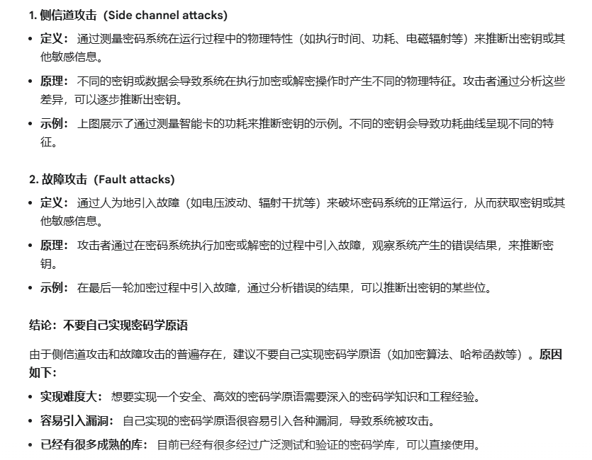

