

> 本笔记部分内容参考了张思莹同学的笔记，非常感谢。

# 背景
### 问题：
RSA 和 ElGamal 等非对称加密方案需要在整数环和域上进行指数运算，参数通常超过 1000 位。这带来了如下问题：
- **计算开销大**：在 32 位或 64 位运算的 CPU 上，这些运算非常耗时。
- **参数规模大**：对于小型设备和嵌入式系统，存储这些大参数是一个挑战。

### 动机：
我们希望找到能提供同等安全性的更小的域，以降低计算和存储需求。

### 解决方案：
椭圆曲线密码（ECC）使用点的集合（而非整数）进行加密运算，系数大小为 160-256 位，大大降低了计算开销。

# 椭圆曲线的定义

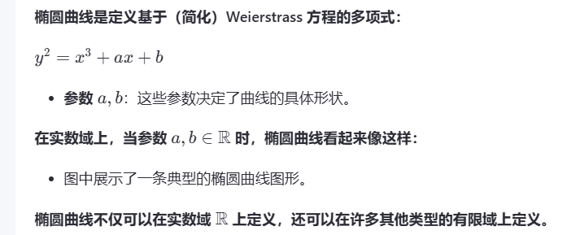
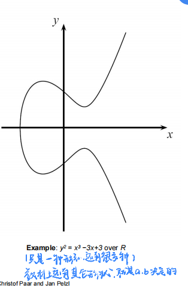
# 素域上的椭圆曲线

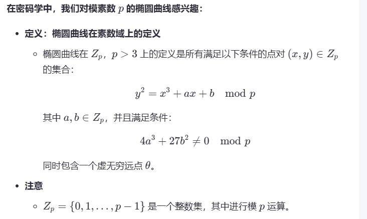
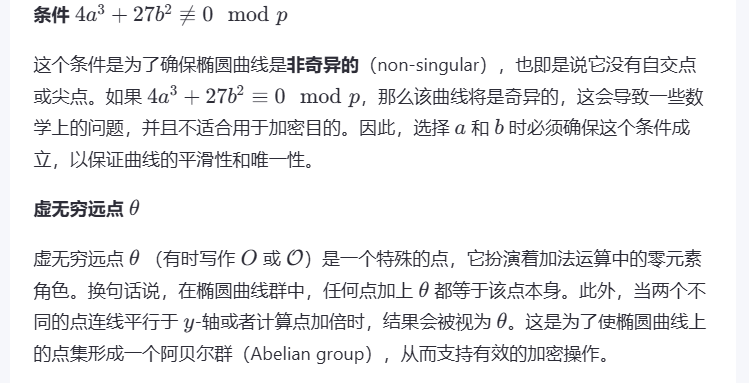

# 不同的域
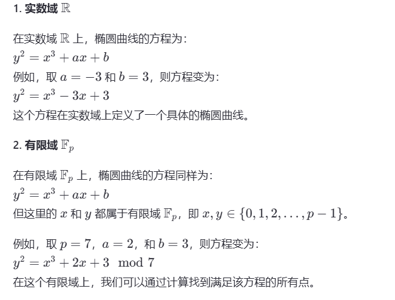

# 相关性质

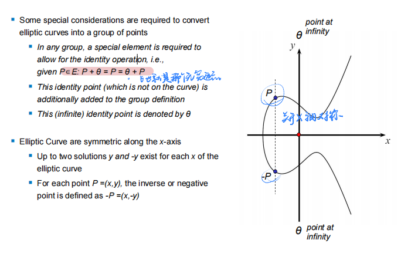
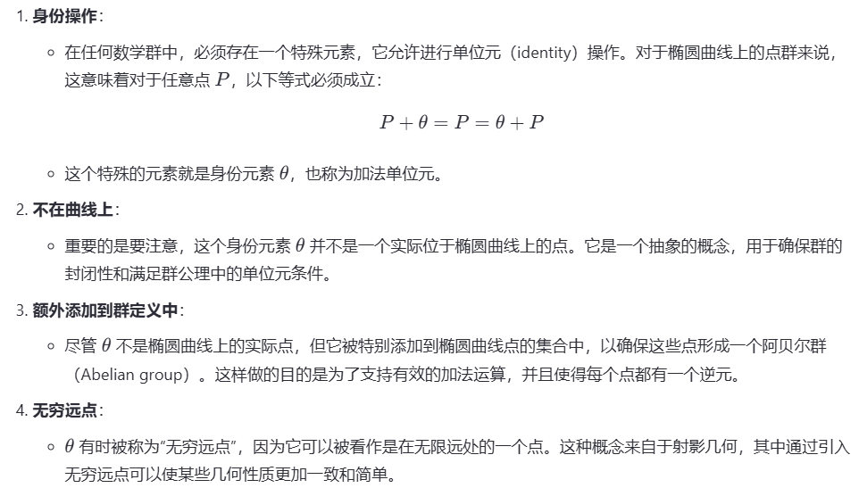
# 相关计算
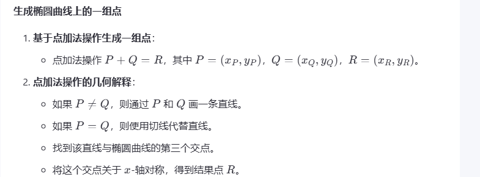
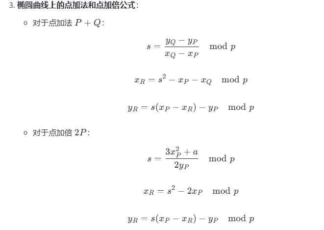

## 例子
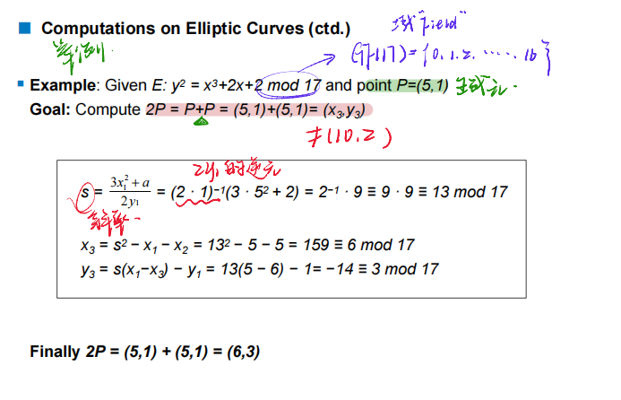
# 循环群
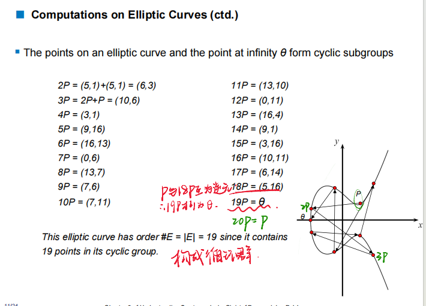
# 点的个数
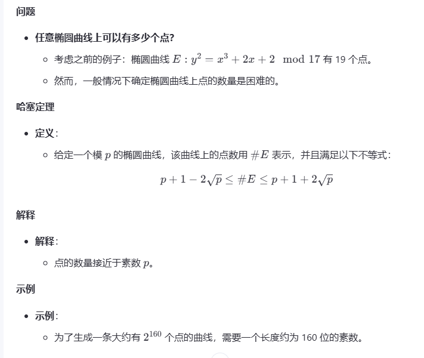
# 椭圆曲线离散对数问题
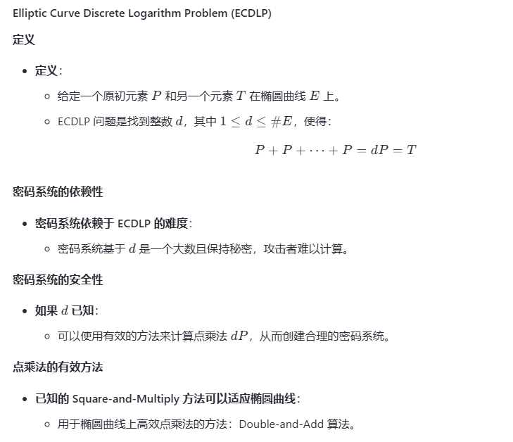

# 计算点乘（倍点-加法）
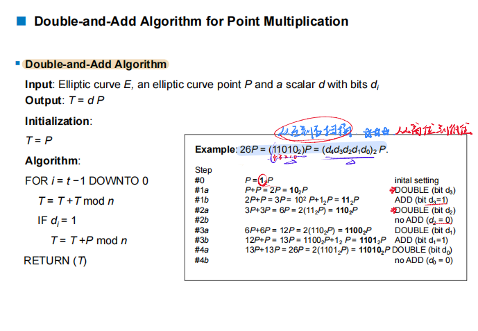

# 椭圆曲线 Diffie-Hellman 密钥交换（ECDH）
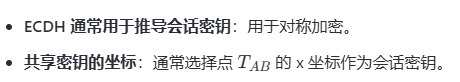

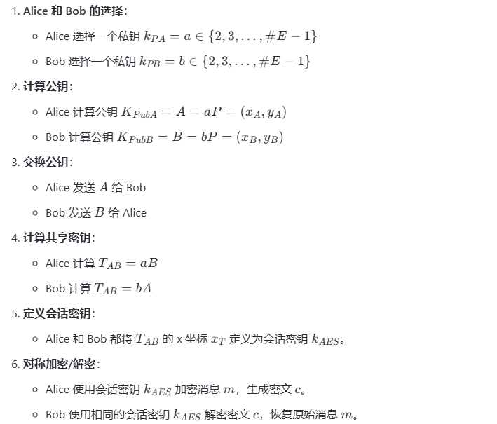
# 安全性

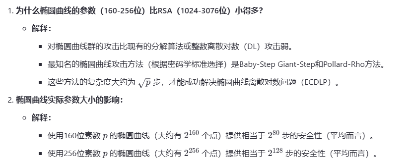
## 大步小步法
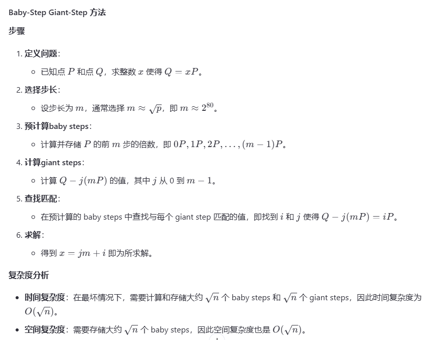
## Pollard-Rho 方法
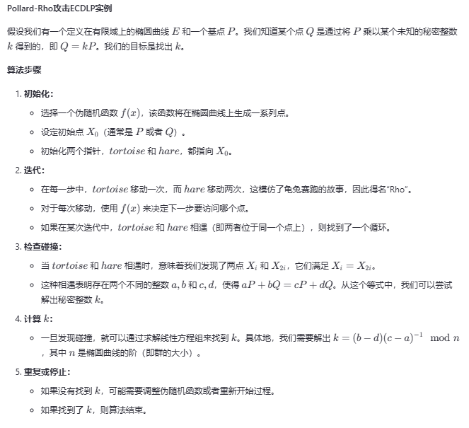

