

复习 PPT——期中考试，可恶，全是按 PPT 出的。每天一章。
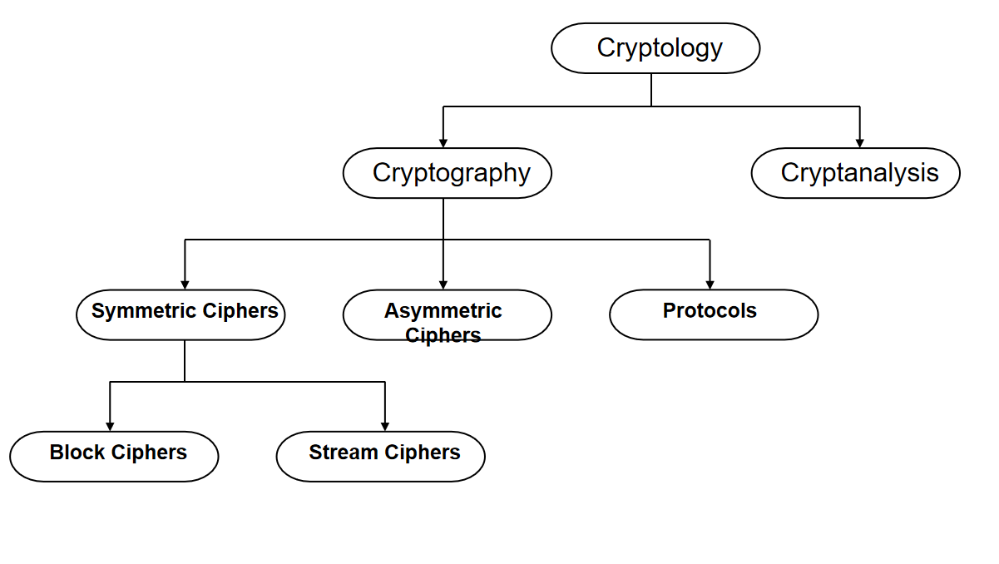
所有的分组密码和流密码都是对称加密
# 对称加密
动机：在不安全的信道上，能访问信道的第三方可以查看通信内容
解决方案：用对称密码加密。第三方只能得到密文，而密文看起来就像随机比特

如果双方使用相同的密钥 K，加密和解密就是互逆运算

重要说明：密钥必须通过安全信道在 Alice 和 Bob 之间传输。安全信道可以通过例如为 Wi-Fi 保护访问（WPA）协议手动安装密钥或由人工信使来实现。不过，只有在攻击者不知道密钥 K 的情况下系统才是安全的，这就把问题简化为 K 的安全传输和存储。

# 代换密码
- 一种历史上的密码；是理解暴力攻击和分析攻击的好工具；它加密的是字母而不是比特（就像二战前的所有密码一样）

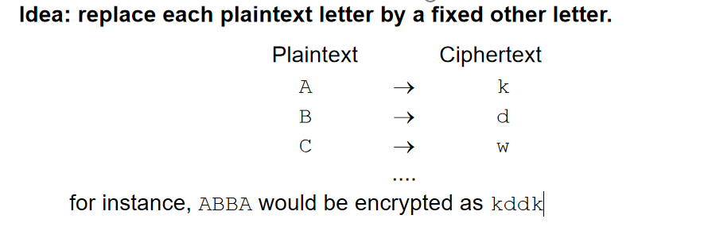
暴力攻击（或穷举密钥搜索）
- 需要（至少）1 个明文-密文对 (x0, y0)
- 检查所有可能的密钥，直到满足条件：dK(y0) = x0（简单地尝试每一种可能的代换表，直到出现可理解的明文（注意每个代换表就是一个密钥）……有多少个代换表（= 密钥）？26 × 25 × ... × 3 × 2 × 1 = 26! ≈ 2^88）在今天的计算机上搜索 2^88 个密钥是完全不可行的

为什么是 2^88？因为对于 26 个字母的代换表，每个字母都可以被其余 25 个字母中的任意一个替换，且不能重复

- 字母频率分析
英语中各字母出现的频率差别很大。而且：明文字母的频率在密文中会被保留下来。例如，“e”是英语中最常见的字母；在典型的英文文本中，几乎 13% 的字母是“e”。其次是“t”，约占 9%。

   攻击中不仅可以利用单个字母的频率，还可以利用字母对的频率（例如“th”在英语中非常常见）、三字母组的频率等等。

重要教训：尽管代换密码有 2^88 这样足够大的密钥空间，它仍然很容易被分析方法攻破。这是一个很好的例子，说明加密方案必须能抵抗所有类型的攻击。

# 为什么需要密码分析
密码分析对现代密码系统至关重要：如果没有人尝试攻破我们的密码方法，我们就永远无法知道它们是否真正安全。

Kerckhoff 原则在现代密码学中至关重要：即使攻击者（Oscar）知道系统除密钥以外的所有细节，密码系统也应该是安全的。

在实践中贯彻 Kerckhoff 原则：只使用经过优秀密码学家多年分析的知名密码！（Understanding cryptography 只讨论这类密码。）注意：不要依靠算法的保密来保证加密系统的安全。虽然很多人可能觉得把加密算法保密会增加难度、更加安全，但历史表明，依赖“秘密算法”往往是危险的。一旦这种“秘密算法”被逆向或泄露，系统就会变得极易被攻破。例如，DVD 内容扰乱系统（CSS）曾试图通过秘密算法保护内容，但最终还是被成功逆向并攻破。

# 攻击类型

### 1. **唯密文攻击（Ciphertext Only Attack）**
   - **已知信息**：
     - 加密算法
     - 密文
   - **说明**：
     - 在这种攻击中，攻击者只知道密文和加密算法，不知道任何对应的明文或密钥。
     - 攻击的目标是通过分析密文推导出明文或密钥。
     - 这是最难的攻击类型，因为已知的信息最少。
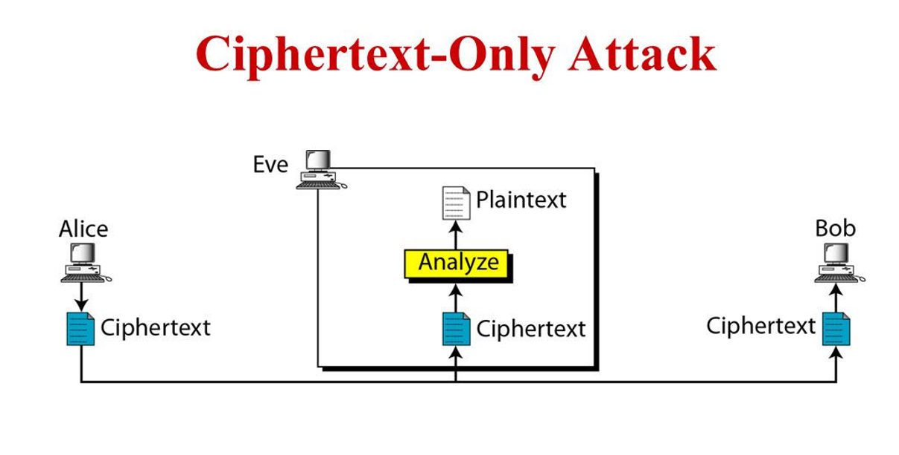

---
### 2. **已知明文攻击（Known Plaintext Attack）**
   - **已知信息**：
     - 加密算法
     - 密文
     - 一个或多个明文-密文对
   - **说明**：
     - 在这种攻击中，攻击者已经获得了一些已知的明文及其对应的密文。
     - 通过分析这些明文-密文对，攻击者试图推导出加密算法的密钥，或其他未解密密文对应的明文。
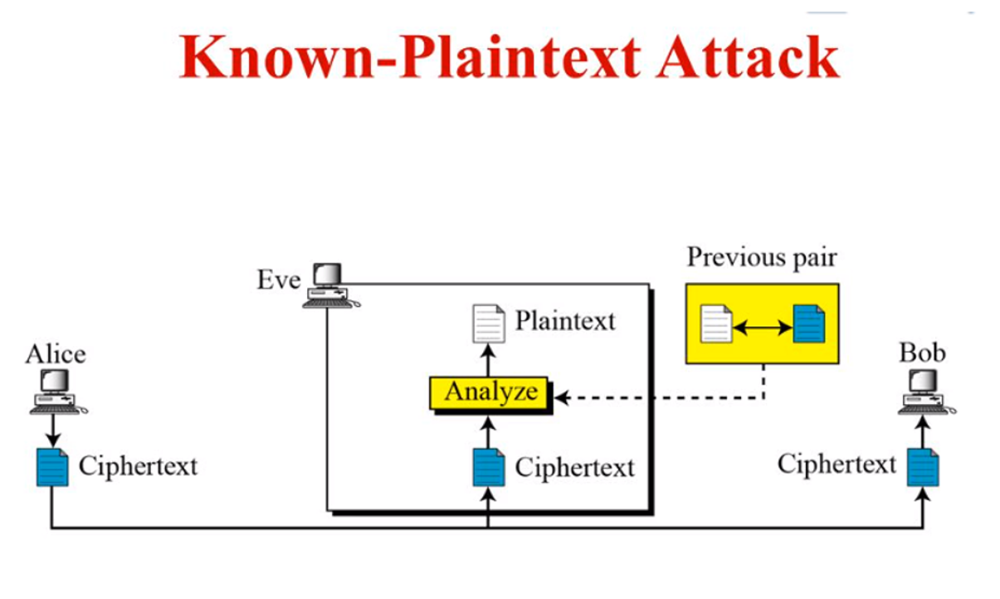

---

### 3. **选择明文攻击（Chosen Plaintext Attack）**
   - **已知信息**：
     - 加密算法
     - 密文
     - 密码分析者选择的明文及其对应的密文
   - **说明**：
     - 在这种攻击中，攻击者可以选择一些明文，并通过加密机制得到其对应的密文。
     - 通过分析这些数据，攻击者试图推导出密钥或攻破算法。
     - 这种攻击假设攻击者能够部分控制加密系统。
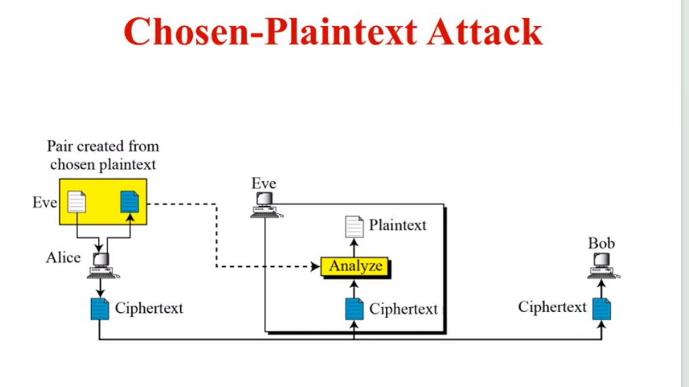

---

### 4. **选择密文攻击（Chosen Ciphertext Attack）**
   - **已知信息**：
     - 加密算法
     - 密文
     - 密码分析者选择的密文及其对应的解密明文
   - **说明**：
     - 在这种攻击中，攻击者可以选择一些密文，并通过解密机制得到其对应的明文。
     - 通过分析解密后的数据，攻击者试图推导出密钥或攻破算法。
     - 这种攻击假设攻击者能够部分控制解密系统。
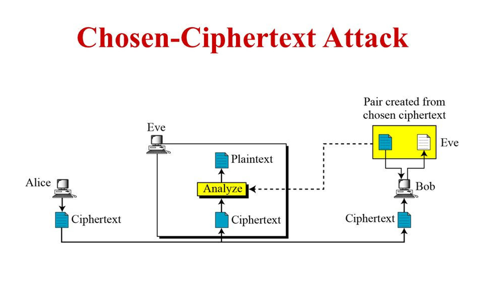

---

- **攻击难度排序（从难到易）**：
  1. 唯密文攻击
  2. 已知明文攻击
  3. 选择明文攻击
  4. 选择密文攻击
  

# 多少位密钥才够？

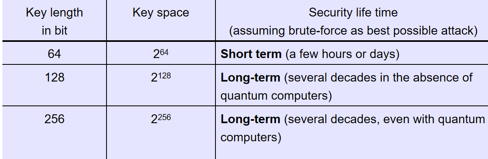

攻击者只需要找到一种有效的攻击方法就能攻破系统。即使密钥空间非常大，攻击者仍然可以通过其他途径成功攻击系统。在这种情况下，密钥再大也无济于事
# 模运算
为什么要学习模运算？它对非对称密码（RSA、椭圆曲线等）非常重要，对一些历史上的密码算法也很有用

- 不同的模数得到不同的余数
- 模除法以及求逆元的方法
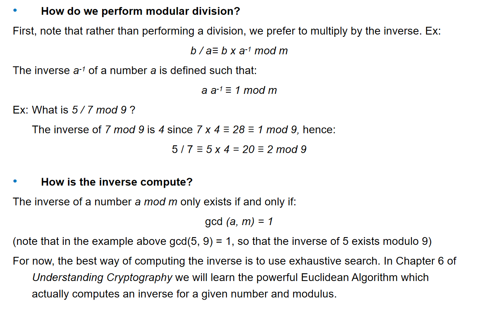
- 简化模运算中的幂运算
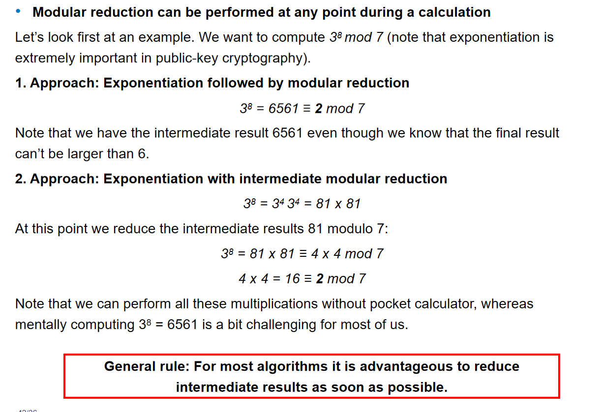
中间结果 81 变小了，计算更容易

- 加、减、乘、除
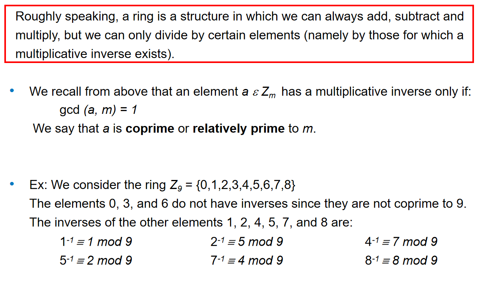
# 移位（或凯撒）密码，即单表代换密码

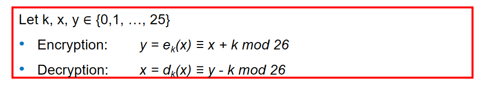
穷举密钥搜索（密钥空间只有 26）；字母频率分析，与针对代换密码的攻击类似
# 多表代换
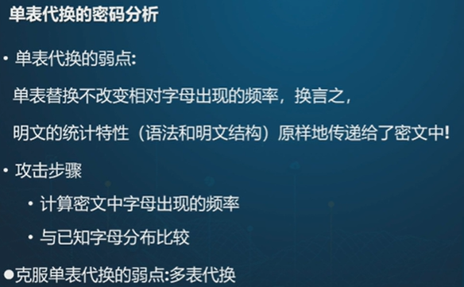
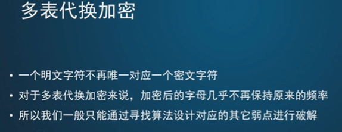

# Playfair 密码
从关键词中按出现顺序去掉与前面重复的字母，然后填入矩阵；再把 A 到 Z 中之前没有出现过的字母，按从左到右逐行的顺序依次填入矩阵
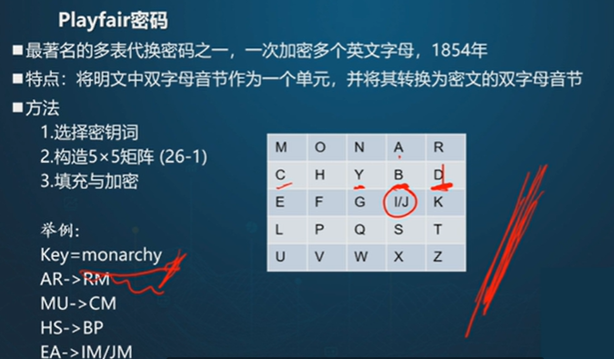

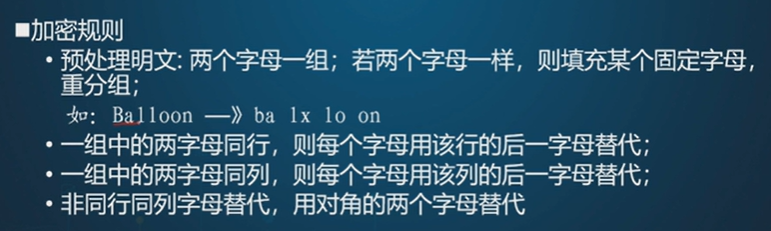
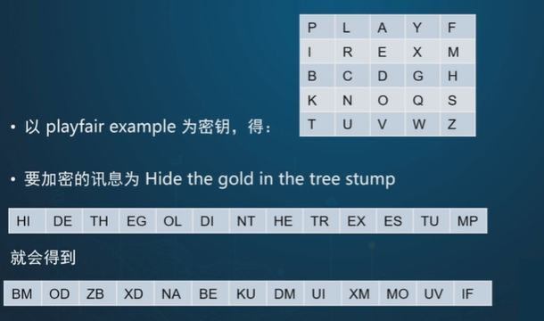

# 维吉尼亚密码（16 世纪，罗马）——一种多表代换密码

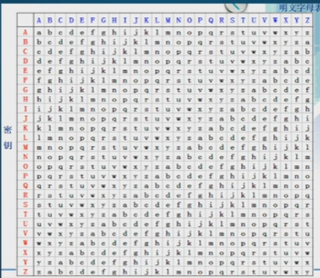
用密钥循环填充
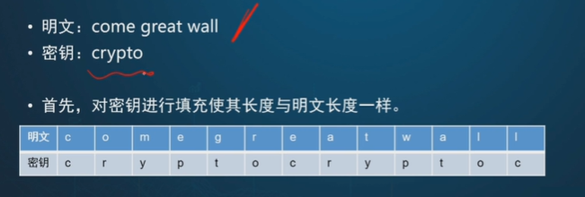
根据明文字母和密钥字母查表
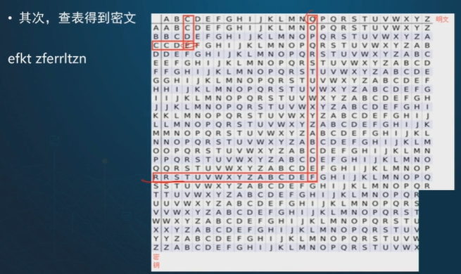

频率分析攻击在这里应该不起作用，因为明文中的频率与密文中出现的频率并不对应

# 仿射密码

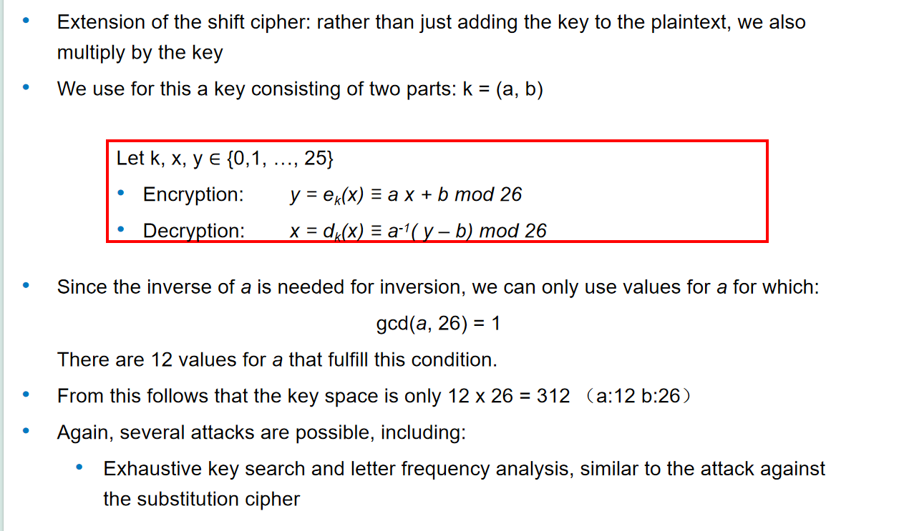
密钥空间：a 有 12 种可能，b 有 26 种

