
# 引言
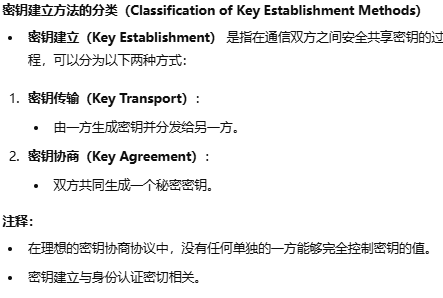
在理想的密钥协商（或密钥交换）协议中，任何一方都不能完全控制密钥的取值：密钥由双方共同生成。

#  n2 密钥分配问题

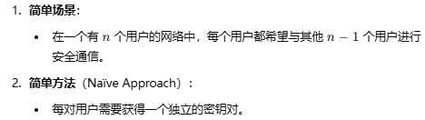
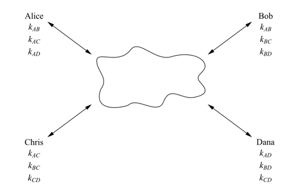
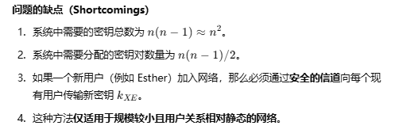
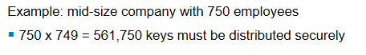

# 密钥派生
##  密钥新鲜性
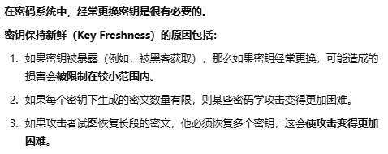

##  密钥派生
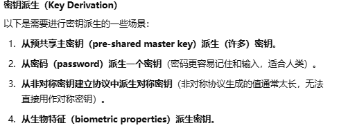

非对称密钥建立协议生成的密钥非常大，不适合直接用作对称密钥。

密钥通过密钥派生函数生成。
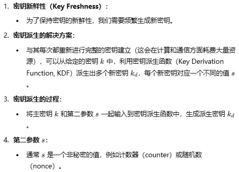

HMAK 生成的签名相当随机，所以可以把它看作一个伪随机函数。
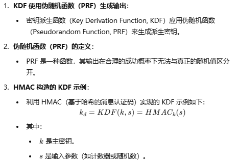

## 基于口令的密钥派生 
下面的 Int(1) 用于填充；更准确地说，它应该是多个 0 与一个 1 拼接（0||1）。
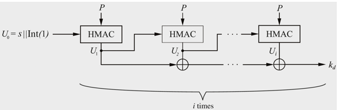

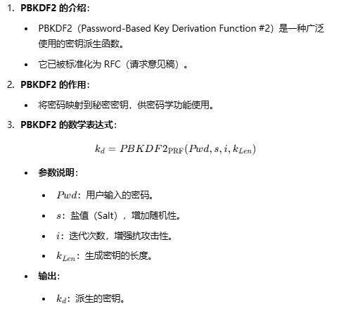

# 使用对称密钥技术建立密钥
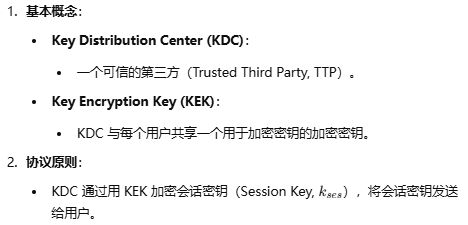
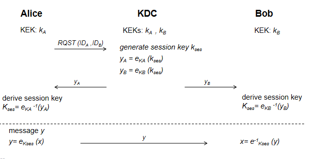
KDC 已经与每个用户各自保存了一个共享的对称密钥。
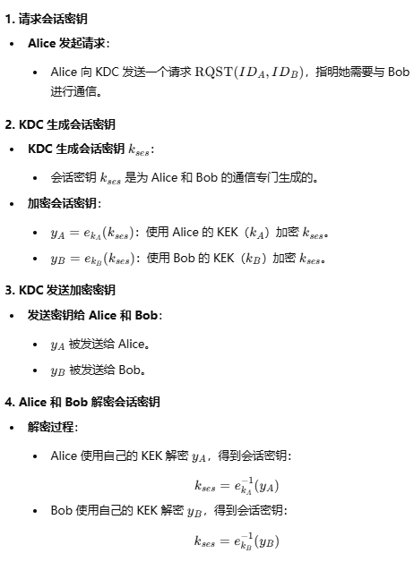
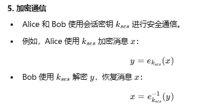
## toy protocol 的优点与不安全性

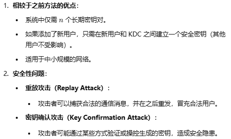

- 单点故障：攻破 KDC 就攻破了一切。
- 重放攻击：截获第一轮中用会话密钥加密的 ya 和 yb 值；然后在下一轮请求会话密钥时，截获该请求，并把上一轮截获的会话密钥分别发给双方，使他们使用旧的会话密钥进行通信。
- 密钥确认攻击：Oscar 截获请求并篡改，使其变成 Alice 与 Oscar 之间的请求。KDC 随后生成会话密钥并把会话密钥发给 Alice。Alice 解密出自己的会话密钥，加密消息，并把它和另一个加密的会话密钥一起发给 Bob。Oscar 在中间截获并解密，得到会话密钥和消息。此后 Alice 与 Bob 之间使用该会话密钥的所有通信都会被 Oscar 截获，于是 Alice 以为自己在和 Bob 通信，实际上却在和 Oscar 通信。
  

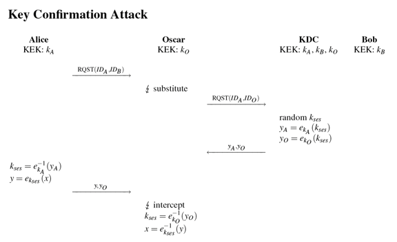

## Kerberos：Needham-Schroeder 协议
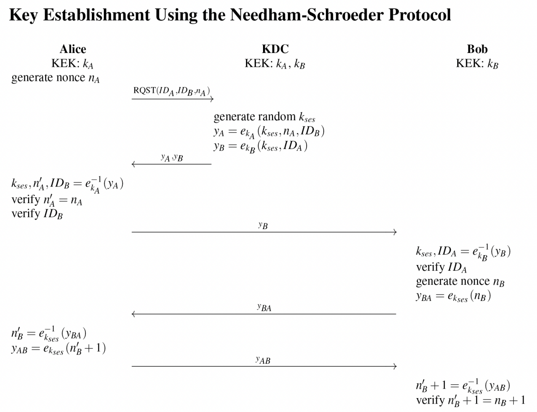
na 和 nb 都是随机数。
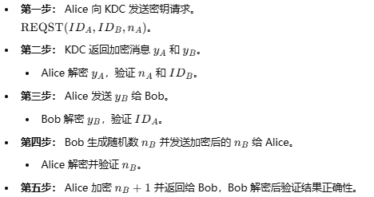

如果攻击者设法获得了 KEK，就能解密之前用该 KEK 加密的所有会话密钥。会话密钥用于保护实际的通信内容（如文件传输和消息）。因此，攻击者只需保存过去的加密通信数据，一旦获得 KEK，过去的所有通信都能被解密。
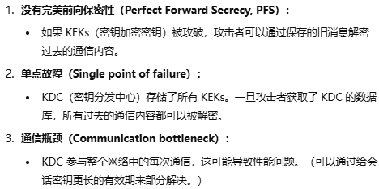
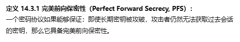

# 使用非对称技术建立密钥

  
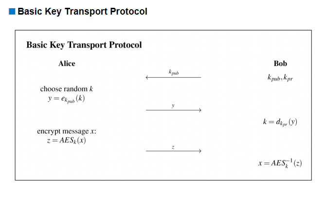
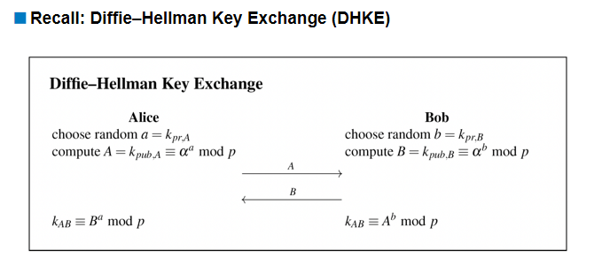

## 中间人攻击
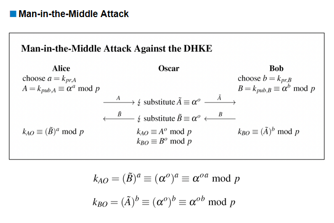
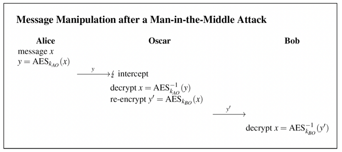

 如果没有对公钥的完整性保护，就可能被替换，而来源看起来仍然正确。
公钥分发：不要求机密性，但要求真实性。
  
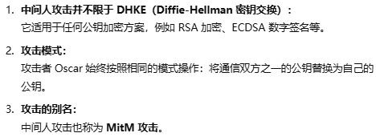
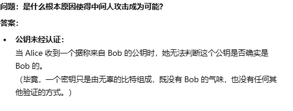
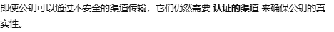

## 公钥的分发
### 公开发布
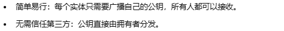
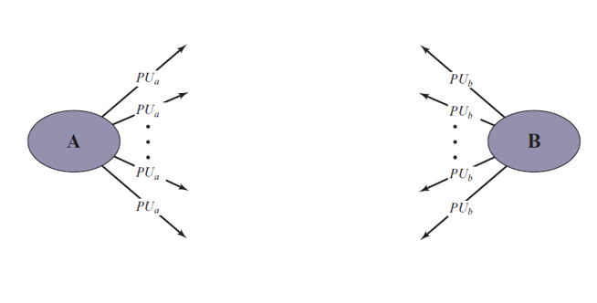
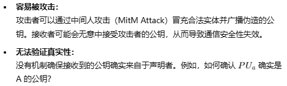

### 公开可访问的目录
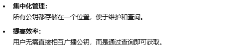
在公钥目录中，条目以（身份信息，公钥）这样的对的形式存在。
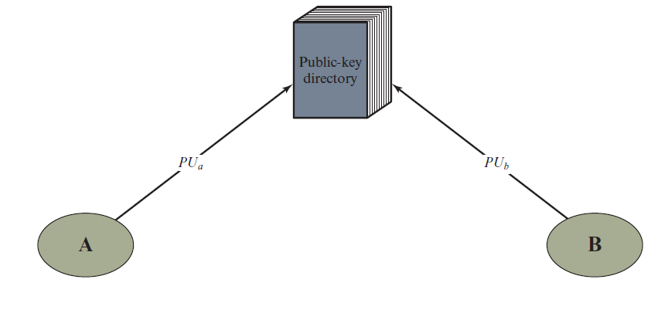

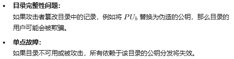

### 公钥管理机构
用户持有公钥管理机构的公钥，用于解密该机构用自己的私钥加密的内容。

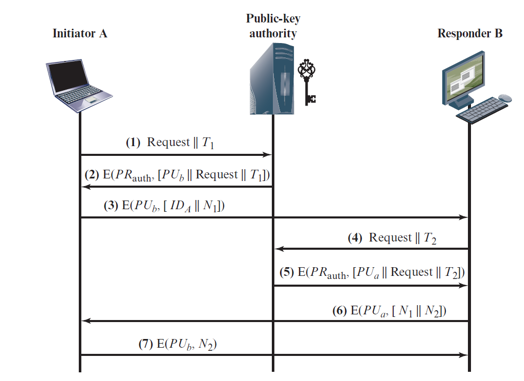
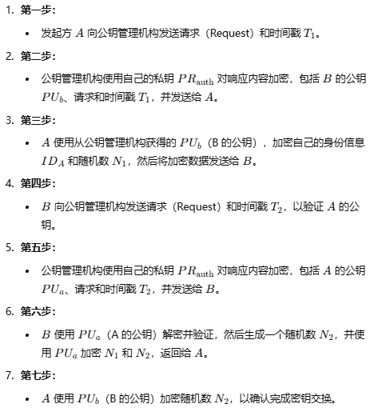

### 公钥证书（非常重要）
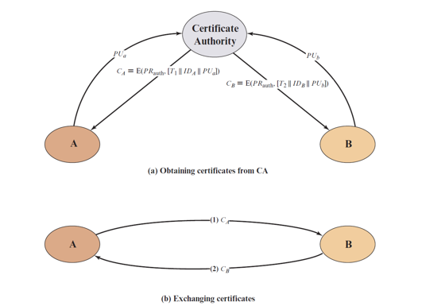

##  证书
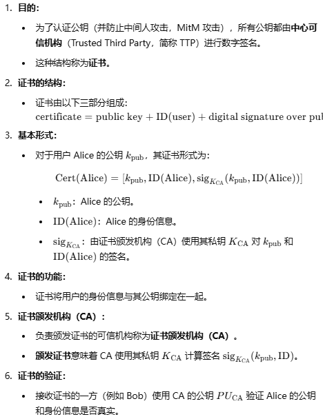

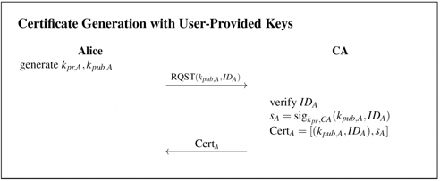

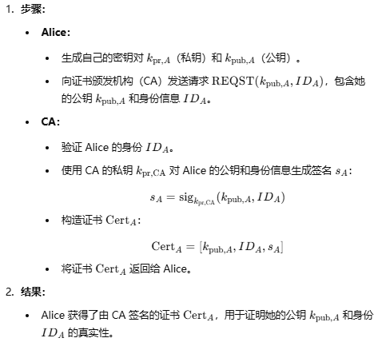
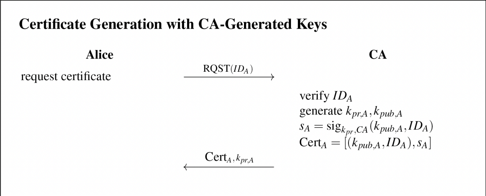

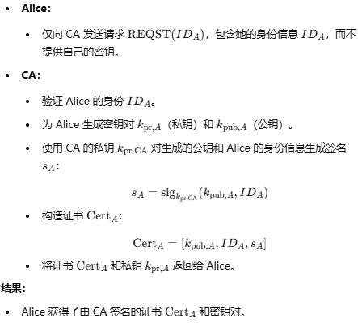
CA 自己的公钥一般通过操作系统或浏览器自动安装。

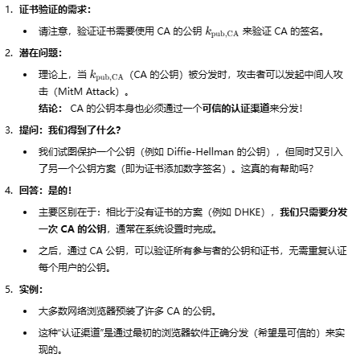
### 现实世界中的证书
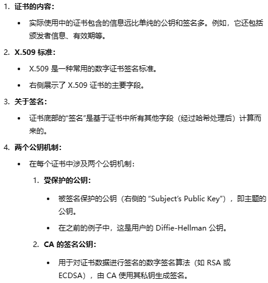

证书签名算法：PKCS #1 SHA-256 带 RSA 加密：先哈希，再用 RSA 加密生成签名。

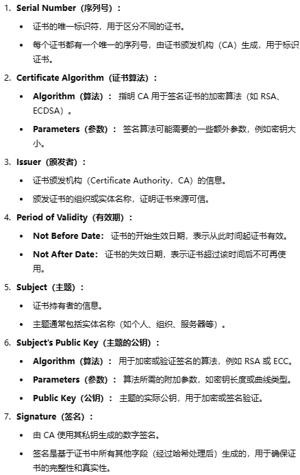

## 公钥基础设施

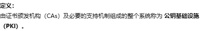

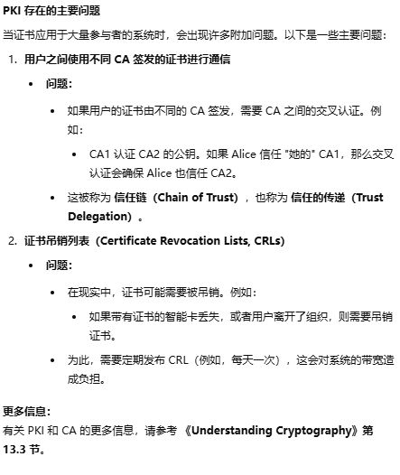

