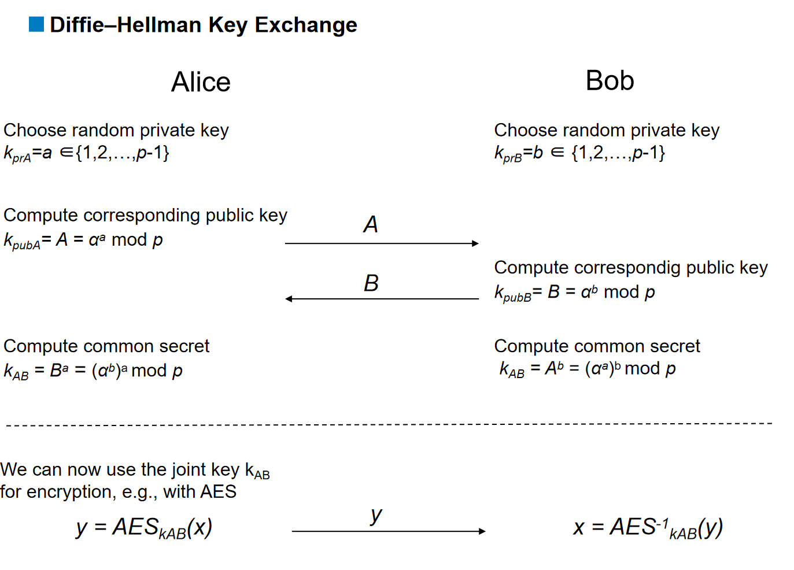
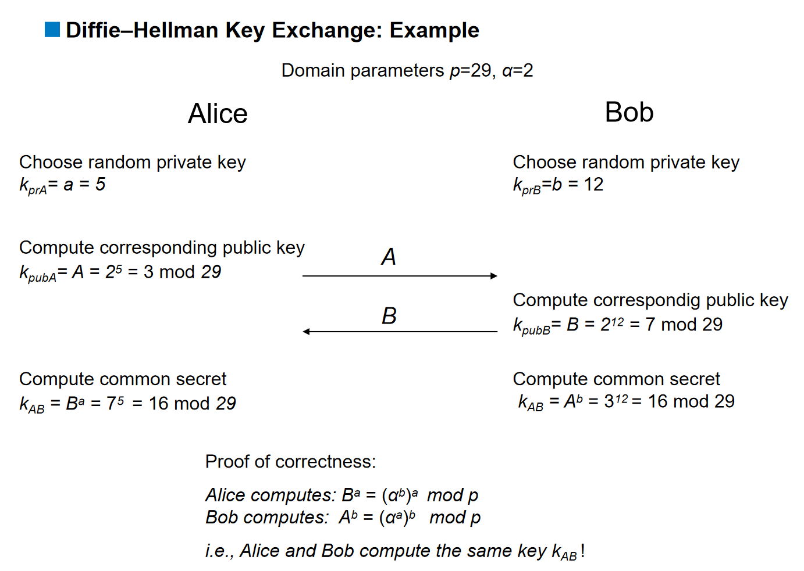
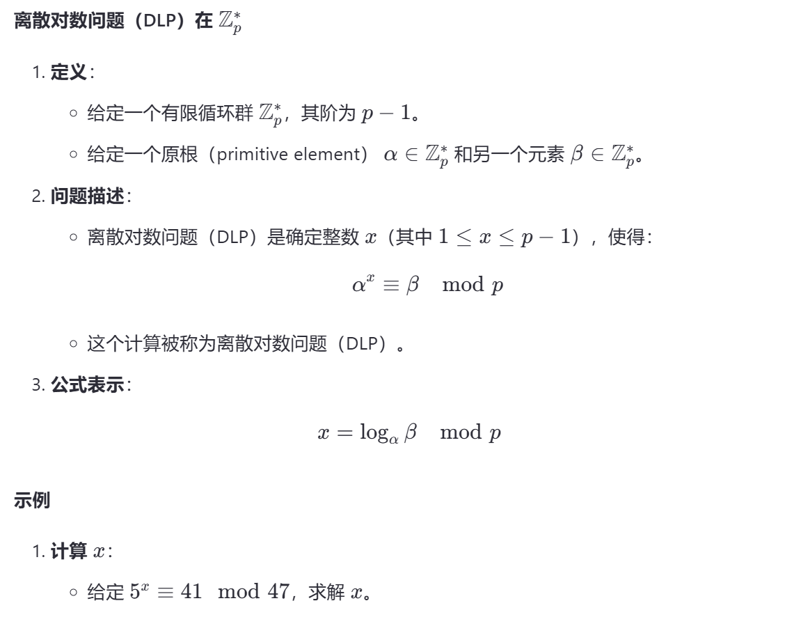
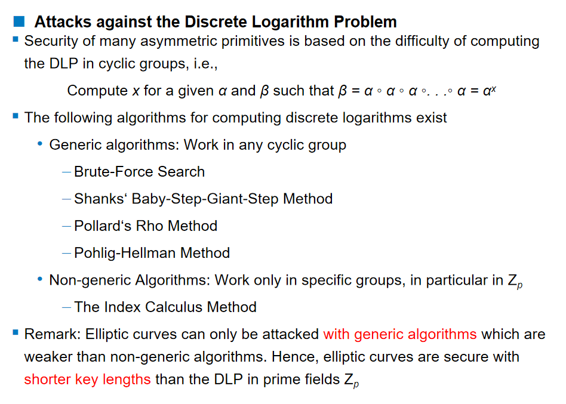
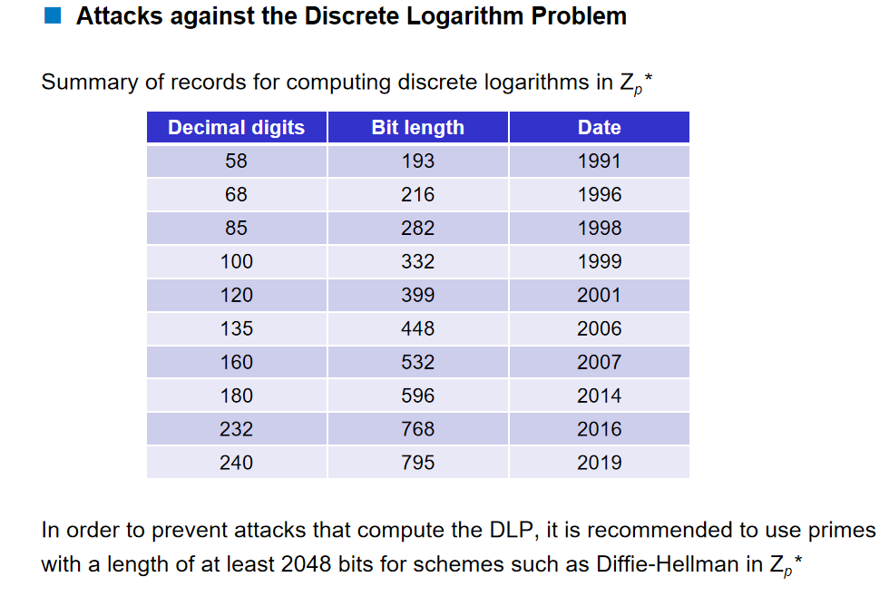
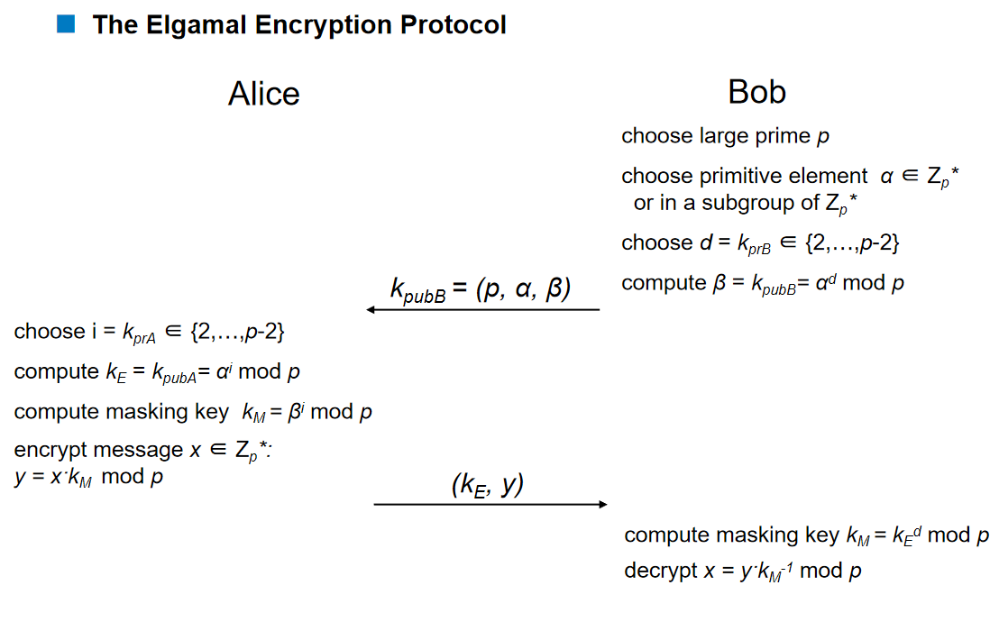
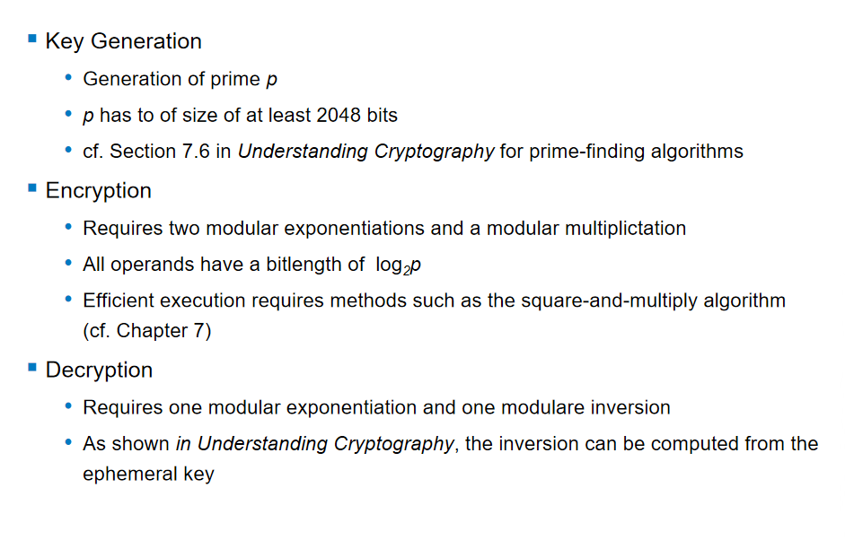
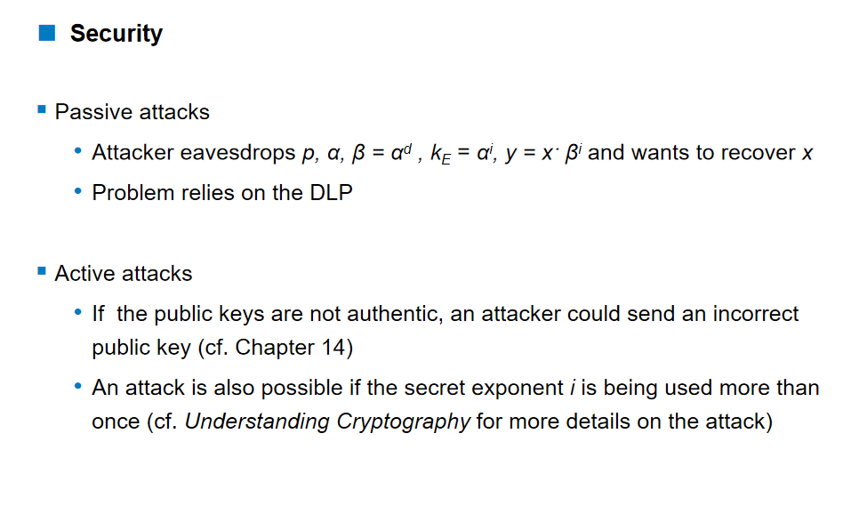
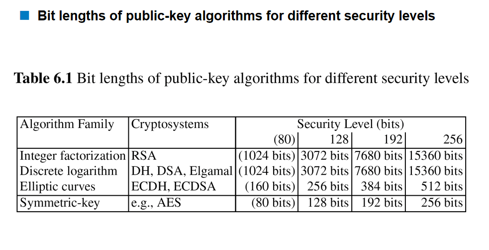



DHKE（Diffie-Hellman 密钥交换）是一种密钥交换协议，不用于加密（要基于 DHKE 进行加密，可以使用 ElGamal）。

它被广泛用于 SSH（Secure Shell）、TLS（Transport Layer Security）和 IPSec（Internet Protocol Security）等协议中。

# DH 密钥交换

设定参数 p=29，α=2。
- 双方各自得出自己的私钥。
- 双方各自得出自己的公钥。
- 双方交换公钥。
- 双方各自计算出共享密钥，二者相同。

# 离散对数问题（Discrete Logarithm Problem，DLP）

#  针对离散对数问题（Discrete Logarithm Problem，DLP）的攻击

一些攻击方法

建议素数 p 取 2048 位，否则很容易被攻破。

# ElGamal 公钥加密方案

涉及的相关计算

# 针对 ElGamal 公钥加密方案的攻击

- 被动攻击：窃听 p 和 α；已知 α 的 d 次方、α 的 i 次方以及 y，求解 x。
- 主动攻击：中间人攻击／相同密钥攻击

# 不同加密算法达到相应安全级别所需的密钥长度


