
# 总结
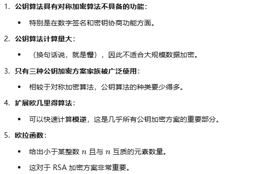

# 再谈对称密码学
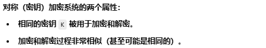
## 对称密码学：类比
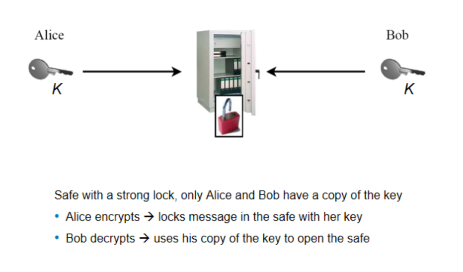
## 对称密码学：缺点
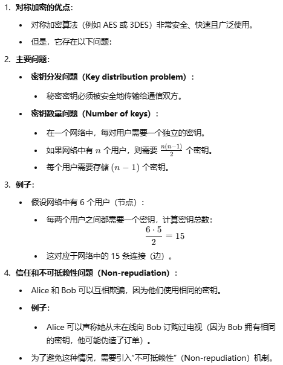
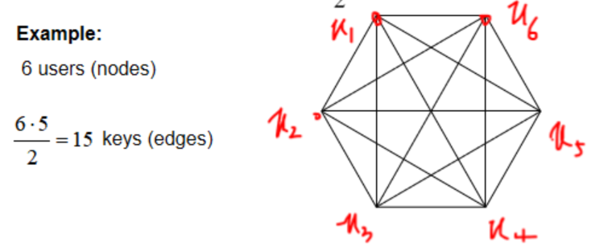
#  非对称密码学的原理
## 非对称密码学背后的思想
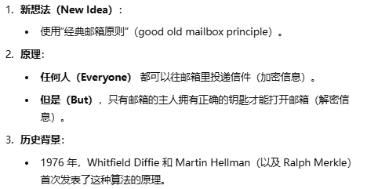
##  非对称（公钥）密码学
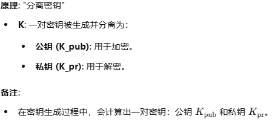
##  非对称密码学：类比
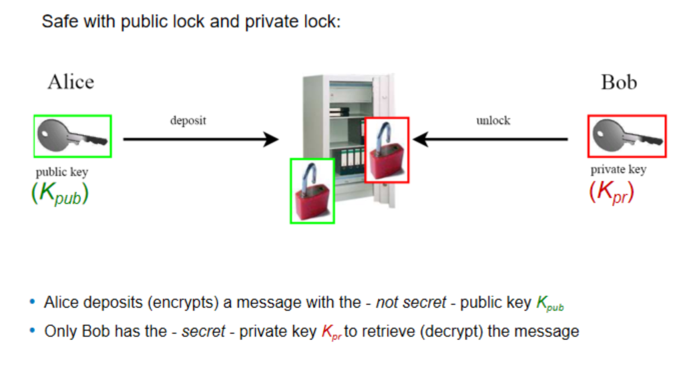
# 公钥密码学的实际应用
##  公钥加密的基本协议
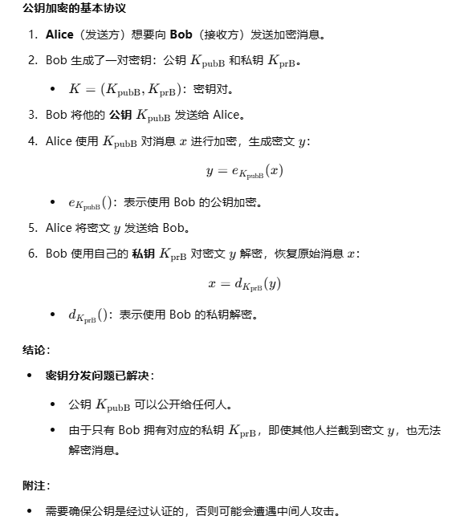
## 公钥密码学的安全机制
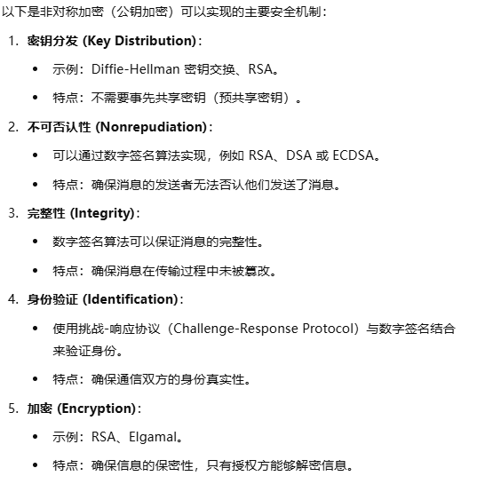
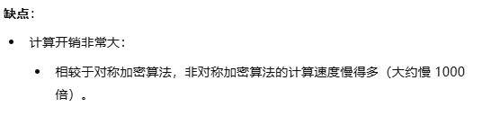
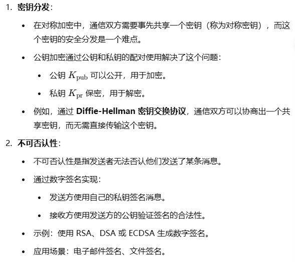
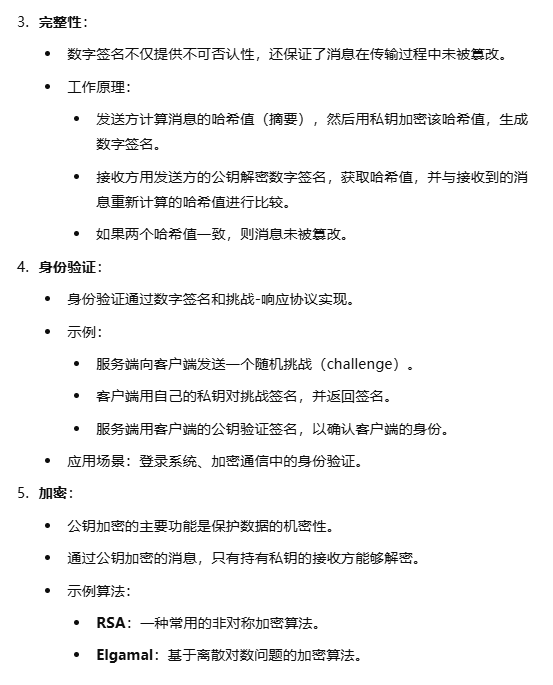
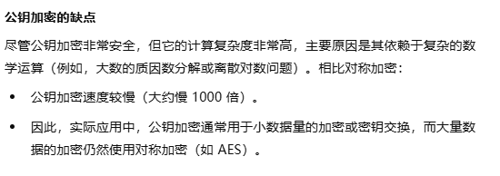
##  基本的密钥传输协议

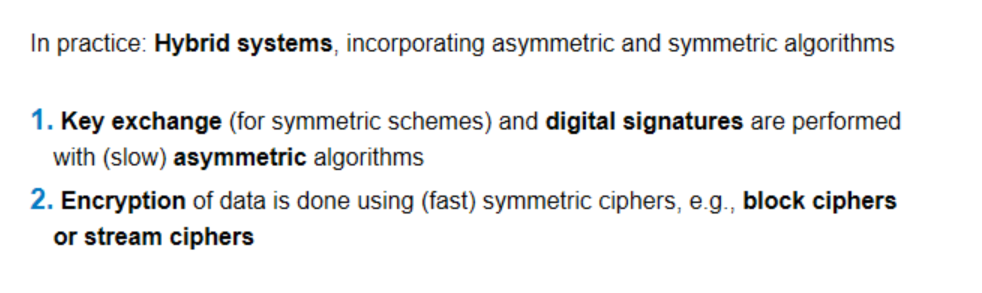
使用 AES 作为对称加密的混合加密协议
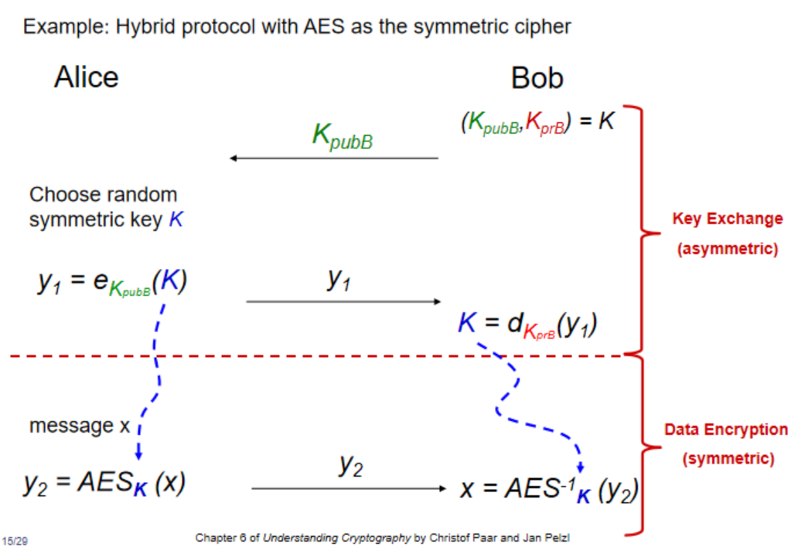
# 重要的公钥算法

## 如何构建公钥算法
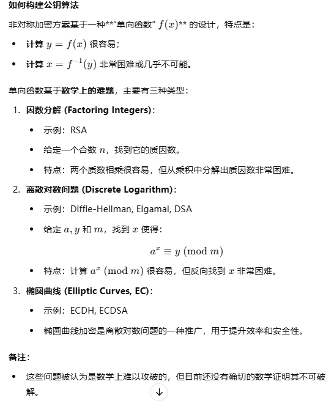
## 密钥长度与安全级别

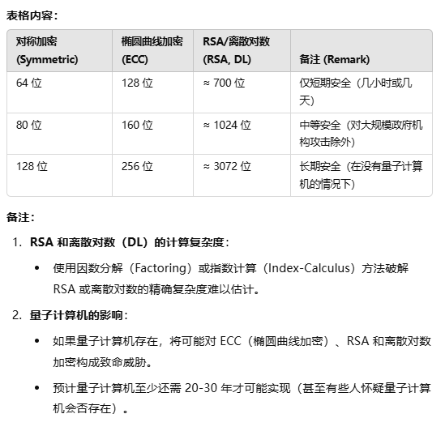
# 公钥算法必备的数论知识
## 欧几里得算法
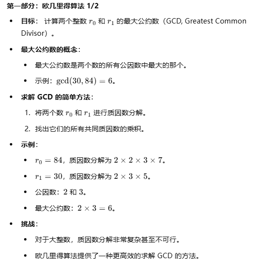
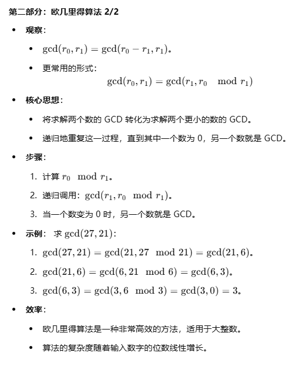
原理证明
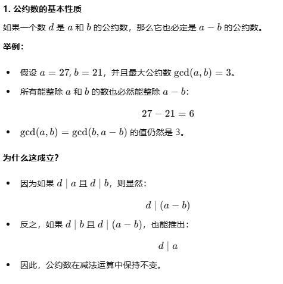

## 扩展欧几里得算法 
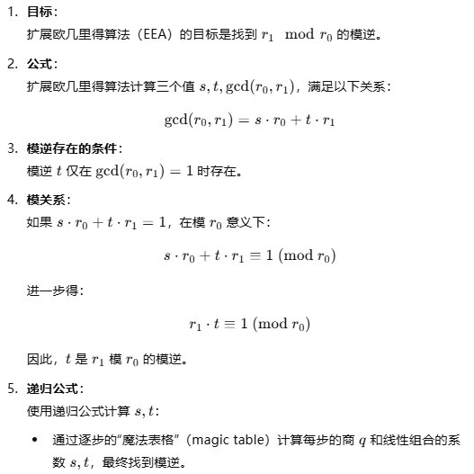
先列出普通欧几里得算法的表，然后逐步回代（把上一步余数的等式代入当前等式）

证明
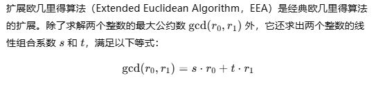
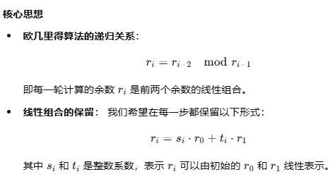
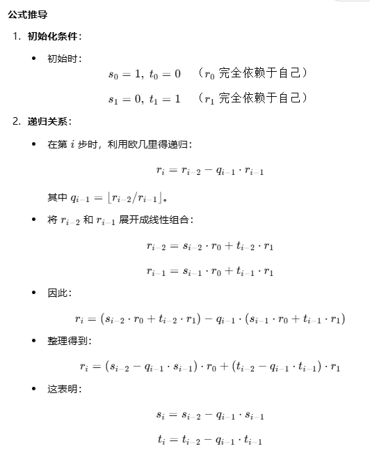
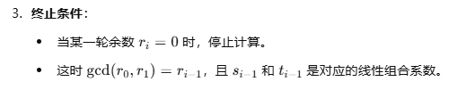

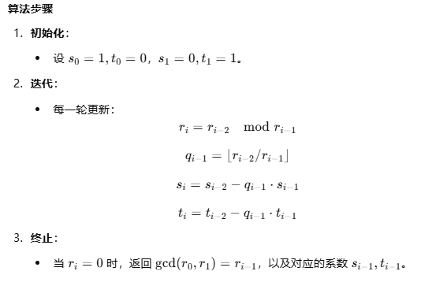
12mod67 和 67mod12 最终得到的等式是一样的，所以不如直接用 67mod12，因为 12mod67 会被转换成 67mod12，其中 67 是 r0，12 是 r1
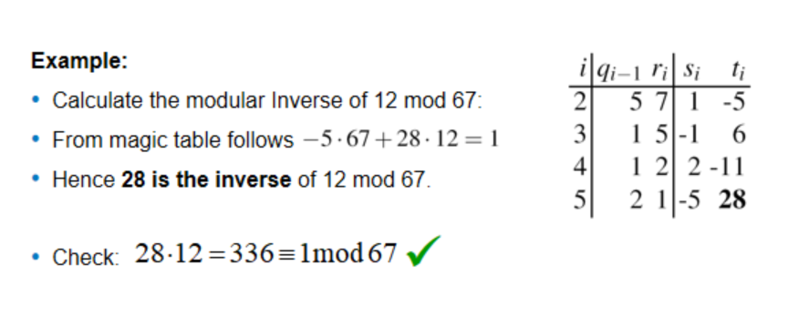

### 欧拉函数
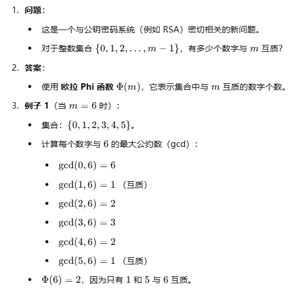
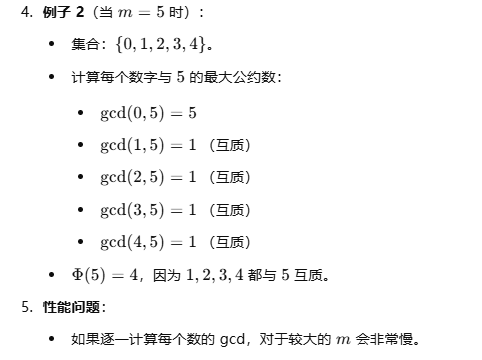
计算欧拉函数的高效方法

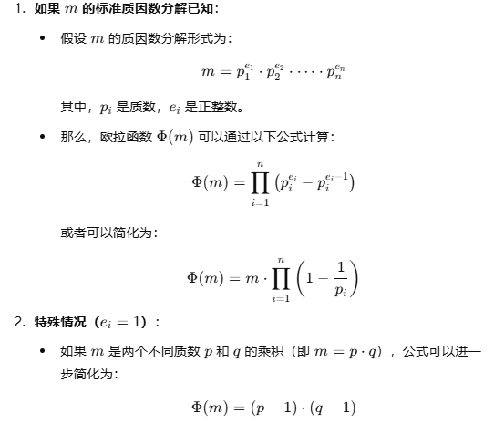
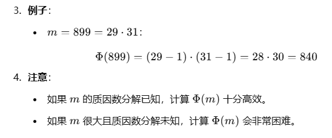
### 费马小定理
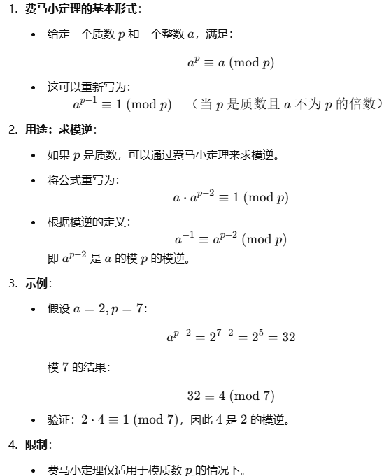

### 欧拉定理
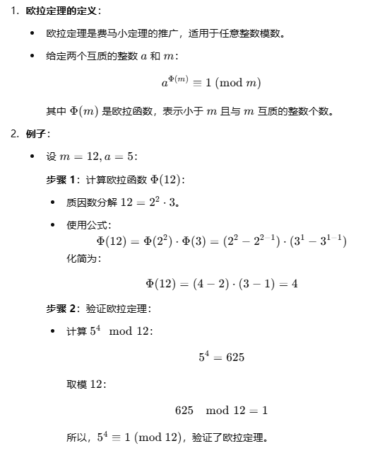
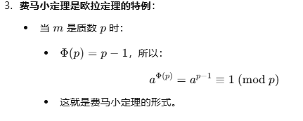

