# 数据库安全 - 第一章 MySQL 安全基础 - [Web 环境搭建 - LAMP-1] - LAMP & LNMP 简介


## 相关知识
### WEB 应用工作原理简介
WEB 的本意是蜘蛛网和网，在网页设计中称为网页。现在被广泛译为网络、互联网等技术领域。日常生活中，用户使用浏览器请求一个 URL。这个 URL 标识了特定服务器上的特定资源。服务器收到请求后，通过 HTTP 协议把生成的 HTML 页面发送给浏览器。

早期的 WEB 页面内容简单，仅用 HTML 就足以满足用户需求，那时网站的主要内容是静态的。
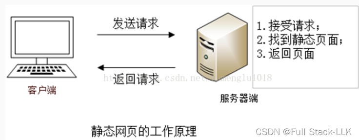


随着用户需求的不断增加，不同用户往往有不同的需求，动态页面应运而生。动态页面具有以下三个特点：

1. “交互性”：页面根据用户的请求和选择动态地变化和响应，以浏览器作为客户端界面。这将是未来 WEB 发展的大趋势。

2. “自动更新”：无需手动更新 HTML 文档，会自动生成新的页面，可以大大节省工作量。

3. “因时因人而变”：不同的人在不同的时间访问同一个 URL，会产生不同的页面。

动态页面的工作原理如下：
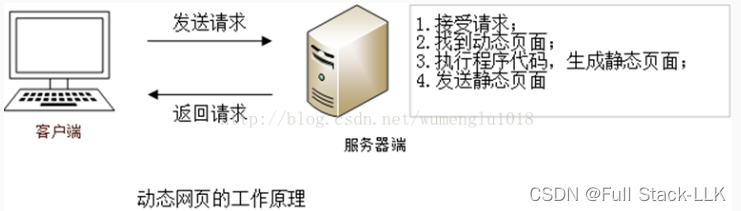

注意：第三步中会根据脚本的类型使用相应的解析器进行解析和执行，例如 index.php 交给 PHP 处理。

### 什么是 LAMP
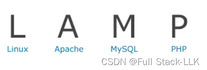
LAMP 是一个开源的 WEB 开发平台，使用 Linux 作为操作系统，Apache 作为 WEB 服务器，MySQL 作为关系型数据库管理系统，PHP 作为面向对象的脚本语言。一般情况下，Apache 监听 80 端口，接收来自公网的用户请求。

Apache 由开放社区开发和维护，是一款成熟且功能丰富的服务器。
MySQL 是一个开源的关系型数据库管理系统，用于存储应用数据。
PHP：一种编程语言。PHP 开源脚本语言与 Apache 配合，帮助创建动态网页。例如，要从数据库中提取数据，只需把 PHP 代码放到页面中想要动态化的部分即可。
四者的架构图如下所示：
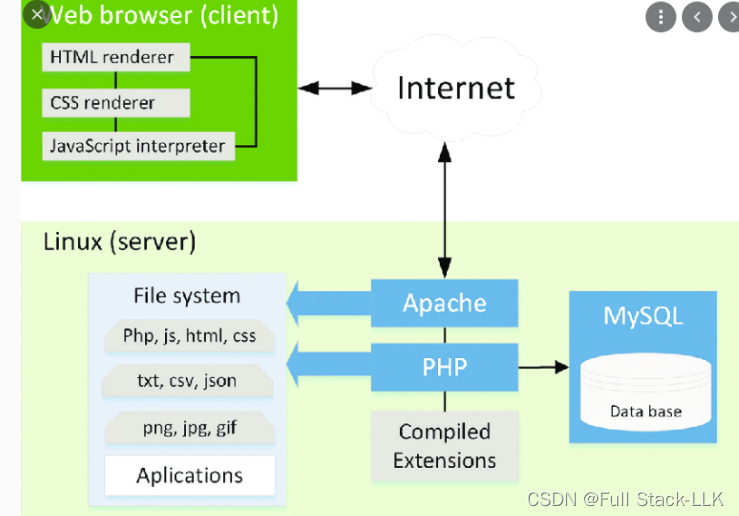
来自公网的请求首先由 Apache 接收。Apache 根据 URL 所请求资源的类型（静态资源如 html、json、png、jpg 等；脚本如 php、asp 等）进行分发。如果是静态文件，就直接访问相应的文件系统并返回其内容。如果是 index.php 这样的脚本，就交给相应的脚本解释器；index.php 对应的是 PHP 解释器。PHP 执行完 index.php 的代码后，把结果返回给 Apache，Apache 再把得到的内容返回给用户。当 PHP 脚本中包含操作数据库的代码时，就会增加图中 PHP 访问数据库的过程，其他过程保持不变。
### 练习
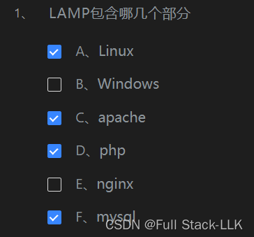


### 什么是 LNMP
LNMP 与 LAMP 的区别在于使用 Nginx 作为 WEB 服务器。

Nginx 是 Linux 上一款小巧高效的 WEB 服务器软件。与 Apache 相比，使用 Nginx 作为 WEB 服务器消耗的资源更少，支持更多的并发连接，效率更高。
### 练习
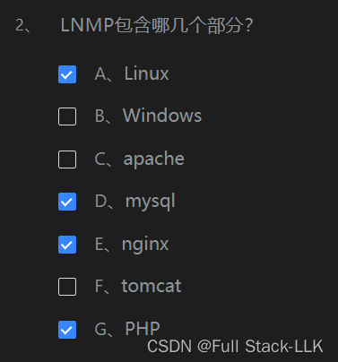
### 什么是 WNMP
由于该平台有四层，LAMP 有时也被称为 LAMP 栈。这个栈可以构建在不同的操作系统上。当这些软件用在 Windows 操作系统上时，称为 WAMP；在 Macintosh 系统上称为 MAMP，在 Solaris 系统上称为 SAMP。
W 代表 Windows，N 代表 Nginx，M 代表 MySQL，P 代表 PHP。
### 练习
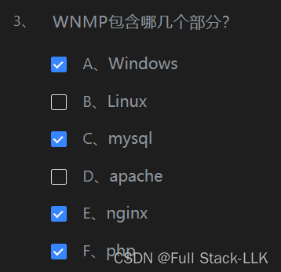


### 补充：HTTP 协议

HTTP 是在网络上传输 HTML 的协议，用于浏览器和服务器之间的通信。

HTTP 请求由请求和响应两部分组成，分别是浏览器发给服务器的请求报文和服务器返回的响应报文。

请求报文示例：

```bash
GET / HTTP/1.1
Host: www.sina.com.cn
User-Agent: Mozilla/5.0 xxx
Accept: */*
Accept-Language: zh-CN,zh;q=0.9,en-US;q=0.8
```

第一行表示使用 GET 请求方法获取路径为 / 的资源，使用 HTTP/1.1 协议。从第二行开始，每一行都是一个 HTTP 头，以 Header: Value 的形式表示。

常用的 HTTP Header 包括：

Host：表示请求的主机名，因为一台服务器上可能托管了多个网站，所以 Host 表示浏览器请求的是哪个域名；
User-Agent：标识客户端本身。例如 Chrome 浏览器的标识类似 Mozilla/5.0 ... Chrome/79，IE 浏览器的标识类似 Mozilla/5.0 (Windows NT ...) like Gecko；
Accept：表示浏览器能接收的资源类型，如 text/*、image/*，或者表示全部的 */*；
Accept-Language：表示浏览器偏好的语言，服务器可以据此返回不同语言的网页；
Accept-Encoding：表示浏览器能支持的压缩类型，如 gzip、deflate、br。
HTTP Header 的每一行都以 \r\n 结尾。如果遇到两个连续的 \r\n，后面就是 HTTP Body。HTTP Body 通常出现在 POST 请求中。

> \r 表示回到行首，\n 表示换到下一行
> '\r' 是回车，'\n' 是换行。前者把光标移到行首，后者把光标下移一行。平常使用的 Enter 就是两者的组合。

POST 请求示例：

```bash
POST / HTTP/1.1
Host: qh.qt.zdbc.baicuoa.com
User-Agent: Mozilla/5.0 (Windows NT 10.0; Win64; x64; rv:89.0) Gecko/20100101 Firefox/89.0
Accept: text/html,application/xhtml+xml,application/xml;q=0.9,image/webp,*/*;q=0.8
Accept-Language: zh-CN,zh;q=0.8,zh-TW;q=0.7,zh-HK;q=0.5,en-US;q=0.3,en;q=0.2
Accept-Encoding: gzip, deflate
Connection: close
Cookie: UM_distinctid=176bb981a6a102-0958497cfbd0fb-4c3f207e-1fa400-176bb981a6c22d; CNZZDATA1277924430=1953373006-1609462947-%7C1624499868; CNZZDATA1277924487=1429083096-1609634137-%7C1624499327
Upgrade-Insecure-Requests: 1
Pragma: no-cache
Cache-Control: no-cache
Content-Type: application/x-www-form-urlencoded
Content-Length: 4

data
```

响应报文如下：

```bash

HTTP/1.1 200 OK
Content-Type: text/html
Content-Length: 21932
Content-Encoding: gzip
Cache-Control: max-age=300
<html>...网页数据...
```

服务器响应的第一行是版本号 + 空格 + 数字 + 空格 + 文本，其中数字 2xx 表示成功，3xx 表示重定向，4xx 表示客户端引起的错误，5xx 表示服务器引起的错误。

常见的响应码有：

200 OK：表示成功；
301 Moved Permanently：表示该 URL 已被永久重定向；
302 Found：表示该 URL 需要临时重定向；
304 Not Modified：表示资源未被修改，客户端可以使用本地缓存的版本；
400 Bad Request：表示客户端发送了错误的请求，例如参数无效；
401 Unauthorized：表示客户端因身份未经验证而不允许访问该 URL；
403 Forbidden：表示服务器因权限问题拒绝了客户端的请求；
404 Not Found：表示客户端请求了不存在的资源；
500 Internal Server Error：表示服务器处理时发生了内部错误，例如无法连接数据库；
503 Service Unavailable：表示服务器此刻暂时无法处理请求。

从第二行开始，服务器返回的每一行都是一个 HTTP 头。服务器常返回的 HTTP Header 包括：

Content-Type：表示响应内容的类型，如 text/html、image/jpeg；
Content-Length：表示响应内容的长度（字节）；
Content-Encoding：表示响应的压缩算法，如 gzip；
Cache-Control：指示客户端如何缓存，例如 max-age=300 表示最多可以缓存 300 秒。
### 练习
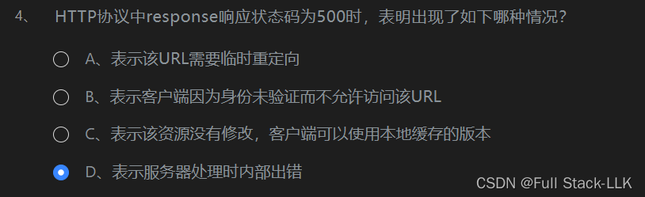


# 数据库安全 - 第一章 MySQL 安全基础 - 【Web 环境搭建 - LAMP-2】（LAMP - 搭建 apache2 环境）


## 相关知识
### apache2 简介


Apache HTTP Server 项目致力于为现代操作系统（包括 UNIX 和 Windows）开发和维护一个开源的 HTTP 服务器。该项目的目标是提供一个安全、高效、可扩展的服务器，提供与当前 HTTP 标准同步的 HTTP 服务。

Apache 软件基金会和 Apache HTTP Server 项目于 2021 年 6 月 1 日宣布发布 Apache HTTP Server（"httpd"）2.4.48 版本。Apache HTTP 服务器有两个名字：一个是 httpd，另一个是 apache2。实际上二者是同一个软件，只是对应**不同操作系统的不同发行版**。例如在 RHEL 6.2 中叫 httpd，而在 Ubuntu 中叫 apache2。

**注意：apache2 和 httpd 的配置文件中使用的指令以及目录结构略有不同**

### 在 ubuntu18.04 上安装 apache2
在 ubuntu18.04 上有两种安装方式：从源代码安装和直接从软件仓库安装。这次只演示通过软件仓库安装。
先更新仓库

```powershell
apt upadate
```
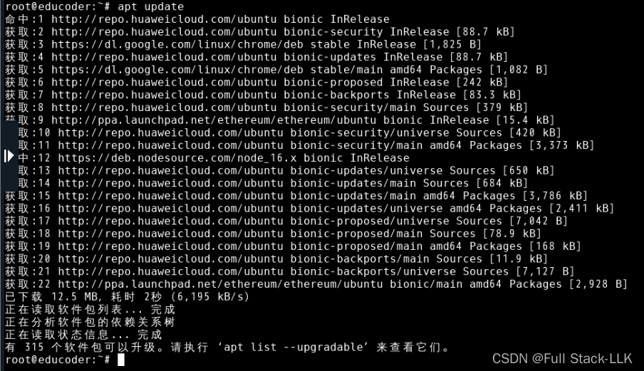

#### apt 命令
注意 -y 的含义
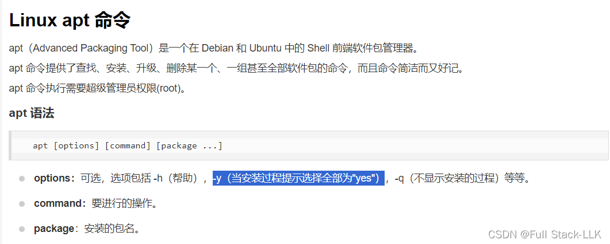
然后安装 apache2
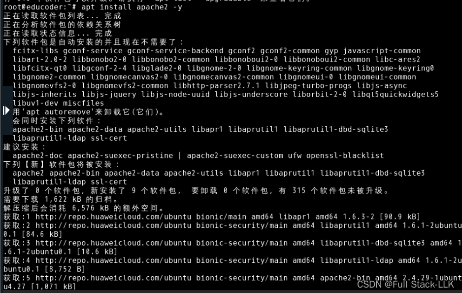


```powershell
apt install apache2 -y
```

### 启动和停止 apache2
启动 apache2 服务

```powershell
service apache2 start
```
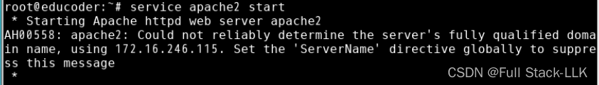

检查 apache2 服务是否在运行

```powershell
netstat -antp | grep 80
# 或者
netstat -antp | grep apache2
```

> netstat
> -a 或 --all 显示所有连线中的 Socket。
> -n 或 --numeric 直接使用 IP 地址，而不通过域名服务器。
> -t 或 --tcp 显示 TCP 传输协议的连线状况。
> -p 或 --programs 显示正在使用 Socket 的程序的 PID 和名称。
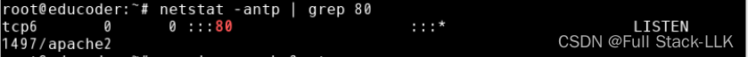


```powershell
systemctl enable apache2
```

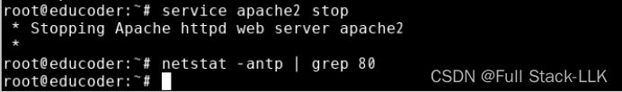
### apache2 配置文件目录分析
apache2 的配置文件位于 /etc/apache2 目录下。主配置文件是 apache2.conf

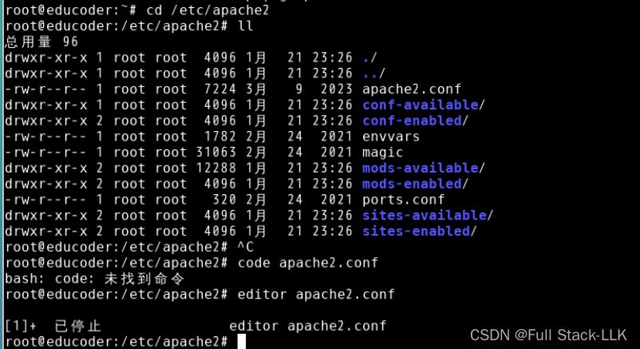
打开文件查看
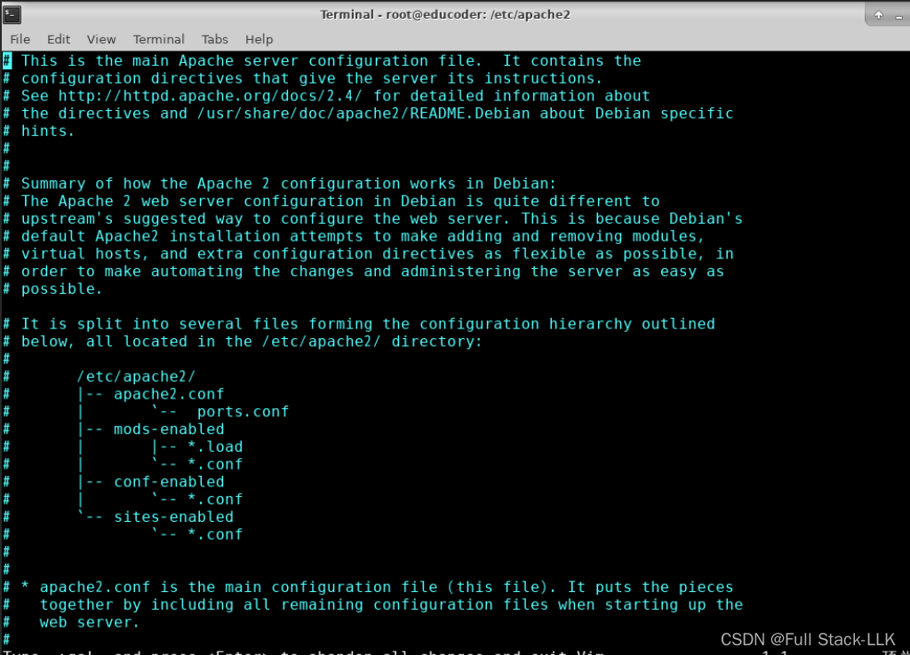
其中包含

```markup
# It is split into several files forming the configuration hierarchy outlined 
# below, all located in the /etc/apache2/ directory:(apache2的配置功能分成了多个文件，形成如下的配置层次结构)
#
#       /etc/apache2/
#       |-- apache2.conf
#       |       `--  ports.conf
#       |-- mods-enabled
#       |       |-- *.load
#       |       `-- *.conf
#       |-- conf-enabled
#       |       `-- *.conf
#       `-- sites-enabled
#               `-- *.conf
```
- apache2.conf：主配置文件
- port.conf：自定义 apache2 监听的端口
- conf-enabled：apache2 服务器已启用的配置文件
- conf-available：apache2 服务器可以启用的配置文件
- mods-enabled：apache2 服务器已启用的模块配置文件
- mods-available：apache2 服务器可用的模块配置文件
- sites-enabled：apache2 当前正在使用的网站配置文件
- sites-available：apache2 可用的网站配置文件。

[可以参考 Apache HTTP Server 官方文档](https://httpd.apache.org/docs/2.4/)
### 修改 apache2 网站根目录
apache2 安装成功后，默认的网站根目录是 /var/www/html/

```powershell

service apache2 start # 开启apache2服务
cd /var/www/html/ && ls
```
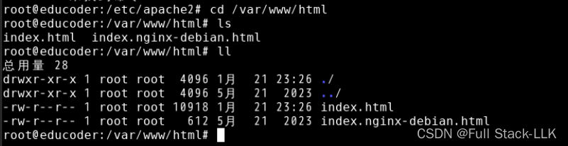

可以看到默认的 index.html。用 firefox 浏览器访问 http://localhost/ 会显示如下页面
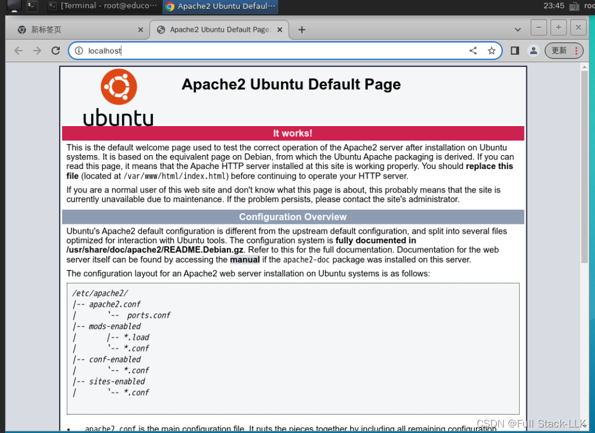

我们在这个目录下创建的文件都可以通过 URL 访问。例如创建 hello.html
```html
<html>
    <h1>
        hello world!
    </h1>
</html>
```

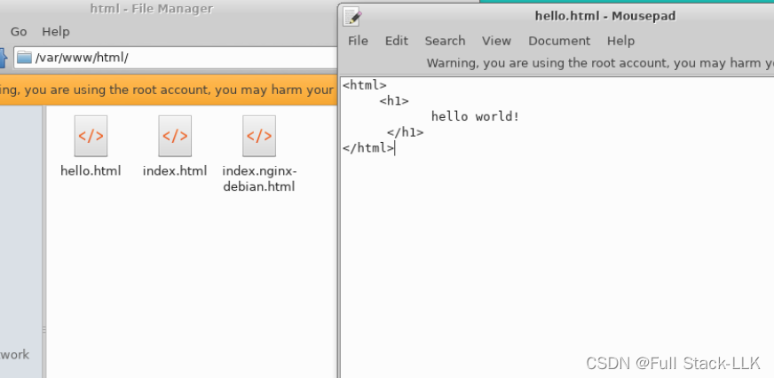
访问它
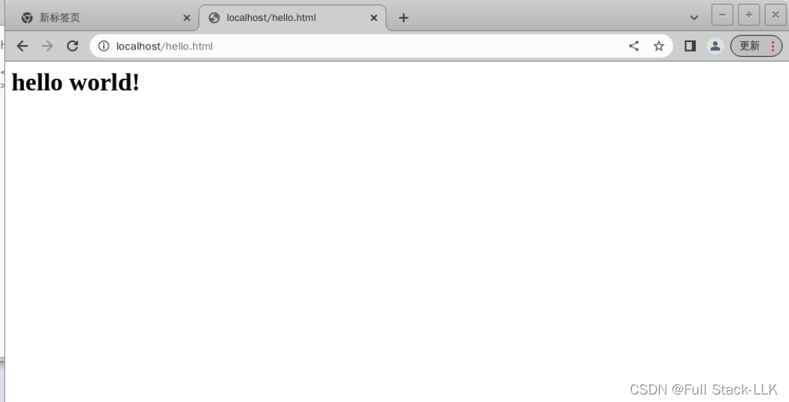

如果需要修改网站的根目录该怎么办？网站根目录可以在配置文件中配置。
- sites-enabled：apache2 当前正在使用的网站配置文件

找到文件 /etc/apache2/sites-enabled/000-default.conf
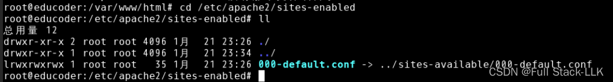

该文件配置了默认页面，内容如下：

```powershell
<VirtualHost *:80>
    # The ServerName directive sets the request scheme, hostname and port that
    # the server uses to identify itself. This is used when creating
    # redirection URLs. In the context of virtual hosts, the ServerName
    # specifies what hostname must appear in the request's Host: header to
    # match this virtual host. For the default virtual host (this file) this
    # value is not decisive as it is used as a last resort host regardless.
    # However, you must set it for any further virtual host explicitly.
    #ServerName www.example.com
    ServerAdmin webmaster@localhost
    DocumentRoot /var/www/html
    # Available loglevels: trace8, ..., trace1, debug, info, notice, warn,
    # error, crit, alert, emerg.
    # It is also possible to configure the loglevel for particular
    # modules, e.g.
    #LogLevel info ssl:warn
    ErrorLog ${APACHE_LOG_DIR}/error.log
    CustomLog ${APACHE_LOG_DIR}/access.log combined
    # For most configuration files from conf-available/, which are
    # enabled or disabled at a global level, it is possible to
    # include a line for only one particular virtual host. For example the
    # following line enables the CGI configuration for this host only
    # after it has been globally disabled with "a2disconf".
    #Include conf-available/serve-cgi-bin.conf
</VirtualHost>
```

"# " 后面的内容是注释说明。

- <VirtualHost *:80>：VirtualHost 表示虚拟主机，80 表示监听 80 端口。
- DocumentRoot /var/www/html：DocumentRoot 指定该虚拟主机的根目录，当前为 /var/www/html
- ErrorLog ${APACHE_LOG_DIR}/error.log 定义错误日志路径
- CustomLog ${APACHE_LOG_DIR}/access.log 定义访问日志路径

如果需要修改网站根目录，例如切换到 /var/www/html/site1/

```powershell
mkdir /var/www/html/site1
mv /var/www/html/hello.html /var/www/html/site1/
```
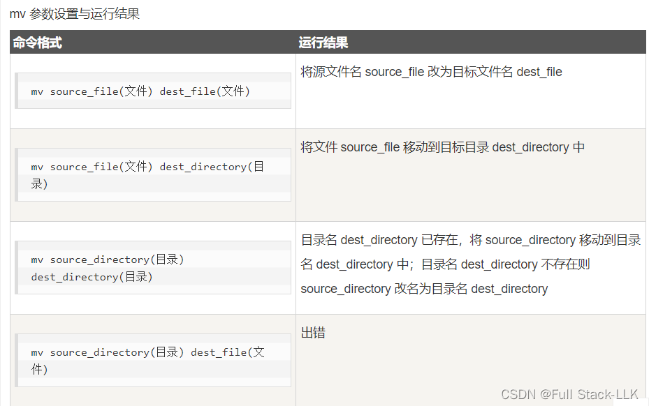
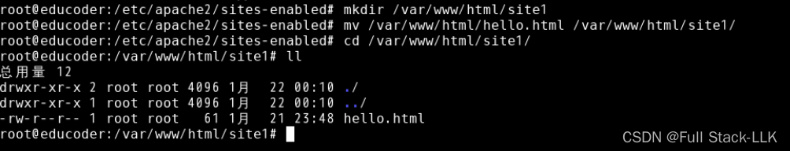


然后在 /etc/apache2/sites-enabled/000-default.conf 中修改 DocumentRoot /var/www/html/site1
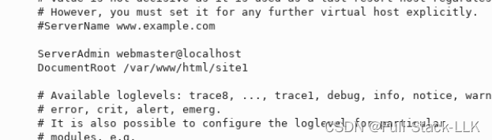

重启 apache2 服务

```powershell
service apache2 restart
```

由于 /var/www/html/hello.html 被移动到了 /var/www/html/site1/，如果站点根目录没有改变，需要通过 http://localhost//site1/hello.html 访问；如果站点根目录已经改为 /var/www/html/site1，那么只需要 http://localhost/hello.html

效果如下：

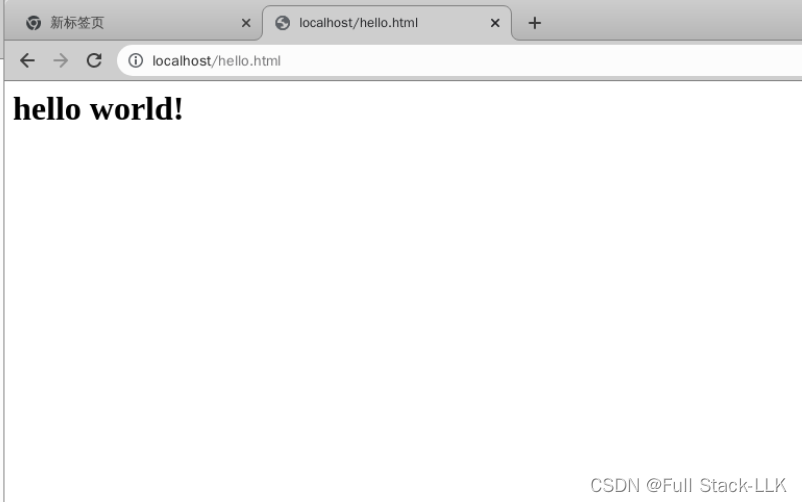


**注意：如果新路径不在 /var/www 下，修改后访问可能会出现 forbidden，这与配置文件的内容有关**

打开配置文件 /etc/apache2/apache2.conf，找到如下内容：

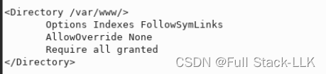

配置文件对目录 /var/www 进行了配置。具体内容看不懂也没关系

- Options Indexes FollowSymLinks：禁止在访问目录时显示目录结构
- AllowOverride None：忽略 .htacess 配置文件
- Require all granted：（这是最关键的配置）Require 是访问控制指令，all granted 表示允许所有访问请求。如果想拒绝所有请求，可以配置为 Require all denied

所以，对于新建的 /tmp/www 和 /tmp/www2，我们也需要同样的配置。为这两个目录添加如下内容并重启 apache2 后，两个目录中的文件就都能正常访问了：
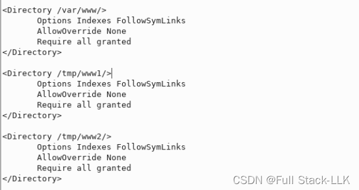
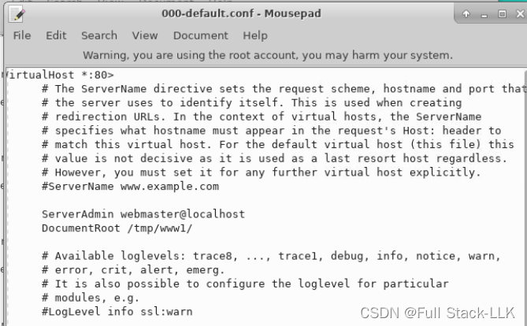
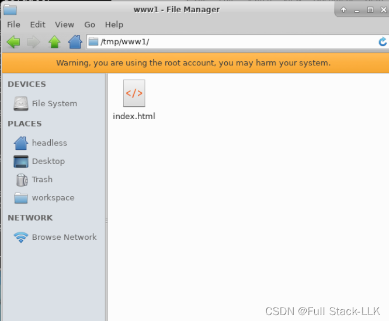

访问结果
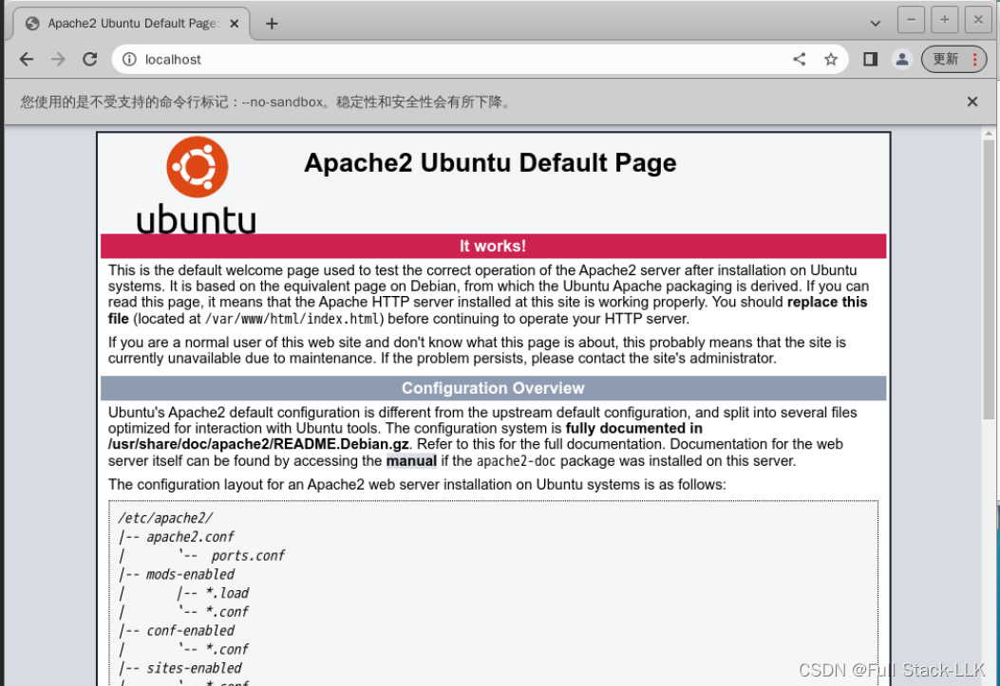


### 修改 apache2 监听端口
在某些场景下，我们需要修改 apache2 监听的端口

可以通过修改 /etc/apache2/port.conf 和 /etc/apache2/sites-enabled/000-default.conf 配置文件来实现。

查看 /etc/apache2/ports.conf 文件的内容：


```markup
# If you just change the port or add more ports here, you will likely also
# have to change the VirtualHost statement in
# /etc/apache2/sites-enabled/000-default.conf
Listen 80
<IfModule ssl_module>
        Listen 443
</IfModule>
<IfModule mod_gnutls.c>
        Listen 443
</IfModule>
# vim: syntax=apache ts=4 sw=4 sts=4 sr noet
```

- Listen 80 表示监听 80 端口

改成 81 端口后，编辑 /etc/apache2/sites-enabled/000-default.conf，把第一行的 <VirtualHost *:80> 改为 <VirtualHost *:81>

修改后重启 apache2

```powershell
service apache2 restart
```

查看端口状态：**netstat -antp**
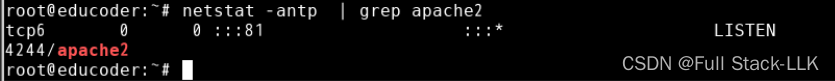

可以看到端口已经切换。用浏览器访问时需要访问 81 端口：http://localhost:81/hello.html
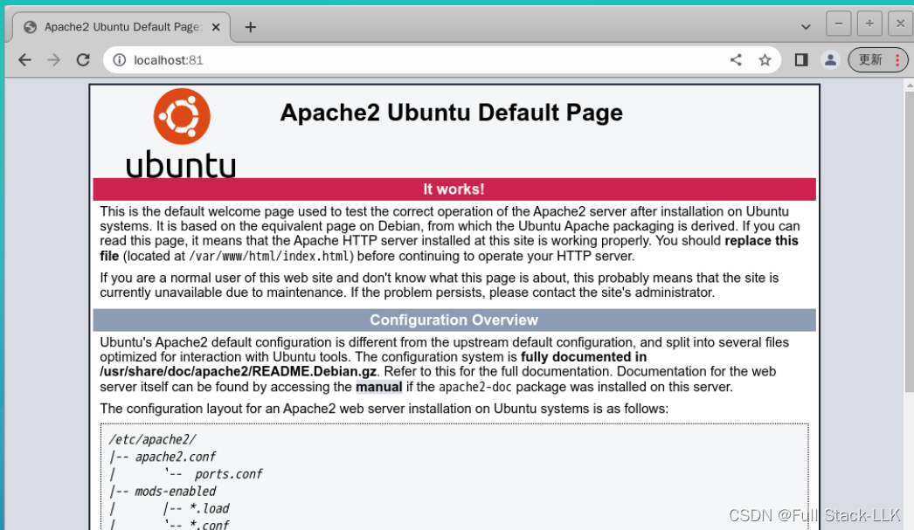


### apache2 监听多个端口
在某些情况下，我们需要开放多个端口，每个端口对应一个站点，每个站点有不同的网站根目录。这种情况下 apache2 该如何配置？

首先编辑 /etc/apache2/ports.conf，添加：

listen 8080

如图所示：

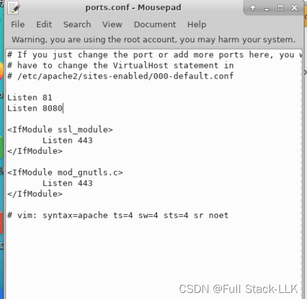


此时重启 apache2 服务后，可以看到该端口已经在监听了。

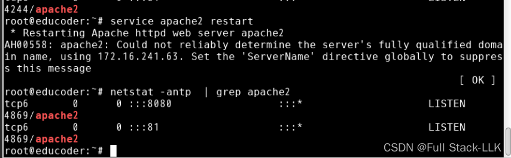
访问 8080 端口相当于访问一个新站点，但由于还没有设置网站根目录，访问 http://localhost:8080/ 时会看到 apache2 的默认 index 页面。接下来我们设置对应的目录。（此时 8080 的站点目录与最初的默认目录相同，都是 /var/www/html/，因为 /etc/apache2/sites-enabled/ 中的 conf 文件只为 81 端口设置了根目录）
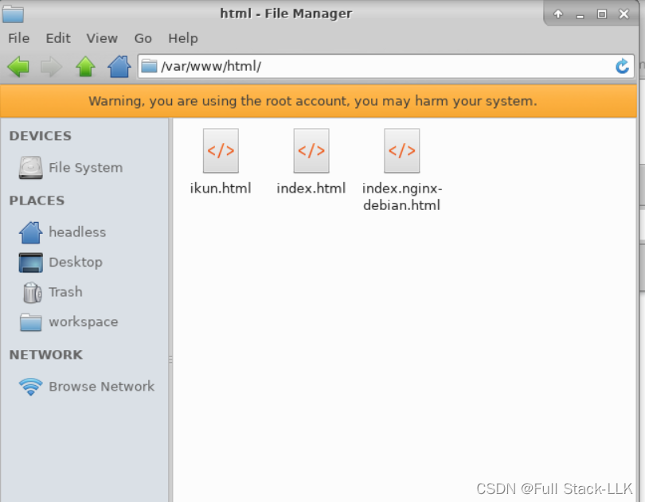


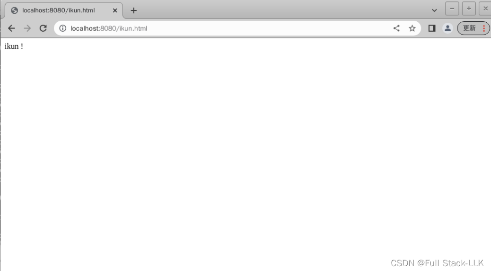


切换到目录 /etc/apache2/sites-enabled/

```powershell

cd /etc/apache2/sites-enabled/
```

复制一份 000-default.conf，名字随意，例如：8080.conf

```markup

<VirtualHost *:8080>
        # The ServerName directive sets the request scheme, hostname and port that
        # the server uses to identify itself. This is used when creating
        # redirection URLs. In the context of virtual hosts, the ServerName
        # specifies what hostname must appear in the request's Host: header to
        # match this virtual host. For the default virtual host (this file) this
        # value is not decisive as it is used as a last resort host regardless.
        # However, you must set it for any further virtual host explicitly.
        #ServerName www.example.com
        ServerAdmin webmaster@localhost
        DocumentRoot /var/www/html/site2
        # Available loglevels: trace8, ..., trace1, debug, info, notice, warn,
        # error, crit, alert, emerg.
        # It is also possible to configure the loglevel for particular
        # modules, e.g.
        #LogLevel info ssl:warn
        ErrorLog ${APACHE_LOG_DIR}/error.log
        CustomLog ${APACHE_LOG_DIR}/access.log combined
        # For most configuration files from conf-available/, which are
        # enabled or disabled at a global level, it is possible to
        # include a line for only one particular virtual host. For example the
        # following line enables the CGI configuration for this host only
        # after it has been globally disabled with "a2disconf".
        #Include conf-available/serve-cgi-bin.conf
</VirtualHost>
# vim: syntax=apache ts=4 sw=4 sts=4 sr noet
```

把 DocumentRoot 设为：/var/www/html/site2
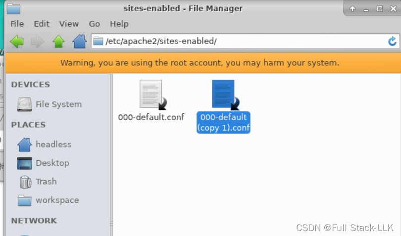


然后创建 /var/www/html/site2 目录，在其中创建 index.html 并写入

```html
<html>
    <h1>
        site 2
    </h1>
</html>
```

重启 apache2 服务，访问 http://localhost:8080/index.html
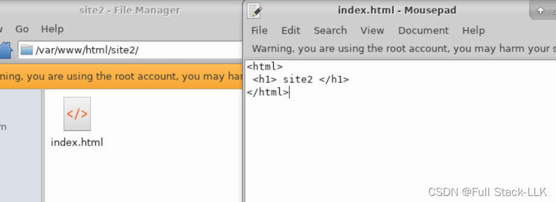
记住每次修改后都需要重启 apache2 才能生效
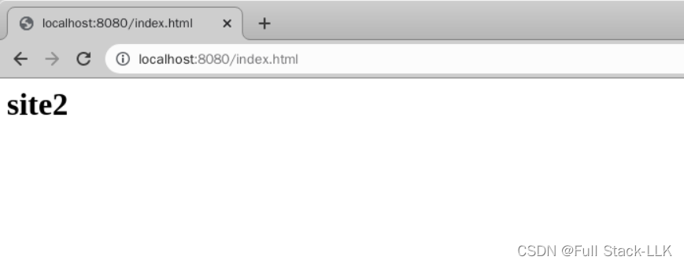


### 操作要求
完成以下任务：

1. 安装 apache2
2. 启动 apache2 服务
3. 将 apache2 网站根目录修改为 /tmp/www/
4. 将 apache2 默认监听端口修改为 81
5. 添加第二个监听端口 8080，根目录设为 /tmp/www2/。

设置监听端口
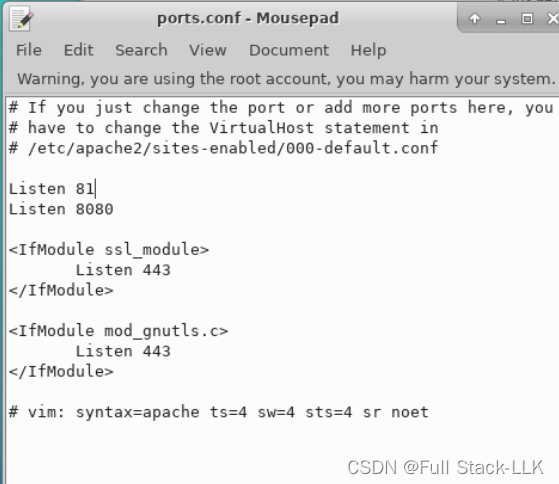
设置可访问的目录

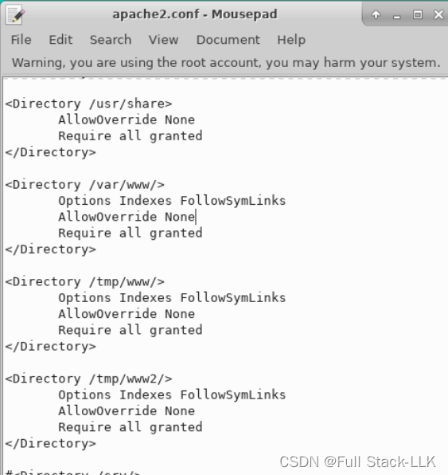设置站点的端口和根目录
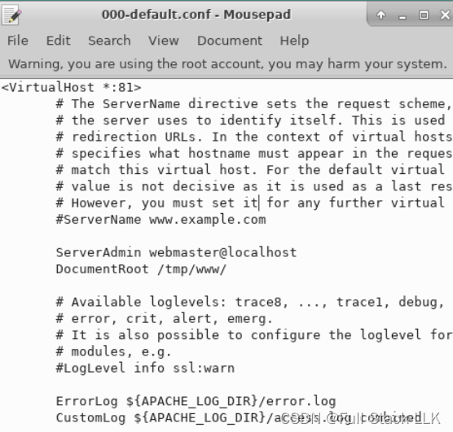
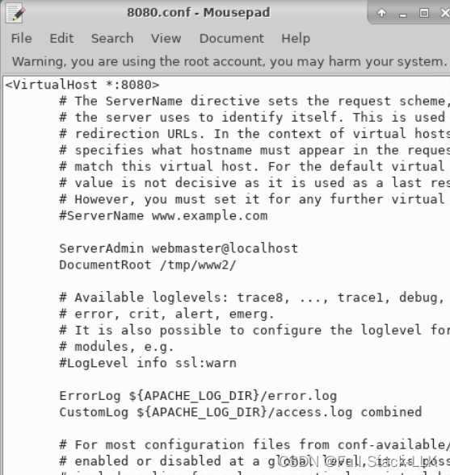
重启 apache2

