
# 概述
两种网络分层体系结构

将事实标准与法定标准相结合，得到折中的 5 层体系结构
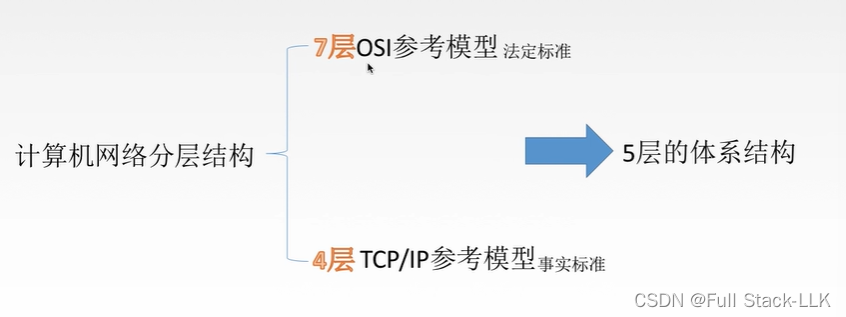

# OSI 模型是怎么来的？
最初，各个公司的网络体系结构各不相同，因此无法互联
于是 ISO 组织提出了这一模型，但由于它与实际应用有一定偏差，实际应用中仍然采用 TCP/IP 模型

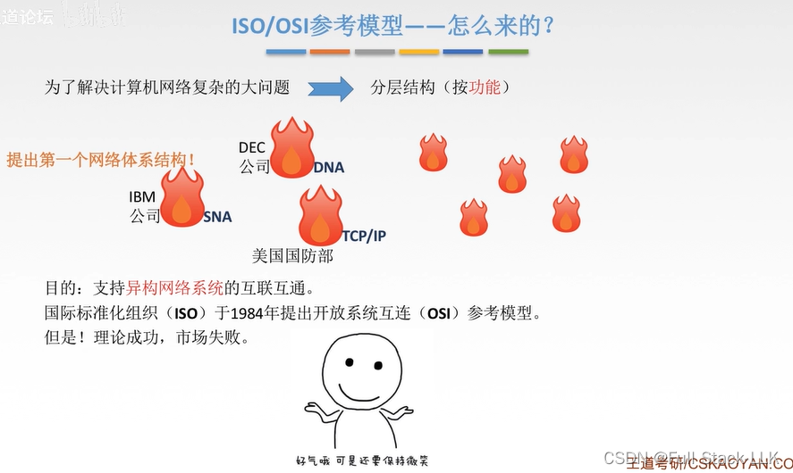

# OSI 参考模型
资源子网和通信子网分别对应资源的处理和该资源的传输
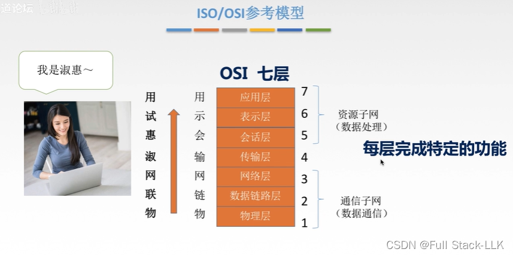
# 用 OSI 参考模型解释通信过程
中间系统只有三层

物理层不对数据添加任何内容，只是把数据组成比特流并传输到传输介质上

中间系统收到数据后，每一层依次还原并检查其中的信息

端到端：只有发送端和接收端才有上四层，因此上四层可以直接看作端到端直接相连（因为只有一次传输过程会到达上四层，上四层对应的连接只有一条，类似于一条路线的出发点和目的地）

点到点：每个节点都有下三层，因此不能作为区分发送端和接收端的唯一标志，故视为点到点（类似于一条路线上从一个节点到下一个节点）
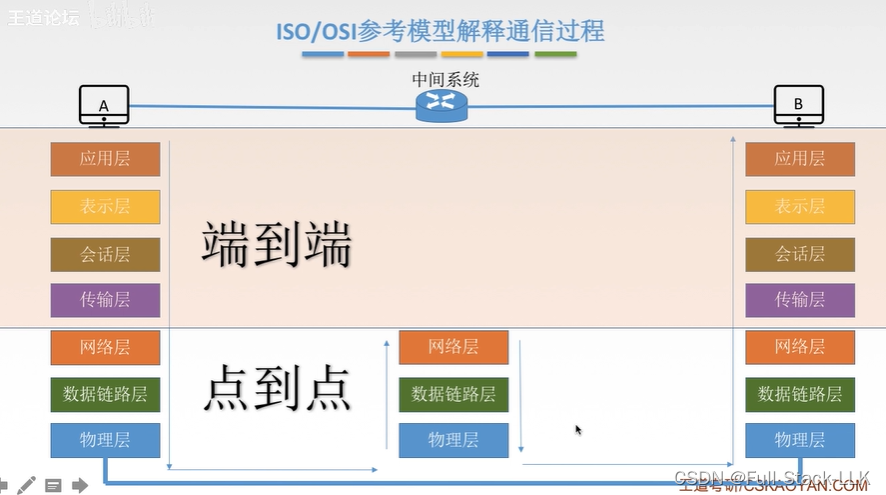
每一层都会添加本层的控制信息（物理层除外）

数据链路层会添加两部分
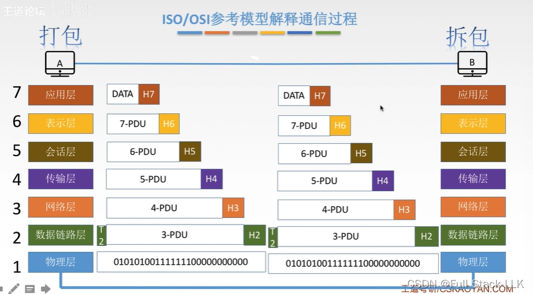
# 逐层分析
## 应用层
用户与网络之间的接口
只有需要使用网络连接的程序才属于应用层
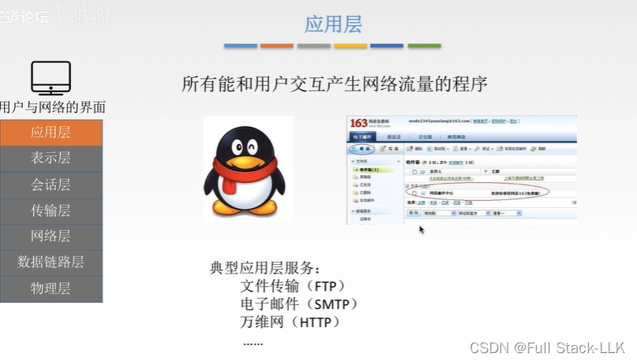
## 表示层
通信的两个系统即接收端和发送端
数据在屏幕上的呈现方式
数据格式转换：例如图片的比特流从下层传到表示层时，会被转换成图片的数据格式

数据压缩和还原：例如图片数据压缩后传输到链路上，接收端收到后再解压或还原
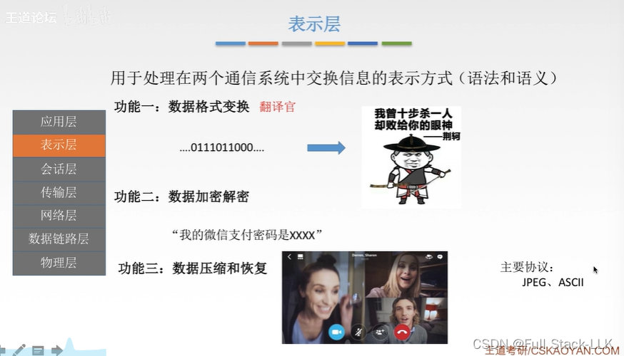

## 会话层
起到建立连接的作用
会话之间相互独立，互不影响
例如视频软件与其对应服务器之间的会话，不会影响百度与其对应服务器之间的会话（视频快进对百度没有任何影响）

检查点：会话突然关闭时，利用检查点恢复之前的会话（例如传输大文件时突然中断，如果重传就会浪费已经发送的那部分；检查点可以让传输从中断处继续）

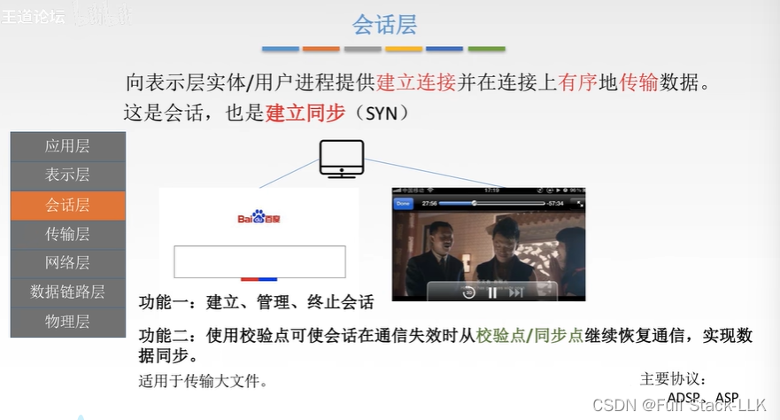
## 传输层
上四层都是端到端的
下三层都是点到点的
 主机上的进程通过端口号来标识
文件会被切分成一个个报文段

可靠传输（大文件）：接收端向发送端回复确认信息，如果没收到则重传数据
不可靠传输（小文件）：没有确认机制
差错控制：报文段乱序或丢失
流量控制：速度匹配，使收发速度相匹配，对发送端进行控制
复用和分用：多个进程可以使用传输层，传输层也可以把信息分发给各个进程

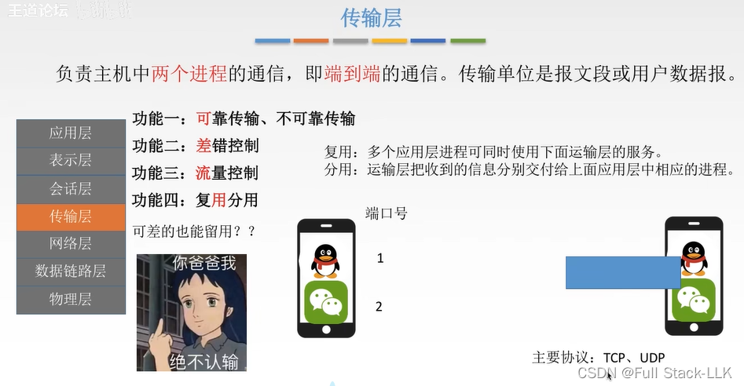
## 网络层
路由选择：选择传输路线
流量控制：使收发速度相匹配，对发送端进行控制
拥塞控制：当分组（即数据报）无法及时接收时，会丢弃分组，造成网络拥塞，此时需要进行一定的控制来解决

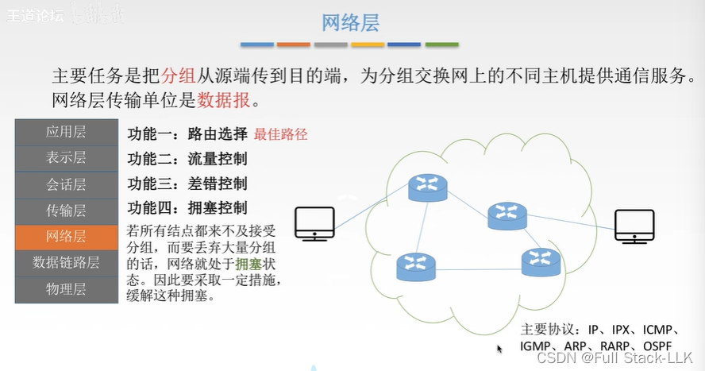
## 数据链路层
成帧：帧同样是比特流，是数据报的封装
流量控制：使收发速度相匹配，对发送端进行控制

访问控制：在广播网络中，同一时间只有一台机器能发送信息，其他机器都在监听；它负责控制哪台主机占用当前信道，该信道连接着每一台机器
 
 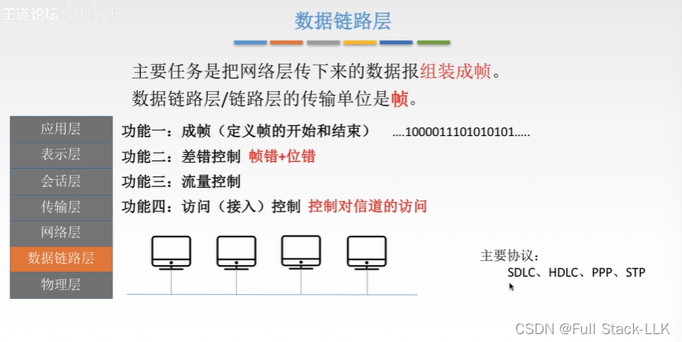
## 物理层
将比特流转换为电信号，不修改数据
透明传输：不论比特是什么组合，都传输到链路上

定义接口特性：例如有多少个引脚、如何连接
定义传输模式：半双工（同一时间只有一方可以向对方发送信息，但可以是 A 到 B，也可以是 B 到 A）、全双工（双方可以同时互相发送）、单工（只能单向发送）
比特同步：例如发送什么，接收方就能收到什么
比特编码：例如用什么电压表示 1，用什么电压表示 0
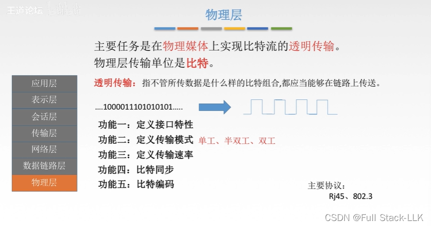
# 总结
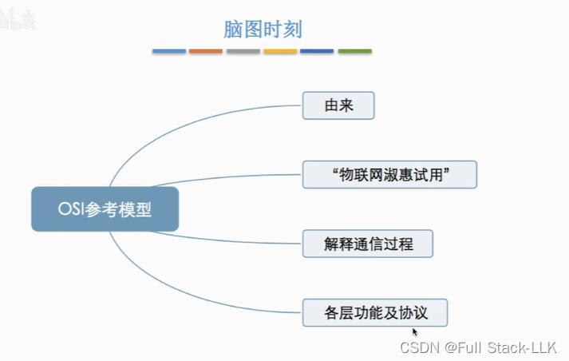

