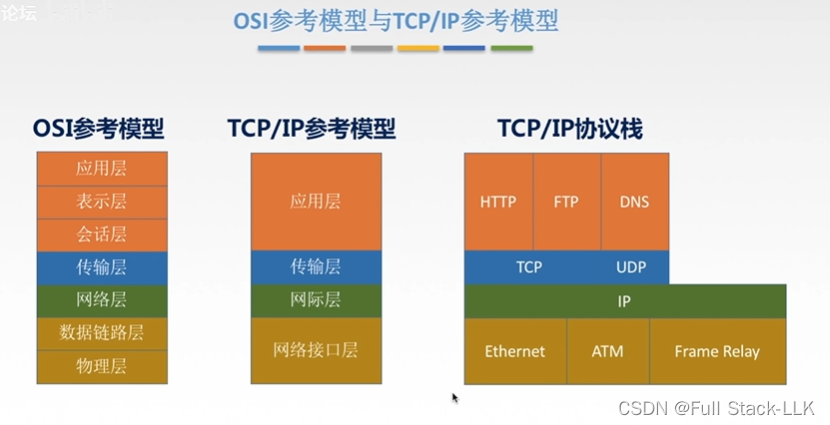
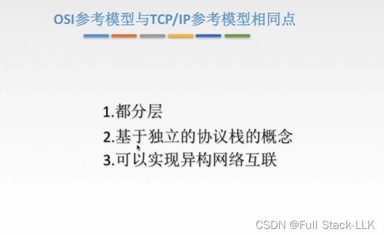
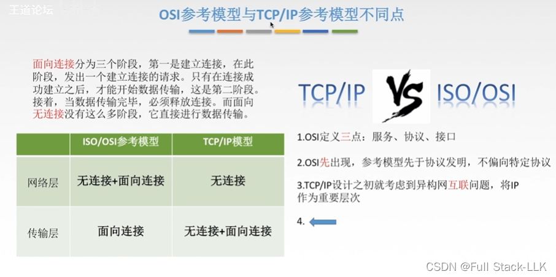
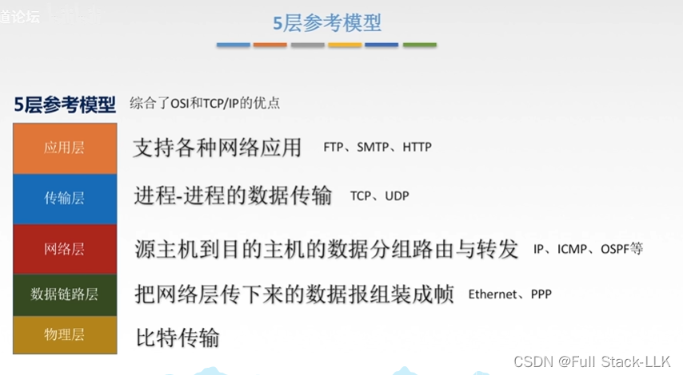
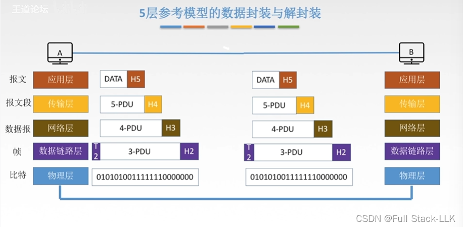
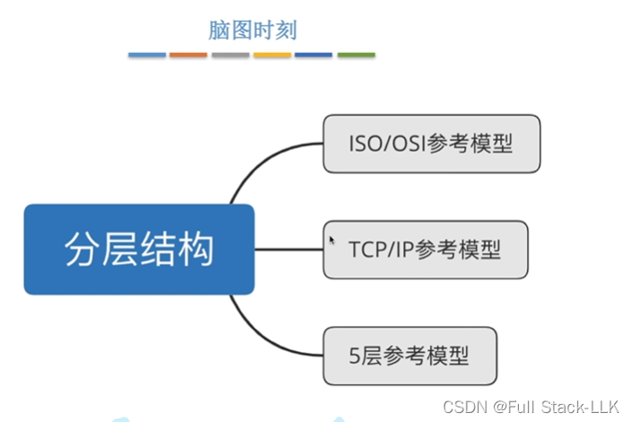


# OSI 与 TCP/IP
OSI：先有理论，但没有实践
TCP/IP：先有实践，后有理论
TCP/IP：基于协议栈分层
网络接口层：数据链路层和物理层
应用层：包含上面三层

# OSI 与 TCP/IP 的相同点

异构网络互联：使不同厂商生产的设备能够互相通信

# OSI 与 TCP/IP 的不同点
IP 协议是无连接的
传输层是端到端的，具有可靠传输的功能，即面向连接的功能

传输层：TCP/IP 也提供无连接服务，是出于实际效率需求的考虑；OSI 是更严谨的标准，所以没有无连接服务
网络层：TCP/IP 只有无连接服务而没有面向连接服务，同样是考虑到实际效率需求，所以没有面向连接的功能

# 五层参考模型
它相当于兼顾了严谨性与实用性

# 五层参考模型中的数据封装与解封装
应用层形成报文

# 总结


