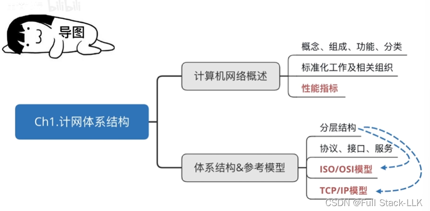
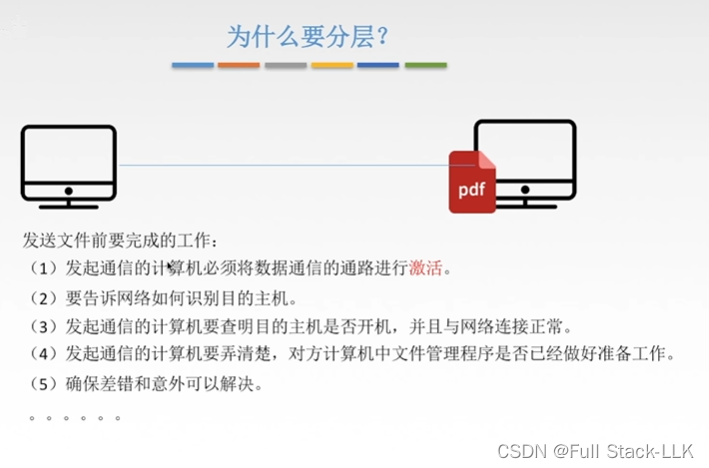
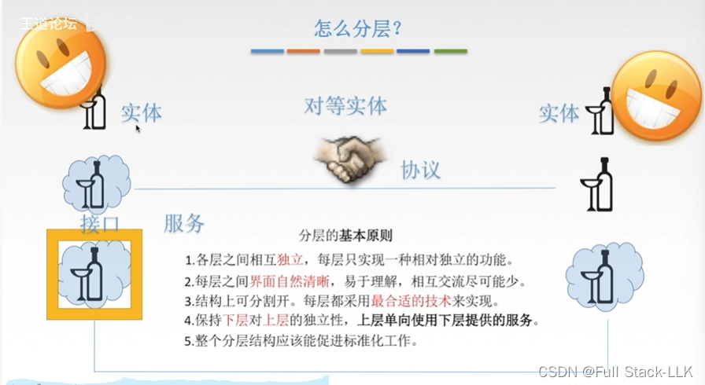
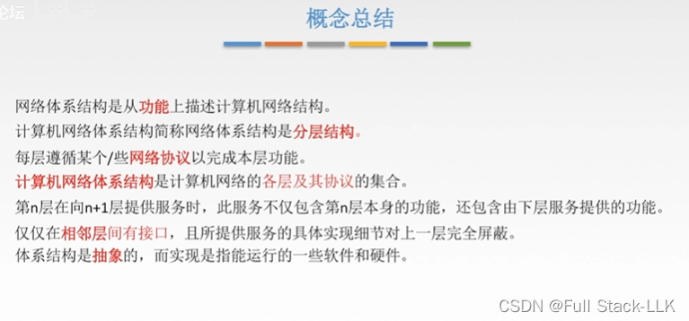
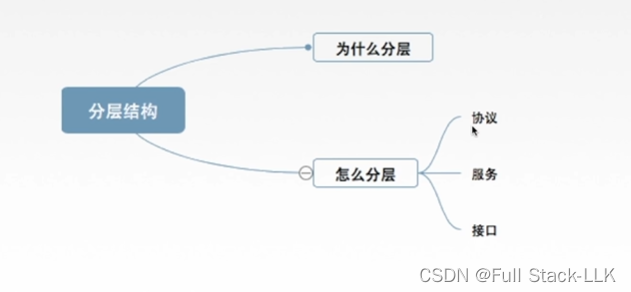


# 概述

# 为什么要分层
发送文件之前有大量的准备工作要做

把这些准备工作分解成小问题，逐层解决，即分层解决
# 如何分层
各层之间相互独立，每一层所做的工作各不相同
层次的边界应当自然清晰，层间接口既要体现层与层之间的关系，又要简洁明了，接口不宜过多

同一层的对等实体所做的操作是相反的

# 从形式上理解分层
只有下层向上层提供服务
SDU 可以看作本层为完成用户所请求的功能而需要传输的数据
PDU 会成为下一层的 SDU

# 概念

从功能的角度来描述，即不同的功能划分出不同的结构层次

有了接口，上层才能使用下层提供的服务

实现与体系结构的区别，就像写代码与整体设计的区别

# 总结


