
# 标准化工作及相关组织
## 标准化工作
即需要统一的标准，这样才能相互兼容
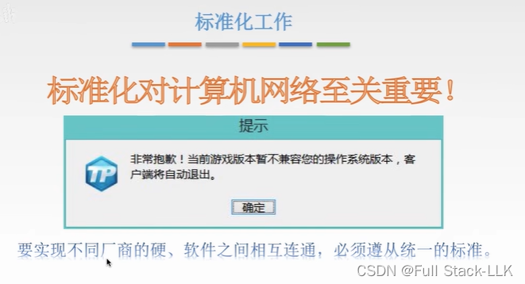

## 标准的分类
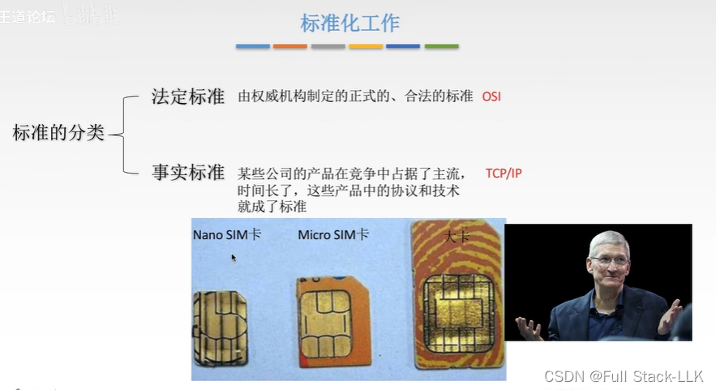

## RFC 流程
第三个阶段现在基本已经没有了

先写草稿，然后发邮件。如果通过就成为建议标准，此时就是 RFC 文档。然后放到网上让很多人修改，此时是草案标准。最后交给 IETF IAB，如果通过就成为因特网标准
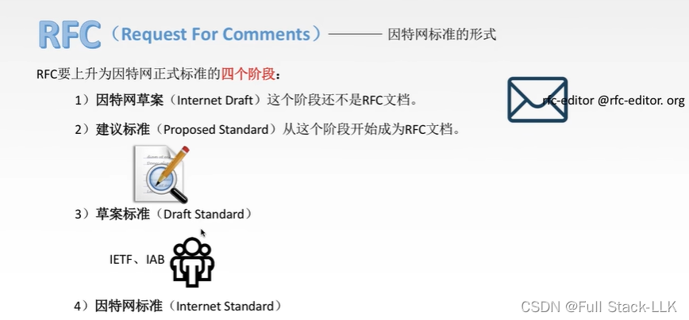
## 与标准化相关的组织
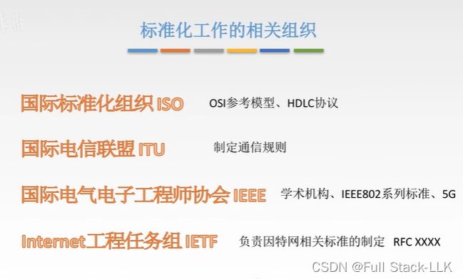
## 总结
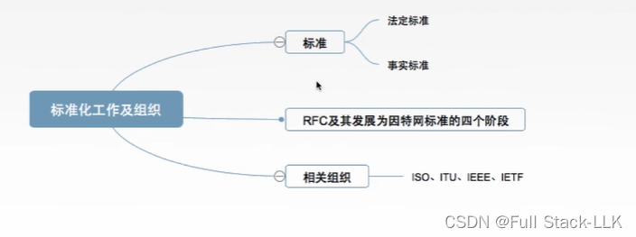

# 性能指标
## 速率
接收端单位时间内从发送端接收到多少比特的数据
注意存储容量和速率之间换算倍数的区别

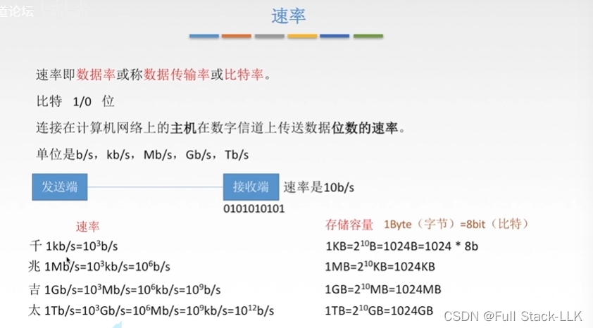
## 带宽
第一张图表示 3us 后的链路，三个笑脸代表三个 us 中每个 us 发送到链路上的 1 比特数据
第二张图类似，只不过每个 us 对应 2 比特
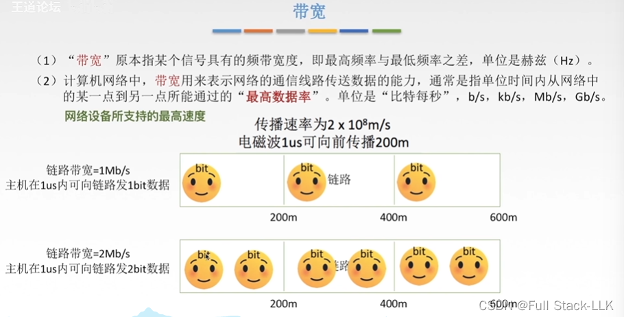

## 吞吐量
某个接口上所有链路速率之和
例如图中交换机的吞吐量为 20mb/s + 10mb/s
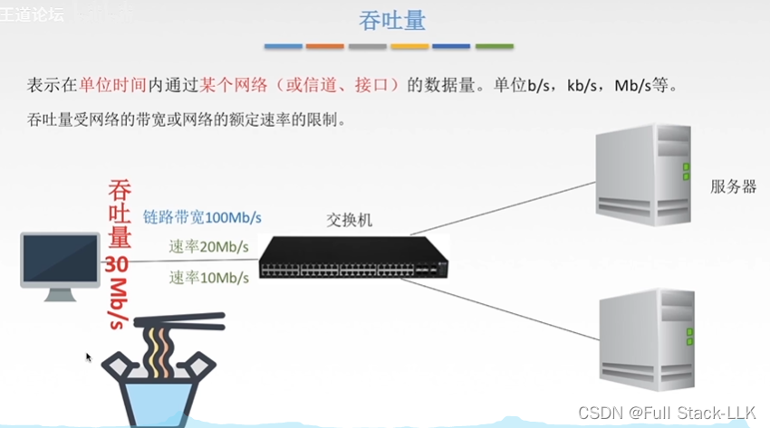
## 时延
### 发送时延
从发送方开始发送第一个比特到最后一个比特被发送到链路上所需的时间

做题时一般把带宽当作发送速率，但实际上并没有那么理想

例如发送的长度为 10，发送速率为 10b/s，那么按照公式，此时的发送时延为 1s
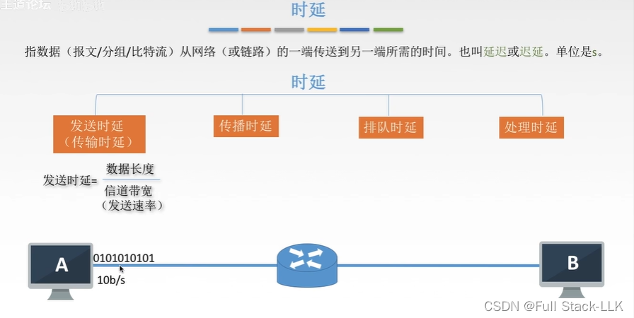
### 传播时延
就是从链路一端传到另一端的时间
电磁波在链路中的传播速度比在真空中慢
它取决于链路的长度和电磁波的传播速度
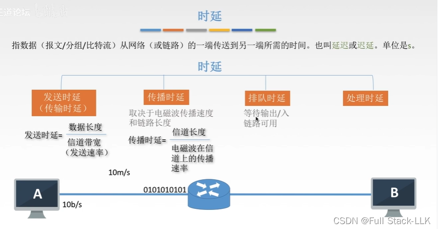

### 排队时延和处理时延
此时 10 比特到达路由器，但由于路由器繁忙，这些比特先被放入路由器的缓存空间等待一段时间，这个等待时间就可以称为排队时延

处理时延是排队结束后路由器开始处理这些比特所需的时间。处理完之后，还要等待输出链路空闲，才能发送到路由器对应的出口
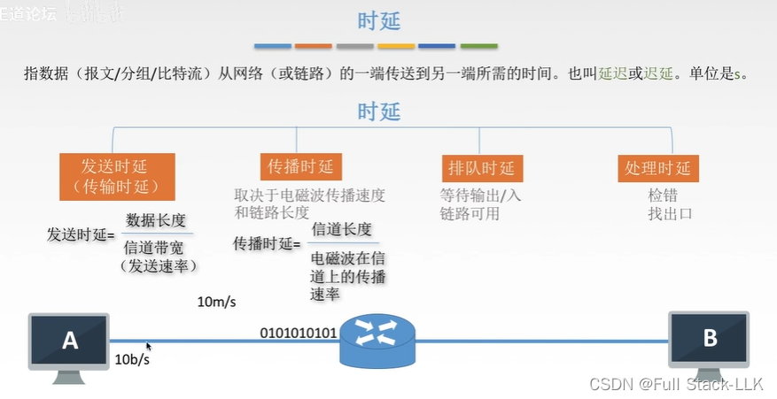
### 补充：高速链路
高速只是提高了带宽，传播时延不受影响
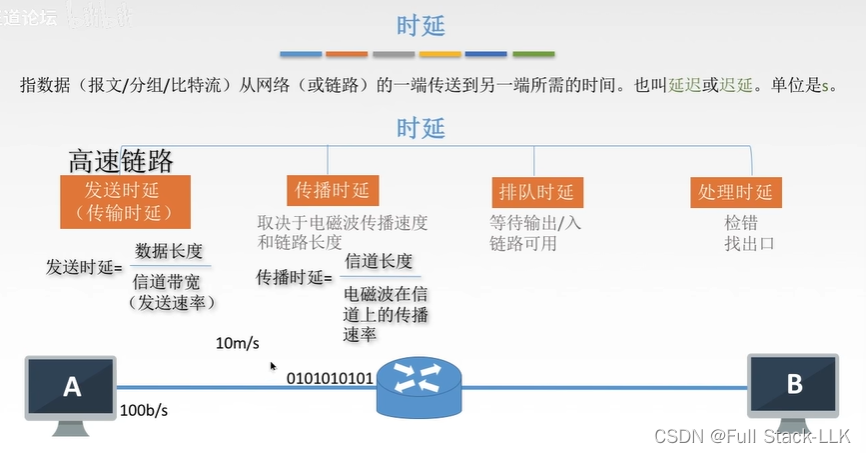
## 时延带宽积
这里的带宽是发送方向数据链路发送数据的带宽

链路是一个圆柱体，带宽就是横截面

可以理解为：每个单位时间向链路上发送一个带宽的比特，随着时间推移它们沿链路传播，于是就形成了一段由比特组成的链路长度
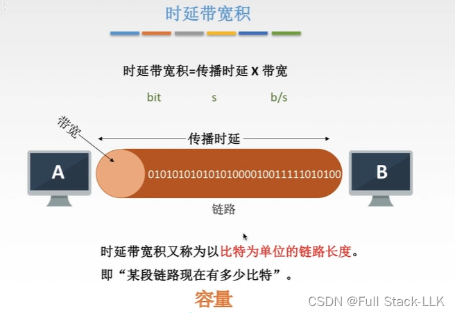

## 往返时间（RTT）
 端处理时间有时会被忽略，具体看题目要求

在这个定义中，接收方收到数据后立即发送确认

开始是指开始发送数据，即开始放置比特的时刻；结束是指收到的确认的第一个比特到达的时刻
在收到确认之前可以一直发送数据。RTT 越大，收到确认越晚，发送的时间越多，发送的数据也越多

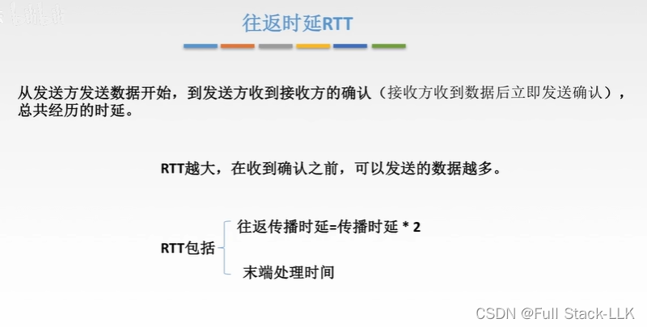
## 利用率
信道利用率：链路上有数据通过时就认为链路被利用

如果利用率高，说明有数据的时间更多，相应地链路上的数据也更多，这就会导致拥塞，即排队

为什么利用率高就意味着链路上的数据多？
因为我们假设每个时刻都有数据，即利用率高。此时由于每个时刻都有一些数据流出，如果链路上数据不多，流出后可能恰好没有数据了；而如果数据很多，流出后仍然有数据，这就对应利用率高
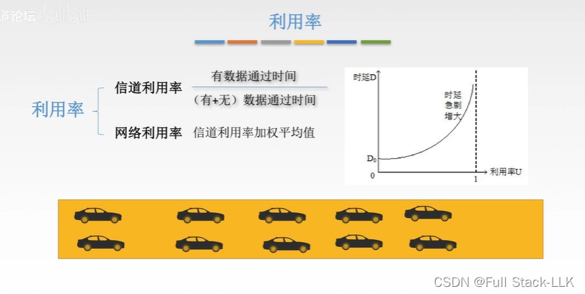

## 总结
带宽也是一种速率，只不过是理想的最高速率，而吞吐量是速率之和
发送时延（主机向链路发送）和传播时延（沿链路传播）
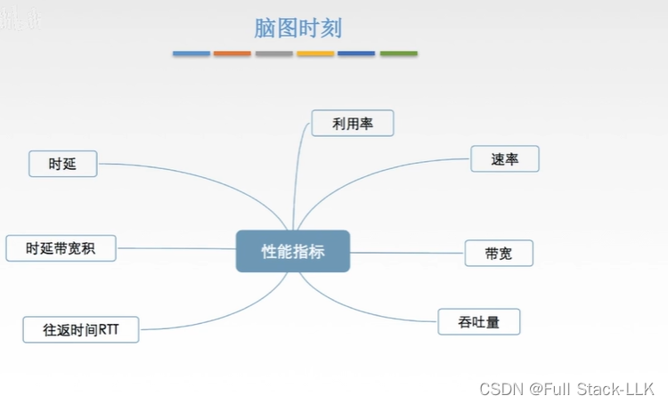

