
# 计算机网络的概念、功能与发展阶段
## 概览
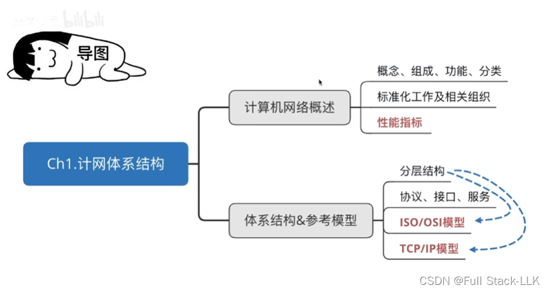
## 计算机网络的概念
  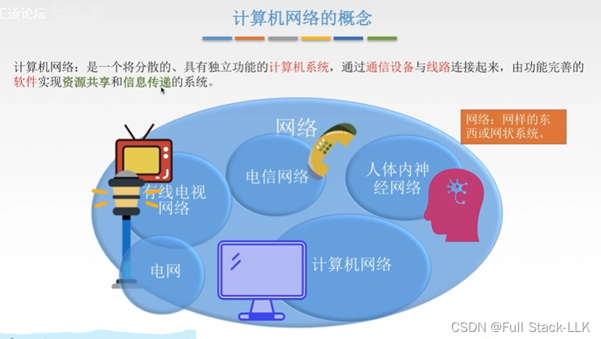
具体理解
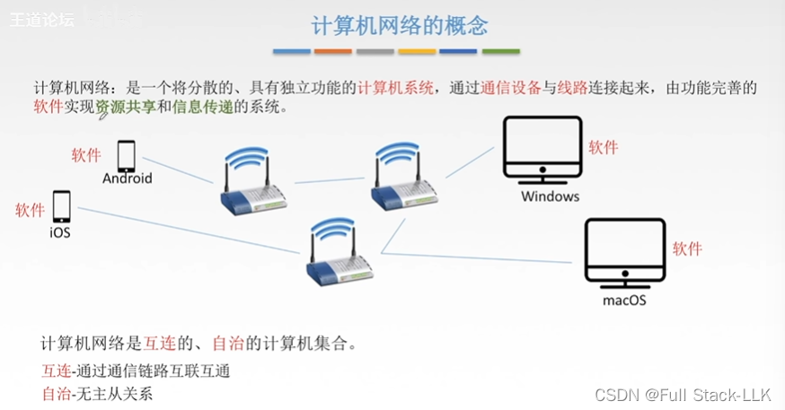
## 计算机网络的功能
1. 数据通信，即传输数据
2. 资源共享：硬件方面可以想想网络打印机（打印机有 IP 地址，可以通过网络连接到打印机，然后发出打印请求）；软件共享是指通过远程网络访问使用别人电脑上的软件；数据共享可以举百度文库之类的例子
3. 分布式处理（Hadoop）

> Hadoop 是由 Apache 基金会开发的分布式系统基础架构，是一个由存储系统和计算框架组成的软件框架。它主要用于解决海量数据的存储和计算问题，是大数据技术的基石。Hadoop 的核心是 HDFS（Hadoop 分布式文件系统）和 MapReduce。HDFS 是一个运行在标准或低端硬件上的分布式文件系统，除了具有高容错性、原生支持大型数据集之外，还能提供比传统文件系统更好的数据吞吐量。MapReduce 是一个帮助规划数据并行计算的框架。此外，Hadoop 还包括 Yet Another Resource Negotiator（YARN），这是一个负责管理和监控集群节点及资源使用的工具，用于调度作业和任务。

4. 提高可靠性：在分布式处理下，即使一台机器宕机，其他机器也可以顶替它——只是整体速度相对慢一些
5. 负载均衡：分布式处理使各台计算机承担的任务不至于失衡
## 计算机网络的发展
### 计算机网络的发展 - 第一阶段
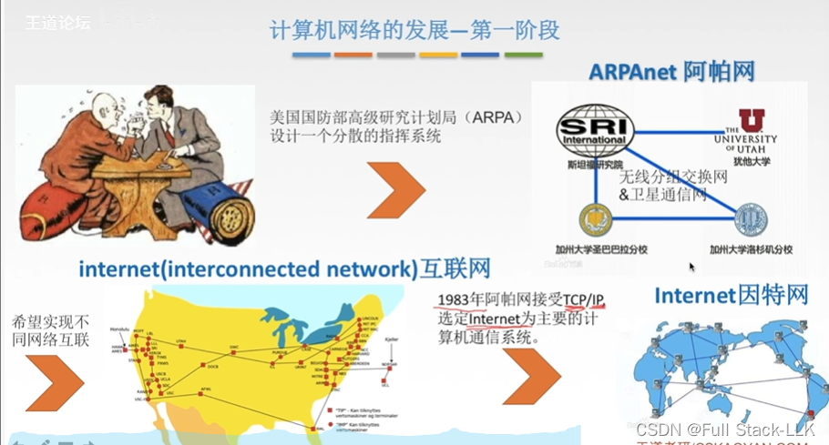
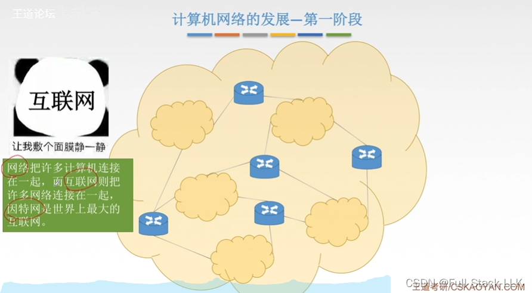
### 计算机网络的发展 - 第二阶段 - 第三阶段
发展为三级结构
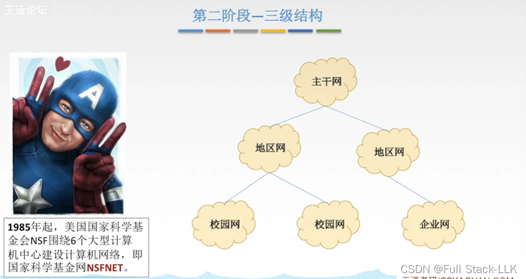
### 计算机网络的发展 - 第三阶段 - 多层次 ISP 结构
网络提供商变成了 ISP
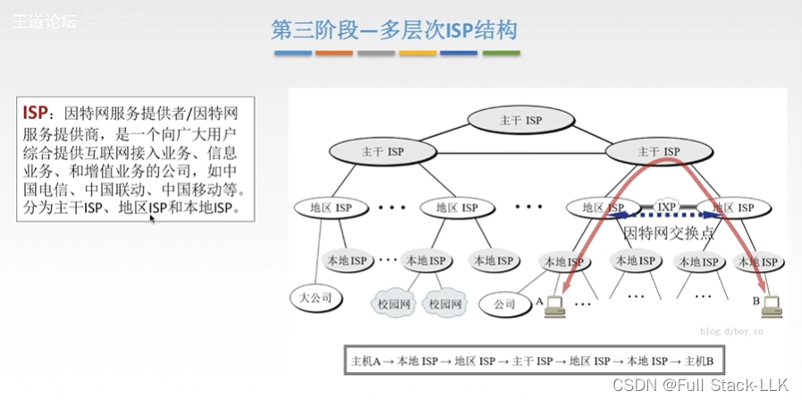
IXP：即把地区 ISP 与地区 ISP 直接相连

## 小结
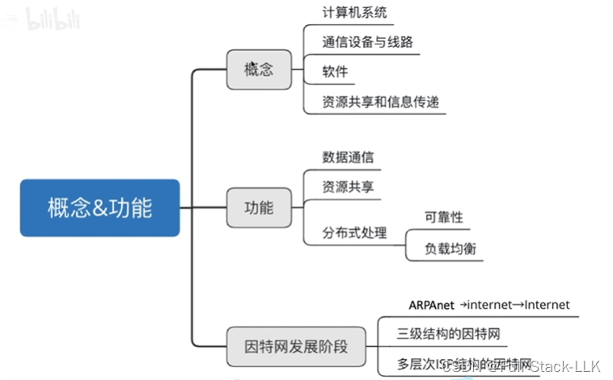
# 计算机网络的组成与分类
## 计算机网络的组成
软件部署在相应的硬件上
主机之间的通信实际上是进程之间的通信
 
 服务器收到的请求越多，客户端得到响应就越慢
B/S：只不过客户端是浏览器
P2P：peer to peer，所有主机同时既是客户端又是服务器（这里主机越多，下载速度越快。比如 A 同时向 B 和 C 传输数据，而 B 也向 C 传输数据，那么 C 需要的数据就可以分成两部分——一部分从 B 获取，另一部分从 C 获取）
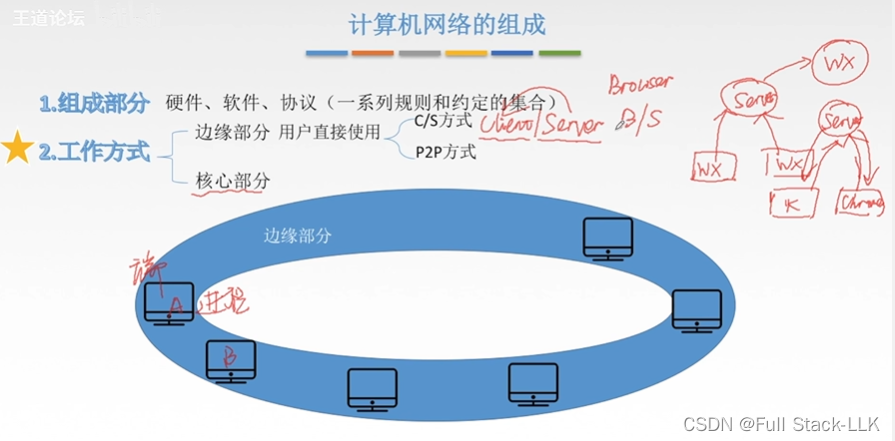
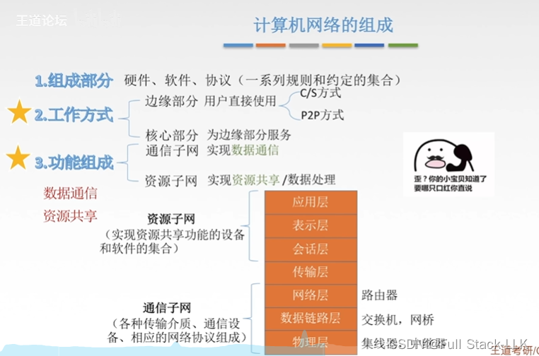
## 计算机网络的分类
广域网：国与国之间、省与省之间——总之比城市范围大
局域网：像学校、公司、单位这样的网络
最初是按分布范围分类的，但归根结底还是看使用了什么类型的技术——这决定了它属于哪种范围的网络

电路交换：占用链路资源，别人无法使用（类似电话）

报文：要传输的一个文件或一个单独的条目
报文交换和分组交换：存储转发

广播式网络大多采用总线型拓扑
点对点网络大多采用网状拓扑
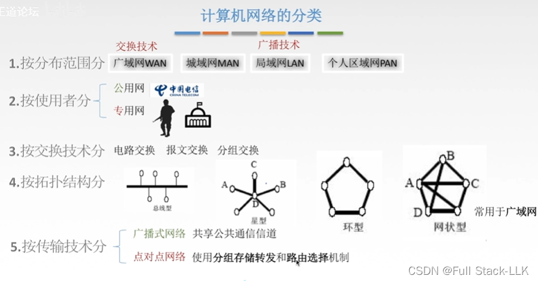
## 小结
局域网：大多是总线型
广域网：大多是网状型
广播式与点对点的区别主要在于是否有存储转发和路由选择
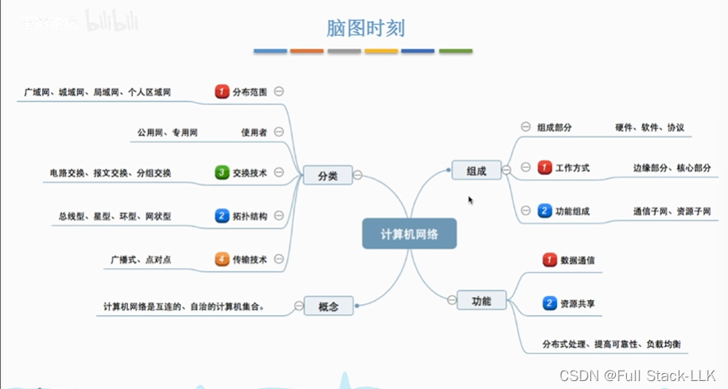

