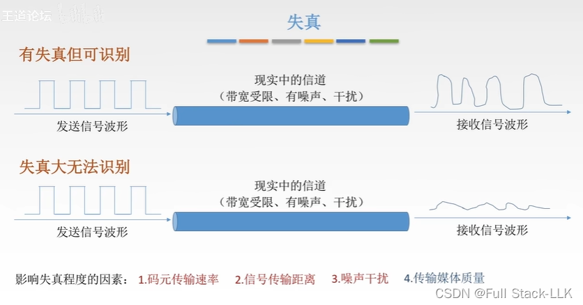
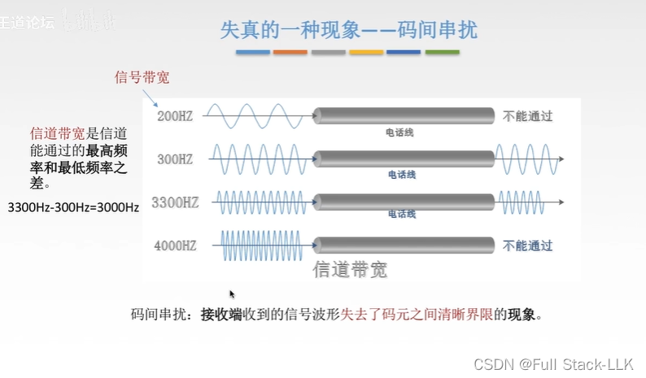
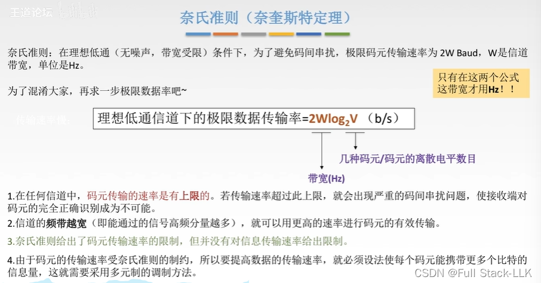
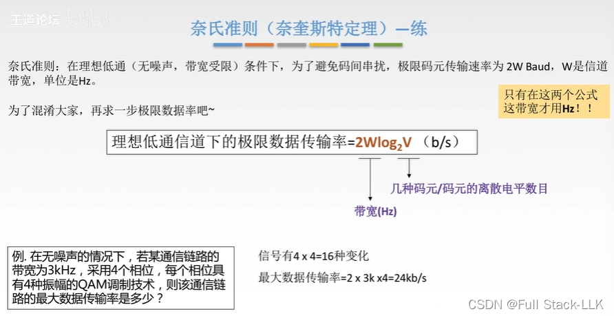
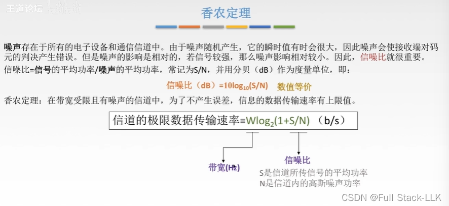
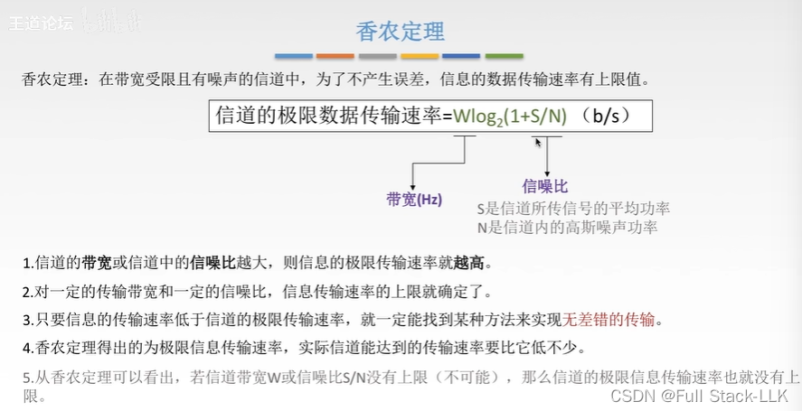
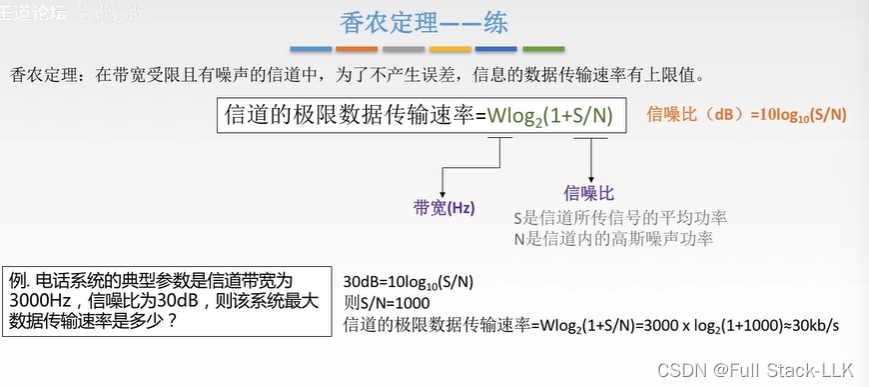
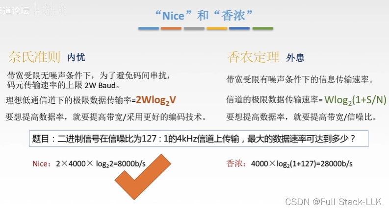


# 失真
简单来说就是结果与原始信号不同
两种情况

前三项是正相关的；最后一项是负相关的

码元传输速率越高，失真越严重。可能的原因包括：

1. 信号频率成分增加：随着码元传输速率上升，信号的频率成分也相应增加。高频信号更容易受到电路特性的影响，例如电阻、电容和电感的响应，这可能改变信号波形并产生失真。
2. 信道带宽限制：根据奈奎斯特准则，为了避免码间串扰，码元传输速率存在上限，即信道的最大带宽。如果传输速率超过这一限制，信号之间会相互干扰，导致失真。
3. 信号衰减与噪声干扰：随着传输速率上升，信号在传输介质中的衰减也会加剧，噪声对信号的影响也更加显著。所有这些因素都会降低接收端的信号质量，增加失真的风险。
# 失真的一种现象——码间串扰
模拟信号是连续的；电话信道是模拟信道
模拟信号的信号带宽是一个频率
信号带宽不等于信道带宽
200 Hz 无法通过，是因为它容易受到其他高频信号的影响，产生严重的衰减或干扰，甚至可能消失，因此无法通过
4000 Hz 无法通过，是因为其振荡频率太高：时间间隔变得非常短，码元之间的边界再也无法区分——也就是说码元传输速率太快，无法分辨码元；或者说码元长度太短，通过时的识别时间过短，来不及处理
就像一群人连续不断地走过——你能分辨出每一个人吗？——而如果是一个一个地走过，你就能清楚地认出每个人
传输速率慢

高电平和低电平都是码元信号
传输速率快

频率越高 = 信号变化越快 = 码元变化越快 = 码元传输速率越高（更密集，码元长度更短，速度更快）

# 奈奎斯特准则（奈奎斯特定理）
理想的（无外部干扰）低通（带宽受限；低于最大频率的频率可以通过）

用于限制码元传输速率

频带越宽 = 信道带宽越大

## 例题
每个相位有 4 种幅度，共 16 种幅度，因此有十六种波形信号

# 香农定理
信噪比可以类比为：学生听到的是老师的声音，还是差生的声音

“无差错”是指接收方能够获得正确的信号

无差错传输是指没有错误

## 例题

# 奈奎斯特与香农
奈奎斯特：从内部减少码元之间的信号干扰
香农：在噪声影响下施加的限制——是外部的

当两个公式都适用时，分别计算并取较小值；较小的那个能保证两个条件都得到满足


