
# 一个典型的数据通信模型
广域网中包含模拟信道；模拟信道可以传输模拟信号，但不能传输数字信号

数据从计算机的网卡发出时是数字信号，经调制器转换为模拟信号后在广域网的模拟信道上传输，再经解调器转换回数字信号，只有计算机处理完数字信号后数据才会被呈现出来

发送端的调制器：发射器
接收端的调制器：接收器
中间的广域网称为传输系统
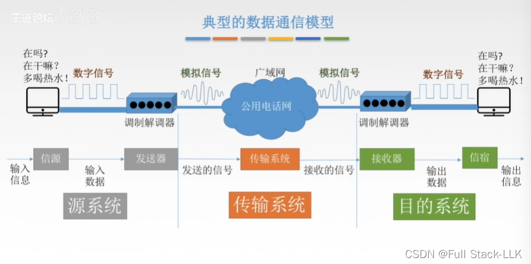
# 数据通信的相关术语
码元序列：可以理解为一个 0/1 序列
数据可以看作是待传输消息的 0/1 比特序列表示
信号是数据在传输过程中呈现的形式
信道是有方向的
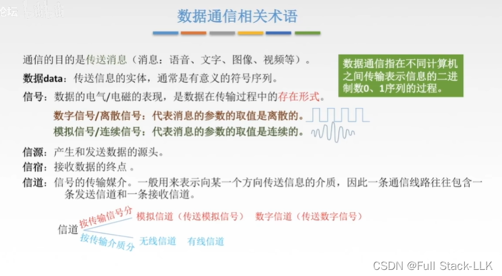

# 设计数据通信系统时要考虑的三个问题

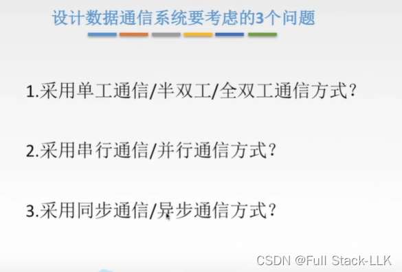
## 单工／半双工／全双工
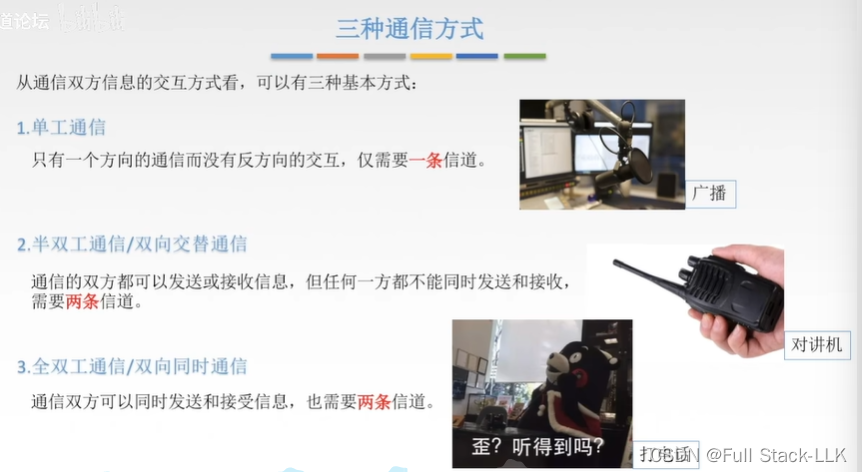
# 串行／并行
"速度更慢"是指所有数据从发送方传到接收方所需的时间更长
"成本更高"是指需要更多的信道，因此花费更多

计算机内部使用并行传输
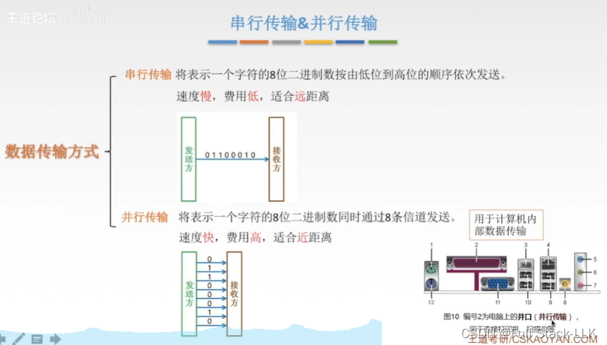
# 同步／异步
同步通信：最后四个块是要传输的数据；会先发送一个同步字符，就像通知对方准备接收，然后两端的时钟进行同步（发送间隔是相同的）
异步通信：发送方会加上一个起始位和一个终止位。假设起始位为 0，终止位为 1；当起始位为 0 时，接收方的电平跳变为 0，告诉接收方可以开始接收数据，当终止位为 1 时，接收方的电平跳变为 1，告诉它停止接收数据。这种状态会一直持续，直到下一个起始位到来并改变电平（发送间隔不同，就像键盘一样）

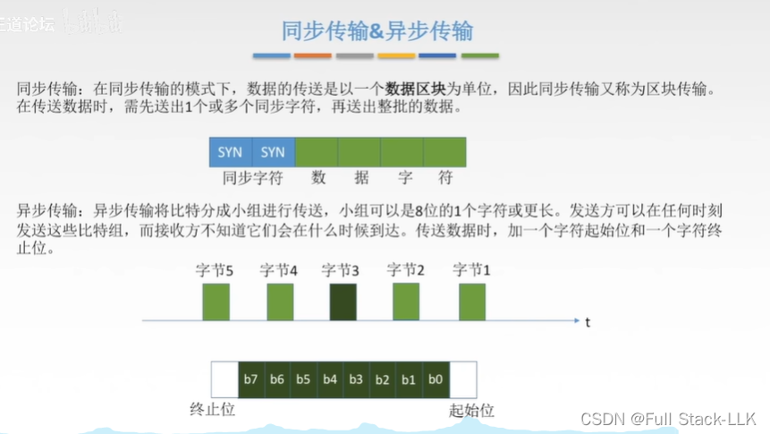
# 小结
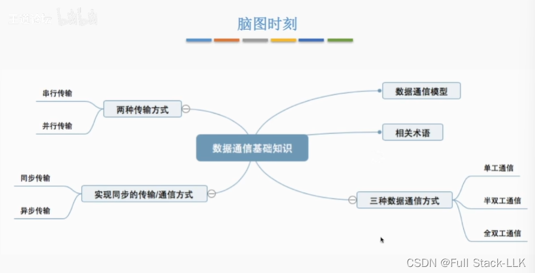
# 码元
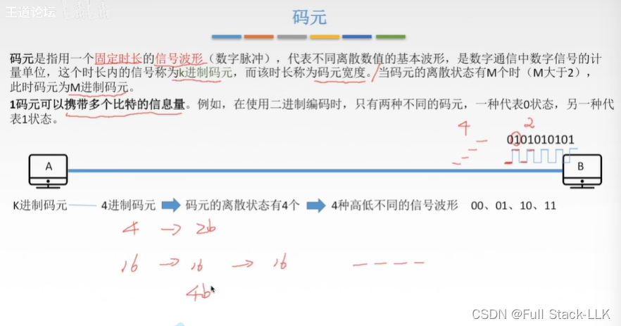
# 表示数据传输速率的两种方式
       
   一个二元码元 = 每个二进制位对应一个码元，换句话说，码元的数量等于一个二进制数可能取值的数量，即 2
 
 码元长度就是一个码元所占的持续时间或宽度
 码元速率只取决于码元长度
两个宽度相同的码元即使波形看起来一样，也是两个不同的码元；想想发送的内容是什么：虽然对应的波形相同，但它们并不是同一件事
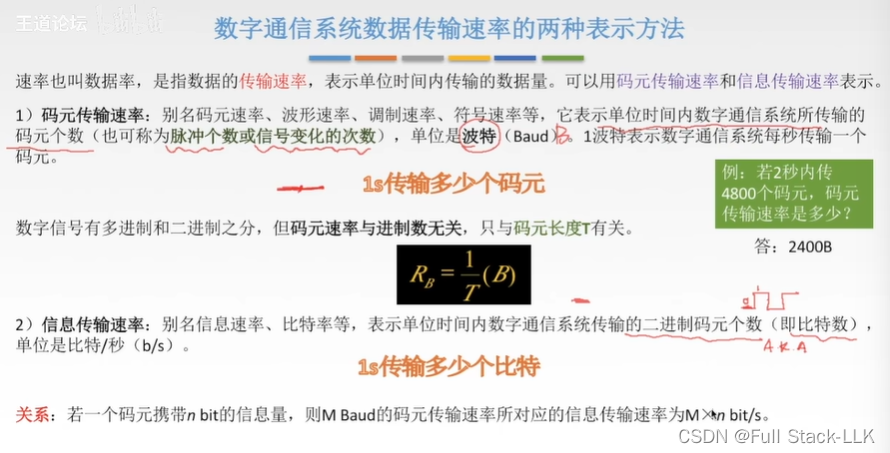
## 思考题 1
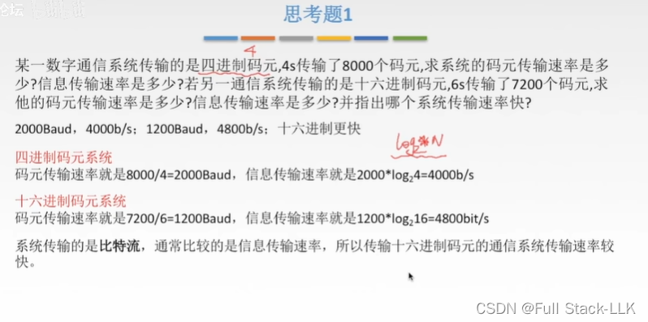
## 思考题 2
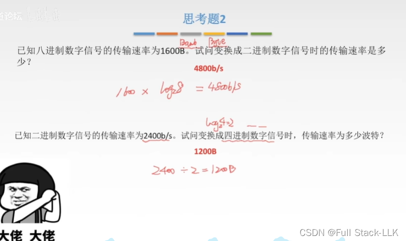
# 带宽
观察某个端口或某个截面，单位时间内通过的车辆数量就是带宽
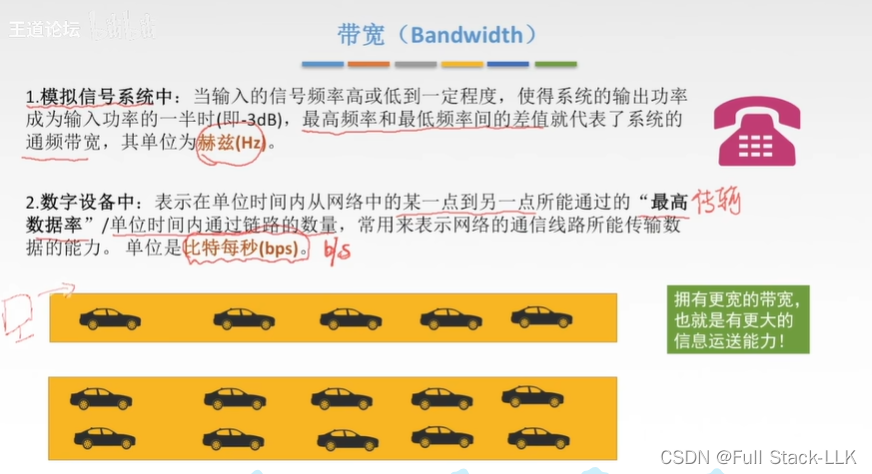

