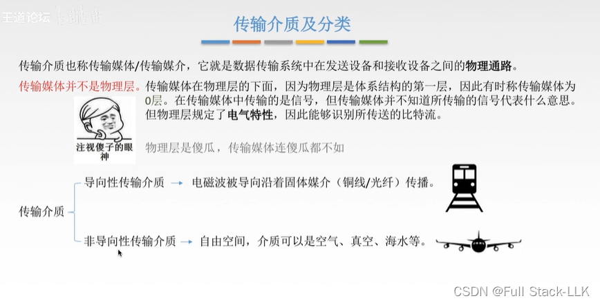
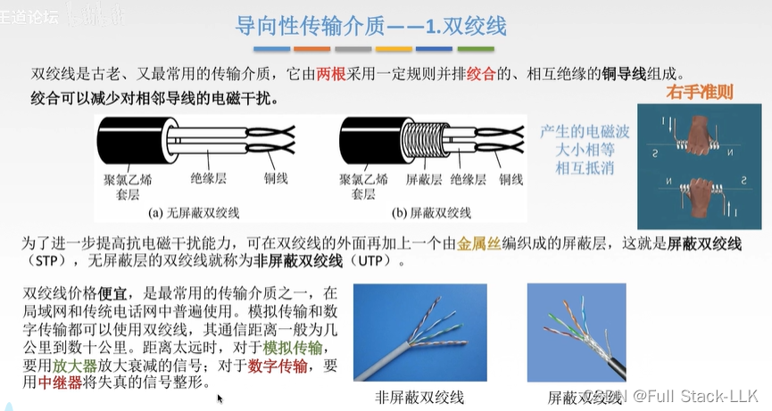
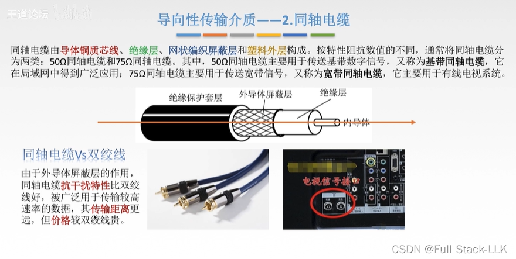
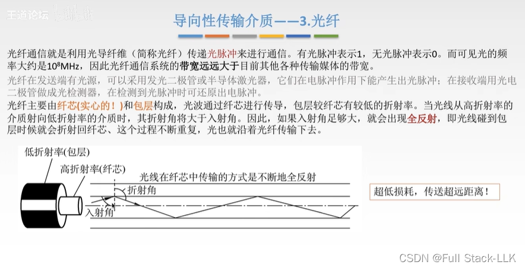
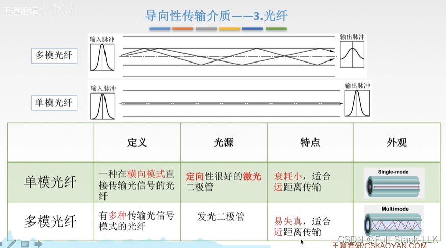
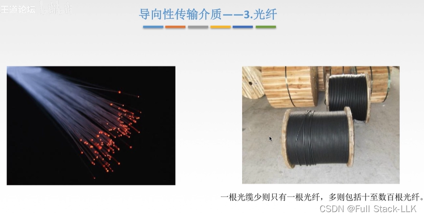
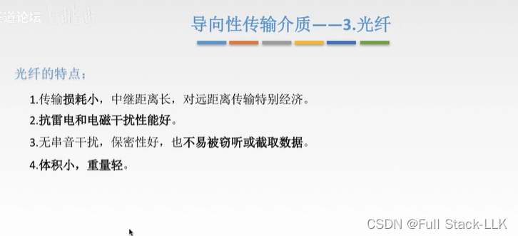
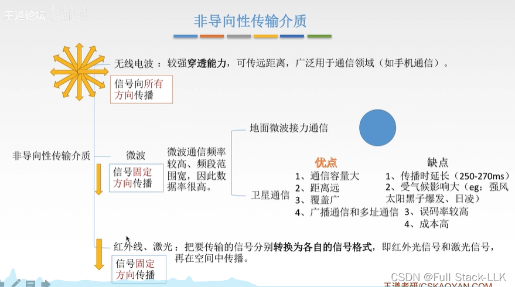
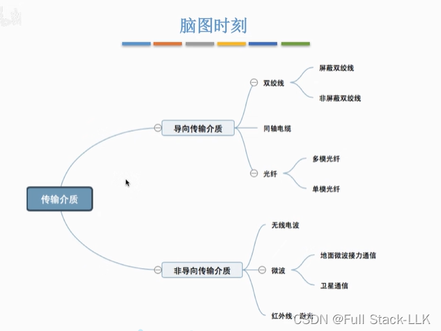


# 传输媒体及其分类
物理层规定电气特性：它定义了电信号所对应的数据

# 导向传输媒体 - 双绞线
双绞线的主要作用是传输数据和语音信息。通过将两根导线按特定方式绞合在一起，可以有效减少电磁辐射和相邻线对之间的串扰，并抑制外部干扰。这种设计使双绞线在短距离通信中非常有效，尤其是在局域网（LAN）环境中。

双绞线电缆通常由一对或多对这样的双绞线放在绝缘套管内构成。虽然双绞线在传输距离、信道宽度和数据速率方面有所限制，但它的成本相对较低，因此在许多应用中仍然是首选的传输媒体。

此外，双绞线有很多种类，包括屏蔽双绞线（STP）和非屏蔽双绞线（UTP），它们在不同的应用场景下各有优缺点。例如，屏蔽双绞线的抗干扰能力更好，而非屏蔽双绞线因成本更低而更受欢迎。

图中的两层绝缘层对应双绞线的两根导线

屏蔽层的主要作用是减少外部电磁场对电力线或通信线路的影响，并防止线路向外辐射电磁能量。
- 金属屏蔽：对于没有金属护套的中低压电力电缆，除半导电屏蔽层外还要加一层金属屏蔽层。金属屏蔽层通常由铜带或铜丝绕包而成，主要起屏蔽电场的作用。

# 导向传输媒体 - 同轴电缆
共用同一根轴线
基带信号是未经调制的信号，通常是低频的，而宽带信号是经过调制的信号，可以跨越更宽的频率范围

抗干扰能力强，因此即使传输距离较长，累积的干扰也不会太大
它可用于高速率数据传输，因为其外层屏蔽层还能减少内部信号向外辐射造成的损耗。

# 导向传输媒体 - 光纤
如果光（在进入包层时）没有被折射出去而是被直接反射，光的损耗就很低

光的频率很高，因此它所承载的信号自然也很高，对应的带宽也很高

单模光纤不需要折射，因此损耗小。光纤直径很细
多模光纤（有多条入射光线）在距离过长时折射过多，损耗过大会导致失真，因此适合短距离传输

光纤很细；为了保护它们，一根光缆通常会把多根光纤和一些保护层捆绑在一起

中继距离是指光纤传输时信号在光纤中能够传输的最大距离；这个距离受光纤线路损耗和色散的限制。

此外，在无线通信中，中继技术通过增加中继节点来转发无线信号，从而扩大覆盖范围并提高链路容量。这里的中继距离指基站到中继站以及中继站到移动台的距离。这种技术可以用两条质量良好的短距离链路来替代一条质量较差的长距离链路。

光纤具有出色的抗雷击和抗电磁干扰能力。具体如下：

- 抗电磁干扰：光纤的基本成分是石英，不导电，因此不受电磁场影响。光纤中传输的是光信号而不是电流，所以光纤传输对电磁干扰和工业干扰有很强的抵抗能力。这使得光纤即使在高压线路、变电站等强电磁干扰环境中也能保持稳定的通信。
- 抗雷击：光纤是绝缘体，不怕雷电和高电压；即使在原子弹爆炸产生的电磁脉冲等极端环境中，光纤通信线路也能保持畅通。

串扰：可以理解为两条信号线路相互干扰
光纤通信没有串扰，因为它的信号几乎不会影响到其他光纤（或者说，它几乎不会泄漏出去，因此自然具有良好的保密性）

传输相同数量的数据时，光纤体积更小、重量更轻，因为所需的光纤更少

# 非导向传输媒体
这三种波是按照频率（或波长）的不同来划分的
无线电波通信不需要特定的方向

地面微波接力通信是一种在地面视距（直线）范围内利用微波进行远距离通信的技术。

地面微波接力通信系统，又称微波中继系统或微波链路系统，使用波长为 1 米到 0.01 米的微波频段，通过视距范围内的地面中继站转换并传递信号。由于微波的传播特性，这种通信方式主要依靠直线传播，因此必须在两个终端站之间建立一系列中间站——中继站，逐站传递信号。这些中继站对接收到的微波信号进行处理（如变频和放大），再转发给下一个中继站，从而实现远距离的超视距通信。

卫星通信：
传输距离长，受天气影响大，因此误码的概率自然较高
频带宽、容量大：卫星通信使用的频带很宽，能提供更大的通信容量，满足高数据速率的需求

广播通信是一个发射机向多个接收机发送信息，而多址通信则涉及多个发射机与一个或多个接收机之间的信息传递

卫星通信之所以容易实现广播和多址通信，主要是由于其独特的技术特点和优势。具体如下：

- 覆盖范围广：卫星通信系统的一个显著特点是覆盖范围广。由于卫星位于地球高轨道上，其信号可以覆盖地球表面的大部分区域。这意味着在卫星信号覆盖的区域内，任意两点都可以通信，不受地形和地理条件的限制。
- 广播能力强：卫星通信系统具有很强的广播能力。一颗地球同步卫星可以覆盖地球表面的三分之一，因此三颗分布合适的地球同步卫星就可以实现除两极以外的全球通信。这种广播特性使卫星通信非常适合分发新闻、天气预报、教育和娱乐节目等。
- 多址方式：卫星通信支持多址接入，即多个地球站可以通过同一颗卫星与不同的目的地通信。这种多址技术处理来自不同地球站的信号，并通过卫星转发器的中继，在多个用户之间建立通信链路。
- 灵活性高：卫星通信中的电路调度非常灵活——可以根据需要随时疏导过于集中的业务，同一信道还可以用于不同方向或不同区域的通信。这种灵活性使卫星通信能够快速响应各种通信需求，尤其是在紧急情况下迅速建立通信链路。

微波不需要格式转换；红外线和激光则需要

# 总结


