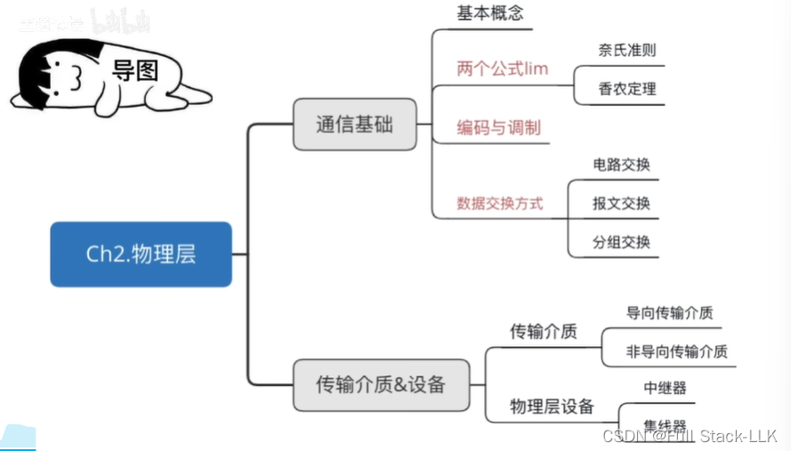
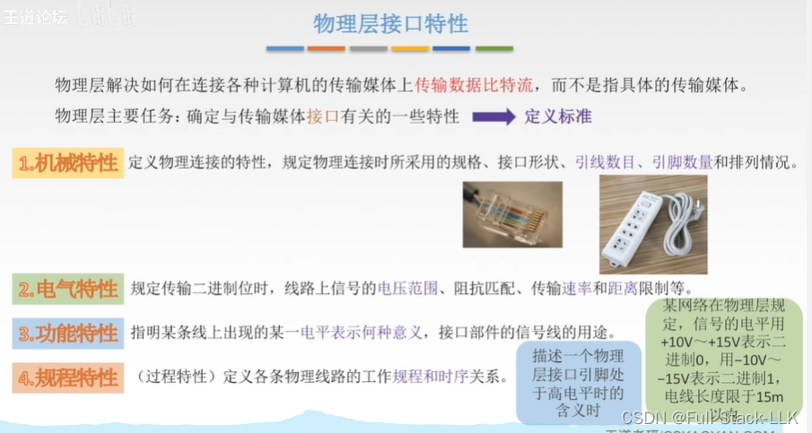


# 概述
寻找最终的传输速率：奈奎斯特准则、香农定理（不同的背景环境）
编码：数据变成数字信号
调制：数字信号变成模拟信号
不同的信道传输不同的数据形式
数据交换方式：核心（打电话就是电路交换）
导向传输介质：看得见
非导向传输介质：看不见

# 物理层接口特性
传输介质不属于物理层，它在物理层之下，可以看作是 TCP/IP 体系结构的第 0 层
物理层解决的是如何把拿到的数据比特流通过传输介质进行传输（要转换成什么信号，再如何传输）
接口标准：比如是两孔还是三孔，以及孔的形状

 注意过程特性
 
# Spark 模型给出的相关概念说明（仅供参考）

 物理层是计算机网络 OSI 模型中最底层的一层，负责数据的实际传输

物理层的相关概念包括以下几个方面：

1. 物理介质：物理层通过各种传输介质（如光纤、电缆、双绞线等）连接不同的计算机设备
2. 数据传输：物理层的主要功能是确保原始比特流数据能够在这些物理介质上正确传输
3. 透明传输：物理层提供透明传输，意味着网络通信的双方不需要关心数据传输路径中具体的传输介质类型、相关标准，或通信协议的细节
4. 数据编码：为了确保数据比特流能够在相应的信道中正常传输，物理层需要对数据进行编码。不同的传输介质支持不同类型的数据编码，比如归零码、非归零码、曼彻斯特编码、差分曼彻斯特编码等
5. 数据传输管理：物理层还具有一定的数据传输管理功能，包括基于比特流的数据传输流量控制、差错控制、物理线路的激活与释放等
6. 传输方式：物理层定义了数据传输方式，包括单向通信、双向通信，以及单工、半双工、全双工等概念

总的来说，物理层的核心任务是为数据链路层提供数据传输服务，保证比特流能够通过传输介质正确传输。它会根据所使用的传输介质制定相应的物理层协议，规定数据信号的编码方式、传输速率等相关参数。

