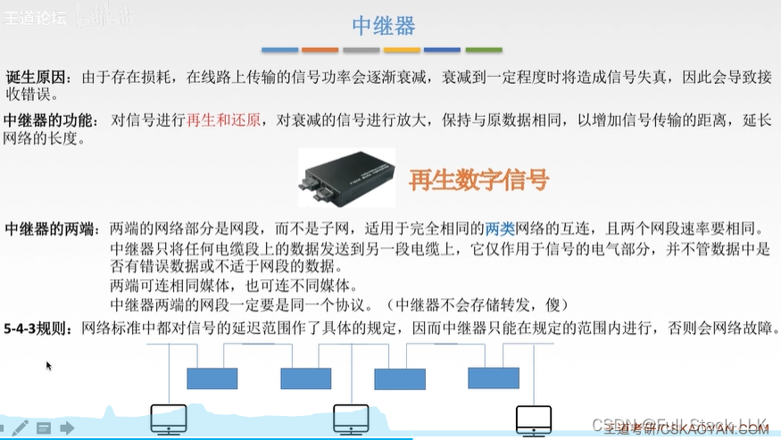
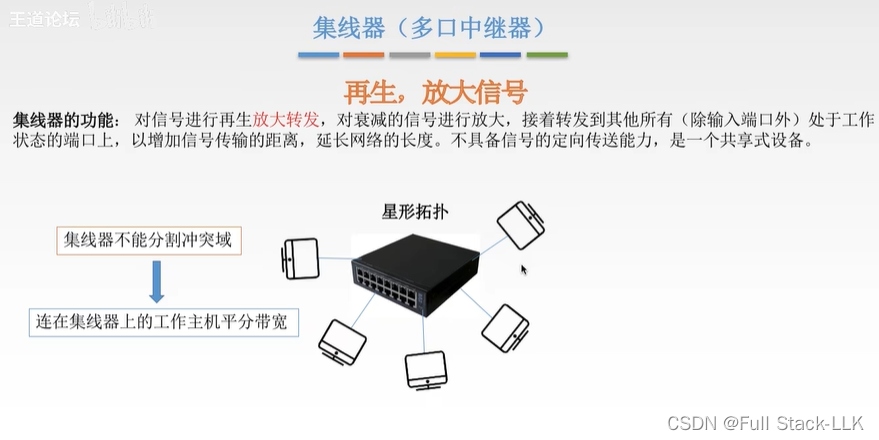


# 中继器
## 中继器的功能
中继器的主要功能是对信号进行再生和还原。

中继器是一种工作在OSI模型物理层的网络设备，它的主要作用是通过重新发送或转发数据信号来扩展网络的传输距离。具体来说，中继器的功能包括：

- 信号再生：中继器可以接收信号，将其复制，然后发送给另一个节点。在这个过程中，中继器会对信号进行再生以保证其质量，使其适合下一段传输。
- 信号还原：由于信号在传输过程中会衰减，中继器可以放大这些信号以保持其强度，从而延长信号的有效传输距离。
扩展网络长度：通过上述功能，中继器有助于扩展网络的长度，使信号能够传输更远的距离，从而扩大网络的覆盖范围。

## 再生数字信号与再生模拟信号
再生数字信号的设备主要是数字中继器，而再生模拟信号的设备是模拟放大器。具体如下：

- 数字中继器：数字中继器的主要功能是对数字信号进行再生和还原。它在接收并识别数字信号后，对其重新编码并发送。这个过程不仅涉及信号放大，更重要的是对信号进行整形和定时，确保信号码元的时序、波形和幅度都符合规定的标准。
- 模拟放大器：模拟放大器的作用是放大模拟信号。它的工作原理是把衰减的信号放大，以补偿传输过程中的信号损失。放大器主要用于模拟信号的传输，而中继器用于数字信号的传输。

## 相同的协议
中继器两端的网段必须使用相同的协议，因为中继器工作在OSI模型的物理层，它的主要功能是对信号进行放大和整形，不涉及任何高层协议的处理。

以下是中继器两端网段必须使用相同协议的几个原因：

- 信号处理：中继器的主要作用是在物理层面再生信号。它接收信号，对其放大和整形后再发送出去。这个过程要求信号的基本特征（如传输速率、信号编码方式）保持一致。
- 通信标准：网络通信标准规定了信号的时延范围，中继器只能在规定的范围内使用，否则会引起网络故障。如果两端协议不同，信号可能无法被正确识别和处理，从而导致网络故障。
- 设备兼容性：中继器两端的网络部分是网段，而不是子网。网段是指在物理层面可以直接通信的网络部分，而子网涉及网络层的划分。作为物理层设备，中继器的功能仅限于网段内的通信，因此两端的网段必须使用相同的协议，以保证设备兼容性和网络稳定性。
- 避免数据丢失：如果中继器两端的网段使用不同的协议，信号传输过程中可能出现数据丢失或错误。因为不同协议可能有不同的数据传输速率、帧格式等特征，这些差异会导致信号在传输过程中无法被正确解析和转发（即存储转发）。
中继器之所以能够连接不同的介质，主要在于它能够在不同介质之间进行信号转换。

中继器的基本功能是在物理层面对信号进行放大和整形，以延长信号的传输距离。虽然大多数情况下中继器两端连接的是相同的通信介质，但有些中继器被设计为具备将一种介质的信号转换为另一种介质信号的能力。例如，中继器可以将光纤信号转换为双绞线信号。这种能力使中继器在网络设计中具有更大的灵活性，能够满足不同网络环境的需求。

不过，尽管中继器可以在不同介质之间进行转换，它仍然受到一些限制：

- 协议限制：中继器两端的网段必须使用相同的协议，因为中继器不具备处理不同协议数据包的能力。
- 速率限制：由于中继器工作在OSI模型的物理层，它不能连接两个速率不同的局域网。
- 时延限制：网络标准对信号的时延范围有详细规定，中继器只能在规定范围内有效工作，否则会引起网络故障。

总的来说，中继器能够连接不同的介质，是因为它具备在不同介质之间转换信号的能力，但这并不意味着它可以不受限制地连接任何类型的网络。在实际应用中，仍需考虑上述限制因素，以保证网络的稳定性和性能。

不进行存储转发的设备，其两端的网段必须使用相同的协议，因为这些设备在设计上不具备处理不同协议之间差异的能力。具体如下：

- 信号处理能力：不进行存储转发的设备（如中继器和集线器）主要功能是放大和整形信号，不涉及数据链路层及以上的处理。因此，它们无法识别或转换不同协议的信号。
- 通信标准要求：网络通信标准规定了信号的时延范围，中继器等设备只能在规定范围内使用，否则会引起网络故障。如果两端网段使用不同的协议，信号可能无法被正确识别和处理，从而导致网络故障。
- 技术限制：这些设备通常只能连接同构网络（同一网段），而不能连接异构网络（不同网段）。因为它们无法处理不同网络类型之间在地址体系和底层硬件接口上的差异。
- 性能考虑：直通式交换方式不需要存储转发操作，可以更高效地利用交换机资源，提高交换机的吞吐量。而存储转发式交换需要进行数据的存储和转发，会占用交换机资源，降低交换机的吞吐量。

5-4-3规则是指任意两台计算机之间最多只能有5个网段，其中可以包括集线器到集线器的连接电缆以及集线器到计算机的连接电缆。这意味着信号在传输过程中最多只能经过4个集线器或中继器的转发。在这些网段中，只有3个可以直接连接计算机或其他网络设备。
- 5个网段：一个网络中最多只能有5个网段。这是由于当时的技术限制，超过5个网段可能导致网络性能下降或不稳定。
- 4个中继器：连接这些网段的中继器数量不能超过4个。中继器的作用是放大和整形信号，但过多的中继器可能导致信号质量下降。
- 3个节点：在任意3个网段中，只有3个节点可以连接设备。这是为了保证网络的可靠性，避免过多的广播流量。

“在规定的范围内”指的是数量上的限制；否则，由于中继器需要时间来再生和还原信号，如果信号经过过多的中继器，就需要更多的时间，导致时延过大，从而引起网络故障。

# 集线器（多口中继器）
集线器的主要功能包括信号放大与再生、帧广播以及冲突检测与处理。具体如下：

- 信号放大与再生：集线器可以对接收到的信号进行放大和整形，消除传输过程中可能出现的衰减，确保数据能够在更远的距离上可靠传输。
- 帧广播：集线器将接收到的数据帧广播到所有其他连接的接口，这意味着局域网中的所有节点都能收到该数据帧，从而实现节点之间的通信。
- 冲突检测与处理：在网络传输中，如果多个节点同时发送数据，可能发生冲突，导致数据丢失。集线器具备检测这类冲突的能力，并能通过退避算法等方法解决冲突，降低数据丢失的风险。

## 为什么集线器不能定向传输
集线器的设计原理基于星型拓扑。它在接收到信号后，对信号进行放大和整形，然后广播到所有其他连接的端口。这种广播机制意味着所有连接到集线器的设备都会收到相同的数据包，而不是根据目的地址有选择地传输数据包。
## 为什么集线器是共享式设备
集线器之所以是共享式设备，是因为它工作时所有端口共享同一条通信信道。

首先，集线器工作在OSI模型的物理层，它的主要功能是对信号进行放大和整形，以扩大网络的传输距离。集线器内部只有一条信道，即公共信道，所有端口都连接到这条信道上。当一个端口在发送数据时，其他端口必须处于等待状态，因为集线器会把数据广播到所有端口，而不只是目标端口。这种设计意味着在任一时刻，只有一台设备可以使用通信信道进行数据传输。

其次，由于集线器的共享特性，它在网络负载较重时效率低下。在负载较重的网络中，多台设备同时尝试发送数据会导致冲突和丢包，从而降低网络的整体性能。相比之下，交换机可以为每个端口提供独立的带宽，并能根据MAC地址对数据包进行定向传输，大大提高了网络的效率和性能。
## 为什么集线器的所有接口都处于同一个冲突域
集线器的所有接口都处于同一个冲突域，这是由它的工作方式和设计原理决定的。

首先，集线器工作在OSI模型的物理层，它的主要功能是接收和转发数据包，而不是像交换机那样根据数据包的目的地址进行智能转发。这意味着当一台设备发送数据时，集线器会把数据包广播给所有其他连接的设备，而不是只发送给目标设备。这种广播机制使得所有连接到集线器的设备共享同一个通信介质，因此它们都处于同一个冲突域中。如果两台或更多设备同时发送数据，就可能发生冲突——数据包在传输过程中相互干扰，导致数据丢失或损坏。

其次，冲突域是指这样一个网络区域：如果其中两台设备同时传输数据，就可能发生冲突。在集线器中，由于所有设备共享同一个通信介质，整个网络被视为一个冲突域。这意味着同一时刻只能有一台设备通信，否则就会发生冲突。此外，集线器不具备隔离广播域的能力，因为所有端口都处于同一个广播域中，任何广播包都会被发送到所有端口。

带宽共享：如果主机必须同时通信，那么正在工作的主机平分带宽——集线器每次广播的带宽不变，但它由每台工作主机发送的数据组成，每台主机平分带宽。此时传输效率很低，因为是对原有带宽的平分。

# 总结
集线器和中继器是两种常见的网络硬件设备，它们在网络中扮演着不同的角色。具体如下：

- 中继器：中继器工作在OSI模型的物理层，它的主要功能是接收网络中的信号，对其放大和整形后再发送出去，从而延长信号的传输距离。中继器通常只有两个端口，用于连接两段网线。它的使用遵循“5-4-3规则”，即一个网络中最多只能有5个网段和4个中继器，其中只有3个网段可以用于连接主机。
- 集线器：集线器同样工作在物理层，但与中继器不同，它是一种多端口转发器，可以把接收到的信号广播到所有其他端口。集线器通常有4到20个甚至更多端口，用于连接多台设备。集线器不具备智能转发能力，即它不知道数据包应该发往哪台具体设备，只是简单地把数据包发送给所有连接的设备。

总的来说，中继器主要用于信号增强和延长传输距离，而集线器则用于连接多个网络设备并将信号广播给所有连接的设备。

