# 计算机网络 - 差错控制（纠错码、海明码、纠错方法）


## 纠错码 - 海明码
奇偶校验码：只能检错，不能找出错误位置，也不能纠错。

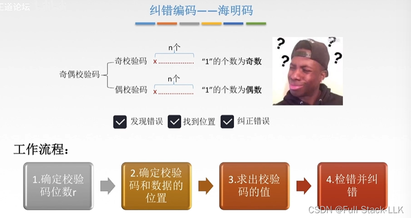
## 海明距离
如果找到码距为 1，那它就一定是 1，因为码距取的是最小值。
码集的码距从 1 开始依次递增查找。

要检测 d 位错误，需要码距为 d+1。
要纠正 d 位错误，需要码距为 2d+1。

要具备检测 d 位错误的能力，码距至少为 d+1。这是因为如果码距为 d+1，那么任何 d 位错误都会使码字从一个合法码字变成非法码字，而不会与其他任何合法码字重合。这样，接收方只需检查码字是否为合法码字就能发现错误。如果码距小于 d+1，则可能存在两个合法码字，它们的海明距离小于或等于 d，这意味着 d 位错误有可能把一个码字变成另一个合法码字，导致错误无法被检测出来。

要具备纠正 d 位错误的能力，码距至少为 2d+1。这是因为要纠错，接收方不仅需要能检测到错误，还需要能确定错误发生的具体位置。如果码距为 2d+1，那么即使发生了 d 位错误，出错的码字与所有合法码字之间的最小海明距离也至少为 d+1，这意味着接收方可以通过比较收到的码字与所有合法码字之间的海明距离，来判定最有可能的原始码字。如果码距小于 2d+1，则可能存在多个合法码字与出错码字的海明距离相同，导致无法准确判定原始码字。
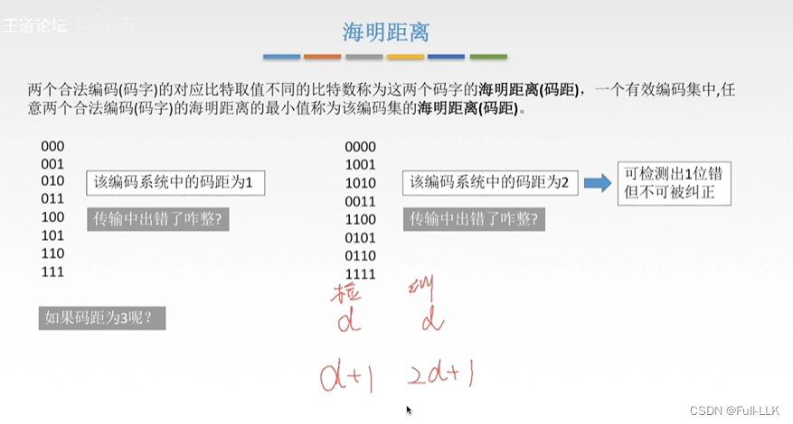

### 1. 确定校验位数 r
根据公式确定 r。
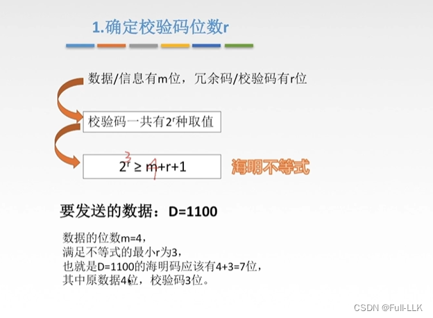
### 2. 确定校验码和数据的位置
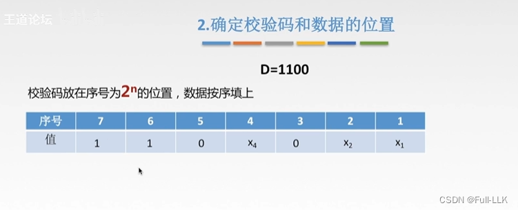
### 3. 求出校验码的值
通常采用偶校验，也可以采用奇校验。
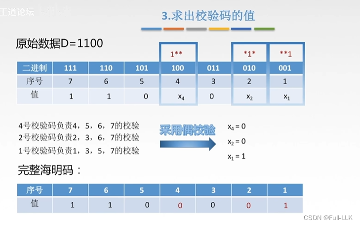
### 4. 检错并纠错
#### 纠错方法一
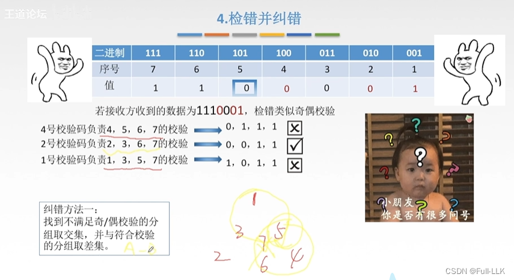
三个大圆分别对应 1、2、4 号校验码，重叠部分是它们各自的交集。正确的部分——2 号校验码覆盖第 2、3、6、7 位，没有问题；出错的 1 号和 4 号校验码的公共部分，即第 5、7 位，必有问题，而 7 没问题（2 号校验码覆盖第 2、3、6、7 位，都正常），所以问题出在第 5 位。
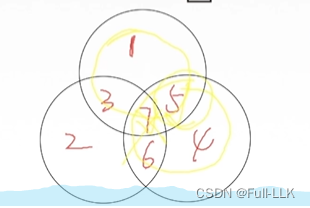
#### 纠错方法二
把各校验组两两异或，得到错误位置的二进制编码，再把这个二进制编码转换成十进制数，就是错误所在的位置。
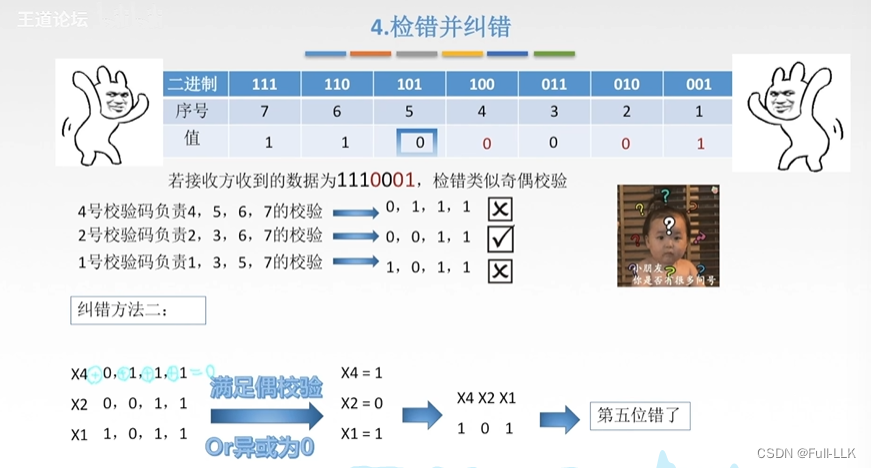
## 总结
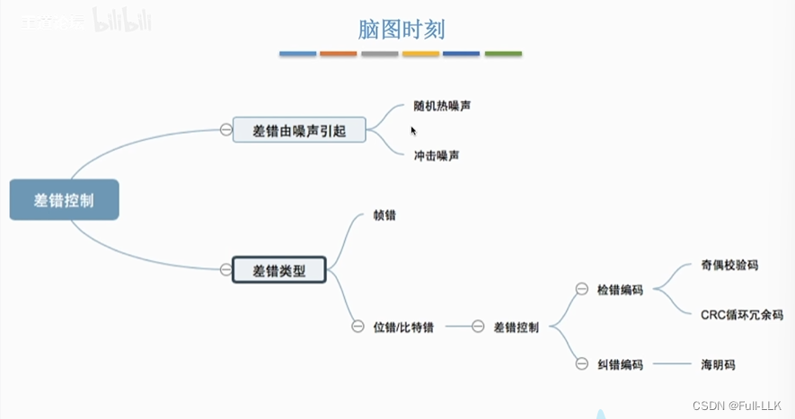


# 计算机网络 - 差错控制（奇偶校验码、CRC 循环冗余码）


## 差错从何而来
- 噪声通常指任何意外的、随机的信号干扰，可能来自多种物理源，比如电子设备中的热噪声、无线信号受到的环境干扰等

不同的链路采用不同的链路层服务
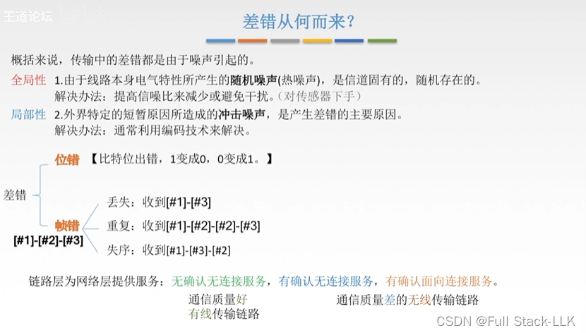

### 一个在传感器层面提升信噪比以降低线路自身随机噪声的例子

在通信系统中，信号在通过信道传输时会衰减，信道上的干扰和噪声也会影响信号，造成信号失真。为了确保信号到达接收端时能够正确解码而不出现太多错误，需要采取措施提升信噪比。具体如下：

改进传输手段：例如用光缆或同轴电缆代替传统的铜缆，因为这些介质提供更高的传输质量，能有效降低传输过程中的信号损耗和外部电磁干扰

增强设备能力：例如在传感器输出端使用低噪声放大器（LNA）来增强信号强度，或者在信号处理阶段使用数字滤波器去除噪声，从而提升信号的质量
### 热噪声与脉冲噪声
脉冲噪声和热噪声是两种不同的干扰，各有各自的特点和解决办法。具体如下：

- 脉冲噪声：

特点：脉冲噪声通常是由外部因素引起的突发干扰，可能是电磁干扰或电源开关的瞬态变化导致的。它的幅度相对较大，可能导致数据传输中多个相邻比特同时出错

解决办法：要解决脉冲噪声的问题，可以使用纠错编码技术，比如奇偶校验码、循环冗余校验（CRC），或者更复杂的前向纠错（FEC）编码。这些编码可以在接收端检测并纠正由脉冲噪声引起的突发错误
- 热噪声：

特点：热噪声又称白噪声，是由导体中电子的热运动引起的，存在于所有电子设备和传输介质中。它是温度变化的结果，但不受频率变化的影响。热噪声无法消除，是通信系统中不可避免的一部分

解决办法：虽然热噪声无法完全消除，但可以通过提高信噪比（SNR）来降低它的影响。可以通过使用低噪声放大器（LNA）、高质量的电缆和连接器，以及在信号处理中使用滤波器来实现。此外，提高信号的传输功率在一定程度上也能抵消热噪声的影响
## 数据链路层的差错控制
 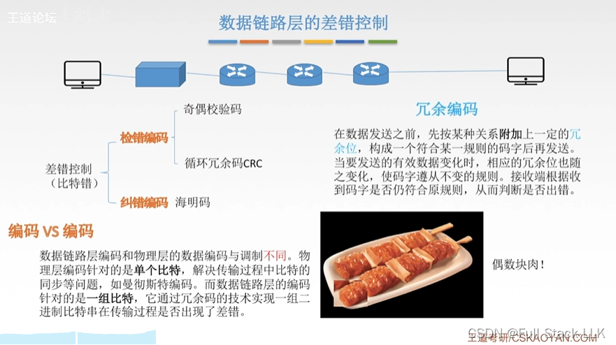
### 检错码——奇偶校验码
添加校验位；它是 0 还是 1，取决于使用的是奇校验还是偶校验
奇校验：1 的个数为奇数时正确
偶校验：1 的个数为偶数时正确

如果检测到的 1 的个数是奇数，仍然可能丢失了偶数个 1。所以准确率只有一半
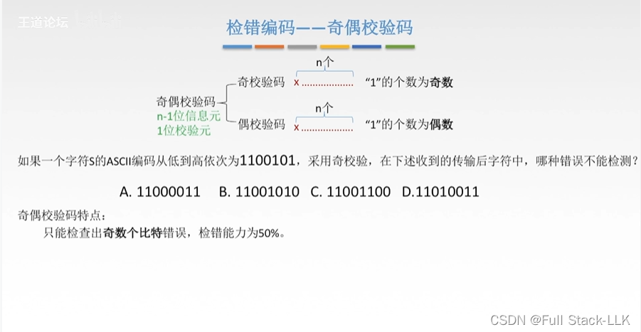
### 检错码——CRC 循环冗余码
会给出生成多项式；注意先计算出 r 位的校验序列，再把它附加到原始数据后面
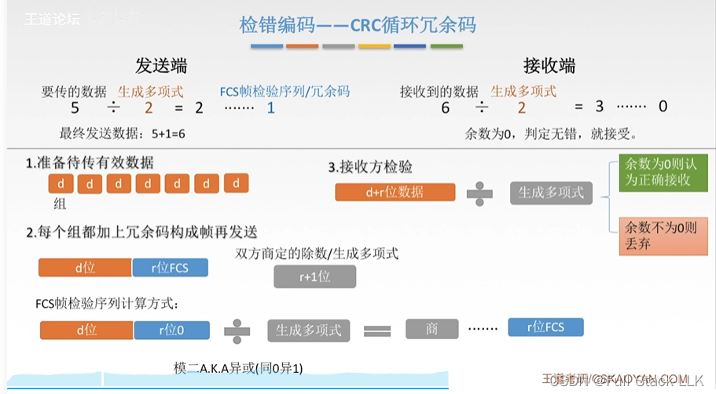
### 例题
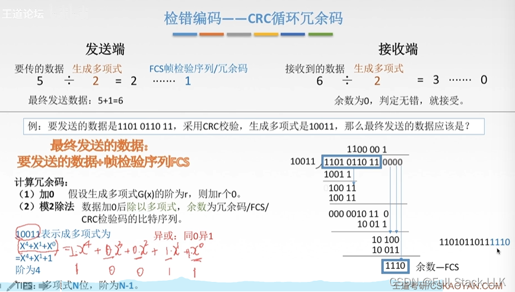

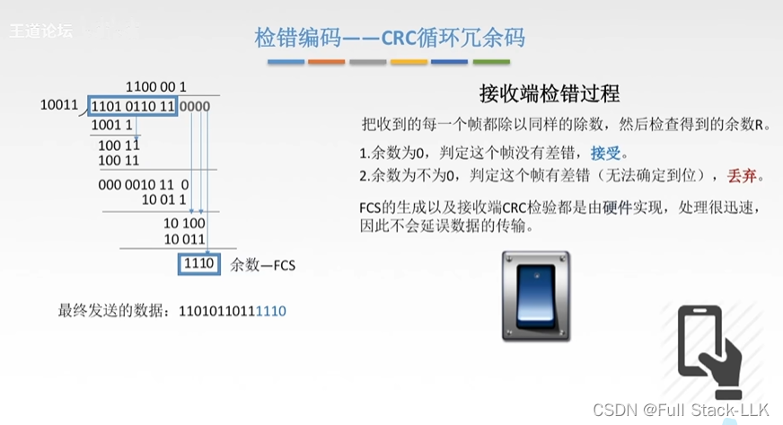
### 说明
数据链路层在接收端收到的所有帧都是无差错的，这个说法大体上是对的：这里的“接收”具有“最终被接受”的含义，因为有差错的帧不会被最终接受。但要注意，余数对应的比特也可能恰好相同，所以即便看起来无差错，仍然有可能存在错误；但由于概率很小，所以认为是无差错的

CRC 校验实现的是比特无差错（不是百分之百），但不能保证不丢帧或不重复。所以并不是发了什么就一定能收到什么，它不是可靠传输
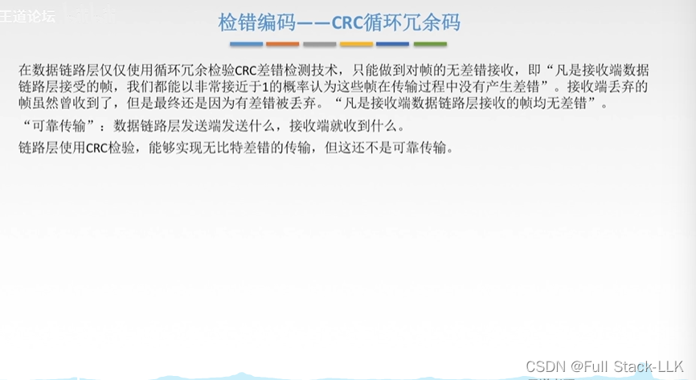

