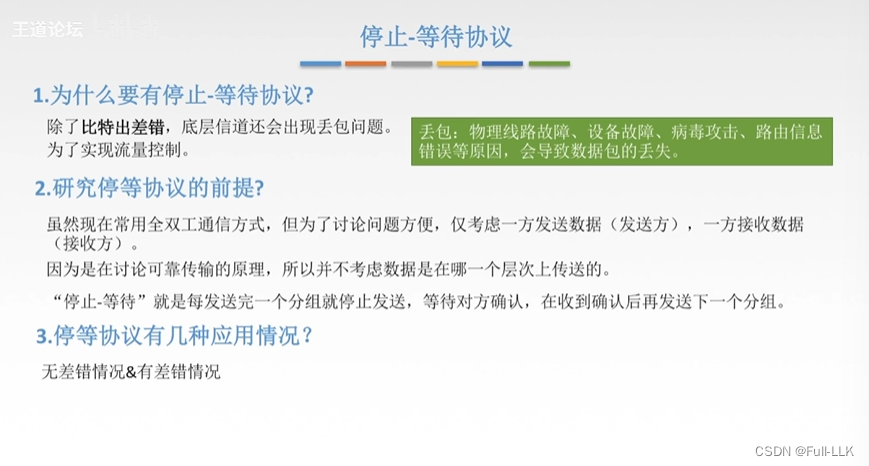
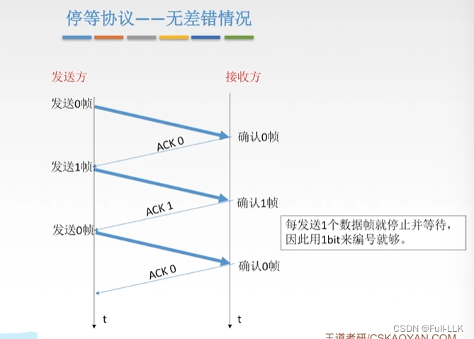
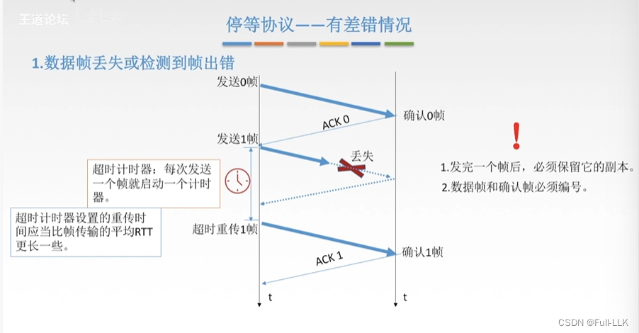
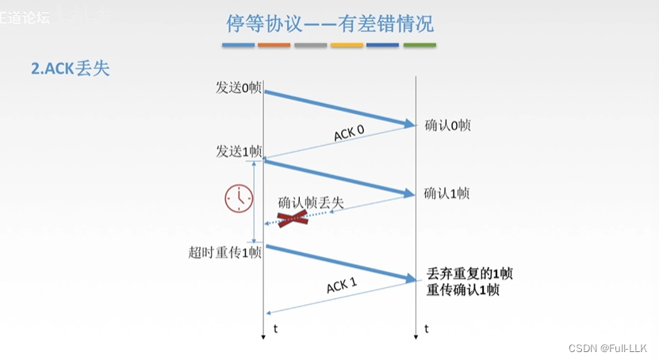
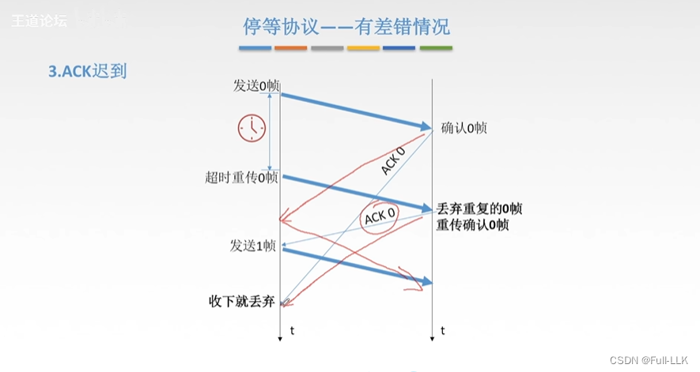
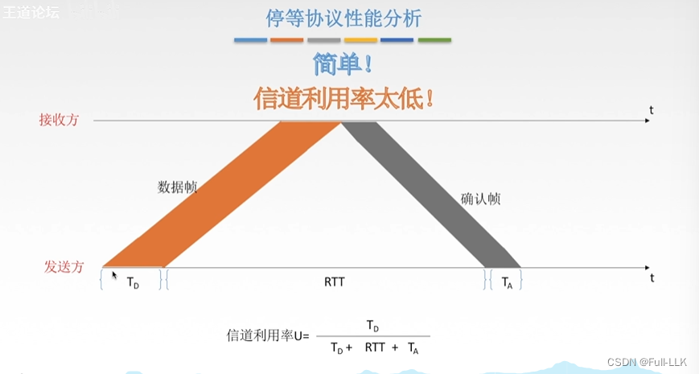
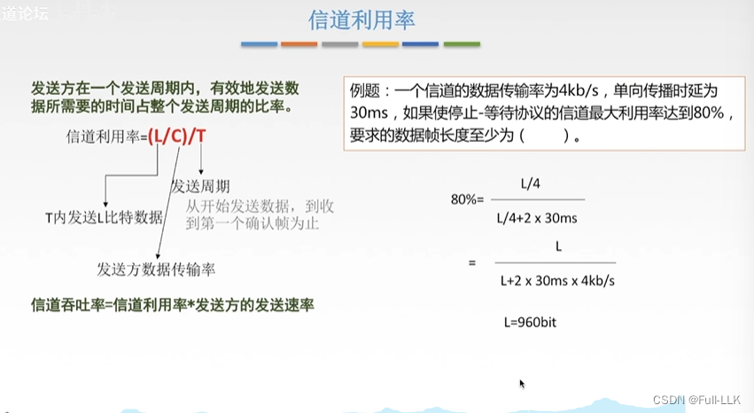
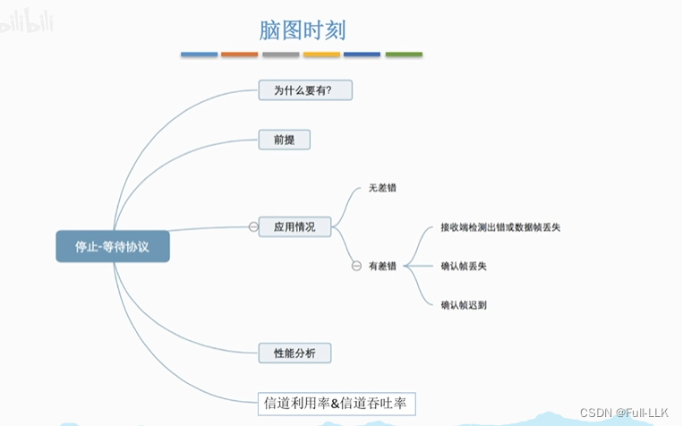


# 停止等待协议属于哪一层？
停止等待协议是一种数据链路层协议。

停止等待协议是数据通信中的一种基础协议，属于 OSI 模型的第二层——数据链路层。该协议的主要特点是简单但效率低，因为它要求发送方每发送一个数据包后就停下来，等待接收方的确认。只有收到确认后，发送方才能继续发送下一个数据包。如果传输过程中出现差错或丢失，发送方会重传同一个数据包，直到收到确认为止。

> 过去网络质量较差，因此链路层需要使用停止等待协议来保证数据的可靠性
如今随着网络质量的提高，链路层负责差错控制，使数据传输更快、出错更少，而由传输层负责可靠传输
# 起源、前提与应用

# 停止等待协议 - 无差错情况
0 和 1 只是序号；编号相同的帧不一定是同一个帧
ACK 0：帧 0 的确认帧

## 编号
在停止等待协议中，帧的编号范围通常是 0 和 1。

停止等待协议是一种基本的数据链路层协议，它使用帧编号来区分不同的数据帧，并保证数据的有序传输。在该协议中，帧编号通常只需要 1 位，也就是说编号范围是 0 和 1。这样的设计足以满足停止等待协议的基本需求，因为该协议的核心在于确认机制，而不在于能够处理大量的帧编号。
# 停止等待协议 - 有差错情况
## 数据帧丢失或检测出错
如果在收到确认帧之前超时计时器就到期了，发送方会在计时器到期后重传该帧（自动重传）

RTT：往返传播时延（从发送到收到确认所经历的时间）

超时计时器所设置的重传时间应当大于帧传输的平均 RTT。原因：这样可以确保在确认帧即将到达时，发送方不会重传

保留一个副本（帧的拷贝）便于重传
只有在收到确认之后，发送方才能丢弃刚刚发送的那个帧的副本

- 编号：解决帧丢失和帧重复的问题
- 帧丢失：发送方发送一个帧之后，等待接收方的确认。如果确认丢失，发送方会在超时后重传同一个帧。由于每个帧都有编号，接收方可以识别出重复帧，将其丢弃，并发送新的确认来告知发送方之前的数据已经收到。
- 帧重复：如果确认迟到，发送方可能会误以为前一个帧没有发送成功，于是再次发送同一个帧。这时，接收方通过帧编号识别出它是重复帧，将其丢弃，并再次发送确认。

帧出错：接收方检测到差错后丢弃该帧，并且不返回确认

## ACK 丢失
被丢弃的重复帧是第二次发送的那个帧

## ACK 迟到
被丢弃的重复帧是第二次发送的那个帧

如果迟到的 ACK 0 在帧 1 发出之后才到达发送方，此时发送方已经收到过 ACK 0，正在等待 ACK 1，因此会丢弃迟到的 ACK 0

如果迟到的 ACK 0 在发送方超时重传之后才到达，就说明帧 0 已经完成，发送方开始发送帧 1。接收方再次收到重传的帧 0 时，会重发 ACK 0；发送方在发出帧 1 之后再次收到 ACK 0 时，由于已经收到过 ACK 0，就会将其丢弃

# 停止等待协议的性能分析
确认帧：只包含控制信息而不包含数据，因此比数据帧短

T0：发送方从把第一个比特放到链路上，到把最后一个比特放到链路上所经历的时延（发送时延）

数据放到链路上之后，接下来是它在链路上传播所花的时间

发送周期：从发送第一个比特的那一刻起，直到发送方收到确认帧的最后一个比特为止

## 信道利用率
 
# 总结


